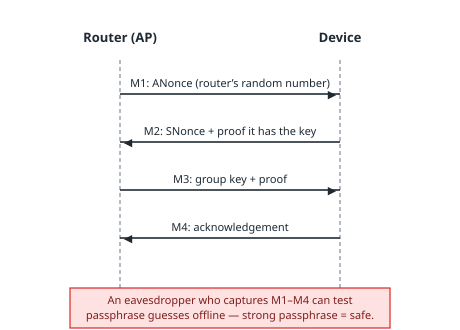

# Wi-Fi Security Testing

**This is testing whether your own Wi-Fi would hold up against an attacker — by being that attacker, against your own router and no one else's.**

## Before you start
<!-- bite: f50a96aa-b2e6-426c-b457-7dbddc7ead77 -->

You should have:

- A Wi-Fi adapter that supports monitor mode (most built-in chips don't) → [[cybersecurity/02-ethical-hacking/04-lab-setup-and-os-choice|the adapter gotcha]].
- Met offline hash cracking → [[cybersecurity/02-ethical-hacking/10-pdf-and-document-security|PDF and document security]].
- **Your own router and devices.** Everything here is your network. The moment a network isn't yours, this is the [[cybersecurity/02-ethical-hacking/01-rules-of-engagement-and-legal|authorization question]], and the answer is no.

After this lesson you will be able to:

1. Explain the WPA2 4-way handshake and why capturing it enables an offline attack.
2. Capture a handshake from your own network and crack the passphrase offline.
3. Say why only weak passphrases fall, and why WPS can bypass a strong one.
4. Harden your own Wi-Fi against exactly this attack.

**Study route.** Kid version, §1–5, the worked example (capture and crack your own handshake), then the practice task — your router only.

## What Wi-Fi security testing is

You capture the login exchange off the air, then try to crack the passphrase offline. It's the same offline-cracking pattern as [[cybersecurity/02-ethical-hacking/10-pdf-and-document-security|PDF cracking]], applied to wireless — and because the network is yours, it needs no authorization paperwork at all.

## The kid version
<!-- bite: 53d9858d-470d-40e4-8dd2-df9f4c6bf8ee -->

When your phone joins your home Wi-Fi, it and the router do a quick secret handshake — four quick messages that prove to each other they both know the Wi-Fi password, *without ever saying the password out loud*. Anyone nearby with the right radio can overhear those four messages. Overhearing them doesn't tell them the password — but it gives them a sealed box that only the real password can open, which they can then take home and try keys on forever.

So the attack isn't "guess the password at the router" (which would be slow and noisy). It's "record the handshake once, then guess at home, offline, as fast as a computer can." If your password is a common word, they open the box quickly. If it's long and random, they never do.

**Where the analogy stops working.** A real overheard conversation happens only when someone speaks. Here, if no device is joining, an attacker can *force* one off the network so it reconnects and hands over a fresh handshake — the deauth trick in §2. So they don't even have to wait.

## 1. The WPA2 4-way handshake
<!-- bite: 34541a48-9a3c-4c7f-af6b-e41fe05f3f21 -->

WPA2-Personal (the common home standard) proves a device knows the passphrase using a **4-way handshake**: four messages between router and device that let both sides independently build the same session key, without the passphrase ever crossing the air.



The catch: those four messages are visible to **anyone listening on the same channel**. Capturing them doesn't hand over the passphrase — but it hands over enough to **test guesses against, offline**, without ever touching the network again. That "sealed box you try keys on at home" is the whole basis of the attack, and §2 is how you capture it.

## Terms used in this lesson
<!-- bite: 4ada98ce-17cd-4798-8bc2-e609176e0f14 -->

1. **WPA2 / WPA3**: These are Wi-Fi security standards. WPA2 is common; WPA3 is newer and resists this attack structurally.
2. **4-way handshake**: This is the four-message exchange that proves a device knows the passphrase when it joins a WPA2 network.
3. **Monitor mode**: This is a Wi-Fi adapter mode that captures *all* traffic on a channel, not just traffic addressed to you. Needed to overhear a handshake.
4. **Deauthentication (deauth) frame**: This is a message that kicks a device off the network. It reconnects automatically, producing a fresh handshake to capture.
5. **BSSID**: This is the router's unique Wi-Fi hardware address, identifying which network you're capturing.
6. **PSK (pre-shared key)**: This is the Wi-Fi passphrase everyone on the network shares.
7. **WPS**: This is Wi-Fi Protected Setup, an 8-digit-PIN shortcut for joining, with a well-known design flaw.
8. **SAE (Simultaneous Authentication of Equals)**: This is WPA3's replacement for the 4-way handshake, designed to defeat offline guessing.

## 2. The methodology
<!-- bite: f5fcc2cc-795a-4853-9299-1b4f8d473488 -->

Three steps, all against your own network:

1. **Monitor mode** — put your adapter into capture-everything mode:
   ```bash
   airmon-ng start wlan0        # creates wlan0mon
   ```
2. **Capture the handshake** — listen for a device joining your router. If none is joining, send a **deauth** frame to a connected device of yours to force a reconnect:
   ```bash
   airodump-ng wlan0mon                               # find your router's BSSID + channel
   aireplay-ng --deauth 5 -a <your-router-bssid> wlan0mon   # force one of your devices to reconnect
   ```
3. **Crack it offline** — dictionary or mask attack against the captured handshake, with aircrack-ng or (far faster on a GPU) hashcat:
   ```bash
   aircrack-ng -w rockyou.txt capture.cap             # or: hashcat -m 22000 capture.hc22000 rockyou.txt
   ```

`wifite` automates the whole sequence into one guided tool — the common way to test your own network end to end without driving each step by hand.

## 3. Why only weak passphrases fall
<!-- bite: ae8f2018-30a7-486b-b709-bb838d05ae21 -->

The crack tries candidate passphrases and checks each against the captured handshake. It succeeds **only if the real passphrase is in the wordlist or matches the pattern tried.** A long, random, high-entropy passphrase — 16+ characters, not a dictionary word, not `name + year` — is not practically crackable this way on current hardware.

That's the actionable takeaway: **this whole attack class tests one thing — passphrase strength.** If a crack against your own network succeeds quickly, the passphrase is the fix. Same lesson as the PDF: strong encryption (WPA2/WPA3 both use strong crypto) plus a weak human-chosen secret equals no protection. The crypto isn't the weak point; the password is.

## 4. WPS — a shortcut around a strong passphrase
<!-- bite: 72906111-f0f8-4a14-9dce-71b794e96f77 -->

Here's the catch that makes a strong passphrase not enough on its own. **WPS** lets a device join with an 8-digit PIN instead of the passphrase. Its PIN is validated in two short halves, so instead of 100 million possibilities it's effectively a few thousand — brute-forceable online (**reaver**, **bully**) in hours, or instantly on some routers via a "Pixie Dust" flaw in weak PIN generation. Crucially, **WPS bypasses the passphrase entirely** — crack the PIN and the length of your passphrase never mattered.

So **disabling WPS is one of the highest-value fixes on almost any home router**, no matter how strong the passphrase. It's the wireless version of "you locked the front door but left a keypad with a 4-digit code next to it."

## 5. WPA3, and hardening your own network
<!-- bite: dcc726bc-2bba-4d71-a326-0e34353a04aa -->

**WPA3** replaces the 4-way handshake with **SAE**, which is specifically designed to resist offline dictionary attacks — capturing a WPA3 exchange doesn't give an attacker a box they can try keys on at home the way WPA2 does. If your router and devices support it, enabling WPA3 is a more *structural* fix than passphrase strength alone.

Your own-network checklist, every item justified by the attack above:

1. **WPA3** if everything supports it; otherwise **WPA2 with a long, random passphrase** (defeats §3's crack).
2. **Disable WPS** entirely (closes §4's bypass).
3. **MAC filtering and hiding your SSID are not real security** — both are trivially bypassed by anyone monitoring traffic, and add hassle without raising attacker cost.
4. **Keep router firmware updated** — router-specific bugs, not just protocol ones, are a common real entry point.

## Worked example — capture and crack your own handshake
<!-- bite: 15d87de0-fb53-495e-ae10-f55a31bcf232 -->

The full pipeline against **your own router**, proving it works before you'd ever trust it against an unknown-strength passphrase. First, temporarily set your own router's passphrase to a weak one that's in `rockyou.txt` (e.g. `password123`) so the crack is guaranteed — this proves your pipeline, exactly like the weak-PDF step in lesson 10.

```bash
# 1. Monitor mode
sudo airmon-ng start wlan0

# 2. Find your router (note its BSSID and channel), then capture on that channel
sudo airodump-ng wlan0mon
sudo airodump-ng --bssid <your-bssid> -c <channel> -w capture wlan0mon

# 3. In a second terminal, force one of YOUR devices to reconnect (produces a handshake)
sudo aireplay-ng --deauth 5 -a <your-bssid> wlan0mon
#    airodump shows "WPA handshake: <bssid>" top-right when captured

# 4. Crack offline with a wordlist you know contains the passphrase
aircrack-ng -w /usr/share/wordlists/rockyou.txt capture-01.cap
#    -> KEY FOUND! [ password123 ]
```

## Worked example: what the Wi-Fi crack proves

The pipeline worked; now flip it to the defender's side.

**What this proves, and the defensive half.** The handshake capture + offline crack works, and `password123` falls in seconds because it's in the wordlist. Now **set your router back to a long random passphrase** and rerun the crack: the same pipeline runs and never finds it. Same attack, opposite result — passphrase strength is the entire difference. (And remember: the deauth in step 3 briefly knocks *all* your devices off, including the one you're reading this on.)

## Common pitfalls and traps
<!-- bite: 4074fcd6-b75d-43f8-8090-c43ee52adc93 -->

1. **Testing a network that isn't yours.** Capturing handshakes or sending deauths against a neighbour's network — even "just to see" — is unauthorized access to a communications system in most countries. Not grey. Your router only.
2. **A deauth hits everyone.** It briefly disconnects *every* device on the network, including your own and family members'. Expect the disruption even on your own network.
3. **Expecting a strong passphrase to crack.** It won't. A quick failure against a long random passphrase is the system working — a finding of good protection, not a tool problem.
4. **Forgetting WPS.** A strong passphrase with WPS enabled is still weak. Check WPS status explicitly.
5. **Wrong adapter.** Most built-in Wi-Fi chips can't do monitor mode or injection; you need a compatible external adapter → [[cybersecurity/02-ethical-hacking/04-lab-setup-and-os-choice|lesson 04]].

## Check your understanding
<!-- bite: 5f6810b7-b914-432a-8130-2bb889399bc0 -->

Try each one before you open the answer.

1. <!-- q: mcq id="85dd20c1" -->
   Capturing a WPA2 4-way handshake off the air gives an attacker what, exactly?

   - [ ] The passphrase, sent in one of the four messages.
   - [x] Enough information to test passphrase guesses offline, without touching the network again.
   - [ ] A live session key they can use immediately to join.
   - [ ] Nothing useful — the handshake is encrypted end to end.

   <details><summary>Answer</summary>

   The passphrase never crosses the air; the handshake proves knowledge of it without sending it. But the captured messages let an attacker check guesses against them offline — the "sealed box you try keys on at home." That's why the attack is an offline dictionary/mask attack, and why passphrase strength is what protects you.

   </details>

2. <!-- q: mcq id="a3730ed1" -->
   During testing of your own network, no device is joining, so no handshake appears. What does an attacker (or you) do to get one without waiting?

   - [ ] Guess the passphrase at the router directly.
   - [x] Send a deauthentication frame to force a connected device to reconnect, producing a fresh handshake.
   - [ ] Disable WPA2 on the router.
   - [ ] Switch the adapter out of monitor mode.

   <details><summary>Answer</summary>

   A deauth frame kicks a device off; it reconnects automatically and performs a fresh 4-way handshake you can capture. Note it briefly disconnects every device on the network — plan for that even on your own. Guessing at the router is the slow, online approach the offline attack avoids.

   </details>

3. <!-- q: gap id="927263b9" answers="WPS" -->
   A strong, long Wi-Fi passphrase can still be bypassed if ___ is enabled, because its 8-digit PIN is validated in two short halves and brute-forced in hours (or instantly via Pixie Dust). Disabling it is a top home-router fix.

   <details><summary>Answer</summary>

   WPS (Wi-Fi Protected Setup). It lets a device join with a PIN instead of the passphrase, and the PIN's weak structure means cracking it bypasses passphrase strength entirely — so disable it regardless of how strong your passphrase is.

   </details>

4. <!-- q: mcq id="122a5459" -->
   Your offline crack against your own network's captured handshake fails after exhausting rockyou.txt and a long mask run. What's the correct conclusion?

   - [ ] The capture was invalid.
   - [ ] WPA2 is unbreakable.
   - [x] The passphrase is strong enough to resist this attack — which is the protection working.
   - [ ] You need a bigger GPU.

   <details><summary>Answer</summary>

   A high-entropy passphrase not in any wordlist and not matching your masks is not practically crackable this way — the failure is the defence succeeding. This whole attack class only beats guessable passphrases, so a clean failure against a strong one is good news, and the actionable takeaway is "keep that passphrase."

   </details>

5. <!-- q: open id="bf7c0ba5" -->
   Someone says "I hid my SSID and turned on MAC filtering, so my Wi-Fi is secure." Explain why neither meaningfully stops the attack in this lesson, and what actually would.

   <details><summary>Answer</summary>

   Both are trivially bypassed by anyone monitoring traffic: a hidden SSID is still broadcast by connecting devices and visible to a monitor-mode listener, and allowed MAC addresses are visible in captured frames and can be spoofed. Neither affects the handshake capture or the offline crack at all. What actually raises attacker cost is a long, random passphrase (defeats the offline crack), disabling WPS (closes the PIN bypass), WPA3 if supported (resists offline guessing structurally), and updated firmware. MAC filtering and SSID hiding add inconvenience without real security.

   </details>

## Practice — test your own Wi-Fi
<!-- bite: b5dc7eac-ff23-4bdd-be89-55a47ad2425a -->

**Task.** Prove the pipeline, then prove the defence — on your own router only.

1. Temporarily set your router's passphrase to a weak one that's in `rockyou.txt`.
2. Put your adapter in monitor mode, capture a handshake (deauth one of your own devices if needed), and crack it. Confirm the recovered key matches.
3. Set the passphrase back to a long random one and rerun the crack; confirm it doesn't finish.
4. Check your router's settings: is WPS enabled? Note yes/no and the risk.

**Done when:** you've cracked the weak passphrase, failed against the strong one, and recorded your WPS status with its implication. Restore your real passphrase afterward. Log it in `cybersecurity/LIVE-RUNS-TODO.md`. **Only your network — never a neighbour's.**

**Stretch.** If your router supports WPA3, enable it and note what changes about the capture (you won't get a crackable offline handshake the same way).

## Before moving on
<!-- bite: c0e1e7ae-82fb-41eb-9f32-088b53ede818 -->

You can now test your own Wi-Fi the way an attacker would: explain the 4-way handshake, capture it (forcing one with a deauth if needed), crack it offline, and you've proven on your own network that passphrase strength is the whole game. You know WPS can bypass a strong passphrase, and how to harden your network against all of it.

**Recap for later lookup:** WPA2 4-way handshake is capturable; capturing enables an *offline* dictionary/mask crack (aircrack-ng / hashcat `-m 22000`), which only beats weak passphrases. Monitor mode + deauth to capture. Disable WPS (PIN bypass). Prefer WPA3 (SAE resists offline attack). SSID hiding and MAC filtering aren't real security.

Next: [[cybersecurity/02-ethical-hacking/12-practice-exercises|practice exercises]] — goal-only drills that put the whole section to the test against your lab.

## Related
<!-- bite: c0e1e7ae-82fb-41eb-9f32-088b53ede819 -->

- [[cybersecurity/02-ethical-hacking/10-pdf-and-document-security|PDF and document security]] — the same offline-cracking pattern on a file.
- [[cybersecurity/02-ethical-hacking/04-lab-setup-and-os-choice|Lab setup and OS choice]] — the monitor-mode adapter you need.
- [[cybersecurity/02-ethical-hacking/08-common-tools|Common tools]] — aircrack-ng, wifite, hashcat.

## About this lesson
<!-- bite: 0213564d-f5b6-40b1-b635-54feadbbbdb3 -->

**Level:** Advanced. **Covers:** the WPA2 4-way handshake, monitor mode and handshake capture (with deauth), offline cracking and why only weak passphrases fall, the WPS bypass, WPA3/SAE, and hardening your own network. **Where it sits:** lesson 11 of the [[cybersecurity/02-ethical-hacking/index|Ethical Hacking]] section — an owned-network wireless lab. **Sources:** the original vault note, made hands-on with a capture-then-crack worked example against your own router. `[reference]` — not drawn from a personal paid engagement. Commands are tracked in `cybersecurity/LIVE-RUNS-TODO.md` for a verified run.
