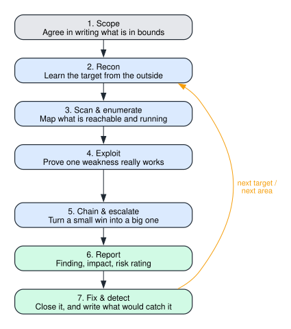

# Ethical Hacking

**Ethical hacking is attacking computer systems on purpose — with permission — to find the weaknesses before a criminal does.** It's the same skill a criminal uses, pointed at a target you're allowed to break, so the weaknesses get fixed instead of exploited.

This section teaches it as a job you could actually do, by running one real engagement from start to finish. Everything you attack is something **you own**, so you stay completely legal while learning the real thing.

## What you'll be able to do

By the end of this section you will be able to:

- rent a server, deploy a real application to it, and attack it the way a professional would;
- run the full loop — scope it, learn it from outside, map it, break one thing, turn that into more, then **write it up, fix it, and write the detection that would have caught you**;
- crack a PDF you locked and recover passwords from a database of dummy accounts you seeded;
- produce the one deliverable the job is actually judged on: a clear findings report.

That last loop is what separates senior from junior. A beginner stops at "I got in." A senior hands over the proof, the business impact, the risk rating, the fix, and the detection. This section drills that loop, not just the break-in.

## The owned-target model — how you stay legal

You never touch anyone else's systems. Your targets are all yours, and they come in three tiers you climb as you go:

1. **The teaching target, runnable today: OWASP Juice Shop.** A modern web app you start with one Docker command on your own laptop — no server, no cost. It's built to be broken into for practice, so every worked example in these lessons runs against it with a known result. It's yours: your container, your machine.
2. **The real target, when you're ready: a production-grade app on your own VPS.** A virtual private server (a Linux box you rent by the month) with a genuine open-source app — something people actually run in production — cloned onto it. Each lesson's practice task is "now do it for real against this." Renting the box makes it yours to attack.
3. **Your own things:** a small app you wrote, a PDF you locked yourself, and a database of dummy people you seeded. These power the app-sec, document-cracking and password-cracking labs.

Nothing real belongs to anyone else. It's all practice — but it teaches exactly what the real job needs. [[cybersecurity/02-ethical-hacking/01-rules-of-engagement-and-legal|Lesson 01]] makes the legal rule exact, and you shouldn't run a single command before reading it.

## The engagement loop

Every pentest lesson is one stage of the same loop. You'll run it over and over, each time against a new part of the target:

Scope it in writing, learn it from the outside, map what's reachable, prove one weakness really works, turn a small win into a bigger one, then report, fix and detect — and go round again for the next area. Hold this loop in your head and every lesson below has an obvious place.

## Reading order

Read 01 first — always. After that the lessons follow the loop.

1. [[cybersecurity/02-ethical-hacking/01-rules-of-engagement-and-legal|01 — Rules of Engagement and the Law]] — **[Beginner]** — the one thing that makes this legal instead of a crime. Read it before anything else, not after.
2. [[cybersecurity/02-ethical-hacking/02-penetration-testing-methodology|02 — Penetration Testing Methodology]] — **[Beginner]** — the engagement loop above, in full: the phases every test moves through.
3. [[cybersecurity/02-ethical-hacking/03-reconnaissance|03 — Reconnaissance]] — **[Beginner]** — learning your target from the outside, passively and then actively (OSINT).
4. [[cybersecurity/02-ethical-hacking/04-lab-setup-and-os-choice|04 — Lab Setup and OS Choice]] — **[Beginner]** — Kali versus a plain Linux box, VM versus the VPS, and the Wi-Fi-adapter gotcha.
5. [[cybersecurity/02-ethical-hacking/05-home-lab-setup|05 — Home Lab Setup]] — **[Beginner]** — the concrete build: your VPS, the app you'll attack, and the snapshot habit, ready to attack tonight.
6. [[cybersecurity/02-ethical-hacking/06-scanning-and-enumeration|06 — Scanning and Enumeration]] — **[Intermediate]** — mapping exactly what's reachable and running on your target, and what it reveals about itself.
7. [[cybersecurity/02-ethical-hacking/07-exploitation-concepts|07 — Exploitation Concepts]] — **[Intermediate]** — the major weakness classes and why each one works, proven on your owned target.
8. [[cybersecurity/02-ethical-hacking/08-common-tools|08 — Common Tools]] — **[Intermediate]** — the standard toolkit (Nmap, Burp Suite, Metasploit) and where to practise legally beyond your own box.
9. [[cybersecurity/02-ethical-hacking/09-post-exploitation-and-reporting|09 — Post-Exploitation and Reporting]] — **[Intermediate]** — proving real impact, and the findings report that actually gets things fixed. **The deliverable.**
10. [[cybersecurity/02-ethical-hacking/10-pdf-and-document-security|10 — PDF and Document Security]] — **[Intermediate]** — lock a PDF yourself, then crack it: offline password cracking on a file you own.
11. [[cybersecurity/02-ethical-hacking/11-wifi-security-testing|11 — Wi-Fi Security Testing]] — **[Advanced]** — cracking WPA2/WPA3, against your own access point and no one else's.
12. [[cybersecurity/02-ethical-hacking/12-practice-exercises|12 — Practice Exercises]] — **[Intermediate]** — goal-only drills against your lab. This is the one that tests whether the rest became a skill.
13. [[cybersecurity/02-ethical-hacking/13-practice-exercises-solutions|13 — Practice Exercise Solutions]] — **[Intermediate]** — worked solutions. Attempt each drill first, then check here.
14. [[cybersecurity/02-ethical-hacking/14-career-path-and-best-practices|14 — Career Path and Best Practices]] — **[Intermediate]** — the climb to senior, certifications, and what actually separates senior from junior.

## Related

- [[cybersecurity/index|The cybersecurity course]] — the whole map.
- [[cybersecurity/01-fundamentals/03-attacker-and-hacker-types|Attacker and hacker types]] — why the white/grey/black-hat line is authorization, not skill.
- [[cybersecurity/projects|Cybersecurity projects]] — where to put in the hours after these lessons.

## About this section

**How it's built:** one engagement against targets the learner owns (a VPS, a cloned production app, a locked PDF, a seeded database), run through the seven-stage loop above. Lessons 01–02 set the rules and the shape; 03–08 run recon through exploitation; 09 is the report; 10–11 are owned-target offline and wireless labs; 12–14 are practice and career. Being rebuilt to the [[COURSE-STANDARD|course standard]]; 01–09 are converted (the full scope→report arc), 10–14 in progress. Live runs of the commands are tracked in `cybersecurity/LIVE-RUNS-TODO.md`.
