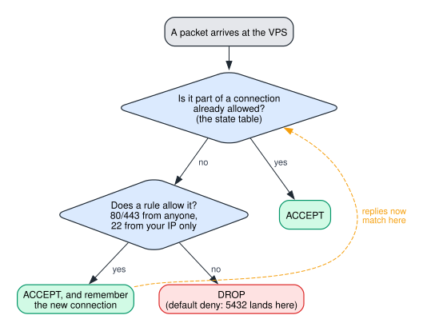

# Firewalls

**A firewall is a set of rules that decides which network traffic may reach a machine and which is thrown away.**

## Before you start
<!-- bite: 13ed3fab-da69-4274-a756-1118ae2c2065 -->

You should have:

- Scanned your own VPS with `nmap -sV` → [[cybersecurity/02-ethical-hacking/06-scanning-and-enumeration|scanning and enumeration]]. This lesson closes the doors that scan found.
- Said what a port and an IP address are → [[networking/05-udp-and-ports|UDP and ports]].
- SSH access to your VPS, and the provider's web console open in a tab (your way back in if a rule locks you out).

After this lesson you will be able to:

1. Explain default deny, and why "block the bad stuff" can never work.
2. Explain what makes a firewall stateful, and why replies get through without their own rule.
3. Write a default-deny firewall for your VPS with `ufw`, and read the `nftables` rules underneath.
4. Prove the firewall works by rescanning, and turn on the log that shows who knocked.

**Study route.** Read the kid version and §1–4, then do the worked example on your VPS. If you don't have a VPS yet, read it through and come back; it's in `cybersecurity/LIVE-RUNS-TODO.md`.

## What a firewall is
<!-- bite: 6b2b420e-9b2e-43ec-9a25-08c728e51309 -->

Remember the scan from the ethical-hacking section? Your VPS answered on four doors: SSH on 22, nginx on 80 and 443, and PostgreSQL on 5432. Three of those you meant to open. The database you didn't. Anyone on the internet could knock on it.

A firewall is how you decide which doors answer. It looks at every packet that arrives, checks it against your rules, and either lets it in or drops it. This whole section is the defender's side of the same VPS you attacked: this lesson closes the doors, and the next three split the box into zones, hide SSH in a tunnel, and catch the next scan.

## The kid version
<!-- bite: 9a7ec479-f531-45ac-bb50-0337d84ba1c3 -->

Think of a gate man at an estate. He has a list: "Visitors for house 3, let them in. Delivery bikes, only to the gatehouse." Anyone not on the list doesn't enter, no matter how nicely they ask. And when a resident drives out and comes back, he waves them in without checking the list again, because he saw them leave.

A firewall is that gate man for a computer. The list is your rules. "Not on the list, not entering" is default deny. Waving back the resident he saw leave is what makes him stateful.

**Where the analogy stops working.** A gate man judges people by their faces. A basic firewall only sees the address on the envelope: where the packet came from and which door it wants. It can't tell a polite visitor from a burglar who knocks on an allowed door. That's why a web attack on port 443 sails through, and why the last section of this lesson and lesson 04 exist.

## 1. Default deny — the only list that works
<!-- bite: 85b7a113-8ca5-429e-aa2c-34f29d8765d4 -->

There are two ways to write the gate man's list. **Default allow**: let everyone in, and list the bad people to stop. **Default deny**: stop everyone, and list the people to let in.

Default allow loses, every time. You can't list every bad thing in advance, because tomorrow's attacker isn't on today's list. And every service you forget about stays open. That forgotten Postgres on 5432? Default allow leaves it answering the whole internet.

Default deny flips it. You only have to list what you *meant* to open, and that's a short list you already know: 80 and 443 for the website, 22 for you. Everything else, including services you didn't know were listening, gets dropped.

So the rule of thumb is simple: **block everything, then open only what you need.** The next question is how the firewall handles the replies to traffic you sent out yourself.

## 2. Stateless versus stateful
<!-- bite: ce78ef6a-f985-4c72-8c62-38f43d6ae6a0 -->

A **stateless** firewall judges each packet alone. It has no memory. That causes a problem: when your VPS downloads an update, the replies come back from the update server to some random high port on your machine. A stateless firewall would need a rule allowing those random ports in from anywhere, which is a big hole.

A **stateful** firewall remembers. It keeps a **state table** of connections that are already allowed. When a packet arrives, it first asks "is this part of a connection I already allowed?" If yes, it's let in. Only new connections go through your rule list.

## 2. Stateless versus stateful: the decision, drawn
<!-- bite: b27ccec0-9f8f-4346-aaad-03d12c13a61a -->

Here is the whole decision for one packet arriving at your VPS.



Follow the dashed orange arrow: once a new connection is accepted, its replies match the state table and skip the rules. Nearly every firewall you'll touch is stateful by default, including Linux's own.

## Terms used in this lesson
<!-- bite: 9bc46ce3-50a0-444a-bf2e-e769386b4d1b -->

1. **Firewall**: This is a set of rules, enforced by software or a device, that decides which network traffic is allowed and which is dropped.
2. **Rule**: This is one line of the firewall's list, like "allow TCP port 443 from anyone". Rules are checked in order, and the first match decides.
3. **Default policy**: This is what happens to a packet that matches no rule. Default deny drops it; default allow lets it through.
4. **Stateful firewall**: This is a firewall that remembers allowed connections in a **state table**, so replies get through without their own rule.
5. **Drop versus reject**: Both block a packet. Drop throws it away silently. Reject sends back a "no" (a TCP reset). Drop gives a scanner less to work with.

## Terms used in this lesson: tools and layers
<!-- bite: f34ad760-ddf4-43b5-977e-a52989729d94 -->

The rest of the terms name the Linux tools and the other kinds of firewall you'll meet.

6. **netfilter**: This is the firewall built into the Linux kernel. Everything below is a way of giving it rules.
7. **nftables**: This is the current tool for writing netfilter rules directly. It replaced the older `iptables`.
8. **UFW (Uncomplicated Firewall)**: The letters stand for those words. It's a simple front end on Ubuntu and Debian that writes the netfilter rules for you.
9. **Host-based firewall**: This is a firewall running on the machine it protects, like UFW on your VPS.
10. **Network firewall**: This is a firewall in front of many machines, like a router's firewall or your cloud provider's firewall, which sits outside your VPS.

## 3. Network and host firewalls — two gates, not one
<!-- bite: 19302bcd-1a74-4472-9aeb-4933ea54e4ed -->

Your VPS can have two gates. Your cloud provider usually offers a **network firewall** (called a cloud firewall or security group) that filters traffic before it ever reaches your box. And the VPS has its own **host-based firewall**, netfilter, which you control with UFW.

Use both. They fail differently. If you fat-finger a UFW rule, the provider's firewall still stands. If you deploy a second server and forget its UFW, the provider's firewall still covers it. And if someone gets onto another machine in the same private network, only the host firewall on *your* box stands between them and your database.

This is **defence in depth**: layers that each catch what the others miss. You'll see the same idea again in lesson 02, where the layers are network zones.

## 4. What a port firewall can't see — NGFW and WAF
<!-- bite: a66fa8fd-74d5-40c1-b5da-aae462bf9ad9 -->

Back to the gate man's weakness: he only reads the envelope. A port firewall allows "anything to 443", so an SQL injection on 443 walks right in. It's a perfectly normal-looking HTTPS connection.

Two kinds of firewall try to read the letter, not just the envelope:

1. **NGFW (next-generation firewall)** — understands which application traffic belongs to, not just the port. It can tell "a web browser on 443" from "a tunnelling tool hiding on 443", and often includes intrusion prevention (lesson 04).
2. **WAF (web application firewall)** — sits in front of one web app and blocks requests that look like attacks, such as `' OR 1=1--` in a login form.

Both help, but neither fixes the bug. A WAF blocks *known-looking* payloads; a cleverly reworded one gets through. The real fix for SQL injection is still the parameterised query from [[cybersecurity/02-ethical-hacking/07-exploitation-concepts|exploitation concepts]]. A WAF buys you time; it doesn't replace the fix.

## Worked example — lock down the VPS with UFW
<!-- bite: 72eafe28-36a5-4e0b-90fa-56386753f5fa -->

Now close the doors on your own VPS (`203.0.113.9` in your `roe.txt`). Say your laptop's public IP is `203.0.113.50`; find yours with `curl ifconfig.me`.

**Order matters.** Allow SSH *before* you enable the firewall, or you lock yourself out mid-command. If that happens anyway, the provider's web console still gets you in.

```bash
sudo ufw default deny incoming       # nothing comes in unless a rule says so
sudo ufw default allow outgoing      # the VPS may still reach out (updates, etc.)
sudo ufw allow from 203.0.113.50 to any port 22 proto tcp   # SSH: you only
sudo ufw allow 80/tcp                # the website
sudo ufw allow 443/tcp
sudo ufw logging on                  # record what gets blocked
sudo ufw enable
sudo ufw status verbose
```

There is no rule for 5432, so default deny drops it. You didn't have to know Postgres was there for it to be blocked. That's the whole point of §1.

## Worked example: what UFW wrote underneath
<!-- bite: 0160e049-336f-4f01-a309-75a6d5c970ad -->

UFW is a front end. Underneath, the rules netfilter runs have this shape (simplified, written in `nftables` syntax):

```text
table inet filter {
  chain input {
    type filter hook input priority 0; policy drop;   # default deny
    ct state established,related accept               # the state table (§2)
    iif "lo" accept                                    # the machine talking to itself
    ip saddr 203.0.113.50 tcp dport 22 accept          # SSH from your IP only
    tcp dport { 80, 443 } accept                       # the website
  }
}
```

Read it top to bottom and you'll find each idea from this lesson: `policy drop` is default deny, `ct state established,related` is the stateful part, and the last two lines are your short allow list. You can see the real thing with `sudo nft list ruleset`.

## Worked example: prove it with a rescan
<!-- bite: 2910df03-2f18-4391-9eb7-36898395441d -->

A firewall you haven't tested is just a hope. From your laptop, scan the VPS again exactly as in lesson 06:

```bash
nmap -sV -p 22,80,443,5432 203.0.113.9
```

**Predict first:** what will 5432 show now, `closed` or `filtered`? Then run it. You should see something like:

```text
PORT     STATE    SERVICE  VERSION
22/tcp   open     ssh      OpenSSH 8.9p1 Ubuntu
80/tcp   open     http     nginx 1.18.0
443/tcp  open     ssl/http nginx 1.18.0
5432/tcp filtered postgresql
```

## Worked example: reading the rescan
<!-- bite: 8817fd61-340b-42ab-aca9-978065fd6108 -->

The interesting line is the last one.

**Filtered** means no answer at all: the firewall dropped the probe. (Closed would mean the machine answered "nothing here", which still tells a scanner the host is alive.) Now ask a friend, or a second VPS, to scan port 22. From any IP that isn't yours, 22 shows `filtered` too.

## Worked example: the detection half
<!-- bite: ad9ad55b-c76f-4294-b1b5-612b842b6bc2 -->

The ethical-hacking section ended every finding with "and what would have caught it?". Do the same here. With `ufw logging on`, every dropped packet lands in the log:

```bash
sudo grep 'UFW BLOCK' /var/log/ufw.log | grep 'DPT=5432' | tail -3
```

```text
[UFW BLOCK] IN=eth0 SRC=198.51.100.23 DST=203.0.113.9 PROTO=TCP SPT=51123 DPT=5432 ...
```

`SRC` is who knocked and `DPT` is the door they tried. One line is background noise; the internet scans every public IP all day. Hundreds of lines from one `SRC` across many `DPT` values in a minute is someone running nmap on you. Lesson 04 turns that pattern into an alert instead of a grep.

## Common pitfalls and traps
<!-- bite: 0cb5f8de-6750-4083-ad46-9c29cdfcaf5c -->

1. **Locking yourself out.** Enabling default deny before allowing SSH cuts your own session. Allow 22 first, and keep the provider's console handy.
2. **Docker quietly bypasses UFW.** A container started with `-p 5432:5432` publishes the port through Docker's own netfilter rules, which run before UFW's. Your UFW says 5432 is blocked; the internet can still reach it. Bind to localhost (`-p 127.0.0.1:5432:5432`), or don't publish the port at all and use a Docker network (lesson 02).
3. **Trusting the firewall and leaving the service wide open.** Also fix it at the source: set Postgres's `listen_addresses = 'localhost'`. Then a firewall mistake doesn't expose it.
4. **Rules that only grow.** "Temporarily" opening a port and forgetting it is how most firewalls rot. Review `ufw status` whenever you change what the box runs.
5. **Thinking an open 443 is safe.** The firewall lets every web attack through on 443 by design. The app still has to be secure.

## Check your understanding
<!-- bite: 765f9a86-6e4c-412e-9291-7b6e3899efbc -->

Try each one before you open the answer.

1. <!-- q: mcq id="25eac096" -->
   A firewall's default policy is "allow", with rules blocking ports 23, 445 and 3389. A developer installs Redis, which listens on port 6379. What happens when someone on the internet connects to 6379?

   - [ ] It's dropped, because Redis isn't a known service.
   - [x] It's allowed, because no rule blocks 6379 and the default is allow.
   - [ ] It's rejected, because firewalls block all high ports.
   - [ ] It depends on whether Redis has a password.

   <details><summary>Answer</summary>

   Allowed. Under default allow, anything not explicitly blocked gets through, so every new service is exposed until someone remembers to add a rule. That's why default deny is the only list that works: the new port would be dropped until you chose to open it.

   </details>

2. <!-- q: mcq id="b2d4b4d2" -->
   A server has a stateful firewall with default deny incoming and only one rule: allow TCP 443 in. The server runs `apt update`, which downloads from a mirror over port 80. Do the mirror's replies get back in?

   - [x] Yes, because the replies belong to a connection the server started, so they match the state table.
   - [ ] No, because there's no rule allowing port 80 in.
   - [ ] No, because default deny blocks all incoming packets.
   - [ ] Only if the mirror uses port 443.

   <details><summary>Answer</summary>

   Yes. A stateful firewall records the outgoing connection, and replies that belong to it are let in before the rule list is checked. You don't need an inbound rule for traffic your own machine started.

   </details>

3. <!-- q: gap id="83a5e158" answers="filtered" -->
   You scan a host with `nmap -p 8080`. The firewall silently drops the probe, so no reply comes back at all. nmap reports the port's state as ___.

   <details><summary>Answer</summary>

   `filtered`. No answer means nmap can't tell whether anything is listening. A `closed` port is different: the host answers "nothing here" with a reset, which at least proves the host is alive.

   </details>

4. <!-- q: mcq id="d93cbf9d" -->
   UFW on a VPS has default deny incoming and no rule for port 6379. A Redis container was started with `docker run -p 6379:6379 redis`. A scan from the internet shows 6379 open. Why?

   - [ ] UFW only filters TCP, and Redis uses UDP.
   - [ ] Default deny doesn't apply to high ports.
   - [x] Docker publishes the port with its own netfilter rules, which take effect before UFW's rules.
   - [ ] The scan must be wrong, since UFW has no rule for 6379.

   <details><summary>Answer</summary>

   Docker writes its own netfilter rules to forward published ports into the container, and that traffic never passes through UFW's input rules. The fix is to publish on localhost only (`-p 127.0.0.1:6379:6379`), or not publish it and reach it over a Docker network.

   </details>

5. <!-- q: open id="1578f57b" -->
   A company has a strong network firewall that only allows 443 to its web server, and says it is therefore safe from SQL injection. Explain why that's wrong, and what actually protects them.

   <details><summary>Answer</summary>

   A port firewall only checks where a packet comes from and which port it goes to. SQL injection arrives as a normal HTTPS request on 443, the port they deliberately allowed, so the firewall lets it straight through. A WAF can block some known-looking payloads, but a reworded payload can get past it. What actually protects them is fixing the code: parameterised queries, so input can never become part of the SQL command.

   </details>

6. <!-- q: mcq id="ac95767f" -->
   Your VPS has UFW, and your cloud provider also offers a firewall in front of the VPS. Which is the best reason to use both?

   - [ ] Two firewalls make traffic faster.
   - [x] They fail differently: a mistake in one is still covered by the other (defence in depth).
   - [ ] The cloud firewall can read HTTPS payloads and UFW can't.
   - [ ] UFW stops working if there's no cloud firewall.

   <details><summary>Answer</summary>

   Defence in depth. A typo in UFW, or a new server where you forgot to set it up, is still covered by the provider's firewall, and the host firewall still protects the box from other machines on the same private network. Neither one reads encrypted payloads.

   </details>

## Practice — firewall your lab and prove it
<!-- bite: e6788f0d-261b-4109-a40a-1991db8842cd -->

**Task.** Put a default-deny firewall on your VPS and prove every door is the way you intend.

1. Write down the doors you *mean* to open, and from where, before you type any rule.
2. Apply them with UFW, SSH first. Turn logging on.
3. Rescan from your laptop with `nmap -sV -p-` (all ports, not just the four).
4. Fix Postgres at the source too: `listen_addresses = 'localhost'`, restart it, rescan.

## Practice: when your firewall is done
<!-- bite: a79b1688-371f-4d04-b05a-402f2e42aae8 -->

Here is how you know the task is finished, plus a stretch step.

**Done when:** your notes show the before-scan from lesson 06 and the after-scan side by side, every port's state matches your written list, and you can point to one `UFW BLOCK` line in the log and say who knocked on which door. Add the run to `cybersecurity/LIVE-RUNS-TODO.md` if you haven't done it live yet.

**Stretch.** Set up your cloud provider's firewall with the same rules, then deliberately break UFW (`sudo ufw disable`) and rescan. The provider's firewall should still hide 5432. Turn UFW back on afterwards.

## Before moving on
<!-- bite: 53cb3c55-d365-47ea-95ff-14745aec9ff1 -->

You can now explain default deny and stateful filtering, write a firewall for your VPS with UFW, read the netfilter rules underneath, prove it works with a rescan, and find who knocked in the log.

**Recap for later lookup:** default deny, then allow a short list. Stateful = replies get in through the state table. `ufw default deny incoming`; allow SSH from your IP *first*; `ufw logging on`. `filtered` = dropped, `closed` = answered "nothing here". Docker's `-p` bypasses UFW, so bind to `127.0.0.1`. A port firewall can't see web attacks; WAFs help, fixes fix.

Next: [[cybersecurity/03-network-security/02-network-segmentation|network segmentation]]. The firewall decides what reaches the box; segmentation decides what can reach what *inside* it, once something is already in.

## Related
<!-- bite: 401f582d-30d0-4298-8e0a-4921fc10facb -->

- [[cybersecurity/02-ethical-hacking/06-scanning-and-enumeration|Scanning and enumeration]] — the attacker's view of the same doors.
- [[networking/14-nat-firewalls-and-middleboxes|NAT, firewalls and middleboxes]] — the networking side: how firewalls and NAT sit in the path.
- [[cybersecurity/04-web-security/index|Web security]] — what has to protect port 443, since the firewall can't.

## About this lesson
<!-- bite: 7c0399aa-233b-44a4-b1b3-06570311169d -->

**Level:** Beginner. **Covers:** default deny, stateless versus stateful filtering, host and network firewalls, NGFW and WAF and their limits, a UFW lockdown of the lab VPS with the nftables rules underneath, proving it with nmap, and reading the block log. **Where it sits:** lesson 1 of the [[cybersecurity/03-network-security/index|Network Security]] section, the defender's side of the VPS scanned in the ethical-hacking section. **Sources:** the original vault note, rebuilt around the lab VPS. `[reference]` — commands not yet run live; tracked in `cybersecurity/LIVE-RUNS-TODO.md`.
