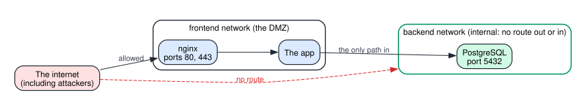

# Network Segmentation

**Network segmentation is splitting a network into separate zones, so that a machine in one zone can only reach the machines it actually needs.**

## Before you start
<!-- bite: 042109e2-08e5-4842-b2d4-1cab49a46f21 -->

You should have:

- Firewalled your VPS → [[cybersecurity/03-network-security/01-firewalls|firewalls]]. That lesson controlled what reaches the box; this one controls what can reach what once something is inside.
- Docker and Docker Compose on your laptop (you installed Docker for Juice Shop in [[cybersecurity/02-ethical-hacking/05-home-lab-setup|home lab setup]]).
- Met lateral movement → [[cybersecurity/02-ethical-hacking/02-penetration-testing-methodology|penetration testing methodology]].

After this lesson you will be able to:

1. Explain why a flat network turns one break-in into a full breach.
2. Describe the common zones (DMZ, internal, guest, IoT) and what goes in each.
3. Build a segmented app with Docker networks, where the database has no route in or out, and prove it.
4. Explain what Zero Trust adds on top of zones.

**Study route.** Kid version and §1–4, then the worked example on your laptop. It runs locally, no VPS needed.

## What network segmentation is
<!-- bite: 48dea46e-805b-4c00-af18-afe440444dd0 -->

Remember the attack chain from [[cybersecurity/02-ethical-hacking/07-exploitation-concepts|exploitation concepts]]: one login bug became every account. Now imagine the bug was in the web app on your VPS, and the attacker now controls that app. What else can they reach from there?

On a **flat network**, the answer is "everything": every machine can talk to every other machine. Segmentation changes the answer to "only what the app needed anyway". It doesn't stop the first break-in. It stops the break-in from spreading. In this lesson you split your app into zones and prove the database can't be reached by anything except the app.

## The kid version
<!-- bite: 383ee84e-918d-4464-a5b7-6eefaf37f350 -->

Think of a big house with no inside doors. Once a thief climbs through the kitchen window, every room is open: the bedroom, the office, the safe. Now think of a hotel. A thief who gets into one room is stuck in that room. Their key card doesn't open the next room, the staff office or the kitchen.

A flat network is the house with no doors. A segmented network is the hotel: each zone is a room, and moving between rooms needs a key the thief doesn't have.

**Where the analogy stops working.** Hotel walls are solid. Network "walls" are only rules, and one rule that says "allow everything between zone A and zone B" quietly knocks the wall down while the sign on the door still says "separate". A segment is only as real as the firewall rules between zones.

## 1. Why a flat network is the real danger
<!-- bite: 71ad71ef-3e43-4ca7-af2c-e00746600493 -->

Attackers rarely land where they want to be. They land wherever was weakest: a phished laptop, an old printer, a web app with a bug. Then they move. That move, from the first machine to the valuable one, is **lateral movement**, and a flat network makes it free.

Here's the shape of most big breaches: the way in was something boring, and the damage came from what it could reach. A smart bulb that can talk to the file server. A receptionist's PC on the same network as the payroll database.

Segmentation attacks that second half. You can't promise nothing will ever be broken into. You *can* make sure that when it is, the attacker is standing in a small room with nothing valuable in it. That's why segmentation is often the difference between "one machine had malware" and "we lost everything" in an incident report.

## Terms used in this lesson
<!-- bite: 3c191352-4669-48d1-a912-47a1353c42f6 -->

1. **Flat network**: This is a network where every device can reach every other device directly. One break-in can reach anything.
2. **Segment**: This is also known as a **zone**. It's a part of the network whose traffic to other parts has to pass through a firewall.
3. **Lateral movement**: This is an attacker using one compromised machine to reach others on the network.
4. **Blast radius**: This is how much an attacker can reach from one compromised machine. Segmentation exists to shrink it.

## Terms used in this lesson: the kinds of zone
<!-- bite: 4d802e6f-8fb7-4c7d-84bb-3e67e34e1f29 -->

The rest of the terms name the tools and zone layouts you'll meet.

5. **VLAN (virtual local area network)**: The letters stand for those words. It's a way of splitting one physical switch or router into separate logical networks, as if they were on different cables.
6. **DMZ (demilitarized zone)**: This is a segment for machines the internet must reach, like a web server, kept apart from the internal network.
7. **Microsegmentation**: This is segmentation down to single workloads, so each service only reaches the exact services it talks to.
8. **Zero Trust**: This is a design where no machine is trusted because of where it sits on the network. Every request is checked, every time.

## 2. The common zones
<!-- bite: 995923eb-d5ad-4f0e-82f6-982c80539f06 -->

Most segmented networks use the same handful of zones, each holding things with the same trust level:

1. **DMZ** — anything the internet must reach: your nginx, a mail server. It's the most attacked zone, so it holds nothing precious.
2. **Internal** — databases, file servers, staff machines. The internet has no route here at all.
3. **Guest** — visitors' Wi-Fi. It gets internet access and nothing else.
4. **IoT** — smart bulbs, cameras, TVs. They're rarely updated and often weak, so they get a zone of their own where they can't reach your laptop.

The rule for placing a machine: **put it with the things that have the same people needing to reach it.** Your database is reached by one app, so it goes deep inside, not next to the web server.

## 3. Where segmentation gets its power — the choke point
<!-- bite: 17d1946c-4161-45ce-b080-ebd5f66415d2 -->

Splitting a network into zones does nothing by itself. The power comes from what sits *between* the zones: a firewall that every cross-zone packet has to pass. That's a **choke point**, and it's useful twice.

1. **It enforces.** "The DMZ may reach the database on 5432 only, and only from the app" is one rule at the choke point.
2. **It watches.** All cross-zone traffic goes through one place, so it's the perfect spot to log and alert. A web server suddenly trying to reach the payroll server on 445 is a loud signal, if someone is watching the choke point (lesson 04).

In an office, zones are usually VLANs on the switches, and the choke point is the router or firewall between them. On your VPS, the same idea is built with Docker networks, which is the worked example.

## 4. Zero Trust — no zone is "safe"
<!-- bite: 87b54029-ccf8-4e59-80f3-e97b0b5d5577 -->

Old-style networks had one wall: outside is dangerous, inside is trusted. Once an attacker was inside, by phishing one employee for example, everything trusted them.

**Zero Trust** throws away "inside means trusted". Every request has to prove who is making it and that they're allowed, even if it comes from the machine next door. Your database checking a password from the app, even though they share a network, is a small piece of Zero Trust.

Zones and Zero Trust work together. Zones shrink what an attacker can *reach*; Zero Trust means that reaching something isn't enough to *use* it. Do both: a segmented database that also requires a strong password and only accepts the app's account.

## Worked example — split the app into zones
<!-- bite: 0d2a4a28-ac51-4379-a41f-40c06cb93ff8 -->

On your laptop, make a folder `seg-lab` and save this as `compose.yaml`. It's your VPS app in miniature: nginx faces the internet, the app sits behind it, the database sits deep inside. The `app` service uses the Postgres image only so it has the `pg_isready` tool for testing.

```yaml
services:
  web:
    image: nginx:1.27
    ports: ["8080:80"]
    networks: [frontend]
  app:
    image: postgres:16          # stand-in app; it has pg_isready for testing
    command: sleep infinity
    networks: [frontend, backend]
  db:
    image: postgres:16
    environment:
      POSTGRES_PASSWORD: lab-only-password
    networks: [backend]        # and no "ports:", so nothing is published
networks:
  frontend:
  backend:
    internal: true             # no route to or from the outside world
```

## Worked example: the zones, drawn
<!-- bite: a8b39914-bce4-4113-9373-58c3caf681e2 -->

This is what that file builds. Look for the red dashed line: the internet has no way to reach the database.



The app is the only service in both networks, so it's the only bridge into the backend. That's the choke point.

## Worked example: prove each wall
<!-- bite: 5047e6ea-dd49-437a-8a95-0a3c11c6e999 -->

Start it with `docker compose up -d`, then test each wall. **Predict first:** which of these four succeed?

```bash
docker compose exec app pg_isready -h db            # app -> db
docker compose exec web getent hosts db             # web -> db
docker compose exec db bash -c 'echo > /dev/tcp/1.1.1.1/443'   # db -> internet
nmap -p 5432 localhost                              # your laptop -> db
```

Only the first works: `db:5432 - accepting connections`. The web container can't even look up the name `db`, because it isn't on the backend network. The database gets `Network is unreachable` when it tries to reach the internet, because the backend network is `internal`. And nmap finds 5432 closed on your laptop, because nothing published it.

## Worked example: what this buys you
<!-- bite: bdda3405-1a76-4784-95b8-91f62ca03160 -->

Now replay the attack in your head. An attacker breaks nginx. From there they can reach the app, and nothing else. They break the app too. Now they can reach the database, but they still need its password (the Zero Trust half), and the database still can't send stolen data straight out to the internet, because the backend network has no route out.

That last part matters more than it looks. A lot of attacks need the compromised machine to "phone home" to the attacker. A database with no route out can't.

## Common pitfalls and traps
<!-- bite: 7565a45e-c039-4e24-aa73-398ff0df6a10 -->

1. **Zones with "allow all" between them.** Two VLANs with an any-to-any rule are one flat network with two names. The rules between zones are the segmentation.
2. **The forgotten bridge.** A machine with a leg in two zones (a jump box, a monitoring server, the `app` above) is a bridge. Guard it like the most valuable thing in both zones.
3. **Publishing the database "just for debugging".** One `ports: ["5432:5432"]` added to the `db` service undoes the whole design, and, from lesson 01, Docker's published ports skip UFW too.
4. **Segmenting and never watching.** The choke point is the best place to spot lateral movement. If nobody logs it, the attacker walks past the one spot you could have seen them.
5. **Forgetting home networks.** Your smart TV and your work laptop on the same Wi-Fi is a flat network. Most home routers offer a guest network; IoT belongs there.

## Check your understanding
<!-- bite: 677d8fca-e558-4700-842a-5510b366c58e -->

Try each one before you open the answer.

1. <!-- q: mcq id="5806b0e3" -->
   An attacker phishes a receptionist's PC. The office network is flat. The payroll database is on a server down the hall. Which statement is true?

   - [ ] The attacker can't reach payroll, because they only phished one PC.
   - [x] The attacker can try to reach the payroll server directly from the PC, because on a flat network every device can reach every other.
   - [ ] The attacker needs physical access to reach the payroll server.
   - [ ] The firewall at the internet edge blocks the PC from reaching payroll.

   <details><summary>Answer</summary>

   On a flat network nothing stands between the PC and the payroll server, so lateral movement is free. The edge firewall only sits between the office and the internet; internal traffic never passes it.

   </details>

2. <!-- q: mcq id="fff273d0" -->
   A small company has: a public website, a mail server, staff laptops, a customer database, visitor Wi-Fi and some security cameras. Which machines belong in the DMZ?

   - [ ] The customer database and staff laptops.
   - [x] The public website and the mail server.
   - [ ] The security cameras.
   - [ ] Everything, so it's all protected by one firewall.

   <details><summary>Answer</summary>

   The DMZ is for machines the internet must reach: the website and the mail server. The database and laptops go internal, the visitor Wi-Fi goes in a guest zone, and the cameras go in an IoT zone.

   </details>

3. <!-- q: gap id="877e71d3" answers="internal" -->
   In a Docker Compose file, the network option that gives a network no route to or from the outside world is `___: true`.

   <details><summary>Answer</summary>

   `internal: true`. Containers on that network can talk to each other, but not out to the internet and not in from it. It's how the database got its own deep zone in the worked example.

   </details>

4. <!-- q: mcq id="1fac689f" -->
   Two VLANs, "staff" and "servers", are separated. The firewall rule between them is `allow any any`. How much segmentation does this give?

   - [ ] Full segmentation, because they're different VLANs.
   - [ ] Partial segmentation, because broadcast traffic is still split.
   - [x] Effectively none for security, because any machine in one VLAN can still reach any machine in the other.
   - [ ] It depends on the VLAN numbers.

   <details><summary>Answer</summary>

   Effectively none. The security value of segmentation lives in the rules between zones. An any-to-any rule makes the two VLANs one flat network with two labels.

   </details>

5. <!-- q: open id="7c9e8520" -->
   A database sits on its own internal network that only the app can reach. Explain why it should still require a strong password from the app, using the idea of Zero Trust.

   <details><summary>Answer</summary>

   Segmentation limits *who can reach* the database, but if the app is compromised, the attacker reaches it too, from the one place that's allowed. Zero Trust says being in the right place on the network isn't proof of being allowed, so the database still checks credentials on every connection. Then reaching it isn't enough to use it; the attacker also needs the app's credentials, and the app's account can be limited to only what the app needs.

   </details>

6. <!-- q: mcq id="1fdab53c" -->
   Why is the firewall between two zones a good place to put detection, not just blocking rules?

   - [ ] Because firewalls are faster than other monitoring tools.
   - [x] Because all cross-zone traffic has to pass through it, so unusual cross-zone attempts are visible in one place.
   - [ ] Because attackers can't encrypt traffic that crosses zones.
   - [ ] Because detection only works on traffic that is blocked.

   <details><summary>Answer</summary>

   It's a choke point: every packet moving between zones passes it. A web server suddenly trying to reach the file server is easy to spot there, and lateral movement has to cross a choke point to get anywhere.

   </details>

## Practice — segment your lab and prove it
<!-- bite: 81b3d17a-aba3-4945-9499-bd4a9c60a649 -->

**Task.** Run the worked example, then break it on purpose so you see what each wall is doing.

1. Run the four test commands and record which succeed.
2. Remove `internal: true`, run `docker compose up -d` again, and rerun the db-to-internet test. What changed?
3. Put it back. Add `ports: ["5432:5432"]` to `db`, recreate it, rerun the nmap test. What changed?
4. Put it back.

## Practice: when your segmentation is done
<!-- bite: 80c79b8b-860f-4235-899d-3d9451b98095 -->

Here is how you know the task is finished, plus a stretch step.

**Done when:** you have a small table of the four tests with "reachable / not reachable" for the correct setup and for each broken version, and one sentence per wall explaining which line in `compose.yaml` builds it. Record the run in `cybersecurity/LIVE-RUNS-TODO.md`.

**Stretch.** Look at your home router's settings. Does it have a guest network or client isolation? Move one IoT device (a smart TV or speaker) onto the guest network and check it still works. That's segmentation in your own house.

## Before moving on
<!-- bite: e37e0e22-a46b-4ff1-b94a-03068d8b24f8 -->

You can now explain why a flat network turns one break-in into a full breach, place machines into DMZ, internal, guest and IoT zones, build zones with Docker networks and prove each wall, and explain what Zero Trust adds.

**Recap for later lookup:** segmentation shrinks the blast radius; it doesn't stop the first break-in. Zones are only as real as the rules between them. Choke points enforce *and* watch. Docker: separate networks, `internal: true` for the deep zone, no `ports:` on the database. Zero Trust: reaching something isn't permission to use it.

Next: [[cybersecurity/03-network-security/03-vpns-and-encryption-in-transit|VPNs and encryption in transit]]. Your zones live inside the VPS; now you need a safe way for *you* to reach them from outside.

## Related
<!-- bite: 2efa9608-fedf-4eda-8a1e-51234fa10ab7 -->

- [[cybersecurity/03-network-security/01-firewalls|Firewalls]] — the rules that make a zone real.
- [[cybersecurity/07-security-operations/01-defensive-architecture|Defensive architecture]] — segmentation as one layer of a whole defensive design.
- [[cybersecurity/12-active-directory/index|Active Directory]] — where lateral movement inside flat office networks is the main event.

## About this lesson
<!-- bite: de1b015f-a5cf-4e34-837c-52a29f9a9542 -->

**Level:** Intermediate. **Covers:** flat networks and lateral movement, blast radius, the common zones (DMZ, internal, guest, IoT), choke points that enforce and watch, VLANs, Zero Trust, and a Docker Compose lab with an internal database network proven wall by wall. **Where it sits:** lesson 2 of the [[cybersecurity/03-network-security/index|Network Security]] section. **Sources:** the original vault note, rebuilt around the lab VPS and a runnable Docker lab. `[reference]` — commands not yet run live; tracked in `cybersecurity/LIVE-RUNS-TODO.md`.
