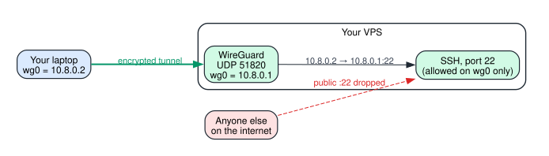

# VPNs and Encryption in Transit

**Encryption in transit is scrambling data while it travels across a network, so that anyone sitting along the path sees only noise.**

## Before you start
<!-- bite: 6594c961-5360-4cd7-a747-6913a7fa4683 -->

You should have:

- A default-deny firewall on your VPS, with SSH allowed from your IP only → [[cybersecurity/03-network-security/01-firewalls|firewalls]].
- Logged into your VPS over SSH, and edited a file on it with `nano` or `vim`.
- Met public and private keys, even roughly → [[cybersecurity/05-cryptography/04-asymmetric-encryption|asymmetric encryption]].

After this lesson you will be able to:

1. Say who can read your traffic on an open network, and what encryption in transit stops them doing.
2. Tell a VPN apart from TLS, and site-to-site from remote access.
3. Build a WireGuard tunnel from your laptop to your VPS, and move SSH behind it so the public port 22 is closed.
4. Say what a VPN does *not* protect, including what a commercial VPN provider can see.

**Study route.** Kid version and §1–4, then the worked example (two machines: your laptop and your VPS). Allow about 30 minutes for the build.

## What encryption in transit is
<!-- bite: d7111538-dcb3-43d1-b04e-672ec4b53af7 -->

Remember the firewall from lesson 01? It lets SSH in only from your home IP. That works until your home IP changes, which many internet providers do without warning, or until you're working from a café and need to reach your server. Opening SSH to the whole internet again is the wrong answer.

This lesson gives a better one. You'll build an encrypted **tunnel** from your laptop to your VPS, and let SSH in only through that tunnel. From anywhere you are, you connect the tunnel first. Everyone else finds port 22 shut. Along the way you'll see what encryption in transit protects, and, just as important, what it doesn't.

## The kid version
<!-- bite: 633db723-37c0-4b5f-acb5-b9651ae07e65 -->

Imagine sending letters through a busy post office where anyone who handles the envelope can open it and read it. Encryption in transit is writing your letter in a code only you and your friend know. The post office still carries it, still sees whose address is on it, but anyone who opens it sees gibberish.

A VPN is a bit more than that: it's a locked mailbag between your house and your friend's house. Everything you send goes inside the bag. The post office sees one bag going back and forth, not the separate letters inside.

**Where the analogy stops working.** The code protects the letter on the road, not at either end. If your friend's house is burgled, or your friend is the one reading your post, the code didn't help. And the post office still knows *that* you write to your friend, and how often. Encryption hides the contents, not the fact you're talking.

## 1. Who can read your traffic
<!-- bite: ec6b7bce-fb5c-4dd1-8284-451d4fdc3315 -->

When your laptop sends a packet, it doesn't fly straight to your VPS. It passes your Wi-Fi router, your internet provider, several networks in between, and the VPS's hosting provider. Anyone in control of any of those hops can read an unencrypted packet, and change it.

On a café's open Wi-Fi, "anyone" includes the person at the next table running a packet capture. That's why encryption in transit matters so much: it turns every one of those hops from "can read and change your data" into "can see that data is passing, and nothing else".

Two promises come with it. **Confidentiality**: nobody on the path can read it. **Integrity**: nobody on the path can change it without being detected. Those are the C and I from the [[cybersecurity/01-fundamentals/02-cia-triad|CIA triad]], applied to data while it moves.

## Terms used in this lesson
<!-- bite: 995ed566-c59b-4577-a954-d35330edda0a -->

1. **Encryption in transit**: This is protecting data while it moves over a network, as opposed to **encryption at rest**, which protects data stored on a disk.
2. **TLS (Transport Layer Security)**: The letters stand for those words. It encrypts one connection between one app and one server. HTTPS is web traffic over TLS.
3. **VPN (virtual private network)**: The letters stand for those words. It's an encrypted tunnel that carries *all* the traffic you route into it between two points, whatever the app.
4. **Tunnel**: This is a connection that carries other network traffic inside it, encrypted, so the network in between only sees the tunnel.

## Terms used in this lesson: kinds of VPN
<!-- bite: bf97f4d9-d850-49d0-8b7f-094d0af11837 -->

The rest of the terms name the shapes and the main protocols.

5. **Site-to-site VPN**: This is a tunnel joining two whole networks, like two offices, so they act as one.
6. **Remote-access VPN**: This is a tunnel from one device to a network, like your laptop to your VPS.
7. **Split tunnel**: This is a VPN where only some traffic goes through the tunnel and the rest goes straight out. A **full tunnel** sends everything through it.
8. **WireGuard**: This is a modern VPN protocol, small and fast, built on public and private keys. The other two you'll meet are **IPsec** (common for site-to-site) and **OpenVPN** (an older remote-access standard).

## 2. VPN or TLS — which one when
<!-- bite: 6c8be8ed-937b-47f4-848d-a04fc11cbf9c -->

Both encrypt in transit. The difference is *how much* they cover.

**TLS** protects one app's connection. Your browser to your bank uses TLS, and that's enough: the one thing that needs protecting is that one connection. Most of the encrypted traffic you'll ever send is TLS, and [[cybersecurity/04-web-security/03-https-and-tls|HTTPS and TLS]] covers it in depth.

**A VPN** protects everything you route into it, whatever the app. It's the right tool when you want to reach a whole *private network* that isn't on the internet at all, like your Docker backend zone from lesson 02, or a company's internal servers. It's also how you hide a service completely: if SSH only listens through the tunnel, the internet can't even find it.

So the rule of thumb: **TLS to protect a connection, a VPN to reach a private network.** Today's task, reaching your VPS's SSH from anywhere without exposing it, is a VPN job.

## 3. Why WireGuard
<!-- bite: a79a8e71-f874-48d2-968a-175f7f3a2559 -->

There are three protocols you'll meet. **IPsec** is old, standard, built into most routers, and fiddly to configure; it's the usual choice for joining two offices. **OpenVPN** was the remote-access standard for years. **WireGuard** is the newcomer, and it's the one this lesson uses.

WireGuard's big advantage is that it's small: a few thousand lines of code, against hundreds of thousands for the others. Less code means fewer places for a bug to hide, and an easier job for the people auditing it. Its setup is also short: each side has a key pair, and each side lists the other's public key.

One more thing makes it great for hiding a server. **WireGuard doesn't answer packets that aren't signed by a key it knows.** A scanner probing its port gets no reply at all, so it can't even tell WireGuard is there.

## 4. What a VPN does not protect
<!-- bite: 5b7be875-6608-45ba-a848-88f948fdcf14 -->

A VPN protects the road, not the ends. Three things it can't help with:

1. **The endpoints.** If your laptop has malware, the malware is inside the tunnel with you. If the server is compromised, the tunnel delivers your data to the attacker, encrypted all the way.
2. **The other end of a commercial VPN.** When you pay a VPN company, the tunnel ends on *their* server, and from there your traffic goes out normally. You've moved the eavesdropping risk from the café to the VPN company. That's fine if you trust them more than the café; it's not "invisible".
3. **The fact that you're talking.** The network still sees a tunnel between your IP and the VPN server, when it's busy and how much data flows. Contents are hidden; the pattern isn't.

Keep these in mind and a VPN is a strong tool. Forget them and it becomes a false sense of safety.

## Worked example — build the tunnel
<!-- bite: 2d7c99bd-3598-42e5-81e9-6deaa691eaef -->

Install WireGuard on both machines (`sudo apt install wireguard` on the VPS, `sudo dnf install wireguard-tools` on Fedora). Then make a key pair on **each** machine:

```bash
umask 077                                   # keys readable by you only
wg genkey | tee wg.key | wg pubkey > wg.pub
cat wg.pub                                  # the public key: safe to copy across
```

The private key (`wg.key`) never leaves the machine it was made on. You copy only the public keys across. The tunnel gets its own small private network, `10.8.0.0/24`: the VPS will be `10.8.0.1` and your laptop `10.8.0.2`.

## Worked example: the two config files
<!-- bite: dbc25ae5-3a55-47af-bf03-e2b1304a281f -->

On the **VPS**, save `/etc/wireguard/wg0.conf`:

```ini
[Interface]
Address    = 10.8.0.1/24
ListenPort = 51820
PrivateKey = <the VPS's wg.key>

[Peer]                                  # your laptop
PublicKey  = <the laptop's wg.pub>
AllowedIPs = 10.8.0.2/32
```

On your **laptop**, save `/etc/wireguard/wg0.conf`:

```ini
[Interface]
Address    = 10.8.0.2/24
PrivateKey = <the laptop's wg.key>

[Peer]                                  # the VPS
PublicKey  = <the VPS's wg.pub>
Endpoint   = 203.0.113.9:51820
AllowedIPs = 10.8.0.1/32
PersistentKeepalive = 25
```

## Worked example: reading AllowedIPs
<!-- bite: 9976e691-f268-48d3-8e02-de85ee2c6569 -->

`AllowedIPs` is the line that does the most work, and it does two jobs at once.

**Going out**, it's a route: "send traffic for these addresses through this peer". The laptop's `10.8.0.1/32` means only traffic to the VPS's tunnel address uses the tunnel. That's a split tunnel; your normal browsing doesn't go through it. (`0.0.0.0/0` there would make it a full tunnel.)

**Coming in**, it's an allowlist: "only accept packets from this peer if they come from these addresses". The VPS's `10.8.0.2/32` means a packet signed with your laptop's key must also come from `10.8.0.2`.

`PersistentKeepalive = 25` sends a tiny packet every 25 seconds, so home routers don't forget the connection while it's idle.

## Worked example: bring it up and move SSH behind it
<!-- bite: a30458a3-8113-4d7c-ba5d-997f90000dcc -->

On the VPS, open the WireGuard port and start the tunnel. Then start it on the laptop and test:

```bash
# VPS
sudo ufw allow 51820/udp
sudo systemctl enable --now wg-quick@wg0

# laptop
sudo wg-quick up wg0
ping -c 3 10.8.0.1              # replies mean the tunnel works
ssh you@10.8.0.1                # SSH *through* the tunnel
```

Only once SSH through the tunnel works, move SSH behind it on the VPS. **In that order**, or you lock yourself out:

```bash
sudo ufw allow in on wg0 to any port 22 proto tcp
sudo ufw delete allow from 203.0.113.50 to any port 22 proto tcp
```

## Worked example: what the network sees now
<!-- bite: 839c57e4-9681-44b7-a973-da8a71fd8424 -->

This is what you built. The green arrow is the only way to SSH in now.



## Worked example: rescan from outside the tunnel
<!-- bite: 82ce39bd-846e-4334-9eac-b68e1e10d5d1 -->

Now look at the VPS the way a stranger on the internet would.

**Predict first:** from your laptop with the tunnel *down*, what will a scan of the VPS's public IP show for TCP 22 and UDP 51820? Then check:

```bash
sudo wg-quick down wg0
sudo nmap -sU -p 51820 203.0.113.9; nmap -p 22 203.0.113.9
```

Port 22 is `filtered`. UDP 51820 shows `open|filtered`, meaning nmap got no answer and can't tell. WireGuard stays silent to packets without a known key, so to a scanner your SSH has disappeared.

## Worked example: the detection half
<!-- bite: 9fabcaaa-0818-4d0b-9473-a86c6d205738 -->

With SSH reachable only through the tunnel, every legitimate SSH login now comes from `10.8.0.2`. That makes a sharp detection rule:

```bash
sudo journalctl -u ssh --since today | grep 'Accepted'
sudo wg show                     # each peer's "latest handshake" time
```

Any `Accepted` line from an address that isn't `10.8.0.x` means someone reached SSH another way, and that's an incident, not noise. And `wg show` lists every peer that can connect; nobody gets a tunnel without a public key you added yourself.

## Common pitfalls and traps
<!-- bite: 8011a774-be7c-406e-af2f-150cf7fae908 -->

1. **Deleting the public SSH rule before testing the tunnel.** Test SSH over `10.8.0.1` first, then delete the old rule. The provider's console is your rescue if you get it wrong.
2. **Copying the private key around.** Only `wg.pub` travels. If a private key leaks, generate a new pair and replace the public key on the other side.
3. **Thinking a commercial VPN makes you anonymous.** It moves who can see your traffic from your network to the VPN company. Whether that's better depends on who you trust more.
4. **Mixing up split and full tunnel.** `AllowedIPs = 0.0.0.0/0` on the laptop sends *all* your traffic through the VPS. Fine if that's what you want; surprising if it isn't.
5. **"It's encrypted, so it's safe."** Encryption in transit protects the road. A compromised laptop or server is still compromised.

## Check your understanding
<!-- bite: b1dbf650-1913-4692-85a4-27d02ea6a031 -->

Try each one before you open the answer.

1. <!-- q: mcq id="3c5c84bb" -->
   You log in to a website over plain HTTP on a café's open Wi-Fi. Who could read your password?

   - [ ] Nobody, because Wi-Fi is always encrypted.
   - [ ] Only the website.
   - [x] Anyone on the path: someone capturing on the same Wi-Fi, the café's router, the internet providers in between, and the website.
   - [ ] Only the café owner.

   <details><summary>Answer</summary>

   Without encryption in transit, every hop between you and the site can read the packet, and on open Wi-Fi that includes other people in the café. HTTPS (TLS) would turn all of those hops into "sees data passing, can't read it".

   </details>

2. <!-- q: mcq id="99a406e1" -->
   A company wants staff working from home to reach an internal wiki that has no public address at all. Which tool fits?

   - [ ] TLS on the wiki, because it encrypts the connection.
   - [x] A remote-access VPN, because staff need to reach a private network that isn't on the internet.
   - [ ] A site-to-site VPN between each employee's home and the office.
   - [ ] A firewall rule allowing the wiki from anywhere.

   <details><summary>Answer</summary>

   A remote-access VPN. TLS protects a connection to something you can already reach, but the wiki has no public address, so staff first need a way into the private network. Site-to-site joins whole networks, which is overkill for one person's laptop.

   </details>

3. <!-- q: exact id="c4580774" answer="10.8.0.1/32" accept="10.8.0.1" -->
   A laptop's WireGuard config should send *only* traffic for the server's tunnel address, `10.8.0.1`, through the tunnel. What goes after `AllowedIPs =` in the laptop's `[Peer]` section?

   <details><summary>Answer</summary>

   `10.8.0.1/32`, a single address. That makes a split tunnel: only traffic to the server's tunnel address uses the tunnel. `0.0.0.0/0` would send everything through it.

   </details>

4. <!-- q: mcq id="c85c5f84" -->
   You pay for a commercial VPN and browse a site over plain HTTP. Who can now read that traffic?

   - [ ] Nobody, because it's inside the VPN.
   - [ ] Only your internet provider.
   - [x] The VPN company and anyone between its server and the site, because the tunnel ends at the VPN company's server.
   - [ ] Only the website.

   <details><summary>Answer</summary>

   The tunnel protects the stretch from you to the VPN server. After that the traffic goes out normally, so the VPN company, and every hop from its server to the site, can read plain HTTP. You've moved who can see it, not hidden it from everyone.

   </details>

5. <!-- q: mcq id="729d8518" -->
   After moving SSH behind WireGuard, you scan the VPS's public IP from outside the tunnel. UDP 51820 shows `open|filtered`. Why can't nmap tell whether WireGuard is there?

   - [ ] WireGuard uses TCP, not UDP.
   - [x] WireGuard doesn't reply to packets that aren't signed with a key it knows, so the probe gets no answer.
   - [ ] UFW blocks all UDP.
   - [ ] nmap can't scan UDP at all.

   <details><summary>Answer</summary>

   WireGuard stays silent to anything without a known key. With no reply, nmap can't tell an open, silent service from a dropped packet, so it reports `open|filtered`. To a scanner, the service may as well not be there.

   </details>

6. <!-- q: open id="77e16010" -->
   A friend says: "My laptop is on a VPN, so I'm safe even if I download sketchy software." Explain what's wrong with that.

   <details><summary>Answer</summary>

   A VPN protects data on the road between two points: it stops people on the network path from reading or changing it. It does nothing about the endpoints. Malware on the laptop runs inside the tunnel with the user, and can read everything before it's encrypted. Encryption in transit protects the journey, not the machine at either end.

   </details>

## Practice — hide SSH behind your own tunnel
<!-- bite: c4455d50-2bc4-411f-854c-b174923ffa8b -->

**Task.** Build the WireGuard tunnel from the worked example, move SSH behind it, and prove the public port is gone.

1. Generate key pairs on both machines and write both `wg0.conf` files.
2. Bring the tunnel up, and SSH to `10.8.0.1` through it.
3. Only then, move SSH behind `wg0` in UFW and delete the public rule.
4. With the tunnel down, scan the VPS's public IP for TCP 22 and UDP 51820.

## Practice: when your tunnel is done
<!-- bite: 7d107239-f1e0-464e-b73b-fe35c25a4995 -->

Here is how you know the task is finished, plus a stretch step.

**Done when:** SSH works through the tunnel from a different network (a phone hotspot is fine), the public scan shows 22 `filtered`, and `journalctl` shows your logins coming from `10.8.0.2`. Record the run in `cybersecurity/LIVE-RUNS-TODO.md`.

**Stretch.** Add your phone as a second peer (the WireGuard app can read a config as a QR code made with `qrencode -t ansiutf8 < phone.conf`). Give it `10.8.0.3`. Then remove it again by deleting its `[Peer]` block and restarting, and check it can no longer connect. That's how you revoke a lost device.

## Before moving on
<!-- bite: bf23ddaf-c5f1-425d-9d5b-fc1709178868 -->

You can now say who can read traffic on an open network, choose between TLS and a VPN, build a WireGuard tunnel with your own keys, move SSH behind it so the internet can't find it, and say what a VPN doesn't protect.

**Recap for later lookup:** encryption in transit = confidentiality + integrity on the road. TLS protects one connection; a VPN carries everything you route into it, to reach private networks. WireGuard: key pair per side, swap public keys only; `AllowedIPs` is both route and allowlist; silent to unknown keys. Test the tunnel *before* deleting the public SSH rule. A VPN protects the road, not the endpoints.

Next: [[cybersecurity/03-network-security/04-intrusion-detection-and-prevention|intrusion detection and prevention]]. The doors are closed, the zones are split and SSH is hidden. Now you need to know when someone tries anyway.

## Related
<!-- bite: f785ece8-5e12-4eba-aff3-63dbef3fb04a -->

- [[cybersecurity/04-web-security/03-https-and-tls|HTTPS and TLS]] — encryption in transit for one web connection, in depth.
- [[networking/12-tls-and-transport-security/index|TLS and transport security]] — the networking side of the handshake.
- [[cybersecurity/05-cryptography/04-asymmetric-encryption|Asymmetric encryption]] — why swapping public keys is safe.

## About this lesson
<!-- bite: 913314b0-1947-418d-9ec2-d7fe624d2f2e -->

**Level:** Intermediate. **Covers:** who can read traffic on the path, confidentiality and integrity in transit, TLS versus a VPN, site-to-site versus remote access, split and full tunnels, IPsec, OpenVPN and WireGuard, what a VPN doesn't protect, and a WireGuard build that moves the lab VPS's SSH behind a tunnel. **Where it sits:** lesson 3 of the [[cybersecurity/03-network-security/index|Network Security]] section. **Sources:** the original vault note, rebuilt around the lab VPS. `[reference]` — commands not yet run live; tracked in `cybersecurity/LIVE-RUNS-TODO.md`.
