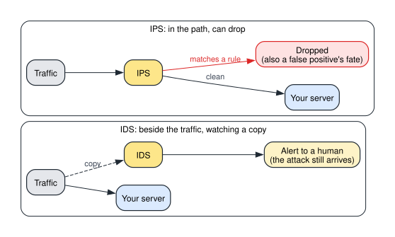

# Intrusion Detection and Prevention

**An intrusion detection system watches network traffic, or a machine's activity, for signs of an attack and raises an alert when it sees one.**

## Before you start
<!-- bite: b2c59b05-f63b-4629-b727-e646baeb5e0d -->

You should have:

- Run the nmap scan and the login SQL injection against your own lab → [[cybersecurity/02-ethical-hacking/06-scanning-and-enumeration|scanning]] and [[cybersecurity/02-ethical-hacking/07-exploitation-concepts|exploitation concepts]]. This lesson catches both.
- Juice Shop running on `localhost:3000` → [[cybersecurity/02-ethical-hacking/05-home-lab-setup|home lab setup]].
- Read the firewall lesson → [[cybersecurity/03-network-security/01-firewalls|firewalls]]. An IDS picks up where a firewall stops.

After this lesson you will be able to:

1. Tell an IDS from an IPS, and say what each costs you when it's wrong.
2. Explain signature-based and anomaly-based detection, and what each misses.
3. Run Suricata against your own Juice Shop, write two rules of your own, and catch your own scan and SQL injection.
4. Explain why encryption hides attacks from a network IDS, and what to do about it.

**Study route.** Kid version and §1–4, then the worked example on your laptop (no VPS needed).

## What intrusion detection is
<!-- bite: b2a94dcd-3d7a-4256-975e-4ba6f4eed3cc -->

Remember how every finding in the ethical-hacking section ended? "What would have caught this?" When you ran `' OR 1=1--` against Juice Shop in lesson 07, nothing noticed. That silence was the second finding.

The firewall from lesson 01 can't help there. It allowed port 3000 (or 443 on the VPS) on purpose, so the attack looked like any other visit. An **IDS** reads what's *inside* the allowed traffic and asks: does this look like an attack? In this lesson you run one, write the rules that catch your own scan and your own SQL injection, and close the loop the ethical-hacking section opened.

## The kid version
<!-- bite: 2c7b9624-3561-458b-9bbe-c16a2bd8dd66 -->

Picture the gate man from lesson 01 again. He lets visitors to house 3 in, as he should. But inside the estate there's a security camera with someone watching it. When a "visitor" walks past house 3 and starts trying every back door, the person at the camera spots it and radios for help.

The camera watcher is an IDS: they don't stop anyone at the gate, they notice bad behaviour by people who were let in. An IPS is a guard who can step in and stop the person on the spot.

**Where the analogy stops working.** A human watcher understands what they see. An IDS only knows the patterns you gave it, or what's "unusual" compared to normal. A clever attacker who behaves like a normal visitor walks past, and a normal visitor doing something odd but innocent can set off the alarm.

## 1. IDS or IPS — watch or block
<!-- bite: 085f86c8-bc00-4a16-8f39-7bb1c06e7004 -->

Both look for attacks. The difference is where they sit.

An **IDS** sits beside the traffic and watches a copy. When it sees an attack, it alerts a human, but the attack still reaches the server. An **IPS** sits *in the path*: every packet passes through it, and it can drop the ones that match a rule.

## 1. IDS or IPS: where each one sits
<!-- bite: 61babf6c-33d2-4e16-b751-30ede159f2e9 -->

Here are the two, drawn side by side.



Look at the IPS's red box: "also a false positive's fate". That's the trade-off. An IPS stops attacks automatically, but when it's wrong, it blocks real users. So most teams start a new rule in IDS mode, watch what it alerts on, and only switch it to blocking once they trust it.

## 2. Signatures and anomalies
<!-- bite: da1c0f39-1a16-4ed7-ae01-26cbc7951c3c -->

There are two ways to decide "this looks like an attack".

**Signature-based** detection matches known patterns: a payload like `' OR 1=1`, the probe pattern of a known scanner, a known piece of malware's traffic. It's precise and cheap, and its alerts are easy to explain. But it's blind to anything new: no pattern, no alert.

**Anomaly-based** detection learns what normal looks like, then flags what's unusual: a server that never talks to the internet suddenly sending 2 GB out at 3 a.m. It can catch attacks nobody has seen before. But "unusual" isn't "malicious", so it raises more false alarms.

Real setups use both. Signatures catch the known attacks cheaply; anomalies are the safety net for the rest. The rules you write in the worked example are signatures, with one rule that counts (a step toward anomaly).

## Terms used in this lesson
<!-- bite: a94482df-64b9-42ed-a003-fe61c0d0e340 -->

1. **IDS (intrusion detection system)**: The letters stand for those words. It watches traffic or a host and alerts on signs of attack, without blocking.
2. **IPS (intrusion prevention system)**: The letters stand for those words. It sits in the traffic path and can drop what matches a rule.
3. **Signature**: This is also called a **rule**. It's a description of a known attack pattern, like a payload string or a probe sequence.
4. **Anomaly detection**: This is flagging behaviour that differs from a learned normal, rather than matching a known pattern.

## Terms used in this lesson: right and wrong alerts
<!-- bite: 38ce4ae6-aa91-4b39-9a9f-b0a6ca1ef9fd -->

The rest of the terms are about where an IDS runs and how it gets things wrong.

5. **NIDS and HIDS**: These are network-based (watches traffic on a network) and host-based (runs on one machine, watching its files, logs and processes) intrusion detection.
6. **False positive**: This is an alert on something harmless. Too many and people stop reading alerts.
7. **False negative**: This is a real attack that raised no alert. You never see these, which is what makes them dangerous.
8. **Alert fatigue**: This is people ignoring alerts because most of them were false positives, so the real one gets missed too.

## 3. Network or host — what each can see
<!-- bite: f201068a-ae47-4346-b5f0-17834dec87c2 -->

A **network IDS** like Suricata or Snort watches packets on the wire. It sees every machine's traffic at once, and it catches scans and attacks crossing the network, especially at a choke point between zones (lesson 02).

A **host IDS** like Wazuh runs on one machine. It watches that machine's logs, files and processes. It catches what never crosses the network in a readable form: a new admin account, a changed system file, a login from a strange place.

You need both, and the reason is lesson 03. **Encryption hides payloads from a network IDS.** On your VPS, a SQL injection arrives inside HTTPS. Suricata on the wire sees an encrypted blob going to 443 and can't read the `' OR 1=1--` inside. Your fix is to watch where the traffic is decrypted: run network detection behind nginx (which ends the TLS), or watch nginx's and the app's logs on the host. The worked example avoids the problem by watching Juice Shop's plain HTTP on your laptop.

## 4. From one alert to a picture — SIEM
<!-- bite: 91e3e364-2210-4117-b480-fd62686f5676 -->

One IDS alert is one fact: "something tried SQL injection on the login." The interesting questions need more than one source. Did the same IP scan you ten minutes earlier? Did the login then *succeed*? Did the database send out more data than usual afterwards?

A **SIEM** collects alerts and logs from everywhere (firewall block logs from lesson 01, SSH logins from lesson 03, Suricata alerts from this lesson, app logs) and correlates them. That's where "scan, then SQL injection, then successful admin login from the same IP" becomes one high-priority incident instead of three alerts nobody connected.

That's a big topic of its own, in [[cybersecurity/07-security-operations/02-logging-siem-and-detection|logging, SIEM and detection]]. For now, notice that every lesson in this section quietly produced a log a SIEM would want.

## Worked example — run Suricata against your Juice Shop
<!-- bite: f3976b52-72ea-4b99-aad2-947f90cfa0f9 -->

Install Suricata on your laptop (`sudo dnf install suricata`) and make a folder for the lab, with Juice Shop running on `localhost:3000`. Save this as `local.rules`. These are two signatures of your own:

```text
alert http any any -> any any (msg:"LAB SQL injection attempt in login"; flow:established,to_server; http.uri; content:"/rest/user/login"; http.request_body; content:"' OR"; nocase; classtype:web-application-attack; sid:1000001; rev:1;)

alert tcp any any -> any any (msg:"LAB possible port scan: many SYNs from one source"; flags:S; threshold:type both, track by_src, count 50, seconds 10; classtype:attempted-recon; sid:1000002; rev:1;)
```

## Worked example: reading the two rules
<!-- bite: 53c33ea4-ff46-46c6-9cf5-5682b539f962 -->

Read each rule left to right. The part before the brackets says *what to do* (`alert`) and *which traffic* (`http` or `tcp`, from any address and port, to any address and port). Inside the brackets is the pattern.

**Rule 1**: in HTTP sent to the server, if the URL contains `/rest/user/login` *and* the request body contains `' OR` (any capitals), alert. That's lesson 07's attack, as a signature.

**Rule 2**: count TCP packets with only the SYN flag set (the "are you open?" knock from a scan). If one source sends 50 in 10 seconds, alert once for that period. Normal browsing opens a handful of connections; nmap opens hundreds.

Every rule needs a unique `sid`. Numbers from 1000000 up are kept for your own rules.

## Worked example: catch yourself
<!-- bite: 75653dbd-7af8-4e84-a2dc-e7647d39067b -->

Start Suricata on the loopback interface, then attack your own Juice Shop from a second terminal:

```bash
mkdir -p logs
sudo suricata -i lo -k none -S local.rules -l ./logs     # -k none: skip checksum checks on loopback

# second terminal: the scan, then the SQL injection
nmap -p 1-1000 localhost
curl -s -X POST http://localhost:3000/rest/user/login \
  -H 'Content-Type: application/json' \
  -d '{"email":"'"' OR 1=1--"'","password":"x"}'
```

**Predict first:** which alerts will `logs/fast.log` show, and in what order? Then look:

```bash
cat logs/fast.log
```

## Worked example: reading the alerts
<!-- bite: bc5d2f87-c006-4d89-bbdc-7d15055695f0 -->

You should see two lines, shaped like this:

```text
11/24/2026-22:41:07  [**] [1:1000002:1] LAB possible port scan: many SYNs from one source [**] [Classification: Attempted Information Leak] [Priority: 2] {TCP} 127.0.0.1:44310 -> 127.0.0.1:256
11/24/2026-22:41:19  [**] [1:1000001:1] LAB SQL injection attempt in login [**] [Classification: Web Application Attack] [Priority: 1] {TCP} 127.0.0.1:51234 -> 127.0.0.1:3000
```

Each line has the time, the rule's `sid`, its message, the classification and the source and destination. The scan comes first, then the injection, the same order an attacker works in. The richer copy of each event, with the HTTP details, is in `logs/eve.json`; that's the file a SIEM would read.

That's the loop closed. In lesson 07, the attack ran in silence. Now it leaves two alerts, written by you.

## Worked example: from alert to block
<!-- bite: b30cf403-11a9-4cd3-b7fd-8b63f2273424 -->

To turn Rule 1 into prevention, the rule's first word changes from `alert` to `drop`, and Suricata has to sit *in the path* rather than beside it. On Linux that means the firewall hands packets to Suricata to judge (Suricata's **IPS mode**, using a netfilter queue), and Suricata hands back "pass" or "drop".

Don't do that on day one. Run the rule as `alert` first, for long enough to see what else it fires on. Rule 1 would also fire on a harmless login whose password happens to contain `' or`, such as the password `rock' or roll`. Rare, but an IPS would block that user every time. Watch first, then block.

## Common pitfalls and traps
<!-- bite: 88b5e868-abca-4a5f-bb5a-db8fc60e6263 -->

1. **Expecting a network IDS to read HTTPS.** It sees encrypted bytes. Put detection where TLS ends, or use host logs.
2. **Turning on blocking straight away.** An IPS rule nobody has watched in IDS mode will block real users the first time it misfires.
3. **Too many alerts.** Turn on every rule and leave them all on, and you get thousands of alerts a day, and alert fatigue. Tune, silence the noise, keep the ones you'd act on.
4. **Rules that only match one spelling.** `' OR` catches lesson 07's payload; `'/**/OR` might not. Signatures catch known shapes. That's why the real fix is still the parameterised query, and the IDS is your alarm, not your lock.
5. **Nobody reading the alerts.** An IDS with no one watching it is a very detailed diary of how you were breached.

## Check your understanding
<!-- bite: 0ae49965-e7d7-4ff8-a35f-2a916234ca3f -->

Try each one before you open the answer.

1. <!-- q: mcq id="da331bbe" -->
   A new IPS rule meant to block SQL injection starts matching a legitimate request from the company's own checkout page. What happens?

   - [ ] Nothing, because an IPS only alerts.
   - [x] The checkout request is dropped, so real customers can't complete payment.
   - [ ] The request goes through, and an alert is sent.
   - [ ] The IPS switches itself to IDS mode.

   <details><summary>Answer</summary>

   An IPS sits in the path and drops what matches, so a false positive blocks real users, here customers trying to pay. That's why new rules usually run in IDS (alert-only) mode until the team trusts them.

   </details>

2. <!-- q: mcq id="08064f1a" -->
   An attacker uses a brand-new exploit that no security vendor has seen. Which kind of detection has a chance of catching it?

   - [ ] Signature-based, because it has the biggest database.
   - [x] Anomaly-based, because the attack may make the system behave unusually even though no signature exists.
   - [ ] Neither, because no IDS can catch new attacks.
   - [ ] A firewall, because it blocks unknown traffic.

   <details><summary>Answer</summary>

   Anomaly-based. A signature needs the attack to be known; this one isn't. But if the exploit makes the server do something unusual, like connect out to a new address or send far more data than normal, anomaly detection can flag it.

   </details>

3. <!-- q: gap id="f6cfc709" answers="false negative|false-negative" -->
   A real attack that triggers no alert at all is called a ___.

   <details><summary>Answer</summary>

   A false negative. It's the dangerous kind of mistake, because nothing tells you it happened. A false positive (an alert on something harmless) is annoying; a false negative is a breach nobody saw.

   </details>

4. <!-- q: mcq id="a04c1427" -->
   Suricata watches the network in front of a web server. All visitors connect over HTTPS, and TLS ends on the web server. An attacker sends a SQL injection. Why does Suricata miss it?

   - [ ] Suricata can't watch port 443.
   - [x] The payload is encrypted on the wire, so Suricata can't see the SQL injection inside it.
   - [ ] SQL injection isn't a network attack.
   - [ ] Suricata only detects port scans.

   <details><summary>Answer</summary>

   The injection is inside the encrypted HTTPS stream, so a network IDS in front of the server sees only ciphertext. The fix is to inspect where TLS ends, behind the web server or reverse proxy, or to watch the web server's and app's logs on the host.

   </details>

5. <!-- q: exact id="ebac1331" answer="1" -->
   A rule uses `threshold:type both, track by_src, count 50, seconds 10`. One source sends 260 SYN packets in a single 10-second window. Under `type threshold`, it would alert once per 50 packets. How many alerts does `type both` raise for that window?

   <details><summary>Answer</summary>

   1. `type both` waits until the count (50) is reached, then alerts **once** for the rest of that 10-second window, however many more packets arrive. Under `type threshold` the same window would give 260 ÷ 50 = 5 alerts, rounded down.

   </details>

6. <!-- q: open id="417e32ab" -->
   Your IDS raises three separate alerts in an hour: a port scan from IP A, a SQL injection attempt on the login from IP A, and a successful admin login from IP A. Explain why a SIEM treats these very differently from three unrelated alerts.

   <details><summary>Answer</summary>

   Separately, each looks routine: scans happen all day, injection attempts are common, and admins log in. Together, from the same IP in that order, they tell a story: someone mapped the target, attacked the login, and then got in as admin. That's an attack that worked. A SIEM correlates events from different sources by things like IP and time, so it can raise this chain as one urgent incident instead of three low alerts nobody connects.

   </details>

## Practice — catch your own attacks
<!-- bite: 64487b88-f578-4f57-bb4e-b0e37bf0ce7d -->

**Task.** Run the worked example, then make it better.

1. Run Suricata with `local.rules` and catch the nmap scan and the SQL injection.
2. Try a reworded payload that still logs you in on Juice Shop, like `admin@juice-sh.op'--` in the email field. Does Rule 1 fire? Why, or why not?
3. Write a third rule that catches your reworded payload, give it `sid:1000003`, and rerun.
4. Run `sudo suricata-update` to download the free community rules. Restart Suricata with `-s local.rules` (small s adds your rules to the community ones; capital `-S` used yours only), and count how many alerts the same attacks raise now.

## Practice: when your detection is done
<!-- bite: 615ebf66-0622-419f-a7a7-0bbd5349fc54 -->

Here is how you know the task is finished, plus a stretch step.

**Done when:** `fast.log` shows your scan and both SQL injection payloads, each with your own rule's `sid`, and you've written one sentence per rule on what it would *miss*. Record the run in `cybersecurity/LIVE-RUNS-TODO.md`.

**Stretch.** Go back to your lesson 07 finding write-up. Its detection section said "no alert fired during testing". Rewrite it with your rule's `sid` and the `fast.log` line as evidence that the detection now exists.

## Before moving on
<!-- bite: fa77e790-4bcc-465a-99a5-76c0cb788cb4 -->

You can now tell an IDS from an IPS and say what each costs when wrong, explain signature and anomaly detection, run Suricata and write rules that catch your own scan and SQL injection, explain why encryption blinds a network IDS, and say why a SIEM correlates alerts.

**Recap for later lookup:** IDS watches a copy and alerts; IPS sits in the path and drops. Signatures catch the known; anomalies catch the unusual (and misfire more). False negatives are the dangerous ones. Encryption hides payloads from a NIDS, so inspect where TLS ends. Suricata rule = action, traffic, `(pattern; sid; rev)`; own rules from `sid:1000000`. Alert first, block later.

**The section, in one line:** lesson 01 closed the doors, 02 split the inside into zones, 03 hid SSH in a tunnel, and 04 made sure that when someone tries anyway, you find out.

Next: [[cybersecurity/04-web-security/index|web security]]. The network is locked down; the attacks that still get through are aimed at the application itself.

## Related
<!-- bite: 81932902-e53e-47c3-a2bf-3a1d3eb749bc -->

- [[cybersecurity/07-security-operations/02-logging-siem-and-detection|Logging, SIEM and detection]] — where alerts from every lesson here get correlated.
- [[cybersecurity/02-ethical-hacking/09-post-exploitation-and-reporting|Post-exploitation and reporting]] — the detection section of a finding, which this lesson lets you fill in.
- [[cybersecurity/03-network-security/02-network-segmentation|Network segmentation]] — choke points, the best place to put a network IDS.

## About this lesson
<!-- bite: c8ba07e9-83dd-4004-8e62-7387570345ad -->

**Level:** Advanced. **Covers:** IDS versus IPS and the cost of false positives, signature and anomaly detection, network and host IDS, why encryption blinds a network IDS, SIEM correlation, and a Suricata lab that catches the learner's own nmap scan and login SQL injection against Juice Shop with hand-written rules. **Where it sits:** lesson 4 of the [[cybersecurity/03-network-security/index|Network Security]] section, closing the fix-and-detect half of the engagement loop. **Sources:** the original vault note, rebuilt around the lab. `[reference]` — commands not yet run live; tracked in `cybersecurity/LIVE-RUNS-TODO.md`.
