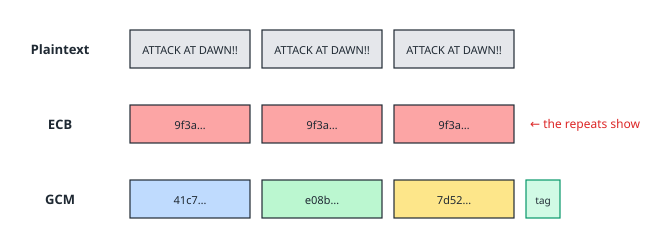

# Symmetric Encryption

**Symmetric encryption is scrambling data with a secret key so that only someone holding the same key can unscramble it.**

## Before you start
<!-- bite: cfd8a377-d262-4664-9452-b4bf476c693e -->

You should have:

- Read the map of the four goals → [[cybersecurity/05-cryptography/01-what-is-cryptography|what is cryptography]].
- Python 3, and the `cryptography` library: `pip install cryptography`.

After this lesson you will be able to:

1. Say what AES is, and what the key size means.
2. Explain why a block cipher needs a mode, and why ECB leaks patterns.
3. Encrypt with AES-GCM in Python, and show it catches tampering.
4. State the two rules that keep GCM safe: never reuse a nonce, and never invent your own key.

**Study route.** Kid version and §1–4, then run the worked example, which shows the ECB leak and GCM's tamper check side by side.

## What symmetric encryption is
<!-- bite: 03b9456e-2553-48ae-aff0-b72475ff31ad -->

Lesson 01 split cryptography into two families. This is the fast one, and it does almost all the work. When your WireGuard tunnel carries a file, when HTTPS carries a page, when your laptop's disk is encrypted, the bytes themselves are scrambled with a symmetric cipher, nearly always AES or ChaCha20.

It's fast and it's strong, but only when it's used right. The same cipher used the wrong way leaks the shape of your data, or lets an attacker change it unseen. This lesson shows both mistakes on your own machine, then the right way.

## The kid version
<!-- bite: beced746-f636-4c79-a965-1fad4854315b -->

Imagine a lockbox with a special lock: the same key locks it and opens it. You lock a message inside, and you give a copy of the key to your friend. Anyone who grabs the box in between sees a locked box. Your friend opens it with their copy.

That's symmetric encryption: one key, two copies, one on each side.

**Where the analogy stops working.** You could hand your friend a key in person. On the internet there's no "in person": the only way to send the key is over the same network you don't trust. Symmetric encryption can't solve that on its own. Lesson 04 does.

## 1. AES — the standard cipher
<!-- bite: a5aa2835-3eda-4ff9-a381-c5f2179c0543 -->

**AES** is the symmetric cipher almost everything uses. It was picked in an open public competition in 2001 (Kerckhoffs's principle in action), and after more than twenty years of the world's best attacks, it's still unbroken. Most laptop and phone chips even have instructions built in to run it fast.

AES is a **block cipher**: it scrambles data 16 bytes (128 bits) at a time. The key is 128, 192 or 256 bits. Even the smallest, 128 bits, has 2¹²⁸ possible keys, a number with 39 digits. Trying every key isn't a realistic attack (lesson 06 does the sum). AES-256 is common, mostly because it sounds safer; AES-128 is also considered safe.

The other cipher you'll meet is **ChaCha20**, a **stream cipher**: it makes a stream of random-looking bytes from the key and mixes it with your data byte by byte. It's fast in plain software, without special chip support, which is why WireGuard and many phones use it.

## 2. Modes — the part people get wrong
<!-- bite: 7383d3bf-bdef-42f2-ad81-ee16aab12820 -->

AES on its own only knows how to scramble *one* 16-byte block. A real message is many blocks. A **mode of operation** is the recipe for handling many blocks, and the wrong recipe ruins a perfect cipher.

The worst recipe is **ECB**: scramble each block on its own with the same key. The trouble is that identical plaintext blocks always give identical ciphertext blocks. So the *pattern* of your data shows through, even though no single block can be read. The famous demonstration is an image encrypted with ECB: you can still see the picture's outline.

## 2. Modes: the leak, drawn
<!-- bite: caa9f5d6-5e7e-406a-a636-321ac83b4fe9 -->

Here are three identical blocks, `ATTACK AT DAWN!!`, encrypted both ways:



With ECB, the repeats are visible: an attacker learns "the same thing was said three times" without breaking anything. With **GCM**, every block looks different, because GCM mixes a counter into each block. And GCM adds a **tag** on the end, which is the second half of the story.

## 3. GCM — encryption with a tamper seal
<!-- bite: 1ef792f2-f4f6-423d-a040-73a3654689d6 -->

Lesson 01 warned that encryption alone gives confidentiality, not integrity. Someone can flip bits in ciphertext without being able to read it, and some modes let that change land predictably in the decrypted message.

**GCM** fixes that. It encrypts *and* computes a **tag**, a short checksum over the ciphertext made with the key. On decryption, the tag is checked first. If a single bit was changed, the check fails and you get an error instead of altered data. Encryption that includes this check is called **authenticated encryption (AEAD)**, and it's what you should always use: AES-GCM, or ChaCha20-Poly1305.

You'll still meet **CBC**, an older mode that chains each block to the one before. It hides patterns, but has no tag, so it needs a separate integrity check, and carelessly built CBC systems leak through their error messages (a padding oracle, lesson 06). For anything new, choose GCM.

## Terms used in this lesson
<!-- bite: 0083fc6c-65af-4a68-a0c0-e58e851e2ff6 -->

1. **AES (Advanced Encryption Standard)**: The letters stand for those words. It's the standard symmetric block cipher, with 128-, 192- or 256-bit keys.
2. **Block cipher**: This is a cipher that scrambles fixed-size chunks of data. AES's chunk, its **block**, is 16 bytes.
3. **Stream cipher**: This is a cipher that turns the key into a stream of random-looking bytes and mixes it with the data byte by byte, like ChaCha20.
4. **Mode of operation**: This is the recipe for using a block cipher on a message longer than one block.

## Terms used in this lesson: modes and nonces
<!-- bite: 15eb3b80-719c-4226-bbf7-52f788b94e64 -->

The rest of the terms name the modes and the values they need.

5. **ECB (Electronic Codebook)**: The letters stand for those words. It's the mode that encrypts each block alone, so identical blocks look identical. Don't use it.
6. **GCM (Galois/Counter Mode)**: The letters stand for those words. It's the recommended mode: it encrypts and adds a tag that detects tampering.
7. **Nonce**: This is short for "number used once". It's a value that must be different every time you encrypt with the same key. In CBC the equivalent is called an **IV (initialisation vector)**.
8. **AEAD (authenticated encryption with associated data)**: The letters stand for those words. It's encryption with a built-in integrity check, like AES-GCM.

## 4. The two rules that keep GCM safe
<!-- bite: 6cda0ff3-6d1e-4f80-bac5-fd5410ec8796 -->

GCM is excellent, and it has two rules that you must not break.

**Rule 1: never reuse a nonce with the same key.** GCM's counter starts from the nonce. Encrypt two messages with the same key and the same nonce, and they're scrambled with the identical stream, so an attacker can cancel it out and learn how the two messages differ. Worse, it lets them forge tags. The safe way: a fresh 12-byte random nonce every time, stored next to the ciphertext. It isn't secret; it only has to be unique.

**Rule 2: the key must really be random, and really be secret.** A key typed by a human is a password, not a key, and passwords can be guessed. If you must start from a password, turn it into a key with a slow key-derivation function (PBKDF2, scrypt or Argon2), the same slow-on-purpose idea as bcrypt from the web-security section. Lesson 01's `openssl -pbkdf2` did exactly that.

And the problem neither rule solves: getting the same key to both sides. That's next lesson's question.

## Worked example — see ECB leak and GCM catch tampering
<!-- bite: c3975fd3-9d2a-4d26-8285-dfb5b26da884 -->

Save this as `aes_lab.py` and run it with `python3 aes_lab.py`.

```python
# aes_lab.py: the same message, the wrong mode and the right one.
import os
from cryptography.hazmat.primitives.ciphers import Cipher, algorithms, modes
from cryptography.hazmat.primitives.ciphers.aead import AESGCM
from cryptography.exceptions import InvalidTag

key = AESGCM.generate_key(bit_length=256)       # 32 random bytes
message = b"ATTACK AT DAWN!!" * 3               # three identical 16-byte blocks

ecb = Cipher(algorithms.AES(key), modes.ECB()).encryptor()
ct = ecb.update(message) + ecb.finalize()
for i in range(3):
    print("ECB block", i, ct[16 * i:16 * i + 16].hex()[:16], "...")

aes = AESGCM(key)
nonce = os.urandom(12)                          # fresh for every message
ct = aes.encrypt(nonce, message, None)          # ciphertext with a 16-byte tag on the end
for i in range(3):
    print("GCM block", i, ct[16 * i:16 * i + 16].hex()[:16], "...")

tampered = bytearray(ct)
tampered[0] ^= 1                                # flip one bit
try:
    aes.decrypt(nonce, bytes(tampered), None)
except InvalidTag:
    print("GCM: tampering detected")
print("GCM: decrypts to", aes.decrypt(nonce, ct, None)[:16])
```

## Worked example: reading the output
<!-- bite: 8e18974e-39e0-41a7-a38e-fed020bcefcb -->

**Predict first:** how many *different* ECB blocks will print, and how many different GCM blocks? Then run it. The hex is random each run, but the shape is always the same:

```text
ECB block 0 5c1e9a07d3b2f418 ...
ECB block 1 5c1e9a07d3b2f418 ...
ECB block 2 5c1e9a07d3b2f418 ...
GCM block 0 a3f08c21e9d55b70 ...
GCM block 1 17bd6e4c0a92f3e8 ...
GCM block 2 e4419d7f2c08b6a1 ...
GCM: tampering detected
GCM: decrypts to b'ATTACK AT DAWN!!'
```

The three ECB lines are identical: the repetition leaked. The GCM lines all differ. Flipping a single bit made decryption refuse with `InvalidTag`, so nobody receives altered data. The untouched ciphertext decrypts normally.

## Common pitfalls and traps
<!-- bite: 4628d5f2-c6d0-4aad-be0c-a7c32d08a751 -->

1. **ECB mode.** It leaks patterns. If a library defaults to it, or a code sample uses it, that's a bug.
2. **Reusing a nonce.** Same key plus same nonce in GCM breaks both confidentiality and the tamper check. Generate a fresh random nonce every time.
3. **Encryption without integrity.** CBC alone, or a stream cipher alone, can be tampered with. Use AEAD (GCM or ChaCha20-Poly1305).
4. **A password used directly as a key.** Run it through a slow key-derivation function first.
5. **The key stored next to the data.** Encrypting a database and putting the key in the same server's config file mostly protects you from people who don't look. Keys belong in a secrets manager (lesson 06).

## Check your understanding
<!-- bite: 58a229cf-dd3f-461b-a328-d8a247f0f749 -->

Try each one before you open the answer.

1. <!-- q: mcq id="560ed66a" -->
   A database encrypts each user's 16-byte country code with AES in ECB mode, using one key. An attacker steals the encrypted column but not the key. What can they learn?

   - [ ] Nothing, because AES is unbroken.
   - [x] Which users share a country, because identical plaintext blocks give identical ciphertext blocks.
   - [ ] Every user's country, because ECB is reversible without the key.
   - [ ] The key, by comparing blocks.

   <details><summary>Answer</summary>

   ECB encrypts each block on its own, so equal inputs give equal outputs. The attacker can group users by country without reading a single one, and if they know one user's country, they know everyone in that group's.

   </details>

2. <!-- q: exact id="123943a0" answer="16" -->
   AES is a block cipher. How many bytes are in one AES block?

   <details><summary>Answer</summary>

   16 bytes (128 bits), whatever the key size. The key size (128, 192 or 256 bits) is separate from the block size.

   </details>

3. <!-- q: mcq id="f795ef9b" -->
   Someone flips one bit of an AES-GCM ciphertext in transit. What happens when the receiver decrypts it?

   - [ ] It decrypts with one character changed.
   - [ ] It decrypts as random-looking garbage.
   - [x] Decryption fails with an authentication error, because the tag no longer matches.
   - [ ] Nothing changes, because GCM ignores single-bit errors.

   <details><summary>Answer</summary>

   GCM checks the tag before giving back any plaintext, so a changed ciphertext is rejected outright. That built-in integrity check is what makes it authenticated encryption.

   </details>

4. <!-- q: gap id="4ff1975a" answers="nonce|IV" -->
   In AES-GCM, the value that must be different for every message encrypted with the same key, and that is stored openly next to the ciphertext, is called the ___.

   <details><summary>Answer</summary>

   The nonce ("number used once"). It isn't secret, only unique. Reusing one with the same key breaks GCM's confidentiality and its tamper check.

   </details>

5. <!-- q: mcq id="864e565e" -->
   A developer builds an encryption key by taking the SHA-256 of a user's password, once. What's the problem?

   - [ ] SHA-256 output is too short for AES.
   - [x] SHA-256 is fast, so an attacker can test billions of password guesses per second to find the key; a slow key-derivation function like scrypt or Argon2 should be used.
   - [ ] SHA-256 can't be used with AES at all.
   - [ ] Nothing, as long as the password is secret.

   <details><summary>Answer</summary>

   The key is only as strong as the password, and a fast hash makes guessing cheap, exactly like storing passwords with SHA-256. A slow, salted key-derivation function makes every guess expensive.

   </details>

6. <!-- q: open id="35962f04" -->
   Explain the one problem symmetric encryption can't solve on its own, using the example of your laptop and a server you've never connected to before.

   <details><summary>Answer</summary>

   Both sides must already share the same secret key. The laptop and the new server have no shared secret, and the only way to send one is over the network, where anyone watching could copy it, and then decrypt everything. Symmetric encryption needs the key exchange solved first, which is what asymmetric cryptography (Diffie–Hellman) does.

   </details>

## Practice — encrypt a file properly
<!-- bite: f625e4a0-a3a8-45d7-8bac-729cc4c3c73d -->

**Task.** Write `vault.py` with two commands: `encrypt FILE` and `decrypt FILE.enc`.

1. Use AES-GCM with a 256-bit key read from a separate key file (generate it once with `AESGCM.generate_key`, and keep that file out of git).
2. Make a fresh random nonce for every encryption, and store it at the front of the output file.
3. On decrypt, read the nonce back, and print a clear error if the tag check fails.
4. Test it: encrypt a file twice and check the two outputs differ; then change one byte of a `.enc` file and check decryption refuses it.

## Practice: when your tool is done
<!-- bite: a8dc7955-197f-4075-9d19-1218ee072469 -->

Here is how you know the task is finished, plus a stretch step.

**Done when:** encrypting the same file twice gives two different outputs, both decrypt correctly, and a one-byte edit makes decryption fail with your error. Record it in `cybersecurity/LIVE-RUNS-TODO.md`.

**Stretch.** Add a `--password` option that derives the key from a password with `Scrypt` (in `cryptography.hazmat.primitives.kdf.scrypt`), storing a random salt next to the nonce. Time how long one derivation takes, and work out how long 14.3 million guesses would take.

## Before moving on
<!-- bite: f95848ca-5e4a-401a-8cdb-0bad5a91ddf3 -->

You can now explain AES and its key sizes, say why a block cipher needs a mode and why ECB leaks, encrypt with AES-GCM and watch it catch tampering, and keep GCM safe with fresh nonces and real keys.

**Recap for later lookup:** AES = block cipher, 16-byte blocks, 128/256-bit keys; ChaCha20 = stream cipher. ECB leaks patterns, never use it. CBC hides patterns but has no tag. Use AEAD: AES-GCM or ChaCha20-Poly1305. Fresh random 12-byte nonce per message, stored with the ciphertext. Passwords become keys only through a slow KDF. Symmetric can't share its own key.

Next: [[cybersecurity/05-cryptography/03-hashing-and-integrity|hashing and integrity]]. GCM's tag checks integrity with the key; hashing checks it with no key at all, and HMAC adds one back.

## Related
<!-- bite: 8a844152-a0e5-418e-b4f4-2eec79473e45 -->

- [[cybersecurity/03-network-security/03-vpns-and-encryption-in-transit|VPNs and encryption in transit]] — WireGuard, which carries your data with ChaCha20-Poly1305.
- [[cybersecurity/05-cryptography/06-cryptographic-attacks-and-best-practices|Cryptographic attacks]] — padding oracles, nonce reuse and key management.
- [[cybersecurity/02-ethical-hacking/10-pdf-and-document-security|PDF and document security]] — AES-256 that still fell to a weak password.

## About this lesson
<!-- bite: 02f4bfc4-c0a7-48c3-8186-fe5f7099513d -->

**Level:** Intermediate. **Covers:** AES and its key and block sizes, block versus stream ciphers, modes of operation (ECB, CBC, GCM), authenticated encryption, nonces, keys from passwords, and a Python lab showing the ECB pattern leak and GCM's tamper detection. **Where it sits:** lesson 2 of the [[cybersecurity/05-cryptography/index|Cryptography]] section. **Sources:** the original vault note, rebuilt with a runnable lab. `[reference]` — the lab hasn't been run yet (the hex in the sample output is illustrative); tracked in `cybersecurity/LIVE-RUNS-TODO.md`.
