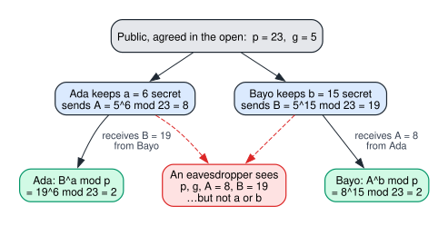
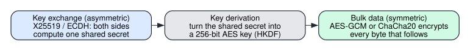

# Asymmetric Encryption

**Asymmetric encryption uses a pair of linked keys, a public key anyone can have and a private key only you keep, so that strangers can protect messages to you, or agree a shared secret with you, without ever meeting.**

## Before you start
<!-- bite: d56c5371-5d7e-47d6-a690-bab8e549ae16 -->

You should have:

- Encrypted with AES-GCM, and seen that both sides need the same key → [[cybersecurity/05-cryptography/02-symmetric-encryption|symmetric encryption]].
- Met modular arithmetic ("mod"), even roughly → [[mathematics/02-discrete-math/08-number-theory-and-modular-arithmetic|number theory]].
- Python with the `cryptography` library.

After this lesson you will be able to:

1. Explain what a trapdoor function is, and why it makes public keys possible.
2. Run RSA by hand on small numbers, and say why real keys are 2048 bits or more.
3. Work a Diffie–Hellman exchange, and say what forward secrecy means.
4. Build hybrid encryption in Python: an X25519 exchange that becomes an AES-GCM key.

**Study route.** Kid version and §1–5, working the small-number examples with a calculator, then the worked example.

## What asymmetric encryption is
<!-- bite: d8e4ef1f-53e6-43f9-aa4f-8aa43ace8b05 -->

Lesson 02 ended on a problem: AES needs the same key on both sides, and you can't send the key over a network you don't trust. For most of history there was no answer except meeting in person. In the 1970s, mathematicians found one, and it's what makes the internet's security work.

The trick is a key *pair*. What one key does, only the other can undo. You'll meet the two ways it's used: encrypting to someone's public key (RSA), and two strangers each computing the same secret without sending it (Diffie–Hellman). Then you'll see why real systems use this only for a moment, at the start, and hand over to AES. Your WireGuard tunnel from the network-security section does exactly that: its keys are X25519 keys, the kind you'll generate here.

## The kid version
<!-- bite: d99d2ca6-c004-4f19-853e-9dd6458186f9 -->

Imagine an open padlock that anyone can snap shut, but only you have the key to open. You make hundreds of copies of the open padlock and leave them everywhere. A friend wants to send you a secret: they put it in a box, snap your padlock shut, and post it. Nobody on the way can open it, not even your friend. Only you can.

The open padlock is your **public key**. The key that opens it is your **private key**.

**Where the analogy stops working.** A padlock is slow to make and you can't make one per message. Real public-key maths is also slow, about a thousand times slower than AES. So in practice nobody padlocks the whole message. They padlock (or agree) one small AES key, and use AES for everything else. That's hybrid encryption, §5.

## 1. Trapdoor functions — easy one way, hard back
<!-- bite: a53dd509-7828-4c2b-b84b-119a2ffbeff6 -->

Public-key cryptography rests on maths that's easy in one direction and practically impossible in reverse, unless you know a secret. That's a **trapdoor function**.

The classic example: multiplying two big prime numbers is easy. A computer multiplies two 300-digit primes instantly. But given only the 600-digit answer, finding the two primes again (**factoring**) would take the world's computers longer than the age of the universe, as far as anyone knows. The primes are the trapdoor: if you know them, the hard direction becomes easy.

RSA is built on factoring. Diffie–Hellman and elliptic-curve cryptography use a different hard problem (the **discrete logarithm**), but the shape is the same: a public value anyone can see, and a secret that makes the reverse direction easy.

## 2. RSA by hand, with small numbers
<!-- bite: 92ee556e-ee68-4329-8106-065d0e94597b -->

Here's RSA with numbers small enough to check on a calculator. Real RSA is identical, just with 600-digit numbers.

**Make the keys.** Pick two primes, p = 61 and q = 53. Multiply them: n = 61 × 53 = 3233. Compute (p − 1)(q − 1) = 60 × 52 = 3120. Pick e = 17. Find d so that e × d leaves remainder 1 when divided by 3120: d = 2753 (check: 17 × 2753 = 46801 = 15 × 3120 + 1).

The **public key** is (n = 3233, e = 17). The **private key** is d = 2753. The primes 61 and 53 are thrown away, because anyone who knows them can compute d.

**Encrypt** the message m = 65 with the public key: c = 65¹⁷ mod 3233 = **2790**.

**Decrypt** with the private key: 2790²⁷⁵³ mod 3233 = **65**. The original comes back.

Anyone can encrypt to you with (3233, 17). Only the holder of 2753 can decrypt. And finding 2753 from 3233 means factoring 3233, easy here, impossible for a real 2048-bit n.

## 3. Real RSA, and why elliptic curves took over
<!-- bite: 37da6ffb-0fe6-4b7f-a177-a3a42390b05e -->

Real RSA uses an n of 2048 bits or more, so factoring is out of reach. It also never encrypts a raw number like the example: it adds random **padding** (called OAEP) first, because "textbook" RSA has structural weaknesses. As always, use the library, never your own maths.

RSA keys are big and slow. **Elliptic-curve cryptography (ECC)** gives the same security with far smaller keys: a 256-bit elliptic-curve key is about as strong as a 3072-bit RSA key. Smaller keys mean faster handshakes and less data to send, so ECC is the modern default. You'll meet it as **X25519** for key exchange (in WireGuard and TLS) and **Ed25519** or **ECDSA** for signatures (lesson 05).

## Terms used in this lesson
<!-- bite: 37fce432-b42d-45dc-86cc-a95ea2c4b7a2 -->

1. **Public key and private key**: These are the two halves of a key pair. The public key is shared with anyone; the private key never leaves its owner. What one does, only the other can undo.
2. **Trapdoor function**: This is maths that's easy one way and practically impossible to reverse, unless you know a secret (the trapdoor).
3. **RSA**: This is the classic public-key system, named after its inventors Rivest, Shamir and Adleman. Its security rests on how hard it is to factor a big number.
4. **ECC (elliptic-curve cryptography)**: The letters stand for those words. It's public-key cryptography built on elliptic curves, giving the same strength as RSA with much smaller keys.

## Terms used in this lesson: exchanging keys
<!-- bite: 107194ce-a195-427c-88e1-fbc6518edac3 -->

The rest of the terms are about agreeing a key and keeping old traffic safe.

5. **Diffie–Hellman**: This is a method for two parties to compute the same secret over a public channel without ever sending it. **ECDH** is the elliptic-curve version; **X25519** is the most common ECDH curve.
6. **Shared secret**: This is the value both sides compute in a key exchange. It's turned into an AES key by a **key derivation function (HKDF)**.
7. **Forward secrecy**: This is the property that stealing a server's long-term key later can't decrypt past sessions, because each session used fresh, thrown-away keys.
8. **Hybrid encryption**: This is using asymmetric cryptography to agree a key, then symmetric encryption for the data.

## 4. Diffie–Hellman — a shared secret nobody sent
<!-- bite: fcf07e63-9e72-4da3-a750-da0ddfe0275b -->

Diffie–Hellman lets two people who've never met end up holding the same secret, while an eavesdropper who sees every message can't work it out. Here it is with small numbers.

Ada and Bayo agree, in public, on p = 23 and g = 5. Ada secretly picks a = 6 and sends A = 5⁶ mod 23 = 8. Bayo secretly picks b = 15 and sends B = 5¹⁵ mod 23 = 19. Then each combines their own secret with the other's public value:



## 4. Diffie–Hellman: checking the answer
<!-- bite: 6b7d64dd-951f-4b7a-91ab-fba7b1a82982 -->

Now check that both sides really land on the same number.

Ada computes 19⁶ mod 23 = 2. Bayo computes 8¹⁵ mod 23 = 2. Same answer, and 2 was never sent. The eavesdropper has 23, 5, 8 and 19, and to get 2 they'd need to recover 6 or 15 from them, the discrete logarithm problem. With real-sized numbers, that's out of reach.

## 4. Diffie–Hellman: forward secrecy, and the catch
<!-- bite: 60319381-6d5d-40df-9665-4575a9508f6b -->

Modern protocols generate a fresh Diffie–Hellman pair for every session and throw it away afterwards. That gives **forward secrecy**: if an attacker records your traffic today and steals the server's long-term key next year, they still can't decrypt today's traffic, because the session keys no longer exist anywhere. TLS 1.3 requires it.

The catch: Diffie–Hellman alone doesn't tell you *who* you agreed a secret with. An attacker in the middle can run one exchange with Ada and another with Bayo, and relay between them, reading everything. The fix is to *authenticate* the exchange: the server signs its half, and the client checks that signature against a certificate. That's lesson 05. WireGuard solves it differently: each side already knows the other's public key, because you pasted it into the config by hand.

## 5. Hybrid encryption — how real systems use both families
<!-- bite: 56c9a352-41ec-4c4a-907d-f30225bb0245 -->

Public-key operations are slow; AES is fast. So every real protocol combines them:



Asymmetric crypto runs once, to agree a secret. A key derivation function turns that secret into a proper AES key. Then AES-GCM (or ChaCha20) encrypts every byte after that. That's TLS, WireGuard, Signal and SSH, all the same shape.

## 5. Hybrid encryption: the quantum question
<!-- bite: d6336a34-1d94-4e42-8c62-c6d4ea46694d -->

One threat hangs over the public-key half of this picture.

One more thing to know about: a large enough quantum computer would break RSA, Diffie–Hellman and ECC, using **Shor's algorithm**. None exists yet, but recorded traffic could be decrypted later, so new **post-quantum** algorithms have been standardised (ML-KEM is the key-exchange one), and browsers already combine one with X25519 in TLS. AES and SHA-256 are much less affected; bigger keys are enough.

## Worked example — hybrid encryption in Python
<!-- bite: f5d33c9c-274b-497f-aca8-5eef2060e6f1 -->

This is lesson 02's AES-GCM, but with the key agreed by X25519 instead of shared in advance. Save it as `hybrid.py`:

```python
# hybrid.py: agree a key with X25519, then encrypt with AES-GCM.
import os
from cryptography.hazmat.primitives.asymmetric.x25519 import X25519PrivateKey
from cryptography.hazmat.primitives.kdf.hkdf import HKDF
from cryptography.hazmat.primitives import hashes
from cryptography.hazmat.primitives.ciphers.aead import AESGCM

ada, bayo = X25519PrivateKey.generate(), X25519PrivateKey.generate()
ada_pub, bayo_pub = ada.public_key(), bayo.public_key()     # only these two travel

secret_ada = ada.exchange(bayo_pub)        # Ada: her private key + Bayo's public key
secret_bayo = bayo.exchange(ada_pub)       # Bayo: his private key + Ada's public key
print("same shared secret:", secret_ada == secret_bayo)

def to_aes_key(secret: bytes) -> bytes:
    return HKDF(algorithm=hashes.SHA256(), length=32, salt=None, info=b"hybrid demo").derive(secret)

nonce = os.urandom(12)
ciphertext = AESGCM(to_aes_key(secret_ada)).encrypt(nonce, b"meet at 3", None)
print("Bayo reads:", AESGCM(to_aes_key(secret_bayo)).decrypt(nonce, ciphertext, None))
```

## Worked example: what just happened
<!-- bite: 13fa0629-1d67-4ae3-91bc-6f46cd136587 -->

**Predict first:** the private keys never left their owners. Will the two shared secrets match? Then run `python3 hybrid.py`:

```text
same shared secret: True
Bayo reads: b'meet at 3'
```

That's the whole of §4 and §5 in twenty lines. Only the two public keys crossed the "network". Each side combined its own private key with the other's public key and reached the same 32-byte secret. HKDF turned it into an AES key, and AES-GCM did the real work.

This is what your WireGuard tunnel did. `wg genkey` made an X25519 private key, `wg pubkey` made its public key, and you swapped only the public keys between your laptop and the VPS. Each side then computed the same secret, exactly as `exchange()` does here.

## Common pitfalls and traps
<!-- bite: 6b2de913-ef9d-420e-81d4-0734ef9cd9a6 -->

1. **Textbook RSA.** Raw RSA without padding has known attacks. Use the library's OAEP for encryption and never do the maths yourself.
2. **Short RSA keys.** 1024-bit RSA is no longer safe. Use 2048 or more, or switch to elliptic curves.
3. **Unauthenticated key exchange.** Diffie–Hellman with no check of who's on the other end invites a man-in-the-middle. Pin or sign the public keys.
4. **Encrypting big data with RSA.** It's slow and limited in size. Agree a key, then use AES.
5. **A leaked private key.** Everything encrypted to it without forward secrecy is exposed, and every signature it made can be forged from then on. Protect it above all else (lesson 06).

## Check your understanding
<!-- bite: 41b09713-0c40-4f18-95d9-c45b37fb4f85 -->

Try each one before you open the answer.

1. <!-- q: exact id="63149ea9" answer="3233" -->
   In an RSA example, the primes are p = 61 and q = 53. What is the public modulus n?

   <details><summary>Answer</summary>

   n = p × q = 61 × 53 = 3233. It's published as part of the public key, while 61 and 53 must stay secret, because anyone who knows them can compute the private key.

   </details>

2. <!-- q: exact id="1f52a7ca" answer="2" -->
   Diffie–Hellman with public values $p = 23$ and $g = 5$. Ada's secret is $a = 6$, so she sent $A = 8$. Bayo's secret is $b = 15$, so he sent $B = 19$. What shared secret does Ada compute as $B^a \bmod p$, that is $19^6 \bmod 23$?

   <details><summary>Answer</summary>

   2. And Bayo computes $A^b \bmod p = 8^{15} \bmod 23$, which is also 2. The eavesdropper sees 23, 5, 8 and 19, but not 6 or 15, so they can't compute it.

   </details>

3. <!-- q: mcq id="1e442995" -->
   Why do TLS and WireGuard use public-key cryptography only at the start of a connection, and AES or ChaCha20 for all the data?

   - [ ] Public-key cryptography can only encrypt text, not files.
   - [x] Public-key operations are far slower, so they're used once to agree a key, and the fast symmetric cipher does the bulk work.
   - [ ] AES is more secure than public-key cryptography.
   - [ ] Public-key keys expire after a few seconds.

   <details><summary>Answer</summary>

   It's hybrid encryption: the slow asymmetric part solves the key-sharing problem once, and a symmetric cipher, roughly a thousand times faster, encrypts everything after that.

   </details>

4. <!-- q: mcq id="cb4ef51b" -->
   An attacker records all of a website's HTTPS traffic in 2026. In 2027 they steal the server's long-term private key. The site uses TLS 1.3 with ephemeral Diffie–Hellman. Can they decrypt the 2026 traffic?

   - [ ] Yes, the private key decrypts all past traffic.
   - [x] No. Each session's key came from a fresh Diffie–Hellman pair that was thrown away, so the long-term key can't recreate it.
   - [ ] Only the first session.
   - [ ] Yes, if the traffic was over Wi-Fi.

   <details><summary>Answer</summary>

   That's forward secrecy. The long-term key only signs the handshake to prove who the server is; it never encrypts the session key. The ephemeral keys that did no longer exist.

   </details>

5. <!-- q: mcq id="25818ee4" -->
   Two strangers run a Diffie–Hellman exchange with no certificates and no known public keys. What can an attacker who sits between them and controls their messages do?

   - [ ] Nothing, because Diffie–Hellman never sends the secret.
   - [x] Run a separate exchange with each side, then decrypt, read and re-encrypt everything between them (a man-in-the-middle).
   - [ ] Only slow the connection down.
   - [ ] Learn the secret by watching the public values.

   <details><summary>Answer</summary>

   Diffie–Hellman hides the secret from a *passive* listener, but it doesn't say who you're talking to. An active attacker can pretend to be each side to the other. Authenticating the exchange, with signatures and certificates, or with public keys known in advance as in WireGuard, closes that gap.

   </details>

6. <!-- q: open id="30ff2494" -->
   A friend says: "Quantum computers will break all encryption, so nothing we do now matters." Explain what's actually at risk, and what's being done.

   <details><summary>Answer</summary>

   A large quantum computer running Shor's algorithm would break RSA, Diffie–Hellman and elliptic-curve cryptography, the public-key part. Symmetric ciphers and hashes like AES and SHA-256 are only weakened, and bigger keys fix that. The real risk today is "record now, decrypt later": traffic captured now could be read once such a machine exists. So post-quantum key-exchange algorithms like ML-KEM have been standardised and are already used alongside X25519 in browsers' TLS.

   </details>

## Practice — RSA and Diffie–Hellman by hand, then in code
<!-- bite: 5524c1e1-5ed2-4dbd-8fd0-76dc8cf895d5 -->

**Task.** Make the maths yours, then check it.

1. RSA by hand: use p = 11, q = 17, e = 7. Compute n, (p − 1)(q − 1), and d. Encrypt m = 9, then decrypt it. Check every step with Python's `pow(m, e, n)` and `pow(e, -1, phi)`.
2. Diffie–Hellman by hand: use p = 29, g = 2, a = 5, b = 12. Compute A, B and both sides' secret.
3. Change `hybrid.py` so a third person, Chidi, with his own key pair, tries `chidi.exchange(ada_pub)`. Does he get the same secret? Explain why not.

## Practice: when your maths is done
<!-- bite: 9c9af48b-6865-4215-a943-3904d8d23416 -->

Here is how you know the task is finished, plus a stretch step.

**Done when:** your hand answers match Python's for both exercises, and you've written one sentence explaining why Chidi's secret differs. Record it in `cybersecurity/LIVE-RUNS-TODO.md`.

**Stretch.** On your laptop, run `wg genkey | tee priv | wg pubkey`. Then load the same private key in Python (`X25519PrivateKey.from_private_bytes(base64.b64decode(...))`), print its public key in Base64, and check it matches what `wg pubkey` printed. Your WireGuard keys are ordinary X25519 keys.

## Before moving on
<!-- bite: 5446c268-b53a-4557-8e13-10f953bfef82 -->

You can now explain trapdoor functions, run RSA and Diffie–Hellman on small numbers, say why real systems use elliptic curves and fresh keys per session, and build hybrid encryption with X25519 and AES-GCM.

**Recap for later lookup:** key pair: public shares, private stays. RSA = factoring; 2048+ bits, always padded (OAEP). ECC = same strength, smaller keys (X25519 exchange, Ed25519/ECDSA signatures). Diffie–Hellman: both compute g^(ab) mod p, nobody sends it. Ephemeral keys = forward secrecy. Unauthenticated DH invites a man-in-the-middle. Hybrid: exchange → HKDF → AES-GCM. Quantum threatens the public-key half; ML-KEM is the answer.

Next: [[cybersecurity/05-cryptography/05-digital-signatures-and-pki|digital signatures and PKI]], the fix for "who did I just agree a key with?"

## Related
<!-- bite: caaf7770-baa4-43b3-8d50-6d08db776589 -->

- [[mathematics/02-discrete-math/08-number-theory-and-modular-arithmetic|Number theory]] — the modular arithmetic underneath, and RSA derived properly.
- [[networking/12-tls-and-transport-security/index|TLS and transport security]] — the handshake that uses all of this.
- [[cybersecurity/03-network-security/03-vpns-and-encryption-in-transit|VPNs and encryption in transit]] — WireGuard, an X25519 key exchange you built by hand.

## About this lesson
<!-- bite: f353af3d-2285-4767-a267-21dda80f3a92 -->

**Level:** Advanced. **Covers:** trapdoor functions, RSA worked by hand and its real-world padding and key sizes, elliptic-curve cryptography, Diffie–Hellman worked by hand, forward secrecy, man-in-the-middle on unauthenticated exchange, hybrid encryption, post-quantum cryptography, and an X25519-to-AES-GCM lab. **Where it sits:** lesson 4 of the [[cybersecurity/05-cryptography/index|Cryptography]] section. **Sources:** the original vault note, rebuilt with worked numbers and a runnable lab; the Diffie–Hellman numbers are asserted in `scripts/diagrams/cybersecurity.py`, and the RSA numbers were checked in Python. `[reference]` — the lab hasn't been run yet; tracked in `cybersecurity/LIVE-RUNS-TODO.md`.
