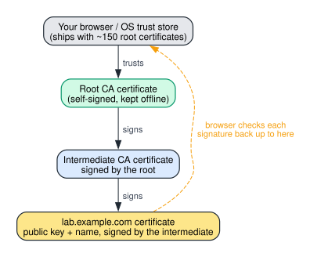

# Digital Signatures and PKI

**A digital signature is a value only the holder of a private key can produce, which anyone with the matching public key can check, proving who signed a message and that it hasn't changed since.**

## Before you start
<!-- bite: ba1f5ba9-8154-4edc-9f3f-cf4d53ee4390 -->

You should have:

- Met key pairs and the man-in-the-middle problem → [[cybersecurity/05-cryptography/04-asymmetric-encryption|asymmetric encryption]].
- Built an HMAC, which proves authorship with a *shared* key → [[cybersecurity/05-cryptography/03-hashing-and-integrity|hashing and integrity]].
- `openssl` and Python with the `cryptography` library.

After this lesson you will be able to:

1. Sign and verify a message with Ed25519, and show a changed message fails.
2. Say what a signature proves, and what it doesn't.
3. Explain how certificates and the chain of trust answer "whose public key is this?"
4. Build a tiny certificate authority with `openssl`, issue a certificate from it, and verify the chain.

**Study route.** Kid version and §1–4, then both worked examples: signing in Python, then your own CA in the terminal.

## What digital signatures and PKI are
<!-- bite: 95fe6f1d-8e6c-4888-a3e1-ef2671c7b4df -->

Lesson 04 left a hole. Diffie–Hellman agrees a secret, but not *with whom*: an attacker in the middle can agree one with each side. HMAC from lesson 03 proves authorship, but only between people who already share a key. The internet needs something stronger: proof of authorship that anyone can check, with no shared secret at all.

That's a digital signature. And signatures lead straight to the next question: when you check a signature with a public key, how do you know the key really belongs to your bank and not an attacker? The answer is **PKI**, the system of certificates and certificate authorities behind the padlock on your VPS from the web-security section. You'll build a small one yourself.

## The kid version
<!-- bite: 95740387-805b-4ee0-bf2f-6a45f7cd6fb4 -->

Imagine a wax seal with a stamp only you own. You press it onto every letter you send. Anyone can look at the seal and compare it to a picture of your stamp, published everywhere, and know the letter is from you. And if anyone opens and reseals the letter, the seal is broken.

The stamp is your **private key**. The published picture is your **public key**. The seal is the **signature**.

**Where the analogy stops working.** How do you know the published picture is really *your* stamp? An attacker could publish their own stamp's picture with your name under it. Somebody trusted has to vouch "this picture belongs to this person". That vouching is a **certificate**, and the trusted somebody is a **certificate authority**.

## 1. Signing and verifying
<!-- bite: c3562442-9fdb-40af-b4fa-f1e4c5a1ce6b -->

A signature uses a key pair the opposite way round to encryption:

1. **Signing** uses the **private key**. The signer hashes the message and runs the hash through the signing algorithm with their private key. Out comes the signature.
2. **Verifying** uses the **public key**. Anyone hashes the message they received and checks it against the signature with the signer's public key. The answer is yes or no.

Change one byte of the message and the hash changes completely (the avalanche effect from lesson 03), so the signature no longer matches. Without the private key, nobody can make a signature that does.

You may read that signing "encrypts the hash with the private key". That's roughly how RSA signatures work, but it isn't true of Ed25519 or ECDSA, the modern choices. Think of it as its own operation: sign with the private key, verify with the public one.

## 2. What a signature proves, and what it doesn't
<!-- bite: 0bf31352-ab28-4895-846f-11a5f7141ed1 -->

A valid signature proves three things:

1. **Integrity** — the message is exactly what was signed.
2. **Authentication** — it was signed by whoever holds that private key.
3. **Non-repudiation** — only they could have made it, so they can't credibly deny it. That's the goal from lesson 01 that only signatures provide, because unlike an HMAC key, the private key isn't shared.

And it doesn't prove that the message is *true* or *safe*. Malware signed with a stolen key verifies perfectly. A signature tells you who signed it and that nothing changed since. Whether to trust that signer is a separate question, and that's where certificates come in.

## 3. Certificates — whose key is this?
<!-- bite: c72635c9-a4eb-47d7-89a9-5f1d7d52a0fe -->

A signature checks out against a public key. But if an attacker hands you *their* public key and says "this is the bank's", their forged messages will verify perfectly too. You need a trusted way to bind a public key to a name.

A **certificate** is that binding: a small document saying "this public key belongs to `lab.example.com`, valid until this date", **signed by a certificate authority (CA)**. You don't need to know the website's key in advance; you only need to trust the CA, and check its signature on the certificate.

Your browser and operating system ship with about 150 trusted **root CA** certificates. Root keys are so valuable they're kept offline, so roots sign **intermediate** CAs, which sign websites' certificates. That makes a **chain of trust**.

## 3. Certificates: the chain, drawn
<!-- bite: 43bc29b8-acf0-499a-a6fe-40b0c2b7461a -->

When your browser connects to your VPS, it walks this chain from the bottom up:



The server sends its own certificate and the intermediate. The browser checks the intermediate's signature on the site's certificate, then the root's signature on the intermediate, and finds that root in its trust store. Every link must verify, the name must match, and nothing may have expired. That chain is also how TLS closes the man-in-the-middle hole from lesson 04: the server *signs* its Diffie–Hellman half, and the certificate proves the signing key is really the site's.

## Terms used in this lesson
<!-- bite: 8a226d01-9481-48e8-9a41-2780d2155c9b -->

1. **Digital signature**: This is a value made from a message with a private key, which anyone can check with the matching public key.
2. **Ed25519**: This is the modern signature algorithm built on elliptic curves: small, fast and hard to misuse. **ECDSA** and **RSA** signatures are the other common ones.
3. **Non-repudiation**: This is the signer being unable to credibly deny signing, because only they hold the private key.
4. **Certificate**: This is a signed document binding a public key to a name, with validity dates. The standard format is called **X.509**.

## Terms used in this lesson: the trust system
<!-- bite: e24da931-f952-43ed-a40a-785a4dc2cd74 -->

The rest of the terms name the parts of the system that issues and cancels certificates.

5. **PKI (public key infrastructure)**: The letters stand for those words. It's the whole system of CAs, certificates and rules that lets strangers trust public keys.
6. **Root CA and intermediate CA**: A root CA's certificate is built into trust stores and signs itself. An intermediate CA is signed by a root, and signs end certificates, so the root key can stay offline.
7. **CSR (certificate signing request)**: The letters stand for those words. It's what you send a CA: your public key and the name you want, signed with your private key to prove you hold it.
8. **Revocation**: This is cancelling a certificate before it expires, usually because its private key leaked. It's published through a **CRL** (a list) or **OCSP** (a live check).

## 4. When things go wrong — revocation and short lives
<!-- bite: 10c17b3d-7675-4000-91fa-2698dab4f278 -->

If a website's private key leaks, its certificate has to stop being trusted before its expiry date, or the attacker can impersonate the site until then. That's **revocation**, and historically it has worked badly: browsers often didn't check, or carried on when the check failed.

The industry's practical answer has been **shorter certificates**. Let's Encrypt's 90-day certificates (from the web-security section) mean a leaked key is useful for weeks, not years, and certificate lifetimes across the industry are being cut further.

The other side of PKI's weakness: it trusts *every* root CA in the store equally. If any one CA is tricked or hacked into issuing a certificate for your domain, browsers accept it. That's why Certificate Transparency logs exist, and why you searched crt.sh for your own domain in the web-security section.

## 4. Signatures outside the web
<!-- bite: 089d79fe-79e9-4852-831e-6c4b448a04b1 -->

The same idea protects software. **Code signing** proves an app or update came from its publisher and wasn't changed; it's why your OS warns about an "unidentified developer". Linux package managers verify every package's signature against the distribution's keys before installing. And Git commits and tags can be signed, so a repository can prove who wrote each change.

A **self-signed certificate** signs itself, with no CA behind it. The cryptography is just as strong; what's missing is anyone vouching for it. It's fine where you control both ends and trust the certificate directly, like a private CA for your own lab, which is exactly the second worked example.

## Worked example — sign and verify in Python
<!-- bite: 01dbb943-d0c8-4d7c-acee-d9f3073dd698 -->

Save this as `sign.py`:

```python
# sign.py: sign with the private key, verify with the public key.
from cryptography.hazmat.primitives.asymmetric.ed25519 import Ed25519PrivateKey
from cryptography.exceptions import InvalidSignature

private_key = Ed25519PrivateKey.generate()      # stays with the signer
public_key = private_key.public_key()           # published for everyone

message = b"Release v1.4: sha256 b94d27b9...cde9"
signature = private_key.sign(message)
print("signature is", len(signature), "bytes")

for candidate in [message, b"Release v1.4: sha256 0fc30e73...f5d4"]:
    try:
        public_key.verify(signature, candidate)
        print("VALID:  ", candidate)
    except InvalidSignature:
        print("INVALID:", candidate)
```

The message is a release note carrying a file's hash, the "signed hash list" that lesson 03 said was needed when an attacker could replace both the file and its hash.

## Worked example: reading the signature output
<!-- bite: 4def5d3f-0b12-4ddb-a23d-137b2aa0552d -->

**Predict first:** the second message swaps in a different hash. Will it verify? Then run `python3 sign.py`:

```text
signature is 64 bytes
VALID:   b'Release v1.4: sha256 b94d27b9...cde9'
INVALID: b'Release v1.4: sha256 0fc30e73...f5d4'
```

An Ed25519 signature is always 64 bytes. The genuine note verifies; the edited one is rejected. An attacker who controls the download website can swap the file and the hash, but they can't make a valid signature for their version without the private key, which never touched the website. That's why this beats a plain hash.

## Worked example — your own certificate authority
<!-- bite: 8a325133-2d77-4915-b401-6eebc6fd8c1d -->

Now build PKI in miniature. In an empty folder, make a root CA, then a key and request for a server called `lab.internal`, then have the root sign it:

```bash
# 1. The root CA: a key pair and a self-signed certificate
openssl req -x509 -newkey ec -pkeyopt ec_paramgen_curve:P-256 -nodes \
  -keyout root.key -out root.crt -days 365 -subj "/CN=Lab Root CA"

# 2. The server: its own key pair and a certificate signing request (CSR)
openssl req -newkey ec -pkeyopt ec_paramgen_curve:P-256 -nodes \
  -keyout lab.key -out lab.csr -subj "/CN=lab.internal"

# 3. The root signs the request, adding the name browsers actually check
printf "subjectAltName=DNS:lab.internal\n" > san.ext
openssl x509 -req -in lab.csr -CA root.crt -CAkey root.key -CAcreateserial \
  -out lab.crt -days 30 -extfile san.ext
```

`root.key` is the most precious file here; a real CA keeps it offline. `lab.key` stays on the server. `lab.crt` is public, and is what the server shows every visitor.

## Worked example: verify the chain
<!-- bite: 4e6440cc-4c74-42e8-8414-4f1dea58ef06 -->

Now check the certificate the way a browser would. **Predict first:** which of these three checks pass?

```bash
openssl verify -CAfile root.crt lab.crt        # trusting your root
openssl verify lab.crt                          # trusting only the system's roots
openssl x509 -in lab.crt -noout -subject -issuer -ext subjectAltName
```

```text
lab.crt: OK
CN=lab.internal
error 20 at 0 depth lookup: unable to get local issuer certificate
error lab.crt: verification failed
subject=CN=lab.internal
issuer=CN=Lab Root CA
X509v3 Subject Alternative Name:
    DNS:lab.internal
```

## Worked example: what the chain check shows
<!-- bite: 68ac8090-3457-42e0-8d02-f9b9239badc5 -->

The three results tell you exactly how trust works.

Against your root it's `OK`. Against the system's trust store it fails, because your root isn't one of the ~150 the system trusts. That's exactly the warning a browser shows for a private CA. A company that runs its own internal CA installs its root on every staff laptop, and then its internal sites verify. Now try making a *second* root, also named "Lab Root CA", and verifying `lab.crt` against it: it fails, because a name isn't trust. Only the right key's signature is.

## Common pitfalls and traps
<!-- bite: 047d3701-66ea-406a-af36-e88936a4129a -->

1. **Trusting a public key that arrived with the message.** If an attacker can send the message, they can send their own key with it. Get keys through a certificate, or another trusted channel.
2. **"It's signed, so it's safe."** A signature proves who signed it. Malware signed with a stolen key verifies perfectly.
3. **Leaking the signing key.** A stolen private key lets the attacker sign as you until it's revoked or expires. Keep CA and release keys offline or in hardware.
4. **Turning off certificate verification** in code to get past a private-CA error. Add your CA to the trust list instead.
5. **Long-lived certificates nobody revokes.** Short lifetimes and automatic renewal limit the damage of a leak.
6. **Checking the signature but not the name.** A valid certificate for `attacker.com` is still valid, just not for your site. Libraries check the name; hand-written code often forgets.

## Check your understanding
<!-- bite: f2527cdc-ea82-4278-b63c-7d33ac5a8f5e -->

Try each one before you open the answer.

1. <!-- q: mcq id="d8df9940" -->
   Which key is used to *create* a digital signature, and which to *check* it?

   - [ ] Create with the public key, check with the private key.
   - [x] Create with the private key, check with the public key.
   - [ ] Both use the same shared key.
   - [ ] Both use the public key.

   <details><summary>Answer</summary>

   Only the private key holder can sign, and anyone with the public key can check. That's what lets a signature prove authorship to everyone without sharing a secret.

   </details>

2. <!-- q: mcq id="4632424f" -->
   A company and its supplier both hold the same secret key and use HMAC on invoices. Later the supplier denies sending a particular invoice. Why can't the HMAC settle the dispute, when a digital signature could?

   - [ ] HMACs can be forged by anyone.
   - [x] Both sides hold the same key, so either could have made the HMAC; a signature needs a private key only the supplier holds.
   - [ ] HMACs don't detect changes to the invoice.
   - [ ] HMACs expire after a day.

   <details><summary>Answer</summary>

   An HMAC proves "someone with the shared key made this", which includes the company itself. A signature proves "the private key holder made this", and only the supplier holds it. That's non-repudiation.

   </details>

3. <!-- q: mcq id="72bc6004" -->
   A software update is validly signed with the vendor's real signing key, but attackers stole that key last month and signed malware with it. What does verifying the signature tell you?

   - [ ] That the update is safe.
   - [x] Only that it was signed with that key and hasn't changed since; it can't tell you the signer was really the vendor or that the content is safe.
   - [ ] That the key has been revoked.
   - [ ] Nothing, because stolen keys produce invalid signatures.

   <details><summary>Answer</summary>

   A signature proves who holds the key and that the content is unchanged. If the key is stolen, forged signatures verify perfectly, which is why signing keys are guarded in hardware and why revocation exists.

   </details>

4. <!-- q: gap id="24d6123b" answers="CSR|certificate signing request" -->
   To get a certificate, a server generates a key pair and sends the CA its public key and the name it wants, signed with its private key. That request is called a ___.

   <details><summary>Answer</summary>

   A CSR, a certificate signing request. Signing it with the private key proves the requester really holds the key they're asking the CA to vouch for.

   </details>

5. <!-- q: mcq id="d6b08ab5" -->
   You run `openssl verify lab.crt` on a certificate issued by your own lab CA, and get "unable to get local issuer certificate". The same command with `-CAfile root.crt` prints `OK`. What's going on?

   - [ ] The certificate is corrupt.
   - [ ] The certificate has expired.
   - [x] Your lab root isn't in the system's trust store, so the chain can't be completed until you supply the root yourself.
   - [ ] openssl doesn't support elliptic-curve certificates.

   <details><summary>Answer</summary>

   Verification walks up the chain to a trusted root. Without `-CAfile`, openssl only knows the system's roots, and your lab root isn't one. Supplying it (or installing it in the trust store, as companies do with internal CAs) completes the chain.

   </details>

6. <!-- q: open id="2e7490d4" -->
   Explain how certificates close the man-in-the-middle hole that plain Diffie–Hellman leaves open in a TLS connection.

   <details><summary>Answer</summary>

   Plain Diffie–Hellman agrees a secret but doesn't prove who's on the other end, so an attacker can run separate exchanges with each side. In TLS, the server *signs* its key-exchange message with its private key and sends its certificate. The client checks the certificate chains to a trusted CA and names the site it wanted, then checks the signature with the certificate's public key. An attacker in the middle can't produce that signature without the site's private key, and can't get a trusted certificate for the site's name, so the substitution is detected.

   </details>

## Practice — sign a release, and run your CA
<!-- bite: d3041c29-3c2e-4f61-8604-020e6b066235 -->

**Task.** Use both halves of this lesson on something of your own.

1. Write `release.py` that signs a file's SHA-256 with an Ed25519 key loaded from disk, and `check.py` that verifies it with only the public key. Show that editing the file, or the signature, makes the check fail.
2. Using your lab CA, issue a certificate for `lab.internal` and serve it from a local nginx or `python3 -m http.server` behind a TLS wrapper. Point `curl --cacert root.crt https://lab.internal` at it (map the name to `127.0.0.1` in `/etc/hosts`).
3. Run the same `curl` without `--cacert`. Read the error, and explain it in one sentence.

## Practice: when your signing is done
<!-- bite: 01af0cb6-9fa7-40ec-b20c-dffd59c4dc26 -->

Here is how you know the task is finished, plus a stretch step.

**Done when:** `check.py` passes for the genuine file and fails for both tampered versions, and `curl` succeeds with your root and fails without it, with your one-sentence explanation. Record it in `cybersecurity/LIVE-RUNS-TODO.md`.

**Stretch.** Inspect the real chain on your VPS (or any HTTPS site): `openssl s_client -connect lab.example.com:443 -showcerts </dev/null`. Find the site certificate, the intermediate, and the root they lead to, and note each one's issuer and expiry date.

## Before moving on
<!-- bite: d36cf498-79ad-40ca-b002-a72555681dfc -->

You can now sign and verify with Ed25519, say what a signature proves and what it doesn't, explain certificates and the chain of trust, run a tiny CA with openssl and verify its chain, and say how revocation, short lifetimes and Certificate Transparency limit PKI's weak spots.

**Recap for later lookup:** sign with private, verify with public. Signature = integrity + authentication + non-repudiation; not truth, not safety. Certificate = public key + name + dates, signed by a CA. Root (offline) → intermediate → site; every link must verify, and the name must match. CSR = public key + name, signed to prove possession. Revocation (CRL/OCSP) is weak; short lifetimes and CT logs help. Private CAs work once their root is trusted.

Next: [[cybersecurity/05-cryptography/06-cryptographic-attacks-and-best-practices|cryptographic attacks and best practices]], where the maths is fine and the mistakes are everywhere else.

## Related
<!-- bite: e5881fb4-37a1-4c59-944d-21988a511d06 -->

- [[cybersecurity/04-web-security/03-https-and-tls|HTTPS and TLS]] — the public PKI on your own VPS, with Let's Encrypt and crt.sh.
- [[networking/12-tls-and-transport-security/index|TLS and transport security]] — exactly where the signature goes in the handshake.
- [[cybersecurity/05-cryptography/03-hashing-and-integrity|Hashing and integrity]] — HMAC, the shared-key cousin of a signature.

## About this lesson
<!-- bite: 49c9fb3b-1207-40a7-964b-9a96af8187bf -->

**Level:** Advanced. **Covers:** signing and verifying, what signatures prove and don't, Ed25519, ECDSA and RSA signatures, certificates, CAs and the chain of trust, CSRs, revocation and short lifetimes, CA compromise, code signing, self-signed and private CAs, with a Python signing lab and an openssl lab that builds a CA. **Where it sits:** lesson 5 of the [[cybersecurity/05-cryptography/index|Cryptography]] section. **Sources:** the original vault note, rebuilt with two labs; the openssl commands and their output were checked with OpenSSL on Fedora while writing. `[reference]` — the Python lab hasn't been run yet; tracked in `cybersecurity/LIVE-RUNS-TODO.md`.
