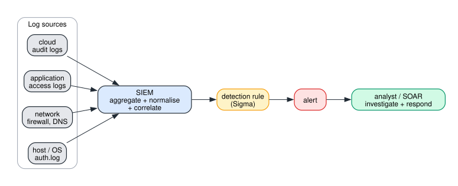

# Logging, SIEM and Detection

**Logging is keeping a record of what happens on a system, and a SIEM is the tool that gathers all those records in one place so an attack shows up in them.**

## Before you start
<!-- bite: beee4627-0436-4ed5-8e5f-14c5d2324d94 -->

You should have:

- Met the attacks this exists to catch, especially password spraying → [[cybersecurity/06-attacks-and-threats/04-password-malware-and-exploits|password attacks]].
- Built defensive architecture, so there are layers worth monitoring → [[cybersecurity/07-security-operations/01-defensive-architecture|defensive architecture]].
- A Linux machine, a terminal, and the ability to read a log file.

After this lesson you will be able to:

1. Name the log sources a SOC collects and why central logging matters.
2. Explain what a SIEM adds on top of raw logs: aggregation, correlation, alerting.
3. Write a real detection — SSH spraying followed by a success — as a one-liner, an SPL query, and a portable Sigma rule.
4. Explain why *tuning* a rule, not writing it, is the actual job.

**Study route.** Kid version and §1–3, then the worked example: writing a detection rule three ways.

## What logging and detection are
<!-- bite: 37973a00-d66f-4092-8342-d61bd852d8e5 -->

Architecture (lesson 1) makes failures survivable. Detection is how you *hear* them. A hardened, segmented system still gets attacked — the difference a blue team makes is noticing, and noticing comes from logs.

A **log** is a line a system writes when something happens: a login, a config change, a connection. One machine's logs are useful; a thousand machines' logs are a flood. A **SIEM** (Security Information and Event Management) is the tool that collects them all centrally and *correlates* them — connects events across sources into a story — so an attack that's invisible in any single log becomes visible across them. By the end you'll have written the most common detection in existence, three ways.

## The kid version
<!-- bite: c5f14446-6d32-46b2-b70a-0a7dda55e0de -->

Imagine every door, till and camera in a shop keeps its own little notebook: "9:01, back door opened", "9:02, till drawer opened", "9:02, camera 3 saw someone". Each notebook alone is boring. But a manager who reads *all* of them together sees a story: back door opened, then the till, with nobody on camera at the front — that's a robbery, even though no single notebook said so.

A SIEM is that manager. It reads every notebook at once and raises a hand when the lines, *put together*, spell trouble.

**Where the analogy stops working.** A shop manager reads a handful of notebooks a day. A SIEM handles millions of lines an hour, so it can't "read" them — it runs *rules* you wrote in advance. If you never wrote the rule for "back door then till", it sails past. Detection is only as good as the rules, and the hard part is writing rules that fire on real attacks without crying wolf all day.

## 1. Logs — the raw material
<!-- bite: e8ccf541-59c1-4ab5-809f-7e414e48c612 -->

Every meaningful action leaves a trace; detection lives or dies on collecting them. The sources that matter:

1. **Endpoint / OS logs** — Windows Event Logs, Linux `syslog` and auth logs: logins, process creation, privilege use.
2. **Network logs** — firewall logs, **NetFlow** (who talked to whom), DNS queries, proxy logs.
3. **Application logs** — web server access and error logs, authentication events, database queries.
4. **Cloud logs** — AWS CloudTrail, Azure and GCP audit logs: API calls, IAM changes.

The classic failure is OWASP's *logging and alerting failures* ([[cybersecurity/06-attacks-and-threats/03-web-application-attacks|web application attacks]]) — a breach nobody noticed because nothing was logged, or the logs sat unread. The three rules: **log centrally** (so an attacker who owns a box can't delete the evidence), **retain enough history**, and **actually analyse it**.

## 2. SIEM — making sense of the flood
<!-- bite: 26af5f02-e3ea-4445-ade1-adb9be3524b1 -->

A **SIEM** aggregates logs from everywhere into one place and **correlates** them to surface threats a single log wouldn't reveal. Its jobs:



1. **Aggregation and normalisation** — pull many log formats into one common schema.
2. **Correlation** — connect events into a story: "failed logins on 50 accounts → one success → new admin account → outbound transfer" is a breach; each line alone is noise.

## 2. SIEM: alerting and the tools
<!-- bite: 2b70b628-1d03-4f3a-846d-ee5db5501ecc -->

The other two jobs, and what runs them.

3. **Alerting** — fire on detection rules (patterns, thresholds, known-bad indicators).
4. **Dashboards and search** — for analysts to investigate and hunt.

Examples: Splunk, Elastic Security, Microsoft Sentinel, Wazuh (open source). **SOAR** (Security Orchestration, Automation and Response) sits alongside, automating repetitive response steps.

## 3. Detection systems and approaches
<!-- bite: 269c5f49-e0c5-4fc2-80a0-a34322086751 -->

The sensors that feed the SIEM, and the ways they decide what's bad:

1. **IDS / IPS** — Intrusion Detection (alerts) and Prevention (blocks) Systems, at the network level (**NIDS**, e.g. Suricata) or host level (**HIDS**). You built one in [[cybersecurity/03-network-security/04-intrusion-detection-and-prevention|intrusion detection]].
2. **EDR / XDR** — Endpoint Detection and Response: agents that record process, file and network behaviour and catch malicious *behaviour*, not just known signatures. The successor to signature antivirus.
3. **Signature-based** detection matches known-bad patterns (a malware hash, an exploit string) — precise, but blind to novel attacks.
4. **Anomaly-based** detection baselines "normal" and flags deviations (a 3am login from a new country) — catches unknowns, but more false positives.
5. **Honeypots** — decoy systems with no real purpose, so *any* interaction is suspicious — high signal, low noise.

A mature SOC combines all of these, tuned to its environment.

## Terms used in this lesson
<!-- bite: dd24052b-28ac-4db5-88b9-155f3cb7e009 -->

1. **Log**: This is a line a system writes recording that something happened — a login, a change, a connection — with a timestamp. Logs are the raw material of detection.
2. **SIEM (Security Information and Event Management)**: The letters stand for those words. It is a tool that centralises logs from many sources and correlates them to surface attacks.
3. **Correlation**: This is connecting separate events across sources into a single story, so a pattern that's invisible in one log becomes visible across several.
4. **Detection rule**: This is a saved query that fires an alert when logs match a suspicious pattern — the thing a SIEM actually runs against the flood.

## Terms used in this lesson: tools and tuning
<!-- bite: 465835eb-ac18-4b5d-88c3-d2b57f915c85 -->

5. **IDS / IPS**: An Intrusion Detection System alerts on an attack; an Intrusion Prevention System blocks it. Same detection, different response.
6. **EDR (Endpoint Detection and Response)**: This is an agent on each host that records its behaviour and detects malicious *actions*, the modern successor to signature antivirus.
7. **SOAR (Security Orchestration, Automation and Response)**: This automates repetitive response steps — enrich an alert, isolate a host — to fight alert volume.
8. **False positive / false negative**: A false positive is an alert on benign activity; a false negative is a real attack that fired no alert. Tuning trades one against the other.

## Worked example — detect SSH spraying, three ways
<!-- bite: 9a067b65-541d-4365-917f-fbc41e01df4d -->

Everything above is vocabulary until you write a rule. Take the most common detection there is: **SSH password spraying followed by a success.** The raw material is a Linux auth log (`/var/log/auth.log` on Debian, `/var/log/secure` on RHEL):

```text
Failed password for invalid user admin from 203.0.113.9 port 54122 ssh2
Failed password for invalid user root from 203.0.113.9 port 54124 ssh2
Accepted password for deploy from 203.0.113.9 port 54180 ssh2
```

**Predict first:** which of those three lines turns the other two from "internet noise" into "incident"? The first two are background noise on any internet-facing box. The third — a *success* from the same IP that just failed against made-up usernames — is the one that should wake someone.

## Worked example: on one box, before any SIEM
<!-- bite: e4d6358e-cb48-468d-8053-a62c38e3ebe6 -->

You don't need a product to start. On the box itself:

```bash
journalctl -u ssh --since "1 hour ago" | grep -c "Failed password"
journalctl -u ssh --since "1 hour ago" | grep "Accepted"
# count failures per source IP, highest first:
grep "Failed password" /var/log/auth.log | awk '{print $(NF-3)}' | sort | uniq -c | sort -rn | head
```

That last line — failures per source IP, descending — is the single most useful one-liner in host-level detection, and it needs no product at all. An IP with 400 failures against 50 usernames is spraying; cross-reference it against the "Accepted" list and any overlap is an incident.

## Worked example: as an SPL query (Splunk)
<!-- bite: 64edc797-0fc1-48c8-be03-01c40e71892a -->

The same logic in a SIEM's query language, across all your hosts at once:

```text
index=linux sourcetype=secure "Failed password"
| stats count AS failures, dc(user) AS users_tried BY src_ip
| where failures > 20 AND users_tried > 5
| join src_ip [ search index=linux sourcetype=secure "Accepted password" | stats count AS successes BY src_ip ]
| where successes > 0
```

Read it top to bottom: count failures and *distinct* usernames per source IP, keep the IPs that failed a lot against many users (the spraying signal), then join to the successes and keep only IPs that *also* logged in. Those are the incidents.

## Worked example: as a Sigma rule
<!-- bite: ba703d32-b9fb-4a7d-bde3-f6379f08e4e0 -->

A one-box `grep` doesn't scale, and an SPL query only runs on Splunk. **Sigma** is the portable detection format: you write the rule once, and a converter turns it into Splunk, Elastic or Sentinel syntax, so rules are *shared* across the community rather than rewritten per platform.

```yaml
title: SSH Brute Force Followed by Successful Login
logsource:
  product: linux
  service: sshd
detection:
  failed:
    message|contains: "Failed password"
  success:
    message|contains: "Accepted password"
  timeframe: 15m
  condition: failed | count() by src_ip > 20 and success
level: high
falsepositives:
  - Misconfigured automation retrying with stale credentials
  - A vulnerability scanner in an authorised test window
```

Note the `falsepositives` block. **A rule without one is disabled within a fortnight** — the analyst paged at 3am by your monitoring service's expired credential turns it off, and it's still off during the real intrusion.

## Tuning is the actual job
<!-- bite: 111c9694-6c1b-41f0-ae0b-98a931645b1b -->

Writing the rule is an afternoon. Making it survivable is the work:

1. **Baseline before you threshold.** Run the query *without* the `where` clause for a week and look at the distribution. A threshold of 20 is a guess; the 99th percentile of your own traffic is a decision.
2. **Exclude by identity, not by silence.** Suppress the known scanner *by its IP and only in its window*, rather than dropping the threshold until it stops firing.
3. **Every alert needs a next step.** If the analyst's only possible response is "hmm", it's a dashboard panel, not an alert.
4. **Test the detection by performing the attack.** Spray your own lab box ([[cybersecurity/06-attacks-and-threats/04-password-malware-and-exploits|password attacks]]) and confirm the alert fires. An untested rule is a belief, not a control — and rules silently break when a log format changes upstream.

The uncomfortable truth of most SOCs: the rules exist, and nobody has verified since the day they were deployed that they still fire.

## Common pitfalls and traps
<!-- bite: f0bc5663-2495-46fc-9a38-189accb44a44 -->

1. **Logging locally only.** An attacker who owns the box deletes its logs. Ship them off the box the moment they're written.
2. **Collecting logs nobody queries.** Storage isn't detection. A log you never write a rule against is a cost, not a control.
3. **Alert fatigue.** Too many noisy alerts and the real one is ignored in the pile. Tune hard; every alert must be actionable.
4. **A rule with no false-positive handling.** It gets switched off and stays off. Suppress precisely, don't delete.
5. **Never re-testing.** Detections rot when upstream log formats change. Re-run the attack on a schedule and confirm the alert still fires.

## Check your understanding
<!-- bite: 16702a1d-ff13-4ae4-800f-ab3aabfee806 -->

Try each one before you open the answer.

1. <!-- q: mcq id="703898e8" -->
   A single log line reads "Accepted password for deploy from 203.0.113.9". On its own it's a normal login. What does a SIEM add that makes the same line part of a detected attack?

   - [ ] It encrypts the log line.
   - [x] Correlation — it connects that success to the 300 failed logins from the same IP moments earlier, which no single line reveals.
   - [ ] It blocks the IP automatically.
   - [ ] It deletes old logs to save space.

   <details><summary>Answer</summary>

   Correlation. The success is only alarming *in the context of* the failures from the same source — a story that spans many log lines. Aggregating everything centrally and connecting events across them is exactly what a SIEM is for. (Blocking would be an IPS or SOAR action, a separate step.)

   </details>

2. <!-- q: gap id="aa0fae5d" answers="centrally|central" -->
   One of the three rules of logging is to log ___, so that an attacker who compromises a machine cannot simply delete the evidence of what they did on it.

   <details><summary>Answer</summary>

   Centrally (ship logs off the box to a central store). Local-only logs are deletable by whoever owns the box. The other two rules: retain enough history, and actually analyse what you collect.

   </details>

3. <!-- q: mcq id="ec05716e" -->
   You write a detection rule and skip the `falsepositives` section because you "can't think of any". What's the most likely outcome?

   - [ ] The rule runs faster.
   - [x] It fires on something benign (a scanner, stale automation), an analyst gets paged, and the rule is disabled — and stays off during a real attack.
   - [ ] The SIEM refuses to save it.
   - [ ] It becomes a signature rule automatically.

   <details><summary>Answer</summary>

   A rule with no false-positive handling gets switched off the first time it pages someone at 3am for nothing — and then it's off when the real intrusion happens. Documenting and precisely suppressing known-benign triggers (by identity, not by lowering the threshold) is what keeps a rule alive.

   </details>

4. <!-- q: mcq id="985ab484" -->
   Why would a team write their detection as a Sigma rule rather than directly as a Splunk query?

   - [ ] Sigma rules run faster than Splunk queries.
   - [x] Sigma is portable — it converts to Splunk, Elastic or Sentinel syntax, so the rule can be shared and reused across platforms.
   - [ ] Splunk cannot detect SSH brute force.
   - [ ] Sigma rules don't need thresholds.

   <details><summary>Answer</summary>

   Sigma is a vendor-neutral format. Write the detection logic once and convert it to whatever query language your SIEM speaks, so the community can share rules instead of rewriting them per product. The logic is identical; only the portability differs.

   </details>

5. <!-- q: exact id="effdbdae" answer="distinct" accept="unique|different" -->
   The signature of password *spraying* (as opposed to brute-forcing one account) is a single source IP that fails against many ___ usernames. Counting that is what catches an attack per-account lockout misses.

   <details><summary>Answer</summary>

   Distinct (unique/different) usernames. Spraying spreads one guess across many accounts, so no account sees enough failures to lock — but one IP touching 50 different usernames stands out. `dc(user)` in the SPL query and `count() by src_ip` in Sigma both capture it.

   </details>

6. <!-- q: open id="409cd4d6" -->
   A manager says "we have 400 detection rules, so our SOC is in great shape." Drawing on the tuning section, give two reasons that number alone tells you almost nothing about whether the SOC can actually catch an attack.

   <details><summary>Answer</summary>

   First, untested rules are beliefs, not controls: unless someone performs the attack and confirms the alert fires, a rule may have silently broken when an upstream log format changed — a SOC can have 400 rules and 0 that still work. Second, a pile of noisy, un-tuned rules causes alert fatigue, so the one real alert is buried and ignored; and rules without false-positive handling get disabled, so "400 rules" may include many that are switched off. Quality — tuned, tested, actionable rules — matters far more than count.

   </details>

## Practice — write and test your own detection
<!-- bite: 3b6fcc39-1f76-49eb-8bf1-e3c69b3773a1 -->

**Task.** Pick a second attack and build the detection for it end to end.

1. Choose one: repeated `sudo` failures (privilege-escalation attempts), or a web server returning many `404`s then one `200` on an admin path (directory brute-force that found something).
2. Write the host-level one-liner first (`journalctl`/`grep`/`awk`), then express the same logic as a Sigma rule with a `falsepositives` block.
3. **Test it by performing the attack** on your own lab box, and confirm your rule would have fired. Baseline the threshold against an hour of normal traffic first.

## Practice: when it's done
<!-- bite: de25171c-7f5c-49ca-973b-6f252f324576 -->

Here's how you know the task is finished.

**Done when:** your rule fires on the attack you performed, does *not* fire on an hour of baselined normal activity, and has a `falsepositives` block naming what benign thing could trip it. Record it in `cybersecurity/LIVE-RUNS-TODO.md`. An untested rule doesn't count — the whole point of the tuning section is that writing it was the easy half.

## Before moving on
<!-- bite: 8e1074a8-9d37-4cde-b278-ca3bf799c7b1 -->

You can now name the log sources a SOC collects, explain what a SIEM adds over raw logs, write a real detection three ways (one-liner, SPL, Sigma), and say why tuning is the job.

**Recap for later lookup:** log sources = endpoint, network, application, cloud; log centrally, retain, analyse. SIEM = aggregate + correlate + alert; SOAR automates response. Detection: signature (known-bad, precise), anomaly (baseline deviations, noisier), honeypots (any touch is suspicious). The SSH-spray detection: count distinct usernames per source IP, join to successes. Sigma = portable rule format. Tuning (baseline, suppress by identity, actionable, re-test) is the real work.

Next: [[cybersecurity/07-security-operations/03-threat-intelligence-and-hunting|threat intelligence and hunting]] — detections catch what you already know to look for; hunting goes looking for what you don't.

## Related
<!-- bite: bcd898da-a826-4b4d-8199-93a354da066c -->

- [[cybersecurity/03-network-security/04-intrusion-detection-and-prevention|Intrusion detection and prevention]] — the network-layer sensor (Suricata) that feeds this.
- [[cybersecurity/06-attacks-and-threats/04-password-malware-and-exploits|Password attacks]] — the spraying attack this detects, with its own detector lab.
- [[devops/07-observability/index|Observability (DevOps)]] — the same telemetry foundation, turned toward reliability instead of security.

## About this lesson
<!-- bite: eaf56eb0-0518-4f3b-bbcf-f15b04c9a6b1 -->

**Level:** Intermediate → Advanced. **Covers:** log sources and central logging, what a SIEM adds (aggregation, correlation, alerting), IDS/IPS, EDR/XDR, signature vs anomaly detection and honeypots, a worked SSH-spray detection as a one-liner, an SPL query and a portable Sigma rule, and why rule tuning is the actual job. **Where it sits:** lesson 2 of the [[cybersecurity/07-security-operations/index|Security Operations]] section. **Sources:** the original vault note (from the roadmap.sh cyber-security roadmap), rebuilt to the [[COURSE-STANDARD|course standard]]; the `journalctl`/`grep`/`awk` detection and the attack-and-confirm test are tracked for a live run in `cybersecurity/LIVE-RUNS-TODO.md`.
