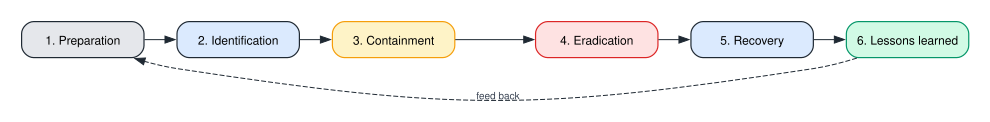

# Incident Response

**Incident response is the plan a team follows when an attack gets through — decided calmly in advance, like a fire drill, so people act fast and correctly instead of panicking.**

## Before you start
<!-- bite: 1891e462-c3a4-4f36-a96c-495fb52a08fd -->

You should have:

- A detection or hunt that could *find* an incident → [[cybersecurity/07-security-operations/02-logging-siem-and-detection|detection]] and [[cybersecurity/07-security-operations/03-threat-intelligence-and-hunting|hunting]].
- Met the attacks an incident might involve → [[cybersecurity/06-attacks-and-threats/index|attacks and threats]].
- A lab box you can safely practise commands against (your VPS or a VM).

After this lesson you will be able to:

1. Explain why a defined process beats improvising during a live incident.
2. Walk through the six-phase IR lifecycle and say what each phase is for.
3. Write a runbook for a specific incident, with the actual commands for each phase.
4. Name the human and legal obligations that run alongside the technical response.

**Study route.** Kid version and §1–3, then the worked example: writing a runbook for a compromised SSH account.

## What incident response is
<!-- bite: 66f71120-21e4-466e-95d6-52f40755abe4 -->

Lessons 2 and 3 were about *finding* an attacker. This lesson is what you do the moment you've found one — when the alert is real and someone is inside.

Under pressure, ad-hoc reactions make things worse: you tip off the attacker, destroy the evidence you'll need, or take down more than necessary. **Incident response (IR)** is the disciplined process — decided *before* anything happens — that lets a team act fast *and* correctly. It has a standard lifecycle (six phases), it's made concrete in **runbooks** (step-by-step procedures per incident type), and it carries obligations beyond the technical work (who to tell, what the law requires, how to preserve evidence). By the end you'll have written a runbook for a real scenario.

## The kid version
<!-- bite: 6219a332-e5d9-4751-b990-893d5b3c4613 -->

Think of a fire drill. Nobody works out the exits *while the building is burning* — the smoke's too thick and everyone's scared. You decide it all in advance: where to go, who checks the toilets, where to meet outside, who counts heads. On the day, people just follow the plan, and it works *because* nobody's inventing it in the moment.

Incident response is the fire drill for a hack. The plan is written on a calm Tuesday so that on the bad day, a frightened team can still do the right things in the right order.

**Where the analogy stops working.** In a fire you want everyone *out* as fast as possible. In an incident, running for the exit — yanking the server off the network the second you see something — can be the wrong move: it tips off the attacker and destroys the memory evidence of *how they got in* and *whether they're elsewhere too*. So IR adds a step a fire drill never has: understand the scope *before* you slam the door, or you'll fight the same fire again tomorrow.

## 1. Why a process, not panic
<!-- bite: e14b950d-b97d-4a2c-bc29-6285ab043254 -->

The temptation during a live incident is to act immediately: pull the plug, delete the malware, reset the password. Each of those, done blind, can backfire:

- **Pull the plug** → you lose the RAM evidence (running processes, the attacker's tools, encryption keys) and tip them off.
- **Delete the malware** → you destroy the sample you'd analyse, and miss the *second* backdoor they planted.
- **Reset one password** → you feel better, while they're still in via the three other accounts you didn't find.

A defined IR process exists so that a stressed team doesn't make these calls by reflex. It's the security counterpart to a DevOps on-call runbook: the thinking is done in advance, so the moment is about *execution*, not invention.

## 2. The IR lifecycle
<!-- bite: d0bdd9d3-b7d3-4242-a588-9d2a3deb82a5 -->

The standard phases (SANS's mnemonic is **PICERL**):



1. **Preparation** — *before* anything: an IR plan, a trained team, logging and EDR in place so you *have* evidence, and runbooks. The most important phase; you can't improvise it mid-crisis.
2. **Identification** — recognise an incident and determine scope: what's affected, how bad, what kind. This is triaging a [[cybersecurity/07-security-operations/02-logging-siem-and-detection|SIEM alert]] or [[cybersecurity/07-security-operations/03-threat-intelligence-and-hunting|hunt]] finding from "event" to "incident".
3. **Containment** — stop the bleeding *without* destroying evidence. The judgment call: contain fast, but understand scope before you tip them off.

## 2. The IR lifecycle: eradicate, recover, learn
<!-- bite: 24bfd0cb-f53e-49cb-81a9-28159a3de2ed -->

The back half of the loop removes the attacker and closes the gap they used.

4. **Eradication** — remove the threat completely: delete the malware, close the vulnerability, reset *all* compromised credentials, remove every persistence mechanism and backdoor. Half-eradication means they're back tomorrow.
5. **Recovery** — restore to normal *safely*: rebuild from known-good [[cybersecurity/06-attacks-and-threats/04-password-malware-and-exploits|backups]] (the ransomware answer), verify systems are clean, and watch closely for the attacker's return before going fully back to production.
6. **Lessons learned** — a *blameless* review: what happened, how the response went, and what to change — a new detection rule, a patch, a process fix — so it doesn't recur. This feeds straight back into Preparation, and it's the phase teams skip most and regret most.

## 3. Runbooks, SOAR, and the loop
<!-- bite: 0cd42c25-e9c0-4b9a-8839-4939d79d36f7 -->

The lifecycle is the shape; a **runbook** (or playbook) makes it concrete for *one* incident type:

- **Runbook** — a step-by-step procedure for a specific incident (ransomware, phishing, account compromise), so responders follow a proven path instead of improvising. It's Preparation turned into a checklist, with the actual commands written out.
- **SOAR** (Security Orchestration, Automation and Response) — automates the repetitive early steps: auto-enrich an alert with threat intel, auto-isolate a flagged host, auto-open a ticket. It fights alert volume and buys analysts time for the judgment calls a machine shouldn't make.

The dashed arrow in the diagram — lessons feeding back into preparation — is what makes a team get *better* after each incident instead of merely surviving it.

## Terms used in this lesson
<!-- bite: 2fd1bd95-af60-4df3-9ed7-f826559bdb96 -->

1. **Incident**: This is a confirmed security event that needs a response — not every alert, but one triaged as a real compromise or active attack.
2. **Incident response (IR)**: This is the disciplined, pre-planned process for handling an incident, so a team acts fast and correctly under pressure instead of improvising.
3. **PICERL**: This is the mnemonic for the six IR phases — Preparation, Identification, Containment, Eradication, Recovery, Lessons learned.
4. **Containment**: This is stopping an incident from spreading without destroying evidence — isolating a host, disabling an account — before you fully understand its scope.

## Terms used in this lesson: runbooks and obligations
<!-- bite: b101549a-a413-4792-a0f9-ad6552e7709e -->

5. **Runbook (playbook)**: This is a step-by-step procedure for a specific incident type, with the exact actions and commands, so responders follow a proven path rather than inventing one.
6. **SOAR (Security Orchestration, Automation and Response)**: This automates repetitive response steps — enrichment, isolation, ticketing — to speed the early phases and fight alert volume.
7. **Chain of custody**: This is the documented, unbroken record of who handled evidence, when and how, so it holds up if the incident ends in court.
8. **Blameless review**: This is a lessons-learned session focused on fixing the system, not blaming a person, so people report honestly and the same gap gets closed.

## Worked example — a runbook for a compromised SSH account
<!-- bite: 6bb77245-c42e-4b62-b798-45ddd6114a59 -->

Lessons 2 and 3 could *detect* an SSH account compromise (spraying, then a success). Here's the other half: the runbook you follow when that alert is real. Write it as a file, `runbook-ssh-compromise.md`, and rehearse it on your lab box. Start with the two phases that come before you touch anything:

```text
## 1. Preparation (done in advance)
- Central logging on, auth.log shipped off the box (lesson 2).
- A break-glass admin account + a known-good SSH key offline.
- This runbook, reviewed and tested.

## 2. Identification
- Confirm: one source IP, many failed users, then an Accepted for user X. (lesson 2 rule)
- Scope: journalctl _COMM=sshd | grep "Accepted .* from <IP>"  -> which accounts, since when?
- Decide: event or incident? A success after spraying from an external IP = incident.
```

**Predict first:** the next phase is containment. What's the *wrong* first move here, and why?

## Worked example: containment without destroying evidence
<!-- bite: f835c08f-aead-4bcc-a5d2-449dcf256887 -->

The wrong move is `poweroff` — it wipes RAM (the attacker's running tools, their other connections) and tells them you noticed. Contain *surgically* instead, capturing volatile state first:

```text
## 3. Containment (capture before you cut)
- Snapshot volatile state (for lesson 5, forensics):
    ss -tnp                      # the attacker's live connections
    ps aux --sort=-%cpu          # what they're running
    sudo last -i | head          # recent logins + source IPs
- Then cut the attacker, not the box:
    sudo pkill -u <compromised_user>          # kill their sessions
    sudo usermod -L <compromised_user>        # lock the account
    sudo iptables -A INPUT -s <attacker_IP> -j DROP   # block the source
```

This stops the bleeding while keeping the box alive and the evidence intact. You've isolated the attacker's *access* without losing what you need to understand the breach.

## Worked example: eradicate, recover, learn
<!-- bite: 1197e904-b7eb-477e-9eb8-896f0e780e54 -->

The rest of the runbook removes them for good and closes the loop:

```text
## 4. Eradication (find ALL of it, not just the obvious)
- Hunt for persistence the login may have planted:
    sudo crontab -l -u <user>; ls -la ~/.ssh/authorized_keys   # rogue cron / added keys
    sudo grep -r <attacker_IP> /etc /home 2>/dev/null
- Reset the credential AND rotate anything it could reach (least privilege pays off here).

## 5. Recovery
- Re-enable the account with a new key; keys-only SSH, no passwords (lesson: firewalls/hardening).
- Watch the box closely for the IP's return for 72h.

## 6. Lessons learned (blameless)
- Why did spraying succeed? -> weak password / no MFA. Fix: enforce keys + fail2ban.
- New detection: alert on ANY added authorized_keys entry. Promote to a standing rule (lesson 2).
```

The last line is the point: the incident ends by making the *next* one less likely — a new rule, feeding back into Preparation. Rehearse the whole thing on your lab (safely, against your own box) so that on a real bad day it's muscle memory, not improvisation.

## 3. The human and legal side
<!-- bite: 9c7a7006-efc6-40e8-9b9d-f53844e0ba96 -->

IR isn't purely technical, and mishandling the non-technical parts can turn a clean response into a disaster:

- **Communication** — who's informed, and when: leadership, legal, PR, affected customers. Decided in the runbook, not in the moment.
- **Legal and regulatory** — breach-notification laws impose hard deadlines (GDPR's 72-hour rule → [[cybersecurity/08-governance-risk-and-compliance/index|compliance]]). Missing them is its own penalty, separate from the breach.
- **Chain of custody** — if any evidence might be used legally, document who handled it, when and how, unbroken ([[cybersecurity/07-security-operations/05-forensics-and-malware-analysis|forensics]]), or it's worthless in court.

## Common pitfalls and traps
<!-- bite: a2c48713-954b-4516-84fb-31a8dacef09b -->

1. **Pulling the plug first.** It destroys RAM evidence and tips off the attacker. Capture volatile state, then contain surgically.
2. **Half-eradication.** Resetting one password while leaving a rogue SSH key or cron job means they're back by morning. Hunt for *all* persistence.
3. **No preparation.** Writing the plan during the crisis is the single biggest failure. The runbook exists before the incident or it doesn't help.
4. **Skipping lessons learned.** Survive the incident, change nothing, repeat it next quarter. The feedback loop is where improvement lives.
5. **Blame over fixes.** A review that punishes the person who clicked the link teaches everyone to hide incidents. Keep it blameless so people report early.

## Check your understanding
<!-- bite: ec0da02c-72c9-475c-ba35-8128f3d9850d -->

Try each one before you open the answer.

1. <!-- q: mcq id="3994e507" -->
   You confirm an attacker is logged into a server via a compromised account. Why is `poweroff` (shutting the box down immediately) usually the *wrong* first containment move?

   - [ ] It's too slow.
   - [x] It destroys volatile RAM evidence (running tools, live connections, keys) and tips off the attacker, before you understand the scope.
   - [ ] It requires root access.
   - [ ] It automatically notifies regulators.

   <details><summary>Answer</summary>

   Powering off wipes everything in RAM — the attacker's running processes, their other live connections, any encryption keys in memory — which is exactly the evidence you need, and the sudden outage signals that you've noticed. Contain surgically instead: capture volatile state, then kill the sessions, lock the account, and block the source IP, keeping the box alive.

   </details>

2. <!-- q: gap id="af8b6528" answers="Preparation" -->
   In the PICERL lifecycle, the phase that happens before any incident — writing the plan, training the team, getting logging and backups in place — and that lessons-learned feeds back into, is ___.

   <details><summary>Answer</summary>

   Preparation. It's the most important phase because you can't improvise a plan, a trained team, or evidence collection mid-crisis. The lifecycle is a loop: lessons learned feed back into Preparation so each incident leaves the team better prepared for the next.

   </details>

3. <!-- q: mcq id="f0035de1" -->
   An attacker got in through a compromised account. During eradication you reset that account's password. Why might the attacker still have access afterwards?

   - [ ] Passwords can't be reset on Linux.
   - [x] They may have planted persistence — a rogue SSH key, a cron job, a second account — that a password reset doesn't touch.
   - [ ] The reset takes 72 hours to apply.
   - [ ] Resetting a password alerts the attacker to leave.

   <details><summary>Answer</summary>

   Half-eradication is a classic failure. A foothold is usually used to establish *persistence* — an added `authorized_keys` entry, a cron job, a new user — so that losing the original credential doesn't lock them out. Eradication must hunt for and remove *all* of it, not just the obvious entry point.

   </details>

4. <!-- q: mcq id="1034eadb" -->
   What is a runbook (playbook) in incident response?

   - [ ] A log of every alert the SIEM ever fired.
   - [x] A step-by-step procedure for a specific incident type, with the exact actions and commands, prepared in advance.
   - [ ] A legal contract with customers.
   - [ ] A list of the company's IP addresses.

   <details><summary>Answer</summary>

   A runbook turns the generic IR lifecycle into a concrete checklist for one scenario (account compromise, ransomware, phishing), with the real commands written out. It's Preparation made usable: on the bad day, responders follow a tested path instead of inventing one under stress. SOAR can automate parts of it.

   </details>

5. <!-- q: exact id="47a93572" answer="72" -->
   Under the GDPR breach-notification rule, an organisation generally must report a qualifying personal-data breach to the regulator within how many hours of becoming aware of it?

   <details><summary>Answer</summary>

   72 hours. Breach-notification laws impose hard deadlines that run alongside the technical response — missing them is a separate penalty from the breach itself. This is why communication and legal obligations belong in the runbook, decided in advance, not worked out during the crisis.

   </details>

6. <!-- q: open id="eb085830" -->
   After an incident, a manager wants to run the lessons-learned review as a meeting to "find out who caused this and make sure it doesn't happen again." Explain why a *blameless* review is more effective, and what the review should produce.

   <details><summary>Answer</summary>

   A blame-focused review teaches everyone that reporting an incident gets you punished, so people hide the next one or stay quiet during it — which makes the organisation slower to detect and respond, the opposite of the goal. A blameless review treats the failure as a system weakness (a missing MFA requirement, a detection gap, an unclear procedure) rather than a person's fault, so people speak honestly about what really happened. It should produce concrete changes — a new detection rule, a patch, a process fix, a hardening step — that feed back into Preparation so the same incident can't recur. "Who" matters far less than "what in our system let this through, and how do we close it."

   </details>

## Practice — write a runbook for a different incident
<!-- bite: 8dae2ea0-2e7a-4f1a-bfe9-0aab5381ffd5 -->

**Task.** Pick an incident type you haven't done and write its runbook, PICERL phase by phase.

1. Choose one: a ransomware detection, a phishing click that led to a credential theft, or a public web app exploited (the Juice Shop SQLi from [[cybersecurity/02-ethical-hacking/index|ethical hacking]]).
2. For each of the six phases, write the concrete actions — and for identification, containment and eradication, the *actual commands* against your lab.
3. Mark where SOAR could automate a repetitive step, and where a human judgment call is required.
4. Rehearse the identification → containment steps on your lab box (safely, your own target only).

## Practice: when it's done
<!-- bite: ed9b9e5f-adfa-4ef6-9c5c-c494e5637ed8 -->

Here's how you know the task is finished.

**Done when:** your runbook covers all six phases, the containment step captures volatile evidence *before* cutting access, eradication hunts for persistence (not just the entry point), and lessons-learned produces at least one new detection rule. Record it in `cybersecurity/LIVE-RUNS-TODO.md`. If you couldn't write a real command for a phase, that's a preparation gap worth noting.

## Before moving on
<!-- bite: 9843fc68-43e3-4c3a-8768-70a708dfc30d -->

You can now explain why a defined process beats improvising, walk through the six-phase IR lifecycle, write a runbook with real commands for a specific incident, and name the communication, legal and evidence obligations alongside it.

**Recap for later lookup:** PICERL = Preparation, Identification, Containment, Eradication, Recovery, Lessons learned, and it's a loop. Contain surgically (capture RAM first, then kill sessions / lock account / block IP) — never `poweroff` first. Eradicate *all* persistence, not just the entry. Recover from known-good backups. Lessons learned is blameless and produces a new rule. Runbooks make it concrete; SOAR automates the repetitive parts. GDPR = 72-hour notification; keep chain of custody for evidence.

Next: [[cybersecurity/07-security-operations/05-forensics-and-malware-analysis|forensics and malware analysis]] — the deep investigation that containment preserved evidence *for*, and how to safely dissect the malware an incident involved.

## Related
<!-- bite: a2164793-eb92-4dc3-8212-99394667f3ea -->

- [[cybersecurity/07-security-operations/05-forensics-and-malware-analysis|Forensics and malware analysis]] — the deep investigation during and after an incident.
- [[cybersecurity/07-security-operations/02-logging-siem-and-detection|Logging, SIEM and detection]] — where incidents are first identified.
- [[cybersecurity/08-governance-risk-and-compliance/index|Governance, risk and compliance]] — the breach-notification and audit obligations IR must satisfy.

## About this lesson
<!-- bite: 2712c785-8cb7-43bb-a533-1f0ccda3feca -->

**Level:** Advanced. **Covers:** why a pre-planned process beats improvisation, the six-phase PICERL lifecycle, runbooks and SOAR, the human/legal/chain-of-custody obligations, and a hands-on worked example writing and rehearsing a runbook for a compromised SSH account with the real commands for each phase. **Where it sits:** lesson 4 of the [[cybersecurity/07-security-operations/index|Security Operations]] section. **Sources:** the original vault note (from the roadmap.sh cyber-security roadmap), rebuilt to the [[COURSE-STANDARD|course standard]] with a runbook lab; the containment/eradication commands are tracked for a live run in `cybersecurity/LIVE-RUNS-TODO.md`.
