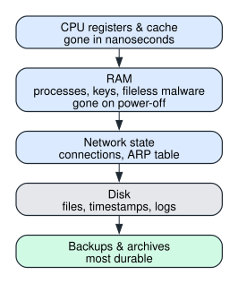

# Forensics and Malware Analysis

**Digital forensics is studying the evidence left on a computer to work out what an attacker did, and malware analysis is safely taking apart the harmful software involved.**

## Before you start
<!-- bite: dc06bcb2-5e71-472b-9fbd-68cac955235b -->

You should have:

- Run an incident response and captured volatile state during containment → [[cybersecurity/07-security-operations/04-incident-response|incident response]].
- Met the malware types this analyses → [[cybersecurity/06-attacks-and-threats/04-password-malware-and-exploits|malware and exploits]].
- Met hashing, which proves evidence is unaltered → [[cybersecurity/05-cryptography/03-hashing-and-integrity|hashing and integrity]].
- A Linux machine and a terminal.

After this lesson you will be able to:

1. State the order of volatility and why evidence is collected most-fleeting first.
2. Name the cardinal rules of evidence handling and why each exists.
3. Do a safe static analysis of a (harmless) malware test file: hash, `file`, `strings`.
4. Explain static vs dynamic analysis and why malware is only run in a sandbox.

**Study route.** Kid version and §1–3, then the worked example: static analysis of the EICAR test file.

## What forensics and malware analysis are
<!-- bite: d0a815df-8007-4a8a-b827-2eda52ad99e8 -->

Incident response (lesson 4) contained the attacker and *preserved* evidence. This lesson is what you do with that evidence: reconstruct what happened, and dissect any malware involved. Together they're often called **DFIR** (Digital Forensics and Incident Response).

**Digital forensics** recovers and analyses digital evidence to answer the incident's key questions: how did they get in, what did they touch, what did they take, are they still here. Its defining constraint is *evidence integrity* — do everything so the findings hold up, legally and technically. **Malware analysis** takes the harmful software apart to learn what it does and produce new detections ([[cybersecurity/07-security-operations/03-threat-intelligence-and-hunting|IOCs]]) — done *only* in strict isolation, because running malware to study it is exactly the dangerous act that needs a sandbox. By the end you'll have statically analysed a safe test file the way you would a real sample.

## The kid version
<!-- bite: 5b55c32b-203a-4ad0-9587-edbd0e840568 -->

Imagine a detective arriving after a break-in. Some clues vanish fast: a warm cup of tea, a smell, footprints in snow that's starting to melt. Others last: a muddy boot print on tile, a forced window, the diary the thief flipped through. A good detective grabs the melting clues *first*, photographs everything before touching it, bags each item with a label saying who found it and when, and never writes in the diary themselves — because a smudged or mislabelled clue is worthless in court.

Forensics is that, for computers. Some evidence (what's in memory right now) vanishes the instant you switch off; some (files on disk) survives. You collect the fleeting stuff first, you work on *copies* so you never smudge the original, and you log who touched what.

**Where the analogy stops working.** A detective can see a boot print. Digital evidence is invisible and trivially altered — just *opening* a file changes its "last accessed" time, destroying part of the timeline. So forensics is stricter than any crime scene: you take a bit-for-bit copy, hash it to prove it's unaltered, and analyse the copy, because the act of looking can itself be the act of destroying.

## 1. The order of volatility
<!-- bite: d42f0727-4916-40dc-9d17-e0535e3e86a5 -->

Evidence has a lifespan. **Order of volatility** says collect the most fleeting first, because it's gone the moment you hesitate:



CPU registers and cache go in nanoseconds. **RAM** — running processes, open connections, encryption keys, and fileless malware that never touches disk — vanishes on power-off. Network state (live connections, the ARP table) is next. Disk and backups are the durable end. This is *why* lesson 4 said never `poweroff` first: shutting down throws away the top of this list, which is often where the attacker actually lives.

## 2. The cardinal rules of evidence
<!-- bite: ac23d5f3-0346-4afe-ba5f-014796e07de7 -->

Four rules keep an investigation valid. Each one exists because its absence has sunk real cases:

1. **Order of volatility** — collect most-fleeting first (above), or the best evidence is gone before you reach it.
2. **Work on copies, never originals** — take a bit-for-bit *forensic image* and analyse the copy, so the original is never altered by your investigation.
3. **Chain of custody** — document who handled each piece of evidence, when and how, unbroken — or it's inadmissible in court.
4. **Hashing for integrity** — hash evidence at the moment of collection ([[cybersecurity/05-cryptography/03-hashing-and-integrity|hashing]]) and re-verify later, proving it wasn't changed between seizure and analysis.

The two domains forensics works in: **disk forensics** (recover files including deleted ones, build a timeline from timestamps — tools: Autopsy, The Sleuth Kit) and **memory forensics** (analyse a RAM capture for processes, connections and injected code — tool: Volatility), which is essential for malware that never writes to disk.

## 3. Malware analysis — static vs dynamic
<!-- bite: a69f06b5-7774-46dc-a305-9a704070aff9 -->

When an incident involves malware, you analyse it to understand its capabilities, build detections, and scope the damage. **Only ever in an isolated, disposable environment** — a sandbox VM with no network path to anything real, and snapshots to revert. Two approaches:

1. **Static analysis** — examine the file *without running it*: its hash, the human-readable `strings` inside it, its headers, embedded resources, and disassembly. Completely safe; but packing and obfuscation limit what you can see.
2. **Dynamic analysis** — *run it* in the sandbox and watch behaviour: files created, config changes, processes spawned, network callbacks (C2). Reveals what it actually does; but sophisticated malware detects the sandbox and hides.

**Automated sandboxes** (Cuckoo, and online services like Any.Run, Hybrid Analysis, VirusTotal) detonate a sample and report behaviour fast — the practical first step. The output feeds detection: a new hash to block, a C2 domain to sinkhole, an ATT&CK technique to hunt.

## Terms used in this lesson
<!-- bite: 50cad6d6-2a99-4b85-a8b4-9e4f5fa48f39 -->

1. **Digital forensics**: This is recovering and analysing digital evidence to reconstruct what happened in an incident, in a way that holds up legally and technically.
2. **Order of volatility**: This is the rule that you collect evidence from most fleeting (CPU, RAM) to most durable (disk, backups), because the fleeting kind vanishes on power-off.
3. **Forensic image**: This is a bit-for-bit copy of a disk (or memory), taken so you analyse the copy and never alter the original evidence.
4. **Chain of custody**: This is the unbroken, documented record of who handled evidence, when and how — without it, evidence is inadmissible in court.

## Terms used in this lesson: analysis
<!-- bite: 40c7a54c-df7d-4a4c-abfd-17a95ed24609 -->

5. **Static analysis**: This is examining a malware file *without running it* — its hash, strings, headers and disassembly. Safe, but obfuscation hides things.
6. **Dynamic analysis**: This is running malware in a sandbox and observing what it does. Reveals real behaviour, but advanced malware detects the sandbox.
7. **Sandbox**: This is an isolated, disposable environment (a VM with no real network, revertible snapshots) where malware is run safely.
8. **DFIR (Digital Forensics and Incident Response)**: This is the combined discipline of investigating an incident and reconstructing it from evidence.

## Worked example — static analysis of a safe test file
<!-- bite: 8a30e22e-135b-4081-b0a0-4991d976bbbe -->

You don't practise on real malware. The **EICAR test file** is a harmless 68-byte string that every antivirus detects *by agreement*, built exactly so you can safely rehearse malware handling. Create it in a throwaway folder:

```bash
mkdir ~/malware-lab && cd ~/malware-lab
printf '%s' 'X5O!P%@AP[4\PZX54(P^)7CC)7}$EICAR-STANDARD-ANTIVIRUS-TEST-FILE!$H+H*' > sample.txt
```

**Predict first:** it's a plain text string with no code that runs. Will a real antivirus flag it anyway? (It will — that's the entire point of EICAR, and why it's safe to practise with.)

## Worked example: hash and identify
<!-- bite: 86134fc0-437d-4195-8245-55b85e5b9156 -->

Static analysis never runs the file. First, **hash it** — the integrity rule — so you can prove later it's unaltered, and so you can look it up:

```bash
sha256sum sample.txt
# 275a021bbfb6489e54d471899f7db9d1663fc695ec2fe2a2c4538aabf651fd0f  sample.txt
file sample.txt
# sample.txt: ASCII text, with no line terminators
```

That hash is the file's fingerprint. Pasting it into VirusTotal would return "EICAR test file" with scores of detections — which is how an analyst identifies a known sample *without ever opening it*: the hash alone is the IOC. `file` reads the header to say what kind of thing it is (here, plain text; for real malware, "ELF 64-bit executable" or "PE32 Windows executable").

## Worked example: read the strings
<!-- bite: 4daf8a99-416d-48d3-8d9b-71cd8dfe7765 -->

`strings` pulls the human-readable text out of any file — on real malware this is where C2 domains, IP addresses, ransom notes and command names leak out:

```bash
strings sample.txt
# X5O!P%@AP[4\PZX54(P^)7CC)7}$EICAR-STANDARD-ANTIVIRUS-TEST-FILE!$H+H*
```

Here the whole file *is* a string, so you see it all. On a real binary you'd skim `strings` output for URLs, file paths, registry keys and suspicious commands — the cheapest, safest first look inside a sample. Everything you just did (hash → `file` → `strings`) is static analysis: you learned what the file is and found its indicators **without ever running it**. Running it — dynamic analysis — would only happen next, inside a sandbox VM, never on your real machine.

## Worked example: a volatile-state snapshot
<!-- bite: 97812c24-e658-4870-af4d-21104867f24c -->

Forensics starts the same way lesson 4's containment did — grabbing the volatile top of the order-of-volatility list before it's gone. On a suspect box (your lab), capture it to timestamped files:

```bash
ps aux                  > ~/ir/processes.txt      # running processes
ss -tnp                 > ~/ir/connections.txt    # live network connections
sudo last -i | head     > ~/ir/logins.txt         # recent logins + source IPs
sha256sum ~/ir/*.txt    > ~/ir/MANIFEST.sha256    # integrity: hash what you collected
```

Hashing the collection immediately is the integrity rule in action: anyone can later re-hash the files and prove they weren't changed since collection. That's chain of custody made concrete — the same `sha256sum` you used on the malware sample, now protecting your evidence.

## 3. The safety and scope caveat
<!-- bite: 7b3db258-b31e-47c9-94f5-432cb4886244 -->

This is legitimate defensive work, but it handles dangerous material and (for forensics) sensitive, possibly legal evidence. The professional disciplines — **isolation** for malware, **work-on-copies** and **chain of custody** for evidence — aren't bureaucracy. They're what stop the analysis from causing a *second* incident (malware escaping the sandbox) or invalidating the whole investigation (a smudged original, a broken custody chain). On a real sample you never possess, you'd send the hash to a sandbox service rather than handle the file at all.

## Common pitfalls and traps
<!-- bite: 6a61479b-1ef7-454a-96cc-e92c7344abb3 -->

1. **Powering off to "secure" the box.** It destroys the RAM evidence at the top of the order of volatility — often exactly where the attacker lives.
2. **Analysing the original.** Opening a file changes its access time and can trigger embedded payloads. Image it, hash the image, analyse the copy.
3. **Running malware on a real machine.** Even "just to see what it does." Sandbox only — no network path to anything real, snapshots to revert.
4. **Breaking chain of custody.** An undocumented gap in who-held-what makes evidence worthless in court, however solid the technical finding.
5. **Trusting `strings` and `file` to be complete.** Packed or obfuscated malware hides its strings; static analysis is the safe first look, not the whole picture.

## Check your understanding
<!-- bite: a54657a9-0b03-4f43-a504-aeab38ee393c -->

Try each one before you open the answer.

1. <!-- q: mcq id="5655ef2d" -->
   An attacker is active on a server. Per the order of volatility, which evidence must you capture *first*, because it disappears the moment the machine loses power?

   - [ ] The files on the hard disk
   - [ ] The nightly backups
   - [x] The contents of RAM — running processes, live connections, keys, fileless malware
   - [ ] The BIOS settings

   <details><summary>Answer</summary>

   RAM (and CPU registers/cache above it). It holds running processes, open connections, encryption keys and any fileless malware — all gone on power-off. Disk and backups are durable, so they wait. This is precisely why you never `poweroff` a compromised box first: you'd throw away the most valuable, most fleeting evidence.

   </details>

2. <!-- q: gap id="bb86487e" answers="copy|copies|image" -->
   A cardinal rule of digital forensics is to work on a bit-for-bit ___ of the evidence, never the original, so that the act of investigating cannot alter what you're investigating.

   <details><summary>Answer</summary>

   A copy (a forensic image). Even opening a file changes its last-accessed timestamp, corrupting the timeline. You take a bit-for-bit image, hash it to prove integrity, and analyse the copy — the original stays untouched and admissible.

   </details>

3. <!-- q: mcq id="a72237bd" -->
   You have a suspicious file. Which of these is a *static* analysis step — one that doesn't run the file?

   - [ ] Double-clicking it to see what happens
   - [x] Running `strings` on it to read the URLs and commands embedded inside
   - [ ] Letting it execute in a sandbox and watching its network callbacks
   - [ ] Opening it in the email client that delivered it

   <details><summary>Answer</summary>

   `strings` reads the file's contents without executing it — static analysis, completely safe. Hashing and `file` are also static. Running it in a sandbox to watch behaviour is *dynamic* analysis, done only in isolation. The other two options run the file on your real machine, which you never do.

   </details>

4. <!-- q: exact id="39f00b5e" answer="275a021bbfb6489e54d471899f7db9d1663fc695ec2fe2a2c4538aabf651fd0f" accept="EICAR|eicar" -->
   The 68-byte EICAR string has SHA-256 `275a021bbfb6489e54d471899f7db9d1663fc695ec2fe2a2c4538aabf651fd0f`. An analyst pastes just this hash (not the file) into VirusTotal and gets hundreds of hits. What is the name of the test file this hash identifies?

   <details><summary>Answer</summary>

   The EICAR test file. The point of the question is the method: a *hash alone* identifies a known sample, so an analyst can recognise malware without ever opening the file. The hash is the IOC — cheap to share, safe to handle, and exactly what you'd look up before touching a real sample.

   </details>

5. <!-- q: mcq id="3a31b837" -->
   Why is malware ever only executed inside an isolated sandbox VM with no real network path and revertible snapshots?

   - [ ] Sandboxes make analysis run faster.
   - [x] Running malware is dangerous — in a sandbox it can't reach real systems, spread, or persist, and the VM can be reverted afterwards.
   - [ ] It's a legal requirement to use a specific vendor's sandbox.
   - [ ] Static analysis doesn't work on Windows.

   <details><summary>Answer</summary>

   Dynamic analysis means actually running the malware, which is the thing it's designed to do harm with. A sandbox with no path to anything real and snapshot-revert contains the blast — so studying the sample can't cause a second incident. Without that isolation, "just seeing what it does" can spread the infection.

   </details>

6. <!-- q: open id="76175f13" -->
   You collect a suspect's disk and memory, then spend three weeks proving the malware exfiltrated customer data. At trial, the defence shows there's no record of who handled the disk between seizure and your analysis. Why can this sink the case even though your technical findings are correct, and which two forensic rules would have prevented it?

   <details><summary>Answer</summary>

   A broken chain of custody means nobody can prove the evidence wasn't altered, swapped, or planted in the gap — so a court can rule it inadmissible regardless of how solid the analysis is. The findings may be true, but they can't be *trusted* without an unbroken record of custody. Two rules would have prevented it: chain of custody (document who held each item, when and how, with no gaps) and hashing for integrity (hash the disk/memory image at seizure and re-verify at analysis, proving the bytes are identical to what was collected). Together they turn "trust me" into "here's the proof it's unchanged."

   </details>

## Practice — a forensic triage script
<!-- bite: 2c786987-eca1-4dde-b4eb-2129371c1a1f -->

**Task.** Turn the volatile-state snapshot into a small, reusable triage tool.

1. Write a script `triage.sh` that, on a suspect Linux box, collects into a timestamped folder: running processes, live connections, recent logins with source IPs, the crontabs, and the contents of every user's `~/.ssh/authorized_keys`.
2. Have it hash everything it collected into a `MANIFEST.sha256` as the last step.
3. Run it on your own lab box (it's read-only — safe), and confirm the manifest lets you re-verify integrity with `sha256sum -c`.

## Practice: when it's done
<!-- bite: a1f4999e-ddbc-47f1-9e10-7d6461165154 -->

Here's how you know the task is finished.

**Done when:** `triage.sh` produces a timestamped evidence folder with a valid `MANIFEST.sha256`, and `sha256sum -c MANIFEST.sha256` reports `OK` for every file. Record it in `cybersecurity/LIVE-RUNS-TODO.md`. This is a toy version of what real DFIR collection kits do — the discipline (collect volatile first, hash immediately) is the same at any scale.

## Before moving on
<!-- bite: c2f38fea-e6d6-47c5-99ff-87477af60e7c -->

You can now state the order of volatility and why it's collected most-fleeting first, name the cardinal evidence rules, do a safe static analysis (hash, `file`, `strings`) of a malware test file, and explain static vs dynamic analysis and the sandbox rule.

**Recap for later lookup:** order of volatility = CPU → RAM → network → disk → backups; collect most-fleeting first, so never `poweroff` first. Evidence rules: volatility, work on copies, chain of custody, hash for integrity. Static analysis (hash, `file`, `strings`, headers) never runs the file; dynamic analysis runs it, sandbox-only. EICAR = a safe test file; a hash alone identifies a known sample (it's an IOC). DFIR = forensics + incident response.

**The section, in one line:** lesson 1 built to be defensible, 2 heard the attack, 3 went hunting for it, 4 responded to it, and 5 reconstructed what happened — the full blue-team loop around everything the attacks-and-threats section described.

Next: [[cybersecurity/08-governance-risk-and-compliance/index|governance, risk and compliance]] — the frameworks, policies and legal obligations that decide what all of this *must* do, not just what it *can*.

## Related
<!-- bite: 3ebaefb5-fe7d-43c9-8a04-f89799df56a6 -->

- [[cybersecurity/07-security-operations/04-incident-response|Incident response]] — the process whose captured evidence forensics investigates.
- [[cybersecurity/06-attacks-and-threats/04-password-malware-and-exploits|Malware and exploits]] — the malware types this analyses.
- [[cybersecurity/05-cryptography/03-hashing-and-integrity|Hashing and integrity]] — proving evidence is unaltered, used here on both the sample and the collection.

## About this lesson
<!-- bite: b14eac0f-c38d-4884-873f-a1337b95a82a -->

**Level:** Advanced. **Covers:** the order of volatility, the cardinal evidence-handling rules (work on copies, chain of custody, hashing), disk and memory forensics, static vs dynamic malware analysis and the sandbox rule, and a hands-on static analysis of the harmless EICAR test file (hash, `file`, `strings`) plus a hashed volatile-state snapshot. **Where it sits:** lesson 5 of the [[cybersecurity/07-security-operations/index|Security Operations]] section, the last of it. **Sources:** the original vault note (from the roadmap.sh cyber-security roadmap), rebuilt to the [[COURSE-STANDARD|course standard]] with a safe static-analysis lab; the EICAR hash was computed while writing (`275a021b…`), and the `strings`/`file`/triage runs are tracked in `cybersecurity/LIVE-RUNS-TODO.md`.
