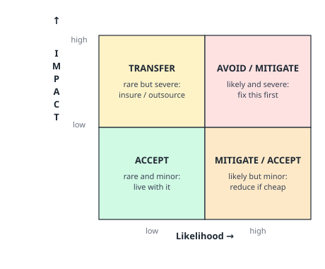
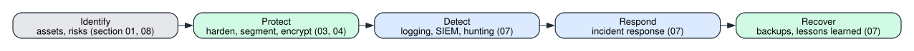

# Risk and Frameworks

**Risk is how likely something bad is, times how much damage it would do — and because no one can protect everything equally, security is deciding which risks to fix first.**

## Before you start
<!-- bite: c27825db-6a56-48d1-a41a-6ffff89a1a2e -->

You should have:

- Built a threat model for Mama Put and found its top threat → [[cybersecurity/01-fundamentals/05-threat-modeling|threat modelling]].
- Met the CIA triad, the goals risk protects → [[cybersecurity/01-fundamentals/02-cia-triad|the CIA triad]].
- Seen the controls the course has built (firewalls, detection, response) that a framework organises.

After this lesson you will be able to:

1. Define risk as likelihood × impact, and tell asset, threat, vulnerability and risk apart.
2. Run the four-step risk process and choose a treatment (mitigate, transfer, accept, avoid).
3. Build a **risk register** for a real app, score and rank the risks, and justify each treatment.
4. Name the main frameworks (NIST CSF, ISO 27001, CIS) and compliance regimes, and place compliance as a floor, not a ceiling.

**Study route.** Kid version and §1–4, then the worked example: building and ranking a risk register for Mama Put.

## What risk and frameworks are
<!-- bite: fbe7a72d-bffe-453b-ad27-229629430fc7 -->

Everything technical in this course — a firewall, a hashed password, a detection rule — costs time and money, and no organisation has infinite amounts of either. So the top of the security field isn't a bigger firewall; it's *deciding where the finite budget does the most good*. That decision is **risk management**.

This lesson is the management layer: how to measure a risk (likelihood × impact), the four-step process for handling one, and the **frameworks** — ready-made, vetted checklists like NIST CSF and ISO 27001 — so you don't invent "what good security looks like" from scratch. Then **compliance**: the obligations the law and your customers impose on top. By the end you'll have built a real risk register for Mama Put and used it to decide what to fix first.

## The kid version
<!-- bite: e2132de3-91c6-4749-94dc-a6a2f44ea3b2 -->

Imagine you've got ₦5,000 and a house with a few weak spots: the front-door lock is a bit loose, a back window doesn't latch, and the roof might leak in a bad storm. You can't fix everything. So you think: how *likely* is each problem, and how *bad* if it happens? The back window is easy for a thief *and* a break-in would be a disaster — fix that first. The roof leak is unlikely and only a nuisance — leave it, or just keep a bucket handy.

That's risk management: you rank your weak spots by *likelihood × how bad*, and spend your limited money on the worst ones first.

**Where the analogy stops working.** With a house you can see the weak spots. An organisation has thousands it can't see, they change every week as new attacks appear, and "how bad" includes things with no price tag — reputation, customer trust, a regulator's fine. So real risk management needs a repeatable *process* and a shared *checklist* (a framework), not just a good eye — otherwise you protect the loose lock while the window stays open because nobody wrote it down.

## 1. Risk = Likelihood × Impact
<!-- bite: 287486a3-220a-4cda-bb5a-fa026db57c51 -->

Perfect security is impossible and budgets are finite, so security is fundamentally **managing risk** — spending where it reduces the most danger. The core formula, in words first: a risk's size is how *likely* the bad event is, multiplied by how *much damage* it would do.

A vulnerability that's trivial to exploit and would destroy the business is high risk; one that's near-impossible to exploit, or would cause a shrug, is low. Four words get mixed up constantly, so pin them down:

1. **Asset** — what you're protecting: data, systems, reputation, money.
2. **Threat** — what could harm it: an attacker, a disaster, a careless employee.
3. **Vulnerability** — a weakness a threat can use.
4. **Risk** — the *potential loss* when a threat exploits a vulnerability against an asset.

A threat with no matching vulnerability is not a risk; a vulnerability no threat can reach is not a risk. Risk is where they meet.

## 2. The risk process and the four treatments
<!-- bite: c5d5620b-d740-43e2-8616-41631c992537 -->

Risk management is a four-step loop:

1. **Identify** — what assets, what threats, what vulnerabilities (your [[cybersecurity/01-fundamentals/05-threat-modeling|threat model]] feeds this).
2. **Assess** — score likelihood × impact for each, to *rank* them. You'll never fix everything, so the ranking is the point. (This is what **CVSS** scores do for individual vulnerabilities — rank severity 0–10.)
3. **Treat** — choose one of four responses.
4. **Monitor** — risk changes as threats and systems evolve, so reassess continually.

## 2. The risk process: the four treatments
<!-- bite: 42cb285b-6dee-464f-93e5-c6f8d2bf4b5f -->

Once a risk is assessed, you choose one of four responses:

1. **Mitigate** — reduce it with a control. The usual choice for likely, damaging risks.
2. **Transfer** — shift it to someone else (cyber insurance, outsourcing). For rare but severe.
3. **Accept** — live with it, when fixing costs more than the risk. For minor, unlikely ones.
4. **Avoid** — don't do the risky thing at all.

The senior insight: **you can't secure everything, so knowing what's *worth* securing — and justifying it to leadership in business terms — is the actual job** at the top of this field.

## 2. Placing the treatments on the matrix
<!-- bite: ecf2bf5c-a3ba-462a-8fda-9d5a91eaf8ef -->

Which treatment fits depends on where the risk sits on the likelihood-impact matrix:

Likely *and* severe (top-right) is avoided or mitigated first; rare but severe (top-left) is transferred; likely but minor is mitigated if it's cheap; rare and minor is accepted.

## 3. The frameworks
<!-- bite: d162e49d-97ff-4ad9-bcd1-404262017b7c -->

Rather than invent controls from scratch, organisations adopt established **frameworks** — shared, vetted checklists of what good security looks like. The NIST Cybersecurity Framework (CSF) is the common reference, built around five functions — and they map onto this whole course:

## 3. The frameworks: the main ones
<!-- bite: 4876de29-c181-41bc-bbbe-3ac901e89379 -->

The three you'll meet most:

1. **NIST CSF** — flexible, organised around Identify / Protect / Detect / Respond / Recover. The common US reference.
2. **ISO/IEC 27001** — the international standard for an Information Security Management System (ISMS); *certifiable*, used globally to prove maturity to customers.
3. **CIS Controls / Benchmarks** — a prioritised, prescriptive list of actions and concrete [[cybersecurity/07-security-operations/01-defensive-architecture|hardening]] configs. The most actionable starting point — you used CIS when you ran `lynis`.

Frameworks give a common language, stop you reinventing the wheel, and give you something to measure and audit against.

## 4. Compliance — the floor, not the ceiling
<!-- bite: 59965608-fb48-4086-9362-146e99b61cb4 -->

**Compliance** is meeting externally-imposed obligations — laws, regulations, contracts. It's related to security but not the same thing: compliance is the *minimum* you must do to be legal, **not** the most you should do. You can be fully compliant and still insecure. The major regimes:

1. **GDPR** — EU data-protection law: consent, breach notification within 72 hours, large fines.
2. **PCI-DSS** — mandatory for anyone handling payment-card data (Mama Put touches this via Paystack).
3. **HIPAA** — US healthcare data.
4. **SOC 2** — a widely-requested audit report on a provider's security controls; common in B2B SaaS, and often the reason customers trust you.

Compliance exists because left alone, many organisations under-invest in security until a law forces a floor under everyone.

## Terms used in this lesson
<!-- bite: 85c57013-f119-4203-9285-edb7c7573fc6 -->

1. **Risk**: This is the potential loss when a threat exploits a vulnerability against an asset. Its size is likelihood × impact.
2. **Asset / threat / vulnerability**: An asset is what you protect; a threat is what could harm it; a vulnerability is the weakness the threat uses. Risk is where all three meet.
3. **Risk treatment**: This is the chosen response to a risk — mitigate (reduce it), transfer (shift it), accept (live with it), or avoid (don't do it).
4. **CVSS (Common Vulnerability Scoring System)**: This is a 0–10 severity score for a single vulnerability, used to rank which to patch first.

## Terms used in this lesson: frameworks and compliance
<!-- bite: 5b3e315b-958e-43e4-9474-492c5ea5f3a8 -->

5. **Framework**: This is a vetted, shared checklist of good security practice — NIST CSF, ISO 27001, CIS — adopted so you don't invent controls from scratch.
6. **ISMS (Information Security Management System)**: This is the documented set of policies and processes ISO 27001 certifies — the "program" that runs security.
7. **Compliance**: This is meeting externally-imposed security obligations (laws, contracts). It is the legal floor, not the security ceiling.
8. **Risk register**: This is the living list of an organisation's risks, each with its likelihood, impact, score, owner and treatment. The core artefact of risk management.

## Worked example — a risk register for Mama Put
<!-- bite: 6b7c2a0f-a198-42a2-9cbb-6870e1ce6f0c -->

The risk register is where all of this becomes real. Take Mama Put (the food-ordering backend from the framework subjects) and its threats from your [[cybersecurity/01-fundamentals/05-threat-modeling|threat model]]. Score each **likelihood** and **impact** 1–5, multiply for a risk score, then rank. Save it as `risk-register.md`:

| # | Risk | Likelihood | Impact | Score | Treatment |
|---|---|---|---|---|---|
| R1 | Spoofed Paystack webhook marks an order paid without payment | 4 | 5 | **20** | Mitigate — verify HMAC signature |
| R2 | Reused admin password lets an attacker into the dashboard | 3 | 5 | **15** | Mitigate — MFA + breached-password check |
| R3 | SQL injection on the login form leaks the user table | 2 | 5 | **10** | Mitigate — parameterised queries |
| R4 | A customer's card data is stolen in transit | 1 | 5 | **5** | Transfer/Mitigate — HTTPS + PCI-DSS via Paystack |
| R5 | A bad storm takes the single server offline | 2 | 2 | **4** | Accept — note it, revisit at scale |

**Predict first:** before reading on, which risk should the team fix *first*, and is it the one that's most *likely* or the one that's most *severe*?

## Worked example: reading the register
<!-- bite: 2ebdd77a-772d-4f4c-a2b9-89cb8a56fa0d -->

The answer is **R1** — score 20, the highest. Notice it's neither the most likely nor uniquely the most severe; it's the one where likelihood *and* impact are both high. That's exactly what the likelihood × impact ranking is for: a spoofed webhook is both easy to attempt and business-ending (free food, lost money), so it beats the SQL injection (R3), which is just as severe but harder to pull off.

This matches what your threat model already found — the spoofed Paystack webhook was Mama Put's top threat. The register turns that instinct into a *defensible number* you can show a non-technical founder: "we're fixing R1 before R3 because it scores 20 versus 10, here's why." That justification — translating security into a ranked, business-readable list — is the skill the senior roles are paid for.

## Worked example: the treatment decisions
<!-- bite: 79304ece-89dc-4049-8a73-6eab2144b166 -->

Each row's treatment is a deliberate choice, not a reflex to "fix everything":

- **R1, R2, R3** — **mitigate**: likely and/or severe, and the control is cheap relative to the loss. Add the control, as the course already taught (HMAC, MFA, parameterised queries).
- **R4** — **transfer**: card data is handled by Paystack, so most of the PCI-DSS burden (and risk) sits with them; you mitigate the transit part with HTTPS and transfer the rest.
- **R5** — **accept**: a single-server outage is unlikely and low-impact at Mama Put's current size. You *write it down* and set a trigger ("revisit when we pass 1,000 orders/day"). Accepting a risk knowingly is a valid decision; *ignoring* it is not — the difference is that it's in the register with an owner.

The register is **living**: new threats get added, scores change as the business grows, and the "monitor" step means you revisit it. That's risk management as an ongoing program, not a one-off audit.

## Common pitfalls and traps
<!-- bite: 8fd6c538-47f9-459b-aa20-9f4aec75dd10 -->

1. **Treating compliance as security.** Passing a PCI-DSS or SOC 2 audit is the floor. Attackers don't care that you're compliant; plenty of breached companies were.
2. **Fixing the loudest risk, not the highest-scoring one.** Without a register you fix whatever someone complained about last, not what's actually most dangerous.
3. **"Accept" meaning "ignore".** Accepting a risk is fine *if it's recorded, owned, and has a revisit trigger*. An unrecorded risk you forgot about is not accepted — it's just unmanaged.
4. **Scoring in a vacuum.** Likelihood and impact are estimates; get the people who know the business to set them, and revisit as reality teaches you.
5. **A register nobody owns.** A risk with no named owner drifts. Every row needs someone accountable for its treatment.

## Check your understanding
<!-- bite: 12433b82-934e-4541-9041-d77914783234 -->

Try each one before you open the answer.

1. <!-- q: mcq id="ac589b13" -->
   Risk is defined as likelihood × impact. A vulnerability is extremely hard to exploit (very low likelihood) but would destroy the business if it were (very high impact). Another is trivial to exploit (high likelihood) but would cause a minor annoyance (low impact). What does the formula say about fixing them first?

   - [ ] Always fix the high-impact one first, regardless of likelihood.
   - [x] Neither is automatically first — multiply each one's likelihood by its impact and compare the scores; a middling pair can outrank a lopsided one.
   - [ ] Always fix the high-likelihood one first.
   - [ ] Fix whichever was discovered most recently.

   

Answer

   The whole point of likelihood × impact is that neither factor alone decides it — a risk that's high on *both* (like the spoofed webhook, 4×5=20) beats one that's severe but rare (1×5=5) or likely but minor (5×1=5). You rank by the product, which is why the risk register scores every risk the same way and sorts by the result.

   

2. <!-- q: gap id="20bc0240" answers="vulnerability" -->
   In risk vocabulary: an *asset* is what you protect, a *threat* is what could harm it, and the weakness that the threat actually exploits to reach the asset is called a ___.

   

Answer

   A vulnerability. Risk is where all three meet: a threat with no matching vulnerability isn't a risk, and a vulnerability no threat can reach isn't a risk either. The weakness is the vulnerability; the potential loss when it's exploited is the risk.

   

3. <!-- q: mcq id="be273632" -->
   Mama Put decides the risk of a rare, catastrophic card-data breach is best handled by relying on Paystack (who are PCI-DSS certified) to hold the card data, so the burden and liability sit largely with them. Which risk treatment is this?

   - [ ] Accept
   - [ ] Avoid
   - [x] Transfer
   - [ ] Mitigate

   

Answer

   Transfer — shifting the risk to another party (here a specialist processor; cyber insurance is the other common example). It fits a rare-but-severe risk, the top-left of the matrix. Mitigate would be adding your own control; accept would be living with it; avoid would be not taking card payments at all.

   

4. <!-- q: mcq id="4edaa217" -->
   A company proudly announces it passed its PCI-DSS compliance audit. Why is "we're compliant" not the same as "we're secure"?

   - [ ] Compliance audits are illegal.
   - [x] Compliance is the minimum legal/contractual floor; you can meet it and still have serious weaknesses it doesn't cover. It's the floor, not the ceiling.
   - [ ] Compliance only applies to small companies.
   - [ ] Being compliant guarantees you can't be breached.

   

Answer

   Compliance is a floor imposed from outside (law, contracts) so organisations don't under-invest below a minimum. Attackers don't care that you're compliant, and many breached companies passed their audits. Real security often requires going well beyond what any single regime mandates.

   

5. <!-- q: exact id="6082e23e" answer="20" -->
   On a risk register, likelihood and impact are each scored 1–5 and multiplied. A spoofed-webhook risk is scored likelihood 4, impact 5. What is its risk score?

   

Answer

   20 (4 × 5). It's the highest score in Mama Put's register, which is why it's treated first. The number isn't precise science — likelihood and impact are estimates — but scoring everything the same way makes the ranking defensible and lets you show a non-technical leader *why* one thing is fixed before another.

   

6. <!-- q: open id="25fee912" -->
   The NIST Cybersecurity Framework has five functions: Identify, Protect, Detect, Respond, Recover. Explain what a framework like this gives an organisation that a pile of individual security tools does not.

   

Answer

   A framework gives three things tools alone don't. First, a *common language*: everyone — engineers, auditors, leadership — can talk about "our Detect capability" and mean the same thing, and findings map to a shared structure. Second, *completeness*: the five functions are a checklist that exposes gaps (a team with great Protect and Detect but no Respond plan can see the hole), so you don't just buy whatever tool a vendor is selling. Third, something to *measure and audit against*: you can assess maturity per function and show progress over time. Tools implement controls; a framework decides which controls you need and whether they add up to a coherent program rather than a random collection.

   

## Practice — a risk register for your own project
<!-- bite: 344d9889-3b27-4822-a718-585e89298dbd -->

**Task.** Build a risk register for something you actually run (one of your own apps, or your lab VPS).

1. List 6–10 risks. For each, name the asset, the threat, and the vulnerability, then score likelihood and impact 1–5 and multiply.
2. Sort by score. Choose a treatment for each (mitigate / transfer / accept / avoid) and justify it in one line.
3. For every "accept", write the revisit trigger (what would change your mind).
4. Assign each row an owner — even if that's just you.

## Practice: when it's done
<!-- bite: 97bb5a92-5202-496a-9e9f-bb5f77b45bc4 -->

Here's how you know the task is finished.

**Done when:** your register has every risk scored and sorted, a justified treatment for each, a revisit trigger on every "accept", and an owner per row — and you could show it to a non-technical person and have them understand *why* the top item is top. Record it in `cybersecurity/LIVE-RUNS-TODO.md`. This is the single most-used artefact in GRC work.

## Before moving on
<!-- bite: a61fc9dc-0b00-4190-81cd-053eb33c7690 -->

You can now define risk as likelihood × impact, tell asset/threat/vulnerability/risk apart, run the four-step process and choose a treatment, build and rank a risk register, and place the main frameworks and compliance regimes.

**Recap for later lookup:** risk = likelihood × impact. Asset (protect), threat (harms), vulnerability (weakness), risk (where they meet). Process: identify → assess → treat → monitor. Treatments: mitigate, transfer, accept, avoid. Frameworks: NIST CSF (Identify/Protect/Detect/Respond/Recover), ISO 27001 (certifiable ISMS), CIS (prescriptive, actionable). Compliance (GDPR, PCI-DSS, HIPAA, SOC 2) is the floor, not the ceiling. The risk register — scored, ranked, owned, with revisit triggers — is the core artefact.

Next: [[cybersecurity/08-governance-risk-and-compliance/02-certifications-and-career|certifications and career]] — the credentials and roles that formalise this knowledge and staff the program a framework describes.

## Related
<!-- bite: 16c7b51f-41f5-4c0b-b1e3-a62e2583de42 -->

- [[cybersecurity/01-fundamentals/05-threat-modeling|Threat modelling]] — where the risks in the register come from.
- [[cybersecurity/07-security-operations/01-defensive-architecture|Defensive architecture]] — CIS Benchmarks and hardening, a framework's controls in practice.
- [[cybersecurity/08-governance-risk-and-compliance/03-governance-and-the-human-layer|Governance and the human layer]] — the program that runs the treatments this chooses.

## About this lesson
<!-- bite: 5a3b8083-6e03-4ef7-bc4a-9bede160a89a -->

**Level:** Intermediate. **Covers:** risk as likelihood × impact, the asset/threat/vulnerability/risk vocabulary, the four-step risk process and the four treatments, building and ranking a risk register (worked for Mama Put), the main frameworks (NIST CSF, ISO 27001, CIS) and compliance regimes (GDPR, PCI-DSS, HIPAA, SOC 2) as a floor not a ceiling. **Where it sits:** lesson 1 of the [[cybersecurity/08-governance-risk-and-compliance/index|Governance, Risk and Compliance]] section. **Sources:** the original vault note (from the roadmap.sh cyber-security roadmap), rebuilt to the [[COURSE-STANDARD|course standard]] with a hands-on risk register; the register is an artefact to build, tracked in `cybersecurity/LIVE-RUNS-TODO.md`.
