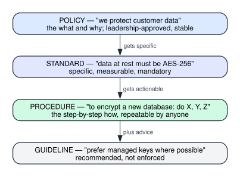

# Governance and the Human Layer

**Governance is how an organisation runs security — who's in charge, what the rules are, and who checks they're followed — and its people are the weakness attackers use most.**

## Before you start
<!-- bite: 98a71bda-241a-4f8c-864f-38b7a54197c7 -->

You should have:

- Built a risk register and met frameworks, which governance operationalises → [[cybersecurity/08-governance-risk-and-compliance/01-risk-and-frameworks|risk and frameworks]].
- Met the human attacks governance defends against → [[cybersecurity/06-attacks-and-threats/01-social-engineering|social engineering]].
- Met the blameless review from incident response → [[cybersecurity/07-security-operations/04-incident-response|incident response]].

After this lesson you will be able to:

1. Explain what governance is and why tools without it still get breached.
2. Lay out the policy → standard → procedure → guideline hierarchy, and write one for a real control.
3. Explain why people are the biggest vulnerability and name the cultural defences.
4. Compute a security metric (like a phishing click rate) and say what it tells leadership.

**Study route.** Kid version and §1–4, then the worked example: writing a policy set and computing a metric for Mama Put.

## What governance is
<!-- bite: e01c3b3f-63cd-422c-8190-3032edc3672d -->

Risk management (lesson 1) decides *what* security to do. Governance is how it actually *gets done* — reliably, across an organisation of hundreds of people, over years. You can buy every security tool on the market and still be breached, because security isn't a product you install; it's a **program you run**: someone owns it, there are written rules, people are trained, and someone checks that they comply.

This lesson is the "G" in GRC. It covers the documented **policy hierarchy** (from high-level intent down to exact steps), the **roles** that own the program (up to the CISO), and the **human layer** — because the single most-exploited weakness in every organisation isn't a server, it's a person, and no technical control fixes judgement. By the end you'll have written a small policy set and computed the metric that tells leadership whether it's working.

## The kid version
<!-- bite: b759947b-c5c4-4a2d-9163-63379ac01042 -->

Imagine a school. Buying the best locks, cameras and fire extinguishers doesn't make it safe on its own. Someone has to be *in charge* of safety, there have to be *written rules* ("fire doors stay shut", "visitors sign in"), the teachers and pupils have to be *taught* the rules, and someone has to *check* now and then that the doors really are shut. A school with great equipment and none of that is still unsafe.

Governance is all of that for an organisation's security: an owner, written rules, training, and checking. And the biggest danger in the school isn't the building — it's a person propping a fire door open for convenience. So the rules and training exist mostly because of people.

**Where the analogy stops working.** A school's rules are simple and everyone can see a propped-open door. An organisation's "doors" are invisible (a password, a cloud setting, a suspicious email), the rules run from boardroom principle down to exact keystrokes, and the person who props the door open usually doesn't *know* they did anything wrong. So governance needs a written hierarchy connecting the big "why" to the exact "how", and a *culture* where people report their mistakes instead of hiding them.

## 1. What governance is, and why tools aren't enough
<!-- bite: 7366d8ce-543d-4dda-994e-b8a271161f66 -->

**Governance is the structure that turns security from good intentions into consistent practice.** Frameworks and risk assessments produce a list of what *should* happen; governance is what makes it happen reliably, everywhere, over time.

It answers four questions: **Who owns security? What are the rules? How do we know they're followed? Who's accountable when they're not?** Without it, security is whatever each engineer happens to remember on a given day — which is to say inconsistent, and inconsistent security is the kind that gets breached. A firewall with no one responsible for its rules drifts; a password policy no one enforces is a document, not a control.

## 2. The policy hierarchy
<!-- bite: 0be1f7be-a25c-4df9-9f8f-057ad9f74d01 -->

Governance is written down as a hierarchy, from principle to keystroke. People conflate these levels constantly, so it's worth separating them:



## 2. The policy hierarchy: the four levels
<!-- bite: 4c80b0f8-a8cf-4b49-9c1c-1d36fe4d6c5a -->

Each level narrows the one above, from principle to keystroke:

1. **Policy** — the organisation's stated intent and rules ("we protect customer data"). High-level, stable, leadership-approved — the anchor everything derives from.
2. **Standard** — the specific, mandatory, measurable requirement ("data at rest must be AES-256"). A length, an algorithm, a config.
3. **Procedure** — the exact steps to comply ("to encrypt a new database: do X, Y, Z"), so it's repeatable regardless of who does it.
4. **Guideline** — recommended good practice ("prefer managed keys where possible"), not enforced.

**Why the hierarchy matters:** a policy nobody can act on is theatre; a procedure with no policy behind it is a rule nobody can justify. The chain from *why* down to *how* is what makes security principled, executable *and* auditable.

## 3. The program and its roles
<!-- bite: 658be75c-be71-4dc6-bbda-9960514c178d -->

Governance assigns **ownership and accountability**, because "everyone's responsible" means no one is:

1. **The CISO (Chief Information Security Officer)** — owns the security program, sets strategy, and increasingly **reports risk to the board in business terms**. The senior-most security role, and the reason the "justify security to leadership" skill from lesson 1 matters so much.
2. **Security team roles** — the [[cybersecurity/08-governance-risk-and-compliance/02-certifications-and-career|career tracks]] (SOC, GRC, appsec) that staff the program.
3. **Data owners** — business leaders accountable for specific data: who may access it, how it's classified.
4. **Everyone else** — because security is a property of the whole organisation, every employee has a role — which is where the human layer comes in.

**Accountability is the point.** A control with a named owner gets maintained; an unowned one drifts and rots.

## 4. The human layer — the biggest vulnerability
<!-- bite: faaec707-fcf1-41ba-adf9-a2982067e747 -->

**People are the most-attacked and most-exploited part of every organisation**, and no technical control fixes it, because the attacks target *judgement*, not systems:

1. **Phishing and social engineering** — the #1 initial-access vector. One clicked link, one leaked password, and the best firewall in the world didn't help → [[cybersecurity/06-attacks-and-threats/01-social-engineering|social engineering]].
2. **Insider threats** — malicious or, far more often, *negligent* insiders. Least privilege and separation of duties exist largely to bound this.
3. **Human error** — a misconfigured bucket, an emailed spreadsheet, a lost laptop.

No tool patches a person's judgement, so the defence is cultural, covered next.

## 4. The human layer: the cultural defences
<!-- bite: d9c63df1-7ee1-4f14-927d-6d017eb6521e -->

Governance answers the human layer with **security awareness and culture**:

1. **Training** — teach people the [[cybersecurity/10-protecting-yourself/index|phishing tells]], the reporting path, the basics. Regular, not once at onboarding.
2. **Simulated phishing** — controlled tests that *measure and improve* resistance, done supportively, not to punish.
3. **A blameless reporting culture** — the single highest-leverage control. **If people are punished for reporting a mistake or a suspected phish, they hide it**, and a hidden incident becomes a large one. Reporting "I think I clicked something" must be fast, normal and rewarded → [[cybersecurity/07-security-operations/04-incident-response|incident response]] depends on early reporting.
4. **Making the secure path the easy path** — SSO, password managers, paved-road tooling, so security isn't something people route around to get their work done.

**Security that fights the people it protects loses.** The human layer is won with culture and usable tooling, not rules nobody follows.

## Terms used in this lesson
<!-- bite: a9f7f7c9-8580-4017-b1fc-6cf7113a5079 -->

1. **Governance**: This is the structure that turns security into a consistently-run program — ownership, written rules, training and checking — rather than ad-hoc effort.
2. **Policy**: This is the organisation's high-level stated intent ("we protect customer data"), stable and leadership-approved.
3. **Standard**: This is a specific, mandatory, measurable requirement derived from a policy (an algorithm, a length, a config).
4. **Procedure**: This is the exact, repeatable steps to comply with a standard, so the outcome is the same whoever does it.

## Terms used in this lesson: roles and culture
<!-- bite: 15ad1fbb-20ef-4786-9d78-4996af46222f -->

5. **Guideline**: This is recommended good practice, not enforced — the optional bottom of the policy hierarchy.
6. **CISO (Chief Information Security Officer)**: This is the senior-most security role, owning the program and reporting risk to the board in business terms.
7. **Insider threat**: This is a risk from someone inside the organisation — usually a negligent employee, sometimes a malicious one — bounded by least privilege.
8. **Blameless culture**: This is a culture where reporting your own mistake or a suspected phish is safe and encouraged, so incidents surface early instead of being hidden.

## Worked example — a policy set and a metric for Mama Put
<!-- bite: e1d6c40f-e823-465a-b840-49b862ad3622 -->

Governance becomes concrete when you write the hierarchy for one real control and then *measure* it. Take Mama Put's passwords. Write the four levels so each flows from the one above:

```text
POLICY     Mama Put protects customer and staff accounts from unauthorised access.
STANDARD   Staff accounts require a password of 12+ characters, not in a breached-
           password list, plus MFA. Customer passwords are stored with bcrypt (cost 12).
PROCEDURE  To onboard a staff member: 1) create account in the dashboard, 2) enforce
           MFA enrolment on first login, 3) verify the password against the breach API.
GUIDELINE  Prefer a password manager and a passphrase over a complex short password.
```

**Predict first:** which of those four levels would you *audit* against — that is, which one can you actually check a system for pass/fail?

## Worked example: auditing and the metric
<!-- bite: b4733abe-e1ce-4ac1-819e-fb30fe940f4d -->

You audit against the **standard** — it's the only level that's specific and measurable ("12+ characters, MFA on, bcrypt cost 12"). The policy is too high-level to check directly, the procedure is about *how* you got there, and the guideline is optional. This is exactly why the standard exists: it's the testable bridge between a principle and reality.

Now the human-layer metric. Mama Put runs a simulated phishing test: it sends the lure to **40 staff**, and **6** click the link. The **click rate** is:

```text
click rate = clicked / sent = 6 / 40 = 0.15 = 15%
```

**15%** is the number you track over time. On its own it's just a figure; as a *trend* it's governance working — run the test quarterly, train the people who click, and watch it fall. A rising click rate warns you before a real attacker finds the same weakness.

## Worked example: why the metric matters
<!-- bite: 6cebbf80-00a7-40c4-bec6-175a90d603f2 -->

A metric turns "are we secure?" from a feeling into something a leader can read. "Our phishing click rate dropped from 22% to 9% over the year, and median patch latency is down to 3 days" is a sentence a CISO can take to the board — and it's what *secures next year's budget*. That loops straight back to lesson 1's senior insight: translating security into business language is the actual job at the top.

The governance loop closes with **audits** (internal and external reviews that verify controls exist and work, feeding SOC 2 / ISO 27001 certification) and **continuous improvement** (the frameworks are cyclical — plan-do-check-act — because threats and systems change, so the program is never "done").

## Common pitfalls and traps
<!-- bite: 4952d54d-11be-4b56-8e66-cb126d1952a8 -->

1. **Buying tools instead of running a program.** Tools with no owner, rules or checking still get breached. Governance is the program around the tools.
2. **Conflating policy and procedure.** A policy that tries to specify keystrokes is unstable; a procedure with no policy behind it can't be justified. Keep the levels distinct.
3. **"Everyone is responsible for security."** Which means no one is. Every control needs a *named* owner.
4. **Punishing people for reporting.** The fastest way to guarantee that your worst incidents stay hidden until they're catastrophic. Reward reporting.
5. **Awareness training as a box-tick.** Once at onboarding, never again, with no measurement, changes nothing. Train regularly and measure the click rate.

## Check your understanding
<!-- bite: 6f66d8c8-01b8-4ef3-8412-f0f68c949c0e -->

Try each one before you open the answer.

1. <!-- q: mcq id="0ccb8e56" -->
   A company has bought top-tier firewalls, EDR and a SIEM, yet suffers a breach when an employee is phished and nobody had defined who maintains the alert rules. What does this illustrate about governance?

   - [ ] The tools were faulty and need replacing.
   - [x] Security is a program (ownership, rules, training, checking), not a set of products — tools without governance around them still fail.
   - [ ] They should have bought more tools.
   - [ ] Governance only matters for large companies.

   <details><summary>Answer</summary>

   Tools implement controls, but without someone owning them, rules governing them, people trained to the rules, and checks that they're followed, the controls drift and the humans stay unprotected. Governance is the program that makes the tools actually work — which is why "buy a product" is never a complete security answer.

   </details>

2. <!-- q: mcq id="ed222eee" -->
   In the policy hierarchy, which statement is a *standard* rather than a policy, procedure, or guideline?

   - [ ] "We protect customer data."
   - [x] "Data at rest must be encrypted with AES-256."
   - [ ] "To encrypt a new database, run steps X, Y, Z."
   - [ ] "Prefer managed keys where possible."

   <details><summary>Answer</summary>

   A standard is the specific, mandatory, *measurable* requirement — "AES-256" is a testable spec. The first is a policy (high-level intent), the third is a procedure (exact steps), and the fourth is a guideline (optional advice). Standards are the level you audit against, because they're the only one you can check pass/fail.

   </details>

3. <!-- q: exact id="90cc9158" answer="15" accept="15%|0.15" tolerance="0.01" -->
   A simulated phishing test is sent to 40 staff, and 6 of them click the link. What is the phishing click rate, as a percentage?

   <details><summary>Answer</summary>

   15% (6 ÷ 40 = 0.15). On its own it's just a number; tracked over time it's the metric that tells you whether awareness training is working — a falling rate is governance succeeding, a rising one is an early warning. Metrics turn "are we secure?" into a trend a leader can read.

   </details>

4. <!-- q: mcq id="ec33677c" -->
   Why is a *blameless* reporting culture described as the single highest-leverage control on the human layer?

   - [ ] It eliminates the need for firewalls.
   - [x] If people are punished for reporting mistakes or suspected phishing, they hide them — and a hidden incident grows into a large one, while early reporting lets it be contained.
   - [ ] It automatically blocks phishing emails.
   - [ ] It means no one is ever accountable for anything.

   <details><summary>Answer</summary>

   Incident response depends on early reporting. If "I think I clicked something" gets you blamed, people stay quiet, and the breach spreads undetected. A blameless culture makes reporting fast, normal and rewarded, so incidents surface while they're still small. (Blameless means no punishment for honest reporting — not that nothing is ever owned.)

   </details>

5. <!-- q: gap id="0f05e8a0" answers="CISO|chief information security officer" -->
   The senior-most security role, which owns the whole security program, sets strategy, and increasingly reports cyber risk to the board in business terms, is the ___.

   <details><summary>Answer</summary>

   The CISO (Chief Information Security Officer). The "report risk to the board in business terms" part connects to lesson 1's point that translating security into business language is the real job at the top of the field — and it's what secures the security budget.

   </details>

6. <!-- q: open id="a68b28c1" -->
   "Making the secure path the easy path" is listed as a human-layer defence. Give a concrete example, and explain why fighting users with inconvenient rules tends to make security *worse*, not better.

   <details><summary>Answer</summary>

   A concrete example: giving everyone a password manager and single sign-on (SSO), so the secure behaviour (unique strong passwords, one trusted login) is also the *easiest* behaviour — easier than reusing one memorable password everywhere. Other examples: paved-road deployment tooling that's secure by default, or a one-click "report phish" button. The reason inconvenient rules backfire is that people optimise for getting their work done: if the secure way is painful (rotate a 20-character password every 30 days, file a ticket for every access), they route around it — writing passwords on sticky notes, sharing accounts, disabling the VPN — which creates *worse* exposure than the rule was trying to prevent. Security that fights its own users loses, because the users always find the path of least resistance. The win is to make that path the secure one.

   </details>

## Practice — write a policy set and measure a control
<!-- bite: 4d42b8d1-18ee-499a-b393-2b0b98d42e21 -->

**Task.** Pick one control in a project you run and govern it properly.

1. Choose a control (passwords, backups, access reviews, dependency updates). Write all four levels — policy, standard, procedure, guideline — so each flows from the one above.
2. Identify which level you'd *audit* against, and write the pass/fail check.
3. Define one **metric** for it (e.g. % of accounts with MFA, patch latency, backup-restore success rate) and compute it from your real or estimated numbers.
4. Assign an owner to the control.

## Practice: when it's done
<!-- bite: 4f1acbd0-9a62-4f84-bc98-5bd481d50895 -->

Here's how you know the task is finished.

**Done when:** you have a four-level policy set where the standard is genuinely testable, a defined metric with a computed value, and a named owner. The test: someone could *audit* your system against the standard and get a clear pass/fail, and your metric could be tracked quarterly. Record the policy set and metric in your notes (this is a document, not a live run).

## Before moving on
<!-- bite: 8b12d7f4-f9ff-4b38-a062-6eae1b3cbedb -->

You can now explain what governance is and why tools alone fail, lay out and write the policy hierarchy, explain the human layer and its cultural defences, and compute a security metric and say what it tells leadership.

**Recap for later lookup:** governance = running security as a program (owner, rules, training, checking). Policy (why) → standard (measurable, audit here) → procedure (exact steps) → guideline (optional). Roles: CISO owns it; every control needs a named owner. Human layer = the biggest vulnerability (phishing, insiders, error); defences are cultural — training, simulated phishing, blameless reporting, making the secure path the easy path. Metrics (phishing click rate, patch latency) + audits + continuous improvement close the loop.

Next: [[cybersecurity/08-governance-risk-and-compliance/04-third-party-and-supply-chain-risk|third-party and supply-chain risk]] — governing the risk you *don't* directly control, inherited from your vendors and dependencies.

## Related
<!-- bite: 5a317518-66ab-4b62-ba81-12fad4bb5f01 -->

- [[cybersecurity/08-governance-risk-and-compliance/01-risk-and-frameworks|Risk and frameworks]] — the R and C that governance operationalises.
- [[cybersecurity/08-governance-risk-and-compliance/04-third-party-and-supply-chain-risk|Third-party and supply-chain risk]] — governing risk you don't directly control.
- [[cybersecurity/06-attacks-and-threats/01-social-engineering|Social engineering]] — the attacks the human layer faces.

## About this lesson
<!-- bite: dfd1ed9c-f626-4c9b-aa93-85f41ad7f062 -->

**Level:** Intermediate. **Covers:** what governance is and why tools need a program around them, the policy → standard → procedure → guideline hierarchy, the program's roles (CISO, data owners), the human layer as the biggest vulnerability and its cultural defences (training, simulated phishing, blameless reporting, the easy secure path), and a hands-on example writing a policy set and computing a phishing-click-rate metric for Mama Put. **Where it sits:** lesson 3 of the [[cybersecurity/08-governance-risk-and-compliance/index|Governance, Risk and Compliance]] section. **Sources:** the original vault note (from the roadmap.sh cyber-security roadmap), rebuilt to the [[COURSE-STANDARD|course standard]] with a policy-set and metric exercise.
