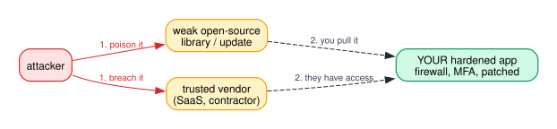

# Third-Party and Supply-Chain Risk

**Third-party risk is the danger that comes from the companies and software you depend on — if any of them is weak, an attacker can reach you through it.**

## Before you start
<!-- bite: eb107a08-e80d-430b-abba-1976abc05ac3 -->

You should have:

- Met governance, which this risk is managed through → [[cybersecurity/08-governance-risk-and-compliance/03-governance-and-the-human-layer|governance]].
- Met vulnerable components and the OWASP supply-chain category → [[cybersecurity/06-attacks-and-threats/03-web-application-attacks|web application attacks]].
- A project with dependencies (any Python or Node project), and a terminal.

After this lesson you will be able to:

1. Explain why supply-chain risk became a dominant breach vector.
2. Tell the two flavours apart: compromised software vs compromised vendors.
3. Generate an **SBOM** for a real project and scan its dependencies for known vulnerabilities.
4. Answer "are we affected by this CVE?" in seconds, and name the governance controls that bound the risk.

**Study route.** Kid version and §1–3, then the worked example: SBOM and dependency scan on one of your projects.

## What supply-chain risk is
<!-- bite: 0f5c21bc-87ce-4b1b-a4cf-88b3495c1ee1 -->

Your organisation's security is no longer just *yours*. A modern app is mostly other people's code — open-source libraries, their dependencies, and *their* dependencies — running on other people's clouds, beside other people's SaaS tools. **A weakness in any of them can breach you**, and you often have no visibility into their security at all.

This is **supply-chain risk**, and it's become one of the hardest problems in security precisely because it's about controlling risk you *don't* directly control. This lesson covers why it took over, its two flavours (poisoned code and breached vendors), and — because you can't technically secure what you don't own — the governance controls that bound it. The most important of those is simply *knowing what you depend on*, which is what you'll build hands-on: a software bill of materials, scanned for known holes.

## The kid version
<!-- bite: 76ac7837-d46c-4b55-a85b-c076f0256c06 -->

Imagine you run a restaurant with a spotless kitchen. You wash your hands, you store everything correctly — your part is perfect. But you buy your meat from one supplier, your vegetables from another, and your sauces pre-made from a third. If the meat supplier's warehouse has a problem, your customers get sick — and it's *your* restaurant's name in the news, even though your kitchen was clean. You trusted suppliers you couldn't see inside.

Software is the same. Your app is "cooked" mostly from ingredients made by other people — code libraries and online services. If one of those ingredients is poisoned, your app is poisoned, no matter how careful your own code was.

**Where the analogy stops working.** A restaurant has a handful of suppliers it chose on purpose. An app has *thousands* of ingredients, most of which it never chose directly — a library you added pulls in fifty more you've never heard of (the "transitive" tree). So you can't just vet your suppliers; you need an automated *list of every ingredient* to even know what's in the pot, which is exactly what an SBOM is.

## 1. Why it became the dominant vector
<!-- bite: a7feb25a-b7c1-4536-b99e-c7b4e59d88ff -->

Two structural shifts made this the risk of the era:

1. **Everything is assembled, not built.** A modern application is 90%+ third-party code — open-source libraries, their dependencies, and theirs (the transitive tree). You wrote a fraction of what you ship.
2. **Everything is outsourced.** Your data lives in other companies' clouds and SaaS tools; your operations depend on vendors who depend on vendors.

So the attack surface extends far beyond anything you own.

## 1. Why it became the dominant vector: the amplification
<!-- bite: de830fdb-f43d-467b-b8b4-6db313e91d2c -->

And attackers noticed: **why attack a hardened target directly when you can compromise a weaker supplier and inherit access to all *their* customers at once?**



One compromised vendor can breach thousands of organisations. That amplification is the whole appeal.

## 2. The two flavours
<!-- bite: 8c0656ff-7e83-426a-96e8-0cd7b3f60d79 -->

**Software supply chain — compromised code:**

1. **Malicious / compromised dependencies** — an attacker poisons a popular package (via a hijacked maintainer account, a typosquatted name, or a malicious update), and everyone who pulls it is compromised.
2. **Compromised build/update pipeline** — **SolarWinds (2020)** is the defining case: attackers compromised the *build system* of a network tool and inserted a backdoor into a legitimate, signed update, which ~18,000 organisations then installed themselves. The update was authentic — that's what made it devastating.
3. **Vulnerable dependencies** — not malicious, just flawed. **Log4Shell (2021)** — a critical bug in Log4j, a logging library embedded in countless apps — meant one library's flaw was a global emergency, and most organisations didn't even know they *had* it.

## 2. The two flavours: compromised vendors
<!-- bite: b63dc1dd-899d-4c79-a5e0-da905b19a19f -->

**Third-party / vendor risk — compromised suppliers:**

4. A vendor with access to your systems or data gets breached, and the attacker pivots to you. **Target's 2013 breach came through an HVAC contractor** with network access that should never have reached the payment network.
5. A SaaS provider holding your data is breached → your data is breached.
6. A managed service provider is compromised → all their clients exposed at once.

The pattern in both flavours is the same: the attacker enters through *trust you extended* to someone you don't fully control.

## 3. Why it's a governance problem
<!-- bite: 528cf651-89c2-4bd7-b599-2b3694abee0c -->

You can't *technically* secure code and systems you don't control, so supply-chain risk is managed through **governance and process**. The controls fall into three groups.

**Know what you depend on** — you can't manage unknown risk:

1. **SBOM (Software Bill of Materials)** — a complete inventory of every component in your software, so when the next Log4Shell drops you can answer "are we affected?" in minutes, not weeks. The single most valuable supply-chain control, and increasingly mandated.
2. **Vendor inventory** — who has access to what data and systems. You can't secure a supplier you've forgotten you use.

**Vet and monitor third parties, and secure your own build** — covered next, then put into practice.

## 3. Why it's a governance problem: vetting and securing
<!-- bite: 6ca6439a-7aa6-49b5-8bcc-9d5783b1f97b -->

**Vet and monitor third parties:**

3. **Vendor security assessments** — before onboarding, review a supplier's security (their SOC 2 report, questionnaires, certifications). This is often *why your own company needs SOC 2* — customers demand it of you.
4. **Contractual requirements** — breach-notification clauses, security obligations, right-to-audit.
5. **Least privilege for vendors** — a supplier gets the minimum access needed, so a compromise is bounded (Target's contractor should never have reached the payment network) → [[cybersecurity/03-network-security/02-network-segmentation|segmentation]].

## 3. Why it's a governance problem: securing your own build
<!-- bite: 2eb6030d-d235-4ffc-83fb-318f7bf9a048 -->

The last group is about the software *you* ship:

6. **Scan dependencies** for known vulnerabilities (SCA — software composition analysis) in CI, continuously.
7. **Pin and verify** — lock dependency versions, verify signatures/hashes, use trusted registries.
8. **Secure the build pipeline** — it's a high-value target (SolarWinds); protect it like production, and use provenance attestation (SLSA) to prove what went into a build.

## Terms used in this lesson
<!-- bite: 36bf014e-2d05-4b6a-b588-4193051346a4 -->

1. **Supply-chain risk**: This is the danger inherited from the software and vendors you depend on, rather than from your own systems.
2. **Transitive dependency**: This is a dependency pulled in *by* one of your dependencies — code you never chose directly but still ship and run.
3. **SBOM (Software Bill of Materials)**: This is a complete inventory of every component in your software, so you can answer "do we use X?" instantly.
4. **SCA (Software Composition Analysis)**: This is scanning your dependencies for known vulnerabilities, ideally automatically in CI.

## Terms used in this lesson: the famous cases and controls
<!-- bite: dfb7e400-a483-4ec2-a053-29b7e74e492f -->

5. **SolarWinds**: This is the 2020 attack where a compromised *build pipeline* shipped a backdoored but legitimately-signed update to ~18,000 organisations.
6. **Log4Shell**: This is the 2021 critical vulnerability in the Log4j library, embedded in countless apps that didn't know they had it — the case an SBOM answers.
7. **Vendor assessment**: This is reviewing a supplier's security (SOC 2 report, questionnaire) before and during the relationship.
8. **Provenance / SLSA**: This is proving what source and build produced an artefact, so a tampered build is detectable.

## Worked example — an SBOM and a dependency scan
<!-- bite: 7df5b5a0-e73f-4e72-9de8-da1426a128d3 -->

The most valuable control is also the most hands-on: know what you ship, then scan it. Use one of your own projects. **First, the SBOM** — list every component. For a Python project:

```bash
cd ~/your-project
pip list --format=freeze > sbom.txt          # quick inventory
pip install pip-audit                          # the scanner
```

For a Node project the equivalents are `npm ls --all > sbom.txt` and the built-in `npm audit`. **Predict first:** your `requirements.txt` might name 10 packages. How many lines do you expect in `sbom.txt` (the *full* installed tree)? It's usually several times more — the rest is transitive dependencies you never chose directly, and every one of them is attack surface.

## Worked example: scanning for known holes
<!-- bite: 260b9ee7-5104-48d1-9415-20d77b54ac48 -->

Now scan the inventory against vulnerability databases. `pip-audit` reads your installed packages and checks each against the advisory database:

```bash
pip-audit
```

A finding looks like this:

```text
Found 1 known vulnerability in 1 package
Name   Version  ID             Fix Versions
-----  -------  -------------  ------------
jinja2 3.1.2    GHSA-h5c8-...  3.1.3
```

That's SCA in one command: it found a known-vulnerable version of a library you depend on and told you the fixed version to upgrade to. Run this in CI on every build and a vulnerable dependency fails the pipeline before it ships — "shift-left" scanning. The equivalent for Node is `npm audit`, and `grype`/`syft` do it language-agnostically from an SBOM.

## Worked example: answering "are we affected?"
<!-- bite: c712a902-1286-4477-8f85-444bd27dd678 -->

This is where the SBOM earns its name. Imagine the news breaks about a critical bug in a library — call it the next Log4Shell. The question every leader asks is "are *we* affected?" Without an inventory, the honest answer is "we'll get back to you in a week". With an SBOM, it's one command:

```bash
grep -i log4j sbom.txt        # or the affected package name
```

Empty output: you're not affected, answered in seconds. A match: you know *exactly* which version, and you check it against the advisory's affected range. During Log4Shell, the organisations that had SBOMs patched in hours; the ones that didn't spent weeks just *finding out* whether they were exposed. The inventory turned a frantic hunt into a lookup — which is the entire point of the control, and why it's increasingly mandated.

## The uncomfortable truth
<!-- bite: 2a8d0ed6-7187-41f0-a238-ac8d6ce2c004 -->

**You are only as secure as your least-secure dependency, and you have limited visibility into most of them.** Perfect internal security is undone by one poisoned library or one breached vendor. This isn't fully solvable — the honest goal is to **reduce and bound** the risk: know your dependencies (SBOM), scan them continuously (SCA), vet and least-privilege your vendors, and *assume a supplier will eventually be compromised*, so segment and limit what that compromise can reach. It's defence in depth extended to a perimeter you don't own.

## Common pitfalls and traps
<!-- bite: 895a061e-83d9-463c-9ee6-5aad59a2259d -->

1. **No inventory.** You can't answer "are we affected?" about code you can't list. The SBOM is the floor, not the ceiling.
2. **Scanning only your direct dependencies.** Most of your code is transitive; the vulnerable library is usually one you never added by hand. Scan the *whole* tree.
3. **Trusting a signed update blindly.** SolarWinds was authentically signed. Signatures prove origin, not safety — provenance and monitoring still matter.
4. **Giving vendors broad access.** Target's contractor reached the payment network. Least-privilege every supplier as if they'll be breached.
5. **One-time vetting.** A vendor secure at onboarding may not stay secure. Monitor continuously; re-scan dependencies on every build, not once.

## Check your understanding
<!-- bite: 1e162042-0cb7-4738-b2d7-f80a21cadde4 -->

Try each one before you open the answer.

1. <!-- q: mcq id="e7ea5ea7" -->
   An attacker wants into a large, well-defended bank with a hardened perimeter. Instead of attacking it directly, they compromise a small software vendor whose product the bank installs. Why is this often the more effective route?

   - [ ] The vendor's software is always free.
   - [x] Compromising one weaker supplier can inherit access to all its customers at once, bypassing each customer's own defences through the trust they placed in the vendor.
   - [ ] Banks don't use third-party software.
   - [ ] It's legal to attack vendors.

   <details><summary>Answer</summary>

   Supply-chain attacks amplify: one compromised supplier reaches all its customers simultaneously, and the malicious code arrives through a trusted, often signed channel that bypasses the customer's perimeter defences. SolarWinds (one build system → ~18,000 organisations) is the textbook case. Attacking the hard target directly is far more work for far less reach.

   </details>

2. <!-- q: mcq id="01d23ebb" -->
   During the Log4Shell emergency, some organisations patched within hours while others spent weeks. What single control most explains the difference?

   - [ ] A faster internet connection
   - [x] An SBOM (software bill of materials) — an inventory that let them answer "do we use Log4j, and where?" instantly instead of hunting
   - [ ] A bigger security budget
   - [ ] More firewalls

   <details><summary>Answer</summary>

   The hard part of Log4Shell wasn't patching — it was *finding out whether you were affected*, because Log4j was buried as a transitive dependency in countless apps. Organisations with an SBOM queried their inventory in seconds; those without spent weeks discovering their own exposure. That's why the SBOM is called the single most valuable supply-chain control.

   </details>

3. <!-- q: gap id="0ae0ac99" answers="transitive" -->
   A dependency that you did not add yourself, but which was pulled in automatically *by* one of your dependencies (or by one of theirs), is called a ___ dependency — and it's usually where the vulnerable library hides.

   <details><summary>Answer</summary>

   A transitive dependency. Most of a modern app's code is transitive — you directly chose a handful of libraries, and they dragged in dozens or hundreds more. This is why scanning only your direct dependencies misses most of the risk, and why you need an SBOM of the whole tree.

   </details>

4. <!-- q: mcq id="b6ccae9e" -->
   The SolarWinds update that carried the backdoor was legitimately signed by the vendor. What's the key lesson for how much trust a valid signature deserves?

   - [ ] Signatures are useless and should be ignored.
   - [x] A signature proves *origin* (it really came from the vendor), not *safety* — if the vendor's build pipeline is compromised, a malicious artefact can be authentically signed.
   - [ ] Signed updates are always safe to install.
   - [ ] Only open-source software can be signed.

   <details><summary>Answer</summary>

   A valid signature proves the artefact came from the claimed source unaltered — but if the *source's own build system* was compromised, it signs the backdoored build too. That's exactly what made SolarWinds devastating. Signatures are necessary but not sufficient; securing the build pipeline and using build provenance (SLSA) address the gap.

   </details>

5. <!-- q: mcq id="c1296548" -->
   Target's 2013 breach reached the payment network through an HVAC (heating/air-conditioning) contractor's access. Which control would most directly have bounded this?

   - [ ] A stronger password policy for customers
   - [x] Least privilege / segmentation for vendors — the contractor should never have had network access that could reach the payment systems
   - [ ] Encrypting the website with HTTPS
   - [ ] A longer SBOM

   <details><summary>Answer</summary>

   The failure was that a contractor who needed access to one thing (HVAC/billing systems) could reach something completely unrelated and critical (the payment network). Least privilege and network segmentation for vendors bound a supplier compromise to the minimum — assume the vendor *will* be breached, and limit what that breach can touch.

   </details>

6. <!-- q: open id="ee2c3bd3" -->
   Supply-chain risk is described as "not fully solvable". Given that, what is the realistic goal, and name three concrete controls that move you toward it.

   <details><summary>Answer</summary>

   Since you can't technically secure code and systems you don't own, and you have limited visibility into most of your dependencies and vendors, the realistic goal isn't "eliminate the risk" but **reduce and bound** it — make it a known, limited risk rather than an invisible one, and assume a supplier *will* eventually be compromised. Three concrete controls (any three): (1) maintain an **SBOM** so you can instantly answer "are we affected?" when a vulnerability drops; (2) run **SCA / dependency scanning** in CI continuously so vulnerable libraries fail the build before shipping; (3) apply **least privilege and segmentation to vendors**, so a compromised supplier can only reach the minimum; also valid — vendor security assessments, pinning and verifying dependencies, and securing the build pipeline with provenance. The theme is defence in depth extended to a perimeter you don't control: know, scan, bound, and assume breach.

   </details>

## Practice — SBOM and scan your own project
<!-- bite: f48dadb0-1e7d-4f40-881c-564d305fddc0 -->

**Task.** Inventory and scan a real project you own.

1. Generate an SBOM: `pip list --format=freeze > sbom.txt` (Python) or `npm ls --all > sbom.txt` (Node). Count the lines, and note how many more there are than your direct dependencies.
2. Scan it: `pip-audit` or `npm audit`. Record every known vulnerability and its fix version.
3. Simulate a "are we affected?" drill: pick any library and `grep` your SBOM for it — time how fast you can answer.
4. Fix (or note the fix for) the highest-severity finding.

## Practice: when it's done
<!-- bite: 3902a4de-f20b-4b10-a6ae-dc8b1cb32803 -->

Here's how you know the task is finished.

**Done when:** you have an SBOM, a scan result listing each vulnerable package with its fix version, and you've answered one "are we affected by X?" question from the SBOM in seconds. Record the counts (direct vs transitive) and the findings in `cybersecurity/LIVE-RUNS-TODO.md`. Bonus: wire `pip-audit`/`npm audit` into the project's CI so it runs on every build.

## Before moving on
<!-- bite: 1b6181f2-530f-41d4-a2d7-ce6b7571b0cf -->

You can now explain why supply-chain risk dominates, tell compromised-code from compromised-vendor attacks apart, generate and scan an SBOM, answer "are we affected?" instantly, and name the controls that bound the risk.

**Recap for later lookup:** supply-chain risk = inherited from dependencies and vendors. Why it dominates: everything is assembled (90%+ third-party, transitive tree) and outsourced; compromise one supplier, reach all its customers (SolarWinds, Log4Shell, Target). Two flavours: poisoned/compromised/vulnerable code, and breached vendors. It's a governance problem: SBOM (know what you ship), SCA (scan continuously), vendor assessment + least privilege, pin/verify, secure the build (SLSA). You're only as secure as your least-secure dependency; the goal is to bound and know the risk, assuming a supplier will be breached.

**The section, in one line:** lesson 1 decided *what* risk to treat, 2 the *careers* that staff it, 3 the *program* that runs it, and 4 the risk you *inherit* — together the management layer that makes security a business function, not just a technical one.

Next: [[cybersecurity/09-cloud-security/index|cloud security]], where these controls meet the infrastructure most organisations now run on.

## Related
<!-- bite: b36040c8-d2f9-434d-9c7e-495682a390bb -->

- [[cybersecurity/08-governance-risk-and-compliance/03-governance-and-the-human-layer|Governance]] — the process side this risk is managed through.
- [[cybersecurity/08-governance-risk-and-compliance/01-risk-and-frameworks|Risk and frameworks]] — SOC 2 and vendor assessment.
- [[cybersecurity/06-attacks-and-threats/04-password-malware-and-exploits|Vulnerable components]] — the technical view of what SCA scans for.

## About this lesson
<!-- bite: d0d57f9c-43af-400e-b7a9-eb75b096c9d3 -->

**Level:** Intermediate → Advanced. **Covers:** why supply-chain risk became a dominant breach vector, its two flavours (compromised software — malicious, build-pipeline, and vulnerable dependencies; and compromised vendors), the famous cases (SolarWinds, Log4Shell, Target), why it's a governance problem, the controls (SBOM, SCA, vendor assessment, least privilege, provenance), and a hands-on SBOM-and-scan lab with `pip-audit`/`npm audit`. **Where it sits:** lesson 4 of the [[cybersecurity/08-governance-risk-and-compliance/index|Governance, Risk and Compliance]] section, the last of it. **Sources:** the original vault note (from the roadmap.sh cyber-security roadmap), rebuilt to the [[COURSE-STANDARD|course standard]] with a dependency-scanning lab; the `pip-audit`/`npm audit` run is tracked in `cybersecurity/LIVE-RUNS-TODO.md`.
