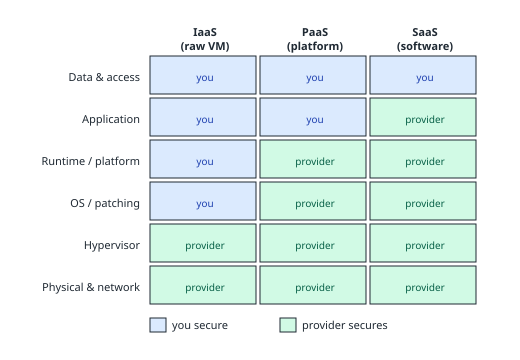

# The Shared Responsibility Model

**The shared responsibility model is the rule for who secures what in the cloud: the provider secures the cloud itself, and you secure what you put in it.**

## Before you start
<!-- bite: 9cf6fa9a-fcf8-4c32-9339-8ed721c10c86 -->

You should have:

- Met zero trust and defence in depth, which this applies to infrastructure → [[cybersecurity/07-security-operations/01-defensive-architecture|defensive architecture]].
- Met misconfiguration as an attack category → [[cybersecurity/06-attacks-and-threats/03-web-application-attacks|web application attacks]].
- A rough idea of IaaS/PaaS/SaaS → [[devops/08-cloud/01-cloud-fundamentals|cloud fundamentals]] (helpful, not required).

After this lesson you will be able to:

1. State the shared responsibility model and what's *always* yours regardless of service model.
2. Say how the provider/you line moves across IaaS, PaaS and SaaS.
3. Audit a deployment: given a setup, list who's responsible for each layer and spot the customer-side mistake.
4. Explain why misconfiguration — not provider hacks — causes almost all cloud breaches.

**Study route.** Kid version and §1–3, then the worked example: a responsibility audit of a Mama Put cloud deployment.

## What the shared responsibility model is
<!-- bite: d267c89a-4711-4597-908a-09a1c3ed3e6a -->

The previous sections mostly assumed you run your own machines. Most organisations now rent them from a cloud provider (AWS, Azure, GCP), and that changes *who is responsible for what*. The rule that answers it is the **shared responsibility model**, and it's the one concept everything else in cloud security is built on.

The split is simple to state and easy to get wrong: the provider secures the cloud (the buildings, the hardware, the hypervisor); you secure what you put in it (your data, your access controls, your configuration). The providers are world-class at their half — so **almost every cloud breach is a customer leaving their own half open**. This lesson pins down exactly where the line sits, how it *moves* with the service model, and why that makes cloud security a discipline of configuration, not exotic exploits.

## The kid version
<!-- bite: a1bc7ee3-d5b5-4a17-9aa7-7d88eea35884 -->

Imagine renting a storage unit at a big, well-run facility. The company secures the *building*: the perimeter fence, the cameras, the guard at the gate, the structure itself. They're very good at it. But inside your unit, *you* decide what to store, how to pack it, and — crucially — who you hand a key to. If you give a copy of your key to a stranger, or leave your unit's own padlock open, the facility's excellent fence didn't fail; *you* did.

The cloud is that facility. The provider secures the building and the locks on the building. You secure what's inside your unit and who gets a key. Break-ins almost never happen by scaling the fence — they happen because a customer left their own padlock open.

**Where the analogy stops working.** A storage unit is a fixed box with one door. Your cloud "unit" might have a door that's open to the entire internet by default, might be a hundred units that appear and vanish every hour, and a single wrong setting puts your contents at a public web address instantly — no break-in needed, just a URL. So "who has a key" (identity) and "is the door open" (configuration) matter far more than any wall, because there's effectively no wall.

## 1. The model, and the two things always yours
<!-- bite: 170a54ea-6a2c-4920-8fb7-f3b4866e9c47 -->

The rule in one line: **the provider secures the cloud; you secure what you put in it.** But *where* the line falls depends on the service model you bought:



1. **IaaS** (a raw VM) — the provider handles hardware, hypervisor and network; **you handle the OS, patching, runtime, app, data, IAM and config**.
2. **PaaS** (a managed platform) — the provider also handles the OS and runtime; you handle the app, data, IAM and config.
3. **SaaS** (finished software) — the provider handles almost everything, including the app; **you handle your data and who has access**.

## 1. The two things always yours
<!-- bite: 3b1aba57-a2f6-43fa-960a-104b0c1064b4 -->

**Whatever the model, two things are *always* yours: your data, and your access controls.** No cloud service secures those for you — that's the through-line of the whole section.

## 2. Why misconfiguration dominates
<!-- bite: 49912638-deca-4e54-a024-e825b74c946b -->

**Most cloud breaches are the customer's misconfiguration, not the provider being hacked.** You will almost never out-secure AWS's physical and hypervisor security — but the customer's side of the line breaks constantly:

1. A **storage bucket set to public** → sensitive data indexed by search engines.
2. An **IAM role with `*` permissions** → one compromised credential owns everything.
3. A **database exposed to the internet** with a default or no password.
4. An **API key committed to a public Git repo** → scraped by bots within minutes.

Cloud security is therefore largely *configuration* security — which is why it looks different from classic pentesting. The attacker isn't finding a buffer overflow; they're finding the door you left open. And in the cloud, **a single wrong setting is instantly internet-reachable**: there's no internal network to hide a mistake behind.

## 3. Why the perimeter dissolved
<!-- bite: 95f69c5a-988a-468c-8efd-7c5c724a536d -->

On-premises security assumed a **network perimeter** — a firewall around the corporate network, trusted inside, untrusted outside. The cloud demolishes that:

1. Resources are **internet-facing by default** — a bucket, an API, a function all have public endpoints.
2. Workloads are **ephemeral** — VMs and containers spin up and down constantly, so a fixed firewall around fixed machines makes no sense.
3. **Everything is an API call** — the "network" is now identity and authorisation, not cables and firewalls.

So cloud security replaces the perimeter with **identity as the new perimeter**: who-can-do-what-to-which-resource becomes the primary control. That's [[cybersecurity/07-security-operations/01-defensive-architecture|zero trust]] applied to infrastructure, and it's the next lesson.

## Terms used in this lesson
<!-- bite: ab6f57be-fda6-42e1-a866-479efddbb988 -->

1. **Shared responsibility model**: This is the division of security duties between a cloud provider and its customer — the provider secures the cloud, the customer secures what they put in it.
2. **IaaS / PaaS / SaaS**: Infrastructure, Platform and Software as a Service — three rental models where the provider handles progressively more of the stack, moving the responsibility line up.
3. **Misconfiguration**: This is a wrong or insecure setting on the customer's side of the line (a public bucket, an over-broad role) — the cause of almost all cloud breaches.
4. **Perimeter**: This is the old network boundary (a firewall around trusted internal systems) that the cloud dissolves, because every resource has a public endpoint.

## Terms used in this lesson: the cloud shift
<!-- bite: da6c902a-e1aa-4ab8-b07b-a407916855ed -->

5. **Ephemeral workload**: This is a VM or container that's created and destroyed constantly, so a fixed firewall around fixed machines no longer fits.
6. **Blast radius**: This is how much an attacker can reach once they compromise something — in the cloud, determined by that thing's permissions.
7. **IAM (Identity and Access Management)**: This is the cloud's access-control system that decides, per API call, who may do what — the control that replaces the perimeter.
8. **Public endpoint**: This is an internet-reachable address a cloud resource has by default, which is why a single misconfiguration is instantly exposed.

## Worked example — a responsibility audit
<!-- bite: 96dac7d3-58a7-4ef8-8e24-b95b4a26488f -->

The skill this lesson builds is deciding *which half is yours* and finding the mistake in it. Say Mama Put is deployed on **IaaS**: a raw VM running the backend, a managed object store for customer receipts, and a managed database. First, split the responsibilities:

| Layer | Who secures it (IaaS) |
|---|---|
| Physical, hypervisor, network hardware | Provider |
| The VM's OS and patching | **You** |
| The backend app code | **You** |
| IAM / who can access the store and DB | **You** |
| The receipt data and the DB contents | **You** |

**Predict first:** given that split, if the customer-receipts bucket ends up readable by the whole internet, is that the provider's failure or yours — and which row of the table is it?

## Worked example: finding the misconfiguration
<!-- bite: 62372c51-bdda-4179-b11a-7f74d67fcb66 -->

It's **yours** — the "IAM / who can access" row. The provider's storage service is working exactly as designed; you (or a teammate) set the access policy to public. Here's the kind of policy that does it, which you'd find auditing the bucket:

```json
{
  "Effect": "Allow",
  "Principal": "*",
  "Action": "s3:GetObject",
  "Resource": "arn:aws:s3:::mamaput-receipts/*"
}
```

`"Principal": "*"` means *anyone* — no credentials, no login — can read every object. That one line is the entire breach: customer receipts (names, orders, maybe addresses) at a public URL, no exploit required. The fix is to remove the public grant and leave the provider's account-level "block public access" on. Nothing about the provider's security changed; the mistake was on your side of the line, in the half the model says is always yours.

## Worked example: why this is the whole game
<!-- bite: 5dbebf92-5693-40c6-9056-0093ef7b195b -->

Notice what the attack *wasn't*: no buffer overflow, no stolen zero-day, no breaking AWS. It was reading a config file and spotting `"Principal": "*"`. That's cloud security in miniature — and it's why the discipline is auditing your own configuration before an attacker does. Every item in the next three lessons (over-broad IAM, exposed secrets, insecure container defaults) is the same shape: a setting on your side of the line that's instantly reachable because the perimeter is gone.

## Common pitfalls and traps
<!-- bite: 9a1805e1-52f2-4c60-a9d6-cab1b8d9458a -->

1. **Assuming the provider secures something they don't.** "It's managed, so it's safe" — but your data and access are always yours. Check the model for the specific service.
2. **Thinking SaaS means no responsibility.** Even for finished software, *who you grant access to* and *what data you put in* are yours. Most SaaS breaches are over-shared access.
3. **Treating a public endpoint as "internal".** There is no internal in the cloud by default. A bucket or database is at a public address unless you explicitly restrict it.
4. **Leaving "block public access" off.** Providers now default it on at the account level. Turning it off "to make a demo work" and forgetting is a classic breach.
5. **Patching confusion on IaaS.** On a raw VM, *you* patch the OS. The provider patches the hypervisor below it, not your OS above it.

## Check your understanding
<!-- bite: a7408e15-54da-4966-831c-af2414aa1005 -->

Try each one before you open the answer.

1. <!-- q: mcq id="ed48bb29" -->
   Under the shared responsibility model, which two things are the customer's responsibility *regardless* of whether they use IaaS, PaaS, or SaaS?

   - [ ] The hypervisor and the physical data centre
   - [x] Their data, and who has access to it (access controls)
   - [ ] The OS patching and the network hardware
   - [ ] The application runtime and the load balancer

   <details><summary>Answer</summary>

   Your data and your access controls are *always* yours, at every service model — no cloud service secures those for you. The other layers (OS, runtime, app) shift to the provider as you move from IaaS to PaaS to SaaS, but data and access never do. That's the through-line of all cloud security.

   </details>

2. <!-- q: mcq id="e765ae00" -->
   You run a raw VM (IaaS) in the cloud and never install OS security updates. A known OS vulnerability is exploited. Whose responsibility was the patching?

   - [ ] The provider's — they run the data centre.
   - [x] Yours — on IaaS, the OS and its patching are on the customer's side of the line.
   - [ ] Nobody's — cloud VMs patch themselves.
   - [ ] The provider's, because the hypervisor includes the OS.

   <details><summary>Answer</summary>

   On IaaS, the provider secures the hardware, network and hypervisor; everything from the OS up — including patching it — is yours. (On PaaS the provider would patch the OS; on IaaS they don't.) Forgetting your half of the line leaves known CVEs open, and that's a customer misconfiguration, not a provider failure.

   </details>

3. <!-- q: gap id="a9c7b463" answers="misconfiguration|misconfigurations" -->
   Almost every cloud breach is caused not by the provider's infrastructure being hacked, but by a customer-side ___ — a wrong setting like a public bucket or an over-broad role.

   <details><summary>Answer</summary>

   A misconfiguration. The providers' own infrastructure is exceptionally well-secured; what breaks is the customer's configuration. This is why cloud security is largely *configuration* security — auditing your own settings — rather than the exploit-hunting of classic pentesting.

   </details>

4. <!-- q: mcq id="251fcff3" -->
   In this bucket policy, which single element makes customer data readable by anyone on the internet with no credentials? `{"Effect":"Allow","Principal":"*","Action":"s3:GetObject","Resource":"...receipts/*"}`

   - [ ] `"Effect":"Allow"`
   - [x] `"Principal":"*"` — it grants the action to *any* principal, authenticated or not
   - [ ] `"Action":"s3:GetObject"`
   - [ ] `"Resource":"...receipts/*"`

   <details><summary>Answer</summary>

   `"Principal":"*"` means "anyone" — no login required. Combined with an Allow on GetObject, every object is readable at a public URL. This is the mechanism behind the most common cloud breach (public storage), and the fix is to remove the public grant and keep account-level "block public access" on.

   </details>

5. <!-- q: mcq id="4cef3f1d" -->
   Why is a single misconfiguration more dangerous in the cloud than the same mistake on a traditional on-premises network?

   - [ ] Cloud providers hide mistakes from you.
   - [x] Cloud resources are internet-facing by default, so a wrong setting is instantly reachable from anywhere — there's no internal network to hide the mistake behind.
   - [ ] On-premises networks have no firewalls.
   - [ ] Cloud mistakes are always permanent.

   <details><summary>Answer</summary>

   On-prem, a mistake often sits behind a network perimeter that buys time. In the cloud, resources have public endpoints by default, so a misconfiguration is exposed to the whole internet the instant it's made — and automated scanners find public buckets and open databases continuously. The dissolved perimeter is exactly why identity and configuration become the controls.

   </details>

6. <!-- q: open id="d137ea83" -->
   A startup moves to SaaS tools (a CRM, a file-sharing service) and the founder says "great, now security is the vendor's problem." Explain what's right and what's dangerously wrong about that.

   <details><summary>Answer</summary>

   What's right: on SaaS the vendor genuinely secures the most of the stack — the infrastructure, the OS, the runtime, and the application itself — so the startup isn't patching servers or hardening app code for those tools. What's dangerously wrong: the two things that are *always* the customer's — their data and who has access to it — don't transfer to the vendor, and those are exactly where most SaaS breaches happen. Over-shared files, an ex-employee's account left active, a link set to "anyone with the link", an admin with no MFA, data put into the tool that shouldn't be there — all of those are the customer's responsibility and cause real breaches. So the correct framing isn't "security is the vendor's problem" but "the vendor secures their half; we still own our data and our access, and that half is where we'll actually get breached."

   </details>

## Practice — audit a deployment you run
<!-- bite: 1336498c-da4c-48f6-a1e3-8d8d92673b1a -->

**Task.** Map the responsibility split for something you actually run (your lab VPS counts as IaaS; any SaaS tool you use counts too).

1. List the layers (physical → hypervisor → OS → runtime → app → data → access) and mark each "provider" or "you" for your service model.
2. For every "you" row, write the one thing that would be a breach if misconfigured (unpatched OS, public store, over-broad access, exposed key).
3. Check one of them for real — e.g. is any storage public? does the database accept connections from `0.0.0.0/0`? is "block public access" on?
4. Fix anything you find, and note what the fix was.

## Practice: when it's done
<!-- bite: b40b3154-d5c5-44b2-bce0-7ead5ee2e44d -->

Here's how you know the task is finished.

**Done when:** you have a responsibility table where every "you" row has a named risk and you've actually verified at least one (ideally the storage/public-access one). Record what you checked and found in `cybersecurity/LIVE-RUNS-TODO.md`. The goal isn't a perfect audit — it's the habit of asking "which half is mine, and have I checked it?"

## Before moving on
<!-- bite: f00f907e-7745-4ce9-9e21-99c070b420af -->

You can now state the shared responsibility model and what's always yours, say how the line moves across IaaS/PaaS/SaaS, audit a deployment for the customer-side mistake, and explain why misconfiguration dominates cloud breaches.

**Recap for later lookup:** provider secures the cloud, you secure what you put in it. The line moves up with the service model (IaaS → PaaS → SaaS), but data and access are *always* yours. Almost all cloud breaches are customer misconfiguration (public buckets, over-broad IAM, exposed DBs, leaked keys), because a single wrong setting is instantly internet-reachable. The perimeter dissolved (public-by-default, ephemeral, everything is an API call), so identity replaces it as the control.

Next: [[cybersecurity/09-cloud-security/02-identity-is-the-perimeter|identity is the new perimeter]] — the primary control once the network wall is gone, and the least-privilege discipline that caps every other mistake.

## Related
<!-- bite: c4e49594-c379-45b1-a5e6-0d7fe19c63c3 -->

- [[cybersecurity/09-cloud-security/02-identity-is-the-perimeter|Identity is the new perimeter]] — the control that replaces the perimeter.
- [[devops/08-cloud/01-cloud-fundamentals|Cloud fundamentals (DevOps)]] — the same model from the operations side.
- [[cybersecurity/07-security-operations/01-defensive-architecture|Defensive architecture]] — zero trust, which this embodies.

## About this lesson
<!-- bite: 53557552-4c4d-4f4f-b345-c138f77ccd88 -->

**Level:** Intermediate. **Covers:** the shared responsibility model, how the provider/you line moves across IaaS/PaaS/SaaS, the two things always yours (data and access), why misconfiguration causes almost all cloud breaches, how the perimeter dissolved, and a hands-on responsibility audit that finds a public-bucket policy. **Where it sits:** lesson 1 of the [[cybersecurity/09-cloud-security/index|Cloud Security]] section, the concept the rest is built on. **Sources:** the original vault note (from the roadmap.sh cyber-security roadmap), rebuilt to the [[COURSE-STANDARD|course standard]] with an audit exercise; the storage/public-access check is tracked in `cybersecurity/LIVE-RUNS-TODO.md`. Overlaps the [[devops/index|DevOps domain]] — this is the security lens.
