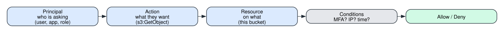

# Identity Is the New Perimeter

**In the cloud there's no network wall, so the only question left is whether this identity is allowed to do this exact thing — which makes identity the primary control.**

## Before you start
<!-- bite: 4af28473-0b2d-4e4b-9615-d0bb57532573 -->

You should have:

- Seen why the perimeter dissolved → [[cybersecurity/09-cloud-security/01-the-shared-responsibility-model|the shared responsibility model]].
- Met least privilege and zero trust → [[cybersecurity/07-security-operations/01-defensive-architecture|defensive architecture]].
- Met the "permissions that reach permissions" idea → [[cybersecurity/01-fundamentals/04-security-principles|security principles]].

After this lesson you will be able to:

1. Explain what IAM evaluates on every API call, and why it's the highest-leverage control.
2. Apply least privilege, and rewrite an over-permissioned policy into a scoped one.
3. Explain why short-lived role credentials beat long-lived static keys.
4. Describe IAM privilege escalation and why over-permissioning is the most dangerous misconfiguration.

**Study route.** Kid version and §1–4, then the worked example: tightening an over-broad IAM policy.

## What "identity is the perimeter" means
<!-- bite: afa730ea-ea4a-49af-9fea-5251fa68a3ac -->

Lesson 1 ended with the perimeter dissolving: every resource has a public endpoint, so "are you inside the network?" is meaningless. This lesson is what replaces it. The only control left is **identity** — for this specific action, on this specific resource, is this specific principal allowed?

That control is **IAM (Identity and Access Management)**, and because everything in the cloud is an API call, IAM is evaluated on *every single operation*. That makes it the highest-leverage thing to get right — and the most dangerous to get wrong. The core discipline is **least privilege**: grant the minimum, so a compromised identity can do the minimum. By the end you'll have taken a dangerous "make it work" policy and rewritten it the way a cloud security review would.

## The kid version
<!-- bite: bac09a08-25c9-4b76-aa3a-11a5dc9146f2 -->

Old-style security was a guard at the front door of an office: once you were past them, you could walk into any room. The cloud has no front door and no building — just thousands of rooms scattered across the internet, each with its own lock. So there's no "inside". The only thing that matters is: for *this* door, does *this* person have a key that works *right now*?

Identity is that set of keys. And the worst mistake is giving someone a master key "to save time" — because if a pickpocket lifts it, they don't get into one room, they get into *every* room.

**Where the analogy stops working.** A physical master key is at least obviously powerful — you'd think twice before handing it out. In the cloud, a policy that says `"Action": "*"` *looks* like a small line of text, and it's granted constantly "just to make the app work". It's a master key that doesn't feel like one. And some keys can be used to *cut more keys* — permissions that let an identity grant itself more permissions — which is the privilege-escalation trap at the end of this lesson.

## 1. IAM — what replaced the firewall
<!-- bite: 03ab05f4-37e3-4b76-9a78-88f485b05377 -->

**IAM** decides, on every API call, whether a **principal** (a user, service or machine) may perform an **action** on a **resource**, subject to **conditions**:



Because everything in the cloud is an API call, **IAM is evaluated on literally every operation** — reading a file, starting a VM, decrypting a secret. That makes it the single highest-leverage control: get IAM right and most attacks stall; get it wrong and everything else is decoration. A principal is the *who*, an action is the *what* (like `s3:GetObject`), a resource is the *on-what*, and conditions add constraints (require MFA, a certain IP range, a time window).

## 2. Least privilege — the discipline
<!-- bite: 3274242a-6a27-427a-b62c-35d259f545b7 -->

**Grant the minimum permissions needed to do the job, and nothing more.** It's zero trust applied to infrastructure, and the single most important cloud-security practice.

Why it matters so much: **a compromised identity can do exactly what it's permitted — no more, no less.** If your web server's role can only read one bucket, compromising that server reads one bucket. If its role has `AdministratorAccess` "to make things work," compromising that server owns your entire account. Over-permissioning silently converts a small breach into a total one.

Yet it's endemic, for a mundane reason: broad permissions make things *work* immediately, and tightening them later is tedious, so nobody does. Wildcards (`"Action": "*"`, `"Resource": "*"`) accumulate like debt.

## 2. Least privilege: how to actually do it
<!-- bite: 6132a39c-7db3-4bbb-89d6-b7208d300bef -->

Four habits turn the principle into practice:

1. **Start from zero and add** — grant nothing, then add each permission a failure reveals you need. The opposite of "grant admin, remove later" (which never happens).
2. **Scope to specific resources**, not `*` — this role reads *this* bucket, not all buckets.
3. **Use access analyzers** — AWS Access Analyzer and CIEM tools generate least-privilege policies from *observed* usage.
4. **Review and prune** — permissions granted for a one-off migration linger for years.

## 3. Machine identity beats static keys
<!-- bite: ceae2123-7c12-461f-9e3a-62ff5dd379ed -->

The second discipline: **prefer temporary, role-based credentials over long-lived static keys.**

1. **Roles** — an app *assumes a role* and gets short-lived credentials (valid minutes to hours) that auto-expire. Nothing to leak permanently.
2. **Static access keys** — a long-lived key pair. **These are the classic breach vector**: committed to Git, baked into an image, left in a config file — and because they never expire, usable forever once leaked.

**Leaked static keys in a public Git repo are scraped within minutes** by bots, then used to spin up crypto miners (denial-of-wallet) or steal data. The fix is structural: **don't have long-lived keys to leak.** Use roles for services, federated SSO for humans, workload identity for containers. **And MFA everywhere**, especially on the root account — which should be locked away, MFA-protected, and never used for daily work.

## 4. IAM privilege escalation — the real danger
<!-- bite: b9521fc5-41c1-478f-9a6d-c6360a3a9ae3 -->

Here's *why* over-permissioning is so dangerous, concretely. **IAM itself has permissions, and some of them let an identity grant itself more power.** An attacker who compromises a *low*-privilege identity hunts for a path to *high* privilege, and IAM misconfigurations provide dozens:

1. **`iam:CreatePolicyVersion` / `iam:PutRolePolicy`** → the identity *rewrites its own permissions* to admin.
2. **`iam:PassRole` + a compute service** → pass a powerful role to a new VM or function you control, and inherit it.
3. **`sts:AssumeRole`** on an over-broad trust policy → assume a more powerful role directly.
4. **Editing a function or CI pipeline** that runs with a privileged role → run your code as that role.

## 4. Privilege escalation: why it's authorisation, not exploits
<!-- bite: 48554a10-cc3b-4d03-bc62-f10e6891e6cc -->

These are all *authorisation logic*, not exploits — the same problem as [[cybersecurity/14-api-security/03-authorization-and-bola|BOLA in APIs]]: the danger is permissions that let you *reach* more permissions. Tools like **PMapper** and **Cloudsplaining** map these paths in an account automatically — run them defensively, before an attacker does. The best defence is the boring one: **least privilege, so there's no path to escalate along.**

## Terms used in this lesson
<!-- bite: a3d54168-77ea-4cbf-8fba-647b03d46bb0 -->

1. **IAM (Identity and Access Management)**: This is the cloud's access-control system, deciding on every API call whether a principal may perform an action on a resource.
2. **Principal**: This is the *who* in an IAM decision — a user, an application, a service, or a machine identity making the request.
3. **Least privilege**: This is granting the minimum permissions needed and nothing more, so a compromised identity can do as little as possible.
4. **Role**: This is an identity an app temporarily *assumes* to get short-lived, auto-expiring credentials, instead of holding a permanent key.

## Terms used in this lesson: keys and escalation
<!-- bite: a5363162-26fe-477e-99ee-296d8714bf9b -->

5. **Static access key**: This is a long-lived credential pair that never expires — the classic breach vector when leaked into code, images or config.
6. **Wildcard permission**: This is `"*"` in the action or resource of a policy, granting everything — the most common over-permissioning mistake.
7. **IAM privilege escalation**: This is using a permission that can grant *more* permissions (rewrite a policy, pass a role) to turn a low-privilege foothold into admin.
8. **PassRole / AssumeRole**: These are IAM actions that hand a role's powers to a service or let an identity take on another role — common escalation paths if over-broad.

## Worked example — tighten an over-broad policy
<!-- bite: 58109e06-f11c-4e05-8635-98602e9f09e3 -->

The core cloud-security skill is reading a policy and scoping it down. Here's one a developer wrote "to make the app work" — the Mama Put backend needs to read receipt objects from one bucket:

```json
{
  "Version": "2012-10-17",
  "Statement": [{
    "Effect": "Allow",
    "Action": "*",
    "Resource": "*"
  }]
}
```

**Predict first:** this app only needs to *read objects from the receipts bucket*. Name two specific, dangerous things this policy allows that have nothing to do with that job.

## Worked example: what the wildcard actually grants
<!-- bite: c14c491c-d217-4bf2-a9eb-6eaf34802be3 -->

`"Action": "*"` on `"Resource": "*"` is `AdministratorAccess` by another name. Among countless other things, it lets the app (and anyone who compromises it): **delete every other bucket and database**, **create new admin IAM users** (instant privilege escalation — `iam:CreateUser` + `iam:AttachUserPolicy`), spin up expensive VMs for crypto-mining, read every secret, and disable logging to hide it all. The app needed to read receipts; the policy handed over the entire account. A compromise of this one server is now a compromise of *everything*.

## Worked example: the least-privilege version
<!-- bite: 3bd94cec-e1fc-40e4-96e9-04658408df1f -->

Start from zero and grant only what the job needs — one action, one resource:

```json
{
  "Version": "2012-10-17",
  "Statement": [{
    "Effect": "Allow",
    "Action": "s3:GetObject",
    "Resource": "arn:aws:s3:::mamaput-receipts/*"
  }]
}
```

Now a compromise of the server reads receipts — bad, but *bounded*. It can't delete data, can't make itself admin, can't mine crypto, can't touch anything but that one bucket's objects. That's the entire point of least privilege: it doesn't prevent the compromise, it **caps the blast radius** so a foothold stays a foothold. This rewrite — from `*/*` to one action on one resource — is exactly what a cloud security review does, and what access analyzers automate from observed usage.

## Common pitfalls and traps
<!-- bite: d8675361-88f7-4892-afad-00e148e6397c -->

1. **`"Action": "*"` to "make it work".** It works, and it hands over the account. Grant the specific actions, scoped to specific resources.
2. **Long-lived static keys.** They get committed, baked into images, and scraped within minutes of a public push. Use roles and short-lived credentials.
3. **Forgetting IAM can escalate itself.** `iam:PutRolePolicy`, `iam:PassRole`, `sts:AssumeRole` on a low-priv identity are paths to admin. Treat IAM-modifying permissions as highly sensitive.
4. **Using the root account for daily work.** Lock it away with MFA; create scoped identities for everything.
5. **Granting broad "to fix later".** Later never comes. Start from zero and add; it's the only version that actually stays least-privilege.

## Check your understanding
<!-- bite: a05f0b97-e9a6-44cc-99ac-39fed447cc4d -->

Try each one before you open the answer.

1. <!-- q: mcq id="de83ed95" -->
   In the cloud, why is IAM described as "the single highest-leverage control"?

   - [ ] It encrypts all network traffic.
   - [x] Because everything is an API call, IAM is evaluated on every operation — so getting it right stalls most attacks, and getting it wrong undermines everything else.
   - [ ] It replaces the need for backups.
   - [ ] It scans container images for vulnerabilities.

   <details><summary>Answer</summary>

   With the network perimeter gone, every action — reading a file, starting a VM, decrypting a secret — is an authenticated, authorised API call that IAM evaluates. That ubiquity is the leverage: a correct least-privilege IAM posture limits what any compromise can do, while an over-broad one means other controls are decoration.

   </details>

2. <!-- q: mcq id="7033e598" -->
   An app's role has `"Action":"*","Resource":"*"`. It only needs to read objects from one bucket. Beyond reading that bucket, what can an attacker who compromises the app now do?

   - [ ] Nothing else — the policy is scoped to the app.
   - [x] Effectively anything in the account: delete other data, create new admin IAM users, mine crypto, disable logging — it's administrator access.
   - [ ] Only read other buckets, nothing destructive.
   - [ ] Only actions that require MFA.

   <details><summary>Answer</summary>

   `*`/`*` is administrator access by another name. A compromise of the app inherits all of it — including `iam:CreateUser`/`AttachUserPolicy` to make itself a permanent admin (privilege escalation), destroying data, and disabling logging. The job needed one read action on one bucket; the policy handed over the whole account. That gap is the blast radius least privilege closes.

   </details>

3. <!-- q: mcq id="f5de265b" -->
   Why are short-lived role credentials strongly preferred over long-lived static access keys?

   - [ ] Static keys are slower to authenticate.
   - [x] Static keys never expire, so once leaked (in Git, an image, a config file) they're usable forever; role credentials auto-expire in minutes to hours, so there's no permanent secret to leak.
   - [ ] Role credentials grant more permissions.
   - [ ] Static keys don't work with MFA.

   <details><summary>Answer</summary>

   The problem with static keys is permanence: bots scrape leaked keys from public repos within minutes and use them indefinitely. Roles hand out credentials that expire automatically, so even a leaked set is useless shortly after. The structural fix is "don't have long-lived keys to leak" — roles for services, SSO for humans, workload identity for containers.

   </details>

4. <!-- q: gap id="38ac5574" answers="least privilege|least-privilege" -->
   A compromised identity can do exactly what it's permitted to do — no more, no less. The practice of granting the minimum permissions needed so that a compromise's blast radius stays small is called ___.

   <details><summary>Answer</summary>

   Least privilege. It doesn't prevent a compromise; it caps what the compromise can reach. It's the single most important cloud-security practice and the direct defence against both over-permissioning and IAM privilege escalation — if there's no excess permission, there's no path to escalate along.

   </details>

5. <!-- q: mcq id="78db5cb7" -->
   An attacker compromises a low-privilege identity that happens to have the `iam:PutRolePolicy` permission. Why is this a serious problem?

   - [ ] It lets them read other users' passwords.
   - [x] That permission lets the identity rewrite its own (or a role's) permissions — so it can grant itself admin. It's IAM privilege escalation.
   - [ ] It only lets them view policies, not change them.
   - [ ] It disables MFA automatically.

   <details><summary>Answer</summary>

   `iam:PutRolePolicy` can *modify permissions*, so a low-privilege identity holding it can write itself an admin policy — turning a small foothold into total control. This is authorisation logic, not an exploit (the same shape as API BOLA): the danger is permissions that reach more permissions. IAM-modifying actions must be treated as highly sensitive and granted to almost no one.

   </details>

6. <!-- q: open id="d58249a5" -->
   Explain why least privilege is described as "capping the blast radius" rather than "preventing the breach", and why that distinction is the whole point of the practice.

   <details><summary>Answer</summary>

   Least privilege doesn't stop an identity from being compromised — a key still leaks, an app still gets an SSRF, a console login still gets phished. What it controls is what happens *next*. Because a compromised identity can do exactly what it's permitted and nothing more, the permissions you granted *are* the blast radius: a role scoped to read one bucket means a compromise reads one bucket; a role with `*` means a compromise owns the account. So least privilege accepts that breaches happen and makes them survivable, turning what would be a catastrophe into a bounded incident. That's the whole point — you can't prevent every initial compromise, but you can decide in advance how far any single one can reach, and that decision is made in your IAM policies long before the attack. It's defence in depth expressed as permissions.

   </details>

## Practice — scope a real policy
<!-- bite: b3a2be42-b34b-4718-afda-c9622b16e2e4 -->

**Task.** Take a broad policy and tighten it (use a real one from a project, or the example above).

1. Write down what the identity actually *needs* to do — the specific actions on the specific resources, nothing aspirational.
2. Rewrite the policy to grant exactly that: named actions (`s3:GetObject`, not `*`), scoped resources (one ARN, not `*`).
3. List three dangerous things the original allowed that the tightened one now blocks.
4. If you have a cloud account, run an access analyzer (AWS Access Analyzer / `cloudsplaining`) and compare its suggestion to yours.

## Practice: when it's done
<!-- bite: a1c5cf35-e0c9-4fc4-972b-b75d15b18809 -->

Here's how you know the task is finished.

**Done when:** your tightened policy has no `*` in action or resource, grants only what the job needs, and you can name what a compromise can no longer do. Record it in `cybersecurity/LIVE-RUNS-TODO.md`. The test: if someone compromised this identity tomorrow, could you describe the exact, bounded blast radius in one sentence?

## Before moving on
<!-- bite: 808336cf-5ef2-425d-ba58-0c6a2e24a8fb -->

You can now explain what IAM evaluates and why it's the top control, apply least privilege and rewrite an over-broad policy, say why role credentials beat static keys, and describe IAM privilege escalation.

**Recap for later lookup:** IAM = principal + action + resource + conditions → allow/deny, on every API call. Least privilege caps the blast radius of every compromise; grant from zero, scope to specific resources, no wildcards. Prefer short-lived role credentials over leakable static keys; MFA everywhere; lock away root. IAM privilege escalation = permissions that grant more permissions (`PutRolePolicy`, `PassRole`, `AssumeRole`) — authorisation logic, not exploits; map your paths with PMapper/Cloudsplaining before an attacker does.

Next: [[cybersecurity/09-cloud-security/03-the-cloud-attack-surface|the cloud attack surface]] — the ranked catalogue of where compromised identities and footholds actually come from, including the metadata-service path that caused Capital One.

## Related
<!-- bite: 976b848a-f189-480b-b068-65ef975f2a15 -->

- [[cybersecurity/09-cloud-security/03-the-cloud-attack-surface|The cloud attack surface]] — where compromised identities come from.
- [[cybersecurity/14-api-security/03-authorization-and-bola|API authorization]] — the same "permissions that reach permissions" problem.
- [[devops/06-secret-management/index|Secret management]] — killing the static keys that leak.

## About this lesson
<!-- bite: 6911033f-a627-4d2b-b7a5-275dc82369f2 -->

**Level:** Advanced. **Covers:** IAM as the control that replaces the perimeter (principal/action/resource/conditions on every call), least privilege and how to actually do it, role-based short-lived credentials vs leakable static keys, MFA and root hygiene, IAM privilege escalation (the paths over-permissioning enables), and a hands-on rewrite of an over-broad policy into a scoped one. **Where it sits:** lesson 2 of the [[cybersecurity/09-cloud-security/index|Cloud Security]] section. **Sources:** the original vault note (from the roadmap.sh cyber-security roadmap), rebuilt to the [[COURSE-STANDARD|course standard]] with a policy-rewrite lab, tracked in `cybersecurity/LIVE-RUNS-TODO.md`.
