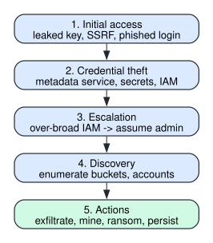

# The Cloud Attack Surface

**The cloud attack surface is the catalogue of doors customers leave open — public storage, exposed secrets, over-broad roles — not exotic exploits against the provider.**

## Before you start
<!-- bite: f111171b-e8b4-4f3f-b747-3cdc20b188fb -->

You should have:

- Met least privilege and IAM escalation → [[cybersecurity/09-cloud-security/02-identity-is-the-perimeter|identity is the perimeter]].
- Met SSRF (Server-Side Request Forgery) → [[cybersecurity/14-api-security/04-input-validation-and-injection|input validation and injection]] (or the OWASP A01 lesson).
- Met why misconfiguration dominates → [[cybersecurity/09-cloud-security/01-the-shared-responsibility-model|the shared responsibility model]].

After this lesson you will be able to:

1. Name the top cloud misconfigurations in rough order of how often they're the way in.
2. Explain the metadata-service-via-SSRF attack that caused the Capital One breach.
3. Trace the cloud kill chain and say why fixing the early steps collapses it.
4. Audit your own environment for the highest-value doors.

**Study route.** Kid version and §1–4, then the worked example: tracing the Capital One chain and an open-door audit.

## What the cloud attack surface is
<!-- bite: d72fbfc9-9667-4ca3-b14d-2f9675bfc2af -->

Lessons 1 and 2 said cloud breaches are customer misconfigurations and that identity is the control. This lesson is the *catalogue*: the specific doors attackers try, roughly in order of how often each is the way in. Knowing it is knowing what to check first on your own environment before an attacker does.

Attackers rarely break the cloud itself — the provider's infrastructure is too well-defended. Instead they walk through a public bucket, a leaked key, an over-broad role, or a server tricked into handing over its own credentials. The dangerous part is how these *compose*: two "medium" problems (an SSRF and a role with bucket access) became the 100-million-record Capital One breach. By the end you'll be able to trace that chain and audit for its links.

## The kid version
<!-- bite: 20656c31-dba5-4d49-9703-2f85b4d79277 -->

Picture a very secure bank building. Robbers don't drill through the vault wall — that's hopeless. Instead they look for the small human mistakes: a side door propped open, a spare key under the mat, a cleaner's pass that happens to open the vault too, or a clerk who can be tricked into fetching something from the safe and handing it over. The building is strong; the *mistakes around it* are the way in.

The cloud attack surface is that list of mistakes: the propped door (public bucket), the key under the mat (leaked secret), the over-powered pass (broad IAM role), and the tricked clerk (a server fooled into handing over its own credentials).

**Where the analogy stops working.** A bank robber has to be physically present and can only use one door at a time. Cloud attackers are automated and global — bots scan the entire internet for public buckets and leaked keys continuously, hitting a mistake within minutes of it being made. And the "tricked clerk" is subtle: it's a normal app with a Server-Side Request Forgery flaw being made to ask the cloud's own metadata service for the machine's credentials — which is the attack that matters most to understand.

## 1. The ranked catalogue
<!-- bite: e622bb87-e47c-45c7-8fb6-b4e99529c9a8 -->

Roughly in order of how often each is the initial way in:

1. **Public storage** — a bucket (S3, Blob, GCS) set to public "to make a demo work," then forgotten. The data is reachable at a URL, no exploit needed. Automated scanners hunt these constantly. **This one category has caused more reported cloud breaches than everything else combined.**
2. **Exposed secrets** — credentials that end up somewhere readable: hardcoded in source and committed, baked into a container image's history, shipped in client-side code, printed in logs, or stored in plaintext in Terraform state. Public Git pushes are scraped within *minutes*.
3. **Over-permissioned identities** — covered in lesson 2, but it belongs here: a foothold (leaked key, SSRF, vulnerable app) turns into account takeover *because* the role was too broad. The blast radius of any compromise equals the permissions of the thing compromised.

The defences are the earlier lessons: default-deny public access, kill static keys, least privilege.

## 2. Metadata service abuse — SSRF's cloud payoff
<!-- bite: ba51cb35-6ce1-4308-bd7a-202a5e2fbee6 -->

This is the most important one to understand, because it's how "medium" issues compose into catastrophe. **Every cloud VM has an internal metadata endpoint** (`169.254.169.254`) that returns information about the instance — including, on misconfigured setups, its **IAM role credentials**. Combine that with an SSRF in an app running on the VM:


**This was the mechanism of the Capital One breach (2019, 100M+ records)** — an SSRF reached the metadata service, stole the role's credentials, and the role could read the storage buckets. Two "medium" issues — an SSRF, and a role with bucket access — composed into a catastrophe.

## 2. Metadata abuse: the defences
<!-- bite: b4dcab7f-9676-4337-b1b4-f9ef80c24d23 -->

Three layers, and the first is the direct fix:

1. **Use IMDSv2** — the version-2 metadata service requires a session token obtained with a `PUT` request, which a basic SSRF (that can only make `GET`s) can't do. This defeats the SSRF-to-metadata step directly.
2. **Least-privilege roles** — so even if credentials are stolen, they're worth little (the Capital One role could read far more than it needed).
3. **Egress filtering** — so workloads can't reach the metadata IP or the internet unnecessarily.

The lesson: no single one of these is the whole answer, but any one of them would have broken the Capital One chain. That's defence in depth — and it's why fixing *any* early link matters.

## 3. Insecure defaults and forgotten resources
<!-- bite: bbf8dcfe-d4d8-4ac1-afe0-325d95c6cb12 -->

The rest of the catalogue:

1. **Things that ship open** — a managed database reachable from `0.0.0.0/0`, a default admin password, a debug endpoint exposed.
2. **Unpatched workloads** — on IaaS *you* patch the OS (lesson 1); forgetting leaves known CVEs open.
3. **Supply chain** — a compromised dependency, base image, or CI action running with cloud credentials → [[cybersecurity/08-governance-risk-and-compliance/04-third-party-and-supply-chain-risk|supply-chain risk]].
4. **Abandoned resources** — a forgotten VM, an old snapshot made public, an unused but still-privileged key. **You can't defend what you've forgotten you have.**

## 4. The attacker's cloud kill chain
<!-- bite: f14b43d9-9437-4ece-8d34-2aba7b2edb84 -->

How these compose into a breach, so you see why order matters:



1. **Initial access** — leaked key, SSRF, vulnerable app, or phished console login.
2. **Credential theft** — the metadata service, secrets in the environment, IAM.
3. **Escalation** — over-broad IAM → assume a more powerful role.
4. **Discovery** — enumerate resources, buckets, other accounts.
5. **Actions** — exfiltrate data, deploy miners, ransomware, persist.

## 4. Why fixing early steps collapses the chain
<!-- bite: b03157ae-5197-4237-85a2-eddf58a2627a -->

**Each step is enabled by a misconfiguration on your side of the line** — which is why fixing the *first* steps (no exposed secrets, no SSRF, least privilege, IMDSv2) collapses the whole chain. You don't have to stop every step; breaking any early link ends the attack.

## Terms used in this lesson
<!-- bite: ea654577-2b40-4161-acf4-fe35f81076ee -->

1. **Attack surface**: This is the full set of doors an attacker could use — in the cloud, mostly a catalogue of customer misconfigurations.
2. **Public bucket**: This is an object-storage container whose access policy allows anyone on the internet to read it — the single most common cloud breach.
3. **Metadata service**: This is an internal endpoint (`169.254.169.254`) a cloud VM can query for its own details, including, if misconfigured, its role credentials.
4. **SSRF (Server-Side Request Forgery)**: This is a flaw where an app can be tricked into making a request to a URL of the attacker's choosing — used here to reach the metadata service.

## Terms used in this lesson: the composition
<!-- bite: f802681c-c11c-4565-9cbc-85e1e4810b11 -->

5. **IMDSv2**: This is the version-2 metadata service that requires a session token, defeating basic SSRF-to-metadata attacks — the direct Capital One fix.
6. **Egress filtering**: This is restricting outbound connections from a workload, so it can't reach the metadata IP or the internet unnecessarily.
7. **Cloud kill chain**: This is the sequence from initial access → credential theft → escalation → discovery → actions, each step enabled by a misconfiguration.
8. **Blast radius**: This is how far a single compromise can reach — set by the permissions of whatever was compromised.

## Worked example — trace the Capital One chain
<!-- bite: 101e6a10-56fd-4086-9a0e-409fd6f7c606 -->

The single most instructive cloud breach. An app running on a cloud VM had a Server-Side Request Forgery flaw. Here's the request an attacker made it send, step by step:

```text
1. App has SSRF: it fetches a URL the attacker supplies.
2. Attacker supplies:  http://169.254.169.254/latest/meta-data/iam/security-credentials/<role>
3. The metadata service returns the VM's role credentials (access key, secret, token).
4. Attacker now holds those credentials and uses them FROM ANYWHERE.
5. The role could read the storage buckets → 100M+ records exfiltrated.
```

**Predict first:** four different fixes could each have broken this chain at a different step. Name as many as you can before reading on.

## Worked example: the four places it could have been stopped
<!-- bite: 402cc1ff-43ab-4482-87db-1d45c859a09e -->

Any one of these would have prevented the breach — which is the whole argument for defence in depth:

1. **Fix the SSRF** (step 1) — validate the URL the app fetches, so it can't be pointed at `169.254.169.254`. Breaks the chain at the app.
2. **IMDSv2** (step 2–3) — require a session token the SSRF can't obtain, so the metadata service refuses. Breaks it at the metadata service.
3. **Least privilege** (step 5) — if the role could only read what it needed, stolen credentials read little, not 100M records. Caps the blast radius.
4. **Egress filtering** (step 2) — block the VM from reaching `169.254.169.254` via the app path, or the internet for exfiltration. Breaks it at the network.

No single control was "the" missing one; *four* were weak at once, and strengthening any would have helped. That's why cloud defence stacks cheap controls rather than hunting one perfect wall.

## Worked example: an open-door audit
<!-- bite: 25fa1f77-aa55-4800-8065-4fb32bb2faf2 -->

Turn the catalogue into a checklist you run against your own environment. The highest-value questions, in order:

```text
[ ] Any storage bucket readable by the public?         (the #1 breach)
[ ] Any access keys in source code / image / logs?     (grep repos, scan with gitleaks)
[ ] Any role with "*" permissions it doesn't need?     (least privilege)
[ ] Is IMDSv2 enforced on every VM?                     (the Capital One fix)
[ ] Any database/service open to 0.0.0.0/0?            (insecure default)
[ ] Any forgotten VMs, snapshots, or old keys?          (shadow resources)
```

Every "yes" is a door. Running this list *is* cloud attack-surface management at small scale — the same thing CSPM tools (next lesson) do continuously and automatically across thousands of resources.

## Common pitfalls and traps
<!-- bite: 38d9dcb6-f580-49a9-8e27-6b72a80342be -->

1. **Chasing provider exploits.** The provider's infrastructure is not where you get breached; your configuration is. Audit your side of the line.
2. **Treating SSRF as low-severity.** In the cloud, an SSRF reaches the metadata service and steals credentials. It's a critical issue, not a curiosity.
3. **Fixing only one link.** You don't need to — but don't assume one control is enough either. Stack them: fix the SSRF *and* enforce IMDSv2 *and* least-privilege the role.
4. **Ignoring forgotten resources.** An old public snapshot or an unused privileged key is a door you're not even watching. Inventory and prune.
5. **Thinking "block public access" once is enough.** Someone will flip a bucket public again. You need continuous detection (next lesson), not a one-time check.

## Check your understanding
<!-- bite: 6bac39ad-90ab-4f30-bcba-bf7d109c8eb7 -->

Try each one before you open the answer.

1. <!-- q: mcq id="a1579263" -->
   Across publicly reported cloud breaches, which single misconfiguration category has caused more than all the others combined?

   - [ ] Weak encryption algorithms
   - [x] Publicly-exposed storage buckets
   - [ ] Outdated TLS versions
   - [ ] Cross-site scripting

   <details><summary>Answer</summary>

   Public storage buckets. A bucket set to public (often "to make a demo work" then forgotten) exposes its contents at a URL with no exploit required, and automated scanners hunt for them continuously. The fix is trivial (default-deny public access) yet the mistake is endemic, which is why it tops the catalogue.

   </details>

2. <!-- q: exact id="4c491507" answer="169.254.169.254" -->
   The Capital One breach worked by using an SSRF to reach the cloud VM's internal metadata endpoint and steal its role credentials. What is the well-known IP address of that metadata endpoint?

   <details><summary>Answer</summary>

   `169.254.169.254` — the link-local metadata address every cloud VM can query for its own details, including, if misconfigured, its IAM role credentials. An SSRF in an app on the VM can be pointed at it; IMDSv2 (requiring a session token a basic SSRF can't get) is the direct defence.

   </details>

3. <!-- q: mcq id="8b228763" -->
   The Capital One breach is described as two "medium" issues composing into a catastrophe. What were the two?

   - [ ] A weak password and an expired certificate
   - [x] An SSRF in the app, and an over-permissioned role (it could read far more than it needed)
   - [ ] A public bucket and a missing firewall
   - [ ] An SQL injection and a cross-site scripting flaw

   <details><summary>Answer</summary>

   An SSRF (which alone just makes the app fetch URLs) plus a role with broad bucket access (which alone is just a permission). Composed, the SSRF stole the role's credentials and the role read 100M+ records. Neither was "critical" in isolation — the lesson is that cloud breaches come from composition, so least privilege (shrinking step two) matters even when each issue looks moderate.

   </details>

4. <!-- q: mcq id="4fee5e07" -->
   Which control most *directly* defeats the SSRF-to-metadata step specifically?

   - [ ] A stronger password policy
   - [x] IMDSv2 — it requires a session token obtained via a PUT request, which a basic GET-only SSRF cannot perform
   - [ ] Encrypting data at rest
   - [ ] A web application firewall logging rule

   <details><summary>Answer</summary>

   IMDSv2 changes the metadata service to require a token from a `PUT` request before it returns credentials. A typical SSRF can only force a `GET`, so it can't complete the handshake, and the metadata service refuses. Least privilege and egress filtering also help (and any of the four would break the chain), but IMDSv2 is the targeted fix for this exact step.

   </details>

5. <!-- q: gap id="8b560c84" answers="blast radius" -->
   "The ___ of any compromise equals the permissions of the thing compromised" — which is why least privilege caps the damage of every other item in the attack-surface catalogue.

   <details><summary>Answer</summary>

   Blast radius. A foothold (from a leaked key, SSRF, or vulnerable app) only becomes account takeover *because* the compromised identity had broad permissions. Shrinking those permissions shrinks what any initial compromise can reach — which is why least privilege is the control that limits the damage of everything else on the list.

   </details>

6. <!-- q: open id="2649764e" -->
   The cloud kill chain has five steps (initial access → credential theft → escalation → discovery → actions). Explain why defenders are told that fixing the *early* steps "collapses the chain", and give one concrete fix for each of the first three steps.

   <details><summary>Answer</summary>

   Because the steps are sequential and each depends on the one before, breaking any early link stops everything after it — the attacker can't escalate if they never got credentials, can't act if they never got in. Fixing early also has the most leverage: the early steps are the common entry points shared across many attacks, so one fix closes many paths. Concrete fixes: step 1 (initial access) — eliminate exposed secrets (secret scanning in CI, no static keys) and fix app flaws like SSRF; step 2 (credential theft) — enforce IMDSv2 so the metadata service won't hand over credentials, and don't store secrets in the environment/logs; step 3 (escalation) — least privilege and tightly controlled IAM-modifying permissions (`PutRolePolicy`, `PassRole`) so there's no path from a foothold to admin. You don't have to be perfect at every step — but strengthening the early, high-leverage ones means a single weakness later can't be chained all the way to a breach.

   </details>

## Practice — run the open-door audit
<!-- bite: 49f7ce80-150c-421c-8feb-b613ae95413a -->

**Task.** Audit the highest-value doors on something you run (lab VPS, or a real cloud account if you have one).

1. Work through the audit checklist from the worked example — public storage, secrets in code, over-broad roles, IMDSv2, open databases, forgotten resources.
2. For the "secrets in code" check, actually run a scanner: `gitleaks detect --source .` on a repo you own.
3. For any VM you control, confirm the metadata service (or your firewall's egress rules) isn't trivially reachable by an app.
4. Write down every door you found and the fix.

## Practice: when it's done
<!-- bite: 2b31b8f4-4162-47ce-a3fe-8da43420d2cd -->

Here's how you know the task is finished.

**Done when:** you've run the checklist, actually executed `gitleaks` on at least one repo, and have a list of doors with fixes (even if the list is "none found, here's what I checked"). Record it in `cybersecurity/LIVE-RUNS-TODO.md`. Confirm `gitleaks`'s current subcommand for your installed version. This is the manual version of what CSPM automates in the next lesson.

## Before moving on
<!-- bite: 2d0e1de6-5bd7-40e9-b29f-0290af99babb -->

You can now name the top cloud misconfigurations in order, explain the metadata-SSRF attack and Capital One, trace the kill chain and why fixing early steps collapses it, and audit your own environment.

**Recap for later lookup:** ranked catalogue: public storage (#1), exposed secrets, over-broad IAM, then the metadata-via-SSRF path, insecure defaults, forgotten resources. Metadata endpoint = `169.254.169.254`; SSRF reaches it and steals role credentials (Capital One, 100M+); fixes = IMDSv2, least privilege, egress filtering, fix the SSRF — any one breaks the chain. Kill chain: initial access → credential theft → escalation → discovery → actions; fix early steps to collapse it. Audit your own doors before attackers do.

Next: [[cybersecurity/09-cloud-security/04-container-and-kubernetes-security|container and Kubernetes security]] — the three extra layers of attack surface that containers add, and why every default is insecure.

## Related
<!-- bite: e8497e14-2f3d-4e14-8090-5cb5a95a0437 -->

- [[cybersecurity/09-cloud-security/02-identity-is-the-perimeter|Identity is the perimeter]] — the escalation step and the role whose credentials get stolen.
- [[cybersecurity/14-api-security/04-input-validation-and-injection|SSRF]] — the flaw the metadata attack depends on.
- [[cybersecurity/09-cloud-security/05-cloud-native-defence|Cloud-native defence]] — CSPM, which automates the open-door audit.

## About this lesson
<!-- bite: d6083b32-a6ce-4dc3-ae93-1e630fb9557b -->

**Level:** Advanced. **Covers:** the ranked catalogue of cloud misconfigurations (public storage, exposed secrets, over-broad IAM), the metadata-service-via-SSRF attack and the Capital One breach, the four places that chain could have been broken, the cloud kill chain, and a hands-on open-door audit with `gitleaks`. **Where it sits:** lesson 3 of the [[cybersecurity/09-cloud-security/index|Cloud Security]] section. **Sources:** the original vault note (from the roadmap.sh cyber-security roadmap), rebuilt to the [[COURSE-STANDARD|course standard]] with an audit exercise, tracked in `cybersecurity/LIVE-RUNS-TODO.md`.
