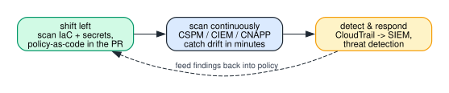

# Cloud-Native Defence

**Cloud-native defence is keeping a large cloud environment safe with automation: catch misconfigurations before they deploy, scan what's running, and detect what gets through.**

## Before you start
<!-- bite: bb815277-5505-4cf6-8e44-dd0818ddb821 -->

You should have:

- Met the attack surface this defends against → [[cybersecurity/09-cloud-security/03-the-cloud-attack-surface|the cloud attack surface]].
- Met logging, SIEM and detection → [[cybersecurity/07-security-operations/02-logging-siem-and-detection|logging, SIEM and detection]].
- Met infrastructure as code and admission control → [[cybersecurity/09-cloud-security/04-container-and-kubernetes-security|container and Kubernetes security]].
- Python/pip, and a terminal.

After this lesson you will be able to:

1. Explain why cloud security must be automated, not manual.
2. Scan infrastructure-as-code for misconfigurations *before* it deploys (shift left).
3. Describe continuous posture management (CSPM/CIEM/CNAPP) and cloud detection.
4. Explain how cloud incident response differs from on-prem.

**Study route.** Kid version and §1–4, then the worked example: scanning Terraform with Checkov and fixing what it finds.

## What cloud-native defence is
<!-- bite: c476bb0c-df39-480f-8820-31281f5fb765 -->

The previous four lessons were the *problems* — the dissolved perimeter, over-broad IAM, the attack surface, insecure container defaults. This one is the *program*: how you keep a cloud environment secure when it has thousands of resources, changes every day, and a single mistake is instantly internet-reachable.

The answer is automation on three fronts. **Shift left** — catch misconfigurations in the code and pipeline *before* they deploy. **Scan continuously** — check the running environment for drift. **Detect and respond** — catch what still gets through. You cannot do cloud security by hand at cloud scale; the whole discipline is pushing checks as early and as automated as possible. By the end you'll have caught a misconfiguration in code the way a pipeline does — before it ever becomes a public bucket.

## The kid version
<!-- bite: acf42627-e7bb-4026-8a1e-538e7f5b273c -->

Imagine a huge building site where thousands of workers each add bits every day. You can't have one inspector walk the whole site every evening — it's too big and changes too fast. So you inspect in three smarter ways. First, you check every *blueprint* before anyone builds from it, catching mistakes on paper (cheap). Second, you have cameras that watch the finished building and alert the moment something changes unexpectedly (a door left open). Third, you have guards who respond when an alarm actually goes off.

Cloud defence is those three: check the blueprints (the infrastructure code) before building, watch the live site continuously for drift, and respond to real alarms. All automated, because the site is too big to inspect by hand.

**Where the analogy stops working.** A building, once inspected, mostly stays put. A cloud environment changes every day — someone clicks something in a console, a resource appears outside the blueprints, a rule gets loosened "temporarily". So checking the blueprints isn't enough; you need the cameras running *continuously*, because today's correct environment drifts into tomorrow's open door, and a cloud open door is found by scanners within minutes.

## 1. Shift left — security as code
<!-- bite: f5858d65-e7e2-48d2-9ae5-98a7a8c24d2e -->

Since infrastructure is now [[devops/09-infrastructure-as-code/index|code]] (Terraform, CloudFormation, Pulumi), security moves *into the code and the pipeline* — catching problems before they exist in production:

1. **Scan IaC before apply** — Checkov, tfsec and Terrascan read your Terraform and flag insecure configs: the public bucket, the `0.0.0.0/0` database, the over-broad role. **Catch it in the pull request, not in a breach report.**
2. **Policy as code** — encode guardrails (OPA/Sentinel, or Kubernetes admission controllers) so *non-compliant infrastructure cannot deploy at all*. "No public buckets, ever" becomes a rule the pipeline enforces, not a wiki page nobody reads.
3. **Secret scanning** — gitleaks/trufflehog in CI, blocking commits that contain credentials.

**This is the heart of DevSecOps** — security integrated into the pipeline rather than bolted on after. The economic argument is blunt: **a misconfiguration caught in a pull request costs minutes; the same one caught in a breach costs the company.**

## 2. Scan continuously — posture management
<!-- bite: 694e9903-f59e-4deb-9c36-b6be34b197db -->

Code review isn't enough, because production *drifts* — someone clicks something in the console, a resource is created outside IaC, a policy is loosened "temporarily". So you scan the *live* environment continuously:

1. **CSPM (Cloud Security Posture Management)** — tools that continuously check your running cloud against best-practice and compliance rules, alerting the moment something drifts (a bucket goes public, a role gains admin, MFA is disabled). **The safety net for everything that escapes shift-left.**
2. **CIEM (Cloud Infrastructure Entitlement Management)** — specifically for the [[cybersecurity/09-cloud-security/02-identity-is-the-perimeter|IAM/least-privilege]] problem: continuously analyse who *can* do what, flag over-permissioning, and map escalation paths.
3. **CNAPP (Cloud-Native Application Protection Platform)** — the consolidation trend: CSPM + CIEM + workload scanning + runtime protection in one platform (Wiz, Prisma Cloud, the providers' own).

The point: a single misconfiguration is instantly internet-reachable, so the window between "someone made a mistake" and "an attacker found it" is short. You need to find it in **minutes, automatically** — not in the next quarterly audit.

## 3. Detect and respond — when something gets through
<!-- bite: 3852ced0-568f-4d53-af66-86c4390d0049 -->

Prevention is never complete, so you need eyes on what's actually happening → [[cybersecurity/07-security-operations/index|security operations]]:

1. **Cloud audit logs are the foundation.** CloudTrail (AWS), Activity Log (Azure), Cloud Audit Logs (GCP) record **every API call** — who did what, when, from where. This is your ground truth; **enable it everywhere and protect it** (an attacker's first move is often to disable logging).
2. **Ship logs to a SIEM** and alert on the tells: a new access key created, a role assumed from an unusual location, MFA disabled, a bucket made public, mass data access, calls from an unexpected region.
3. **Threat detection services** — GuardDuty, Defender, CNAPP runtime modules apply ML and threat intel to the logs, flagging credential compromise, crypto-mining and reconnaissance automatically.

## 4. Cloud incident response is different
<!-- bite: 4f2893d4-7500-4a56-b08d-960654287c54 -->

Cloud IR has its own shape, worth knowing → [[cybersecurity/07-security-operations/04-incident-response|incident response]]:

1. **Everything is logged** (if you enabled it) — CloudTrail gives a near-complete record of what the attacker did, a forensic gift on-prem rarely offers.
2. **Containment is fast and programmatic** — revoke the compromised role, rotate keys, snapshot for forensics, isolate a resource with a security-group change — all via API, in seconds.
3. **Blast radius follows IAM** — the first question is "what could this identity do?", which is why [[cybersecurity/09-cloud-security/02-identity-is-the-perimeter|least privilege]] limits the whole incident, not just the attack.
4. **Ephemerality cuts both ways** — a compromised container may already be gone (good for containment, hard for forensics — capture memory and logs fast).

## 4. The defence loop
<!-- bite: 0f121bdc-d113-4231-bb8c-9de3fa736730 -->

The whole thing is a loop: findings from detection feed back into policy, so the next misconfiguration is caught earlier.



## Terms used in this lesson
<!-- bite: 24692316-fb38-4d22-88e5-41d998cb7280 -->

1. **Shift left**: This is moving security checks earlier — into the code and pipeline — so a misconfiguration is caught in the pull request instead of in production.
2. **IaC scanning**: This is reading infrastructure-as-code (Terraform, etc.) with a tool (Checkov, tfsec) to flag insecure settings before they deploy.
3. **Policy as code**: This is encoding security rules (OPA, admission controllers) so non-compliant infrastructure cannot deploy at all.
4. **Drift**: This is production changing away from its intended, code-defined state — a console click, a loosened rule — which continuous scanning catches.

## Terms used in this lesson: the tools and the loop
<!-- bite: aae86171-e7b8-4ba6-8fd5-1bda7f9efc20 -->

5. **CSPM (Cloud Security Posture Management)**: This continuously checks a running cloud against best-practice rules and alerts when something drifts (a bucket goes public).
6. **CIEM (Cloud Infrastructure Entitlement Management)**: This continuously analyses who can do what, flagging over-permissioning and escalation paths — least privilege, watched.
7. **CNAPP (Cloud-Native Application Protection Platform)**: This is the consolidation of CSPM, CIEM, workload scanning and runtime protection into one platform.
8. **DevSecOps**: This is security integrated into the development and operations pipeline rather than bolted on afterward — the discipline shift-left belongs to.

## Worked example — catch a misconfiguration before it deploys
<!-- bite: 20b3e4e3-3206-4c9e-acb2-5e4dc91dd65b -->

This is shift-left, runnable on your laptop with no cloud account. Write a Terraform file, `main.tf`, with the most common mistake baked in — a public bucket:

```hcl
resource "aws_s3_bucket" "receipts" {
  bucket = "mamaput-receipts"
}

resource "aws_s3_bucket_public_access_block" "receipts" {
  bucket                  = aws_s3_bucket.receipts.id
  block_public_acls       = false   # <- the mistake
  block_public_policy     = false   # <- the mistake
  ignore_public_acls      = false
  restrict_public_buckets = false
}
```

**Predict first:** this never touches a cloud account — it's just a text file describing infrastructure. Can a tool catch the public-access mistake *before* anyone runs `terraform apply`?

## Worked example: scanning the code
<!-- bite: 54fc38ac-55b4-4ddd-be42-496817151037 -->

Yes — that's the whole point of shift-left. **Checkov** reads the Terraform statically and checks it against hundreds of rules:

```bash
pip install checkov
checkov -f main.tf
```

It flags the bucket:

```text
Check: CKV_AWS_53 "Ensure S3 bucket has block public ACLs enabled"
	FAILED for resource: aws_s3_bucket_public_access_block.receipts
	File: /main.tf:7-13

Check: CKV_AWS_56 "Ensure S3 bucket has restrict public buckets enabled"
	FAILED for resource: aws_s3_bucket_public_access_block.receipts
```

The misconfiguration — the same public bucket that tops the attack-surface catalogue — is caught in a text file, before any resource exists, for the cost of running one command. No breach, no exposed data, no scanner finding it before you did.

## Worked example: the fix, and the pipeline
<!-- bite: 640dabfd-eed7-4beb-a3c6-324e92cd6711 -->

Fix the Terraform so the checks pass:

```hcl
resource "aws_s3_bucket_public_access_block" "receipts" {
  bucket                  = aws_s3_bucket.receipts.id
  block_public_acls       = true
  block_public_policy     = true
  ignore_public_acls      = true
  restrict_public_buckets = true
}
```

Re-run `checkov -f main.tf` and the checks pass. Now wire it into CI (`checkov` has a non-zero exit code on failures), and **a pull request that introduces a public bucket fails the build** — the mistake can't merge, let alone deploy. That's shift-left made real: the earliest, cheapest place to catch the number-one cloud breach is a text file in a pull request. CSPM would catch it later in production; Checkov catches it before production exists.

## Common pitfalls and traps
<!-- bite: 756b030b-2506-48e2-9285-eb07dbf24e0d -->

1. **Manual cloud security.** At cloud scale and speed, by-hand review can't keep up. Automate all three fronts.
2. **Shift-left only.** Code review doesn't catch drift — the console click, the resource made outside IaC. You need continuous production scanning too.
3. **Logging off until you need it.** CloudTrail is a forensic gift, but only if it was on *before* the incident. Enable it everywhere and protect it from being disabled.
4. **Alerts with no response.** A CSPM that emails findings nobody actions is theatre. Route findings to owners and, where safe, auto-remediate.
5. **Ignoring the feedback loop.** Every incident and finding should become a new policy-as-code rule, so the same misconfiguration is caught earlier next time.

## Check your understanding
<!-- bite: 6edfc80c-ef33-4d8e-8426-61dd7595c7db -->

Try each one before you open the answer.

1. <!-- q: mcq id="7a8cc167" -->
   What is the core economic argument for "shift left" in cloud security?

   - [ ] It makes the code run faster.
   - [x] A misconfiguration caught in a pull request costs minutes to fix; the same one caught in a breach costs the company — so catching it earliest is cheapest.
   - [ ] It removes the need for any production monitoring.
   - [ ] It lets you skip writing infrastructure as code.

   <details><summary>Answer</summary>

   Shift-left moves security checks into the code and pipeline so misconfigurations are caught before they exist in production. The cost curve is steep: a flagged line in a PR is a minute's fix; the same public bucket discovered in a breach is data loss, incident response and reputational cost. Earliest and cheapest, not instead of later controls.

   </details>

2. <!-- q: mcq id="df60eb7d" -->
   Why is continuous posture management (CSPM) needed *in addition to* scanning infrastructure-as-code in the pipeline?

   - [ ] IaC scanning only works on weekends.
   - [x] Production drifts — someone clicks something in the console, a resource is created outside IaC, a rule is loosened — and only continuous scanning of the live environment catches that.
   - [ ] CSPM is cheaper than IaC scanning.
   - [ ] IaC scanning cannot detect public buckets.

   <details><summary>Answer</summary>

   Shift-left checks the code, but not everything goes through the code: a console click, a resource created by hand, a "temporary" loosened policy. Production drifts away from its intended state, and a cloud open door is found by scanners in minutes — so CSPM continuously checks the *running* environment and alerts on drift. The two are complementary: catch what you can in code, catch the rest in production.

   </details>

3. <!-- q: gap id="16aa84e1" answers="CloudTrail|audit logs|audit log" -->
   The foundation of cloud detection and incident response is the cloud audit log (AWS calls it ___), which records every API call — who did what, when, from where — and an attacker's first move is often to disable it.

   <details><summary>Answer</summary>

   CloudTrail (the general term is cloud audit logs; Azure's is Activity Log, GCP's is Cloud Audit Logs). It's a near-complete record of actions in the account — a forensic gift — but only if it was enabled *before* the incident and protected from being switched off. "Enable it everywhere and protect it" is the rule.

   </details>

4. <!-- q: mcq id="abf0a715" -->
   Running `checkov -f main.tf` on a Terraform file that sets `block_public_policy = false` flags it before deployment. What does this demonstrate?

   - [ ] That the bucket is already breached.
   - [x] Shift-left: a misconfiguration is caught in a static text file, before any cloud resource exists, for the cost of one command.
   - [ ] That Terraform is insecure and shouldn't be used.
   - [ ] That you need a cloud account to find misconfigurations.

   <details><summary>Answer</summary>

   Checkov reads the infrastructure-as-code statically and checks it against rules — no cloud account, no deployed resource. It catches the number-one cloud breach (a public bucket) in a pull request, which is the earliest and cheapest possible place. Wired into CI, it fails the build so the mistake can't even merge.

   </details>

5. <!-- q: mcq id="5cd47c57" -->
   How is incident containment often *different* in the cloud compared to on-premises?

   - [ ] It's slower because you must physically visit the data centre.
   - [x] It's fast and programmatic — revoke the role, rotate keys, snapshot, isolate a resource with a security-group change, all via API in seconds.
   - [ ] It's impossible because cloud resources can't be isolated.
   - [ ] It requires shutting down the entire account.

   <details><summary>Answer</summary>

   In the cloud, containment actions are API calls: revoke the compromised role, rotate credentials, snapshot a disk for forensics, change a security group to isolate a resource — done in seconds, scriptable. Combined with complete audit logs, cloud IR can be faster than on-prem — *provided* logging was enabled beforehand. Blast radius also follows IAM, so least privilege limits the whole incident.

   </details>

6. <!-- q: open id="ba5f17d8" -->
   Cloud-native defence is described as three fronts — shift-left, continuous scanning, detect-and-respond — that form a loop rather than a checklist. Explain why all three are needed and how they reinforce each other.

   <details><summary>Answer</summary>

   Each front catches what the previous one misses, so none is sufficient alone. Shift-left (IaC scanning, policy-as-code, secret scanning in CI) catches misconfigurations before they deploy — the cheapest place — but it only sees changes that go through the code, not console clicks or drift. Continuous scanning (CSPM/CIEM/CNAPP) catches what shift-left missed: production drifting away from its intended state, within minutes rather than at the next audit. Detect-and-respond (CloudTrail → SIEM → threat detection) catches what prevention missed entirely — an actual attacker using stolen credentials — and enables fast, programmatic containment. They form a loop because the output of the later fronts feeds back into the earlier ones: an incident or a CSPM finding becomes a new policy-as-code rule, so the same misconfiguration is caught earlier (ideally in a PR) next time. The whole thing must be automated because cloud scale and speed make manual security impossible — and the loop means the environment gets *more* defended over time, not just surviving each incident.

   </details>

## Practice — shift-left on your own infrastructure
<!-- bite: fd3c93a2-7cf9-4341-828a-fc23184f5739 -->

**Task.** Catch a misconfiguration in code before it deploys.

1. Write (or take) a Terraform file with at least one insecure setting — a public bucket, a `0.0.0.0/0` security group, an unencrypted volume.
2. Run `checkov -f main.tf` (or `tfsec .`) and read every finding, noting the check ID and what it objects to.
3. Fix the findings and re-run until it passes.
4. Describe how you'd wire this into CI so a pull request with a failing check can't merge.

## Practice: when it's done
<!-- bite: c2c48fca-3064-4cd7-8f6a-f886802917e6 -->

Here's how you know the task is finished.

**Done when:** Checkov (or tfsec) flagged your insecure setting, you fixed it, and a re-run passes — and you can state where in a pipeline this check belongs and what it blocks. Record the check IDs and fixes in `cybersecurity/LIVE-RUNS-TODO.md`. Confirm Checkov's current invocation for your installed version. This is the exact control that would have prevented the public-bucket breach from lesson 1.

## Before moving on
<!-- bite: addbf545-9b09-4779-ab68-8baa8218390a -->

You can now explain why cloud security must be automated, scan IaC before deployment, describe continuous posture management and cloud detection, and say how cloud incident response differs from on-prem.

**Recap for later lookup:** three automated fronts — shift-left (IaC scanning with Checkov/tfsec, policy-as-code, secret scanning; catch it in the PR), continuous scanning (CSPM for posture, CIEM for entitlements, CNAPP consolidating them; catch drift in minutes), detect-and-respond (CloudTrail/audit logs → SIEM → threat detection; enable logging before you need it). Cloud IR: everything logged, programmatic containment in seconds, blast radius follows IAM. It's a loop — findings feed back into policy — and automated because cloud scale makes manual security impossible.

**The section, in one line:** lesson 1 drew the responsibility line, 2 made identity the perimeter, 3 catalogued the open doors, 4 locked down containers, and 5 automated the defence of all of it — cloud security as identity and configuration discipline at scale, not exotic exploits.

Next: [[cybersecurity/10-protecting-yourself/index|protecting yourself]] — the personal-security version of everything here, for your own accounts and devices.

## Related
<!-- bite: 13118802-b60f-49c9-aee9-20776310ceca -->

- [[cybersecurity/09-cloud-security/01-the-shared-responsibility-model|The shared responsibility model]] — where this all started.
- [[devops/09-infrastructure-as-code/index|Infrastructure as code]] — what shift-left scanning reads.
- [[cybersecurity/07-security-operations/02-logging-siem-and-detection|Logging, SIEM and detection]] — where cloud audit logs go.

## About this lesson
<!-- bite: f72fb61e-2698-46cd-a52f-7a8b6d140813 -->

**Level:** Advanced. **Covers:** why cloud security must be automated, shift-left (IaC scanning with Checkov/tfsec, policy-as-code, secret scanning), continuous posture management (CSPM/CIEM/CNAPP), cloud detection (CloudTrail → SIEM → threat detection), how cloud incident response differs from on-prem, and a hands-on shift-left lab catching a public-bucket misconfiguration in Terraform with Checkov. **Where it sits:** lesson 5 of the [[cybersecurity/09-cloud-security/index|Cloud Security]] section, the last of it. **Sources:** the original vault note (from the roadmap.sh cyber-security roadmap), rebuilt to the [[COURSE-STANDARD|course standard]] with a Checkov lab, tracked in `cybersecurity/LIVE-RUNS-TODO.md`.
