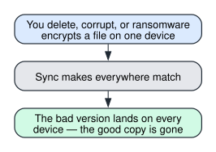

# Backups and Your Data

**A backup is a second copy of your files kept elsewhere — and a tested one turns a dead drive, a stolen phone or ransomware into an inconvenience.**

## Before you start
<!-- bite: 145df025-b9c8-4802-b34d-f7d8bf9ebc90 -->

You should have:

- Met ransomware and device loss in your threat model → [[cybersecurity/10-protecting-yourself/01-your-actual-threat-model|your actual threat model]].
- Nothing technical; about an hour, plus an external drive if you have one.

After this lesson you will be able to:

1. Explain why backups are a *security* topic, not just a safety one.
2. Apply the 3-2-1 rule, and explain why sync is not backup.
3. Choose a backup approach and set one up.
4. Run the ten-minute restore test that proves a backup actually works.

**Study route.** Kid version and §1–3, then the practice task: set up one backup and test a restore.

## What a backup is
<!-- bite: 6fa566cf-5b38-4d99-bafd-55165d43ec21 -->

This is thing number five, and the one that's different from all the others: every other measure in this section *reduces the chance* of something bad; a backup *reduces the cost* when it happens anyway. That makes it the only defence that works against threats nobody has thought of yet.

A backup is a second copy of your files, kept somewhere else, so you can get them back when the original is lost — to a dead drive, a stolen phone, or ransomware that encrypts everything until you pay. It's the measure people are most confident they have and most often don't, because an untested backup is a belief, not a backup. This lesson covers why it's a security matter, the 3-2-1 rule, the crucial sync-isn't-backup trap, and the ten-minute test that separates a real backup from a hope.

## The kid version
<!-- bite: 5ef732b0-6616-428e-9595-061018b63f90 -->

Imagine your only copy of every photo, document and memory lives in one notebook. If it's lost, soaked, or stolen, it's all gone — there's no getting it back. So you photocopy the notebook and keep the copy at a friend's house. Now losing the original is annoying, not devastating. A backup is that copy at your friend's house: somewhere else, so one accident can't take both.

**Where the analogy stops working.** A photocopy is frozen the moment you make it. But if your "copy" is a sync service that instantly mirrors every change, then the moment you delete a file — or ransomware scrambles it — the copy *also* deletes or scrambles, because it's told to match. So a real backup has to keep *yesterday's* version even after today's changed, and not be something your everyday machine can instantly overwrite. That difference — versioned and not continuously writable — is the whole lesson.

## 1. Why this is a security topic
<!-- bite: 1d327cc2-997b-4727-8470-7b2c2c88ed9c -->

**Ransomware makes backups the primary defence.** Malware encrypts your files and demands payment; paying funds the industry, is often unnecessary, and frequently doesn't work — victims routinely pay and get nothing usable. A tested, offline backup makes ransomware an inconvenience: wipe, restore, move on.

(Modern ransomware also *steals* data before encrypting and threatens to publish it, which backups don't solve — but that's an argument for encryption and prevention, not against backups.)

## 2. The 3-2-1 rule, and why sync is not backup
<!-- bite: 86b174c4-ec74-4a52-8c82-dd4917df7a7c -->

The rule that's survived decades: keep **3 copies** of anything you care about, on **2 different kinds** of storage, with **1 copy off-site**. Concretely: the file on your laptop, a copy on an external drive at home, and a copy in cloud storage. The off-site copy is what survives fire, flood and theft — a backup drive next to the laptop is one burglary away from useless.

## 2. Why sync is not backup
<!-- bite: 4d9af535-a247-4e64-bb2f-b41713b861d4 -->

And the most common, most expensive misunderstanding here: **sync is not backup.** Dropbox, iCloud, Google Drive and OneDrive *synchronise* — they make everywhere match:

Sync propagates mistakes at the speed of your internet connection. These services do offer version history and a recycle bin (30 days is typical), which has saved many people — **know your provider's window**, and know it's a partial mitigation, not a backup. A real backup is **versioned** (it keeps yesterday's file after today changed) and **isn't continuously writable** by your everyday machine.

## 3. What to actually use
<!-- bite: cbd0fc82-cdbb-42e6-a9e8-c432938a69ef -->

1. **Time Machine (macOS) / File History (Windows)** — automatic, versioned, local. **Turn one on today** — free and already installed.
2. **Backblaze / iDrive** — unlimited-ish cloud backup, versioned, off-site. Set and forget.
3. **An external drive, unplugged between backups** — the offline copy ransomware can't reach. Cheap and effective.
4. **Restic / Borg / Duplicati** — free, encrypted, scriptable, if you're technical.
5. **Photos** — the thing people grieve. Ensure they're in *two* places, not just your phone.

**Encrypt any backup you keep off-site or in the cloud**, and store the key in your password manager.

## 3. What to back up
<!-- bite: ae1fe8f4-8e7d-41a2-a994-4ae88c1037fb -->

**What to back up:** the irreplaceable — photos and video, documents, anything creative, records and tax files, your password manager's recovery kit and 2FA backup codes. **Not** apps, the OS, or films you can re-download — backing up less makes it more likely you'll do it. And **don't forget your phone** — usually the device with the most irreplaceable content; check its automatic backup is actually running, because a full iCloud or Google account silently stops.

## The test nobody does
<!-- bite: 973776d6-c44a-4337-b823-45903ced42bf -->

> **An untested backup is not a backup. It's a hope.**

Backups fail silently, constantly — a job stopped months ago, a drive died, a folder was never included, the key was lost. **Twice a year, this takes ten minutes:**

1. Pick a file you'd hate to lose.
2. **Restore it from your backup** to a different location.
3. Open it and check it's intact and current.

**Once a year, try something bigger** — restore a whole folder. Discovering your backup is broken should happen on a Tuesday afternoon, not the day the laptop dies. And **get your data out** of platforms before you need to: Google Takeout, Apple's Data and Privacy, Facebook's Download Your Information. Account lockouts happen with no appeal, and people lose two decades of photos that way.

## Terms used in this lesson
<!-- bite: c30c778d-d969-43dd-bdce-b2f5bce6e612 -->

1. **Backup**: This is a separate copy of your files kept elsewhere, so you can recover them when the original is lost, corrupted, or encrypted.
2. **3-2-1 rule**: This is keeping 3 copies, on 2 kinds of storage, with 1 off-site — the long-standing recipe for surviving fire, theft and failure.
3. **Sync**: This is a service that makes every device match the latest version — convenient, but it copies your deletions and corruptions everywhere, so it is *not* a backup.
4. **Versioned backup**: This is a backup that keeps older versions of a file even after it changes, so you can go back to yesterday's copy.

## Terms used in this lesson: the practice
<!-- bite: 99ef8206-763a-40f2-bfa5-7e65105828b7 -->

5. **Off-site copy**: This is the backup kept somewhere physically separate (cloud, or a drive elsewhere), so one fire or burglary can't take both copies.
6. **Offline backup**: This is a backup not connected to your everyday machine (an unplugged drive), so ransomware can't reach and encrypt it.
7. **Ransomware**: This is malware that encrypts your files for a ransom; a tested offline backup is the real defence against losing the data.
8. **Restore test**: This is actually recovering a file from your backup to confirm the backup works — the step that separates a real backup from a hope.

## Check your understanding
<!-- bite: 5b1b5767-eb87-4993-93df-bb5faf840ffa -->

Try each one before you open the answer.

1. <!-- q: mcq id="6f38f3d0" -->
   Why is a backup described as the only security measure that works against "threats nobody has thought of yet"?

   - [ ] It predicts new attacks.
   - [x] Every other measure reduces the *chance* of something bad; a backup reduces the *cost* once it happens — so it helps no matter what the cause was.
   - [ ] It encrypts your network traffic.
   - [ ] It blocks malware before it runs.

   

Answer

   Prevention measures each target a specific threat; a backup is indifferent to cause. Whether your files are lost to ransomware, a dead drive, theft, a mistake, or something new, a good backup gets them back. It reduces the cost of a bad outcome rather than its probability, which is why it's the one defence that covers the unknown.

   

2. <!-- q: mcq id="9231e014" -->
   Why is a cloud *sync* service like Dropbox or iCloud not a substitute for a backup?

   - [ ] Sync services are too slow.
   - [x] Sync makes everywhere match, so if you delete or corrupt a file — or ransomware encrypts it — the bad version is copied to every device, destroying the good copy.
   - [ ] Sync services don't store your files.
   - [ ] Sync only works on phones.

   

Answer

   Sync's whole job is to make every device match the latest version — so it faithfully propagates your mistakes and ransomware's damage at internet speed. Version history and a recycle bin (often 30 days) are a partial mitigation worth knowing, but a real backup is *versioned* and *not continuously writable* by your everyday machine, so a bad change can't overwrite the good copy everywhere.

   

3. <!-- q: gap id="23042eff" answers="3-2-1|3 2 1|three-two-one" -->
   The decades-old backup rule — keep 3 copies of anything you care about, on 2 different kinds of storage, with 1 copy off-site — is known as the ___ rule.

   

Answer

   The 3-2-1 rule. The off-site copy is the critical part: it's what survives a fire, flood or burglary that takes everything in one place. A backup drive sitting next to the laptop satisfies "3 copies, 2 media" but fails "1 off-site" — one theft and both are gone.

   

4. <!-- q: mcq id="22163b64" -->
   Which backup is specifically the one ransomware *cannot* reach to encrypt?

   - [ ] A synced cloud folder that's always connected.
   - [x] An external drive that stays unplugged between backups (an offline copy).
   - [ ] A second folder on the same laptop.
   - [ ] A network drive mapped on your computer.

   

Answer

   Ransomware encrypts everything your machine can write to — including synced folders and connected network/cloud drives. An *offline* backup (an external drive unplugged between backups) isn't reachable when the malware strikes, so it survives. That's why the recommended setup includes an offline, ideally off-site copy, not just a synced one.

   

5. <!-- q: mcq id="03f9a745" -->
   The lesson says "an untested backup is not a backup, it's a hope." What's the recommended test?

   - [ ] Check that the backup software is installed.
   - [x] Twice a year, restore a file you'd hate to lose to a different location and open it to confirm it's intact and current.
   - [ ] Count the number of files backed up.
   - [ ] Trust the green "backup complete" message.

   

Answer

   Backups fail silently all the time — a stopped job, a dead drive, a folder never included, a lost key. The only way to know yours works is to actually restore from it: pick a file, restore it elsewhere, open it, confirm it's current. Ten minutes, twice a year. Discovering it's broken should happen on a quiet Tuesday, not the day your laptop dies.

   

6. <!-- q: open id="4b71acc0" -->
   Someone says "I'm fine, all my photos are in iCloud / Google Photos." Explain the two different ways this could still fail, and what would make it a real backup.

   

Answer

   Two failure modes. First, it's *sync, not backup*: iCloud/Google Photos mirror your device, so if you accidentally delete photos, or your account is compromised and photos are deleted, or ransomware/corruption hits, the change propagates to the cloud copy too — there's one logical copy, not an independent one (version history and the recycle bin give a limited window, typically ~30 days, not true backup). Second, it's a *single point of failure in the account itself*: account lockouts and bans happen with no appeal, and people lose decades of photos when access is cut off, with the "copy" inaccessible exactly when they need it. To make it a real backup, the photos should exist in at least two genuinely independent places — e.g. the cloud copy plus a versioned local backup (Time Machine/File History) or an external drive, ideally one that's offline — following 3-2-1, and the person should periodically test that they can actually restore and that they can export their data (Google Takeout / Apple Data and Privacy) before they're locked out. Then one deletion, hack, or ban can't take everything.

   

## Practice — set up one backup and test it
<!-- bite: 337a486b-4a39-4154-909f-56082ba31d6b -->

**Task.** Go from "I think I'm backed up" to "I've proven it".

1. Turn on a versioned local backup today — Time Machine (Mac) or File History (Windows) to an external drive.
2. Add an off-site copy: a cloud backup service (Backblaze/iDrive), or a second drive kept elsewhere. Encrypt it and store the key in your manager.
3. Confirm your phone's automatic backup is actually running.
4. **Run the restore test:** restore one file you'd hate to lose to a new location and open it.

## Practice: when it's done
<!-- bite: 3a7cd4b1-8c8e-44ba-b9a5-1c755409a2da -->

Here's how you know the task is finished.

**Done when:** you have a versioned local backup *and* an off-site copy running, your phone's backup is confirmed on, and you've successfully restored and opened a real file from the backup. The restore is the part that counts — until you've recovered something, you have a hope, not a backup. Put a twice-a-year reminder in your calendar to re-test.

## Before moving on
<!-- bite: dfa2b9c6-3099-47fe-a9b7-56d8077d6526 -->

You can now explain why backups are a security topic, apply 3-2-1, explain why sync isn't backup, set one up, and run the restore test.

**Recap for later lookup:** backups reduce the *cost* of any bad outcome, including unknown ones. Ransomware makes them the primary defence (don't pay; restore). 3-2-1 = 3 copies, 2 media, 1 off-site. Sync is NOT backup — it copies your mistakes everywhere; a real backup is versioned and not continuously writable, ideally offline. Use Time Machine/File History + an off-site copy; back up the irreplaceable, not apps/OS; check your phone's backup runs. Test a restore twice a year — an untested backup is a hope.

Next: [[cybersecurity/10-protecting-yourself/07-your-privacy-footprint|your privacy footprint]] — why the facts that are already public about you are a security problem.

## Related
<!-- bite: 5d56e027-8185-440a-8a59-8e8c86751cbc -->

- [[cybersecurity/10-protecting-yourself/05-your-devices-and-networks|Devices]] — encryption and updates.
- [[cybersecurity/10-protecting-yourself/08-when-it-goes-wrong|When it goes wrong]] — where a tested backup makes recovery possible.
- [[cybersecurity/07-security-operations/04-incident-response|Incident response]] — the organisational version (backups as the ransomware answer).

## About this lesson
<!-- bite: 65091cea-5490-47b6-9f3e-15987a9a4e42 -->

**Level:** Beginner (no code). **Covers:** why backups are a security topic, ransomware, the 3-2-1 rule, why sync is not backup, what tools to use, what to back up, and the ten-minute restore test, with a set-up-and-test-a-restore task. **Where it sits:** lesson 6 of the [[cybersecurity/10-protecting-yourself/index|Protecting Yourself]] section. **Sources:** the original vault note, rebuilt to the [[COURSE-STANDARD|course standard]] with quizzes and a personal task; written for the non-technical reader.
