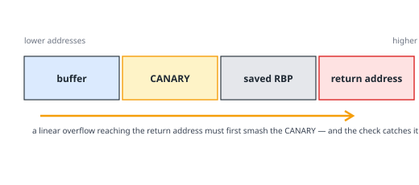

# Modern Mitigations

**Mitigations are protections in modern compilers and systems that make overflow attacks much harder — none fixes the bug, and each has a known bypass.**

## Before you start
<!-- bite: 224a271b-890f-412b-84bd-6d63f42e1a01 -->

You should have:

- Written a stack overflow and seen injected shellcode blocked by NX → [[cybersecurity/11-binary-exploitation/03-shellcode|shellcode]].
- `checksec` available (ships with pwntools), and a few binaries to inspect.

After this lesson you will be able to:

1. Explain NX, stack canaries, ASLR and PIE — what each stops and doesn't.
2. Explain RELRO and the GOT it protects.
3. **Read `checksec` output as a recipe** for which technique a target needs.
4. Name the newer defences (CET, CFI, pointer authentication).

**Study route.** Kid version and §1–4, then the practice task: run `checksec` on several binaries and read each as a plan.

## What mitigations are
<!-- bite: 7240295e-0b82-43bd-b11e-e73d2f0982cf -->

Every simple exploit so far assumed the defender did nothing. Real systems — every app on your phone and laptop — stack up defences that don't fix the underlying bug but make turning it into control much harder. This lesson is the four you must know, plus RELRO and the newer hardware defences.

The crucial habit it builds is reading `checksec` first, every time. The set of mitigations enabled on a binary *is* the specification of which technique you need: "No canary, NX on, No PIE" is a different exploit from "Full RELRO, canary, PIE". By the end you'll read that output like a recipe instead of flailing.

## The kid version
<!-- bite: 01778779-100d-4fa6-8f31-059b6417f6c6 -->

Picture the buffer-overflow attack as a burglar who gets in by one trick. The owner can't change that the lock is pickable (that's the bug), but they add defences around it: make the valuables useless even if grabbed (a non-executable stack, so injected code won't run), move the house to a random street each night (randomised addresses), and put a fragile seal in the doorway that breaks if forced (a canary). None of these fixes the lock — they make the burglary harder, and a determined burglar has a counter to each.

**Where the analogy stops working.** A burglar improvises on the spot; an exploit's counters are *precise and mechanical*. To beat randomised addresses you don't guess — you *leak* one real address and compute the rest from fixed offsets. To beat the canary you *read its exact value* first and write it back unchanged. So defences don't make exploitation fuzzy; they add specific extra steps, and `checksec` tells you which steps this target demands.

## 1. NX / DEP — no executable stack
<!-- bite: 0db3e9d8-53b7-41c4-a00f-3f5146e1f602 -->

**Memory is either writable or executable, never both.** The stack and heap are writable (you put data there), so they're marked non-executable; the code section is executable but read-only.

- **Stops:** injecting shellcode into a buffer and jumping to it — the CPU refuses to execute data pages.
- **Doesn't stop:** reusing code that's *already* executable, which is exactly what [[cybersecurity/11-binary-exploitation/05-bypassing-mitigations|ROP and ret2libc]] do.
- **Check:** `checksec` shows `NX enabled`. **This is why modern exploitation is code-reuse, not code-injection.**

## 2. Stack canaries — a tripwire
<!-- bite: 543adb38-0586-4315-acb9-f4874e68c03a -->

The compiler places a random secret value (the **canary**) just before the saved return address, and checks it's intact before the function returns; if an overflow clobbered it, the program aborts:



## 2. Stack canaries: what it stops
<!-- bite: 67537d58-6d71-4848-92f8-94fa837c6cc5 -->

- **Stops:** a naive linear stack overflow — you can't reach the return address without smashing the canary.
- **Doesn't stop:** a bug that **leaks** the canary first (then you overwrite it with its own value), a write that skips over it, or overflows that don't touch the return address.
- **Check:** `checksec` → `Canary found`. **The standard defeat is: leak the canary, then include it in the payload.** The canary's low byte is a **null byte** on Linux — deliberately, so a string-copy overflow can't easily leak it.

## 3. ASLR and PIE — randomised addresses
<!-- bite: 1bab2fba-f56a-4f31-b560-917bbb12a3fe -->

**ASLR (Address Space Layout Randomization)** loads the stack, heap and shared libraries at a different base address every run, so you can't hard-code the address of `buffer`, `system`, or your shellcode.

- **Stops:** hard-coding any address.
- **Doesn't stop:** an **information leak** revealing one real address at runtime (from which you compute the rest, since offsets *within* a library are fixed), or brute force on 32-bit (too little entropy).

ASLR is an OS feature; whether the *main binary* is randomised depends on **PIE (Position-Independent Executable)**. Without PIE, the program's own code loads at a fixed address (e.g. `0x400000`) even with ASLR on — so its gadgets and functions are at known addresses. **Many CTF challenges are compiled No-PIE on purpose.** With PIE, you need a leak of the binary's base before you can use its gadgets. **Check:** `checksec` → `PIE enabled` / `No PIE`.

## 4. RELRO, and reading `checksec`
<!-- bite: fa61d7a8-c6f8-430a-81e7-bdd60b4eed3e -->

**RELRO (RELocation Read-Only)** hardens the **GOT (Global Offset Table)**, which holds resolved addresses of library functions. A classic attack overwrites a GOT entry so calling `printf` actually calls `system`. **Partial RELRO** (default) leaves the GOT writable (overwrite works); **Full RELRO** makes it read-only after startup (overwrite dead), at the cost of slower startup.

The single most important command before exploiting anything reads like a recipe:

```text
$ checksec --file=./vuln
    Arch:     amd64-64-little
    RELRO:    Partial RELRO       ← GOT overwrite possible
    Stack:    No canary found     ← naive overflow works
    NX:       NX enabled          ← must use ROP, not shellcode
    PIE:      No PIE              ← binary gadgets at fixed addresses
```

That output says: *straight overflow, no shellcode, ROP with the binary's own gadgets, no leak needed.* The defences present tell you which technique the challenge wants → [[cybersecurity/11-binary-exploitation/05-bypassing-mitigations|bypassing mitigations]].

## The newer defences, briefly
<!-- bite: de75ed0b-be7c-4f98-b276-41fe5135b053 -->

Beyond the classic four, hardening keeps arriving:

1. **CET / shadow stacks** (recent Intel/AMD + OS) — a second, protected copy of return addresses; a mismatch aborts. **Directly targets ROP**, and is rolling out now.
2. **Fortify Source** (`_FORTIFY_SOURCE`) — compile-time bounds checks on known-size buffers in `memcpy`/`strcpy`.
3. **CFI (Control-Flow Integrity)** — restricts indirect calls to valid targets; big in browsers and the kernel.
4. **Pointer Authentication** (ARM) — signs pointers so a corrupted one fails verification; standard on Apple silicon.

## Terms used in this lesson
<!-- bite: 6ae5d82f-85c1-4ef4-85d3-feb7fb6bcf3e -->

1. **Mitigation**: This is a defence that makes exploiting a memory bug harder without fixing the bug itself; each has a known bypass.
2. **NX / DEP**: This marks writable memory (stack, heap) non-executable, so injected shellcode can't run — forcing code reuse.
3. **Stack canary**: This is a random secret placed before the return address and checked before return; a naive overflow smashes it and aborts the program.
4. **ASLR**: This randomises the base addresses of the stack, heap and libraries each run, so no address can be hard-coded.

## Terms used in this lesson: the binary and the GOT
<!-- bite: 19e6e1ed-5db5-4818-ada8-839359c27fd3 -->

5. **PIE (Position-Independent Executable)**: This randomises the main binary's own code too; without it, the binary's functions and gadgets sit at fixed addresses.
6. **GOT (Global Offset Table)**: This holds resolved addresses of library functions; overwriting an entry can redirect a call (e.g. `free` → `system`).
7. **RELRO**: This protects the GOT — Partial leaves it writable, Full makes it read-only after startup, killing GOT-overwrite attacks.
8. **checksec**: This is the command that prints which mitigations a binary has, which tells you which exploitation technique you need.

## Common pitfalls and traps
<!-- bite: 60c1dbcc-359b-47db-84e7-805d6968cbf9 -->

1. **Not running `checksec` first.** You can't plan an exploit without knowing the defences. It's always step one.
2. **Thinking a mitigation fixes the bug.** It doesn't — it adds steps. The overflow is still there; you just need a leak, or code reuse, to use it.
3. **Confusing ASLR and PIE.** ASLR randomises libraries and stack; PIE randomises the *binary*. A No-PIE binary has fixed gadgets even with ASLR on.
4. **Forgetting the canary's null byte.** Its low byte is `\x00`, which affects how you leak and place it.
5. **Assuming Full RELRO everywhere.** Partial is the common default, so GOT overwrite is often still on the table — check.

## Check your understanding
<!-- bite: 0ca410b6-b80f-41ba-9f97-12370228754d -->

Try each one before you open the answer.

1. <!-- q: mcq id="17f1528f" -->
   NX/DEP marks the stack non-executable. What does this stop, and what does it *not* stop?

   - [ ] It stops all buffer overflows.
   - [x] It stops injecting shellcode into a buffer and executing it; it does not stop reusing code that's already executable (ROP, ret2libc).
   - [ ] It stops ROP but allows shellcode.
   - [ ] It fixes the overflow bug itself.

   <details><summary>Answer</summary>

   NX makes writable memory non-executable, so bytes you inject into a stack buffer can't run — that kills classic shellcode injection. But it does nothing about *reusing* code that's already marked executable, which is exactly what ROP and ret2libc do. This is the single reason modern exploitation is code-reuse rather than code-injection.

   </details>

2. <!-- q: mcq id="b0b3a324" -->
   A binary has a stack canary. What's the standard way to defeat it?

   - [ ] Overflow faster than the check runs.
   - [x] Leak the canary's value first (via another bug), then include that exact value in your payload so the check still passes.
   - [ ] Canaries cannot be defeated.
   - [ ] Overwrite the canary with zeros.

   <details><summary>Answer</summary>

   The canary sits between the buffer and the return address, so a linear overflow must cross it, and the pre-return check catches a changed value. The defeat is to *leak* the canary first (e.g. with a format-string or info-leak bug), then write it back unchanged in your overflow so the check passes while you still overwrite the return address past it. (A non-linear write that skips the canary, or an overflow not reaching the return address, also sidesteps it.)

   </details>

3. <!-- q: mcq id="056be414" -->
   ASLR randomises addresses every run. What single thing lets an attacker defeat it?

   - [ ] A faster CPU.
   - [x] An information leak that reveals one real runtime address — because offsets within a library are fixed, one leaked address yields all the others.
   - [ ] Turning the binary into a PIE.
   - [ ] A larger buffer.

   <details><summary>Answer</summary>

   ASLR randomises the *base*, but the layout *within* a library is fixed, so if you learn the runtime address of any one function (via a leak), you compute the library base and from it every other address. "Leak, then pwn" is the shape of nearly every modern exploit — the bug first gives a read to defeat ASLR, then a write to take control.

   </details>

4. <!-- q: mcq id="45f8da29" -->
   What's the difference between ASLR and PIE?

   - [ ] They're the same thing.
   - [x] ASLR (an OS feature) randomises the stack, heap and libraries; PIE randomises the main binary's own code — without PIE, the binary's gadgets sit at fixed addresses even with ASLR on.
   - [ ] PIE randomises libraries; ASLR randomises the binary.
   - [ ] PIE is a hardware feature.

   <details><summary>Answer</summary>

   ASLR handles the OS-managed regions (stack, heap, shared libraries). Whether the *executable itself* is randomised depends on whether it was compiled as a PIE. A No-PIE binary loads its code at a fixed address (like `0x400000`) regardless of ASLR, so its functions and ROP gadgets are at known addresses — which is why many CTF challenges are built No-PIE to keep them approachable.

   </details>

5. <!-- q: gap id="c6361827" answers="checksec" -->
   The single most important command to run before exploiting any binary — because the set of enabled mitigations it prints *is* the specification of which technique you need — is ___.

   <details><summary>Answer</summary>

   `checksec`. Reading its output ("No canary, NX on, No PIE, Partial RELRO") tells you the exact plan: straight overflow, no shellcode, ROP with the binary's fixed gadgets, GOT overwrite available, no leak needed. Skipping it is the difference between a plan and flailing.

   </details>

6. <!-- q: open id="e9e865bb" -->
   "None of these mitigations fixes the underlying bug — they raise the cost, and they compose." Explain what "compose" means here, using a binary with NX + ASLR + a canary as the example.

   <details><summary>Answer</summary>

   "Compose" means the defences stack, each forcing an additional, independent step in the exploit rather than any one being sufficient. On a binary with NX + ASLR + a canary, the overflow bug is still there, but to use it you must satisfy all three counters at once: NX means you can't inject and run shellcode, so you must build a ROP chain or ret2libc from existing executable code; ASLR means you don't know where that code (libc, or gadgets) actually is at runtime, so you must first obtain an information leak and compute the real addresses from fixed offsets; and the canary means your linear overflow would abort the program before it ever returns, so you must also leak the canary's value and write it back unchanged in the payload. So a single exploit now needs: a leak primitive (ideally giving both a canary value and a libc address), then a ROP chain assembled against the leaked addresses, laid out so the canary is preserved. Remove any one mitigation and a step disappears (no canary → no canary leak needed; No-PIE/ASLR off → no address leak needed; no NX → you could just inject shellcode). That's why `checksec` is the spec: the *combination* of enabled mitigations dictates exactly which steps your exploit must chain together.

   </details>

## Practice — read `checksec` as a recipe
<!-- bite: 90212415-ac14-4f1e-91a6-6c5042871ece -->

**Task.** Turn mitigation output into exploitation plans.

1. Compile the same `vuln.c` several ways: defences off; then `-fstack-protector-all`; then without `-no-pie`; then `-Wl,-z,relro,-z,now` (Full RELRO). Run `checksec` on each.
2. For each binary, write one sentence saying which technique it now demands (e.g. "canary present → need a leak first").
3. Confirm your lesson-02 `ret2win` still works on the defences-off one and *fails* on the canary one — and read the failure.
4. Toggle system ASLR (`/proc/sys/kernel/randomize_va_space`) and note what breaks.

## Practice: when it's done
<!-- bite: 97f999e1-8fe3-45d1-85e4-7697e2454edc -->

Here's how you know the task is finished.

**Done when:** you have `checksec` output for four builds of the same source and can translate each into the technique it requires, and you've watched a canary turn your working `ret2win` into an abort. Record the outputs in `cybersecurity/LIVE-RUNS-TODO.md`. The skill is reading the defences and *immediately* knowing the plan — that's what the next lesson executes.

## Before moving on
<!-- bite: 07f9712a-7294-46ef-a810-103d3a34ec2b -->

You can now explain NX, canaries, ASLR, PIE and RELRO and what each does and doesn't stop, read `checksec` as a recipe, and name the newer defences.

**Recap for later lookup:** mitigations raise cost, don't fix bugs, and compose. NX = no executable stack (forces code reuse). Canary = secret before the return address (defeat: leak it, write it back). ASLR = randomised library/stack bases (defeat: leak one address). PIE = randomised binary (No-PIE → fixed gadgets). RELRO = GOT protection (Partial writable → overwrite works; Full read-only → dead). Run `checksec` first, always — the enabled set is the spec. Newer: CET/shadow stacks (target ROP), CFI, pointer authentication.

Next: [[cybersecurity/11-binary-exploitation/05-bypassing-mitigations|bypassing mitigations]] — ret2libc, the info-leak that defeats ASLR, and ROP: writing a program in the target's own gadgets.

## Related
<!-- bite: 2c095b73-2317-4e92-9cc6-4075932c97cf -->

- [[cybersecurity/11-binary-exploitation/05-bypassing-mitigations|Bypassing mitigations]] — the counter to each of these.
- [[cybersecurity/11-binary-exploitation/03-shellcode|Shellcode]] — what NX killed.
- [[cybersecurity/05-cryptography/06-cryptographic-attacks-and-best-practices|Weak randomness]] — ASLR's entropy matters.

## About this lesson
<!-- bite: d78e8cda-e28e-4e1a-8d1e-8588d6f14487 -->

**Level:** Intermediate. **Covers:** NX/DEP, stack canaries, ASLR, PIE and RELRO — what each stops and its bypass — reading `checksec` output as a recipe, and the newer defences (CET/shadow stacks, CFI, pointer authentication), with a hands-on compile-and-checksec lab. **Where it sits:** lesson 4 of the [[cybersecurity/11-binary-exploitation/index|Binary Exploitation]] section — the defences the classic exploit runs into. **Sources:** the original vault note (reference), rebuilt to the [[COURSE-STANDARD|course standard]] with quizzes and a lab, tracked in `cybersecurity/LIVE-RUNS-TODO.md`.
