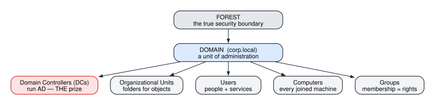

# What Active Directory Is

**Active Directory (AD) is the Microsoft system most companies use to decide who can log into which computer and what they can touch.**

## Before you start
<!-- bite: e49ea8bb-1063-4890-a0ca-3a22ab4102ca -->

You should have:

- A feel for what a corporate network is — many Windows machines, one login that works across them.
- The authorization framing → [[cybersecurity/02-ethical-hacking/01-rules-of-engagement-and-legal|rules of engagement]]. Everything here runs only against a domain you own or are engaged to test.

After this lesson you will be able to:

1. Name the pieces of an AD domain — forest, domain, domain controller, OU, groups — and say which one is the attacker's prize.
2. Explain why internal pentesting *is* AD pentesting.
3. State the four-part attacker's mental model (graph, credentials, misconfiguration, living off the land).

**Study route.** Read the kid version and §1–2 for the why, then the structure and the mental model carefully — they're the frame every later lesson hangs on.

## What Active Directory is
<!-- bite: f6a5513a-6fc8-4358-b73f-9e6f47b628c1 -->

Active Directory is one central system that holds every user, every computer and every group in a company, plus the rules connecting them. Log in once and it lets you into everything you're allowed to touch. That central control is what makes it convenient to run a company on — and it's exactly why an attacker who gets onto one laptop spends all their effort trying to reach *that central system*, because owning it means owning the whole network. The rest of this section is how they try, and how you stop them.

## The kid version
<!-- bite: 825652cf-d785-4ada-a158-8d12a6ca1310 -->

Almost every company runs Windows, and **Active Directory is the thing that decides who's allowed to log into what.** One central system holds every user, every computer, every group, and the rules connecting them. Log in once and it lets you into everything you're allowed to touch.

That central control is convenient for the company — and it's why an attacker who compromises one laptop spends all their effort trying to reach *that central system*, because owning it means owning the whole network.

## Why AD is the pentester's main event
<!-- bite: 99496ded-bad5-431e-8e69-828b3f977399 -->

**Internal network penetration testing is, in practice, Active Directory penetration testing.** The overwhelming majority of corporate environments run AD, and a real engagement looks like:

```text
phish one user / find one weak password
   → land on one workstation as a low-privilege user
      → enumerate AD to map the terrain
         → find a path of misconfigurations
            → escalate to Domain Admin
               → you own every machine in the domain
```

**This is the gap most self-taught hackers have.** They learn web exploitation and buffer overflows, then hit a real corporate network — or a HackTheBox Pro Lab, or the OSCP AD set — and have no idea what they're looking at. **AD is what the actual job is**, and it barely resembles the CTF `pwn` and web categories.

## The structure
<!-- bite: daffe0e3-42c1-461b-ba80-d6900d848a11 -->



- **Domain Controller (DC)** — the server that runs AD, holds the database of every object, and authenticates logins. **Compromising a DC = compromising the domain.** There are usually several for redundancy; they replicate to each other
- **Domain** — the administrative and (mostly) security unit. `corp.local`
- **Forest** — one or more domains with trust between them. **The forest, not the domain, is the true security boundary** — a subtlety that matters for escalation across trusts
- **The database** is a file called `NTDS.dit` on the DC, holding every account's password hash. **Stealing it is game over** → [[cybersecurity/12-active-directory/04-credential-attacks|credential attacks]]

## The objects that matter
<!-- bite: fb17f48c-2ca0-46a8-bcfc-471ffe4e9cdc -->

- **Domain Admins** — the group whose members control the entire domain. **The goal**
- **Service accounts** — accounts that run services (SQL, IIS). Often over-privileged, often with weak or non-expiring passwords, and **exploitable via Kerberoasting** → [[cybersecurity/12-active-directory/04-credential-attacks|04]]
- **Computer accounts** — every joined machine has one, with its own password. They matter more than beginners expect (delegation, resource-based attacks)
- **GPOs (Group Policy Objects)** — push configuration and scripts to machines. **Control a GPO and you run code on every machine it applies to**
- **Kerberos** — the authentication protocol AD uses, and the source of most named attacks → [[cybersecurity/12-active-directory/02-authentication-and-kerberos|Kerberos]]

## The attacker's mental model
<!-- bite: 53f4d94e-ac9f-4c58-96e5-1abc6521b623 -->

Internalise these four ideas and AD stops being opaque:

**1. It's a graph, not a hierarchy.** Users, groups, computers and permissions form a graph of "who can do what to whom." Attack paths are *paths through that graph* from where you are to Domain Admin. **This is literally how [[cybersecurity/12-active-directory/03-enumeration|BloodHound]] works** — it draws the graph and finds the shortest path.

**2. Credentials are currency.** The whole game is collecting credentials (passwords, hashes, tickets) and using them to reach accounts with more access. You rarely "exploit a vulnerability" in the CTF sense; **you abuse legitimate features with stolen credentials.**

**3. Misconfiguration, not vulnerability.** AD compromise is overwhelmingly about *how it's configured* — over-privileged accounts, weak service passwords, dangerous ACLs, excessive delegation — not about a CVE. **The DC is usually fully patched; the domain falls anyway.**

**4. Living off the land.** Attackers use built-in Windows tools and legitimate protocols, because they blend in with normal admin activity and evade detection → [[cybersecurity/12-active-directory/05-lateral-movement-and-escalation|lateral movement]].

## Why defenders struggle
<!-- bite: ed7ebb72-d089-4efd-bab1-4fd9b159d5f5 -->

AD is **decades old, backward-compatible to a fault, and insecure by default in the name of "it just works."** Legacy protocols stay enabled, default permissions are generous, and the same features that make it manageable make it exploitable. **Defence is largely about turning off defaults and watching the graph** → [[cybersecurity/12-active-directory/06-defending-active-directory|defending AD]].

## Key insight
<!-- bite: 37f71f29-6a46-4ab0-ab7e-51f117580d0d -->

**Active Directory compromise is graph traversal with stolen credentials, not vulnerability exploitation** — you land somewhere, map the graph of who-can-do-what-to-whom, and follow a path of *misconfigurations* to Domain Admin. That's why it's the pentester's main event and the biggest blind spot for people who learned on CTFs: the skill isn't finding a bug, it's reading the terrain and abusing legitimate features. Learn the graph, the credentials, and the defaults, and the named attacks become obvious.

## Terms used in this lesson
<!-- bite: 6639a9d5-17e7-4532-a99e-26144018450d -->

1. **Active Directory (AD)**: Microsoft's system for managing a Windows network — the one place that holds every account, machine and group and decides who can access what.
2. **Domain**: One administrative unit of an AD network, named like `corp.local`. All its users, computers and policy live together under one set of controllers.
3. **Domain Controller (DC)**: A server that runs Active Directory, holds the database of every object, and checks logins. Compromising a DC means compromising the domain.
4. **Forest**: One or more domains that trust each other. The forest — not the domain — is the real security boundary, which matters when an attacker crosses a trust.
5. **Organizational Unit (OU)**: A folder inside a domain for grouping objects (users, computers) so policy can be applied to them together.
6. **Domain Admin**: A member of the group that controls the whole domain. This is the attacker's goal.
7. **Group Policy Object (GPO)**: A bundle of settings and scripts that AD pushes to machines. Control a GPO and you run code on every machine it applies to.
8. **`NTDS.dit`**: The database file on a DC that stores every account's password hash. Stealing it is game over.

## Check your understanding
<!-- bite: a2008dbc-c42c-41cb-a289-d7e229978a4b -->

Try each one before you open the answer.

1. <!-- q: mcq id="e0517101" -->
   An attacker phishes one employee and lands on their laptop as a normal user. In AD terms, what is the single machine they most want to reach from there?

   - [ ] The employee's manager's laptop
   - [x] A Domain Controller
   - [ ] The company web server
   - [ ] The attacker's own command-and-control server

   <details><summary>Answer</summary>

   A Domain Controller. The DC runs Active Directory and holds `NTDS.dit`, the database of every account's password hash. Owning a DC means owning the domain, so every attack path is ultimately aimed there.

   </details>

2. <!-- q: mcq id="666a639d" -->
   Which statement best captures the "attacker's mental model" of AD?

   - [ ] Find an unpatched CVE on the Domain Controller and exploit it.
   - [x] Map the graph of who-can-do-what-to-whom and follow a path of misconfigurations to Domain Admin.
   - [ ] Brute-force the Administrator password until it cracks.
   - [ ] Flood the network until a controller fails open.

   <details><summary>Answer</summary>

   AD compromise is graph traversal with stolen credentials, not vulnerability exploitation. The DC is usually fully patched; the domain falls through over-privileged accounts, weak service passwords and dangerous permissions — a path through the graph.

   </details>

3. <!-- q: gap id="4660a78d" answers="forest" -->
   A domain is a unit of administration, but the true top-level security boundary in AD — the thing that really contains a compromise, or fails to — is the ___.

   <details><summary>Answer</summary>

   Forest. People assume the domain is the boundary, but trusts between domains in a forest mean an attacker who owns one domain can often reach the others. The forest is where the security boundary actually sits.

   </details>

4. <!-- q: mcq id="610f1bbc" -->
   Why are service accounts (accounts that run SQL, IIS, and similar) a favourite target?

   - [ ] They are always Domain Admins.
   - [x] They are often over-privileged and have weak, human-set, non-expiring passwords — and any user can request a crackable ticket for them.
   - [ ] They cannot be logged or monitored.
   - [ ] They bypass Kerberos entirely.

   <details><summary>Answer</summary>

   Service accounts are frequently set up once with a memorable password that never expires, and given more rights than they need. Because any authenticated user can request a Kerberos ticket for one (Kerberoasting, lesson 04), that weak password becomes an offline cracking target.

   </details>

5. <!-- q: open id="efdd72e8" -->
   "Living off the land" is one of the four parts of the attacker's mental model. In your own words, what does it mean in AD, and why does it make an attacker hard to catch?

   <details><summary>Answer</summary>

   It means using the built-in Windows tools and legitimate protocols (LDAP queries, Kerberos tickets, remote-admin protocols like WMI and PsExec) rather than custom malware. Because these are the same actions real administrators perform all day, the attacker's traffic blends into normal activity and evades signature-based detection — which is why defending AD leans on *behavioural* detection, watching for unusual patterns rather than known-bad tools.

   </details>

## Practice — get the lay of the land
<!-- bite: 24bfb60a-bf25-4605-becf-7a53f2a27a24 -->

You can't attack AD without an AD to attack. Your task for this section is to stand one up so every later lesson has a target.

- **Build a lab.** Follow the [GOAD (Game of Active Directory)](https://github.com/Orange-Cyberdefense/GOAD) install, or spin up a single Windows Server as a DC plus one Windows workstation. GOAD is the better choice — it ships the misconfigurations the next five lessons exploit.
- **Draw the structure** of your lab on paper from memory: forest, domain, DC, a couple of users, a service account, the Domain Admins group. Label which one is the prize.
- **Done when:** you can log into the workstation as a normal domain user, and you can name — without looking — what a DC, a forest, an OU and the Domain Admins group each are.

Everything attacked from here on is this lab, or an authorised engagement → [[cybersecurity/02-ethical-hacking/01-rules-of-engagement-and-legal|rules of engagement]].

## Before moving on
<!-- bite: 663ab4af-8c2c-4437-806d-b1fe762c89e8 -->

You should be able to sketch an AD domain, point to the Domain Controller as the prize, and recite the four-part mental model: it's a graph, credentials are currency, misconfiguration not vulnerability, live off the land. Hold those and the named attacks stop being a list to memorise and start being obvious consequences.

Next: [[cybersecurity/12-active-directory/02-authentication-and-kerberos|authentication and Kerberos]] — the one protocol underneath nearly every named AD attack. Read it before the attack lessons, because they won't make sense without it.

## Related
<!-- bite: 3a793005-a3ac-4068-8309-53bdb99596aa -->
- [[cybersecurity/12-active-directory/02-authentication-and-kerberos|authentication and Kerberos]] — the protocol underneath the attacks
- [[cybersecurity/12-active-directory/03-enumeration|enumeration]] — BloodHound and mapping the graph
- [[cybersecurity/01-fundamentals/01-what-is-cybersecurity|fundamentals]] · [[cybersecurity/03-network-security/index|network security]]
- [[cybersecurity/11-binary-exploitation/index|binary exploitation]] — the other big offensive gap

## About this lesson
<!-- bite: 4a1703df-a8de-44c8-a64d-c491fe26ed34 -->

**Level:** Intermediate. **Covers:** the corporate backbone, why it's the pentester's main event, and the attacker's mental model. Assumes the authorization in [[cybersecurity/02-ethical-hacking/01-rules-of-engagement-and-legal|rules of engagement]].

*Source: [reference] — Aug 2026. Authorised-testing / lab material.*
