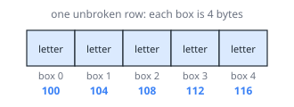
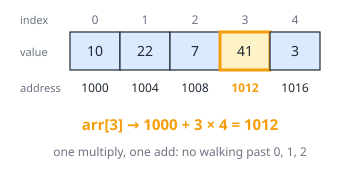
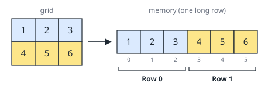
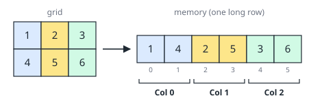
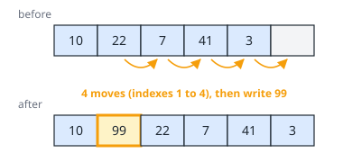

# Module: Arrays (Contiguous Memory & Fast Access)

Welcome to the **Arrays** module. An array is the simplest, most fundamental data structure in computer science. Almost every other structure (Dynamic Arrays, Hash Maps, Heaps, Stacks, Queues) is built on top of arrays.

---

## Before you start
<!-- bite: 57c1a5d9-7caf-49a5-bdef-bdb729f8173a -->

- You can read a small Python function.
- You know what a byte is and that memory is addressed numerically.

**What you will be able to do after this lesson:**

1. Compute the memory address of any element from the base address and index.
2. Explain why indexing is O(1) and why searching an unsorted array is not.
3. Explain how a 2-D grid is flattened, the difference between **row-major and column-major** order, and why matching your loop order to the layout changes speed without changing complexity.
4. Explain why building a string with += in a loop is O(n^2).

**Study route:** read the mechanism, run the lab, then attempt the independent task before opening the hint.

## 1. Why Do Arrays Exist? (Real-World Motivation)
<!-- bite: 9fc3234c-a337-42d1-9507-2771f0d8129d -->

Imagine a physical **row of numbered mailboxes** at a post office:



Because the mailboxes are placed **side-by-side in a straight, unbroken line** (contiguous), you don't need to walk past box 0, box 1, and box 2 to open box 3. You can calculate box 3's exact physical location instantly using arithmetic!

That property—storing items back-to-back in memory—is called **contiguity**, and it is the entire reason arrays exist.

---

## Terms used with arrays
<!-- bite: 5fe2dd30-6f65-4370-bb88-f00f1c241fbf -->

1. **Array**: This is a block of memory holding a fixed number of items, all of the same type, laid out one after another with no gaps. Because the items are all the same size and sit next to each other, the computer can jump straight to any one of them.

2. **Contiguous memory**: This means the items are placed directly next to each other in memory, with nothing in between. Think of parked cars in adjacent spaces rather than scattered around a city.

3. **Element**: This is a single item stored in the array.

4. **Index**: This is the position number of an element. It counts from **zero**, so the first element is at index 0, the second at index 1, and the last element of an array of length $n$ is at index $n-1$.

5. **Base address**: This is the memory address where the very first element lives — the address of index 0. Everything else is worked out relative to it.

6. **Element size**: This is how many bytes one item takes up. A 4-byte integer means every element is 4 bytes, and that sameness is what makes the arithmetic work.

7. **Length**: This is how many elements the array holds. For a plain array it is fixed when the array is created and never changes — growing it is what [[02-dynamic-arrays|dynamic arrays]] are for.

8. **Random access**: This means you can reach any element directly, without walking past the ones before it. Getting element 500 costs exactly what getting element 1 costs. This is the array's defining property.

9. **Cache line**: This is the chunk of memory the processor actually fetches when you ask for a single byte — typically 64 bytes. You never fetch one item; you fetch the block it sits in, which is why reading neighbouring elements is nearly free.

10. **Cache locality**: This means arranging your reads so that the things you use next are in the block you have already fetched. Good locality can make identical work run many times faster, without changing the complexity at all.

## 3. How Array Math Works ($O(1)$ Address Calculation)
<!-- bite: 28813f82-adfd-4e81-97fa-5492dadbb1fc -->

When you write `arr[i]` in code, the computer's CPU does not search or loop. It performs a single fast mathematical calculation to find the exact byte location in RAM:

$$\text{Address of element } i = \text{Base Address} + (i \times \text{Element Size})$$

### Concrete Example
Suppose an array of 4-byte integers starts at memory address `1000`:



To access `arr[3]`:
$$\text{Address} = 1000 + (3 \times 4) = 1000 + 12 = 1012$$

The CPU jumps directly to address `1012`. It takes the exact same fraction of a nanosecond whether the array has 5 items or 5,000,000 items!

---

## 4. Multi-Dimensional Arrays & Memory Layout
<!-- bite: f7b38305-a3a6-4211-bcb4-3cf7311c15bb -->

Memory in a computer chip is strictly 1-dimensional—a long single row of byte addresses. To store a 2D grid (matrix), languages must **flatten** the grid into a single 1D array.

There are two ways to do that flattening, and which one a language picks changes which loop order is fast.

### Row-major order

**Row-major means whole rows are stored one after another.** All of row 0, then all of row 1, and so on. Reading left to right across a row walks straight along memory.

The colours show which row each value came from:



To find `grid[r][c]` you skip `r` whole rows and then `c` elements:

$$\text{Address}(r, c) = \text{Base} + (r \times \text{num\_cols} + c) \times \text{Element Size}$$

**Used by:** C, C++, Java, Python, Rust, Go, and NumPy by default.

### Column-major order

**Column-major means whole columns are stored one after another.** All of column 0, then all of column 1. It is the same grid and the same idea, with the roles of rows and columns swapped.

Here the colours show which column each value came from:



Now you skip `c` whole columns and then `r` elements, so the multiplication uses the number of **rows** instead:

$$\text{Address}(r, c) = \text{Base} + (c \times \text{num\_rows} + r) \times \text{Element Size}$$

**Used by:** Fortran, MATLAB, R, Julia, and the BLAS and LAPACK numerical libraries that almost all scientific computing sits on top of.

### Why the difference matters

Neither layout is better. **What matters is that your loop order matches your layout**, because the processor fetches a whole 64-byte block whenever you read one element.

- In a **row-major** language, make the **column** index the inner loop. You then read neighbouring addresses, and each fetched block serves many iterations.
- In a **column-major** language, make the **row** index the inner loop, for exactly the same reason.

Get it backwards and every single read lands in a different block. The complexity is unchanged — it is $O(\text{rows} \times \text{cols})$ either way — but the running time is not, and the lab below measures a **16×** difference in blocks fetched.

This is also the single most common source of confusion when moving numerical code between Python and MATLAB, or when calling a Fortran library from C. The array contents are identical; only the order in memory differs. NumPy makes the choice explicit with `order='C'` for row-major and `order='F'` for column-major — the letters standing for C and Fortran.

### Performance Consequence: Cache Locality
When your CPU loads `arr[i]` from RAM into its ultra-fast L1 cache, it automatically grabs a **64-byte block (Cache Line)** containing adjacent elements (`arr[i+1]`, `arr[i+2]`, etc.).

```python
# FAST: Iterates sequentially along memory (High Cache Hits)
for r in range(rows):
    for c in range(cols):
        total += grid[r][c]

# SLOW: Jumps across memory rows (Frequent Cache Misses)
for c in range(cols):
    for r in range(rows):
        total += grid[r][c]
```
> [!NOTE]
> Even though both loops have the same Big-O ($O(\text{rows} \times \text{cols})$), the second loop can be **$3\times$ to $5\times$ slower** in actual runtime due to CPU cache misses!

---

## 5. Strings Are Arrays of Characters
<!-- bite: c7519c1c-6c5f-4eb7-af74-0a5a4d462ebc -->

In almost every programming language, a String is simply an array of character bytes with text helper methods attached.

### The String Concatenation Trap
In languages like Python, Java, and JavaScript, strings are **immutable** (cannot be changed in place). Appending to a string inside a loop creates a brand new array and copies all characters over each time:

```python
# BAD: O(n²) total time due to repeated array reallocation!
result = ""
for char in char_list:
    result += char  # Secretly O(n) array copy inside an O(n) loop!

# GOOD: O(n) total time using list join
result = "".join(char_list)
```

---

## 6. Time & Space Complexity Summary
<!-- bite: 6dc241b2-fefb-4048-ac7c-ce8889fed6d8 -->

| Operation | Time Complexity | Why? |
| :--- | :--- | :--- |
| **Access by Index (`arr[i]`)** | $O(1)$ | Direct formula calculation ($\text{base} + i \times \text{size}$). |
| **Search (Unsorted)** | $O(n)$ | Must check elements one by one. |
| **Search (Sorted)** | $O(\log n)$ | Binary search (halving remaining range). |
| **Insert / Delete at End** | $O(1)$ | No element shifting required. |
| **Insert / Delete at Front/Middle** | $O(n)$ | Must shift all subsequent elements to make/fill a gap. |

---

## 7. Common Pitfalls & Traps
<!-- bite: c766de5a-b5e2-4161-afbe-6b1fbb377c86 -->

1. **Front Insertion is $O(n)$**: Calling `arr.insert(0, item)` forces every single element in the array to move right by 1 index.
2. **Fixed Size Constraint**: In low-level languages (C/C++), static arrays cannot grow once allocated. Resizing requires allocating a larger block and copying everything over (solved by [[02-dynamic-arrays|Dynamic Arrays]]).
3. **Index Out of Bounds**: Requesting index `n` on an array of length `n` causes a crash because indices run from `0` to `n-1`.

Here is pitfall 1 on a small array. To put 99 at index 1, every element from index 1 onward moves one place right, starting from the back:



---

## The array ADT
<!-- bite: 6c5ec495-0829-4e64-9931-4d3489fd6c0d -->

An ADT is a description of **what** a structure does, listed before you decide **how** it is built. For an array the list is strikingly short, and that is the point — an array does almost nothing, extremely fast.

1. `get(i)` — Returns the element at index `i`. Costs $O(1)$: the computer does one multiplication and one addition to work out the address, then reads it. It does not matter whether `i` is 0 or 4,000,000.

2. `set(i, value)` — Replaces the element at index `i` with `value`. Also $O(1)$, for the same reason.

3. `length()` — Returns how many elements the array holds. $O(1)$, because the length is stored, not counted.

That is the entire ADT of a fixed array. Notice what is **absent**:

- There is no `insert(i, value)`. To make room in the middle you must shift every later element up by one, which is $O(n)$ work, and the array has no spare room at the end anyway.
- There is no `delete(i)`. Removing from the middle leaves a hole, and closing it means shifting everything after it down — again $O(n)$.
- There is no `append(value)`. The length is fixed at creation. Getting one is the whole subject of [[02-dynamic-arrays|dynamic arrays]].
- There is no `find(value)`. You can scan for it yourself in $O(n)$, but the array does not help — it knows nothing about what it contains, only where things sit.

**The trade in one sentence.** An array gives you the fastest possible access *by position* and offers nothing else. Every other structure in this folder is, in some sense, paying an access-time cost to buy back one of those missing operations.

## Implementation - complete runnable example
<!-- bite: 93f886b7-6f1c-4763-9f23-6ea2481cc288 -->

**Runnable example:** save as `arrays_lab.py` and run `python3 arrays_lab.py`. Standard library only; writes no files. Everything is counted rather than timed, so your output will match this exactly.

```python
"""Arrays: address arithmetic, row-major layout, and the concatenation trap.

Everything here is counted rather than timed, so the output is identical
on every machine."""

def address_of(base, index, element_size):
    """The single calculation the CPU performs for arr[i]. No searching."""
    return base + index * element_size

def flat_index(row, col, n_cols):
    """Row-major: skip whole ROWS, then step along the row.

    Used by C, C++, Java, Python, Rust, Go and NumPy by default."""
    return row * n_cols + col

def flat_index_col_major(row, col, n_rows):
    """Column-major: skip whole COLUMNS, then step down the column.

    Used by Fortran, MATLAB, R, Julia, and the BLAS/LAPACK libraries."""
    return col * n_rows + row

def scan_order(rows, cols, row_major):
    """Return the flat indices a nested loop touches, in order."""
    if row_major:
        return [flat_index(r, c, cols) for r in range(rows) for c in range(cols)]
    return [flat_index(r, c, cols) for c in range(cols) for r in range(rows)]

def cache_lines_touched(indices, element_size=4, line_bytes=64):
    """Count how many times the scan moves to a different 64-byte cache line.

    Sequential access reuses one line for several elements; strided access
    lands on a new line almost every time, and each change is a real fetch."""
    per_line = line_bytes // element_size
    changes, last = 0, None
    for i in indices:
        line = i // per_line
        if line != last:
            changes += 1
            last = line
    return changes

def naive_concat_copies(n):
    """Immutable strings: `result += ch` copies the whole result each time."""
    return sum(range(n))          # 0 + 1 + 2 + ... + (n-1) characters copied

def join_copies(n):
    """"".join(parts) allocates once and copies each character once."""
    return n

if __name__ == "__main__":
    print("ADDRESS ARITHMETIC -- why arr[i] is O(1)")
    base, size = 1000, 4
    for i in (0, 3, 4, 500):
        print(f"  arr[{i:3d}] lives at {base} + {i} x {size} = {address_of(base, i, size)}")
    print("  the same one multiplication and one addition, whatever i is.")
    print()

    print("TWO LAYOUTS -- the same grid, flattened two different ways")
    grid = [[1, 2, 3], [4, 5, 6]]
    n_rows, n_cols = len(grid), len(grid[0])
    row_major_flat = [None] * (n_rows * n_cols)
    col_major_flat = [None] * (n_rows * n_cols)
    for r in range(n_rows):
        for c in range(n_cols):
            row_major_flat[flat_index(r, c, n_cols)] = grid[r][c]
            col_major_flat[flat_index_col_major(r, c, n_rows)] = grid[r][c]
    print(f"  grid            {grid}")
    print(f"  row-major    -> {row_major_flat}")
    print(f"  column-major -> {col_major_flat}")
    assert row_major_flat == [1, 2, 3, 4, 5, 6]
    assert col_major_flat == [1, 4, 2, 5, 3, 6]
    # both formulas must recover the same element from their own layout
    for r in range(n_rows):
        for c in range(n_cols):
            assert row_major_flat[flat_index(r, c, n_cols)] == grid[r][c]
            assert col_major_flat[flat_index_col_major(r, c, n_rows)] == grid[r][c]
    print("  both address formulas recover every element correctly from their own")
    print("  layout. Neither is 'right' - they are different conventions, and the")
    print("  one your language uses decides which loop order is cache-friendly.")

    print()
    print("ROW-MAJOR LAYOUT -- a 2-D grid is a lie told over 1-D memory")
    grid = [[1, 2, 3], [4, 5, 6]]
    flat = [v for row in grid for v in row]
    print(f"  grid  = {grid}")
    print(f"  memory= {flat}")
    for r, c in [(0, 0), (1, 0), (1, 2)]:
        print(f"  grid[{r}][{c}] -> flat index {flat_index(r, c, 3)} -> {flat[flat_index(r,c,3)]}")
    print()

    print("CACHE LOCALITY -- same Big-O, different memory behaviour")
    rows, cols = 64, 64
    for label, rm in (("row-major (rows inner)", True), ("column-major (cols inner)", False)):
        fetches = cache_lines_touched(scan_order(rows, cols, rm))
        print(f"  {label:26s} {fetches:6d} cache-line fetches")
    rm = cache_lines_touched(scan_order(rows, cols, True))
    cm = cache_lines_touched(scan_order(rows, cols, False))
    print(f"  -> column-major fetches {cm/rm:.0f}x more lines for identical work")
    print("     both loops are O(rows x cols). Big-O cannot see this.")
    print()

    print("THE STRING CONCATENATION TRAP -- characters copied")
    print(f"  {'n':>6s} {'result += ch':>14s} {'join':>8s} {'ratio':>8s}")
    for n in (10, 100, 1000):
        a, b = naive_concat_copies(n), join_copies(n)
        print(f"  {n:6d} {a:14,d} {b:8,d} {a/b:7.1f}x")
    print("  += inside a loop is O(n^2) because each += copies everything so far.")

    assert address_of(1000, 3, 4) == 1012
    assert flat_index(1, 2, 3) == 5
    assert cm > rm
    assert naive_concat_copies(1000) > 100 * join_copies(1000)
    print()
    print("arrays_lab: passed")
```

Expected output:

```text
ADDRESS ARITHMETIC -- why arr[i] is O(1)
  arr[  0] lives at 1000 + 0 x 4 = 1000
  arr[  3] lives at 1000 + 3 x 4 = 1012
  arr[  4] lives at 1000 + 4 x 4 = 1016
  arr[500] lives at 1000 + 500 x 4 = 3000
  the same one multiplication and one addition, whatever i is.

TWO LAYOUTS -- the same grid, flattened two different ways
  grid            [[1, 2, 3], [4, 5, 6]]
  row-major    -> [1, 2, 3, 4, 5, 6]
  column-major -> [1, 4, 2, 5, 3, 6]
  both address formulas recover every element correctly from their own
  layout. Neither is 'right' - they are different conventions, and the
  one your language uses decides which loop order is cache-friendly.

ROW-MAJOR LAYOUT -- a 2-D grid is a lie told over 1-D memory
  grid  = [[1, 2, 3], [4, 5, 6]]
  memory= [1, 2, 3, 4, 5, 6]
  grid[0][0] -> flat index 0 -> 1
  grid[1][0] -> flat index 3 -> 4
  grid[1][2] -> flat index 5 -> 6

CACHE LOCALITY -- same Big-O, different memory behaviour
  row-major (rows inner)        256 cache-line fetches
  column-major (cols inner)    4096 cache-line fetches
  -> column-major fetches 16x more lines for identical work
     both loops are O(rows x cols). Big-O cannot see this.

THE STRING CONCATENATION TRAP -- characters copied
       n   result += ch     join    ratio
      10             45       10     4.5x
     100          4,950      100    49.5x
    1000        499,500    1,000   499.5x
  += inside a loop is O(n^2) because each += copies everything so far.

arrays_lab: passed
```

## Check your understanding
<!-- bite: 47684921-4510-4cf8-a7a0-d0adaf6c8426 -->

Try each one before you open the answer.

1. <!-- q: exact id="da9a38e6" answer="3048" -->
   An array of 8-byte integers starts at memory address 3000. What is the memory address of `arr[6]`?

   <details><summary>Answer</summary>

   3048. Address = base + index × element size = 3000 + 6 × 8 = 3048.

   </details>

2. <!-- q: mcq id="aa4f41be" -->
   Why does reading `arr[500]` cost the same as reading `arr[1]`?

   - [ ] The computer remembers where every element was last read
   - [x] The address is worked out with one multiplication and one addition, whatever the index
   - [ ] Arrays are sorted, so the computer can binary search to the index
   - [ ] It doesn't; `arr[500]` takes 500 times longer

   <details><summary>Answer</summary>

   The elements are all the same size and sit side by side, so the address is base + i × size. That is the same small calculation for any i, so indexing is O(1).

   </details>

3. <!-- q: mcq id="efa04d29" -->
   An array holds n elements and has no spare room problems. Which operations cost O(n)? Choose all that apply.

   - [x] Inserting a new element at index 0
   - [x] Deleting the element at index 0 and closing the gap
   - [x] Searching an unsorted array for a value
   - [ ] Replacing the value at index 7

   <details><summary>Answer</summary>

   The first three. Inserting or deleting at the front shifts every later element by one, and searching an unsorted array checks elements one by one. Replacing `arr[7]` is a single O(1) write.

   </details>

4. <!-- q: gap id="84426344" answers="column|col|c;row|r" -->
   Fill in the gaps. Python, C and Java store grids in row-major order, so the fast loop order makes the ___ index the inner loop. Fortran and MATLAB are column-major, so there the ___ index should be the inner loop.

   <details><summary>Answer</summary>

   Column, then row. The inner loop should walk along neighbouring memory addresses, so each 64-byte cache line that is fetched serves many reads.

   </details>

5. <!-- q: mcq id="f90ecb6b" -->
   Two loops sum every cell of a 1000 × 1000 grid. One goes row by row and one goes column by column. What is true about them in a row-major language?

   - [ ] The column-by-column loop is O(n²) and the row-by-row loop is O(n)
   - [x] Both are the same Big-O, but row by row runs faster because of cache locality
   - [ ] Both run at exactly the same speed
   - [ ] Column by column is faster because columns are shorter

   <details><summary>Answer</summary>

   Both do rows × cols reads, so the complexity is identical. Row by row reads neighbouring addresses and reuses each fetched cache line, so it runs several times faster in practice.

   </details>

6. <!-- q: open id="5f46a027" -->
   Why does building a string with `result += char` inside a loop cost O(n²) in Python, and what is the fix?

   <details><summary>Answer</summary>

   Strings are immutable arrays of characters, so each `+=` makes a new string and copies every character already there. The copies grow 1, 2, 3, … n, which adds up to about n²/2. The fix is to append the characters to a list and call `''.join(list)` once at the end, which is O(n).

   </details>

## Check your understanding: worked problems
<!-- bite: c830caa7-8d3c-4a9e-ac51-f469e3a50eba -->

Work each one out on paper first, then type your answer.

1. <!-- q: exact id="f577d947" answer="5050" -->
   An array of 2-byte values starts at address 5000. What is the address of `arr[25]`?

   <details><summary>Answer</summary>

   5050. 5000 + 25 × 2 = 5050.

   </details>

2. <!-- q: gap id="54820a89" answers="252;256" -->
   Fill in the gaps. A grid has 4 rows and 5 columns of 4-byte integers, starting at address 200. The address of `grid[2][3]` is ___ when stored row-major, and ___ when stored column-major.

   <details><summary>Answer</summary>

   Row-major: 200 + (2 × 5 + 3) × 4 = 252. Column-major: 200 + (3 × 4 + 2) × 4 = 256. Row-major skips whole rows (multiply by the number of columns); column-major skips whole columns (multiply by the number of rows).

   </details>

3. <!-- q: exact id="ca082fde" answer="8" -->
   An array holds 10 elements at indexes 0 to 9, with room for one more at the end. You insert a new element at index 2. How many existing elements must move one place to the right?

   <details><summary>Answer</summary>

   8. The elements at indexes 2 to 9 all shift right by one to open a gap at index 2. That is 10 − 2 = 8 moves.

   </details>

4. <!-- q: exact id="a3af068b" answer="15" -->
   You build the string "HELLO" with `result += char`, one letter at a time, starting from an empty string. Each `+=` copies every character of the new string. How many character copies happen in total?

   <details><summary>Answer</summary>

   15. The new strings have lengths 1, 2, 3, 4 and 5, so 1 + 2 + 3 + 4 + 5 = 15 copies. For n characters this is n(n+1)/2, which is O(n²).

   </details>

## Practice - independent task
<!-- bite: a1e3942a-e62d-4d7d-ba7d-f64af3feba38 -->

Implement `transpose(grid)` returning a new grid with rows and columns swapped, **using only flat 1-D lists and index arithmetic** - no nested lists, no `zip`.

- Represent an `r x c` grid as a flat list of length `r*c` plus the two dimensions.
- Write `get(flat, r, c, n_cols)` and `set(flat, r, c, n_cols, v)` using `row * n_cols + col`.
- Transpose a 2x3 into a 3x2 and verify against a nested-list version.
- **Then answer:** does your transpose read row-major and write column-major, or the reverse? Which of the two loops has poor locality, and could you fix it by swapping the loop order?

**Done when:** your flat transpose matches a nested-list reference on a 3x4 grid, and you can say which access pattern in it is cache-unfriendly.

<details><summary>Hint - open only after an attempt</summary>
The output grid's dimensions are swapped, so <code>out[c][r] = in[r][c]</code> becomes <code>out_flat[c * r_count + r] = in_flat[r * c_count + c]</code>.<br>
One of those walks memory sequentially and the other jumps by a whole row each step. <strong>You cannot make both sequential</strong> - which is exactly why cache-aware transposes process the grid in small blocks rather than row by row.
</details>

## Before moving on
<!-- bite: a87c4854-b93e-4cc2-8118-60a830379cac -->

You are done with this module when you can, closed-book:

- [ ] Compute an element's address from base, index and element size.
- [ ] Explain why array indexing is O(1) but front insertion is O(n).
- [ ] Explain row-major layout and why scan order changes speed at identical Big-O.
- [ ] Explain the string concatenation trap and the join fix.

**Recap:** An array is a contiguous block, so any element's address is base + i x size - one multiplication and one addition, regardless of size. That contiguity is also the cost: inserting at the front shifts everything after it. A 2-D grid is flattened row-major, which makes row-wise scanning cache-friendly and column-wise scanning far slower at identical Big-O. Strings are arrays of characters, which is why += in a loop copies everything each time.

**Next:** [[02-dynamic-arrays|Dynamic Arrays]] - arrays cannot grow - this is what happens when you need them to.

## Related Modules
<!-- bite: 2417849c-96af-4b8d-8dc9-cf9f185a0e5d -->
- [[02-dynamic-arrays|Dynamic Arrays]] — How arrays grow automatically when full
- [[04-linked-lists|Linked Lists]] — The non-contiguous alternative using pointers
- [[03-hash-maps|Hash Maps]] — Using array indexing to build $O(1)$ key-value lookups
