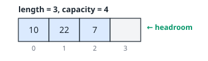
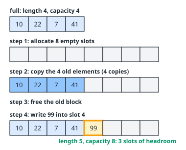
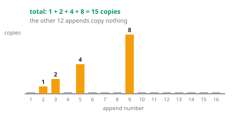

# Module: Dynamic Arrays (Resizable Contiguous Storage)

Welcome to the **Dynamic Arrays** module.

---

## Before you start
<!-- bite: 9289aecb-7518-42fb-b08a-302e824b6a37 -->

- You understand contiguous memory and O(1) indexing. See [[01-arrays|arrays]].
- You can read Big-O notation and know what 'amortised' means informally.

**What you will be able to do after this lesson:**

1. Explain why a fixed-size array must be reallocated to grow.
2. Compute the total copies for n appends under doubling, and show it is under 2n.
3. Explain why doubling gives amortised O(1) and fixed-chunk growth does not.
4. Explain why append is cheap and insert-at-front is not.

**Study route:** read the mechanism, run the lab, then attempt the independent task before opening the hint.

## What a dynamic array is
<!-- bite: 5070e640-1de3-4ff9-917d-d33795833d54 -->

A dynamic array is a static [[01-arrays|array]] with a smart management layer built around it. It provides the lightning-fast $O(1)$ access speed of a static array, while automatically growing in size whenever it fills up.

Dynamic arrays are what high-level languages hand you by default: Python's `list`, JavaScript's `Array`, C++'s `std::vector`, and Java's `ArrayList`.

## 1. Why Do Dynamic Arrays Exist? (Real-World Motivation)
<!-- bite: 0dfe78c7-dcc2-4c2c-b955-514e82601286 -->

Imagine buying an expandable **accordion suitcase** for travel:
- When you start packing, it takes up a compact space.
- If you run out of room, you un-zipper the extension seam to **double its capacity**.

## 1. Why Do Dynamic Arrays Exist?: the real problem
<!-- bite: f2c3c21c-3f6d-4218-81d7-05d3a77bc6d5 -->

This part says why software needs arrays that can grow.

In real-world software, you almost never know in advance how many records a user will load, how many items will be added to a shopping cart, or how many messages will arrive over a network connection.

Static arrays demand a fixed size at creation time. Dynamic arrays eliminate that restriction by automatically managing capacity behind the scenes.

---

## Terms used with dynamic arrays
<!-- bite: 28e2af9b-9ca7-4953-a076-7283de0708e1 -->

1. **Dynamic array**: This is an array that can grow. It is also called a **resizable array**, a **vector** in C++, an **ArrayList** in Java, and simply a **list** in Python. Underneath it is still a plain fixed-size array — the growing is a trick played on top.

2. **Length**: This is how many elements are actually stored right now. This is the number you get from `len()`.

3. **Capacity**: This is how many elements the underlying memory block could hold before it runs out. It is usually **larger** than the length, and it is invisible from outside.

4. **Headroom**: This is the spare space, `capacity - length`. It is what lets an append happen without any copying, and it is the whole reason appends are usually instant.

## Terms used with dynamic arrays: growing the array
<!-- bite: e8bfb22d-a25c-4f98-a22b-ddd351418709 -->

These terms are about what happens when the array runs out of room.

5. **Growth factor**: This is the multiplier used when the block runs out of room — commonly $2\times$, sometimes $1.5\times$. The array allocates a new, larger block and copies everything across. **That it is a multiplier and not a fixed amount is the single most important detail**, and section 3 shows why.

6. **Reallocation**: This is the expensive step: request a bigger block, copy every existing element into it, then release the old block. It is $O(n)$, and it is what you are trying to do rarely.

7. **Amortised $O(1)$**: This means that although a single operation can occasionally be slow, the **average** cost across a long run of operations is constant. Appending is amortised $O(1)$: most appends are instant, the occasional one copies everything, and the total still works out to constant time per append. It is a statement about the *total*, never a promise about any *one* call.

## 3. How Dynamic Resizing Works
<!-- bite: e83269eb-3b5c-4e61-a4de-727d4f0f8b0f -->

Internally, a dynamic array tracks both its current **length** and underlying **capacity**.

### State 1: Headroom Available



Appending `41` fills the empty slot. Now `length = 4, capacity = 4`.

---

## 3. State 2: Array Full (`length == capacity`) — The Resize Trigger
<!-- bite: 1754ed31-a330-4b1b-8969-42f0599f75bf -->
When you call `append(99)` and `length == capacity`, the dynamic array executes a 4-step resize algorithm:



---

## 4. Mathematical Proof: Why Doubling Makes Append "Amortized $O(1)$"
<!-- bite: 206c3718-2405-494d-808e-a930442f6814 -->

A single resize operation costs $O(n)$ because every single element must be copied to the new memory location. Why, then, do computer scientists claim that `append()` is $O(1)$?

Because capacity **doubles**, resizes become exponentially rarer as the array grows!

### Counting the Total Copies
Suppose you append $N = 16$ elements starting from a capacity of 1:

```text
Appends 1-2:   Resize to 2   (Cost: 1 copy)
Appends 3-4:   Resize to 4   (Cost: 2 copies)
Appends 5-8:   Resize to 8   (Cost: 4 copies)
Appends 9-16:  Resize to 16  (Cost: 8 copies)

Total Copies across ALL 16 appends = 1 + 2 + 4 + 8 = 15 copies!
```

## 4. Amortized $O(1)$: the total for any $N$
<!-- bite: 30683b49-ddfe-4921-9fd7-237af368dfb5 -->

This part turns the count of copies into a formula for any number of appends.

Mathematically, for $N$ appends:
$$\text{Total Copy Cost} = 1 + 2 + 4 + 8 + \dots + \frac{N}{2} = N - 1 < N$$

- **Total work for $N$ appends**: $N$ insertions + $N$ copies = $2N$ operations.
- **Average (Amortized) cost per append**: $\frac{2N}{N} = 2 = O(1)$!

> [!IMPORTANT]
> **Why Fixed Additive Growth Fails**: If you increased capacity by a fixed amount (e.g. $+10$ slots each time instead of multiplying by $2\times$), the total copy work would be $O(n^2)$, causing `append()` to degrade to a slow $O(n)$ average cost!

---

## Seeing the copies append by append
<!-- bite: a3f02a1e-231a-410c-8f6c-4a5dbd18110d -->

Each bar is how many elements one append had to copy, for 16 appends starting from capacity 1. Only appends 2, 3, 5 and 9 copy anything, and each spike is twice the last. The spikes get rarer as they get bigger, which is why the total stays under 16.



---

## 5. Time & Space Complexity Summary
<!-- bite: ecda8a12-c1bc-4405-a81c-daaf22c6ea01 -->

| Operation | Time Complexity | Notes |
| :--- | :--- | :--- |
| **Access by Index (`arr[i]`)** | $O(1)$ | Direct formula calculation ($\text{base} + i \times \text{size}$). |
| **Append at End** | **$O(1)$ Amortized** | $O(n)$ worst-case only on the rare resize step. |
| **Pop from End** | $O(1)$ | Shrinks length counter; no shifting needed. |
| **Insert / Delete at Front** | $O(n)$ | Must shift all subsequent elements right/left. |
| **Search (Unsorted)** | $O(n)$ | Linear scan. |

---

## 6. Practical Optimizations & Gotchas
<!-- bite: 72428940-49a4-4907-aea6-c31a052880d5 -->

1. **Pre-Allocation Optimization**: If you know you will store 100,000 items, pre-allocate the capacity upfront (`[None] * 100000` in Python or `vector.reserve(100000)` in C++) to prevent all resize copies!
2. **Front Operations Are Still $O(n)$**: Dynamic arrays solve the dynamic sizing problem, but inserting at index 0 still requires shifting every item. If you need fast front insertions, use [[05-stacks-and-queues|Queues]] or [[04-linked-lists|Linked Lists]].

---

## The dynamic array ADT
<!-- bite: 6e6c8f71-df39-48bf-a624-b28ba330a235 -->

A dynamic array supports everything [[01-arrays|a plain array]] does, and adds the operation an array cannot have.

1. `get(i)` and `set(i, value)` — Exactly as for a plain array. **$O(1)$**. The underlying storage is still one contiguous block, so the address arithmetic is unchanged.

2. `append(value)` — Adds `value` to the end. **Amortised $O(1)$**. Usually it writes into spare headroom and returns immediately. Occasionally there is no headroom left, and it must allocate a bigger block and copy everything, which is $O(n)$ for that one call.

3. `pop()` — Removes and returns the last element. **$O(1)$**. Nothing needs to move, because nothing sits after it.

4. `insert(i, value)` — Inserts at position `i`, shifting everything after it up one place. **$O(n)$**. The shifting is unavoidable: contiguous storage means there is no gap to insert into.

5. `delete(i)` — Removes the element at `i` and shifts everything after it down. **$O(n)$**, for the same reason.

6. `length()` — How many elements are stored. $O(1)$.

## The dynamic array ADT: the one claim worth being precise about
<!-- bite: 139937ab-d512-414f-af73-3d7979b2d011 -->

**"Appending is $O(1)$" is a statement about a sequence, not about a single call.** Any individual append may be the unlucky one that triggers a copy of a million elements. If you are writing something latency-sensitive — an audio callback, a control loop, a game frame — that occasional $O(n)$ spike is real and will show up in your worst-case timing, even though your average looks perfect.

The fix, when it matters, is to **reserve capacity up front** if you know roughly how many elements are coming. Most languages expose this: `reserve()` in C++, `ensureCapacity()` in Java. Python does not expose it directly, which is one reason building a list by repeated `append` in a hot loop is sometimes replaced by preallocating a list of the right size.

## Implementation - complete runnable example
<!-- bite: 4e490e28-f580-4837-a236-7c377a86b0b2 -->

**Runnable example:** save as `dynamic_arrays_lab.py` and run `python3 dynamic_arrays_lab.py`. Standard library only; writes no files. Everything is counted rather than timed, so your output will match this exactly.

```python
"""Dynamic arrays: why doubling gives amortised O(1) append.

Counts element copies exactly, so the amortisation is arithmetic rather
than a claim."""

class GrowableArray:
    """A dynamic array built on a fixed-capacity store, like a real one."""
    def __init__(self, growth=2):
        self.data, self.size, self.capacity = [None], 0, 1
        self.growth, self.copies, self.resizes = growth, 0, 0

    def append(self, value):
        if self.size == self.capacity:
            self._resize(max(1, int(self.capacity * self.growth)))
        self.data[self.size] = value
        self.size += 1

    def _resize(self, new_capacity):
        """The expensive step: allocate bigger, copy everything across."""
        bigger = [None] * new_capacity
        for i in range(self.size):
            bigger[i] = self.data[i]
        self.copies += self.size
        self.resizes += 1
        self.data, self.capacity = bigger, new_capacity

    def __getitem__(self, i):
        if not 0 <= i < self.size:
            raise IndexError(i)
        return self.data[i]

    def insert_front(self, value):
        """O(n): everything must shift right to make room."""
        if self.size == self.capacity:
            self._resize(max(1, int(self.capacity * self.growth)))
        for i in range(self.size, 0, -1):
            self.data[i] = self.data[i - 1]
        self.copies += self.size
        self.data[0] = value
        self.size += 1

def append_cost(n, growth):
    a = GrowableArray(growth)
    for i in range(n):
        a.append(i)
    return a.copies, a.resizes

if __name__ == "__main__":
    print("GROWTH BY DOUBLING -- copies during n appends")
    print(f"  {'n':>7s} {'copies':>10s} {'resizes':>9s} {'copies/append':>14s}")
    for n in (10, 100, 1000, 10000):
        copies, resizes = append_cost(n, 2)
        print(f"  {n:7d} {copies:10,d} {resizes:9d} {copies/n:14.2f}")
    print("  -> copies per append approaches 1 and never exceeds 2.")
    print("     THAT is what 'amortised O(1)' means: some appends are")
    print("     expensive, but the average over any run is constant.")
    print()

    print("WHY DOUBLING, NOT ADDING A FIXED AMOUNT")
    print(f"  {'strategy':>22s} {'copies for n=10000':>20s}")
    a = GrowableArray(2)
    for i in range(10000): a.append(i)
    print(f"  {'double (x2)':>22s} {a.copies:20,d}")
    # grow by a constant chunk instead
    size = cap = copies = 0
    for i in range(10000):
        if size == cap:
            copies += size
            cap += 100
        size += 1
    print(f"  {'grow by 100 each time':>22s} {copies:20,d}")
    print(f"  -> fixed-chunk growth is O(n^2) overall; doubling is O(n).")
    print()

    print("APPEND vs INSERT AT FRONT")
    back = GrowableArray()
    for i in range(1000): back.append(i)
    front = GrowableArray()
    for i in range(1000): front.insert_front(i)
    print(f"  1000 appends        : {back.copies:8,d} copies")
    print(f"  1000 front inserts  : {front.copies:8,d} copies")
    print(f"  -> front insertion is O(n) per operation, O(n^2) overall.")

    copies_2x, _ = append_cost(10000, 2)
    assert copies_2x < 2 * 10000, "doubling must stay under 2 copies per append"
    assert copies_2x < copies, "doubling must beat fixed-chunk growth"
    assert front.copies > 100 * back.copies
    a = GrowableArray()
    for i in range(5): a.append(i * i)
    assert [a[i] for i in range(5)] == [0, 1, 4, 9, 16]
    print()
    print("dynamic_arrays_lab: passed")
```

## Implementation: what it prints
<!-- bite: c64fde5d-f588-4164-b303-e9ce4ac652a5 -->

This is what the dynamic array lab prints when you run it.

Expected output:

```text
GROWTH BY DOUBLING -- copies during n appends
        n     copies   resizes  copies/append
       10         15         4           1.50
      100        127         7           1.27
     1000      1,023        10           1.02
    10000     16,383        14           1.64
  -> copies per append approaches 1 and never exceeds 2.
     THAT is what 'amortised O(1)' means: some appends are
     expensive, but the average over any run is constant.

WHY DOUBLING, NOT ADDING A FIXED AMOUNT
                strategy   copies for n=10000
             double (x2)               16,383
   grow by 100 each time              495,000
  -> fixed-chunk growth is O(n^2) overall; doubling is O(n).

APPEND vs INSERT AT FRONT
  1000 appends        :    1,023 copies
  1000 front inserts  :  500,523 copies
  -> front insertion is O(n) per operation, O(n^2) overall.

dynamic_arrays_lab: passed
```

## Check your understanding
<!-- bite: 0f52c9a3-1f23-4ab0-9650-b33f0758fcff -->

Try each one before you open the answer.

1. <!-- q: exact id="67fcb2bd" answer="8" -->
   A dynamic array has length 8 and capacity 8. It doubles when full. How many existing elements are copied during the next `append()`?

   <details><summary>Answer</summary>

   8. The block is full, so a new block of capacity 16 is allocated and all 8 existing elements are copied into it before the new one is written.

   </details>

2. <!-- q: gap id="e6775133" answers="length;capacity" -->
   Fill in the gaps. In a dynamic array, the number of elements actually stored is the ___, and the number the underlying block could hold before it runs out is the ___.

   <details><summary>Answer</summary>

   Length, then capacity. Capacity minus length is the headroom, the spare room that lets an append happen without copying.

   </details>

3. <!-- q: mcq id="3aeb9fe7" -->
   A team changes their dynamic array from "double the capacity when full" to "add 100 slots when full". What happens to the cost of n appends?

   - [ ] Nothing changes; both are amortised O(1) per append
   - [x] The total becomes O(n²), so the average append becomes O(n)
   - [ ] It gets faster, because the array wastes less memory
   - [ ] The total becomes O(log n)

   <details><summary>Answer</summary>

   Adding a fixed amount means a resize every 100 appends, and each resize copies everything so far. Those copies add up to about n²/200, which is O(n²). Doubling makes resizes rarer as the array grows, so the copies sum to less than n.

   </details>

4. <!-- q: mcq id="c68d300c" -->
   Which operations on a dynamic array of n elements cost O(n) in the worst case for a single call? Choose all that apply.

   - [x] `append(x)` when length equals capacity
   - [x] `insert(0, x)`
   - [ ] `get(i)`
   - [ ] `pop()` from the end, with no shrinking

   <details><summary>Answer</summary>

   An append into a full block copies everything, and inserting at the front shifts everything. `get(i)` is address arithmetic and `pop()` from the end moves nothing, so both are O(1).

   </details>

5. <!-- q: open id="379fcfc4" -->
   Append on a dynamic array is called amortised O(1). Why is that not the same as saying every append is O(1), and when does the difference matter?

   <details><summary>Answer</summary>

   Amortised O(1) is about the total over a long run: n appends cost O(n) altogether, so the average is constant. Any one append can still be the one that copies every element, which is O(n). That spike matters in latency-sensitive code such as an audio callback or a game frame; the fix is to reserve capacity up front.

   </details>

## Check your understanding: worked problems
<!-- bite: 27fb1fdb-e9ea-4744-b992-0eb6e04b77de -->

Work each one out on paper first, then type your answer.

1. <!-- q: gap id="754f69ec" answers="31;5;32" -->
   Fill in the gaps. A dynamic array starts empty with capacity 1 and doubles whenever it is full. After 20 appends, it has copied ___ elements in total, resized ___ times, and has a capacity of ___.

   <details><summary>Answer</summary>

   31 copies, 5 resizes, capacity 32. The resizes copy 1, 2, 4, 8 and 16 elements (at appends 2, 3, 5, 9 and 17), and 1 + 2 + 4 + 8 + 16 = 31.

   </details>

2. <!-- q: exact id="f42dc14e" answer="40" -->
   A badly designed dynamic array starts empty with capacity 4 and adds 4 slots whenever it is full. How many element copies happen during 20 appends?

   <details><summary>Answer</summary>

   40. It resizes when full at lengths 4, 8, 12 and 16, copying 4 + 8 + 12 + 16 = 40 elements. Growing by a fixed amount makes these copies add up to O(n²).

   </details>

3. <!-- q: exact id="e0faa6ae" answer="28" -->
   A dynamic array starts empty with capacity 4. When it is full, it doubles its capacity and copies every element across. How many element copies happen during 20 appends?

   <details><summary>Answer</summary>

   28. It resizes at lengths 4, 8 and 16, copying 4 + 8 + 16 = 28 elements, ending with capacity 32. That is fewer than 2 copies per append on average.

   </details>

4. <!-- q: exact id="7f009c49" answer="1.5" accept="3/2" -->
   A dynamic array starts empty with capacity 1 and doubles when full. After 10 appends it has made 15 copies. What is the average number of copies per append?

   <details><summary>Answer</summary>

   1.5. 15 copies ÷ 10 appends = 1.5. The copies always stay under 2n, so the average stays below 2: amortised O(1).

   </details>

## Practice - independent task
<!-- bite: 1672df78-4ff4-477a-ac46-7a2bce5399b8 -->

Implement `pop()` and automatic shrinking, then measure the hazard it creates.

- Add `pop()` removing the last element in O(1).
- Add shrinking: when size drops below **half** capacity, halve the capacity.
- Now write a loop that repeatedly appends one element and pops it, at exactly the boundary where capacity flips. Count the copies.
- **You should see thrashing** - every single operation triggers a resize.
- Fix it by shrinking only when size drops below **a quarter** of capacity. Re-measure.

**Done when:** you can state how many copies the naive shrink rule costs for 1000 alternating operations versus the quarter rule, and explain why hysteresis fixes it.

<details><summary>Hint - open only after an attempt</summary>
With shrink-at-half, an array sitting at exactly half capacity that gains one element grows (copying everything), and losing it again shrinks (copying everything). Each operation is O(n), so the sequence is O(n^2).<br>
Shrinking at a <em>quarter</em> leaves a gap between the grow threshold and the shrink threshold, so a single element cannot cross both. That gap is <strong>hysteresis</strong>, and every real implementation has some form of it.
</details>

## Before moving on
<!-- bite: 52b7c213-0934-4488-a353-5470eecf1317 -->

You are done with this module when you can, closed-book:

- [ ] Explain why growing requires allocate-and-copy rather than extending in place.
- [ ] Compute total copies for n appends under doubling and show it is bounded by 2n.
- [ ] Explain why growing by a fixed chunk is O(n^2) overall.
- [ ] State why amortised O(1) is not the same as O(1).

**Recap:** A dynamic array wraps a fixed-capacity block, reallocating when full. Doubling means the copies form a geometric series summing to under 2n, so n appends cost O(n) in total and each append is amortised O(1) - some are expensive, the average is constant. Growing by a fixed amount instead makes the total O(n^2). Front insertion remains O(n) because contiguity must be preserved.

**Next:** [[03-hash-maps|Hash Maps]] - the structure that gives up ordering entirely to buy O(1) lookup by key.

## Related Modules
<!-- bite: 05eb0d3f-cb07-42e6-bb1e-e002f5fd1982 -->
- [[01-arrays|Arrays]] — The static contiguous foundation
- [[04-linked-lists|Linked Lists]] — The pointer-based alternative with $O(1)$ front insertions
- [[05-stacks-and-queues|Stacks and Queues]] — LIFO/FIFO structures built using dynamic arrays
