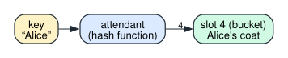
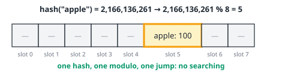
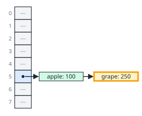
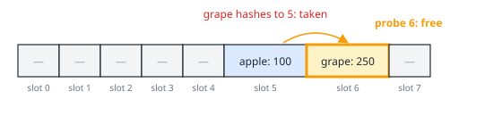
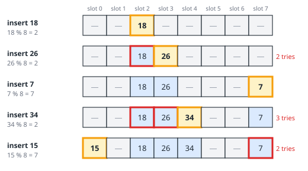
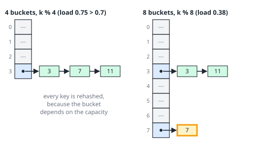
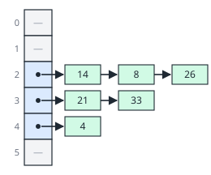

# Module: Hash Maps & Hash Sets (Instant Key-Value Lookups)

Welcome to the **Hash Maps** module. A Hash Map (also known as a Dictionary, Hash Table, or Associative Array) is a structure that stores **Key $\rightarrow$ Value** pairs and retrieves values in average **$O(1)$ Constant Time**, regardless of whether the table contains 10 entries or 10,000,000 entries.

If Arrays are the workhorse of memory, Hash Maps are the most useful high-level data structure in software development.

---

## Before you start
<!-- bite: a504ec54-be0d-4a26-b8be-d526086944a1 -->

- You understand arrays and O(1) indexing. See [[01-arrays|arrays]].
- You know what a linked list is, since chaining uses one. See [[04-linked-lists|linked lists]].

**What you will be able to do after this lesson:**

1. Explain how a hash function turns a key into an array index.
2. Explain what a collision is and how chaining resolves it.
3. Explain what load factor is and why resizing keeps lookups fast.
4. State precisely what assumption 'O(1) average' rests on, and how it fails.

**Study route:** read the mechanism, run the lab, then attempt the independent task before opening the hint.

## 1. Why Do Hash Maps Exist? (Real-World Motivation)
<!-- bite: 677571fd-4537-4f0a-aa09-7d26fde444d9 -->

Imagine a physical **Coat Check Room** at a concert hall:



- In an [[01-arrays|Array]], you can only retrieve data if you already know a numeric index like `arr[4]`.
- But what if your "index" is a person's name (`"Alice"`), a user ID (`"usr_99"`), or an email address?

A Hash Map acts like that coat check attendant: it takes **any arbitrary key**, transforms it into a numeric slot number, and retrieves the value instantly without searching through every item!

---

## Terms used with hash maps
<!-- bite: 4194820b-0c20-4adb-a54b-c85526936299 -->

1. **Hash map**: This is a structure that stores pairs of things, so you can look one up by the other almost instantly. It is also called a **hash table**, a **dictionary** or `dict` in Python, a **map** in C++ and Java, and an **object** in JavaScript.

2. **Key**: This is the thing you look something up *by* — a username, a product code, a word. Keys must be unique within the map, and storing a pair with an existing key overwrites the old value.

3. **Value**: This is the thing stored *against* a key — the user's profile, the product's price. Values have no restrictions at all; they can repeat freely.

4. **Hash function**: This is a function that takes a key and returns a large integer. The same key always produces the same integer, and different keys usually produce different ones. It is what turns "look up this word" into "go to this array position".

5. **Bucket**: This is one slot in the underlying array where entries are kept. The hash function's job is to decide which bucket a key belongs in, usually by taking the hash value modulo the number of buckets.

6. **Collision**: This is when two **different** keys end up in the same bucket. Collisions are not a bug and cannot be avoided — there are more possible keys than buckets, so some must share. The design question is never how to prevent them, only how to handle them.

7. **Chaining**: This is one way of handling collisions. Each bucket holds a small list of all the entries that landed there, and a lookup walks that short list.

8. **Open addressing**: This is the other way. When a bucket is taken, the entry goes into some other bucket found by a fixed rule — the simplest being "try the next one along", which is called **linear probing**.

9. **Load factor**: This is how full the map is: the number of stored entries divided by the number of buckets, written $\alpha$. As it rises, collisions become more common and lookups slow down.

10. **Rehashing**: This is what happens when the load factor gets too high. The map allocates a larger bucket array and **recomputes the bucket for every existing entry**, because the bucket depends on the array size. It is $O(n)$ and it is why a hash map's excellent average performance is amortised rather than guaranteed.

## 3. How a Hash Map Works (The 3-Step Pipeline)
<!-- bite: b2c2bffb-7828-4db3-9d47-af3bd74850f0 -->

When you write `map["apple"] = 100`, the Hash Map executes three fast steps:

```text
1. Pass Key through Hash Function:
   hash("apple") -> 2,166,136,261

2. Map Large Integer to Bucket Array Index (using Modulo %):
   index = 2,166,136,261 % 8 (capacity) -> 5

3. Store Key-Value Pair in Bucket #5:
   bucket[5] = ("apple", 100)
```

The bucket array after step 3. Every other slot is still empty:



---

## 4. Handling Collisions (What Happens When Keys Clash?)
<!-- bite: 63f39489-622d-485a-aade-8d104bc1b330 -->

Because there are infinitely many possible strings/keys but a finite number of bucket slots, two different keys will eventually hash to the same bucket index. This is called a **Collision**.

Computer scientists use two primary strategies to resolve collisions:

---

### Strategy 1: Separate Chaining (Linked Lists in Buckets)
Each bucket slot holds a small list of pairs. When a collision occurs, the new pair is appended to that bucket's list.


- **Lookup Process**: Hash to bucket #5, then walk the short list to find the matching key.
- *Used by*: Java `HashMap`.

---

### Strategy 2: Open Addressing (Probing for Next Available Slot)
All entries live directly in the flat array. When a slot is occupied, the table **probes** (scans) for the next open slot using a rule (e.g. check slot $i+1, i+2, \dots$).



#### Comparison of Collision Strategies

| Feature | Separate Chaining | Open Addressing |
| :--- | :--- | :--- |
| **Storage Mechanism** | Bucket contains a pointer to a list node. | Everything lives in one flat array. |
| **Cache Behavior** | Poor (list nodes scattered on heap). | **Excellent** (sequential array probing). |
| **Max Load Factor** | Can exceed $1.0$ (lists grow infinitely). | Must stay $< 1.0$ (fails when full). |
| **Deletion Mechanism** | Simple node removal from list. | Requires **Tombstone** markers so probe chains aren't broken. |
| **Modern Adoption** | Textbook classic. | **Python `dict`**, Rust `HashMap`, C++ `flat_map`. |

## Seeing linear probing step by step
<!-- bite: 330c7542-7295-45bf-bbb6-82d8379f71b1 -->

Here is linear probing on a fresh example: 8 slots, hash(k) = k % 8, inserting 18, 26, 7, 34 and 15. Each row is the table after one insert. The orange slot is where the key landed, and the red slots are the ones it tried first and found taken. Notice 15: slot 7 is taken, so it wraps round to slot 0.



---

## 5. Load Factor & Dynamic Resizing
<!-- bite: ae00bfa0-139f-4942-a6a1-1069d094e57d -->

As more items are added to a Hash Map, the buckets fill up and collisions become frequent. Left unchecked, $O(1)$ lookups would slow down to $O(n)$ linear scans.

To prevent this, Hash Maps maintain a **Load Factor Threshold** (typically $\approx 0.7$):

$$\text{Load Factor } (\alpha) = \frac{\text{Total Entries}}{\text{Total Capacity}}$$

When $\alpha > 0.7$:
1. Allocate a **new bucket array** with double the capacity ($2\times$).
2. **Re-hash every existing key** into the new bucket array.
3. Free the old array.

Because resizing happens exponentially rarely, Hash Map operations are **Amortized $O(1)$**.

Here is one resize. Keys 3, 7 and 11 all leave remainder 3 when divided by 4. With 4 buckets the load is 0.75, so the map doubles to 8 and works out every bucket again:



---

## 6. Hash Sets (Instant Membership Checks)
<!-- bite: f519458c-31f0-4ae2-9876-7161b9fa85fc -->

A **Hash Set** is simply a Hash Map that stores only **Keys without Values**. 

It answers one specific question instantly: *"Have I seen this item before?"*

```python
# BAD: O(n) scan inside an O(n) loop = O(n²) total time
seen_list = []
for item in items:
    if item in seen_list:  # Scans entire list element-by-element!
        print("Duplicate")

# GOOD: O(1) membership check inside an O(n) loop = O(n) total time
seen_set = set()
for item in items:
    if item in seen_set:   # Instant O(1) hash lookup!
        print("Duplicate")
```

> [!TIP]
> **The Golden Optimizations Rule**: Replacing a `List` with a `Set` for membership testing is the single most common speedup in software engineering!

---

## 7. Trade-Offs: What Hash Maps Give Up to Buy $O(1)$
<!-- bite: e17815a1-18c9-4f51-88c7-f208183fbe47 -->

Hash Maps are extraordinarily fast, but they come with trade-offs:

1. **Destroys Order**: Hashing scrambles keys across memory. A standard Hash Map cannot tell you the minimum key, maximum key, or display keys in sorted order.
2. **No Range Queries**: You cannot query "all keys between 10 and 50" without scanning every entry in the map ($O(n)$). (For range queries, use a [[01-trees|Binary Search Tree]] or B+ Tree).
3. **Keys Must Be Immutable**: If a key changes its internal data after being inserted into a dict, its hash changes, rendering the item permanently lost inside the table! (In Python, lists cannot be keys, but immutable tuples can).

---

## 8. Summary of Complexity
<!-- bite: 4576389d-30fb-4440-b6a7-3b2bf7950c82 -->

| Operation | Average Time | Worst-Case Time (Hash Flooding / Collisions) |
| :--- | :--- | :--- |
| **Lookup (`map[key]`)** | **$O(1)$** | $O(n)$ |
| **Insert (`map[key] = val`)** | **$O(1)$ Amortized** | $O(n)$ |
| **Delete (`del map[key]`)** | **$O(1)$** | $O(n)$ |
| **Space Complexity** | $O(n)$ | $O(n)$ |

---

## The hash map ADT
<!-- bite: 4977f85d-3ef3-49cb-a61f-b2a8d46c6c1c -->

A hash map answers one question extremely well: **"what value did I store under this key?"** It answers almost nothing else.

1. `put(key, value)` — Stores `value` under `key`, replacing any value already there. **$O(1)$ on average**, $O(n)$ in the worst case.

2. `get(key)` — Returns the value stored under `key`, or reports that there is none. **$O(1)$ on average**.

3. `contains(key)` — Returns whether the key is present. **$O(1)$ on average**. A **hash set** is simply a hash map that stores keys and no values, exposing only this operation and `add`.

4. `delete(key)` — Removes the pair. **$O(1)$ on average**.

5. `size()` — How many pairs are stored. $O(1)$.

6. `keys()`, `values()`, `items()` — Return everything, in **no guaranteed order**. $O(n)$.

### What a hash map cannot do, and why

This list is short but decisive, and each absence follows from the same cause: **hashing deliberately destroys order**. A good hash function scatters similar keys to unrelated buckets — that scattering is what avoids collisions — and in scattering it throws away every relationship between keys.

So a hash map cannot answer:

- **"What is the smallest key?"** — the smallest key is in an arbitrary bucket. You would have to check all $n$. A [[07-heaps|heap]] or a balanced [[06-trees/01-trees|tree]] answers this in $O(1)$ or $O(\log n)$.
- **"Which keys fall between 100 and 200?"** — a range query. Nearby keys are nowhere near each other in memory. A [[06-trees/01-trees|B-tree]] answers this efficiently, which is exactly why databases index with B-trees rather than hash tables.
- **"What comes after this key?"** — there is no "after". The order you get from iterating is an artefact of the bucket layout.

> [!NOTE]
> Python's `dict` does preserve **insertion** order, as of Python 3.7. That is a guarantee about the order you added things, not about sorted order, and it comes from an extra list kept alongside the buckets. It does not give you any of the three operations above.

**The average-case asterisk.** Every $O(1)$ above says "on average". With a bad hash function, or an attacker deliberately choosing keys that collide, every entry can land in one bucket and lookups degrade to $O(n)$. That attack is real and has a name — a **hash collision denial-of-service** — and it is why languages now randomise their hash seed at startup.

## Implementation - complete runnable example
<!-- bite: 6916e00c-4410-4a5c-9f58-831e54207072 -->

**Runnable example:** save as `hash_maps_lab.py` and run `python3 hash_maps_lab.py`. Standard library only; writes no files. Everything is counted rather than timed, so your output will match this exactly.

```python
"""Hash maps: a hash table with chaining, built from an array.

Shows where O(1) average comes from, and exactly how it degrades."""

class HashMap:
    """Separate chaining: an array of buckets, each holding a list of pairs."""
    def __init__(self, capacity=8, hash_fn=None, max_load=0.75):
        self.capacity, self.size = capacity, 0
        self.buckets = [[] for _ in range(capacity)]
        self.hash_fn = hash_fn or (lambda k: hash(k))
        self.max_load, self.probes, self.resizes = max_load, 0, 0

    def _index(self, key):
        return self.hash_fn(key) % self.capacity

    def put(self, key, value):
        i = self._index(key)
        for pair in self.buckets[i]:
            self.probes += 1
            if pair[0] == key:
                pair[1] = value
                return
        self.buckets[i].append([key, value])
        self.size += 1
        if self.size / self.capacity > self.max_load:
            self._resize()

    def get(self, key, default=None):
        for pair in self.buckets[self._index(key)]:
            self.probes += 1
            if pair[0] == key:
                return pair[1]
        return default

    def _resize(self):
        """Rehash everything into a bigger array -- keeps chains short."""
        old = self.buckets
        self.capacity *= 2
        self.buckets = [[] for _ in range(self.capacity)]
        self.resizes += 1
        for bucket in old:
            for k, v in bucket:
                self.buckets[self._index(k)].append([k, v])

    def chain_lengths(self):
        return [len(b) for b in self.buckets]

if __name__ == "__main__":
    print("A GOOD HASH -- keys spread evenly across buckets")
    m = HashMap(hash_fn=lambda k: k * 2654435761)      # Knuth multiplicative
    for i in range(1000):
        m.put(i, i * i)
    lens = m.chain_lengths()
    print(f"  1000 keys, capacity {m.capacity}, {m.resizes} resizes")
    print(f"  load factor {m.size / m.capacity:.2f}")
    print(f"  chain lengths: min {min(lens)}, max {max(lens)}, "
          f"mean {sum(lens)/len(lens):.2f}")
    m.probes = 0
    for i in range(1000):
        m.get(i)
    print(f"  1000 successful lookups cost {m.probes:,} probes "
          f"({m.probes/1000:.2f} per lookup)")
    print("  -> a short, bounded chain is why lookup is O(1) on AVERAGE.")
    print()

    print("A TERRIBLE HASH -- every key lands in the same bucket")
    bad = HashMap(hash_fn=lambda k: 0)
    for i in range(200):
        bad.put(i, i)
    lens = bad.chain_lengths()
    print(f"  200 keys, capacity {bad.capacity}")
    print(f"  chain lengths: min {min(lens)}, max {max(lens)}")
    before = bad.probes
    bad.get(199)
    print(f"  one lookup of the last key cost {bad.probes - before} probes")
    print("  -> the hash map has degenerated into a linked list: O(n).")
    print("     'O(1) average' assumes the hash SPREADS keys. It is an")
    print("     assumption about your data, not a guarantee.")
    print()

    print("LOAD FACTOR AND RESIZING")
    print(f"  {'keys':>6s} {'capacity':>9s} {'load':>6s} {'resizes':>8s}")
    m2 = HashMap(hash_fn=lambda k: k * 2654435761)
    for n in (1, 10, 100, 1000):
        while m2.size < n:
            m2.put(m2.size, 0)
        print(f"  {m2.size:6d} {m2.capacity:9d} {m2.size/m2.capacity:6.2f} {m2.resizes:8d}")
    print("  -> capacity grows to keep the load factor under 0.75, which")
    print("     keeps the average chain short. Resizing is the cost.")

    good = HashMap(hash_fn=lambda k: k * 2654435761)
    for i in range(500): good.put(i, i)
    assert max(good.chain_lengths()) <= 5, "a good hash keeps chains short"
    assert max(bad.chain_lengths()) == 200, "a constant hash puts everything in one chain"
    assert good.get(499) == 499 and good.get(9999) is None
    good.put(1, "changed")
    assert good.get(1) == "changed" and good.size == 500
    print()
    print("hash_maps_lab: passed")
```

Expected output:

```text
A GOOD HASH -- keys spread evenly across buckets
  1000 keys, capacity 2048, 8 resizes
  load factor 0.49
  chain lengths: min 0, max 1, mean 0.49
  1000 successful lookups cost 1,000 probes (1.00 per lookup)
  -> a short, bounded chain is why lookup is O(1) on AVERAGE.

A TERRIBLE HASH -- every key lands in the same bucket
  200 keys, capacity 512
  chain lengths: min 0, max 200
  one lookup of the last key cost 200 probes
  -> the hash map has degenerated into a linked list: O(n).
     'O(1) average' assumes the hash SPREADS keys. It is an
     assumption about your data, not a guarantee.

LOAD FACTOR AND RESIZING
    keys  capacity   load  resizes
       1         8   0.12        0
      10        16   0.62        1
     100       256   0.39        5
    1000      2048   0.49        8
  -> capacity grows to keep the load factor under 0.75, which
     keeps the average chain short. Resizing is the cost.

hash_maps_lab: passed
```

## Check your understanding
<!-- bite: 8b551d85-f262-4b27-85f5-1543755e4300 -->

Try each one before you open the answer.

1. <!-- q: mcq id="eecd7f3e" -->
   Python raises `TypeError: unhashable type` when you use a list as a dictionary key, but a tuple works. Why?

   - [x] A list can change after it is stored, which would change its hash and lose the entry
   - [ ] Lists are too long to hash
   - [ ] Tuples are sorted, lists are not
   - [ ] Dictionaries can only hold one type of key

   <details><summary>Answer</summary>

   Lists are mutable. If a key's contents changed, its hash would change, and the map would look in the wrong bucket. Tuples are immutable, so their hash never changes.

   </details>

2. <!-- q: gap id="9aabb2c9" answers="collision;chaining|separate chaining;open addressing|probing|linear probing" -->
   Fill in the gaps. When two different keys land in the same bucket, that is a ___. Keeping a small list of entries in each bucket is called ___, and putting the entry in another free slot of the same array is called ___.

   <details><summary>Answer</summary>

   Collision, chaining, open addressing. Collisions cannot be avoided because there are more possible keys than buckets; the only design question is how to handle them.

   </details>

3. <!-- q: exact id="50a86e8b" answer="0.75" accept="3/4|75%" -->
   A hash map holds 18 entries in 24 buckets. What is its load factor?

   <details><summary>Answer</summary>

   0.75. Load factor = entries ÷ buckets = 18 ÷ 24. With a threshold of 0.7 this map would already have resized.

   </details>

4. <!-- q: mcq id="b85fb9cf" -->
   Which questions can a plain hash map NOT answer quickly? Choose all that apply.

   - [x] What is the smallest key?
   - [x] Which keys fall between 100 and 200?
   - [ ] Is the key "alice" present?
   - [x] Which key comes right after "bob" in sorted order?

   <details><summary>Answer</summary>

   Min, range and "next key" all need order, and hashing deliberately scatters keys so similar keys land far apart. Each would need an O(n) scan. Membership is the one thing a hash map does in O(1) on average.

   </details>

5. <!-- q: mcq id="c1903ed2" -->
   In an open-addressing table, why does deleting an entry leave a tombstone marker instead of simply emptying the slot?

   - [ ] To save memory
   - [x] An empty slot would stop later lookups early, so keys placed further along the probe chain could not be found
   - [ ] Because the hash function cannot be run again
   - [ ] So the load factor goes down faster

   <details><summary>Answer</summary>

   A lookup probes until it finds the key or hits an empty slot. Emptying a slot in the middle of a probe chain would break the chain, so later keys would look missing. A tombstone says "keep probing".

   </details>

6. <!-- q: open id="e1f9dd52" -->
   Hash map lookup is "O(1) on average" but O(n) in the worst case. What assumption does the average rest on, and how can it fail?

   <details><summary>Answer</summary>

   It assumes the hash function spreads keys evenly, so chains or probe runs stay short and the load factor is kept low by resizing. A poor hash function, or an attacker choosing keys that all collide, puts every entry in one bucket, and a lookup then walks all n entries. That is why languages randomise their hash seed.

   </details>

## Check your understanding: worked problems
<!-- bite: d64d2b45-a326-41c9-b367-a679ecb92736 -->

Work each one out on paper first, then type your answer.

1. <!-- q: gap id="9ad23d79" answers="3;4;5;6;0" -->
   Fill in the gaps. A hash table has 7 slots (0 to 6), hash(k) = k % 7, and linear probing (if a slot is taken, try the next one, wrapping from 6 back to 0). Insert 10, 17, 24, 3, 5 in that order. 10 goes in slot ___, 17 in slot ___, 24 in slot ___, 3 in slot ___, and 5 in slot ___.

   <details><summary>Answer</summary>

   3, 4, 5, 6, 0. 10, 17, 24 and 3 all hash to 3, so each probes one slot further along. 5 hashes to 5, finds 5 and 6 taken, and wraps round to slot 0.

   </details>

2. <!-- q: exact id="816d4928" answer="4" -->
   A hash table has 5 buckets, hash(k) = k % 5, and separate chaining. You insert 12, 7, 22, 15, 30, 9, 17. How many keys are in the longest chain?

   <details><summary>Answer</summary>

   4. Bucket 2 gets 12, 7, 22 and 17. Bucket 0 gets 15 and 30, bucket 4 gets 9, and buckets 1 and 3 stay empty. A lookup for 17 walks all four.

   </details>

3. <!-- q: gap id="6c71f9ed" answers="1;5;1" -->
   Fill in the gaps. A chained hash map uses bucket = k % capacity. The keys 5, 9 and 13 sit together in bucket ___ when the capacity is 4. After it rehashes to capacity 8, key 9 moves to bucket 1 and keys 5 and 13 share bucket ___, so the longest chain drops from 3 to 2 and key 9's chain length is ___.

   <details><summary>Answer</summary>

   Bucket 1, then bucket 5, and key 9 is alone (length 1). 5, 9 and 13 all leave remainder 1 when divided by 4. Divided by 8, 9 leaves 1 while 5 and 13 leave 5. Rehashing must recompute every bucket because the bucket depends on the capacity.

   </details>

4. <!-- q: exact id="af0ba2d5" answer="200" -->
   A hash map has 100 buckets and 70 entries. It doubles its buckets as soon as the load factor goes above 0.7. You add 10 more entries. How many buckets does it have now?

   <details><summary>Answer</summary>

   200. The 71st entry makes the load factor 0.71, which is above 0.7, so it doubles to 200 buckets and rehashes every key. With 80 entries in 200 buckets the load factor is 0.4.

   </details>

5. <!-- q: sketch id="5b18246b" -->
   A hash table has 6 buckets (0 to 5), hash(k) = k % 6, and separate chaining (new keys go on the end of their bucket's list). Insert 14, 21, 8, 26, 33 and 4 in that order. On paper, draw the bucket array as a column of 6 boxes and draw each bucket's chain to its right.

   <details><summary>Answer</summary>

   

   What to check:
   - 14, 8 and 26 all leave remainder 2, so bucket 2 has a chain of three, in the order they were inserted.
   - 21 and 33 leave remainder 3 and share bucket 3; 4 sits alone in bucket 4.
   - Buckets 0, 1 and 5 are drawn empty, not left out.

   </details>

## Practice - independent task
<!-- bite: 9033b8c1-8074-4d49-9061-8d04a74bc67e -->

Implement **open addressing** with linear probing, as an alternative to chaining.

- Store entries directly in the bucket array; on collision, try the next slot.
- Implement `put`, `get` and - the hard one - `delete`.
- **Deletion is the trap.** Removing an entry can break the probe chain for later keys. Discover this yourself: insert three keys that collide, delete the middle one, then look up the third.
- Fix it with a **tombstone** marker.
- Compare probe counts against the chaining version at load factors 0.5 and 0.9.

**Done when:** your open-addressed map passes the delete-then-lookup case, and you can say which approach degrades worse at high load factor and why.

<details><summary>Hint - open only after an attempt</summary>
If keys A, B and C all hash to slot 5 and land in slots 5, 6 and 7, then deleting B leaves slot 6 empty. A lookup for C probes 5, finds A (not C), probes 6, finds <em>empty</em>, and concludes C is absent - even though C is sitting in slot 7.<br>
A <strong>tombstone</strong> marks the slot as "deleted, keep probing". The cost is that tombstones accumulate and must be cleared during a resize.
</details>

## Before moving on
<!-- bite: e7451a03-22e2-4fdb-9d53-4cca3ebfa405 -->

You are done with this module when you can, closed-book:

- [ ] Explain how a hash maps a key to a bucket index.
- [ ] Explain chaining, and what happens when every key collides.
- [ ] Explain load factor and why exceeding it triggers a resize.
- [ ] State what 'O(1) average' assumes about your data and your hash function.

**Recap:** A hash map turns a key into an array index by hashing, giving direct access rather than a search. Collisions are inevitable, and chaining stores colliding entries in a list per bucket. Keeping the load factor low - by resizing and rehashing - keeps chains short, which is where average O(1) comes from. That average assumes the hash spreads keys evenly; a degenerate hash puts everything in one chain and lookup becomes O(n).

**Next:** [[04-linked-lists|Linked Lists]] - the non-contiguous alternative, and the opposite bet about which operation should be cheap.

## Related Modules
<!-- bite: a88e0621-2821-48a0-9a0f-daa3c7825dd9 -->
- [[01-arrays|Arrays]] — The bucket array foundation underneath
- [[02-dynamic-arrays|Dynamic Arrays]] — Amortized resizing principles
- [[01-trees|Trees]] — Binary Search Trees for ordered key-value storage
- [[08-tries|Tries]] — Prefix trees for string key searches
