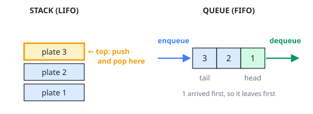
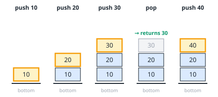
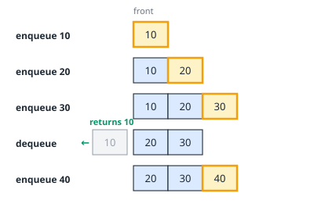

# Module: Stacks and Queues (LIFO & FIFO Collections)

Welcome to the **Stacks and Queues** module. Both Stacks and Queues are linear data structures with constrained interfaces: you can only insert and remove elements at specific ends.

Despite their simplicity, Stacks and Queues drive core software systems—from CPU call stacks and browser history to network packet buffers and graph traversal algorithms (**DFS** and **BFS**).

---

## Before you start
<!-- bite: c2639c05-a4b1-422d-9a35-83660c7d26ee -->

- You understand dynamic arrays and why front removal is O(n). See [[02-dynamic-arrays|dynamic arrays]].
- You have seen DFS and BFS. See [[09-graphs/index|graphs]].

**What you will be able to do after this lesson:**

1. State the LIFO and FIFO orderings and which problems each suits.
2. Explain why a naive list-based queue is O(n) per dequeue.
3. Implement a queue from two stacks and explain its amortised O(1).
4. Explain why bracket matching is naturally a stack problem.

**Study route:** read the mechanism, run the lab, then attempt the independent task before opening the hint.

## 1. Real-World Motivation & Physical Metaphors
<!-- bite: 816f5d33-e5fe-4f04-891a-d685dbea421f -->



### 1. Stack — Last-In, First-Out (LIFO)
Imagine a physical **stack of cafeteria trays**:
- The last tray placed on top of the pile is the very first tray picked up by a customer.
- **Key Principle**: Insertions (`Push`) and Deletions (`Pop`) happen at the **same end (The Top)**.

### 2. Queue — First-In, First-Out (FIFO)
Imagine a **supermarket checkout line**:
- New customers join the **back (Tail)** of the line. The customer who has been waiting longest at the **front (Head)** gets served first.
- **Key Principle**: Insertions (`Enqueue`) happen at the **Tail**; Deletions (`Dequeue`) happen at the **Head**.

---

## Terms used with stacks and queues
<!-- bite: e3a22816-4c3c-4ef0-9455-0795c4a256d8 -->

1. **Collection**: This is any structure that holds a group of items. A stack and a queue are both collections; what separates them is the single rule deciding **which item comes out next**.

2. **LIFO**: This stands for **last in, first out**. The most recently added item is the first one removed. A stack of plates behaves this way — you take the plate you put down most recently, because it is on top. Pressing undo repeatedly walks backwards through your most recent actions for the same reason.

3. **FIFO**: This stands for **first in, first out**. The item that has been waiting longest is the first one removed. A queue at a counter behaves this way, and so does a printer working through print jobs.

4. **Push**: This is the word for adding an item to a **stack**. The new item goes on top.

5. **Pop**: This is the word for removing an item from a **stack**. It takes the item off the top and gives it to you.

6. **Enqueue**: This is the word for adding an item to a **queue**. The new item joins the back.

7. **Dequeue**: This is the word for removing an item from a **queue**. It takes the item from the front and gives it to you.

8. **Peek**: This means looking at the item that would come out next **without removing it**. On a stack it is often called `top`, and on a queue `front`.

9. **Underflow**: This is what happens when you try to remove an item from an empty collection. Every implementation must decide what to do — raise an error, or return a "nothing here" value — and must say which.

10. **Overflow**: This is what happens when you try to add an item to a collection with no room left. It only applies to fixed-capacity implementations.

11. **Circular buffer**: This is also called a **ring buffer**. It is a way of building a fixed-capacity queue inside a flat array, where the front and back positions wrap around to the start using the remainder operator `%`. It avoids ever shifting elements, which is what keeps the operations $O(1)$.

## 3. Stacks: Mechanics & Applications
<!-- bite: 6907aac1-f45d-42e5-bdd7-43ea3b0bf8e4 -->

### Python Stack Implementation ($O(1)$ Operations)
In Python, a standard `list` functions as a high-performance stack using `.append()` and `.pop()`:

```python
class Stack:
    """LIFO Stack implementation using dynamic array."""
    def __init__(self):
        self.items = []
        
    def push(self, val):
        self.items.append(val)  # O(1) Amortized
        
    def pop(self):
        if self.is_empty():
            raise IndexError("Pop from empty stack")
        return self.items.pop()  # O(1) from end of array
        
    def peek(self):
        return self.items[-1] if not self.is_empty() else None
        
    def is_empty(self):
        return len(self.items) == 0
```

### Where Stacks Are Used in Production
1. **Function Call Stack**: Tracking active function calls, local variables, and return addresses in memory.
2. **Undo / Redo Mechanisms**: `Ctrl + Z` pops the most recent action off the undo stack.
3. **Balanced Parentheses Validation**: Matching opening `(` and closing `)` brackets.
4. **Depth-First Search (DFS)**: Exploring graph/tree paths using recursive or explicit stacks.

---

## Seeing a stack change, push by pop
<!-- bite: b55fcc58-1bb8-4a04-bb6e-d8d5cf256ac1 -->

Each column is the stack after one operation, with the bottom at the bottom. The orange box is the item just pushed. Look at the pop: it takes 30, the newest item, not 10.



---

## 4. Queues: Mechanics & The `pop(0)` Performance Trap
<!-- bite: 188a3011-ec9d-402f-a7e2-c9ff7c06fdbf -->

> [!WARNING]
> **Python Performance Trap**: Writing `queue.pop(0)` on a standard Python list is an **$O(n)$ disaster**! It removes the item at index 0 and shifts every single remaining item left by 1 position in RAM.

### Correct Python Queue Implementation using `collections.deque`
To achieve true **$O(1)$ Dequeue** operations, use a Doubly-Linked List (`collections.deque`):

```python
from collections import deque

class Queue:
    """FIFO Queue implementation using doubly linked deque."""
    def __init__(self):
        self.items = deque()
        
    def enqueue(self, val):
        self.items.append(val)     # Add to Tail: O(1)
        
    def dequeue(self):
        if self.is_empty():
            raise IndexError("Dequeue from empty queue")
        return self.items.popleft() # Remove from Head: O(1)!
        
    def is_empty(self):
        return len(self.items) == 0
```

---

## Seeing a queue change, enqueue by dequeue
<!-- bite: d79f26d5-24fa-4f99-a709-049d8f8e4c47 -->

The same kind of operations on a queue. Each row is the queue after one operation, front on the left. This time the dequeue takes 10, the oldest item.



---

## 5. Low-Level Circular Buffer (Array Queue)
<!-- bite: 7b105cce-1b2c-493d-9214-2d9c6fef94ce -->

In low-level systems (C, OS kernels, audio drivers), queues are implemented in a fixed-size array without memory allocations using **modulo arithmetic (`% N`)**:

```python
class CircularQueue:
    """Fixed-capacity Queue using array modulo wraparound."""
    def __init__(self, capacity: int):
        self.capacity = capacity
        self.queue = [None] * capacity
        self.head = 0
        self.tail = 0
        self.size = 0
        
    def enqueue(self, val) -> bool:
        if self.size == self.capacity:
            return False  # Queue Full
        self.queue[self.tail] = val
        self.tail = (self.tail + 1) % self.capacity  # Wraparound index
        self.size += 1
        return True
        
    def dequeue(self):
        if self.size == 0:
            return None   # Queue Empty
        val = self.queue[self.head]
        self.queue[self.head] = None
        self.head = (self.head + 1) % self.capacity  # Wraparound index
        self.size -= 1
        return val
```

---

## Seeing the circular buffer wrap round
<!-- bite: ce61d46a-5a73-4379-8da3-14bcea707b2a -->

Here the `CircularQueue` above runs with capacity 5. H marks `head` and T marks `tail`. Watch T: after slot 4 it wraps back to slot 0, so the slots freed by the two dequeues get used again. Nothing is ever shifted.


---

## 6. Time & Space Complexity Summary
<!-- bite: c801c614-2e1e-402b-9713-8d383ec3020b -->

| Data Structure | Insertion (Push / Enqueue) | Deletion (Pop / Dequeue) | Lookup Top/Front | Space Complexity |
| :--- | :--- | :--- | :--- | :--- |
| **Stack (Array-backed)** | **$O(1)$ Amortized** | **$O(1)$** | **$O(1)$** | $O(n)$ |
| **Queue (`deque`)** | **$O(1)$** | **$O(1)$** | **$O(1)$** | $O(n)$ |
| **Queue (Naive `list.pop(0)`)** | $O(1)$ | **$O(n)$ (SLOW)** | $O(1)$ | $O(n)$ |
| **Circular Buffer** | **$O(1)$** | **$O(1)$** | **$O(1)$** | $O(\text{Capacity})$ |

---

## 7. Common Pitfalls & Traps
<!-- bite: ee79455c-fef6-4f9c-97cb-ca95b58ecbe7 -->

1. **`list.pop(0)` in Python**: Always use `collections.deque.popleft()` for $O(1)$ FIFO queues instead of `list.pop(0)`.
2. **Stack Overflow**: Infinite recursive calls fill the call stack memory, throwing a stack overflow error.
3. **Queue Underflow / Empty Pop**: Popping from an empty stack or queue without checking `is_empty()` crashes with index errors.

---

## The stack and queue ADTs
<!-- bite: 99b3e8b9-8c51-48c2-92cf-b81da3e8f80c -->

These two belong together, because **they are the same ADT with one rule changed**. That rule is the whole difference, and everything else follows from it.

Both are defined purely by their operations. Unlike an array, neither says anything about memory or layout — you can build either on an array or on a [[04-linked-lists|linked list]] and the ADT does not change.

### The stack ADT — LIFO

1. `push(item)` — Adds `item` to the top of the stack. $O(1)$.

2. `pop()` — Removes and returns the item on top, which is the one added most recently. $O(1)$. If the stack is empty this is an error, and your implementation must say what it does.

3. `peek()` — Returns the top item **without** removing it. $O(1)$. Useful when you must decide what to do based on what is next, before committing to taking it.

4. `is_empty()` — Returns `true` when there are no items. $O(1)$.

5. `size()` — Returns how many items are held. $O(1)$.

### The queue ADT — FIFO

6. `enqueue(item)` — Adds `item` to the back of the queue. $O(1)$.

7. `dequeue()` — Removes and returns the item at the front, which is the one that has waited longest. $O(1)$.

8. `front()` — Returns the front item without removing it. $O(1)$.

9. `is_empty()` and `size()` — Exactly as for the stack.

### What the ADT deliberately refuses to give you

Neither structure lets you reach into the middle. **There is no `get(i)`.** That is not a missing feature — it is the entire point.

By refusing random access, a stack or queue guarantees the order things come out in, and that guarantee is what makes them useful for reasoning. When you see a stack in an algorithm you immediately know the most recent thing comes back first, which is exactly what [[01-depth-first-search|depth-first search]], undo histories, the function call stack and bracket matching all need. A queue's guarantee — oldest first — is what makes [[02-breadth-first-search|breadth-first search]] explore level by level, and what makes a print queue fair.

**Choosing a stack or a queue is choosing a guarantee, not choosing a container.**

## Implementation - complete runnable example
<!-- bite: 2c1f3e09-be56-462e-82bb-0d7618d45126 -->

**Runnable example:** save as `stacks_queues_lab.py` and run `python3 stacks_queues_lab.py`. Standard library only; writes no files. Everything is counted rather than timed, so your output will match this exactly.

```python
"""Stacks and queues: one restriction each, and what it buys."""

class Stack:
    """LIFO. Only the most recent item is reachable."""
    def __init__(self): self.items = []
    def push(self, x): self.items.append(x)
    def pop(self):
        if not self.items: raise IndexError("pop from empty stack")
        return self.items.pop()
    def peek(self): return self.items[-1] if self.items else None
    def empty(self): return not self.items

class Queue:
    """FIFO built on two stacks -- amortised O(1), no shifting.

    A naive list-based queue uses list.pop(0), which is O(n) because
    every remaining element shifts down."""
    def __init__(self):
        self.inbox, self.outbox, self.moves = [], [], 0
    def enqueue(self, x): self.inbox.append(x)
    def dequeue(self):
        if not self.outbox:
            while self.inbox:
                self.outbox.append(self.inbox.pop())
                self.moves += 1
        if not self.outbox: raise IndexError("dequeue from empty queue")
        return self.outbox.pop()
    def empty(self): return not self.inbox and not self.outbox

def balanced(text):
    """The classic stack problem: brackets must close in reverse order."""
    pairs, stack = {")": "(", "]": "[", "}": "{"}, Stack()
    for ch in text:
        if ch in "([{":
            stack.push(ch)
        elif ch in pairs:
            if stack.empty() or stack.pop() != pairs[ch]:
                return False
    return stack.empty()

def naive_dequeue_shifts(n):
    """Cost of list.pop(0) n times: every element after index 0 shifts."""
    return sum(range(n))

if __name__ == "__main__":
    print("A STACK IS LIFO -- last in, first out")
    s = Stack()
    for x in "ABC": s.push(x)
    print(f"  pushed A, B, C   ->  pop order: {[s.pop() for _ in range(3)]}")
    print()

    print("A QUEUE IS FIFO -- first in, first out")
    q = Queue()
    for x in "ABC": q.enqueue(x)
    print(f"  enqueued A, B, C ->  dequeue order: {[q.dequeue() for _ in range(3)]}")
    print()

    print("WHY TWO STACKS -- avoiding the O(n) shift")
    print(f"  {'n':>7s} {'list.pop(0) shifts':>20s} {'two-stack moves':>18s}")
    for n in (10, 100, 1000):
        q2 = Queue()
        for i in range(n): q2.enqueue(i)
        for _ in range(n): q2.dequeue()
        print(f"  {n:7d} {naive_dequeue_shifts(n):20,d} {q2.moves:18,d}")
    print("  -> each element moves between stacks at most ONCE, so n")
    print("     dequeues cost n moves: amortised O(1) versus O(n^2).")
    print()

    print("BRACKET MATCHING -- why a stack is the right shape")
    for text in ["([]{})", "(]", "((())", "", "a(b[c]d)e"]:
        print(f"  {text!r:12s} balanced: {balanced(text)}")
    print("  -> brackets must close in REVERSE order of opening, which is")
    print("     exactly LIFO. The data structure encodes the rule.")
    print()

    print("WHERE EACH ONE SHOWS UP")
    print("  stack : function calls, undo, DFS, expression evaluation,")
    print("          backtracking -- anything that must unwind")
    print("  queue : BFS, job scheduling, request buffering, print spooling")
    print("          -- anything that must be fair to arrival order")

    assert balanced("([]{})") and not balanced("(]") and not balanced("((())")
    assert balanced("") and balanced("a(b[c]d)e")
    s2 = Stack(); s2.push(1)
    assert s2.pop() == 1
    try: s2.pop(); raise SystemExit("expected IndexError")
    except IndexError: pass
    q3 = Queue()
    for i in range(5): q3.enqueue(i)
    assert [q3.dequeue() for _ in range(5)] == [0, 1, 2, 3, 4]
    assert q3.moves == 5, "each element should move exactly once"
    print()
    print("stacks_queues_lab: passed")
```

Expected output:

```text
A STACK IS LIFO -- last in, first out
  pushed A, B, C   ->  pop order: ['C', 'B', 'A']

A QUEUE IS FIFO -- first in, first out
  enqueued A, B, C ->  dequeue order: ['A', 'B', 'C']

WHY TWO STACKS -- avoiding the O(n) shift
        n   list.pop(0) shifts    two-stack moves
       10                   45                 10
      100                4,950                100
     1000              499,500              1,000
  -> each element moves between stacks at most ONCE, so n
     dequeues cost n moves: amortised O(1) versus O(n^2).

BRACKET MATCHING -- why a stack is the right shape
  '([]{})'     balanced: True
  '(]'         balanced: False
  '((())'      balanced: False
  ''           balanced: True
  'a(b[c]d)e'  balanced: True
  -> brackets must close in REVERSE order of opening, which is
     exactly LIFO. The data structure encodes the rule.

WHERE EACH ONE SHOWS UP
  stack : function calls, undo, DFS, expression evaluation,
          backtracking -- anything that must unwind
  queue : BFS, job scheduling, request buffering, print spooling
          -- anything that must be fair to arrival order

stacks_queues_lab: passed
```

## Check your understanding
<!-- bite: d8314b48-6a6e-4bb3-8c4f-67ac9aba8273 -->

Try each one before you open the answer.

1. <!-- q: gap id="7f44778a" answers="LIFO|last in first out|last in, first out;FIFO|first in first out|first in, first out" -->
   Fill in the gaps. A stack removes the item added most recently, which is called ___. A queue removes the item that has waited longest, which is called ___.

   <details><summary>Answer</summary>

   LIFO (last in, first out) for a stack, like a pile of plates. FIFO (first in, first out) for a queue, like a checkout line.

   </details>

2. <!-- q: mcq id="8590ff04" -->
   Why is `my_list.pop(0)` a poor way to dequeue from a Python list holding n items?

   - [x] Removing index 0 shifts every remaining item left, so each dequeue is O(n)
   - [ ] It removes the last item instead of the first
   - [ ] It raises an error on lists longer than 1,000
   - [ ] It is O(log n), which is slower than O(1)

   <details><summary>Answer</summary>

   The list is a contiguous array, so closing the gap at the front moves every other element. `collections.deque.popleft()` removes from the front in O(1).

   </details>

3. <!-- q: mcq id="e9cec569" -->
   Which pairing of search and structure is right?

   - [x] Depth-first search uses a stack; breadth-first search uses a queue
   - [ ] Depth-first search uses a queue; breadth-first search uses a stack
   - [ ] Both use a queue
   - [ ] Both use a hash map instead

   <details><summary>Answer</summary>

   DFS always continues from the newest thing it found, which is LIFO, so it uses a stack (or recursion). BFS finishes everything at one distance before going further, which is FIFO, so it uses a queue.

   </details>

4. <!-- q: mcq id="33cf95cb" -->
   A stack and a queue both refuse to offer `get(i)`, reaching into the middle. Why is that a strength rather than a missing feature?

   - [ ] It saves memory
   - [x] It guarantees the order items come out, which is what an algorithm relies on
   - [ ] It makes push and pop O(log n)
   - [ ] Arrays cannot support `get(i)`

   <details><summary>Answer</summary>

   Because only one end is reachable, you always know which item comes next. That guarantee is what DFS, BFS, undo and bracket matching depend on. Choosing a stack or a queue is choosing a guarantee.

   </details>

5. <!-- q: open id="bdb0201c" -->
   Why is checking that brackets like `{[()]}` are balanced naturally a stack problem?

   <details><summary>Answer</summary>

   Each closing bracket must match the most recent opening bracket that is still unmatched. "Most recent first" is exactly LIFO. Push every opener; on a closer, pop and check it matches. The text is balanced if every pop matched and the stack is empty at the end.

   </details>

## Check your understanding: worked problems
<!-- bite: c739a842-feef-44de-b83b-9ca3cc94febe -->

Work each one out on paper first, then type your answer.

1. <!-- q: gap id="336bad84" answers="4;2;5" -->
   Fill in the gaps. Start with an empty stack and run: push 4, push 7, pop, push 2, push 9, pop, push 5. From bottom to top, the stack now holds ___, ___, ___.

   <details><summary>Answer</summary>

   4, 2, 5. The first pop removes 7 (the newest), and the second pop removes 9. 4 was pushed first and is never on top when a pop happens.

   </details>

2. <!-- q: gap id="332a020c" answers="2;9;5" -->
   Fill in the gaps. Start with an empty queue and run: enqueue 4, enqueue 7, dequeue, enqueue 2, enqueue 9, dequeue, enqueue 5. From front to back, the queue now holds ___, ___, ___.

   <details><summary>Answer</summary>

   2, 9, 5. Each dequeue removes the oldest item: first 4, then 7. The same operations on a stack leave 4, 2, 5, which shows the one rule that differs.

   </details>

3. <!-- q: gap id="9968e841" answers="E;F;C;D;2" -->
   Fill in the gaps. A circular queue has an array of 4 slots (indexes 0 to 3) with head = tail = 0. Enqueue writes at `tail` then sets `tail = (tail + 1) % 4`; dequeue reads at `head`, empties that slot and sets `head = (head + 1) % 4`. Run: enqueue A, B, C; dequeue twice; enqueue D, E, F. The array is now [___, ___, ___, ___] and head is ___.

   <details><summary>Answer</summary>

   [E, F, C, D] with head 2. A and B are removed from slots 0 and 1, so head moves to 2. D goes in slot 3, then tail wraps to 0, so E and F reuse slots 0 and 1. The queue is full: C, D, E, F in that order.

   </details>

4. <!-- q: gap id="7b922121" answers="1;2;3;4;5" -->
   Fill in the gaps. A queue is built from two stacks. Enqueue pushes onto `inbox`. Dequeue pops from `outbox`, but if `outbox` is empty it first pops every item from `inbox` and pushes each onto `outbox`. Run: enqueue 1, 2, 3; dequeue; enqueue 4, 5; dequeue three times. The four dequeues return ___, ___, ___, ___, and the number of items moved from inbox to outbox is ___.

   <details><summary>Answer</summary>

   1, 2, 3, 4, with 5 moves. The first dequeue moves 3, 2, 1 across (3 moves) and returns 1. 2 and 3 come straight off outbox. The last dequeue finds outbox empty and moves 5 and 4 (2 more moves), then returns 4. Each item moves at most once, so dequeue is amortised O(1).

   </details>

## Practice - independent task
<!-- bite: c43569eb-7842-4b3f-8ee1-5f837c31a52c -->

Implement a **min-stack**: a stack that also reports its minimum in O(1).

- `push`, `pop`, `peek` and `min` must **all** be O(1). No scanning.
- The obvious approach - keeping a single `min` variable - breaks on `pop`. Discover this: push 3, push 1, pop, then ask for the minimum.
- Fix it. The standard solution keeps a second stack of minima.
- Then optimise: only push to the auxiliary stack when the new value is less than or equal to the current minimum. **Why is the "or equal" necessary?**
- Test against a reference that recomputes the minimum by scanning.

**Done when:** all four operations are O(1), your min-stack agrees with the scanning reference over 500 random operations, and you can explain the "or equal".

<details><summary>Hint - open only after an attempt</summary>
If you only push when strictly less than the current minimum, duplicate minima break it: push 1, push 1, pop. The auxiliary stack recorded 1 once, popping removes it, and the minimum is now wrong even though a 1 is still present.<br>
Pushing on <strong>less than or equal</strong> records each occurrence, so each pop removes exactly one. This is the same off-by-one-duplicate class of bug as forgetting that a multiset is not a set.
</details>

## Before moving on
<!-- bite: a8d5c6f4-25f7-4314-b46d-09ed3ac7ea13 -->

You are done with this module when you can, closed-book:

- [ ] State LIFO and FIFO and give a real use of each.
- [ ] Explain why removing from the front of an array-backed list is O(n).
- [ ] Explain the two-stack queue and why each element moves at most once.
- [ ] Explain why bracket matching needs a stack specifically.

**Recap:** A stack allows access only at one end (LIFO) and a queue only at opposite ends (FIFO). That single restriction is what makes each useful: brackets must close in reverse order of opening, which is precisely LIFO, while fair processing of arrivals is precisely FIFO. Implementing a queue over a plain array makes dequeue O(n) because everything shifts; two stacks avoid that by moving each element at most once, giving amortised O(1). Stacks drive DFS, function calls and undo; queues drive BFS and scheduling.

**Next:** [[06-trees/01-trees|Trees]] - what happens when each node points to more than one other node. Searching a tree level by level uses the queue you just built.

## Related Modules
<!-- bite: 1ef2f585-b167-4d1e-b0be-d3212f22d45c -->
- [[01-arrays|Arrays]] — The memory structure backing array-based stacks
- [[04-linked-lists|Linked Lists]] — Node structure backing `collections.deque`
- [[01-depth-first-search|DFS]] & [[02-breadth-first-search|BFS]] — Traversals powered by Stacks and Queues
