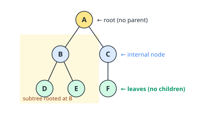
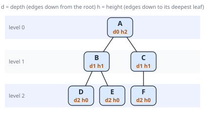
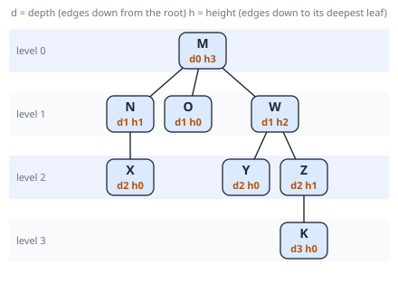

# Module: Trees (Hierarchy, and the Shapes It Comes In)

A tree is a way of storing data where each item sits under one parent and can have items of its own underneath, like branches.

## Before you start
<!-- bite: 9ea484fc-0c4e-42a4-8538-6e580f862509 -->

- You know what a [[04-linked-lists|linked list]] is, and that following a pointer is how you move between nodes.
- You know what [[09-graphs/index|a graph]] is, or you can read this first and meet graphs later — a tree is a special kind of graph, and [[09-graphs/03-subgraphs-trees-and-forests|the graphs folder]] proves the connection.

**After this lesson you will be able to:**

1. Explain what makes a structure a tree, and why "no cycles" is the condition that matters.
2. Use the vocabulary — root, parent, child, leaf, subtree, height, depth — precisely.
3. Name the **main kinds of tree** and say what each one is for.
4. Say why this course focuses on binary trees, and what that leaves out.

**Study route:** read the terms, then the height-versus-depth trap, then the catalogue of tree types at the end.

## What a tree is, in plain words
<!-- bite: 332312c4-db6e-43ea-9ee2-418b50dbc15b -->

A tree is how you store anything with levels. The folders on your laptop, a family tree and a company's chart of who reports to whom are all trees.

---

## Why do we need trees?
<!-- bite: dc9704d8-6e5c-4ae5-8e83-244611e9c57d -->

Before diving into formal computer science definitions, let's understand why linear data structures (Arrays and Linked Lists) are not always enough.

### The Limitation of Linear Structures
- **Arrays**: Excellent for accessing elements by index ($O(1)$), but inserting or deleting elements in the middle requires shifting elements ($O(n)$).
- **Linked Lists**: Fast insertion and deletion ($O(1)$), but searching for an item requires walking link-by-link from the beginning ($O(n)$).

What if you need to organize data that naturally branches, or data that needs **both fast search and dynamic insertion**? That is where **Trees** come in.

## Real-World Examples of Trees
<!-- bite: 8f982ef9-eb18-4dbc-8a1f-132cfe92763a -->
You interact with trees every single day when using software:

1. **Your Computer's File Explorer / Directory System**:
   - The main drive (`C:\` or `/`) is the top folder.
   - Folders contain subfolders, which contain files.
   
2. **Web Pages (The HTML Document Object Model - DOM)**:
   - The `<html>` tag contains `<head>` and `<body>`.
   - The `<body>` contains `
` tags, which contain `
` and `<a>` elements.

3. **Company Organizational Charts**:
   - The CEO is at the top.
   - Vice Presidents report to the CEO, Directors report to VPs, and Engineers report to Directors.

---

## What is a tree?
<!-- bite: f67de38a-3610-4328-84b7-8757e3d1cb21 -->

In computer science, a **Tree** is a collection of nodes connected by edges, organized in a parent-child hierarchy with **no loops or cycles**.

> **Fun Fact**: In real life, trees grow from the ground up. In computer science, we draw trees upside down, with the **Root at the top** and the **Leaves at the bottom**.

### Visualizing a Tree

## Terms used with trees
<!-- bite: b3b363be-551e-4ef3-a12f-990ea05f1c92 -->

These are the names for the parts of a tree, using the diagram above.

1. **Node**: This is one item in the tree. It holds a value and pointers to the nodes beneath it. In the diagram above, `A` through `F` are all nodes.

2. **Edge**: This is the link between two nodes — the line drawn between `A` and `B`.

3. **Root**: This is the single node at the very top, the one with **no parent**. Node `A` is the root. A tree has exactly one, and it is where every traversal begins.

4. **Parent**: This is a node that points directly down to another. `A` is the parent of `B` and `C`. Every node has exactly one parent, except the root, which has none.

5. **Child**: This is a node directly below a parent. `B` and `C` are the children of `A`.

6. **Siblings**: These are nodes sharing the same parent. `B` and `C` are siblings, and so are `D` and `E`.

7. **Leaf**: This is a node with **no children** — the end of a branch. `D`, `E` and `F` are leaves. It is also called a **terminal node**.

## Terms used with trees: family and position
<!-- bite: 31ab1c89-a38b-406d-bd78-04ca59336c55 -->

These terms describe how nodes relate to each other and where they sit.

8. **Internal node**: This is any node that is not a leaf, meaning it has at least one child. `A`, `B` and `C` are internal nodes.

9. **Ancestor**: This is any node on the path from the root down to a given node. The ancestors of `D` are `B` and `A`.

10. **Descendant**: This is any node you can reach by moving downwards from a given node. The descendants of `A` are every other node in the tree.

11. **Subtree**: This is a node together with all of its descendants. `B` with `D` and `E` forms a subtree rooted at `B`. **Every node is the root of its own subtree**, and that fact is what makes tree algorithms naturally recursive.

12. **Degree**: This is how many children a node has. A leaf has degree 0.

13. **Level**: This is how far down a node sits. The root is at level 0, its children at level 1, and so on.

## Height versus depth — the classic off-by-one trap
<!-- bite: e29ed4fe-e272-4468-9df9-a636b7306bd1 -->

Two measurements describe the position of nodes inside a tree: **Depth** and **Height**. Computer science students often confuse them:

Each node below is labelled with its depth (d) and its height (h):

## Height versus depth: the two rules
<!-- bite: 5fad62ba-06a3-49e6-9b63-44043baef433 -->

Here is how to count each of the two measurements.

- **Depth (or Level)**: How far down a node is from the root.
  - **Rule**: Count edges from **Root $\rightarrow$ Node**.
  - Root `A` has **Depth 0**. Node `B` has **Depth 1**. Node `D` has **Depth 2**.
- **Height**: The longest path from a node down to a leaf.
  - **Rule**: Count edges on the longest path from **Node $\rightarrow$ Leaf**.
  - Leaf `D` has **Height 0**. Node `B` has **Height 1** (path: `B -> D`). Root `A` has **Height 2** (path: `A -> B -> D`).
  - **Height of the Tree** = Height of the Root node (here, 2).

> [!TIP]
> **Memory Trick**: **Depth** measures how deep you sink down from the surface (Root). **Height** measures how tall a tower is built up from the ground (Leaf).

---

## The formal definition, and why trees are recursive
<!-- bite: 20792571-5387-4248-a9f0-5876ddd60f03 -->

Formally, a tree with $n$ nodes is a connected, acyclic graph with exactly **$n - 1$ edges**.

### Why "No Cycles" Matters
Because there are no loops (cycles) and every node except the root has exactly **one parent**:
1. There is **exactly one unique path** between the root and any node.
2. **Trees are inherently recursive**: Any node in a tree can be viewed as the root of a smaller tree (its subtree).

This is why almost every tree algorithm (traversals, searches, insertions) is written using **recursion**! Solving a problem on a tree simply means solving the identical problem on its left and right subtrees.

---

## The kinds of tree
<!-- bite: 5c3e27b4-8fde-40b7-b184-12a070bd0246 -->

"Tree" is a shape, not a single structure. Many different things are trees, built for very different jobs. Here are the ones worth knowing by name.

### Trees grouped by how many children a node may have

1. **Binary tree**: Every node has **at most two** children, called the left child and the right child. This is the kind this course concentrates on, and [[02-binary-trees|the next lesson]] covers it properly.

2. **N-ary tree**: Every node may have up to **N** children. A file system is an n-ary tree — a folder can hold any number of items.

3. **General tree**: Every node may have **any** number of children, with no limit. The DOM in a web page is one of these.

## Trees that keep their data in order
<!-- bite: 249db377-ef1e-4cc9-bd39-d496f47849aa -->

These kinds of tree keep their data sorted, so you can search it.

4. **Binary search tree**: This is a binary tree with a rule added — everything in a node's left subtree is smaller than it, and everything in the right subtree is larger. That rule is what turns a tree into a searchable structure, and it is [[03-binary-search-trees|lesson 3]].

5. **AVL tree**: This is a binary search tree that **rebalances itself** after every insertion and deletion, keeping its height close to $\log n$. It is strictly balanced, which makes lookups fast and modifications slightly more expensive.

## Trees that keep their data in order: the ones libraries and databases use
<!-- bite: c09826e2-72ee-4513-9a0c-3d988e3784dd -->

These three ordered trees are the ones standard libraries and databases actually use.

6. **Red-black tree**: This is another self-balancing binary search tree, with looser balance rules than an AVL tree. Rebalancing is cheaper, lookups are slightly slower, and it is what most standard libraries actually use — Java's `TreeMap` and C++'s `std::map` are red-black trees.

7. **B-tree**: This is a self-balancing tree where each node holds **many** keys and has **many** children, rather than one key and two children. The wide, shallow shape means fewer disk reads to reach any key, which is why almost every database index is a B-tree.

8. **B+ tree**: This is a B-tree variant where all the actual data lives in the leaves, and the leaves are linked together in a chain. That chain makes range queries — "everything between these two values" — very fast, which is why it, rather than the plain B-tree, is what databases most often use.

## Trees built for one particular job
<!-- bite: 151f6015-44da-481d-90ee-b27352ee9865 -->

These trees are each built for one kind of problem.

9. **Trie**: This is a tree where the **path spells a word** rather than any node holding one. It is built for prefix questions, and it is [[08-tries|its own lesson]].

10. **Heap**: This is a tree with a much weaker rule than a binary search tree — each parent is merely ordered relative to its children, with no rule between siblings. That weakness is deliberate and makes it cheap to maintain. It is [[07-heaps|its own lesson]] too.

11. **Segment tree**: This stores a summary of a range in each node, so questions like "what is the sum between positions 5 and 900?" can be answered in $O(\log n)$ while still allowing updates.

## Trees built for one particular job: ranges, strings and space
<!-- bite: 53134ce1-afd9-4af4-9bc0-168239427d19 -->

Three more specialist trees answer questions about ranges, strings and points in space.

12. **Fenwick tree**: Also called a **binary indexed tree**. It answers the same sort of range question as a segment tree, using less memory and much shorter code, at the cost of being harder to reason about.

13. **Suffix tree**: This stores every suffix of a string, which makes substring searching extremely fast. It is heavily used in bioinformatics for matching DNA sequences.

14. **k-d tree**: This splits space rather than a list, so it can answer "which stored point is nearest to this one?" It underlies nearest-neighbour search in graphics and machine learning.

## What this course covers about trees
<!-- bite: 3d4c32c6-2a97-460b-a4da-f6b07ac89224 -->

This part says which kinds of tree the course teaches, and why.

**This course focuses on binary trees**, and within them on binary search trees, because they are where the core ideas live: recursion over a hierarchy, the relationship between height and cost, and the fact that **balance is what makes a tree fast**. Once those are clear, the others are variations rather than new subjects.

Heaps and tries have their own lessons here because they are used constantly in practice. B-trees and B+ trees appear in [[databases/index|databases]], where the reason for their shape — minimising disk reads — actually makes sense. Segment trees, Fenwick trees, suffix trees and k-d trees are specialist tools, worth knowing exist so that you recognise the problem shape when you meet it.

## Check your understanding
<!-- bite: ea93cdc2-da91-46a4-9e05-3757837c67c5 -->

Try each one before you open the answer.

1. <!-- q: mcq id="2f22b08a" -->
   What makes a connected set of nodes and edges a tree?

   - [x] It has no cycles, so there is exactly one path between any two nodes
   - [ ] Every node has exactly two children
   - [ ] Its values are kept in sorted order
   - [ ] It has more edges than nodes

   

Answer

   A tree is connected and has no cycles. That gives exactly one path from the root to any node, and every node except the root has exactly one parent.

   

2. <!-- q: gap id="34a9ef70" answers="depth;height" -->
   Fill in the gaps. Counting edges from the root down to a node gives that node's ___. Counting edges on the longest path from a node down to a leaf gives that node's ___.

   

Answer

   Depth, then height. Depth sinks down from the surface (the root); height is how tall the tower is above the ground (a leaf). A leaf has height 0 and the root has depth 0.

   

3. <!-- q: exact id="67948527" answer="11" -->
   A tree has 12 nodes. How many edges does it have?

   

Answer

   11. Every node except the root has exactly one edge up to its parent, so a tree with n nodes has n − 1 edges.

   

4. <!-- q: mcq id="a3d6fe07" -->
   Which kind of tree do almost all database indexes use, because its wide, shallow shape means fewer disk reads?

   - [ ] Trie
   - [ ] Heap
   - [x] B-tree (usually the B+ tree variant)
   - [ ] k-d tree

   

Answer

   B-trees hold many keys per node, so the tree stays only a few levels deep. The B+ tree keeps data in linked leaves, which also makes range queries fast.

   

5. <!-- q: open id="fd00797e" -->
   Why are tree algorithms so often written with recursion?

   

Answer

   Every node is the root of its own subtree, and each subtree is itself a tree. So solving a problem for a node means solving the same problem for each child's subtree and combining the answers, which is exactly what a recursive function does.

   

## Check your understanding: worked problems
<!-- bite: febbd221-52cc-4120-ae79-096421d7e162 -->

Work each one out on paper first, then type your answer.

1. <!-- q: gap id="0719d579" answers="3;0;2" -->
   Fill in the gaps. A tree has root P. P's children are Q and R. Q has one child, S. R's children are T and U. T has one child, V. The depth of V is ___, the height of V is ___, and the height of R is ___.

   

Answer

   V has depth 3 (P → R → T → V) and height 0 (it is a leaf). R has height 2, from its longest path down: R → T → V.

   

2. <!-- q: exact id="a7263bf5" answer="3" -->
   A tree has root P. P's children are Q and R. Q has one child, S. R's children are T and U. T has one child, V. What is the height of the whole tree?

   

Answer

   3. The height of a tree is the height of its root, and the longest path down from P is P → R → T → V, which has 3 edges.

   

3. <!-- q: gap id="f8a1f8d2" answers="3;4;6" -->
   Fill in the gaps. A tree has root P. P's children are Q and R. Q has one child, S. R's children are T and U. T has one child, V. It has ___ leaves, ___ internal nodes and ___ edges.

   

Answer

   3 leaves (S, U, V), 4 internal nodes (P, Q, R, T) and 6 edges. 7 nodes give 7 − 1 = 6 edges.

   

4. <!-- q: sketch id="149b186e" -->
   A tree has root M. M's children are N, O and W. N has one child, X. W's children are Y and Z. Z has one child, K. On paper, draw the tree with the root at the top, then write each node's depth and height next to it.

   

Answer

   

   What to check:
   - M is alone at the top, with three children N, O and W in the row below it.
   - Depth counts edges down from M, so K, under Z under W, has depth 3.
   - Height counts edges down to the deepest leaf, so every leaf (O, X, Y, K) has height 0, and M has height 3 through W, Z and K.

   

## Before moving on
<!-- bite: 6515b723-c56b-4bfc-97a6-0c08aeff9b08 -->

You can define a tree, use the vocabulary without hesitating, tell height from depth, and name the main kinds of tree and what each is for.

**Recap:** a tree is a connected structure with no cycles and exactly one root; every node has one parent except the root; a leaf has no children; every node is the root of its own subtree, which is why tree algorithms are naturally recursive; **depth** counts downwards from the root and **height** counts upwards from the deepest leaf; trees come in many kinds, and this course concentrates on binary trees because that is where the core ideas live.

**Next:** [[02-binary-trees|Binary Trees]] — at most two children, and the five shapes worth naming.

## Related
<!-- bite: 221edda2-d6bb-4e5d-8690-b119a55a9dd4 -->

- [[index|the trees folder]] — the rest of this course
- [[02-binary-trees|Binary Trees]] — the next lesson, and where this course goes
- [[09-graphs/03-subgraphs-trees-and-forests|Graphs: trees and forests]] — the same object, defined without a root
- [[04-linked-lists|Linked Lists]] — what a tree degenerates into when it loses its balance

## About this lesson
<!-- bite: 399d885e-1d80-48be-af95-7a8f5504128a -->

**Level:** Intermediate. **Covers:** what a tree is, the many kinds there are, and why this course concentrates on one of them.
