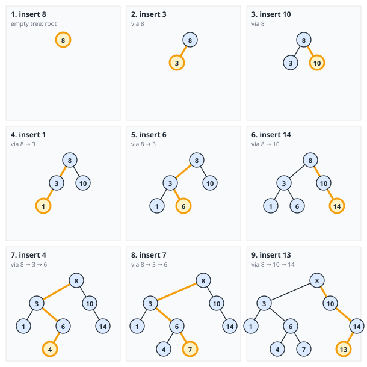
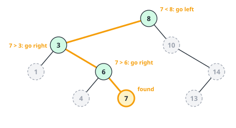
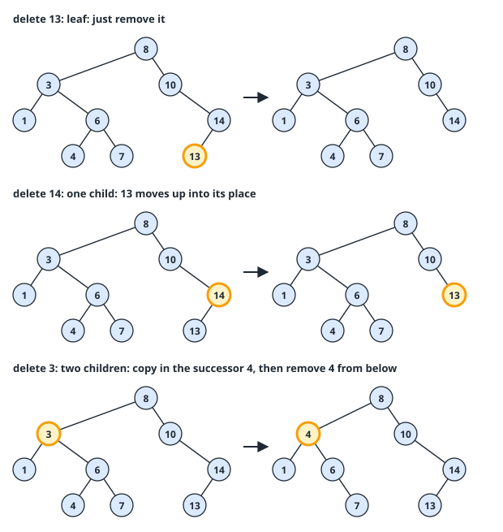
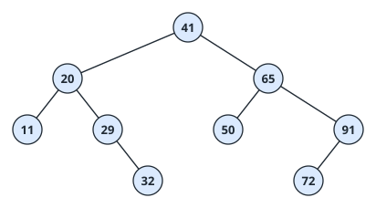

# Module: Binary Search Trees (Ordering Makes It Searchable)

A binary search tree is a binary tree kept in order: everything to the left of an item is smaller, and everything to the right is bigger. That order lets you find an item by going left or right at each step, the same way you halve the pages when looking up a word in a dictionary. Databases and the sorted lists inside many programs use trees like this.

## Before you start
<!-- bite: 437b322e-1ac0-4f1e-878b-a922ed36d599 -->

- You know what a binary tree is and can name its shapes — [[02-binary-trees|binary trees]].
- You know binary search on an array — [[01-linear-and-binary-search|searching]]. A binary search tree is that idea made into a structure.
- You know what a [[03-hash-maps|hash map]] gives you, so the comparison at the end lands.

**After this lesson you will be able to:**

1. State the **binary search tree property** precisely, including the part people get wrong.
2. Implement search, insert and delete, and explain why delete is the awkward one.
3. Explain why **every cost is $O(h)$, not $O(\log n)$**, and what makes those differ.
4. Say when to reach for a binary search tree rather than a hash map.

**Study route:** read the property and the search mechanism, then the ADT, then run the lab — it builds the same keys two ways and measures the difference.

---

## What a binary search tree is
<!-- bite: eba828c2-200d-4be7-80be-3e283e2773ae -->

A **Binary Search Tree (BST)** is a binary tree with a special ordering rule called the **BST Invariant**:

> **The BST Invariant**: For every node $X$:
> - All values in $X$'s **left subtree** must be strictly **smaller** than $X$'s value.
> - All values in $X$'s **right subtree** must be strictly **larger** than $X$'s value.

### Visualizing a Valid BST


Notice:
- Left of `8`: `{1, 3, 4, 6, 7}` (all $< 8$).
- Right of `8`: `{10, 13, 14}` (all $> 8$).

### How Searching Works in a BST ($O(\log n)$)

Searching a BST mimics **Binary Search** on a sorted array:
1. Start at the root.
2. If `target == current.val`, you found it!
3. If `target < current.val`, go **left** (discard the entire right half of the tree).
4. If `target > current.val`, go **right** (discard the entire left half of the tree).

#### Python Implementation of BST Search

```python
def bst_search(node: TreeNode, target: int) -> TreeNode:
    """Recursively search for target in a Binary Search Tree."""
    # Base Case: target not found (None) or target found
    if node is None or node.val == target:
        return node
    
    # If target is smaller than current node, search left subtree
    if target < node.val:
        return bst_search(node.left, target)
    
    # Otherwise, target is larger, search right subtree
    return bst_search(node.right, target)
```

### Two Essential BST Properties to Remember

1. **Inorder Traversal of a BST yields SORTED order!**
   - If you visit `Left Subtree -> Root -> Right Subtree`, you will visit the values in strictly ascending order: `1, 3, 4, 6, 7, 8, 10, 13, 14`.
2. **The BST invariant applies to ENTIRE subtrees, not just immediate children!**
   - *Common Bug*: Only checking `node.left.val < node.val` is NOT enough. A node deep inside the left subtree could still be greater than the root!

---

## Seeing a BST grow, one insert at a time
<!-- bite: 68793eb6-b14b-4b46-80bb-03518f9a748d -->

This is the tree above, built by inserting 8, 3, 10, 1, 6, 14, 4, 7, 13 in that order. In each panel the orange path is the walk the new key took: left when smaller, right when larger, until it found an empty spot.



---

## Seeing a search walk down the tree
<!-- bite: 61a7745f-3c00-4ea6-82e5-d3b197959472 -->

Here is `bst_search` looking for 7 in the same tree. Each comparison picks one side, and the greyed-out nodes are never looked at.



---

## Self-balancing trees, and why production uses them
<!-- bite: f9877413-2c83-4320-a253-6160472756e2 -->

What happens if you insert already sorted data (`1, 2, 3, 4, 5`) into a plain BST?
- `1` becomes root. `2` goes right of `1`. `3` goes right of `2`...
- You get a **Degenerate Tree** (Linked List), and search time degrades to $O(n)$!

To prevent this, production software uses **Self-Balancing Binary Search Trees**, which perform mathematical re-arrangements called **Tree Rotations** to keep height at $O(\log n)$.

A right rotation on node 5. The triangles A, C and D stand for whole subtrees:


### Types of Self-Balancing Trees

1. **AVL Trees**:
   - Enforces strict balance: height difference between left and right subtrees $\le 1$.
   - *Best for*: Read-heavy workloads where fast lookup is critical.
2. **Red-Black Trees**:
   - Uses node colors (Red/Black) and rules to ensure the longest path is at most $2\times$ the shortest path.
   - Requires fewer rotations during insertions/deletions than AVL trees.
   - *Where it's used*: Java `TreeMap`, C++ `std::map`, Linux kernel process scheduler.
3. **B-Trees & B+ Trees**:
   - Nodes hold **hundreds of keys** and have **hundreds of children** instead of just 2.
   - *Why*: Reduces tree height to just 3-4 levels for billions of records, minimizing expensive **Disk Reads/Seeks**.
   - *Where it's used*: **Every major database index** (PostgreSQL, MySQL InnoDB, SQLite) and Filesystem (ext4, NTFS).

---

## Summary of complexity
<!-- bite: ff3eec1f-e28e-46ac-a41c-f13896cee224 -->

| Structure / Tree Type | Average Search | Worst Case Search | Average Insert | Worst Case Insert |
| :--- | :--- | :--- | :--- | :--- |
| **Unbalanced BST** | $O(\log n)$ | $O(n)$ (degenerate) | $O(\log n)$ | $O(n)$ |
| **AVL Tree** | $O(\log n)$ | $O(\log n)$ | $O(\log n)$ | $O(\log n)$ |
| **Red-Black Tree** | $O(\log n)$ | $O(\log n)$ | $O(\log n)$ | $O(\log n)$ |
| **B+ Tree (Disk)** | $O(\log n)$ | $O(\log n)$ | $O(\log n)$ | $O(\log n)$ |

---

## The binary search tree ADT
<!-- bite: b5fe59c1-19ea-444e-b157-f39140de370d -->

A tree is a **shape**, not an ADT — many different structures are trees. What has an ADT is the thing you build with that shape, and the most important one here is the **binary search tree**, usually shortened to **BST**.

A BST answers the questions a [[03-hash-maps|hash map]] cannot, and that is precisely why it exists alongside one.

1. `insert(value)` — Adds `value`, walking down from the root and going left when smaller and right when larger. **$O(h)$**, where $h$ is the height.

2. `search(value)` — Returns whether the value is present. **$O(h)$**. Each comparison discards half the remaining tree, which is binary search made into a structure.

3. `delete(value)` — Removes a value. **$O(h)$**, and the fiddliest operation — a node with two children must be replaced by its in-order successor.

4. `min()` and `max()` — Return the smallest and largest values. **$O(h)$**: walk left as far as possible, or right as far as possible. A hash map cannot do this at all without checking everything.

5. `successor(value)` — Returns the next value in sorted order. **$O(h)$**. Again impossible in a hash map.

6. `range(low, high)` — Returns every value between two bounds. **$O(h + k)$** for $k$ results. **This is the operation databases are built on.**

7. `in_order()` — Returns every value in **sorted** order. $O(n)$. See [[04-traversal/index|traversal]].

### Everything depends on $h$, and $h$ is not guaranteed

Notice that no cost above is stated in terms of $n$. They are all $O(h)$, and the relationship between $h$ and $n$ is where the entire subject lives:

- A **balanced** tree has $h \approx \log_2 n$. For a million items that is about 20 comparisons.
- A **degenerate** tree has $h = n$. Every operation becomes $O(n)$, and the structure is a [[04-linked-lists|linked list]] wearing a tree's clothes.

And degeneracy is not an exotic case — **inserting already-sorted data produces it every time**, because every new value goes to the right of the last. Sorted input is the most common input there is, which is why unbalanced BSTs are essentially never used in production and why [[06-trees/01-trees|self-balancing trees]] — AVL, red-black, B-trees — exist. They add rotations to keep $h$ at $\log n$ no matter what order the data arrives in.

### BST versus hash map

| | Hash map | Balanced BST |
| :--- | :---: | :---: |
| `search`, `insert`, `delete` | $O(1)$ average | $O(\log n)$ guaranteed |
| `min` / `max` | $O(n)$ | $O(\log n)$ |
| Range query | not possible | $O(\log n + k)$ |
| In sorted order | $O(n \log n)$ — sort it | $O(n)$ |
| Worst case | $O(n)$ | $O(\log n)$ |

A hash map is faster on average for the operations it supports. A balanced tree is slower but **guaranteed**, and it keeps the ordering that hashing throws away. That is why a database index is a B-tree: `WHERE age BETWEEN 20 AND 30` is a range query, and a hash index simply cannot answer it.

## Seeing the three delete cases
<!-- bite: 422aba1b-9e0c-4823-b64c-22a1fe79faab -->

`delete` has three cases, shown here on the tree from the start of the lesson. The orange node on the left is the one being deleted, and the orange node on the right is what took its place. In the last case, 4 is the in-order successor of 3: the smallest value in 3's right subtree.



## Implementation — complete runnable example
<!-- bite: d7ec0f97-f6f2-4ca2-9dfb-a161ff2af589 -->

**Runnable example:** save as `trees_lab.py` and run `python3 trees_lab.py`. Standard library only; writes no files. Everything is counted rather than timed, so your output will match this exactly.

```python
"""Trees: a BST, and why balance is the whole story."""

class BST:
    class Node:
        __slots__ = ("key", "left", "right")
        def __init__(self, key):
            self.key, self.left, self.right = key, None, None

    def __init__(self):
        self.root, self.comparisons = None, 0

    def insert(self, key):
        """Iterative on purpose. A recursive insert into a DEGENERATE tree
        recurses once per level -- 1000 sorted keys would blow the stack,
        which is the failure this lesson is about."""
        if self.root is None:
            self.root = BST.Node(key)
            return
        node = self.root
        while True:
            self.comparisons += 1
            if key < node.key:
                if node.left is None:
                    node.left = BST.Node(key); return
                node = node.left
            elif key > node.key:
                if node.right is None:
                    node.right = BST.Node(key); return
                node = node.right
            else:
                return

    def contains(self, key):
        node = self.root
        while node:
            self.comparisons += 1
            if key == node.key:
                return True
            node = node.left if key < node.key else node.right
        return False

    def height(self):
        """Iterative, for the same reason as insert."""
        if self.root is None:
            return 0
        best, stack = 0, [(self.root, 1)]
        while stack:
            node, depth = stack.pop()
            best = max(best, depth)
            if node.left:  stack.append((node.left, depth + 1))
            if node.right: stack.append((node.right, depth + 1))
        return best

    def in_order(self):
        """Iterative in-order with an explicit stack."""
        out, stack, node = [], [], self.root
        while stack or node:
            while node:
                stack.append(node); node = node.left
            node = stack.pop()
            out.append(node.key)
            node = node.right
        return out

if __name__ == "__main__":
    print("A BALANCED TREE -- height grows like log2(n)")
    print(f"  {'n':>7s} {'height':>8s} {'log2(n)':>9s} {'lookups (worst)':>16s}")
    for n in (7, 15, 1023, 65535):
        t = BST()
        # insert in an order that happens to balance: middle-out
        def build(lo, hi):
            if lo > hi: return
            mid = (lo + hi) // 2
            t.insert(mid); build(lo, mid-1); build(mid+1, hi)
        build(0, n-1)
        import math
        print(f"  {n:7d} {t.height():8d} {math.log2(n+1):9.1f} {t.height():16d}")
    print("  -> each comparison discards HALF the remaining tree.")
    print()

    print("THE SAME KEYS, INSERTED IN SORTED ORDER")
    sorted_tree = BST()
    for i in range(1000):
        sorted_tree.insert(i)
    balanced = BST()
    def build2(lo, hi):
        if lo > hi: return
        mid = (lo + hi) // 2
        balanced.insert(mid); build2(lo, mid-1); build2(mid+1, hi)
    build2(0, 999)
    print(f"  sorted insertion : height {sorted_tree.height():5d}")
    print(f"  balanced         : height {balanced.height():5d}")
    sorted_tree.comparisons = balanced.comparisons = 0
    sorted_tree.contains(999); balanced.contains(999)
    print(f"  finding key 999  : {sorted_tree.comparisons:4d} vs "
          f"{balanced.comparisons:3d} comparisons")
    print("  -> a BST with sorted input IS a linked list. Same code, same")
    print("     keys, O(n) instead of O(log n). This is why self-balancing")
    print("     trees (AVL, red-black) exist -- they refuse to degenerate.")
    print()

    print("IN-ORDER TRAVERSAL OF A BST YIELDS SORTED OUTPUT")
    t = BST()
    for k in (50, 30, 70, 20, 40, 60, 80):
        t.insert(k)
    print(f"  inserted: 50 30 70 20 40 60 80")
    print(f"  in-order: {t.in_order()}")
    print("  -> the BST property (left < node < right) applied recursively")
    print("     IS the definition of sorted.")

    assert t.in_order() == sorted(t.in_order())
    assert t.contains(60) and not t.contains(65)
    assert sorted_tree.height() == 1000, "sorted insertion degenerates fully"
    assert balanced.height() <= 12, "balanced tree stays logarithmic"
    print()
    print("trees_lab: passed")
```

Expected output:

```text
A BALANCED TREE -- height grows like log2(n)
        n   height   log2(n)  lookups (worst)
        7        3       3.0                3
       15        4       4.0                4
     1023       10      10.0               10
    65535       16      16.0               16
  -> each comparison discards HALF the remaining tree.

THE SAME KEYS, INSERTED IN SORTED ORDER
  sorted insertion : height  1000
  balanced         : height    10
  finding key 999  : 1000 vs  10 comparisons
  -> a BST with sorted input IS a linked list. Same code, same
     keys, O(n) instead of O(log n). This is why self-balancing
     trees (AVL, red-black) exist -- they refuse to degenerate.

IN-ORDER TRAVERSAL OF A BST YIELDS SORTED OUTPUT
  inserted: 50 30 70 20 40 60 80
  in-order: [20, 30, 40, 50, 60, 70, 80]
  -> the BST property (left < node < right) applied recursively
     IS the definition of sorted.

trees_lab: passed
```

## Check your understanding
<!-- bite: 498d5897-55d0-4cfe-b297-c54ab0d02f9c -->

Try each one before you open the answer.

1. <!-- q: mcq id="06d55cfc" -->
   Which statement of the binary search tree rule is correct?

   - [ ] Each node's left child is smaller than it, and its right child is larger
   - [x] Every value in a node's whole left subtree is smaller than it, and every value in its whole right subtree is larger
   - [ ] Each level holds values in increasing order from left to right, and nothing more
   - [ ] The root holds the median value

   <details><summary>Answer</summary>

   The rule covers entire subtrees, not just the immediate children. Checking only `node.left.val < node.val` misses a value deep in the left subtree that is larger than the root.

   </details>

2. <!-- q: gap id="4872ab49" answers="in-order|inorder|in order" -->
   Fill in the gap. Visiting a binary search tree left subtree, then node, then right subtree is called an ___ traversal, and it gives the values in sorted order.

   <details><summary>Answer</summary>

   In-order. Everything smaller sits on the left and everything larger on the right, so left–node–right visits values in ascending order.

   </details>

3. <!-- q: mcq id="a57fc201" -->
   Search, insert and delete in a binary search tree all cost O(h), where h is the height. When is h close to n rather than log n?

   - [ ] When the keys are inserted in random order
   - [x] When the keys are inserted already sorted
   - [ ] When the tree is perfect
   - [ ] Never; h is always about log n

   <details><summary>Answer</summary>

   Sorted input puts every new key to the right of the last, so the tree becomes a straight line of height about n. Self-balancing trees (AVL, red-black) use rotations to keep h near log n.

   </details>

4. <!-- q: mcq id="d3ccebdb" -->
   Which queries does a balanced binary search tree answer well but a hash map cannot? Choose all that apply.

   - [x] All keys between 20 and 30
   - [x] The smallest key
   - [x] The next key after 42 in sorted order
   - [ ] Whether the key 42 is present

   <details><summary>Answer</summary>

   Range, min and successor all need order, which the tree keeps and hashing throws away. Both structures can answer membership; the hash map is faster at it on average.

   </details>

5. <!-- q: mcq id="34ed16ae" -->
   Why do databases like PostgreSQL index with B+ trees rather than plain binary search trees?

   - [ ] B+ trees use less memory per key
   - [x] Each node holds hundreds of keys, so the tree is only 3 or 4 levels deep and a lookup needs only a few slow disk reads
   - [ ] Binary search trees cannot store strings
   - [ ] B+ trees never need rebalancing

   <details><summary>Answer</summary>

   Data on disk is far slower to reach than RAM. A wide, shallow B+ tree reaches any key in 3 or 4 disk reads instead of the 30 or so a binary tree over a billion keys would need, and its linked leaves make range queries fast.

   </details>

6. <!-- q: open id="bdb23f68" -->
   Deleting a node with two children is the awkward case in a binary search tree. What do you do, and why does it keep the rule intact?

   <details><summary>Answer</summary>

   Replace the node's value with its in-order successor, the smallest value in its right subtree, then delete that successor from the right subtree (it has at most one child, so that is easy). The successor is larger than everything on the left and smaller than everything else on the right, so the ordering rule still holds.

   </details>

## Check your understanding: worked problems
<!-- bite: 850bb9bf-5959-454b-8a0e-d378988fa805 -->

Work each one out on paper first, then type your answer.

1. <!-- q: gap id="23b460f0" answers="15;9;12;11" -->
   Fill in the gaps. Insert 15, 9, 22, 4, 12, 18, 30, 11 in that order into an empty binary search tree. Searching for 11 visits the nodes ___ → ___ → ___ → ___.

   <details><summary>Answer</summary>

   15 → 9 → 12 → 11. 11 < 15 so go left to 9; 11 > 9 so go right to 12; 11 < 12 so go left, and there it is.

   </details>

2. <!-- q: exact id="4620a649" answer="4, 9, 11, 12, 15, 18, 22, 30" accept="4 9 11 12 15 18 22 30|4,9,11,12,15,18,22,30" -->
   Insert 15, 9, 22, 4, 12, 18, 30, 11 in that order into an empty binary search tree. List the values in in-order traversal order, separated by commas.

   <details><summary>Answer</summary>

   4, 9, 11, 12, 15, 18, 22, 30. In-order traversal of any binary search tree gives the values sorted, whatever order they were inserted in.

   </details>

3. <!-- q: gap id="ee1272cb" answers="35;20;40" -->
   Fill in the gaps. Insert 50, 30, 70, 20, 40, 60, 80, 35, 45, 65 into an empty binary search tree. Then delete 30, which has two children, by replacing it with its in-order successor. The node that was 30 now holds ___, and its left and right children are ___ and ___.

   <details><summary>Answer</summary>

   35, with children 20 and 40. The in-order successor of 30 is the smallest value in its right subtree: go right to 40, then left as far as possible to 35. 35 takes 30's place and is removed from under 40.

   </details>

4. <!-- q: exact id="48c76fd0" answer="5" -->
   Insert 10, 20, 30, 40, 50 in that order into an empty binary search tree. How many nodes does a search for 50 visit?

   <details><summary>Answer</summary>

   5. Sorted input makes each key the right child of the one before, so the tree is a straight line and the search visits every node: O(n), not O(log n).

   </details>

5. <!-- q: sketch id="ca0142d8" -->
   Insert 41, 20, 65, 11, 29, 50, 91, 32, 72 in that order into an empty binary search tree. On paper, draw the tree after the last insert.

   <details><summary>Answer</summary>

   

   What to check:
   - 41, the first key, is the root, and nothing ever moves it.
   - 32 sits right of 29 (32 > 29), inside 20's right side, because 32 < 41 and 32 > 20.
   - 72 sits left of 91: it went right at 41 and at 65, then left at 91.
   - Reading the tree left to right gives 11, 20, 29, 32, 41, 50, 65, 72, 91, which is sorted.

   </details>

## Practice — independent task
<!-- bite: 8aaf852b-c3cf-4a28-bd3a-67c9b4ec2a14 -->

Implement `delete(key)` on the BST - the operation everyone skips.

- The easy cases: a leaf (just remove it) and a node with one child (splice it out).
- The hard case: a node with **two children**. You must replace it with either its in-order predecessor or successor, then delete that node instead.
- Implement it, then verify: after any sequence of inserts and deletes, `in_order()` must still be sorted and `contains()` must agree with a Python `set`.
- Test with 200 random insert/delete operations against a `set` as the oracle.

**Done when:** your tree survives 200 random operations with in-order output still sorted, including deleting the root and deleting the last node.

<details><summary>Hint - open only after an attempt</summary>
For a node with two children, the replacement must preserve the BST property: everything left is smaller, everything right is larger. Only two keys can sit there - the <strong>largest key in the left subtree</strong> (the in-order predecessor) or the <strong>smallest in the right subtree</strong> (the successor).<br>
Both are guaranteed to have at most one child, so removing them recurses into an easy case. That is why the two-child case reduces to a one-child case rather than recursing forever.
</details>

## Before moving on
<!-- bite: 1b252977-cd5f-4ffa-b9e9-464754ac052b -->

You are done with this module when you can, closed-book:

- [ ] Explain why each comparison discards half a balanced tree.
- [ ] Explain what input order causes a BST to degenerate, and what it becomes.
- [ ] Explain why in-order traversal of a BST is sorted.
- [ ] State what a self-balancing tree guarantees that a plain BST does not.

**Recap:** A binary search tree keeps every key in the left subtree smaller than the node and every key on the right larger, so each comparison discards half the remaining tree - O(log n) when balanced. Balance is not automatic: inserting sorted keys produces a tree of height n, which is a linked list wearing a tree's shape, and lookup degrades to O(n). Self-balancing variants such as AVL and red-black trees restructure on insertion to guarantee logarithmic height.

**Next:** [[04-traversal/index|Tree Traversal]] - having built the tree, the next question is in what order to visit it - and the choice is decided by the problem.

## Related
<!-- bite: 7a34682e-db94-476a-b38b-3e15274a2646 -->

- [[02-binary-trees|Binary Trees]] — the structure this adds a rule to
- [[01-trees|Trees]] — the vocabulary, and the other kinds of tree
- [[04-traversal/index|Traversal]] — in-order traversal of a binary search tree yields sorted output
- [[03-hash-maps|Hash Maps]] — the alternative, and what it cannot do
- [[databases/index|databases/]] — where B-trees and B+ trees take this idea to disk

## About this lesson
<!-- bite: f266391f-1e10-47d9-ab19-ce2975fa271e -->

**Level:** Intermediate. **Covers:** one rule added to a binary tree, and why that rule is worth nothing without balance.
