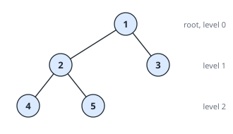
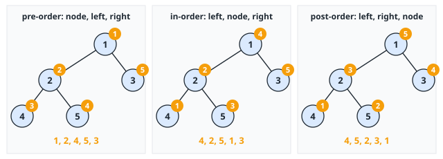
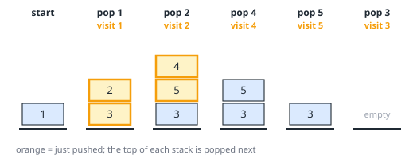
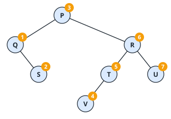

# Module: Depth-First Traversals (Pre-order, In-order, Post-order)

A depth-first traversal is a way of visiting every item in a tree by going as far down one branch as you can before coming back up to try the next. There are three common orders, called pre-order, in-order and post-order, depending on when you handle each item. It is like exploring every room down one corridor of a building before moving to the next corridor.

## Before you start
<!-- bite: 5f1722bb-a086-412e-a350-1886745cc411 -->

- You know what a binary tree is — [[../02-binary-trees|binary trees]].
- You can trace a recursive call, and you know what a stack does — [[../../05-stacks-and-queues|stacks and queues]].

**After this lesson you will be able to:**

1. Perform all three depth-first traversals by hand on a given tree.
2. Say which job each order is right for, and why.
3. Write each one recursively **and** iteratively with an explicit stack.
4. Explain why in-order traversal of a binary search tree comes out sorted.

**Study route:** read the orders, trace each on the reference tree by hand, then run the lab.

---

## Why tree traversal strategies matter
<!-- bite: f63fdf99-7264-42f9-b850-69730de94266 -->

Imagine inspecting a company's organizational chart:

- **Scenario A (Top-Down Management Briefing)**: You talk to the CEO first, then the VPs, then the engineers. (**Pre-order**)
- **Scenario B (Alphabetical / Sorted Roll Call)**: You list all employees in alphabetical order. (**In-order**)
- **Scenario C (Bottom-Up Expense Report Aggregation)**: Engineers calculate costs, pass them up to Directors, and finally up to the CEO. (**Post-order**)
- **Scenario D (Level-by-Level Audit)**: You inspect everyone at Executive level, then Manager level, then Staff level. (**Level-order / BFS**)

Each scenario visits the exact same people, but the **order of visitation** is tailored to solve a specific problem.

---

## The reference tree
<!-- bite: 0dc4cc8e-0a60-4ac9-b948-ab8e8cdc3736 -->

Throughout this module, we will trace the traversal orders using this binary tree:



---

## Terms used with tree traversal
<!-- bite: 74e81f72-1a80-4519-a17f-bb759e5979cb -->

1. **Traversal**: This means visiting every node in a tree exactly once, in some definite order. The tree itself does not change; what changes is the **sequence** in which you see the nodes.

2. **Visit**: This is the moment you actually do something with a node — print it, add it to a list, compare it. The whole difference between the traversal orders is *when* the visit happens relative to the recursive calls.

3. **Depth-first traversal**: This means going as deep as possible down one branch before backing up and trying another. It uses a stack, either an explicit one or the call stack that recursion provides.

4. **Breadth-first traversal**: This means visiting every node at one depth before moving to the next depth down. It uses a queue. It is also called **level-order traversal**.

5. **Pre-order**: Visit the node **first**, then its left subtree, then its right subtree. The root comes out first, which is what makes it right for copying a tree or writing it out to a file.

6. **In-order**: Visit the left subtree, then the node, then the right subtree. On a [[../03-binary-search-trees|binary search tree]] this produces the values in **sorted order**, which is its main use.

7. **Post-order**: Visit the left subtree, then the right subtree, then the node **last**. A node is only visited after everything beneath it, which is what makes it right for deleting a tree or evaluating an expression.

8. **Level-order**: Visit all nodes at depth 0, then all at depth 1, and so on. This is [[02-breadth-first-search|breadth-first search]] applied to a tree.

9. **The call stack**: This is the private area of memory the language uses to remember where it was. Every time a function calls another function, the computer pushes a record onto the call stack saying which line to come back to and what the local variables were. When the function returns, that record is popped off. **Recursion is not magic — it is a stack you did not have to write.**

10. **Explicit stack**: This means a stack you create yourself, usually just a list, and push onto and pop from by hand. Writing one lets you do the same traversal **without recursion**, which matters because the call stack is small and fixed while a list can grow as large as memory allows.

11. **Iterative**: This means written as a loop rather than as a function that calls itself. Every recursive traversal has an iterative twin that does exactly the same work; the difference is only in who is keeping track of where you were.

## The three orders, recursively
<!-- bite: 0e19cde7-ba9d-445a-863e-42760c264172 -->

The first three traversals are all **depth-first search (DFS)** strategies. They commit to exploring down a branch as far as possible before backtracking.

**Look at the three functions below together before reading them separately.** They contain exactly the same three lines. The only thing that moves is *where the visit line sits*, and that single difference is the whole topic.

### 1. Pre-order (Root $\rightarrow$ Left $\rightarrow$ Right)

Processes the current node **before** inspecting its subtrees.

```python
def preorder(node: TreeNode, result: list):
    """Pre-order traversal: process the node first."""
    if node is None:
        return

    result.append(node.val)      # 1. Process current node
    preorder(node.left, result)  # 2. Recurse left
    preorder(node.right, result) # 3. Recurse right

# Visited Order: [1, 2, 4, 5, 3]
```

### 2. In-order (Left $\rightarrow$ Root $\rightarrow$ Right)

Processes the current node **between** visiting the left and right subtrees.

```python
def inorder(node: TreeNode, result: list):
    """In-order traversal: process the node between its subtrees."""
    if node is None:
        return

    inorder(node.left, result)   # 1. Recurse left
    result.append(node.val)      # 2. Process current node
    inorder(node.right, result)  # 3. Recurse right

# Visited Order: [4, 2, 5, 1, 3]
```

> [!IMPORTANT]
> **The BST In-order Guarantee**: Running an in-order traversal on a binary search tree will ALWAYS produce the values in **strictly sorted ascending order**.

### 3. Post-order (Left $\rightarrow$ Right $\rightarrow$ Root)

Processes children completely **before** processing the parent node.

```python
def postorder(node: TreeNode, result: list):
    """Post-order traversal: process the node last."""
    if node is None:
        return

    postorder(node.left, result)   # 1. Recurse left
    postorder(node.right, result)  # 2. Recurse right
    result.append(node.val)        # 3. Process current node

# Visited Order: [4, 5, 2, 3, 1]
```

*Why post-order is special*: it is essential when a parent node requires calculation results from both of its children before it can compute its own answer — calculating directory sizes, or freeing memory in C.

---

## Seeing the three orders on the tree

Here is the reference tree three times. The orange badge on each node is when that node gets visited. Look at the root, 1: it comes first in pre-order, in the middle in in-order, and last in post-order.



---

## The same three orders, iteratively
<!-- bite: 2ce75fe5-5860-4519-ab05-3c6f731d4494 -->

Every recursive traversal can be rewritten as a loop, because **the call stack is doing something you can do yourself**. When `preorder` calls itself on the left child, the computer quietly pushes a note saying "come back here afterwards and then do the right child". An explicit stack is you writing that note down instead.

There are two reasons to bother:

1. **Recursion has a depth limit and an explicit stack does not.** Python stops at roughly 1,000 nested calls; a list can hold millions. On a [[../02-binary-trees|degenerate tree]] — one long chain — the recursive version crashes on inputs the iterative version handles without noticing. The lab below demonstrates exactly this.
2. **Interviewers ask for it**, because the iterative in-order and post-order are where it becomes clear whether you understand the traversal or just memorised three lines.

The three iterative versions are **not** three variations of one loop. Pre-order is easy, in-order needs a different skeleton, and post-order needs a trick. That unevenness is the honest shape of the topic.

### 1. Pre-order iteratively — the straightforward one

Push the root. Then repeatedly pop a node, visit it, and push its children. **Push the right child first**, because a stack gives back the *last* thing pushed, so pushing right first means left comes out first.

```python
def dfs_preorder(root):
    if not root:
        return []

    result, stack = [], [root]

    while stack:
        node = stack.pop()
        result.append(node.val)  # Process Root

        # Push Right then Left so Left is popped first
        if node.right:
            stack.append(node.right)
        if node.left:
            stack.append(node.left)

    return result
```

**Why this one is easy:** in pre-order the node is visited the moment you first reach it, so there is nothing to remember. You are finished with a node before you look at its children, and a node on the stack is simply "not started yet".

Here is the stack after each step on the reference tree. Popping 1 pushes 3 and then 2, so 2 sits on top and is visited next:



### 2. In-order iteratively — a pointer plus a stack

Here the node must **not** be visited when you first reach it, because its whole left subtree has to come out first. So instead of pushing both children at once, you use a `curr` pointer to walk all the way down the left edge, stacking nodes as you pass them. When you run out of left, you pop the most recent node, visit it, and turn right.

```python
def dfs_inorder(root):
    result, stack = [], []
    curr = root

    while curr or stack:
        # Drill down to the leftmost node
        while curr:
            stack.append(curr)
            curr = curr.left

        curr = stack.pop()
        result.append(curr.val)  # Process Root
        curr = curr.right        # Traverse Right

    return result
```

**Read the loop condition carefully — `while curr or stack` is the part that matters.** There are two separate ways for there still to be work left: either you are holding a node you have not descended into (`curr`), or you have nodes parked on the stack waiting to be visited. The traversal is only finished when *both* are empty.

A node sitting on this stack means something specific: **"I have gone past you on the way down, and I still owe you a visit."**

### 3. Post-order iteratively — the awkward one

Post-order is genuinely harder, and it is worth saying why rather than just presenting the code. A node must be visited only after **both** subtrees are done, so when you arrive back at a node from below you have to know *which* child you just came back from. The stack alone does not tell you that.

There are two standard answers.

#### Option A: modified pre-order, then reverse (easiest)

Pre-order is `Root -> Left -> Right`. If you tweak it to visit `Root -> Right -> Left` and reverse the final result, you get `Left -> Right -> Root`, which is post-order.

```python
def dfs_postorder_reverse(root):
    if not root:
        return []

    result, stack = [], [root]

    while stack:
        node = stack.pop()
        result.append(node.val)

        # Push Left then Right
        if node.left:
            stack.append(node.left)
        if node.right:
            stack.append(node.right)

    return result[::-1]  # Reverse to get Left -> Right -> Root
```

Note the push order flipped from the pre-order version: pushing **left first** means right is popped first, giving `Root -> Right -> Left` on the way in.

> [!WARNING]
> **This produces the right list in the wrong order, and the difference matters.**
>
> The list you get back is correct post-order. But the *nodes were touched* root-first — on the lab's tree below (the reference tree with a 6 added under 3), in the order `1, 3, 6, 2, 5, 4`. The reversal happens afterwards, to the list.
>
> So Option A is fine whenever the work is **collecting values**, and wrong whenever the work is **the visit itself** — freeing memory, deleting nodes, closing files. You cannot reverse a `free()` that has already happened. The lab below prints both orders side by side so you can see it.

#### Option B: one stack and a `last_visited` pointer (true post-order)

If you need the nodes genuinely visited in post-order — or you are forbidden from reversing the output — track the last node you visited. That tells you whether you are arriving at a node on the way *down* or returning from its right subtree.

```python
def dfs_postorder_single_stack(root):
    result, stack = [], []
    curr, last_visited = root, None

    while curr or stack:
        if curr:
            stack.append(curr)
            curr = curr.left
        else:
            peek_node = stack[-1]
            # If right child exists and traversing from left child, go right
            if peek_node.right and last_visited != peek_node.right:
                curr = peek_node.right
            else:
                result.append(peek_node.val)  # Process Root
                last_visited = stack.pop()

    return result
```

**The key line is `last_visited != peek_node.right`.** You peek at the top of the stack without removing it and ask one question: *have I already finished this node's right subtree?* If the answer is no, go do it. If the answer is yes — or there is no right child at all — then both subtrees are done, so now you may finally visit the node and pop it.

Notice that this reuses the in-order skeleton exactly: the same `while curr or stack`, the same drill-down-left. **The only new idea is peeking instead of popping**, and popping only once the node is genuinely finished.

---

## Summary comparison
<!-- bite: af0c60a9-9ba0-4e0d-91f8-9d1621827f6a -->

| Traversal | Order | Stack logic | Key trick |
| --- | --- | --- | --- |
| **Pre-order** | Root $\rightarrow$ Left $\rightarrow$ Right | Push root, pop, push right, push left | Process immediately on pop |
| **In-order** | Left $\rightarrow$ Root $\rightarrow$ Right | Drill left onto the stack, pop and process, go right | A `curr` pointer manages the descent |
| **Post-order** | Left $\rightarrow$ Right $\rightarrow$ Root | Visit root $\rightarrow$ right $\rightarrow$ left, then reverse the list | Modified pre-order reversed, **or** track `last_visited` |

All of them cost $O(n)$ time, because every node is handled a constant number of times, and $O(h)$ space for the stack, where $h$ is the height of the tree. **The iterative versions do not use less memory than the recursive ones** — they use the same amount, in a place that is allowed to be much bigger.

---

## Implementation - complete runnable example
<!-- bite: f608054b-9a47-4a60-9c1f-13224e745e8c -->

**Runnable example:** save as `traversal_lab.py` and run `python3 traversal_lab.py`. Standard library only; writes no files. Everything is counted rather than timed, so your output will match this exactly.

```python
"""Tree traversal: the three depth-first orders, recursive and iterative."""
from collections import deque

class Node:
    def __init__(self, val, left=None, right=None):
        self.val, self.left, self.right = val, left, right

#         1
#       /   \
#      2     3
#     / \     \
#    4   5     6
TREE = Node(1, Node(2, Node(4), Node(5)), Node(3, None, Node(6)))

# --- recursive: three lines each, differing only in where the visit goes ---
def preorder(n):
    return [] if n is None else [n.val] + preorder(n.left) + preorder(n.right)

def inorder(n):
    return [] if n is None else inorder(n.left) + [n.val] + inorder(n.right)

def postorder(n):
    return [] if n is None else postorder(n.left) + postorder(n.right) + [n.val]

def levelorder(root):
    """Breadth-first: a queue instead of the call stack."""
    out, q = [], deque([root] if root else [])
    while q:
        n = q.popleft()
        out.append(n.val)
        if n.left:  q.append(n.left)
        if n.right: q.append(n.right)
    return out

# --- iterative: the same three orders, with the stack written out by hand ---
def preorder_iterative(root):
    """Push right first so left is popped first."""
    out, stack = [], [root] if root else []
    while stack:
        n = stack.pop()
        out.append(n.val)
        if n.right: stack.append(n.right)
        if n.left:  stack.append(n.left)
    return out

def inorder_iterative(root):
    """Drill down the left edge, pop, visit, then turn right."""
    out, stack, curr = [], [], root
    while curr or stack:
        while curr:
            stack.append(curr)
            curr = curr.left
        curr = stack.pop()
        out.append(curr.val)
        curr = curr.right
    return out

def postorder_reversed(root, touch_order=None):
    """Pre-order modified to node-right-left, then reversed."""
    out, stack = [], [root] if root else []
    while stack:
        n = stack.pop()
        out.append(n.val)
        if touch_order is not None:
            touch_order.append(n.val)
        if n.left:  stack.append(n.left)
        if n.right: stack.append(n.right)
    return out[::-1]

def postorder_iterative(root):
    """One stack, tracking the last node visited to know which way you came."""
    out, stack = [], []
    curr, last = root, None
    while curr or stack:
        if curr:
            stack.append(curr)
            curr = curr.left
        else:
            peek = stack[-1]
            if peek.right and last is not peek.right:
                curr = peek.right          # right subtree still owed
            else:
                out.append(peek.val)       # both children done: visit
                last = stack.pop()
    return out

# --- the point: which order does a given problem NEED? ---
def depth_of_each(n, depth=0):
    """Top-down: a node's answer depends on its ANCESTORS -> PREORDER."""
    if n is None: return {}
    out = {n.val: depth}
    out.update(depth_of_each(n.left, depth + 1))
    out.update(depth_of_each(n.right, depth + 1))
    return out

def height_of(n):
    """Bottom-up: a node's answer depends on its CHILDREN -> POSTORDER."""
    if n is None: return 0
    return 1 + max(height_of(n.left), height_of(n.right))

def is_bst(n, lo=float("-inf"), hi=float("inf")):
    """In-order on a BST is sorted -- so validity is an ordering check."""
    if n is None: return True
    return (lo < n.val < hi
            and is_bst(n.left, lo, n.val)
            and is_bst(n.right, n.val, hi))

def chain(values, side):
    """Build a one-sided chain, the shape that breaks recursion."""
    root = Node(values[0])
    curr = root
    for v in values[1:]:
        nxt = Node(v)
        setattr(curr, side, nxt)
        curr = nxt
    return root

if __name__ == "__main__":
    print("ONE TREE, FOUR ORDERS")
    print("        1")
    print("      /   \\")
    print("     2     3")
    print("    / \\     \\")
    print("   4   5     6")
    print()
    print(f"  pre-order   (node, left, right) : {preorder(TREE)}")
    print(f"  in-order    (left, node, right) : {inorder(TREE)}")
    print(f"  post-order  (left, right, node) : {postorder(TREE)}")
    print(f"  level-order (breadth-first)     : {levelorder(TREE)}")
    print()
    print("  the three depth-first orders differ ONLY in when the node is")
    print("  visited relative to its subtrees. That timing is the choice.")
    print()

    print("RECURSIVE AND ITERATIVE AGREE, ON EVERY SHAPE")
    shapes = [
        ("the tree above", TREE),
        ("single node   ", Node(1)),
        ("left chain    ", chain([1, 2, 3, 4], "left")),
        ("right chain   ", chain([1, 2, 3, 4], "right")),
    ]
    print(f"  {'shape':16s} {'in-order recursive':22s} {'in-order iterative':22s} same")
    for name, t in shapes:
        r, i = inorder(t), inorder_iterative(t)
        print(f"  {name:16s} {str(r):22s} {str(i):22s} {r == i}")
    print()
    print(f"  {'shape':16s} {'post recursive':22s} {'post iterative':22s} same")
    for name, t in shapes:
        r, i = postorder(t), postorder_iterative(t)
        print(f"  {name:16s} {str(r):22s} {str(i):22s} {r == i}")
    print()

    print("THE REVERSAL TRICK PRODUCES THE RIGHT LIST, IN THE WRONG ORDER")
    touched = []
    result = postorder_reversed(TREE, touched)
    print(f"  nodes were touched in this order : {touched}")
    print(f"  the list after reversing         : {result}")
    print(f"  true post-order                  : {postorder(TREE)}")
    print("  -> the LIST matches, but node 1 was touched FIRST, not last.")
    print("  -> so this is fine for collecting values, and WRONG for freeing")
    print("     memory or deleting nodes, where the touch order is the work.")
    print()

    print("CHOOSING THE ORDER -- it is decided by the data flow")
    print(f"  depth of each node (top-down, needs ANCESTORS -> pre-order):")
    print(f"    {depth_of_each(TREE)}")
    print(f"  height of the tree (bottom-up, needs CHILDREN -> post-order):")
    print(f"    {height_of(TREE)}")
    print()
    print("  RULE: if a node's answer depends on what is ABOVE it, go")
    print("  top-down (pre-order). If it depends on what is BELOW it, go")
    print("  bottom-up (post-order). Getting this backwards is why a")
    print("  traversal 'nearly works'.")
    print()

    print("IN-ORDER ON A BST IS SORTED -- so it validates one")
    bst = Node(5, Node(3, Node(1), Node(4)), Node(8, Node(7), Node(9)))
    broken = Node(5, Node(3, Node(1), Node(6)), Node(8))   # 6 > 5, wrong side
    for name, t in (("valid BST", bst), ("broken BST", broken)):
        print(f"  {name:11s} in-order {str(inorder(t)):28s} sorted={inorder(t)==sorted(inorder(t))}  is_bst={is_bst(t)}")
    print()

    print("WHY YOU WOULD EVER BOTHER: A DEEP CHAIN")
    deep = chain(list(range(3000)), "left")
    print(f"  iterative in-order on a 3000-node left chain : "
          f"{len(inorder_iterative(deep))} nodes visited")
    try:
        inorder(deep)
        print("  recursive in-order on the same chain         : fine")
    except RecursionError:
        print("  recursive in-order on the same chain         : RecursionError")
    print("  -> the explicit stack lives on the heap, which is far larger")
    print("     than the call stack. That is the practical reason to write one.")

    for _, t in shapes:
        assert preorder_iterative(t) == preorder(t)
        assert inorder_iterative(t) == inorder(t)
        assert postorder_iterative(t) == postorder(t)
        assert postorder_reversed(t) == postorder(t)
    assert preorder(TREE) == [1, 2, 4, 5, 3, 6]
    assert inorder(TREE) == [4, 2, 5, 1, 3, 6]
    assert postorder(TREE) == [4, 5, 2, 6, 3, 1]
    assert levelorder(TREE) == [1, 2, 3, 4, 5, 6]
    assert touched == [1, 3, 6, 2, 5, 4] and touched[0] == 1
    assert height_of(TREE) == 3 and is_bst(bst) and not is_bst(broken)
    assert preorder(None) == [] and levelorder(None) == []
    assert inorder_iterative(None) == [] and postorder_iterative(None) == []
    print()
    print("traversal_lab: passed")
```

Expected output:

```text
ONE TREE, FOUR ORDERS
        1
      /   \
     2     3
    / \     \
   4   5     6

  pre-order   (node, left, right) : [1, 2, 4, 5, 3, 6]
  in-order    (left, node, right) : [4, 2, 5, 1, 3, 6]
  post-order  (left, right, node) : [4, 5, 2, 6, 3, 1]
  level-order (breadth-first)     : [1, 2, 3, 4, 5, 6]

  the three depth-first orders differ ONLY in when the node is
  visited relative to its subtrees. That timing is the choice.

RECURSIVE AND ITERATIVE AGREE, ON EVERY SHAPE
  shape            in-order recursive     in-order iterative     same
  the tree above   [4, 2, 5, 1, 3, 6]     [4, 2, 5, 1, 3, 6]     True
  single node      [1]                    [1]                    True
  left chain       [4, 3, 2, 1]           [4, 3, 2, 1]           True
  right chain      [1, 2, 3, 4]           [1, 2, 3, 4]           True

  shape            post recursive         post iterative         same
  the tree above   [4, 5, 2, 6, 3, 1]     [4, 5, 2, 6, 3, 1]     True
  single node      [1]                    [1]                    True
  left chain       [4, 3, 2, 1]           [4, 3, 2, 1]           True
  right chain      [4, 3, 2, 1]           [4, 3, 2, 1]           True

THE REVERSAL TRICK PRODUCES THE RIGHT LIST, IN THE WRONG ORDER
  nodes were touched in this order : [1, 3, 6, 2, 5, 4]
  the list after reversing         : [4, 5, 2, 6, 3, 1]
  true post-order                  : [4, 5, 2, 6, 3, 1]
  -> the LIST matches, but node 1 was touched FIRST, not last.
  -> so this is fine for collecting values, and WRONG for freeing
     memory or deleting nodes, where the touch order is the work.

CHOOSING THE ORDER -- it is decided by the data flow
  depth of each node (top-down, needs ANCESTORS -> pre-order):
    {1: 0, 2: 1, 4: 2, 5: 2, 3: 1, 6: 2}
  height of the tree (bottom-up, needs CHILDREN -> post-order):
    3

  RULE: if a node's answer depends on what is ABOVE it, go
  top-down (pre-order). If it depends on what is BELOW it, go
  bottom-up (post-order). Getting this backwards is why a
  traversal 'nearly works'.

IN-ORDER ON A BST IS SORTED -- so it validates one
  valid BST   in-order [1, 3, 4, 5, 7, 8, 9]        sorted=True  is_bst=True
  broken BST  in-order [1, 3, 6, 5, 8]              sorted=False  is_bst=False

WHY YOU WOULD EVER BOTHER: A DEEP CHAIN
  iterative in-order on a 3000-node left chain : 3000 nodes visited
  recursive in-order on the same chain         : RecursionError
  -> the explicit stack lives on the heap, which is far larger
     than the call stack. That is the practical reason to write one.

traversal_lab: passed
```

## Check your understanding
<!-- bite: 77c99531-4424-4c9d-b0a3-67a51200fc4d -->

Try each one before you open the answer.

1. <!-- q: mcq id="748c6f4e" -->
   You want to print every value of a binary search tree in ascending order. Which traversal do you use?

   - [ ] Pre-order
   - [x] In-order
   - [ ] Post-order
   - [ ] Level-order

   <details><summary>Answer</summary>

   In-order (left, node, right). Everything smaller is on the left and everything larger on the right, so the values come out sorted.

   </details>

2. <!-- q: mcq id="59974bfa" -->
   You are freeing every node of a tree in C. Why use post-order rather than pre-order?

   - [x] Post-order frees the children before the parent, so no pointer to an unfreed child is lost
   - [ ] Post-order is faster
   - [ ] Pre-order cannot reach the leaves
   - [ ] Post-order uses no stack

   <details><summary>Answer</summary>

   Freeing a parent first destroys the only pointers to its children, so they leak. Post-order only visits a node after everything below it is done.

   </details>

3. <!-- q: gap id="1c91b475" answers="right;left" -->
   Fill in the gaps. In the iterative pre-order with an explicit stack, after popping and visiting a node you push its ___ child first and its ___ child second, so the correct one is popped next.

   <details><summary>Answer</summary>

   Right first, then left. A stack returns the last item pushed, so left ends up on top and is visited next, giving root, left, right.

   </details>

4. <!-- q: mcq id="61566bd6" -->
   Option A builds post-order by running a root–right–left pre-order and reversing the list. Why is it wrong for freeing memory?

   - [ ] It produces the wrong list
   - [x] It touches nodes root-first; only the final list is in post-order, so freeing as you go frees parents before children
   - [ ] It needs two stacks
   - [ ] It cannot handle a single-node tree

   <details><summary>Answer</summary>

   The reversal happens to the list afterwards. If the visit itself is the work, like `free()`, it already happened in the wrong order, and you can't reverse a free. Use the single-stack version with `last_visited` instead.

   </details>

5. <!-- q: mcq id="6bf26da0" -->
   All three depth-first traversals of a tree with n nodes and height h cost how much time and extra space?

   - [x] O(n) time and O(h) space
   - [ ] O(n) time and O(1) space
   - [ ] O(n log n) time and O(n) space
   - [ ] O(h) time and O(n) space

   <details><summary>Answer</summary>

   Each node is handled a constant number of times, so O(n) time. The stack, whether the call stack or your own, holds at most one path from root to leaf, so O(h) space. The iterative versions don't save memory; they just avoid the recursion depth limit.

   </details>

6. <!-- q: open id="2e32f6ab" -->
   The iterative in-order loop is `while curr or stack:`. Why are both conditions needed?

   <details><summary>Answer</summary>

   They are two different kinds of unfinished work. `curr` is a node you are holding but have not yet descended into. The stack holds nodes you passed on the way down and still owe a visit. The traversal is finished only when both are empty; checking just one would stop early, for example right after popping the root when its right subtree is still to come.

   </details>

## Check your understanding: worked problems
<!-- bite: 9cc67117-80c3-439a-aed4-cae4d3c3af33 -->

Work each one out on paper first, then type your answer.

1. <!-- q: exact id="3fcf0143" answer="A, B, D, E, G, C, F, H, I" accept="ABDEGCFHI|A B D E G C F H I" -->
   A binary tree has root A. A's children are B (left) and C (right). B's children are D (left) and E (right). E has only a left child, G. C has only a right child, F. F's children are H (left) and I (right). List the nodes in pre-order (node, left, right), separated by commas.

   <details><summary>Answer</summary>

   A, B, D, E, G, C, F, H, I. Each node comes out before its subtrees: A, then all of B's subtree (B, D, E, G), then all of C's (C, F, H, I).

   </details>

2. <!-- q: exact id="9fca92ad" answer="D, B, G, E, A, C, H, F, I" accept="DBGEACHFI|D B G E A C H F I" -->
   A binary tree has root A. A's children are B (left) and C (right). B's children are D (left) and E (right). E has only a left child, G. C has only a right child, F. F's children are H (left) and I (right). List the nodes in in-order (left, node, right), separated by commas.

   <details><summary>Answer</summary>

   D, B, G, E, A, C, H, F, I. B's subtree gives D, B, G, E (G is E's left child, so it comes before E). Then A. C has no left child, so C comes before its right subtree H, F, I.

   </details>

3. <!-- q: exact id="49ffe745" answer="D, G, E, B, H, I, F, C, A" accept="DGEBHIFCA|D G E B H I F C A" -->
   A binary tree has root A. A's children are B (left) and C (right). B's children are D (left) and E (right). E has only a left child, G. C has only a right child, F. F's children are H (left) and I (right). List the nodes in post-order (left, right, node), separated by commas.

   <details><summary>Answer</summary>

   D, G, E, B, H, I, F, C, A. Each node comes out only after both its subtrees, so the root A is last.

   </details>

4. <!-- q: gap id="6571a680" answers="C;E;D" -->
   Fill in the gaps. A binary tree has root A. A's children are B (left) and C (right). B's children are D (left) and E (right). E has only a left child, G. C has only a right child, F. F's children are H (left) and I (right). An iterative pre-order starts with stack [A]. Each step pops a node, visits it, then pushes its right child and then its left child (if they exist). After A and then B have been visited, the stack from bottom to top is ___, ___, ___.

   <details><summary>Answer</summary>

   C, E, D. Visiting A pushes C then B. Popping B and visiting it pushes E then D. D is on top, so it is visited next.

   </details>

5. <!-- q: sketch id="5d451ccb" -->
   A binary tree has root P. P's children are Q (left) and R (right). Q has only a right child, S. R's children are T (left) and U (right). T has only a left child, V. On paper, draw the tree, then write a number beside each node giving its position in an in-order traversal (left, node, right), starting from 1.

   <details><summary>Answer</summary>

   

   What to check:
   - S hangs to the right of Q, and V to the left of T. Left and right matter.
   - Q is 1, because it has no left child, and S is 2, before the root P at 3.
   - On R's side, V (4) comes before T (5), and U is last at 7.

   </details>

## Practice - independent task
<!-- bite: 6a001fb5-fa3b-40bd-beea-54c327e7d16a -->

Write a **single iterative traversal function** that takes the order as an argument — `traverse(root, order)` where `order` is `"pre"`, `"in"` or `"post"` — and returns the correct list for each, using **one explicit stack and no recursion anywhere**.

- The straightforward route is a stack of `(node, state)` pairs, where the state records how much of that node you have already dealt with. Pop a pair, and either push it back with an advanced state plus a child, or visit it.
- This unified version is how a real interpreter or garbage collector walks a structure, because it can be paused and resumed mid-traversal.
- Verify it against the three recursive versions on at least six differently-shaped trees: empty, a single node, a left-only chain, a right-only chain, a perfect tree, and a lopsided one.
- **Then measure:** build a left-only chain of 10,000 nodes and run all three orders through it. Report the maximum size the stack ever reaches, for each order, on each shape.

**Done when:** one function reproduces all three orders exactly, no recursion appears anywhere in it, and you can say what the maximum stack size is as a function of the tree's height.

<details><summary>Hint - open only after an attempt</summary>
Think of the state as "how many of this node's three jobs are done", where the three jobs are <em>visit me</em>, <em>do my left</em> and <em>do my right</em>. The order argument decides only the sequence those three jobs are listed in — <code>[visit, left, right]</code> for pre-order, <code>[left, visit, right]</code> for in-order, <code>[left, right, visit]</code> for post-order.<br><br>
Push <code>(node, 0)</code>. On popping <code>(node, i)</code>, if <code>i</code> is past the end, discard it; otherwise push <code>(node, i + 1)</code> back first, then act on job <code>i</code> — either appending the value or pushing the relevant child as <code>(child, 0)</code>. <strong>Pushing the continuation back before the child is the whole trick</strong>, and it is exactly what the call stack does for you in the recursive version.
</details>

## Before moving on
<!-- bite: f3d7ec8e-2e2b-4537-916c-d2e449d5ac45 -->

You can perform all three orders by hand, write each recursively and iteratively, and say what each is for.

**Recap:** all three are depth-first and all three cost $O(n)$ time and $O(h)$ space; they differ only in **when the node is visited** relative to its subtrees — **pre-order** visits the node first and is for copying or serialising, **in-order** visits it in the middle and yields sorted output on a binary search tree, **post-order** visits it last and is for deleting or evaluating. The recursive versions are three lines each. The iterative versions replace the call stack with an explicit one: pre-order is a plain pop-and-push loop, in-order needs a `curr` pointer to drill down the left edge, and post-order needs either a reversal (fine for collecting values, wrong for freeing memory) or a `last_visited` pointer to tell descent from return.

**Next:** [[02-level-order-traversal|Level-Order Traversal]] — the one that is not depth-first.

## Related
<!-- bite: 9bc9a82f-daa2-4aff-b574-964414ed89be -->

- [[index|the traversal folder]]
- [[../02-binary-trees|Binary Trees]] — including the degenerate shape that breaks the recursive versions
- [[../03-binary-search-trees|Binary Search Trees]] — where in-order matters most
- [[../../05-stacks-and-queues|Stacks and Queues]] — the structure the iterative versions are built on
- [[01-depth-first-search|Depth-First Search]] — the same idea on a general graph, where you also need a visited set

## About this lesson
<!-- bite: 42063d01-7171-48a4-8985-bf4a745bd078 -->

**Level:** Intermediate. **Covers:** three orders that differ by one line, and the different jobs each one is right for.
