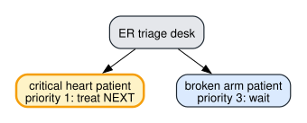
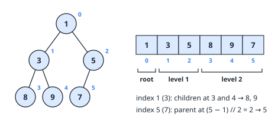
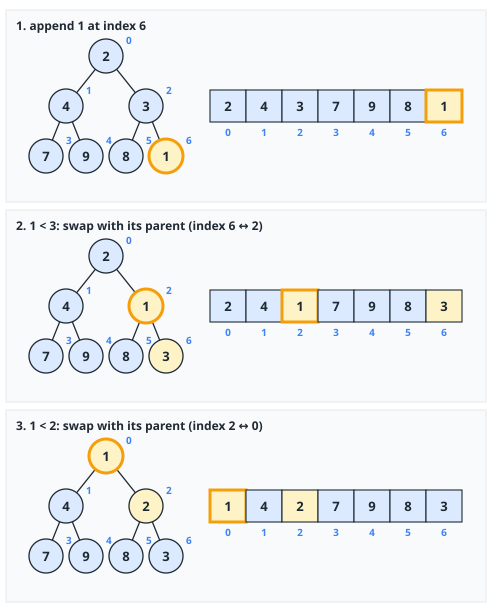
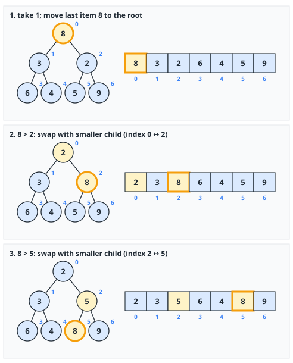
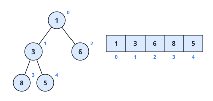

# Module: Heaps & Priority Queues (Extreme Value Tracking)

Welcome to the **Heaps & Priority Queues** module. A **Heap** is a specialized tree structure designed to solve one specific problem with maximum efficiency: **constantly tracking and extracting the minimum (or maximum) element in a collection**.

A **Priority Queue** is an abstract data type where elements have priorities. A **Heap** is the high-performance data structure used to implement a Priority Queue under the hood.

> [!NOTE]
> **Terminology Disambiguation**: The "Heap" data structure described here is completely unrelated to the "Heap Memory" region of RAM used for dynamic memory allocation!

---

## Before you start
<!-- bite: 7613b3c8-2aa7-489b-9526-d4586af7abd0 -->

- You understand arrays and index arithmetic. See [[01-arrays|arrays]].
- You understand tree shape and height. See [[01-trees|trees]].

**What you will be able to do after this lesson:**

1. Explain how a complete binary tree is stored in an array with no pointers.
2. Explain why the heap property is weaker than sorting, and why that is the point.
3. Implement push and pop with bubble-up and bubble-down.
4. Explain why finding the k largest uses a min-heap.

**Study route:** read the mechanism, run the lab, then attempt the independent task before opening the hint.

## 1. Real-World Motivation & Physical Metaphors
<!-- bite: 6186825e-5b10-4703-9960-b439f1782613 -->

Imagine an **Hospital Emergency Room Triage Desk**:



- When patients arrive, they are not treated strictly First-In, First-Out (FIFO).
- Patients are assigned a **Triage Score (Priority)**. The doctors must **always treat the highest-urgency patient next**, regardless of when they walked through the door.

### Why Not Just Use an Array?
1. **Unsorted Array**: Inserting a new patient is fast ($O(1)$), but finding the most critical patient requires scanning every person in the waiting room ($O(n)$).
2. **Sorted Array**: Finding the most critical patient is instant ($O(1)$ at index 0), but inserting a new patient requires shifting people in memory ($O(n)$).
3. **Heap (The Ideal Compromise)**: Maintaining a **partial order** allows you to peek at the extreme in **$O(1)$** time, and insert or remove items in **$O(\log n)$** time!

---

## Terms used with heaps
<!-- bite: 5fbc917d-79dd-44b2-af70-1c15d566a534 -->

1. **Heap**: This is a tree-shaped structure with one rule — every parent is ordered relative to its children. That single rule is weaker than full sorting, and the weakness is what makes it cheap to maintain.

2. **Heap property**: This is the rule itself. In a **min-heap** every parent is less than or equal to both of its children. In a **max-heap** every parent is greater than or equal to both. Note it says nothing about siblings: two children of the same parent are in no particular order relative to each other.

3. **Min-heap**: This is a heap where the smallest item is always at the root. If you repeatedly need "the smallest thing left", this is the structure.

4. **Max-heap**: This is a heap where the largest item is always at the root.

5. **Root**: This is the item at the top. In a min-heap it is the global minimum, and finding it costs nothing — you simply look at it.

6. **Complete binary tree**: This means every level of the tree is completely full, except possibly the last, which fills from the left. This shape is not decoration: it is what lets the whole tree be stored in a plain array with **no pointers at all**, because a node at index $i$ has its children at $2i+1$ and $2i+2$.

7. **Sift-up**: This is also called **bubble-up**. After adding an item at the bottom, it is compared with its parent and swapped upwards until the heap property holds again. It costs $O(\log n)$, because the tree's height is $\log n$.

8. **Sift-down**: This is also called **bubble-down**. After removing the root, the last item is moved to the top and then swapped downwards with its smaller child until the property holds. Also $O(\log n)$.

9. **Heapify**: This is turning an unordered array into a valid heap. Done naively — inserting items one at a time — it costs $O(n\log n)$. Done properly, sifting down from the middle of the array backwards, it costs **$O(n)$**, which is a genuinely surprising result worth understanding.

10. **Priority queue**: This is the **ADT**; a heap is the usual **implementation** of it. The distinction matters and is the subject of the next section.

## 3. The Array Representation (Zero Pointers Required!)
<!-- bite: 8249492a-88e1-4205-92c3-52134b738a1c -->

Because a Heap is guaranteed to be a **Complete Binary Tree**, it can be stored inside a standard **1D Array** without allocating Node objects or memory pointers!



### The Index Arithmetic Formula
For any element at index $i$:
$$\text{Parent Index} = \lfloor \frac{i - 1}{2} \rfloor$$
$$\text{Left Child Index} = 2i + 1$$
$$\text{Right Child Index} = 2i + 2$$

---

## 4. How Heap Operations Work ($O(\log n)$)
<!-- bite: 2383a198-d843-407e-93db-dc8e71127cec -->

### 1. `Push` Operation (Sift-Up) — $O(\log n)$
1. Append the new item to the very end of the array (maintaining complete tree shape).
2. Compare the item with its parent. If it violates the heap property (e.g. smaller than parent in a min-heap), **swap** them.
3. Repeat swapping UP until the parent is smaller (or it reaches the root).

### 2. `Pop` Operation (Sift-Down) — $O(\log n)$
1. The extreme item (min or max) is always at `array[0]`.
2. Replace `array[0]` with the **last item** in the array, then remove the last item.
3. Compare the new root with its children. **Swap** with the smaller child (in a min-heap).
4. Repeat swapping DOWN until both children are larger (or it hits a leaf).

---

## Seeing a push sift up
<!-- bite: eff9b522-14b4-45dd-9b5e-5d47e78e9543 -->

Here 1 is pushed onto the min-heap [2, 4, 3, 7, 9, 8]. Each panel shows the tree and the array together. The orange ring is the new item, and the shaded node is the one it just swapped with. It climbs one level per swap until its parent is smaller.



---

## Seeing a pop sift down
<!-- bite: 98b00bf3-4b59-4d7f-be13-f6f611b38f3e -->

Now a pop from [1, 3, 2, 6, 4, 5, 9, 8]. The root 1 is taken, the last item 8 jumps to the top, and then 8 sinks. At each step it swaps with the smaller of its two children, so the smaller one rises.



---

## The priority queue ADT
<!-- bite: 538f052f-9d15-42c6-9ce5-d1700ce5cd89 -->

**This is the clearest example in the folder of why ADTs and implementations are different things**, and it is worth being careful about the words.

A **priority queue** is an ADT: a collection where you add items freely and always remove the one with the highest priority. A **heap** is a way of building one. You could also build a priority queue from a sorted list, or an unsorted list, and it would satisfy the same ADT with different costs — which is exactly the comparison in the table below.

1. `insert(item)` — Adds `item` to the collection. **$O(\log n)$** with a heap: place it at the end and sift up.

2. `peek_min()` — Returns the smallest item **without** removing it. **$O(1)$** — it is the root, so you just read it. This is the operation heaps exist for.

3. `extract_min()` — Removes and returns the smallest item. **$O(\log n)$**: take the root, move the last item to the top, sift down.

4. `is_empty()` and `size()` — $O(1)$.

5. `heapify(list)` — Builds a heap from an existing list in **$O(n)$**, which is faster than inserting the items one by one.

6. `decrease_key(item, new_priority)` — Lowers an item's priority value and sifts it up. $O(\log n)$, but it needs a way to *find* the item first, which a plain heap does not provide. This is why [[02-dijkstra|Dijkstra's algorithm]] usually pushes a duplicate entry and skips stale ones instead.

### Why a heap rather than a sorted list

| Operation | Unsorted list | Sorted list | **Heap** |
| :--- | :---: | :---: | :---: |
| `insert` | $O(1)$ | $O(n)$ | $O(\log n)$ |
| `peek_min` | $O(n)$ | $O(1)$ | $O(1)$ |
| `extract_min` | $O(n)$ | $O(1)$ | $O(\log n)$ |

A sorted list beats a heap on both read operations and loses badly on insert. An unsorted list is the mirror image. **The heap's whole value is that it is good at all three at once**, by maintaining exactly enough order to know the minimum and no more.

That is the key idea and it is easy to miss: a heap is **not** a sorted structure. Printing a heap's array gives you something that looks almost random. It maintains one relationship — parent versus child — and refuses to do the extra work of ordering siblings, because knowing the minimum never required that work.

## 5. Python Implementation (`heapq` Module)
<!-- bite: a3bef44e-d098-4e1c-8b76-32eddac883be -->

Python provides the built-in `heapq` module, which implements a **Min-Heap**:

```python
import heapq

# 1. Initialize an empty heap
heap = []

# 2. Push elements: O(log n) each
heapq.heappush(heap, 5)
heapq.heappush(heap, 1)
heapq.heappush(heap, 3)

# 3. Peek at the minimum element: O(1)
min_val = heap[0]  # Returns 1

# 4. Pop the minimum element: O(log n)
smallest = heapq.heappop(heap)  # Returns 1, remaining heap is [3, 5]

# 5. Convert an existing list into a heap in-place: O(n)!
numbers = [9, 2, 7, 4, 1]
heapq.heapify(numbers)  # In-place transform: numbers is now [1, 2, 7, 4, 9]
```

### The Max-Heap Trick in Python
Since Python's `heapq` is strictly a Min-Heap, negate values when inserting and popping to simulate a Max-Heap:

```python
# To store values [10, 50, 20] in a Max-Heap:
max_heap = []
heapq.heappush(max_heap, -10)
heapq.heappush(max_heap, -50)
heapq.heappush(max_heap, -20)

# Pop largest element:
largest = -heapq.heappop(max_heap)  # Returns 50!
```

---

## 6. Mathematical Proof: Why `heapify()` is $O(n)$ (Not $O(n \log n)$!)
<!-- bite: 48d573e4-1f76-4a4f-88a4-0fd10628566c -->

Converting an unsorted array of size $N$ into a heap by repeatedly calling `heappush()` takes $N \times O(\log n) = O(n \log n)$.

However, calling `heapq.heapify(arr)` takes **$O(n)$ linear time**!

### Why?
`heapify()` works bottom-up:
- Half of the elements ($\approx N/2$) are leaves at the bottom of the tree. Sifting them down takes **0 swaps**!
- $N/4$ nodes are one level above leaves $\rightarrow$ at most **1 swap**.
- $N/8$ nodes are two levels above $\rightarrow$ at most **2 swaps**.

$$\text{Total Work} = \sum_{h=0}^{\log n} \frac{N}{2^{h+1}} \times h = O(N)$$

---

## Seeing heapify work bottom-up
<!-- bite: 8f861c59-e6f9-4cbe-ac25-2e1e153bbd1b -->

This is `heapify` on the lesson's list [9, 2, 7, 4, 1]. It skips the leaves and sifts down from index 1 back to index 0. Notice that only the item at the top travels two levels; the rest move one level or not at all.


---

## 7. Time & Space Complexity Summary
<!-- bite: f4354911-0460-4cdc-a44a-5fc2141c27c4 -->

| Operation | Time Complexity | Notes |
| :--- | :--- | :--- |
| **Peek Min / Max (`heap[0]`)** | **$O(1)$** | Direct index access to root. |
| **Push (`heappush`)** | **$O(\log n)$** | Swaps along tree height $h = \log n$. |
| **Pop (`heappop`)** | **$O(\log n)$** | Swaps along tree height $h = \log n$. |
| **Build Heap (`heapify`)** | **$O(n)$** | Bottom-up sift-down algorithm. |
| **Search Arbitrary Element** | $O(n)$ | Heaps do NOT maintain sorted search order! |
| **Space Complexity** | $O(n)$ | Stored in a flat 1D array. |

---

## 8. Common Pitfalls & Traps
<!-- bite: c6f16f89-e331-4f1d-be61-0c988b3096c7 -->

1. **Heaps Are NOT Search Trees**: Do not use a Heap to look up an arbitrary value (e.g. "Does 42 exist?"). Searching a heap requires scanning every element ($O(n)$). Use a [[03-hash-maps|Hash Map]] or [[01-trees|Binary Search Tree]] for lookups!
2. **Tuple Comparison Crashes**: Storing `(priority, item)` tuples in Python throws a `TypeError` if two priorities are equal and `item` is an unorderable object (like a custom class).
   - *Fix*: Include an incrementing counter tiebreaker: `(priority, counter, item)`.
3. **Repeated Push vs. Heapify**: Building a heap from an initial array by pushing one element at a time is $O(n \log n)$. Use `heapify(arr)` for $O(n)$ speed!

---

## Implementation - complete runnable example
<!-- bite: 6c27c755-d8f1-45ca-a12f-bd9161897c4c -->

**Runnable example:** save as `heaps_lab.py` and run `python3 heaps_lab.py`. Standard library only; writes no files. Everything is counted rather than timed, so your output will match this exactly.

```python
"""Heaps: a tree stored in an array, and why that is the whole trick."""

class MinHeap:
    """A complete binary tree with no pointers -- the array IS the tree."""
    def __init__(self):
        self.data, self.swaps = [], 0

    @staticmethod
    def parent(i): return (i - 1) // 2
    @staticmethod
    def left(i):   return 2 * i + 1
    @staticmethod
    def right(i):  return 2 * i + 2

    def push(self, x):
        """Add at the end, then bubble UP while smaller than the parent."""
        self.data.append(x)
        i = len(self.data) - 1
        while i > 0 and self.data[i] < self.data[self.parent(i)]:
            p = self.parent(i)
            self.data[i], self.data[p] = self.data[p], self.data[i]
            self.swaps += 1
            i = p

    def pop(self):
        """Take the root, move the last item there, bubble DOWN."""
        if not self.data: raise IndexError("pop from empty heap")
        smallest = self.data[0]
        last = self.data.pop()
        if self.data:
            self.data[0] = last
            i = 0
            while True:
                l, r, best = self.left(i), self.right(i), i
                if l < len(self.data) and self.data[l] < self.data[best]: best = l
                if r < len(self.data) and self.data[r] < self.data[best]: best = r
                if best == i: break
                self.data[i], self.data[best] = self.data[best], self.data[i]
                self.swaps += 1
                i = best
        return smallest

    def peek(self): return self.data[0] if self.data else None
    def __len__(self): return len(self.data)

def top_k(values, k):
    """Keep a MIN-heap of size k to find the k LARGEST.

    The smallest of your current best sits at the root, so it is the
    cheapest to evict -- which is why the heap is a min-heap."""
    h = MinHeap()
    for v in values:
        h.push(v)
        if len(h) > k:
            h.pop()
    return sorted(h.data, reverse=True)

if __name__ == "__main__":
    print("THE ARRAY IS THE TREE -- no pointers anywhere")
    h = MinHeap()
    for v in [5, 3, 8, 1, 9, 2]:
        h.push(v)
    print(f"  pushed 5 3 8 1 9 2")
    print(f"  array: {h.data}")
    print("  index: 0  1  2  3  4  5")
    print("         └─ children of i are at 2i+1 and 2i+2, parent at (i-1)//2")
    print(f"  root (the minimum) = {h.peek()}")
    print()
    print("  as a tree:")
    print("        1")
    print("      /   \\")
    print("     3     2")
    print("    / \\   /")
    print("   5   9 8")
    print()

    print("THE HEAP PROPERTY IS WEAKER THAN SORTING")
    print(f"  heap array : {h.data}")
    print(f"  sorted     : {sorted(h.data)}")
    print("  -> a heap only guarantees parent <= children. It does NOT")
    print("     sort. That weaker promise is why push and pop are")
    print("     O(log n) instead of O(n log n).")
    print()

    print("POPPING YIELDS SORTED ORDER")
    order = [h.pop() for _ in range(len(h))]
    print(f"  {order}")
    print()

    print("TOP-K -- the pattern heaps exist for")
    values = [7, 2, 9, 4, 1, 8, 3, 6, 5]
    for k in (1, 3, 5):
        print(f"  top {k} of {values}: {top_k(values, k)}")
    print()
    print(f"  {'n':>8s} {'k':>5s} {'sort: n log n':>15s} {'heap: n log k':>15s}")
    import math
    for n, k in [(1_000_000, 10), (1_000_000, 1000)]:
        print(f"  {n:8,d} {k:5d} {n*math.log2(n):15,.0f} {n*math.log2(k):15,.0f}")
    print("  -> the win only matters when k is much smaller than n.")

    assert h.data == []
    assert order == sorted(order)
    assert top_k([7,2,9,4,1,8,3,6,5], 3) == [9, 8, 7]
    assert top_k([1], 5) == [1]
    h2 = MinHeap()
    for v in [9, 8, 7, 6, 5]: h2.push(v)
    assert h2.peek() == 5
    assert [h2.pop() for _ in range(5)] == [5, 6, 7, 8, 9]
    print()
    print("heaps_lab: passed")
```

Expected output:

```text
THE ARRAY IS THE TREE -- no pointers anywhere
  pushed 5 3 8 1 9 2
  array: [1, 3, 2, 5, 9, 8]
  index: 0  1  2  3  4  5
         └─ children of i are at 2i+1 and 2i+2, parent at (i-1)//2
  root (the minimum) = 1

  as a tree:
        1
      /   \
     3     2
    / \   /
   5   9 8

THE HEAP PROPERTY IS WEAKER THAN SORTING
  heap array : [1, 3, 2, 5, 9, 8]
  sorted     : [1, 2, 3, 5, 8, 9]
  -> a heap only guarantees parent <= children. It does NOT
     sort. That weaker promise is why push and pop are
     O(log n) instead of O(n log n).

POPPING YIELDS SORTED ORDER
  [1, 2, 3, 5, 8, 9]

TOP-K -- the pattern heaps exist for
  top 1 of [7, 2, 9, 4, 1, 8, 3, 6, 5]: [9]
  top 3 of [7, 2, 9, 4, 1, 8, 3, 6, 5]: [9, 8, 7]
  top 5 of [7, 2, 9, 4, 1, 8, 3, 6, 5]: [9, 8, 7, 6, 5]

         n     k   sort: n log n   heap: n log k
  1,000,000    10      19,931,569       3,321,928
  1,000,000  1000      19,931,569       9,965,784
  -> the win only matters when k is much smaller than n.

heaps_lab: passed
```

## Check your understanding
<!-- bite: ea892193-a3ea-4d66-bdd3-0a15c2d90777 -->

Try each one before you open the answer.

1. <!-- q: gap id="140fe19d" answers="7;8;3" -->
   Fill in the gaps. A heap is stored in an array starting at index 0. The element at index 3 has its left child at index ___ and its right child at index ___. The element at index 7 has its parent at index ___.

   <details><summary>Answer</summary>

   Left child 2(3) + 1 = 7, right child 2(3) + 2 = 8, parent of 7 is ⌊(7 − 1)/2⌋ = 3.

   </details>

2. <!-- q: mcq id="4dcd31ac" -->
   Which statement about a min-heap is true?

   - [ ] Its array is in sorted order
   - [x] Every parent is less than or equal to its children, and there is no rule between siblings
   - [ ] Every left child is smaller than its right sibling
   - [ ] Finding any value takes O(log n)

   <details><summary>Answer</summary>

   The heap property is only parent versus child. That is just enough order to keep the minimum at the root, and weak enough to fix in O(log n) after each change. Searching for an arbitrary value is still O(n).

   </details>

3. <!-- q: mcq id="a28267bd" -->
   Match the costs for a heap of n items. Which line is correct?

   - [x] peek_min O(1), insert O(log n), extract_min O(log n), heapify O(n)
   - [ ] peek_min O(log n), insert O(1), extract_min O(1), heapify O(n log n)
   - [ ] peek_min O(1), insert O(n), extract_min O(n), heapify O(n)
   - [ ] All operations O(log n)

   <details><summary>Answer</summary>

   The minimum is the root, so peeking is O(1). Insert and extract each sift one item along a path of height log n. Building from a list bottom-up is O(n), because most nodes are near the bottom and barely move.

   </details>

4. <!-- q: mcq id="3dfe4be5" -->
   Python's `heapq` is a min-heap. How do you use it as a max-heap of numbers?

   - [ ] Call `heapq.reverse()` after each push
   - [x] Push each value multiplied by −1, and multiply by −1 again when you pop
   - [ ] Pop from the end of the list instead of the front
   - [ ] Pass `max=True` to `heappush`

   <details><summary>Answer</summary>

   Negating flips the order, so the largest original value becomes the smallest stored value and sits at the root.

   </details>

5. <!-- q: mcq id="ddda45a2" -->
   Why does `heapify` on n items cost O(n) while pushing them one at a time costs O(n log n)?

   - [ ] heapify skips half the items
   - [x] heapify sifts down from the bottom up, and about half the nodes are leaves needing no swaps, a quarter need at most one, and so on
   - [ ] heapify sorts the array first
   - [ ] heappush is badly written

   <details><summary>Answer</summary>

   Only the few nodes near the top can move far. Adding up n/4 × 1 + n/8 × 2 + n/16 × 3 + … gives a total below n.

   </details>

6. <!-- q: open id="1d9778cd" -->
   To keep the k largest values from a long stream, you use a MIN-heap of size k. Why a min-heap and not a max-heap?

   <details><summary>Answer</summary>

   The min-heap's root is the smallest of the k values kept so far, which is exactly the one to throw out when something bigger arrives. Each new value is compared with the root in O(1) and, if larger, replaces it in O(log k). A max-heap would put the wrong value at the root.

   </details>

## Check your understanding: worked problems
<!-- bite: 84a5bf37-24fc-41ac-9684-c0b595ddc6cd -->

Work each one out on paper first, then type your answer.

1. <!-- q: exact id="6bf4234d" answer="1, 4, 2, 7, 6, 9" accept="1 4 2 7 6 9|[1, 4, 2, 7, 6, 9]" -->
   Push 7, 4, 9, 2, 6, 1 in that order into an empty min-heap stored in an array (each push appends at the end and sifts up). What is the array afterwards? Separate the values with commas.

   <details><summary>Answer</summary>

   1, 4, 2, 7, 6, 9. Pushing 2 swaps it past 7 and then 4 to the root. Pushing 1 lands at index 5 under 9, swaps with 9, then with 2 at the root.

   </details>

2. <!-- q: exact id="f69c6e8e" answer="2, 4, 9, 7, 6" accept="2 4 9 7 6|[2, 4, 9, 7, 6]" -->
   A min-heap array is [1, 4, 2, 7, 6, 9]. You pop the minimum: the last item moves to the root and sifts down, swapping with its smaller child. What is the array afterwards? Separate the values with commas.

   <details><summary>Answer</summary>

   2, 4, 9, 7, 6. 9 moves to the root, giving [9, 4, 2, 7, 6]. Its children are 4 and 2, so it swaps with 2. At index 2 it has no children, so it stops.

   </details>

3. <!-- q: exact id="25e861b6" answer="3" -->
   A min-heap array is [3, 5, 8, 9, 6, 10, 12]. You push 1. How many swaps does sift-up make?

   <details><summary>Answer</summary>

   3. 1 is appended at index 7. Its parent at index 3 is 9: swap. Its parent at index 1 is 5: swap. Its parent at index 0 is 3: swap. It is now the root: [1, 3, 8, 5, 6, 10, 12, 9]. That is the tree's height, log₂ 8 = 3.

   </details>

4. <!-- q: gap id="0f32948d" answers="18;25;30" -->
   Fill in the gaps. To keep the 3 largest values, you read 12, 5, 30, 7, 18, 25, 3 into a min-heap of size 3. Once it is full, a new value replaces the root only if it is larger than the root. At the end the heap holds ___, ___ and ___ (smallest first).

   <details><summary>Answer</summary>

   18, 25, 30. After 12, 5, 30 the root is 5. 7 replaces 5 (root 7). 18 replaces 7 (root 12). 25 replaces 12 (root 18). 3 is smaller than 18 and is ignored.

   </details>

5. <!-- q: sketch id="2fe38c73" -->
   Push 8, 3, 6, 1, 5 in that order into an empty min-heap (each push appends at the end and sifts up). On paper, draw the final heap as a tree, and write the array underneath with its indexes.

   <details><summary>Answer</summary>

   

   What to check:
   - The tree is complete: levels fill left to right, so 8 and 5 both hang under 3, not under 6.
   - Pushing 1 swaps it past 8 and then 3 to reach the root.
   - Pushing 5 makes no swap, because its parent 3 is already smaller.
   - Every parent is smaller than its children, but 3 and 6 (siblings) are in no special order.

   </details>

## Practice - independent task
<!-- bite: 2031b749-9156-4d6e-addc-d8b07c4ad481 -->

Implement **heapify** - building a heap from an unsorted array in O(n), not O(n log n).

- The obvious way pushes each element one at a time: n pushes at O(log n) each.
- The better way starts at the last non-leaf node and bubbles **down**, working backwards to the root.
- Implement both. Count swaps for arrays of 1,000, 10,000 and 100,000 elements.
- **The surprising result:** bottom-up heapify is O(n), not O(n log n). Most nodes are near the bottom and barely move.
- Then implement **heapsort**: heapify, then repeatedly pop the root.

**Done when:** both constructions produce valid heaps, your swap counts show bottom-up growing linearly while repeated-push grows faster, and heapsort matches Python's `sorted()`.

<details><summary>Hint - open only after an attempt</summary>
The intuition for O(n): half the nodes are leaves and cannot move at all; a quarter are one level up and move at most one step; an eighth move at most two. The total is n times the sum of k/2^k, which converges to a constant.<br>
<strong>Repeated push is the opposite</strong> - it adds each element at the bottom where the tree is deepest, so it pays close to the full log n every time. Same final structure, different construction cost, and the difference is a genuinely surprising piece of arithmetic.
</details>

## Before moving on
<!-- bite: 9e6739bc-8360-4aba-a6b1-c03f186f9872 -->

You are done with this module when you can, closed-book:

- [ ] Explain the index arithmetic linking a node to its parent and children.
- [ ] Explain why a heap does not sort, and why that weaker promise is useful.
- [ ] Trace a push that bubbles up and a pop that bubbles down.
- [ ] Explain why the k largest elements are found with a min-heap.

**Recap:** A heap is a complete binary tree stored in an array, with children of index i at 2i+1 and 2i+2 - so the structure is implied by arithmetic and needs no pointers. It guarantees only that each parent beats its children, which is far weaker than sorting and is exactly why push and pop cost O(log n) rather than O(n log n). Keeping a min-heap of size k finds the k largest in O(n log k), which beats sorting when k is much smaller than n.

**Next:** [[08-tries|Tries]] - a structure where the shape of the key itself becomes the path through the tree.

## Related Modules
<!-- bite: aa9d8f78-7e81-4805-aee4-476cf52fb2d0 -->
- [[01-arrays|Arrays]] — The flat 1D storage array underlying heaps
- [[02-dijkstra|Dijkstra's Algorithm]] — Priority queues driving weighted shortest path search
- [[05-sorting/index|Sorting]] — Heapsort ($O(n \log n)$ in-place sort)
