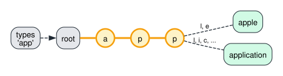
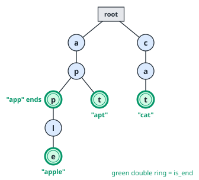
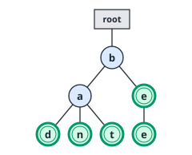

# Module: Tries / Prefix Trees (Shared Prefix Search)

Welcome to the **Trie** (pronounced *"try"*, short for re**TRIE**val) module.

---

## Before you start
<!-- bite: f5aabaf3-b2e8-43bd-aef8-efcdc4ab8b11 -->

- You understand tree structure. See [[01-trees|trees]].
- You understand hash maps and what they give up. See [[03-hash-maps|hash maps]].

**What you will be able to do after this lesson:**

1. Explain how a key becomes a path rather than something stored at a node.
2. Explain why lookup is O(length) and independent of how many words are stored.
3. Explain why a hash map cannot do prefix search at all.
4. State the memory tradeoff and when a trie is the wrong choice.

**Study route:** read the mechanism, run the lab, then attempt the independent task before opening the hint.

## What a trie is
<!-- bite: 57e45f33-72ee-4a34-8172-5b44f85466cb -->

A Trie is a tree-based data structure optimized for storing strings by sharing common letter prefixes.

Tries trade extra memory to grant a superpower that [[03-hash-maps|Hash Maps]] cannot match: **answering "Does any word start with this prefix?" in $O(L)$ time**, where $L$ is the length of the prefix, regardless of whether the dictionary contains 10 words or 10,000,000 words!

## 1. Real-World Motivation & Physical Metaphors
<!-- bite: b3a57254-a940-4a1f-9b63-8b4c8baf57d8 -->

Imagine using the **Search Bar Autocomplete** on your phone:



- If you stored 1,000,000 words in a [[03-hash-maps|Hash Set]], asking *"Are there any words starting with 'app'?"* would force the computer to scan all 1,000,000 entries one-by-one ($O(N)$).
- A **Trie** stores words by sharing letter paths. The characters `'a' -> 'p' -> 'p'` are stored **once**, and all words starting with `"app"` branch off from that exact node!

## Production Use Cases for tries
<!-- bite: b7d27d20-6773-4cae-b115-20afed3b5c23 -->

Tries show up in these real systems.

1. **Search Engine Autocomplete**: Instant word predictions as you type.
2. **Spell-Checkers & Predictive Text (T9)**: Validating dictionary words.
3. **IP Router Routing Tables**: Longest prefix matching for IP addresses.

---

## Terms used with tries
<!-- bite: a1b3595c-6e43-463c-a3e1-f47596292882 -->

1. **Trie**: This is a tree where the **path you walk spells out a word**, rather than any single node holding one. It is also called a **prefix tree**. The name comes from "retrieval" and is usually pronounced "try".

2. **Root node**: This is the starting node, representing the empty string. Every word's path begins here.

3. **Character edge**: This is a link from one node to the next, labelled with a single character. Walking the edge labelled `a` then the edge labelled `p` puts you at the node for the prefix `"ap"`.

## Terms used with tries: prefixes, word ends and alphabet size
<!-- bite: dba08651-f59d-4019-949a-004692bc0771 -->

These terms are about prefixes, marking where a word ends, and how many characters can follow a node.

4. **Prefix**: This is the beginning of a word. `"ap"` is a prefix of `"apple"`. **A trie's defining feature is that every prefix is an actual place in the structure**, which is why prefix questions are cheap.

5. **`is_end` flag**: This is a true-or-false marker on a node saying "a complete word ends here". It is needed because a node can be passed through on the way to a longer word without being a word itself — the flag is what separates `"app"`, which is a word, from `"appl"`, which is only a stop along the way to `"apple"`.

6. **Alphabet size**: This is how many different characters can follow any node, written $\Sigma$. It is 26 for lowercase English letters, 128 for ASCII, and over a million for full Unicode. **This number decides how much memory a trie costs**, which is its main drawback.

## 3. Visual Anatomy of a Trie
<!-- bite: 77d94ae2-9384-4821-bb16-8b959e480e00 -->

Below is a Trie containing the words **`"app"`, `"apple"`, `"apt"`, and `"cat"`**:

The green double rings mark nodes where `is_end` is True:



Notice how `"app"`, `"apple"`, and `"apt"` all share the initial path `'a' -> 'p'`!

---

## Seeing a trie grow, word by word
<!-- bite: 4acafd72-916c-47cf-adac-3337d55fe72a -->

Here is the same trie built by inserting its four words in order. The orange path is the walk for each word, and orange rings are nodes created by that insert. Look at "apt": a and p already exist, so it adds just one node.


---

## The trie ADT
<!-- bite: 93be1f36-96ee-428d-bbd9-f7e810caf776 -->

A trie stores a set of strings, like a [[03-hash-maps|hash set]] would. The difference is entirely in the **third** operation below, and that one operation is the reason tries exist.

Throughout, $L$ is the length of the word being handled — **not** the number of words stored. That is the unusual and valuable part.

1. `insert(word)` — Adds `word` to the trie. **$O(L)$** — walk one node per character, creating nodes as needed.

2. `search(word)` — Returns whether the exact word is present. **$O(L)$**. Note this does not depend on how many words the trie holds: searching a trie of ten words and a trie of ten million words costs the same for a five-letter word.

3. `starts_with(prefix)` — Returns whether **any** stored word begins with `prefix`. **$O(L)$**. *This is the operation a hash set cannot do at all.* A hash set would have to check every stored word, because hashing destroys the relationship between `"app"` and `"apple"`.

## The trie ADT: deleting and autocomplete
<!-- bite: d0b2bc13-dccf-46cf-b6ce-193f2b86fdbc -->

Two more operations remove a word and list every word under a prefix.

4. `delete(word)` — Removes a word, clearing its `is_end` flag and pruning any nodes now leading nowhere. $O(L)$.

5. `words_with_prefix(prefix)` — Returns every stored word beginning with `prefix`. Costs $O(L)$ to walk to the prefix node, plus the time to collect what hangs below it. **This is autocomplete.**

## The trie ADT: the trade
<!-- bite: d1468776-10b9-4177-8628-880ef45138ea -->

Compared with a hash set, a trie:

- **Gains** prefix search, ordered iteration (walking children alphabetically yields sorted words), and a lookup cost that does not grow with the number of stored words.
- **Costs** far more memory. Every node may hold up to $\Sigma$ child pointers, and most sit empty. A trie over full Unicode is impractical without a compressed variant.
- **Loses** on plain exact-match lookup in practice: both read the whole word, $O(L)$, but a hash set does it in one quick pass over the characters and then one jump to a bucket, with much better cache behaviour, since trie nodes are scattered like [[04-linked-lists|linked list]] nodes.

**Use a trie when the question is about prefixes.** If you only ever ask "is this exact word present?", use a hash set.

## 4. Technical Deep Dive: Trie Implementation
<!-- bite: 5d0aa600-d017-4c2a-913e-a2362ab9d1eb -->

### Python Code: `TrieNode` & `Trie` Class
```python
class TrieNode:
    """Node representing a single character step in the Trie."""
    def __init__(self):
        self.children = {}  # Maps character -> TrieNode (e.g. {'a': Node})
        self.is_end = False  # True if a complete word ends at this node


class Trie:
    """Prefix Tree data structure."""
    def __init__(self):
        self.root = TrieNode()

    def insert(self, word: str) -> None:
        """Inserts a word into the trie. Time Complexity: O(L)"""
        current = self.root
        for char in word:
            if char not in current.children:
                current.children[char] = TrieNode()
            current = current.children[char]
        current.is_end = True  # Flag the end of the word

    def search(self, word: str) -> bool:
        """Returns True if the exact word exists in the trie. Time Complexity: O(L)"""
        node = self._walk(word)
        return node is not None and node.is_end

    def startsWith(self, prefix: str) -> bool:
        """Returns True if any word in the trie starts with prefix. Time Complexity: O(L)"""
        return self._walk(prefix) is not None

    def _walk(self, text: str) -> TrieNode:
        """Helper to walk the trie path for a given string."""
        current = self.root
        for char in text:
            if char not in current.children:
                return None
            current = current.children[char]
        return current
```

---

## 5. Hash Set vs. Trie Comparison
<!-- bite: e4d076a8-e184-4905-897d-cdcc6aae2cec -->

| Feature | Hash Set / Hash Map | Trie (Prefix Tree) |
| :--- | :--- | :--- |
| **Exact Word Match (`"apple"`)** | **$O(L)$** (Hash calculation) | **$O(L)$** (Node traversal) |
| **Prefix Match (`startsWith("app")`)** | $O(N \cdot L)$ (Must scan all keys) | **$O(L)$** (Walk prefix length only!) |
| **Memory Consumption** | Compact ($O(N \cdot L)$) | Higher due to node pointers ($O(N \cdot L \cdot \Sigma)$) |
| **Sorted Lexicographical Traversal**| Requires sorting all keys ($O(N \log N)$) | **$O(N)$ for free** (Preorder traversal of tree) |

---

## 6. Advanced Pattern: Wildcard Search (`.`)
<!-- bite: 71b81c8a-cdbb-457e-9086-696e5bc2c7c5 -->

When a query string includes a wildcard `.` (matching any character), the single-path lookup transforms into a **Depth-First Search (DFS)** over all child branches:

```python
def search_wildcard(self, word: str) -> bool:
    """Searches for a word where '.' matches any character."""
    def dfs(node: TrieNode, index: int) -> bool:
        if index == len(word):
            return node.is_end
            
        char = word[index]
        if char == '.':
            # Wildcard: Recurse down ALL existing child nodes!
            return any(dfs(child, index + 1) for child in node.children.values())
        else:
            if char not in node.children:
                return False
            return dfs(node.children[char], index + 1)

    return dfs(self.root, 0)
```

---

## 7. Complexity & Memory Trade-Offs
<!-- bite: c5412957-4502-4b4d-9138-1dea0e7ad867 -->

Let $L$ = Length of the target word/prefix, and $\Sigma$ = Alphabet size (e.g. 26).

| Operation | Time Complexity | Notes |
| :--- | :--- | :--- |
| **Insert Word** | **$O(L)$** | Completely independent of total words stored ($N$). |
| **Search Exact Word** | **$O(L)$** | Checks `is_end == True`. |
| **Prefix Match (`startsWith`)**| **$O(L)$** | The key operation a Hash Map cannot match! |
| **Space Overhead** | $O(N \cdot L \cdot \Sigma)$ | Shared prefixes save space, but pointer overhead is high. |

---

## 8. Common Pitfalls & Traps
<!-- bite: cb93ac6f-c6f0-4b0d-a417-387c559dfb7b -->

1. **Forgetting `is_end`**: If you forget to flag `is_end = True`, your Trie cannot distinguish between an actual word (`"app"`) and a prefix of a longer word (`"apple"`).
2. **Memory Overuse**: Using fixed arrays of size 26 for Unicode/multilingual inputs wastes massive RAM. Use a dynamic dictionary `self.children = {}` instead.
3. **Complex Deletions**: Deleting a word from a Trie requires recursively pruning unneeded nodes only if they have no other children and are not marked as `is_end` for another word.

---

## Implementation - complete runnable example
<!-- bite: c362c287-914f-4506-8f3e-3f839eb8d8a0 -->

**Runnable example:** save as `tries_lab.py` and run `python3 tries_lab.py`. Standard library only; writes no files. Everything is counted rather than timed, so your output will match this exactly.

```python
"""Tries: the structure where the KEY is the path, not something stored."""

class Trie:
    class Node:
        __slots__ = ("children", "is_word")
        def __init__(self):
            self.children, self.is_word = {}, False

    def __init__(self):
        self.root, self.nodes = Trie.Node(), 1

    def insert(self, word):
        node = self.root
        for ch in word:
            if ch not in node.children:
                node.children[ch] = Trie.Node()
                self.nodes += 1
            node = node.children[ch]
        node.is_word = True

    def _walk(self, prefix):
        node = self.root
        for ch in prefix:
            if ch not in node.children:
                return None
            node = node.children[ch]
        return node

    def contains(self, word):
        node = self._walk(word)
        return node is not None and node.is_word

    def starts_with(self, prefix):
        return self._walk(prefix) is not None

    def with_prefix(self, prefix):
        """The operation a hash map cannot do at all."""
        node, out = self._walk(prefix), []
        if node is None:
            return out
        def collect(n, path):
            if n.is_word: out.append(prefix + path)
            for ch in sorted(n.children):
                collect(n.children[ch], path + ch)
        collect(node, "")
        return out

if __name__ == "__main__":
    words = ["car", "card", "care", "careful", "cat", "dog", "do"]
    t = Trie()
    for w in words: t.insert(w)

    print("THE KEY IS THE PATH")
    print(f"  inserted: {words}")
    print()
    print("  root")
    print("   ├── c ── a ── r*  ── d*")
    print("   │              │    └── e* ── f ── u ── l*")
    print("   │              └── t*")
    print("   └── d ── o* ── g*")
    print("  (* marks the end of a real word)")
    print()
    print("  'car', 'card' and 'care' SHARE the nodes c-a-r. The common")
    print("  prefix is stored once, not three times.")
    print()

    print("LOOKUP IS O(length), NOT O(number of words)")
    print(f"  {'query':>10s} {'contains':>10s} {'is a prefix':>13s}")
    for q in ["car", "care", "ca", "cart", "do", "dog"]:
        print(f"  {q:>10s} {str(t.contains(q)):>10s} {str(t.starts_with(q)):>13s}")
    print("  -> 'ca' is a valid PREFIX but not a WORD. A trie distinguishes")
    print("     them; that is what the is_word flag is for.")
    print()

    print("PREFIX SEARCH -- what a hash map simply cannot do")
    for p in ["car", "ca", "d", "z"]:
        print(f"  words starting {p!r:6s}: {t.with_prefix(p)}")
    print("  -> a hash map hashes the WHOLE key, so it destroys the")
    print("     relationship between 'car' and 'card'. Autocomplete needs")
    print("     that relationship, which is why tries exist.")
    print()

    print("THE COST -- nodes versus characters stored")
    total_chars = sum(len(w) for w in words)
    print(f"  {len(words)} words, {total_chars} characters total")
    print(f"  trie nodes: {t.nodes}  (shared prefixes save {total_chars + 1 - t.nodes} nodes)")
    print("  -> tries trade memory per node for prefix operations. With")
    print("     little shared prefix, they are far heavier than a hash map.")

    assert t.contains("car") and t.contains("careful")
    assert not t.contains("ca") and t.starts_with("ca")
    assert not t.contains("cart") and not t.starts_with("cart")
    assert t.with_prefix("car") == ["car", "card", "care", "careful"]
    assert t.with_prefix("z") == []
    assert sorted(t.with_prefix("")) == sorted(words)
    print()
    print("tries_lab: passed")
```

## Implementation: what it prints
<!-- bite: 19f4c3a2-f389-42d8-8279-cd5d545cba28 -->

This is what the tries lab prints when you run it.

Expected output:

```text
THE KEY IS THE PATH
  inserted: ['car', 'card', 'care', 'careful', 'cat', 'dog', 'do']

  root
   ├── c ── a ── r*  ── d*
   │              │    └── e* ── f ── u ── l*
   │              └── t*
   └── d ── o* ── g*
  (* marks the end of a real word)

  'car', 'card' and 'care' SHARE the nodes c-a-r. The common
  prefix is stored once, not three times.

LOOKUP IS O(length), NOT O(number of words)
       query   contains   is a prefix
         car       True          True
        care       True          True
          ca      False          True
        cart      False         False
          do       True          True
         dog       True          True
  -> 'ca' is a valid PREFIX but not a WORD. A trie distinguishes
     them; that is what the is_word flag is for.

PREFIX SEARCH -- what a hash map simply cannot do
  words starting 'car' : ['car', 'card', 'care', 'careful']
  words starting 'ca'  : ['car', 'card', 'care', 'careful', 'cat']
  words starting 'd'   : ['do', 'dog']
  words starting 'z'   : []
  -> a hash map hashes the WHOLE key, so it destroys the
     relationship between 'car' and 'card'. Autocomplete needs
     that relationship, which is why tries exist.

THE COST -- nodes versus characters stored
  7 words, 26 characters total
  trie nodes: 13  (shared prefixes save 14 nodes)
  -> tries trade memory per node for prefix operations. With
     little shared prefix, they are far heavier than a hash map.

tries_lab: passed
```

## Check your understanding
<!-- bite: eb4aa98d-87aa-4d59-bf0c-4cdf8b87e7a4 -->

Try each one before you open the answer.

1. <!-- q: mcq id="af9279d4" -->
   Why can't a hash set answer "does any stored word start with 'app'?" quickly?

   - [x] It hashes whole words, so "app" hashes to an unrelated bucket and every stored word would have to be checked
   - [ ] Hash sets can only store numbers
   - [ ] Hash sets are sorted backwards
   - [ ] It can; prefix search is O(1) in a hash set

   <details><summary>Answer</summary>

   Hashing scatters similar strings to unrelated buckets, so nothing links "app" to "apple". The only way is to scan all N words. A trie walks three edges.

   </details>

2. <!-- q: mcq id="a7013f35" -->
   A trie holds only the word "apple". Without an `is_end` flag, what goes wrong when you search for "app"?

   - [x] The path a → p → p exists, so "app" would wrongly be reported as a stored word
   - [ ] The search crashes
   - [ ] "apple" can no longer be found
   - [ ] Nothing goes wrong

   <details><summary>Answer</summary>

   A node can be passed through on the way to a longer word without being a word itself. The flag marks where a complete word ends.

   </details>

3. <!-- q: gap id="a8935f80" answers="length|L|the length of the word|word length" -->
   Fill in the gap. Searching a trie for a word costs O(L), where L is the ___ of the word, no matter how many words the trie holds.

   <details><summary>Answer</summary>

   The length of the word. You walk one edge per character, so a trie of ten words and one of ten million cost the same for a five-letter word.

   </details>

4. <!-- q: mcq id="4453c286" -->
   When is a trie the wrong choice? Choose all that apply.

   - [x] You only ever ask whether an exact word is present
   - [x] Keys come from full Unicode and each node uses a fixed array of child pointers
   - [ ] You need autocomplete from a typed prefix
   - [ ] You need longest-prefix matching for IP routes

   <details><summary>Answer</summary>

   For exact lookups a hash set is simpler, faster in practice and smaller. A fixed child array per node wastes huge memory for big alphabets. Autocomplete and prefix matching are exactly what tries are for.

   </details>

5. <!-- q: open id="fb45d6fb" -->
   How can a trie give you all its words in alphabetical order without sorting them?

   <details><summary>Answer</summary>

   Do a pre-order walk from the root, visiting each node's children in alphabetical order and outputting the path whenever a node has `is_end` set. A shorter word is output before its longer extensions, and branches come out in letter order, so the words appear sorted.

   </details>

## Check your understanding: worked problems
<!-- bite: b910c78c-eb51-4496-bbc1-9adc03dd4df3 -->

Work each one out on paper first, then type your answer.

1. <!-- q: exact id="ba601d46" answer="10" -->
   Insert the words "tea", "ten", "tent", "to" and "inn" into an empty trie, one node per character. How many nodes does the trie have, counting the root?

   <details><summary>Answer</summary>

   10. Root, t, te, tea, ten, tent, to, i, in, inn. The prefix "t" is shared by four words and "te" by three, so each is stored once.

   </details>

2. <!-- q: gap id="511f0993" answers="no;yes" -->
   Fill in the gaps with yes or no. A trie holds "tea", "ten", "tent", "to" and "inn". `search("te")` returns ___ and `starts_with("te")` returns ___.

   <details><summary>Answer</summary>

   No, then yes. The node for "te" exists but its `is_end` flag is false, because "te" was never inserted as a word. It is a prefix of tea, ten and tent.

   </details>

3. <!-- q: exact id="415f5297" answer="inn, tea, ten, tent, to" accept="inn tea ten tent to" -->
   A trie holds "tea", "ten", "tent", "to" and "inn". A pre-order walk visits children in alphabetical order and outputs each word where `is_end` is true. List the output, separated by commas.

   <details><summary>Answer</summary>

   inn, tea, ten, tent, to. The i branch comes before t. Under "te", a comes before n, and "ten" is output before its extension "tent".

   </details>

4. <!-- q: exact id="f1a87d47" answer="7" -->
   Insert "car", "card", "care" and "cat" into an empty trie, one node per character. How many nodes does it have, counting the root?

   <details><summary>Answer</summary>

   7. Root, c, ca, car, card, care, cat. Four words with 15 letters between them need only 6 character nodes, because "ca" and "car" are shared.

   </details>

5. <!-- q: sketch id="65f25127" -->
   Insert the words "bat", "bad", "ban", "be" and "bee" into an empty trie, one node per character. On paper, draw the trie, putting each node's letter inside it, and mark every node where a word ends.

   <details><summary>Answer</summary>

   

   What to check:
   - There is only one b node, shared by all five words.
   - The a under b has three children, d, n and t, each marked as a word end.
   - The e under b is marked as a word end ("be") even though it also has a child, the second e ("bee").

   </details>

## Practice - independent task
<!-- bite: 85f6f083-f08c-4824-b81c-39cbc1252937 -->

Implement **autocomplete with ranking** - the actual product feature.

- Extend the trie so each word carries a frequency count.
- `suggest(prefix, k)` returns the `k` most frequent completions.
- The naive version collects every completion and sorts. For a prefix like `"a"` on a large dictionary that is very slow.
- Improve it: store at each node the best score in its subtree, then explore with a priority queue ([[07-heaps|heap]]), always expanding the most promising branch first.
- Test on at least 500 words with varied frequencies.

**Done when:** ranked suggestions are correct, and you can show your improved version visits far fewer nodes than the collect-everything approach for a short prefix.

<details><summary>Hint - open only after an attempt</summary>
Store <code>best_below</code> at each node: the highest frequency of any word in that subtree. Then a best-first search using a max-heap keyed on <code>best_below</code> expands only branches that could still contain a top-k answer.<br>
This is the same idea as branch-and-bound: <strong>an upper bound on what a branch could yield lets you skip it entirely</strong>. Without the bound you must explore everything to be sure.
</details>

## Before moving on
<!-- bite: c002b409-b74d-4449-8797-83b77473747d -->

You are done with this module when you can, closed-book:

- [ ] Explain how the path from the root spells the key.
- [ ] Explain why lookup cost depends on key length, not on the number of keys.
- [ ] Explain why a hash map destroys the prefix relationship.
- [ ] State when a trie costs more memory than it is worth.

**Recap:** A trie stores keys as paths, so common prefixes are shared rather than duplicated and lookup costs O(length) regardless of how many keys exist. A separate flag marks which paths are complete words, distinguishing a prefix from a key. Because a hash map hashes the whole key, it destroys any relationship between similar keys - which is why prefix search and autocomplete need a trie. The cost is memory per node, so tries are a poor choice when keys share little.

**Next:** [[09-graphs/index|Graphs]] - drop the rule that every node has one parent, and trees become graphs: roads, networks, dependencies.

## Related Modules
<!-- bite: e1fa0186-6bf7-477d-85c1-0ce651d054d1 -->
- [[03-hash-maps|Hash Maps]] — The faster exact-match alternative
- [[01-trees|Trees]] — General tree hierarchies
- [[01-depth-first-search|Depth-First Search (DFS)]] — Traversing Tries for wildcard and grid search (Word Search II)
