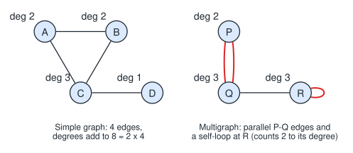
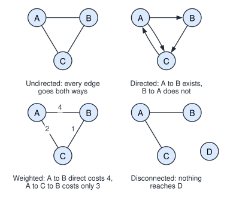
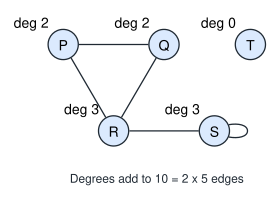

# Module: What a Graph Is

A graph is a set of things, called vertices, joined by links, called edges.

## Before you start
<!-- bite: 513fc576-cb6a-4250-ac09-bf0abdd0e03d -->

- You know what an array and a hash map are — [[01-arrays|arrays]], [[03-hash-maps|hash-maps]].
- Helpful: [[02-discrete-math/07-graph-theory|discrete maths: graph theory]], which proves what this course uses.

**After this lesson you will be able to:**

1. Define **vertex, edge, incident, adjacent** and **degree**, and use them precisely.
2. Distinguish **simple graph, multigraph, self-loop** and **parallel edges**, and say which your code assumes.
3. Classify any graph along the four dimensions: **directed/undirected, weighted/unweighted, cyclic/acyclic, connected/disconnected**.
4. State and verify the **handshake lemma**.

**Study route:** read the terms first, then the four dimensions, then the abstract data type. Attempt the prediction before the lab, then run it.

---

## What a graph is
<!-- bite: 956eec98-cadc-4b57-9a62-f782aea3cbf1 -->

A graph stores things and the links between them. It is the way to store anything that is about connections. Your contacts on WhatsApp, roads between towns on Google Maps and links between web pages are all graphs.

## Why this exists
<!-- bite: f9a60d11-bfd6-439a-a81a-8eb4c32ce4af -->

A graph is the structure you reach for when **the relationships matter as much as the things**. Cities and roads. Users and follows. Tasks and dependencies. Web pages and links.

Arrays and trees both impose a shape: an array is a line, a tree is a hierarchy with one path between any two nodes. A graph imposes nothing — any node may connect to any other, in either direction, possibly more than once. That freedom is why graphs model so much, and why the vocabulary has to be exact: without agreed terms, "is there a path?" is four different questions.

This lesson is almost entirely definitions. That is deliberate. Nearly every confusion later in this folder traces back to a term used loosely here.

## Terms used in graphs
<!-- bite: 5a95f3e1-fde8-40e6-920f-ab236314e526 -->

These are all the words the rest of this folder is written in. None of them are hard, but they are used precisely, so it is worth reading them once slowly.

1. **Vertex**: This is also known as a **node**. This is a point in a graph that can be connected to other points by edges. If the graph is a map, a vertex is a city.

2. **Edge**: This is also known as an **arc** or a **link**. This is a connection or line between two vertices. If a vertex is a city, an edge is a road between two cities.

3. **Endpoints**: An endpoint is one of the two vertices that are connected by a particular edge. Every edge has exactly two of them, and that fact is used more often than you would expect.

4. **Incident**: This is the relationship between a vertex and an edge. If a vertex is an endpoint of an edge, then the vertex and the edge are incident to each other.

5. **Adjacent**: This is also called being **neighbours**. Adjacent vertices are two nodes that are connected by the same edge, and adjacent edges are two edges that connect to the same vertex.

## Terms used in graphs: degree and odd edges
<!-- bite: 12ba8d3c-0fed-40f7-9ac0-4b090143813a -->

These terms count edges at a vertex, and name the odd kinds of edge.

6. **Degree**: The degree of a vertex is the number of edges connected to it. It is written $\deg(v)$. A self-loop is the one exception worth remembering — it counts **twice**, because both of its ends are attached to the same vertex.

7. **In-degree and out-degree**: In-degree is the number of edges coming in to a vertex, and out-degree is the number of edges leaving it. These only mean something in a directed graph, where edges have a direction.

8. **Self-loop**: This is an edge that connects a vertex to itself. A web page that links to itself is a self-loop.

9. **Parallel edges**: These are multiple edges that connect the same pair of vertices. Two separate roads between the same two towns are parallel edges.

## Terms used in graphs: kinds of graph and their size
<!-- bite: 3338aca4-cabb-4e36-8bb5-894a8f557058 -->

These terms name whole graphs: plain or messy, weighted or not, big or small.

10. **Simple graph**: This is a graph with no self-loops and no parallel edges. Most algorithms quietly assume they are given one of these, so it is worth checking that your input really is simple before trusting them.

11. **Multigraph**: This is a graph where parallel edges and self-loops are both allowed. Road networks and circuit diagrams are usually multigraphs.

12. **Weighted graph**: This is a graph where each edge carries a number. That number might be a distance, a cost, a capacity, or a travel time, depending on what you are modelling.

## Terms used in graphs: how big and how full
<!-- bite: 8e0d46eb-3e41-4529-9cd5-3a4cd012e8a5 -->

The last two terms measure a graph: how many vertices and edges it has, and how full it is.

13. **Order and size**: The order of a graph is the number of vertices, written $\lvert V\rvert$. The size is the number of edges, written $\lvert E\rvert$. These are often shortened to $n$ and $m$.

14. **Dense and sparse**: A dense graph has a number of edges close to the maximum possible number of edges. A sparse graph has relatively few edges compared to its number of vertices. Which one you have decides how you should store the graph, which is the whole subject of [[04-representations|lesson 4]].

**Incident and adjacent are not interchangeable.** *Incident* relates an edge to a vertex. *Adjacent* relates two vertices to each other. Textbooks are strict about this and so are exam questions.

## Seeing the terms on one small graph
<!-- bite: 86110ec4-a665-4110-8462-fc3faa89d853 -->

The left graph is the one the lab builds. Each vertex has its degree written beside it, and the degrees add up to twice the number of edges. The right graph is a multigraph: look at the two red P–Q edges and the red self-loop at R, which adds 2 to R's degree.



## The four dimensions of a graph
<!-- bite: e2bfb1ad-4e20-467c-8548-39cb6238cb67 -->

Every graph question starts by fixing these four. Get one wrong and the algorithm you choose is wrong.

| Dimension        | Options                         | What it changes                             |
| :--------------- | :------------------------------ | :------------------------------------------ |
| **Direction**    | Undirected / directed (digraph) | Whether an edge can be traversed both ways  |
| **Weight**       | Unweighted / weighted           | Whether BFS suffices or you need Dijkstra   |
| **Cycles**       | Cyclic / acyclic                | Whether you need a visited set to terminate |
| **Connectivity** | Connected / disconnected        | Whether one traversal reaches everything    |

Each of those four rows is a question with two answers. Here is what all twelve words mean.

## The four dimensions: direction
<!-- bite: 5963013a-5437-48b9-bc63-e1ec483c5e54 -->

The first dimension asks whether an edge works both ways or only one way.

1. **Direction**: This is the question of whether an edge can be travelled both ways or only one way. It is the first thing to settle about any graph, because almost every algorithm behaves differently depending on the answer.

2. **Undirected**: This means every edge works in both directions. An undirected edge between $u$ and $v$ is written $\{u,v\}$ with curly brackets, and it makes $u$ and $v$ neighbours of each other — if you can get from $u$ to $v$ then you can always get back. Friendship on most platforms is undirected: if I am your friend, you are mine.

3. **Directed**: This means every edge points one way only. A directed graph is also called a **digraph**. A directed edge from $u$ to $v$ is written $(u,v)$ with round brackets, and it says you can go from $u$ to $v$ and says **nothing at all** about going back. Following someone on social media is directed: you following them does not mean they follow you.

## The four dimensions: weight
<!-- bite: 4abddcab-a59b-4654-b5f8-fe8019846c45 -->

The second dimension asks whether the edges carry numbers.

4. **Weight**: This is the question of whether the edges carry numbers. Those numbers might be distances, costs, capacities, travel times, or anything else you are measuring.

5. **Unweighted**: This means the edges carry no numbers, so every edge counts the same. "Shortest path" then simply means "fewest edges", which is a question BFS answers directly.

6. **Weighted**: This means every edge carries a number. Now "shortest path" means "smallest total weight", which is a completely different question — a route with more edges can easily be cheaper. BFS no longer works, and you need [[02-dijkstra|Dijkstra's algorithm]] instead.

## The four dimensions: cycles
<!-- bite: bba68f8c-8a0e-43d0-af6c-6a261680337a -->

The third dimension asks whether you can go round and come back.

7. **Cycles**: This is the question of whether the graph contains any route that comes back to where it started.

8. **Cyclic**: This means the graph contains at least one cycle. Any traversal must keep a **visited set** — a record of where it has already been — or it will go round the cycle forever and never stop.

9. **Acyclic**: This means the graph contains no cycle anywhere. A directed graph with no cycles is a DAG, and those are the shape of dependency: build steps, task schedules, course prerequisites, spreadsheet formulas.

## The four dimensions: connectivity
<!-- bite: 2e78a04f-8649-4a02-8afb-87da9d5c460b -->

The fourth dimension asks whether the graph is one piece or several.

10. **Connectivity**: This is the question of whether the graph is all one piece, or several separate pieces.

11. **Connected**: This means you can get from any vertex to any other vertex by following edges. One traversal, started anywhere, will reach everything.

12. **Disconnected**: This means the graph falls into two or more separate pieces with no edges between them. A single traversal will only ever cover the piece it started in, so to visit everything you must start a fresh traversal from each vertex you have not yet reached. Those pieces are called **connected components**, and they are the subject of [[02-paths-cycles-and-connectivity|lesson 2]].

## The handshake lemma
<!-- bite: acf5eab3-3b64-4b0d-a395-48c1e2814b4d -->

The handshake lemma is a simple counting fact about degrees that holds for every undirected graph.

The handshaking lemma states that in any undirected graph, the sum of all the vertex degrees is exactly twice the total number of edges. It's a fundamental principle because each edge connects exactly two vertices.

$$
\sum_{v \in V} \deg(v) = 2\lvert E\rvert
$$

Every edge contributes exactly two edge-ends — one at each endpoint — so summing degrees counts every edge twice. A self-loop contributes both ends to the same vertex, which is why it adds $2$ to that vertex's degree.

## The handshake lemma: odd degrees come in pairs
<!-- bite: 39acac83-05b3-482f-b63f-0732987e2c93 -->

The lemma has one quick consequence that exam questions love.

An immediate consequence: **the number of odd-degree vertices is always even.** The total is even, and the even-degree vertices contribute an even amount, so the odd ones must pair up.

> [!TIP]
> **Predict before running the lab.** A simple undirected graph has $6$ vertices. What is the largest possible number of edges? And could such a graph have exactly three vertices of odd degree? Decide before opening the answers.

## Seeing the four dimensions
<!-- bite: 9963f760-ef41-4b81-8309-c67c78c8624a -->

Each small graph below shows one of the four questions. Look at the arrows in the directed one, the numbers in the weighted one, and the lone vertex D in the disconnected one.



## The graph ADT
<!-- bite: b7a93132-d42f-4937-ab5e-1283b80e0633 -->

An **ADT** is a description of *what* a structure does, written down before you decide *how* to build it. It lists the operations you can perform, says what each one means, and says nothing at all about arrays, lists or hash maps. That separation is the point: the same ADT can be built several different ways, and [[04-representations|lesson 4]] shows five of them, each making different operations cheap.

Read this before the code below. The code answers "how"; this answers "what" and "why", and you cannot reliably work those out by reading an implementation.

A graph supports these operations.

## The graph ADT: building it
<!-- bite: 5baf6ac0-7fae-42ee-af15-89ca93b7862c -->

The first group of operations builds and changes the graph.

1. `add_vertex(v)` — Adds a new vertex `v` to the graph, with no edges attached to it yet. Use it when a new thing appears: a new city, a new user, a new task. If the vertex is already there, nothing should happen.

2. `add_edge(u, v)` — Creates a connection between the two vertices `u` and `v`. In an undirected graph this makes them neighbours of each other. In a directed graph it means you can go from `u` to `v`, and says nothing about going back.

3. `remove_edge(u, v)` — Deletes the connection between `u` and `v`, leaving both vertices in place. Use it when a road closes but the two towns still exist.

4. `remove_vertex(v)` — Deletes the vertex `v` **and every edge attached to it**. That second part is not optional: an edge with only one endpoint is not a thing, so removing a vertex must remove its edges too.

## The graph ADT: asking questions about it
<!-- bite: 86ee484b-a33c-4130-92a9-72254f00ff09 -->

The second group of operations asks questions about the graph without changing it.

5. `adjacent(u, v)` — Returns `true` if there is an edge between `u` and `v`, and `false` otherwise. Use it when you have two specific vertices in mind and want to know whether they are joined — "is there a direct flight from Lagos to Accra?"

6. `neighbours(v)` — Returns all the vertices directly connected to `v`. Use it when you are standing at one vertex and want to know where you can go next. This is the operation every traversal actually runs on, which is why it is the one worth making fast.

7. `degree(v)` — Returns how many edges are attached to `v`. For an undirected graph this is just the number of neighbours, except that a self-loop counts twice.

## The graph ADT: listing and counting
<!-- bite: 652fb3f4-23ad-44a7-81db-ce8731d581f4 -->

The last few operations list or count everything in the graph.

8. `vertices()` — Returns every vertex in the graph.

9. `edges()` — Returns every edge in the graph. Some algorithms want exactly this and nothing else — [[06-minimum-spanning-tree|Kruskal's algorithm]] sorts the whole edge list and never asks for a single vertex's neighbours.

10. `order()` and `size()` — Return the number of vertices and the number of edges respectively.

## The graph ADT: weighted graphs, and why the operations matter
<!-- bite: 2136c25d-8211-44a4-8065-cef13d918b94 -->

Weighted graphs add two more operations, and the list as a whole decides how you store a graph.

11. `set_weight(u, v, w)` — Attaches the number `w` to the edge between `u` and `v`.

12. `weight(u, v)` — Returns the number attached to that edge.

**Why the operations matter more than they look.** Notice that `adjacent(u, v)` and `neighbours(v)` are different questions. The first asks about one specific pair; the second asks for a whole list. No single way of storing a graph makes both cheap — an adjacency matrix answers `adjacent` instantly but has to scan a whole row for `neighbours`, and an adjacency list is the other way round. **Choosing a representation is really choosing which of these operations you are willing to make slow**, and you can only make that choice once you know which ones your algorithm actually calls.

The costs of each operation under each representation are tabulated in [[04-representations|lesson 4]], once the representations themselves have been introduced.

## Worked example — runnable
<!-- bite: 005f5ae2-084e-4a50-b98f-91b58e34affb -->

**Runnable example:** save as `graph_basics.py` in any empty directory and run `python3 graph_basics.py`. Standard library only; writes no files.

```python
"""Vertices, edges, degree, and the handshake lemma."""
from collections import defaultdict


class Graph:
    """A multigraph: parallel edges and self-loops are allowed and counted."""

    def __init__(self, directed=False):
        self.directed = directed
        self.adj = defaultdict(list)      # vertex -> list of neighbours (with repeats)
        self.edges = []                   # the edge list, as recorded

    def add_vertex(self, v):
        self.adj.setdefault(v, [])
        return self

    def add_edge(self, u, v):
        self.add_vertex(u); self.add_vertex(v)
        self.edges.append((u, v))
        self.adj[u].append(v)
        if not self.directed and u != v:
            self.adj[v].append(u)
        elif not self.directed and u == v:
            self.adj[u].append(v)         # a self-loop adds TWO ends at u
        return self

    def degree(self, v):
        return len(self.adj[v])

    def in_degree(self, v):
        return sum(1 for a, b in self.edges if b == v)

    def out_degree(self, v):
        return sum(1 for a, b in self.edges if a == v)

    def has_self_loop(self):
        return any(u == v for u, v in self.edges)

    def parallel_edges(self):
        seen, dupes = set(), set()
        for u, v in self.edges:
            key = (u, v) if self.directed else tuple(sorted((u, v)))
            if key in seen:
                dupes.add(key)
            seen.add(key)
        return sorted(dupes)

    def is_simple(self):
        return not self.has_self_loop() and not self.parallel_edges()

    def adjacent(self, u, v):
        return v in self.adj[u]

    def incident_edges(self, v):
        return [e for e in self.edges if v in e]


if __name__ == "__main__":
    print("Block 1 - a small undirected graph")
    g = Graph()
    for u, v in [("A", "B"), ("A", "C"), ("B", "C"), ("C", "D")]:
        g.add_edge(u, v)
    print(f"  vertices {sorted(g.adj)}   |V| = {len(g.adj)}, |E| = {len(g.edges)}")
    for v in sorted(g.adj):
        print(f"    deg({v}) = {g.degree(v)}   neighbours {sorted(g.adj[v])}")
    print(f"  A and B adjacent?  {g.adjacent('A', 'B')}")
    print(f"  A and D adjacent?  {g.adjacent('A', 'D')}")
    print(f"  edges incident to C: {g.incident_edges('C')}")
    assert g.adjacent("A", "B") and not g.adjacent("A", "D")
    assert len(g.incident_edges("C")) == 3

    print()
    print("Block 2 - the handshake lemma")
    total = sum(g.degree(v) for v in g.adj)
    print(f"  sum of degrees = {total},  2|E| = {2 * len(g.edges)}")
    assert total == 2 * len(g.edges)
    odd = [v for v in sorted(g.adj) if g.degree(v) % 2 == 1]
    print(f"  odd-degree vertices: {odd}  (there are {len(odd)}, an even number)")
    assert len(odd) % 2 == 0

    print()
    print("  it holds for self-loops too, because a loop adds TWO ends:")
    loopy = Graph().add_edge("X", "X").add_edge("X", "Y")
    for v in sorted(loopy.adj):
        print(f"    deg({v}) = {loopy.degree(v)}")
    print(f"    sum {sum(loopy.degree(v) for v in loopy.adj)} = 2|E| = {2*len(loopy.edges)}")
    assert loopy.degree("X") == 3
    assert sum(loopy.degree(v) for v in loopy.adj) == 2 * len(loopy.edges)

    print()
    print("Block 3 - simple graph vs multigraph")
    multi = Graph()
    for u, v in [("P", "Q"), ("P", "Q"), ("Q", "R"), ("R", "R")]:
        multi.add_edge(u, v)
    for name, gr in [("g    ", g), ("multi", multi)]:
        print(f"  {name}: simple={gr.is_simple()}  self-loop={gr.has_self_loop()}"
              f"  parallel={gr.parallel_edges()}")
    assert g.is_simple()
    assert not multi.is_simple()
    print("  most algorithms assume SIMPLE - check your input before trusting them")

    print()
    print("Block 4 - direction changes the degree question")
    d = Graph(directed=True)
    for u, v in [("A", "B"), ("B", "C"), ("C", "A"), ("A", "C")]:
        d.add_edge(u, v)
    print("    vertex   in   out")
    for v in sorted(d.adj):
        print(f"      {v}      {d.in_degree(v)}    {d.out_degree(v)}")
    tot_in = sum(d.in_degree(v) for v in d.adj)
    tot_out = sum(d.out_degree(v) for v in d.adj)
    print(f"  total in = {tot_in}, total out = {tot_out}, |E| = {len(d.edges)}")
    assert tot_in == tot_out == len(d.edges)
    print("  in a digraph each edge contributes ONE in and ONE out, so both totals are |E|")
    print(f"  A->B exists: {d.adjacent('A','B')};  B->A exists: {d.adjacent('B','A')}")
    assert d.adjacent("A", "B") and not d.adjacent("B", "A")

    print()
    print("Block 5 - how many edges can a simple graph have?")
    print("    |V|   max edges = V(V-1)/2   a 'complete' graph")
    for n in (2, 3, 4, 6, 10):
        print(f"   {n:5}   {n*(n-1)//2:18}")
    complete6 = Graph()
    vs = list(range(6))
    for i in range(6):
        for j in range(i + 1, 6):
            complete6.add_edge(i, j)
    print(f"  built K6: |E| = {len(complete6.edges)}, every degree = "
          f"{sorted({complete6.degree(v) for v in complete6.adj})}")
    assert len(complete6.edges) == 15
    assert all(complete6.degree(v) == 5 for v in complete6.adj)
    print("  density decides representation: K6 is dense, a road network is sparse")

    print()
    print("graph_basics: passed")
```

## Worked example: what it prints
<!-- bite: ac419560-9b2f-4d4d-bdfc-3429a75f4d22 -->

When you run the program, it prints this, block by block.

Expected output:

```text
Block 1 - a small undirected graph
  vertices ['A', 'B', 'C', 'D']   |V| = 4, |E| = 4
    deg(A) = 2   neighbours ['B', 'C']
    deg(B) = 2   neighbours ['A', 'C']
    deg(C) = 3   neighbours ['A', 'B', 'D']
    deg(D) = 1   neighbours ['C']
  A and B adjacent?  True
  A and D adjacent?  False
  edges incident to C: [('A', 'C'), ('B', 'C'), ('C', 'D')]

Block 2 - the handshake lemma
  sum of degrees = 8,  2|E| = 8
  odd-degree vertices: ['C', 'D']  (there are 2, an even number)

  it holds for self-loops too, because a loop adds TWO ends:
    deg(X) = 3
    deg(Y) = 1
    sum 4 = 2|E| = 4

Block 3 - simple graph vs multigraph
  g    : simple=True  self-loop=False  parallel=[]
  multi: simple=False  self-loop=True  parallel=[('P', 'Q')]
  most algorithms assume SIMPLE - check your input before trusting them

Block 4 - direction changes the degree question
    vertex   in   out
      A      1    2
      B      1    1
      C      2    1
  total in = 4, total out = 4, |E| = 4
  in a digraph each edge contributes ONE in and ONE out, so both totals are |E|
  A->B exists: True;  B->A exists: False

Block 5 - how many edges can a simple graph have?
    |V|   max edges = V(V-1)/2   a 'complete' graph
       2                    1
       3                    3
       4                    6
       6                   15
      10                   45
  built K6: |E| = 15, every degree = [5]
  density decides representation: K6 is dense, a road network is sparse

graph_basics: passed
```

## Common pitfalls and traps
<!-- bite: 60ea4ad2-c6b3-44b8-96c0-e207333c5dff -->

- **Counting a self-loop once.** It contributes **two** to the degree, and the handshake lemma fails if you count it once.
- **Using "adjacent" for an edge and a vertex.** Vertices are adjacent to vertices; edges are _incident_ to vertices.
- **Assuming a graph is simple.** If your input may contain duplicate edges or self-loops, most textbook algorithms need guarding. Check, or normalise on load.
- **Assuming undirected means "both directions stored".** In an adjacency list it usually does — every undirected edge appears twice. Forgetting that doubles or halves your edge count.
- **Confusing $\lvert E\rvert$ with the adjacency list's total length.** For an undirected simple graph the list holds $2\lvert E\rvert$ entries.

## Check your understanding
<!-- bite: 4d4bb49d-e757-4bef-bd1a-ef8419a7c5b8 -->

Try each one before you open the answer.

1. <!-- q: gap id="b01c276c" answers="incident;adjacent" -->
   Fill in the gaps. An edge and each of its two endpoints are ___ to each other. Two vertices joined by an edge are ___.

   <details><summary>Answer</summary>

   Incident, then adjacent. Incident relates an edge to a vertex; adjacent relates two vertices (or two edges sharing a vertex). They are not interchangeable.

   </details>

2. <!-- q: exact id="73bbb7b5" answer="8" -->
   An undirected graph has six vertices with degrees 4, 3, 3, 2, 2, 2. How many edges does it have?

   <details><summary>Answer</summary>

   8. By the handshake lemma the degrees add up to twice the number of edges: 4 + 3 + 3 + 2 + 2 + 2 = 16 = 2 × 8.

   </details>

3. <!-- q: mcq id="963ae953" -->
   Can an undirected graph have exactly three vertices of odd degree?

   - [ ] Yes, if it has enough edges
   - [x] No, the degrees add up to an even number, so odd-degree vertices always come in pairs
   - [ ] Only if it has self-loops
   - [ ] Only if it is disconnected

   <details><summary>Answer</summary>

   The degree sum is 2|E|, which is even. Even degrees add up to an even number, so the odd degrees must also add to an even number, which needs an even count of them.

   </details>

4. <!-- q: exact id="c3b9a717" answer="2" accept="two" -->
   Vertex v has one self-loop and nothing else attached. What is deg(v)?

   <details><summary>Answer</summary>

   2. Degree counts edge-ends at a vertex, and a self-loop has both of its ends at v. Counting it once breaks the handshake lemma.

   </details>

5. <!-- q: mcq id="e839fb44" -->
   A road map stores travel times on every road. Which of the four dimensions decides that plain BFS is no longer enough to find the quickest route?

   - [ ] Direction
   - [x] Weight
   - [ ] Cycles
   - [ ] Connectivity

   <details><summary>Answer</summary>

   Weight. With no weights, shortest means fewest edges and BFS finds it. With weights, a route with more edges can be cheaper, so you need something like Dijkstra.

   </details>

6. <!-- q: open id="2b71bdee" -->
   Why must a traversal of a cyclic graph keep a visited set?

   <details><summary>Answer</summary>

   A cycle leads back to a vertex already seen. Without a record of visited vertices, the traversal would follow the cycle round forever and never stop. Recording each vertex when first reached means it is processed only once.

   </details>

## Check your understanding: worked problems
<!-- bite: acdeba99-136c-4196-92e7-ca60c8729185 -->

Work each one out on paper first, then type your answer.

1. <!-- q: gap id="ffcc5250" answers="21;42" -->
   Fill in the gaps. A simple undirected graph on 7 vertices can have at most ___ edges. A simple directed graph on 7 vertices (both directions allowed, no self-loops) can have at most ___ edges.

   <details><summary>Answer</summary>

   21 and 42. Undirected: every pair once, 7 × 6 / 2 = 21. Directed: every ordered pair, 7 × 6 = 42.

   </details>

2. <!-- q: gap id="ab0002be" answers="3;3;12" -->
   Fill in the gaps. An undirected graph has the edges A–B, B–C, C–A, C–D, D–D (a self-loop) and E–F. deg(C) is ___, deg(D) is ___, and the degrees add up to ___.

   <details><summary>Answer</summary>

   deg(C) = 3 (B, A, D). deg(D) = 3: 1 from C–D and 2 from the self-loop. The sum is 2 + 2 + 3 + 3 + 1 + 1 = 12 = 2 × 6 edges.

   </details>

3. <!-- q: mcq id="ceaabcfb" -->
   Which degree lists could belong to an undirected graph? Choose all that apply.

   - [x] 3, 3, 2, 2, 2
   - [ ] 3, 3, 3, 2, 2
   - [x] 1, 1, 1, 1
   - [ ] 5, 1, 1

   <details><summary>Answer</summary>

   3, 3, 3, 2, 2 adds to 13, which is odd, so it breaks the handshake lemma. 5, 1, 1 adds to 7, also odd. The other two add to 12 and 4, which are even: for example two separate edges give 1, 1, 1, 1.

   </details>

4. <!-- q: sketch id="5dd4082a" -->
   An undirected graph has the vertices P, Q, R, S and T, and the edges P–Q, P–R, Q–R, R–S and a self-loop S–S. T has no edges. Draw it on paper and write each vertex's degree beside it. Then check that the degrees add up to twice the number of edges.

   <details><summary>Answer</summary>

   

   What to check:
   - P, Q and R form a triangle, and R joins to S.
   - S has a loop drawn back to itself, and its degree is 3 (1 from R–S, 2 from the loop).
   - T is drawn on its own with degree 0.
   - The degrees add to 10, which is 2 × 5 edges.

   </details>

## Practice — independent task
<!-- bite: de8d04b7-4e9c-46cf-9d30-9382c3f30be6 -->

Implement `degree_sequence(graph)` and `is_graphical(sequence)`.

1. `degree_sequence` returns the degrees sorted descending — a basic fingerprint of a graph's shape.
2. `is_graphical` decides whether a given sequence of non-negative integers can be the degree sequence of some **simple** graph. Implement the **Erdős–Gallai** condition, or the **Havel–Hakimi** algorithm (repeatedly remove the largest degree $d$ and subtract 1 from the next $d$ entries).
3. Assert the two necessary conditions first: the sum is even, and no degree exceeds $n-1$. Show a sequence that passes both and is still not graphical, proving they are not sufficient.
4. When a sequence _is_ graphical, **construct** a graph realising it, and verify with `degree_sequence`.
5. Test on: $(3,3,2,2,2)$, $(4,3,3,2,2)$, $(5,1,1,1,1,1)$, $(3,3,3,1)$, and $(1,1)$.

## Practice: edge cases and when you are done
<!-- bite: 3f65f94f-e1ca-44e9-b9d1-bc778c3cbd39 -->

Test your two functions on these awkward inputs before you call the task finished.

**Edge cases:** the empty sequence; all zeros; a single vertex with degree 0; a sequence containing a negative number.

**Done when:** every graphical sequence is realised by a graph you built, every non-graphical one is rejected with the reason, and you can give a sequence that satisfies both necessary conditions yet is not graphical.

## Before moving on
<!-- bite: 50c1b145-e469-460b-9779-ebadcfc65ada -->

You can define every term in the terms list without hesitating, state the handshake lemma and why odd-degree vertices come in pairs, and classify a graph along all four dimensions.

**Recap:** vertices and edges; edges are _incident_, vertices are _adjacent_; degree counts edge-ends, and a self-loop counts twice; simple = no loops, no parallel edges; the four dimensions are direction, weight, cycles, connectivity; $\sum\deg(v) = 2\lvert E\rvert$; a simple graph on $n$ vertices has at most $\binom{n}{2}$ edges.

**Next:** [[02-paths-cycles-and-connectivity|Paths, Cycles and Connectivity]] — what it means to get from one vertex to another, and the four different things "connected" can mean.

## Related
<!-- bite: f15e4ad2-f1e9-459d-af43-726082036de7 -->

- [[02-discrete-math/07-graph-theory|Discrete maths: graph theory]] — the proofs behind these facts
- [[04-representations|Representations]] — how to store all of this
- [[06-trees/01-trees|Trees]] — the special case with no cycles

## About this lesson
<!-- bite: c9b100c1-23ac-4b48-bbe3-1e4bbc330f2b -->

**Level:** Beginner. **Covers:** vertices, edges, and the vocabulary that every later graph result is stated in.
