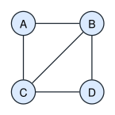
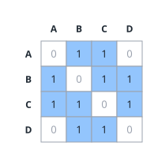
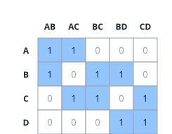
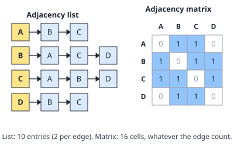
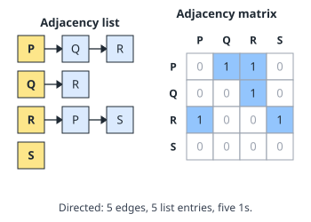

# Module: Graph Representations

A graph representation is the way a graph is actually stored in a computer's memory, such as a list of each vertex's neighbours or a grid of yes and no values. Different ways make different jobs fast or slow. Picking one is like choosing between a contact list and a big table of who knows whom.

## Before you start
<!-- bite: 1021c1bb-53d2-4da1-90ea-967dad9d22fa -->

- You know the graph vocabulary — [[01-what-a-graph-is|what a graph is]].
- You know arrays and hash maps and their costs — [[01-arrays|arrays]], [[03-hash-maps|hash-maps]].

**After this lesson you will be able to:**

1. Build a graph as an **edge list, adjacency list, adjacency map, adjacency matrix** and **incidence matrix**.
2. State the space and per-operation cost of each, and choose from the graph's density and the operations you need.
3. Explain why the adjacency list is the default and when it is the wrong default.
4. Recognise an **implicit graph** and traverse it without building one.

**Study route:** read the five representations, then how to choose between them. Attempt the prediction before the lab, then run it. Block 3 measures the costs rather than asserting them.

---

## Why this exists
<!-- bite: 5ae2084b-08fb-423d-be87-038be2f9602d -->

A graph is an abstract object: a set of vertices and a set of edges. To compute with it you must pick a concrete layout, and that choice decides your program's complexity more than the algorithm does.

Ask "does edge $(u,v)$ exist?" a million times and an adjacency matrix answers each in $O(1)$ while an adjacency list scans a neighbour list. Iterate all edges of a sparse graph and the list is $O(V+E)$ while the matrix is $O(V^2)$ regardless — for a road network with a million junctions, the matrix is $10^{12}$ cells to visit and $10^{12}$ to store, for perhaps $3\times10^6$ real edges.

There is no universally best choice. There is a right one per problem.

## The five representations
<!-- bite: 3f417feb-2f82-4c76-bdaf-e073186f6717 -->

Take this graph throughout:



Its edges are A-B, A-C, B-C, B-D and C-D.

### Edge list

Just the edges, as pairs.

```python
[("A","B"), ("A","C"), ("B","C"), ("B","D"), ("C","D")]
```

Space $O(E)$. Iterating edges is trivial and $O(E)$ — which is exactly what **Kruskal's** algorithm wants, since it sorts all edges by weight. But finding one vertex's neighbours means scanning everything: $O(E)$.

### Adjacency list

For each vertex, the list of its neighbours.

```python
{"A": ["B","C"], "B": ["A","C","D"], "C": ["A","B","D"], "D": ["B","C"]}
```

Space $O(V + E)$. Neighbours are $O(\deg v)$ — optimal. Checking one specific edge is $O(\deg v)$, since you scan the list.

**This is the default**, because BFS, DFS, Dijkstra and topological sort all iterate neighbours and never ask about a random pair.

### Adjacency map (adjacency set / dict-of-dicts)

The same idea, but each neighbour collection is a **hash map or set** rather than a list.

```python
{"A": {"B": 1, "C": 1}, "B": {"A": 1, "C": 1, "D": 1}, ...}
```

Space still $O(V+E)$, with a larger constant. The gain: edge lookup and edge deletion become $O(1)$ average instead of $O(\deg v)$, and edge weights get a natural home. This is what NetworkX uses, and it is the right default for a graph that **changes**.

### Adjacency matrix

A $V \times V$ grid, $M[i][j] = 1$ when the edge exists.



Space $O(V^2)$ — **regardless of edge count**. Edge lookup is a genuine $O(1)$ array index. Listing neighbours is $O(V)$: you scan a whole row even if the vertex has two neighbours.

For an undirected graph the matrix is **symmetric**, and the diagonal is non-zero exactly where self-loops are. Its real payoff is algebraic: $M^k[i][j]$ counts the walks of length $k$ from $i$ to $j$, which the lab verifies.

### Incidence matrix

A $V \times E$ grid: rows are vertices, columns are edges, and an entry marks that the vertex is an endpoint of that edge.



Space $O(V \times E)$ — the largest of all, and rarely used for computation. It earns its place in two situations: it handles **parallel edges** naturally, where an adjacency matrix cannot distinguish them; and for directed graphs, with $-1$ for the tail and $+1$ for the head, it is the matrix whose null space is the cycle space — the foundation of the network-flow and electrical-circuit formulations.

Each **column sums to 2** in the undirected case, because every edge has two endpoints. That is the handshake lemma again.

## Seeing the list and the matrix side by side

Here is the same graph stored both ways. The list holds only the edges that exist, two entries per edge. The matrix has a cell for every pair, so most of its size is paid for whether the edges are there or not.



## Choosing a representation
<!-- bite: 8bf001af-1acb-406d-a33c-8442d2f5cbd6 -->

This is the table promised in [[01-what-a-graph-is|lesson 1]]: the same ADT operations, costed under each way of storing the graph. Nothing here changes *what* the operations mean — only what they cost.

| ADT operation | Edge list | Adjacency list | Adjacency map | Adjacency matrix | Incidence matrix |
| :--- | :---: | :---: | :---: | :---: | :---: |
| *space used* | $O(E)$ | $O(V+E)$ | $O(V+E)$ | $O(V^2)$ | $O(VE)$ |
| `adjacent(u, v)` | $O(E)$ | $O(\deg u)$ | $O(1)$ | $O(1)$ | $O(E)$ |
| `neighbours(u)` | $O(E)$ | $O(\deg u)$ | $O(\deg u)$ | $O(V)$ | $O(E)$ |
| `add_edge(u, v)` | $O(1)$ | $O(1)$ | $O(1)$ | $O(1)$ | $O(VE)$ rebuild |
| `remove_edge(u, v)` | $O(E)$ | $O(\deg u)$ | $O(1)$ | $O(1)$ | $O(VE)$ rebuild |
| `edges()` | $O(E)$ | $O(V+E)$ | $O(V+E)$ | $O(V^2)$ | $O(VE)$ |

**Read the two middle rows together.** `adjacent(u, v)` asks about one specific pair; `neighbours(u)` asks for a whole list. The adjacency matrix wins the first and loses the second; the adjacency list does the opposite. **That single trade is what choosing a representation actually is**, and it is why the question "which is best?" has no answer until you know which operation your algorithm calls most.

**The decision, in practice:**

- **Sparse** ($E \approx V$) and you traverse — **adjacency list**. This is most real graphs.
- **The graph changes**, or you need edge lookup — **adjacency map**.
- **Dense** ($E \approx V^2$), small $V$, or you want matrix algebra — **adjacency matrix**.
- **Sorting edges** (Kruskal) or a file format — **edge list**.
- **Parallel edges** matter, or you need the cycle space — **incidence matrix**.

The crossover is roughly $E \sim V^2/32$ if you store matrix bits, or where $V^2$ simply stops fitting in memory. At $V = 10^6$, an adjacency matrix is $10^{12}$ entries — not an option at any density.

> [!TIP]
> **Predict before running the lab.** A social network has $10^6$ users averaging $200$ friends each. Compare the storage for an adjacency list against an adjacency matrix — roughly what is the ratio? Decide the order of magnitude before opening the answers.

## Implicit graphs
<!-- bite: 0765a2a0-95d5-4454-bb12-bc061ad5aaa0 -->

Sometimes the best representation is **none at all**. A grid maze is a graph — each cell a vertex, each open neighbour an edge — but building the adjacency list wastes time and memory when the neighbours are computable:

```python
for dr, dc in ((1,0), (-1,0), (0,1), (0,-1)):
    nr, nc = r + dr, c + dc
    if 0 <= nr < rows and 0 <= nc < cols and grid[nr][nc] != "#":
        yield (nr, nc)
```

The same applies to state-space search — puzzle configurations, word ladders, game positions — where the graph is astronomically large but each node's neighbours are cheap to generate. You traverse the graph without ever holding it.

## Worked example — runnable
<!-- bite: 0f6dbece-f708-4675-ad87-627ddea91cfd -->

**Runnable example:** save as `representations.py` in any empty directory and run `python3 representations.py`. Standard library only; writes no files.

```python
"""Five representations of one graph, with their costs counted."""
from collections import defaultdict

EDGES = [("A", "B"), ("A", "C"), ("B", "C"), ("B", "D"), ("C", "D")]
VERTS = ["A", "B", "C", "D"]


def adjacency_list(verts, edges):
    adj = {v: [] for v in verts}
    for u, v in edges:
        adj[u].append(v)
        adj[v].append(u)
    return adj


def adjacency_map(verts, edges, weights=None):
    adj = {v: {} for v in verts}
    for i, (u, v) in enumerate(edges):
        w = 1 if weights is None else weights[i]
        adj[u][v] = w
        adj[v][u] = w
    return adj


def adjacency_matrix(verts, edges):
    idx = {v: i for i, v in enumerate(verts)}
    M = [[0] * len(verts) for _ in verts]
    for u, v in edges:
        M[idx[u]][idx[v]] = 1
        M[idx[v]][idx[u]] = 1
    return M, idx


def incidence_matrix(verts, edges):
    idx = {v: i for i, v in enumerate(verts)}
    M = [[0] * len(edges) for _ in verts]
    for j, (u, v) in enumerate(edges):
        M[idx[u]][j] = 1
        M[idx[v]][j] = 1
    return M


def matmul(A, B):
    n = len(A)
    return [[sum(A[i][k] * B[k][j] for k in range(n)) for j in range(n)] for i in range(n)]


if __name__ == "__main__":
    print("Block 1 - the same graph, five ways")
    print(f"  edge list        {EDGES}")
    al = adjacency_list(VERTS, EDGES)
    print(f"  adjacency list   { {k: v for k, v in al.items()} }")
    am = adjacency_map(VERTS, EDGES)
    print(f"  adjacency map    { {k: dict(v) for k, v in am.items()} }")
    M, idx = adjacency_matrix(VERTS, EDGES)
    print("  adjacency matrix     " + "  ".join(VERTS))
    for v in VERTS:
        print(f"                {v}    " + "  ".join(str(x) for x in M[idx[v]]))
    I = incidence_matrix(VERTS, EDGES)
    print("  incidence matrix    " + " ".join(f"{u}{v}" for u, v in EDGES))
    for i, v in enumerate(VERTS):
        print(f"                {v}    " + "  ".join(str(x) for x in I[i]))

    print()
    print("Block 2 - structural checks")
    assert all(M[i][j] == M[j][i] for i in range(4) for j in range(4))
    print("  adjacency matrix is symmetric (undirected)")
    assert all(M[i][i] == 0 for i in range(4))
    print("  its diagonal is zero: no self-loops")
    col_sums = [sum(I[i][j] for i in range(len(VERTS))) for j in range(len(EDGES))]
    print(f"  incidence matrix column sums: {col_sums} - every edge has exactly 2 ends")
    assert all(c == 2 for c in col_sums)
    row_sums = [sum(row) for row in I]
    degs = [len(al[v]) for v in VERTS]
    print(f"  incidence row sums {row_sums} == degrees {degs}")
    assert row_sums == degs

    print()
    print("Block 3 - what the adjacency matrix is FOR: powers count walks")
    M2 = matmul(M, M)
    M3 = matmul(M2, M)
    print("  M^2 (walks of length 2)      M^3 (walks of length 3)")
    for i, v in enumerate(VERTS):
        print(f"    {v}  {M2[i]}            {M3[i]}")
    print(f"  M^2[A][A] = {M2[idx['A']][idx['A']]}: A has 2 neighbours, "
          "so 2 walks out-and-back")
    assert M2[idx["A"]][idx["A"]] == 2
    print(f"  M^2[A][D] = {M2[idx['A']][idx['D']]}: A->B->D and A->C->D")
    assert M2[idx["A"]][idx["D"]] == 2
    print(f"  M^3[A][A] = {M3[idx['A']][idx['A']]}: walks of length 3 from A back to A")
    print("  no other representation gives you this for free")

    print()
    print("Block 4 - the costs, counted on a sparse graph")
    N, DEG = 2000, 6
    big_edges = [(i, (i * 7 + k * 13 + 1) % N) for i in range(N) for k in range(DEG // 2)]
    big_edges = [(u, v) for u, v in big_edges if u != v]
    big_al = adjacency_list(list(range(N)), big_edges)
    big_am = adjacency_map(list(range(N)), big_edges)
    edge_set = set()
    for u, v in big_edges:
        edge_set.add((u, v))
    print(f"  {N} vertices, {len(big_edges)} edges (average degree "
          f"{2*len(big_edges)/N:.1f})")

    # Count PROBES rather than seconds: deterministic, and it is the complexity
    # that matters, not this machine's clock speed.
    QUERIES = [(i, (i * 7 + 1) % N) for i in range(0, N, 7)]
    probes = {"adjacency map": 0, "adjacency list": 0, "edge list": 0}
    hits = {"adjacency map": 0, "adjacency list": 0, "edge list": 0}
    for u, v in QUERIES:
        probes["adjacency map"] += 1                      # one hash lookup
        hits["adjacency map"] += v in big_am[u]

        found = False
        for w in big_al[u]:                               # scan u's neighbours
            probes["adjacency list"] += 1
            if w == v:
                found = True
                break
        hits["adjacency list"] += found

        found = False
        for a, b in big_edges:                            # scan every edge
            probes["edge list"] += 1
            if (a, b) == (u, v) or (b, a) == (u, v):
                found = True
                break
        hits["edge list"] += found

    assert len(set(hits.values())) == 1, hits
    print(f"  {len(QUERIES)} 'has edge?' queries, all three agreeing on "
          f"{hits['adjacency map']} hits")
    print("    representation     complexity   total probes   probes per query")
    base = probes["adjacency map"]
    for name in ("adjacency map", "adjacency list", "edge list"):
        cost = {"adjacency map": "O(1)   ", "adjacency list": "O(deg u)",
                "edge list": "O(E)    "}[name]
        print(f"    {name:18} {cost}     {probes[name]:12,}   "
              f"{probes[name]/len(QUERIES):16.1f}")
    assert probes["adjacency map"] < probes["adjacency list"] < probes["edge list"]
    print(f"  the edge list does {probes['edge list']//probes['adjacency list']}x the work "
          "of the adjacency list, which does")
    print(f"  {probes['adjacency list']//base}x the work of the map - exactly the cost table above")

    print("Block 5 - why a matrix is impossible at scale")
    print("        V     adjacency list entries    adjacency matrix cells      ratio")
    for v, deg in ((10, 4), (1000, 6), (10 ** 6, 200)):
        list_cells = v * deg
        matrix_cells = v * v
        print(f"  {v:9,}   {list_cells:22,}   {matrix_cells:22,}   {matrix_cells/list_cells:9,.0f}x")
    print("  a million users with 200 friends each: the matrix is 5,000x larger")
    print("  and 10^12 cells - about a terabyte at one byte each, for 2x10^8 real edges")

    print()
    print("Block 6 - an implicit graph needs no representation at all")
    grid = ["....#", ".##.#", "....."]
    rows, cols = len(grid), len(grid[0])

    def neighbours(cell):
        r, c = cell
        for dr, dc in ((1, 0), (-1, 0), (0, 1), (0, -1)):
            nr, nc = r + dr, c + dc
            if 0 <= nr < rows and 0 <= nc < cols and grid[nr][nc] != "#":
                yield (nr, nc)

    from collections import deque
    start, goal = (0, 0), (2, 4)
    dist = {start: 0}
    q = deque([start])
    while q:
        cell = q.popleft()
        for nb in neighbours(cell):
            if nb not in dist:
                dist[nb] = dist[cell] + 1
                q.append(nb)
    for row in grid:
        print(f"    {row}")
    print(f"  BFS from {start} to {goal}: {dist[goal]} steps, "
          f"{len(dist)} cells reached, zero graph objects built")
    assert dist[goal] == 6

    print()
    print("representations: passed")
```

Expected output:

```text
Block 1 - the same graph, five ways
  edge list        [('A', 'B'), ('A', 'C'), ('B', 'C'), ('B', 'D'), ('C', 'D')]
  adjacency list   {'A': ['B', 'C'], 'B': ['A', 'C', 'D'], 'C': ['A', 'B', 'D'], 'D': ['B', 'C']}
  adjacency map    {'A': {'B': 1, 'C': 1}, 'B': {'A': 1, 'C': 1, 'D': 1}, 'C': {'A': 1, 'B': 1, 'D': 1}, 'D': {'B': 1, 'C': 1}}
  adjacency matrix     A  B  C  D
                A    0  1  1  0
                B    1  0  1  1
                C    1  1  0  1
                D    0  1  1  0
  incidence matrix    AB AC BC BD CD
                A    1  1  0  0  0
                B    1  0  1  1  0
                C    0  1  1  0  1
                D    0  0  0  1  1

Block 2 - structural checks
  adjacency matrix is symmetric (undirected)
  its diagonal is zero: no self-loops
  incidence matrix column sums: [2, 2, 2, 2, 2] - every edge has exactly 2 ends
  incidence row sums [2, 3, 3, 2] == degrees [2, 3, 3, 2]

Block 3 - what the adjacency matrix is FOR: powers count walks
  M^2 (walks of length 2)      M^3 (walks of length 3)
    A  [2, 1, 1, 2]            [2, 5, 5, 2]
    B  [1, 3, 2, 1]            [5, 4, 5, 5]
    C  [1, 2, 3, 1]            [5, 5, 4, 5]
    D  [2, 1, 1, 2]            [2, 5, 5, 2]
  M^2[A][A] = 2: A has 2 neighbours, so 2 walks out-and-back
  M^2[A][D] = 2: A->B->D and A->C->D
  M^3[A][A] = 2: walks of length 3 from A back to A
  no other representation gives you this for free

Block 4 - the costs, counted on a sparse graph
  2000 vertices, 5998 edges (average degree 6.0)
  286 'has edge?' queries, all three agreeing on 286 hits
    representation     complexity   total probes   probes per query
    adjacency map      O(1)                 286                1.0
    adjacency list     O(deg u)              809                2.8
    edge list          O(E)              855,808             2992.3
  the edge list does 1057x the work of the adjacency list, which does
  2x the work of the map - exactly the cost table above
Block 5 - why a matrix is impossible at scale
        V     adjacency list entries    adjacency matrix cells      ratio
         10                       40                      100           2x
      1,000                    6,000                1,000,000         167x
  1,000,000              200,000,000        1,000,000,000,000       5,000x
  a million users with 200 friends each: the matrix is 5,000x larger
  and 10^12 cells - about a terabyte at one byte each, for 2x10^8 real edges

Block 6 - an implicit graph needs no representation at all
    ....#
    .##.#
    .....
  BFS from (0, 0) to (2, 4): 6 steps, 11 cells reached, zero graph objects built

representations: passed
```

Block 3 is the adjacency matrix's real justification: $M^k[i][j]$ counts walks of length $k$, so a matrix multiplication answers a combinatorial question no other layout gives you directly.

## Common pitfalls and traps
<!-- bite: 1636c9e9-89f6-44af-bcf9-05c10768e554 -->

- **Reaching for a matrix by default.** $O(V^2)$ space is fine at $V=100$ and impossible at $V=10^6$, whatever the density.
- **Storing an undirected edge once in an adjacency list.** It must appear in **both** vertices' lists, or half your traversals miss it.
- **Using a list when you need lookup.** If the hot operation is "is there an edge?", an adjacency map turns $O(\deg v)$ into $O(1)$ — block 4 measures the difference.
- **Forgetting that the adjacency list holds $2E$ entries.** For undirected graphs, `sum(len(l) for l in adj.values())` is $2E$, not $E$.
- **Building a graph object for a grid.** Grids, state spaces and word ladders are implicit; generating neighbours on demand is simpler and faster.
- **Assuming an adjacency matrix can hold a multigraph.** A single cell cannot record two parallel edges — store counts, or use an incidence matrix.

## Check your understanding
<!-- bite: 37f81b89-7b77-4830-a9ee-4343eb93571a -->

Try each one before you open the answer.

1. <!-- q: mcq id="6ea62702" -->
   A graph has 100,000 vertices and 300,000 edges, and you will run BFS on it. Which representation fits best?

   - [x] Adjacency list
   - [ ] Adjacency matrix
   - [ ] Incidence matrix
   - [ ] Edge list

   <details><summary>Answer</summary>

   It is sparse (average degree 6) and BFS only ever asks for neighbours. An adjacency list costs about 700,000 entries; a matrix would need 10¹⁰ cells.

   </details>

2. <!-- q: mcq id="f95f34a0" -->
   Kruskal's algorithm sorts every edge by weight and processes them in order. Which representation does it want?

   - [ ] Adjacency matrix
   - [x] Edge list
   - [ ] Adjacency map
   - [ ] Incidence matrix

   <details><summary>Answer</summary>

   An edge list. Kruskal never asks for a vertex's neighbours; it just needs all edges to sort.

   </details>

3. <!-- q: gap id="4be1a580" answers="O(1)|1;O(V)|V" -->
   Fill in the gaps. In an adjacency matrix, checking whether edge (u, v) exists costs ___, and listing all neighbours of u costs ___.

   <details><summary>Answer</summary>

   O(1) for the edge check, because it is one array index. O(V) for neighbours, because you scan a whole row even when u has only two neighbours.

   </details>

4. <!-- q: mcq id="1df56a1b" -->
   What does entry M³[i][j] of an adjacency matrix raised to the third power count?

   - [ ] Shortest paths from i to j
   - [x] Walks of length 3 from i to j, where vertices may repeat
   - [ ] Paths of length 3 with no repeated vertex
   - [ ] Edges between i and j

   <details><summary>Answer</summary>

   Walks of length 3. Matrix multiplication sums over every middle vertex, and nothing stops a walk revisiting a vertex.

   </details>

5. <!-- q: mcq id="9e69bdd8" -->
   A grid maze is a graph: cells are vertices and open neighbouring cells are joined. What is usually the best way to store it?

   - [ ] Build an adjacency matrix of all cells
   - [ ] Build an edge list of all open pairs
   - [x] Don't build anything; generate each cell's open neighbours on demand
   - [ ] Build an incidence matrix

   <details><summary>Answer</summary>

   It is an implicit graph. The four neighbours of a cell are cheap to compute when needed, so building any structure only wastes time and memory.

   </details>

6. <!-- q: open id="7370ea14" -->
   Why does every column of an undirected graph's incidence matrix add up to 2?

   <details><summary>Answer</summary>

   Each column is one edge, and every edge has exactly two endpoints, so exactly two rows are marked. It is the handshake lemma in matrix form.

   </details>

## Check your understanding: worked problems
<!-- bite: 4786b843-0c04-4ff5-b449-8b18ac424e11 -->

Work each one out on paper first, then type your answer.

1. <!-- q: exact id="76d80aba" answer="12" -->
   An undirected graph has 6 edges and is stored as an adjacency list. How many neighbour entries do all the lists hold together?

   <details><summary>Answer</summary>

   12. Every undirected edge appears in both of its endpoints' lists, so the total is 2E = 12.

   </details>

2. <!-- q: gap id="7f8ce08b" answers="4000000|4,000,000;14000|14,000" -->
   Fill in the gaps. A graph has 2,000 vertices and 6,000 undirected edges. An adjacency matrix needs ___ cells. An adjacency list needs about ___ items: one slot per vertex plus two entries per edge.

   <details><summary>Answer</summary>

   4,000,000 cells (2000²) against 2,000 + 2 × 6,000 = 14,000 items. The matrix pays for every possible pair whether or not the edge exists.

   </details>

3. <!-- q: gap id="3ccce543" answers="2;5" -->
   Fill in the gaps. An undirected graph has vertices A, B, C, D and edges A–B, A–C, B–C, B–D, C–D. With adjacency matrix M, the entry M²[A][D] is ___ and M³[A][B] is ___.

   <details><summary>Answer</summary>

   M²[A][D] = 2: the walks A–B–D and A–C–D. M³[A][B] = 5, the number of walks of length 3 from A to B, such as A–B–A–B, A–C–D–B and A–B–C–B. Multiplying the matrix out gives these counts.

   </details>

4. <!-- q: sketch id="a1a70b02" -->
   A directed graph has the vertices P, Q, R, S and the edges P → Q, P → R, Q → R, R → P and R → S. Draw its adjacency list (neighbours in alphabetical order) and its 4 × 4 adjacency matrix on paper, with rows for "from" and columns for "to".

   <details><summary>Answer</summary>

   

   What to check:
   - The list has 5 entries, one per edge, because the graph is directed.
   - S's list is empty: S has no edges going out.
   - The matrix has five 1s and is not symmetric: row P has a 1 under Q, but row Q has a 0 under P.
   - Row Q has a single 1, under R.

   </details>

## Practice — independent task
<!-- bite: f9fc5191-00cd-4809-83d4-756f30b11c97 -->

Implement a `Graph` class supporting all five representations behind one interface, and measure the crossover point.

1. One class, a `representation=` parameter, and identical methods: `add_edge`, `has_edge`, `neighbours`, `all_edges`, `degree`.
2. **Assert equivalence:** for a set of random graphs, all five must return the same neighbours, the same edge set, and the same degree sequence. This is the real test — a representation that disagrees is a bug.
3. Benchmark each operation on graphs of increasing density at fixed $V$, and plot (as text) the time against density.
4. **Find the crossover:** at what density does the adjacency matrix beat the adjacency list for `has_edge`, and for `all_edges`? Report the two densities — they are not the same.
5. Then measure memory with `sys.getsizeof` plus a recursive walk of the contained objects. Compare against the theoretical $O(V+E)$ and $O(V^2)$ and report where the constants make the theory misleading.

**Edge cases:** an empty graph; a graph with one vertex and no edges; a self-loop (each representation stores it differently — document what yours does); parallel edges (which representations can even express them?).

**Done when:** all five agree on every random graph tested, you can state both crossover densities with numbers you measured, and you can say which representations cannot express a multigraph and why.

## Before moving on
<!-- bite: e0de8feb-50da-4774-bc67-c2539b8df199 -->

You can build all five, state their costs, choose from density and operation mix, and traverse an implicit graph.

**Recap:** edge list $O(E)$, good for sorting edges; adjacency list $O(V+E)$, the default for traversal; adjacency map $O(V+E)$ with $O(1)$ lookup and deletion, best for changing graphs; adjacency matrix $O(V^2)$, $O(1)$ lookup and $M^k$ counts walks; incidence matrix $O(VE)$, handles parallel edges and gives the cycle space; implicit graphs need no storage at all.

**Next:** the algorithms that run on these — [[01-depth-first-search|DFS]], [[02-breadth-first-search|BFS]], [[02-dijkstra|Dijkstra]], [[01-topological-sort|topological sort]], [[06-minimum-spanning-tree|MST]].

## Related
<!-- bite: fbb49e01-84c2-4045-9fd4-ffe5af46630f -->

- [[01-arrays|Arrays]] · [[03-hash-maps|Hash Maps]] — what each representation is built from
- [[04-linear-algebra/01-matrices-and-determinants/01-matrices-and-determinants|Matrices]] — why $M^k$ counts walks
- [[06-minimum-spanning-tree|MST]] — the algorithm that wants an edge list

## About this lesson
<!-- bite: ede30af6-d787-47bb-9628-687e25cfe2d4 -->

**Level:** Intermediate. **Covers:** five ways to store a graph, what each one makes cheap, and how to choose.
