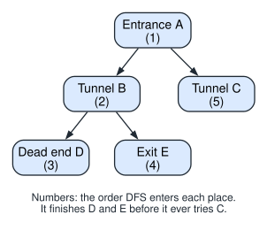
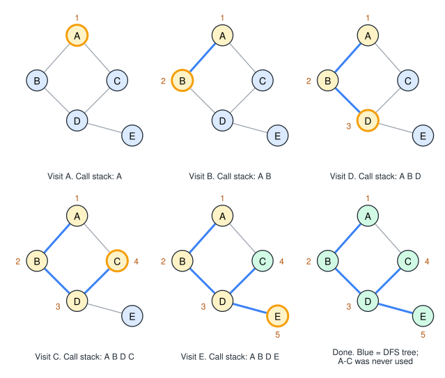
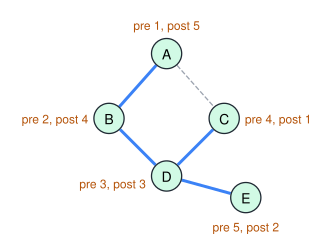
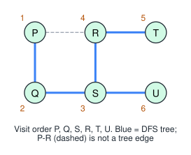

# Module: Depth-First Search (DFS) (Deep Exploration & Backtracking)

Welcome to the **Depth-First Search (DFS)** module. DFS is a fundamental graph and tree traversal algorithm that explores as far down a single branch as possible before **backtracking** to try alternative paths.

Where [[02-breadth-first-search|BFS]] spreads out evenly level-by-level like a pebble dropped in water, DFS charges headfirst down one path until it hits a dead end, then unwinds to explore unvisited branches.

---

## Before you start
<!-- bite: a86c8dac-ff20-4403-88af-9be9292583e7 -->

- You know what a graph is, and the difference between a path and a cycle — [[09-graphs/01-what-a-graph-is|what a graph is]], [[09-graphs/02-paths-cycles-and-connectivity|paths and connectivity]].
- You know how a stack behaves — [[05-stacks-and-queues|stacks and queues]].
- You can trace a recursive call — [[09-recursion-and-the-call-stack|recursion and the call stack]].

**After this lesson you will be able to:**

1. Implement DFS **recursively and iteratively**, and say what the explicit stack replaces.
2. Distinguish **pre-order** and **post-order** DFS, and name a problem that needs each.
3. Use DFS to count connected components and to detect a cycle, in both directed and undirected graphs.
4. Explain when the recursive form **fails in practice**, and demonstrate it.

**Study route:** read 1–5, attempt the prediction in section 4, then run the lab. Its last block breaks the recursive version on purpose.

---

## 1. Real-World Motivation & Physical Metaphors
<!-- bite: 1d5e4c60-b37d-4d35-a9b8-28970daf92bd -->

Imagine a **Maze Explorer in a Dark Cave**:



1. You walk down Tunnel B as deep as you can go until you hit Dead End D.
2. You **backtrack** to the last intersection (Tunnel B) and explore the other direction (Exit E).
3. Once all paths from Tunnel B are exhausted, you backtrack to Entrance A and explore Tunnel C.

In software, DFS powers **Puzzle Solvers (Sudoku, N-Queens)**, **Dependency Ordering (Build Systems)**, and **Cycle Detection in Graphs**.

---

## Terms used in depth-first search
<!-- bite: 7b2d00ea-7c05-4a99-909e-ee2e425f5b7e -->

1. **Depth-first**: This is the commitment to explore one branch all the way to its end before looking at any alternative. It is the difference between reading one book cover to cover and reading page one of every book on the shelf.
2. **Backtracking**: This is what the search does when it reaches a vertex with no unvisited neighbours — it returns to the previous decision point and tries the next option there. At a maze dead end, backtracking is walking back to the last junction.
3. **Call stack**: This is also known as the **execution stack**. This is the region of memory that holds one frame per function call that has started and not yet returned, in **LIFO (last-in, first-out)** order. Recursive DFS does not create a stack of its own — it borrows this one, which is why it is shorter to write and why it can run out of room.
4. **Explicit stack**: This is a stack you declare yourself, usually a plain list, holding the vertices still to be examined. Iterative DFS uses one to do exactly what the call stack was doing, with the difference that a list grows into ordinary heap memory and the call stack does not.
5. **Visited set**: This is a set recording which vertices the search has already reached, consulted before descending into any vertex. On a graph containing a cycle it is not an optimisation — **without it the search never terminates.** It is the chalk mark on the cave wall.
6. **Pre-order**: This is doing the work for a vertex **on arrival**, before descending into its neighbours. Use it when a vertex's answer depends on what is above it, such as its depth or the route taken to reach it.
7. **Post-order**: This is doing the work for a vertex **on departure**, after every neighbour has been fully explored. Use it when a vertex's answer depends on what is below it — and it is the order [[01-topological-sort|topological sort]] is built on.

---

## 3. Technical Deep Dive: Recursive vs. Iterative DFS
<!-- bite: 80c4fc69-45f2-4b6d-8ae8-2b84111d5715 -->

DFS can be implemented using **Recursion** (implicit system call stack) or an **Explicit Stack** (LIFO queue).

### 1. Recursive DFS (The Natural Implementation)
```python
def dfs_recursive(graph: dict, node: str, visited: set = None) -> set:
    """Explores a graph recursively using the system call stack."""
    if visited is None:
        visited = set()
        
    visited.add(node)
    print("Visited Node:", node)
    
    for neighbor in graph[node]:
        if neighbor not in visited:
            dfs_recursive(graph, neighbor, visited)
            
    return visited
```

---

### 2. Iterative DFS (Using an Explicit LIFO Stack)
For extremely deep graphs (over 1,000 levels), recursion can trigger a `RecursionError` / Stack Overflow. The iterative version moves the call stack onto the heap using a list:

```python
def dfs_iterative(graph: dict, start: str) -> set:
    """Explores a graph iteratively using an explicit LIFO stack."""
    visited = set()
    stack = [start]  # LIFO Stack
    
    while stack:
        node = stack.pop()  # Pop top element: LIFO behavior drives depth-first search!
        if node in visited:
            continue
            
        visited.add(node)
        print("Visited Node:", node)
        
        for neighbor in graph[node]:
            if neighbor not in visited:
                stack.append(neighbor)
                
    return visited
```

---

## Seeing DFS step by step
<!-- bite: 79fd59e6-1876-44d0-9e35-b5c64613059f -->

These frames run recursive DFS from A on the lab's graph, with neighbours in alphabetical order. The orange outline is the vertex just reached, yellow vertices are still on the call stack, green ones are finished, and the small numbers are the visit order. Look at frame 4: C is reached from D, not from A, so the edge A–C is never used.



## Seeing pre-order and post-order
<!-- bite: 2ed32f87-233c-4b74-bc52-edef2de5eada -->

Each vertex of the same graph carries two numbers: when DFS arrived (pre) and when it left (post). A arrives first and leaves last. C is the first to finish, because it is the deepest dead end.



## 4. Key Applications of DFS
<!-- bite: 7b70dac6-fe13-4fce-8ac2-dbf555c9fa31 -->

1. **Detecting Cycles in Directed Graphs**: Tracking nodes currently in the active recursion call stack (`in_stack` set). Reaching a node already `in_stack` proves a **Cycle exists**.
2. **Topological Sort**: Running a postorder DFS on a Directed Acyclic Graph (DAG) orders tasks by dependencies.
3. **Connected Components**: Iterating through all vertices and calling DFS on unvisited nodes counts isolated graph clusters.

---

## 5. Time & Space Complexity Summary
<!-- bite: a4d1ec79-ede1-4b1b-b492-ea8691bbb65b -->

| Metric | Complexity | Explanation |
| :--- | :--- | :--- |
| **Time Complexity** | **$O(V + E)$** | Every vertex ($V$) is visited once, and every edge ($E$) is examined once. |
| **Space Complexity (Auxiliary)** | **$O(V)$** | Space for `visited` set plus call stack depth $h \le V$ in worst-case linear graphs. |

---

## Implementation — complete runnable example
<!-- bite: f578de1a-71d8-4ef8-8c87-2d80a408eede -->

**Runnable example:** save as `dfs_lab.py` in any empty directory and run `python3 dfs_lab.py`. Standard library only; writes no files.

```python
"""DFS: recursive and iterative, pre/post-order, components, cycles, and depth."""
import sys
from collections import defaultdict


def build(edges, directed=False):
    adj = defaultdict(list)
    for u, v in edges:
        adj[u].append(v)
        adj[v].append(u) if not directed else adj.setdefault(v, [])
    return {k: sorted(vs) for k, vs in adj.items()}


def dfs_recursive(adj, start, seen=None, order=None):
    seen = set() if seen is None else seen
    order = [] if order is None else order
    seen.add(start)
    order.append(start)                      # PRE-order: record on arrival
    for w in adj.get(start, []):
        if w not in seen:
            dfs_recursive(adj, w, seen, order)
    return order


def dfs_postorder(adj, start, seen=None, order=None):
    seen = set() if seen is None else seen
    order = [] if order is None else order
    seen.add(start)
    for w in adj.get(start, []):
        if w not in seen:
            dfs_postorder(adj, w, seen, order)
    order.append(start)                      # POST-order: record on the way out
    return order


def dfs_iterative(adj, start):
    """The explicit stack replaces the call stack - same order, no recursion limit."""
    seen, order, stack = set(), [], [start]
    while stack:
        v = stack.pop()
        if v in seen:
            continue
        seen.add(v)
        order.append(v)
        for w in reversed(adj.get(v, [])):   # reversed, so the first neighbour pops first
            if w not in seen:
                stack.append(w)
    return order


def components(adj):
    seen, out = set(), []
    for v in sorted(adj):
        if v not in seen:
            comp = dfs_iterative(adj, v)
            seen.update(comp)
            out.append(sorted(comp))
    return out


def has_cycle_undirected(adj):
    seen = set()
    for start in sorted(adj):
        if start in seen:
            continue
        stack = [(start, None)]
        seen.add(start)
        while stack:
            v, parent = stack.pop()
            for w in adj[v]:
                if w == parent:              # the edge you arrived on is not a cycle
                    continue
                if w in seen:
                    return True
                seen.add(w)
                stack.append((w, v))
    return False


def has_cycle_directed(adj):
    """Three colours: 0 unvisited, 1 on the current path, 2 finished."""
    colour = defaultdict(int)

    def visit(v):
        colour[v] = 1
        for w in adj.get(v, []):
            if colour[w] == 1:               # a BACK edge: w is still on the path
                return True
            if colour[w] == 0 and visit(w):
                return True
        colour[v] = 2
        return False

    return any(colour[v] == 0 and visit(v) for v in sorted(adj))


if __name__ == "__main__":
    G = build([("A", "B"), ("A", "C"), ("B", "D"), ("C", "D"), ("D", "E")])
    print("Block 1 - recursive and iterative DFS give the same order")
    rec = dfs_recursive(G, "A")
    ite = dfs_iterative(G, "A")
    print(f"  recursive: {rec}")
    print(f"  iterative: {ite}")
    assert rec == ite
    print("  the explicit stack does exactly what the call stack was doing")
    print("  (note the 'reversed' when pushing: a stack reverses the order you push in)")

    print()
    print("Block 2 - pre-order vs post-order")
    print(f"  pre-order  (record on arrival):  {dfs_recursive(G, 'A')}")
    print(f"  post-order (record on exit):     {dfs_postorder(G, 'A')}")
    assert dfs_postorder(G, "A")[-1] == "A"
    print("  post-order finishes at the START vertex, because it is recorded last.")
    print("  That is why topological sort uses post-order: a vertex is only")
    print("  finished once everything it depends on is finished.")

    print()
    print("Block 3 - counting connected components")
    split = build([("A", "B"), ("B", "C"), ("D", "E"), ("F", "G"), ("G", "H")])
    comps = components(split)
    for i, c in enumerate(comps, 1):
        print(f"    component {i}: {c}")
    print(f"  {len(comps)} components - one DFS per unvisited vertex, O(V+E) total")
    assert len(comps) == 3

    print()
    print("Block 4 - cycle detection, and why directed needs three colours")
    cases_u = {"triangle": [("A", "B"), ("B", "C"), ("C", "A")],
               "path":     [("A", "B"), ("B", "C")],
               "tree":     [("A", "B"), ("A", "C"), ("B", "D")]}
    for name, es in cases_u.items():
        print(f"  undirected {name:9}: cycle = {has_cycle_undirected(build(es))}")
    assert has_cycle_undirected(build(cases_u["triangle"]))
    assert not has_cycle_undirected(build(cases_u["tree"]))

    cases_d = {"A->B->C->A (cycle)": [("A", "B"), ("B", "C"), ("C", "A")],
               "A->B, A->C, B->C ":  [("A", "B"), ("A", "C"), ("B", "C")]}
    for name, es in cases_d.items():
        print(f"  directed {name}: cycle = {has_cycle_directed(build(es, directed=True))}")
    assert has_cycle_directed(build(cases_d["A->B->C->A (cycle)"], directed=True))
    assert not has_cycle_directed(build(cases_d["A->B, A->C, B->C "], directed=True))
    print("  the second digraph has an UNDIRECTED cycle but no directed one -")
    print("  which is why 'already visited' is not enough for digraphs. You need")
    print("  'visited AND still on the current path', which is what colour 1 means.")

    print()
    print("Block 5 - where the recursive version breaks")
    print(f"  Python's recursion limit is {sys.getrecursionlimit():,}")
    long_path = build([(i, i + 1) for i in range(5000)])
    try:
        dfs_recursive(long_path, 0)
        print("  recursive DFS on a 5,000-vertex path: succeeded")
    except RecursionError:
        print("  recursive DFS on a 5,000-vertex path: RecursionError")
    order = dfs_iterative(long_path, 0)
    print(f"  iterative DFS on the same graph: visited {len(order):,} vertices, no problem")
    assert len(order) == 5001
    print("  a long path is not an exotic input - it is a linked list, a chain of")
    print("  dependencies, or a grid traversed in one direction. Prefer the iterative")
    print("  form for anything whose depth you do not control.")

    print()
    print("dfs_lab: passed")
```

Expected output:

```text
Block 1 - recursive and iterative DFS give the same order
  recursive: ['A', 'B', 'D', 'C', 'E']
  iterative: ['A', 'B', 'D', 'C', 'E']
  the explicit stack does exactly what the call stack was doing
  (note the 'reversed' when pushing: a stack reverses the order you push in)

Block 2 - pre-order vs post-order
  pre-order  (record on arrival):  ['A', 'B', 'D', 'C', 'E']
  post-order (record on exit):     ['C', 'E', 'D', 'B', 'A']
  post-order finishes at the START vertex, because it is recorded last.
  That is why topological sort uses post-order: a vertex is only
  finished once everything it depends on is finished.

Block 3 - counting connected components
    component 1: ['A', 'B', 'C']
    component 2: ['D', 'E']
    component 3: ['F', 'G', 'H']
  3 components - one DFS per unvisited vertex, O(V+E) total

Block 4 - cycle detection, and why directed needs three colours
  undirected triangle : cycle = True
  undirected path     : cycle = False
  undirected tree     : cycle = False
  directed A->B->C->A (cycle): cycle = True
  directed A->B, A->C, B->C : cycle = False
  the second digraph has an UNDIRECTED cycle but no directed one -
  which is why 'already visited' is not enough for digraphs. You need
  'visited AND still on the current path', which is what colour 1 means.

Block 5 - where the recursive version breaks
  Python's recursion limit is 1,000
  recursive DFS on a 5,000-vertex path: RecursionError
  iterative DFS on the same graph: visited 5,001 vertices, no problem
  a long path is not an exotic input - it is a linked list, a chain of
  dependencies, or a grid traversed in one direction. Prefer the iterative
  form for anything whose depth you do not control.

dfs_lab: passed
```

Block 5 is the practical warning: the recursive form is clearer and fails on input you will actually meet.

## 6. Common Pitfalls & Traps
<!-- bite: 110982e9-8e64-44f5-929e-c33194c14333 -->

1. **Forgetting the `visited` Set**: On cyclic graphs, omitting a `visited` set causes infinite recursion loops.
2. **Recursion Limit Crash**: In Python, default maximum recursion depth is 1,000. For deep graphs, use `sys.setrecursionlimit()` or the **Iterative DFS** implementation.
3. **DFS Does NOT Find Shortest Paths**: DFS explores arbitrary deep paths first. It does **NOT** guarantee finding the shortest path on unweighted graphs! Use [[02-breadth-first-search|BFS]] for shortest paths.

---

## Check your understanding
<!-- bite: 9ca6f440-5d98-4d1d-97cd-d8b60e4d211f -->

Try each one before you open the answer.

1. <!-- q: mcq id="fa3c1765" -->
   Why can DFS fail to find the shortest route in an unweighted graph?

   - [x] It follows one branch to its end first, so the first route it finds to the target may be a long one
   - [ ] It visits each vertex twice
   - [ ] It ignores edges to visited vertices
   - [ ] It only works on trees

   <details><summary>Answer</summary>

   DFS commits to depth, not distance. BFS finishes every vertex at distance k before distance k + 1, so it is the one that guarantees fewest edges.

   </details>

2. <!-- q: gap id="9a430148" answers="stack|LIFO stack;visited set|visited|seen set|seen" -->
   Fill in the gaps. Iterative DFS replaces the call stack with an explicit ___, and on a graph with cycles it needs a ___ so it never processes a vertex twice.

   <details><summary>Answer</summary>

   A stack (LIFO) and a visited set. Popping the newest vertex is what drives the search deeper; the visited set stops it going round a cycle forever.

   </details>

3. <!-- q: mcq id="84d3c162" -->
   The directed graph A → B, A → C, B → C has no directed cycle, but plain "already visited" cycle detection would say it does. What does correct cycle detection in a directed graph check instead?

   - [ ] Whether a vertex has two parents
   - [x] Whether the neighbour is still on the current DFS path (colour "in progress"), which marks a back edge
   - [ ] Whether the graph has more edges than vertices
   - [ ] Whether BFS reaches the same vertex twice

   <details><summary>Answer</summary>

   Reaching C a second time from A is fine: C is already finished. Only reaching a vertex that is still on the current path proves a directed cycle. That is the three-colour method: unvisited, on the path, finished.

   </details>

4. <!-- q: mcq id="0cb6937d" -->
   How do you count the connected components of an undirected graph with DFS?

   - [x] Loop over every vertex; each time one is unvisited, run a DFS from it and add 1 to the count
   - [ ] Run DFS once from any vertex and count the leaves
   - [ ] Count the vertices with degree 0
   - [ ] Divide the number of edges by the number of vertices

   <details><summary>Answer</summary>

   Each DFS marks one whole component as visited. The number of times you have to start a new DFS is the number of components, and the total work is still O(V + E).

   </details>

5. <!-- q: open id="6eb6c8b4" -->
   Recursive DFS is shorter to write. When does it fail in practice, and what is the fix?

   <details><summary>Answer</summary>

   Each recursive call uses a call-stack frame, and Python stops at about 1,000 nested calls. A long chain, such as a 5,000-vertex path or a linked list of dependencies, raises RecursionError. The iterative version keeps its own stack in a list on the heap, which can hold millions of vertices.

   </details>

## Check your understanding: worked problems
<!-- bite: 91bac334-c29c-4a24-b2ae-c4e61d791982 -->

Work each one out on paper first, then type your answer.

1. <!-- q: exact id="116ac471" answer="A, B, D, E, F, C, G" accept="ABDEFCG|A B D E F C G" -->
   An undirected graph has these adjacency lists, each in the order shown:

   | Vertex | Neighbours |
   | :--- | :--- |
   | A | B, C |
   | B | A, D, E |
   | C | A, F |
   | D | B |
   | E | B, F |
   | F | C, E, G |
   | G | F |

   Recursive DFS starts at A and records each vertex when it first arrives (pre-order), trying neighbours in list order. List the visit order, separated by commas.

   <details><summary>Answer</summary>

   A, B, D, E, F, C, G. From A go to B, then D (dead end, back to B), then E, then F. F's first neighbour C is new, so visit C (its neighbours are already seen), then back at F visit G.

   </details>

2. <!-- q: exact id="d5470435" answer="D, C, G, F, E, B, A" accept="DCGFEBA|D C G F E B A" -->
   An undirected graph has these adjacency lists, each in the order shown:

   | Vertex | Neighbours |
   | :--- | :--- |
   | A | B, C |
   | B | A, D, E |
   | C | A, F |
   | D | B |
   | E | B, F |
   | F | C, E, G |
   | G | F |

   Recursive DFS starts at A, tries neighbours in list order, and records each vertex when it finishes, after all its neighbours are done (post-order). List the order, separated by commas.

   <details><summary>Answer</summary>

   D, C, G, F, E, B, A. D finishes first because it is a dead end. C and G finish inside F, then F, E and B unwind. The start vertex A is always last in post-order.

   </details>

3. <!-- q: exact id="660bd51c" answer="A, C, F, G, E, B, D" accept="ACFGEBD|A C F G E B D" -->
   An undirected graph has these adjacency lists, each in the order shown:

   | Vertex | Neighbours |
   | :--- | :--- |
   | A | B, C |
   | B | A, D, E |
   | C | A, F |
   | D | B |
   | E | B, F |
   | F | C, E, G |
   | G | F |

   An iterative DFS starts with stack [A]. It pops a vertex, skips it if already visited, otherwise visits it and pushes its unvisited neighbours in list order (without reversing). List the visit order, separated by commas.

   <details><summary>Answer</summary>

   A, C, F, G, E, B, D. Pushing in list order puts the LAST neighbour on top, so the search goes right first: A, then C, then F, then G. This is why the lesson's code pushes in reversed order to match the recursive version.

   </details>

4. <!-- q: sketch id="8fc10e7c" -->
   An undirected graph has these adjacency lists, each in the order shown:

   | Vertex | Neighbours |
   | :--- | :--- |
   | P | Q, R |
   | Q | P, S |
   | R | P, S, T |
   | S | Q, R, U |
   | T | R |
   | U | S |

   Run recursive DFS from P, trying neighbours in list order. Draw the graph on paper, write each vertex's visit number beside it, and mark the DFS tree edges (the edge by which each vertex was first reached).

   <details><summary>Answer</summary>

   

   What to check:
   - The visit order is P, Q, S, R, T, U.
   - R is reached from S, not from P, because DFS goes deep through Q and S first.
   - There are 5 tree edges for 6 vertices: P–Q, Q–S, S–R, R–T and S–U.
   - P–R is not a tree edge.

   </details>

## Practice — independent task
<!-- bite: 246d3134-6b37-4bf7-a3d0-209cf50b00e9 -->

Implement `find_path(graph, start, goal)` returning an actual path, not just whether one exists — then extend it.

1. Return the list of vertices from `start` to `goal`, or `None`. Track a **parent map** during the search and walk it backwards at the end.
2. Do it both recursively and iteratively, and assert the two agree on the *set* of reachable vertices (the paths themselves may differ, and that is worth noticing).
3. **Find all paths**, not just one. Explain in a comment why this needs the visited set to be un-marked on the way back out — and why that makes it exponential.
4. Add a `max_depth` parameter that stops the search early. Use it to implement **iterative deepening**: run depth-limited DFS with the limit increasing from 1. Show that it finds the shortest path like BFS while using DFS's $O(d)$ memory.
5. Measure the cost of that trade: count vertices visited by iterative deepening versus plain BFS on the same graph, and report the ratio. It re-explores, and you should be able to say roughly by what factor.

**Edge cases:** `start == goal`; the goal unreachable; a graph with a cycle (your all-paths version must still terminate); a self-loop.

**Done when:** your path is verifiable — every consecutive pair is an edge — iterative deepening returns the same length as BFS, and you can state the re-exploration factor with a number you measured.

## Before moving on
<!-- bite: 6223fc81-26cc-4187-ae2a-00dbaae0263d -->

You can implement DFS both ways, use pre- and post-order deliberately, detect cycles in both graph kinds, and say when recursion will fail.

**Recap:** DFS goes deep before wide, using a stack (explicit or the call stack); $O(V+E)$ time, $O(V)$ space; pre-order records on arrival, post-order on exit — and post-order is what topological sort needs; undirected cycle detection ignores the edge you arrived on, directed needs three colours to distinguish "finished" from "on the current path"; the recursive form dies on deep graphs.

**Next:** [[02-breadth-first-search|Breadth-First Search]] — the same traversal cost, a different order, and the one that gives shortest paths. After that, [[03-traversal-trees-and-edge-classification|traversal trees and edge classification]] turns the timestamps this search already produces into cycle detection, topological sort and connected components.

## Related
<!-- bite: 7f084227-c015-4f4d-8555-e7ea94ff773b -->

- [[02-breadth-first-search|Breadth-First Search]] — level-by-level graph traversal, and the shortest-path guarantee
- [[03-traversal-trees-and-edge-classification|Traversal Trees and Edge Classification]] — discovery and finish times, and why a back edge *is* a directed cycle
- [[09-graphs/index|Graphs]] — the vocabulary and representations this assumes
- [[05-stacks-and-queues|Stacks and Queues]] — LIFO stack mechanics
- [[01-depth-first-traversals|Tree depth-first traversals]] — the same three orders without cycles, where no visited set is needed
- [[05-traversal/index|the traversal folder]]
