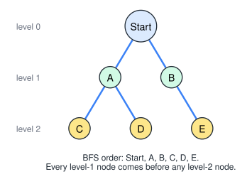
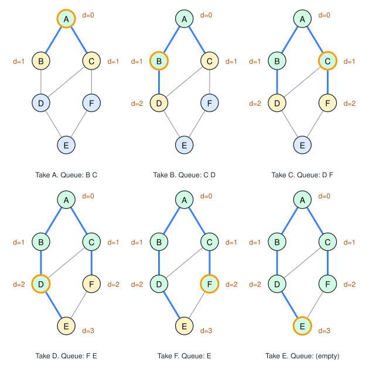
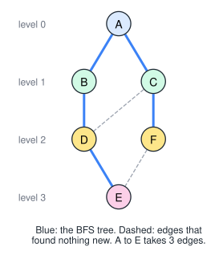
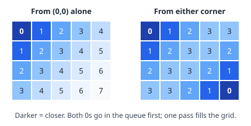
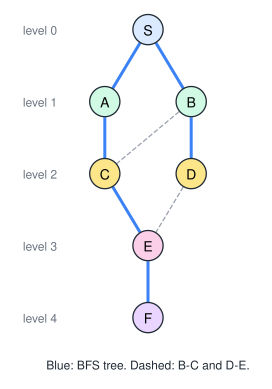

# Module: Breadth-First Search (BFS) (Level-by-Level & Shortest Path)

Welcome to the **Breadth-First Search (BFS)** module. BFS is a fundamental graph and tree traversal algorithm that explores nodes **level-by-level**, expanding outward in concentric rings from a starting vertex.

Where [[01-depth-first-search|DFS]] dives deep down one branch before backtracking, BFS explores all immediate neighbors at distance $k$ before moving to any neighbor at distance $k+1$.

---

## Before you start
<!-- bite: 9b7606b4-31ed-432b-94f5-6ead9cbdb4da -->

- You know DFS and what it does *not* guarantee — [[01-depth-first-search|depth-first search]].
- You know how a queue behaves — [[05-stacks-and-queues|stacks and queues]].
- You know graph connectivity vocabulary — [[09-graphs/02-paths-cycles-and-connectivity|paths and connectivity]].

**After this lesson you will be able to:**

1. Implement BFS, and **prove to yourself** that it returns shortest paths on unweighted graphs by comparing against DFS.
2. Reconstruct the path itself, not just its length.
3. Implement **multi-source** BFS, and say which problems need it.
4. Say precisely why BFS stops giving shortest paths the moment edges have weights.

**Study route:** read 1–5, attempt the prediction in section 4, then run the lab. Block 2 is the shortest-path guarantee, measured.

---

## 1. Real-World Motivation & Physical Metaphors
<!-- bite: 4ccd0cd5-ac36-4d6b-b87b-ac308ff75e8e -->

Imagine dropping a **pebble into a calm pond**:



1. Ripples expand outward in **concentric circles**.
2. First, the wave hits all points 1 meter away.
3. Then, it hits points 2 meters away, then 3 meters away.

### Why BFS Guarantees Shortest Path (Unweighted Graphs)
Because BFS explores every node at distance $k$ before touching distance $k+1$, **the very first time BFS reaches a target node, it is GUARANTEED to have arrived via the shortest possible path** (fewest edges)!

### Real-World Applications:
- **LinkedIn / Facebook Friend Degrees**: 1st-degree connections $\rightarrow$ 2nd-degree connections $\rightarrow$ 3rd-degree connections.
- **Shortest Path in Unweighted Mazes**: Minimum moves to solve a grid puzzle (e.g. Rotting Oranges, Word Ladder).
- **Web Crawlers**: Crawling pages at depth 1 before crawling linked pages at depth 2.

---

## Terms used in breadth-first search
<!-- bite: d071ffd6-3e06-4085-a8dc-25aa52d9a701 -->

1. **Breadth-first**: This is expanding uniformly across every neighbour at the current distance before considering anything further away. It is the shape of concentric ripples from a pebble dropped in water — the wave reaches everything one metre away before it reaches anything two metres away.
2. **Queue**: This is a **FIFO (first-in, first-out)** collection: things leave in the order they arrived, like a supermarket line. Scheduling vertices through a queue is the entire difference between BFS and [[01-depth-first-search|DFS]], which uses a stack.
3. **Frontier**: This is also known as the **open set**. This is the set of vertices that have been discovered but not yet expanded — in BFS, exactly the contents of the queue. It is the advancing outer edge of the wave, and its size is what determines BFS's memory use.
4. **Level**: This is also known as the **layer** or the **distance from the source**. This is the number of edges on the shortest route from the starting vertex. The source is level 0, its neighbours are level 1, and so on. BFS assigns every vertex its correct level the first time it reaches it, which is the whole reason the algorithm exists.
5. **Unweighted graph**: This is a graph where every edge counts the same — cost 1, or no cost at all. Grid mazes and friendship links are unweighted. **BFS's shortest-path guarantee holds only here**, because BFS counts edges and nothing else.
6. **Parent map**: This is also known as the **predecessor map**. This is a dictionary recording, for each vertex, which vertex the search arrived from. It is what lets you recover an actual path at the end instead of only a distance, by walking backwards from the goal to the source and reversing.
7. **Multi-source BFS**: This is BFS started from several vertices at once, by putting all of them in the queue at distance 0 before the loop begins. It computes, for every vertex, the distance to the *nearest* source — in one pass, at the same $O(V+E)$ cost as a single-source run.

---

## 3. Technical Deep Dive: BFS Implementation
<!-- bite: e7477ccd-b7b4-4e2f-94e2-2cc468488779 -->

### Standard BFS Algorithm (Using `collections.deque`)

> [!IMPORTANT]
> **The Golden BFS Rule**: Always mark a node as `visited` **immediately when ENQUEUING it** into the queue, NOT when dequeuing it! Marking on enqueue prevents duplicate nodes from being added to the queue by multiple neighbors.

```python
from collections import deque

def bfs(graph: dict, start: str) -> list:
    """Traverses a graph level-by-level using a FIFO Queue."""
    visited = {start}          # Mark visited immediately at start
    queue = deque([start])     # FIFO Queue initialized with start node
    traversal_order = []
    
    while queue:
        node = queue.popleft() # Pop head node: FIFO behavior drives level-order!
        traversal_order.append(node)
        
        for neighbor in graph[node]:
            if neighbor not in visited:
                visited.add(neighbor)   # Mark visited ON ENQUEUE!
                queue.append(neighbor)
                
    return traversal_order
```

---

## Seeing BFS step by step

These frames run BFS from A on the lab's graph, with neighbours in alphabetical order. The orange outline is the vertex just taken from the queue, yellow vertices are waiting in the queue, and green ones are done. Each found vertex shows its distance d from A. Notice that D and F (distance 2) both leave the queue before E (distance 3).



## 4. Shortest Path Reconstruction in Unweighted Graphs
<!-- bite: fc84838d-d0b4-4279-8fed-78fe5c25b071 -->

To reconstruct the exact shortest path from `start` to `target`, track each node's `parent` pointer during traversal:

```python
def shortest_path_bfs(graph: dict, start: str, target: str) -> list:
    """Finds the shortest path between start and target in an unweighted graph."""
    if start == target:
        return [start]
        
    visited = {start}
    queue = deque([start])
    parent = {start: None}  # Track predecessor node
    
    while queue:
        current = queue.popleft()
        
        if current == target:
            # Reconstruct path by walking backwards from target to start
            path = []
            while current is not None:
                path.append(current)
                current = parent[current]
            return path[::-1]  # Reverse to get start -> target
            
        for neighbor in graph[current]:
            if neighbor not in visited:
                visited.add(neighbor)
                parent[neighbor] = current
                queue.append(neighbor)
                
    return []  # No path exists
```

---

## Seeing the BFS levels and tree

Here is the same graph redrawn one level per row. The blue edges are the parent links, so following them up from any vertex gives a shortest path back to A. The dashed edges never found anything new.



## 5. Time & Space Complexity Summary
<!-- bite: a673dfd6-96b1-489a-ae53-346136f1e883 -->

| Metric | Complexity | Explanation |
| :--- | :--- | :--- |
| **Time Complexity** | **$O(V + E)$** | Every vertex ($V$) is enqueued once, and every edge ($E$) is examined once. |
| **Space Complexity (Auxiliary)** | **$O(V)$** | Space for `visited` set and `queue` (wide graphs store up to $O(V)$ nodes in queue). |

---

## Implementation — complete runnable example
<!-- bite: 2e733ca3-db98-42d0-89bf-47118d249302 -->

**Runnable example:** save as `bfs_lab.py` in any empty directory and run `python3 bfs_lab.py`. Standard library only; writes no files.

```python
"""BFS: levels, shortest paths, multi-source, and where the guarantee ends."""
from collections import defaultdict, deque


def build(edges, directed=False):
    adj = defaultdict(list)
    for u, v in edges:
        adj[u].append(v)
        adj[v].append(u) if not directed else adj.setdefault(v, [])
    return {k: sorted(vs) for k, vs in adj.items()}


def bfs_levels(adj, start):
    """Return {vertex: distance in edges}, and the vertices grouped by level."""
    dist = {start: 0}
    levels = [[start]]
    q = deque([start])
    while q:
        v = q.popleft()
        for w in adj.get(v, []):
            if w not in dist:
                dist[w] = dist[v] + 1
                while len(levels) <= dist[w]:
                    levels.append([])
                levels[dist[w]].append(w)
                q.append(w)
    return dist, levels


def bfs_path(adj, start, goal):
    """The path itself, via a parent map."""
    if start == goal:
        return [start]
    parent = {start: None}
    q = deque([start])
    while q:
        v = q.popleft()
        for w in adj.get(v, []):
            if w not in parent:
                parent[w] = v
                if w == goal:
                    path = [goal]
                    while parent[path[-1]] is not None:
                        path.append(parent[path[-1]])
                    return path[::-1]
                q.append(w)
    return None


def dfs_path(adj, start, goal, seen=None):
    """DFS finds A path, with no claim about its length."""
    seen = seen or {start}
    if start == goal:
        return [start]
    for w in adj.get(start, []):
        if w not in seen:
            seen.add(w)
            sub = dfs_path(adj, w, goal, seen)
            if sub:
                return [start] + sub
    return None


def multi_source_bfs(adj, sources):
    """Every source starts at distance 0, all in the queue at once."""
    dist = {s: 0 for s in sources}
    q = deque(sources)
    while q:
        v = q.popleft()
        for w in adj.get(v, []):
            if w not in dist:
                dist[w] = dist[v] + 1
                q.append(w)
    return dist


def path_weight(path, weights):
    return sum(weights[tuple(sorted((a, b)))] for a, b in zip(path, path[1:]))


if __name__ == "__main__":
    G = build([("A", "B"), ("A", "C"), ("B", "D"), ("C", "D"),
               ("D", "E"), ("C", "F"), ("F", "E")])

    print("Block 1 - BFS explores by level")
    dist, levels = bfs_levels(G, "A")
    for i, lvl in enumerate(levels):
        print(f"    level {i}: {sorted(lvl)}")
    print(f"  distances from A: {dict(sorted(dist.items()))}")
    assert dist["A"] == 0 and dist["B"] == 1 and dist["E"] == 3

    print()
    print("Block 2 - BFS gives the SHORTEST path; DFS gives A path")
    print("   start  goal   BFS path            len   DFS path                  len")
    for start, goal in [("A", "E"), ("A", "D"), ("B", "F")]:
        bp = bfs_path(G, start, goal)
        dp = dfs_path(G, start, goal)
        print(f"     {start}     {goal}    {str(bp):20}{len(bp)-1:4}   {str(dp):24}{len(dp)-1:4}")
        assert len(bp) <= len(dp), "BFS is never longer"
    bp, dp = bfs_path(G, "A", "E"), dfs_path(G, "A", "E")
    assert len(bp) < len(dp), "on this graph DFS is strictly worse"
    print("  BFS is never longer, and here it is strictly shorter.")
    print("  The reason: BFS finishes every vertex at distance k before starting")
    print("  any at distance k+1, so the first time it reaches the goal is the closest.")

    print()
    print("Block 3 - multi-source BFS: every source starts at zero")
    grid_edges = []
    R, C = 4, 5
    for r in range(R):
        for c in range(C):
            if r + 1 < R: grid_edges.append(((r, c), (r + 1, c)))
            if c + 1 < C: grid_edges.append(((r, c), (r, c + 1)))
    grid = build(grid_edges)
    single = bfs_levels(grid, (0, 0))[0]
    multi = multi_source_bfs(grid, [(0, 0), (3, 4)])
    print("   distance from (0,0) alone      distance from EITHER corner")
    for r in range(R):
        row1 = " ".join(f"{single[(r,c)]:2}" for c in range(C))
        row2 = " ".join(f"{multi[(r,c)]:2}" for c in range(C))
        print(f"     {row1}              {row2}")
    assert multi[(3, 4)] == 0 and single[(3, 4)] == 7
    print("  one queue, two starting points, one pass - not two separate searches.")
    print("  This is how 'nearest exit', 'rotting oranges' and 'walls and gates' work.")

    print()
    print("Block 4 - where the guarantee ends: weighted edges")
    weights = {("A", "B"): 1, ("A", "C"): 1, ("B", "D"): 1, ("C", "D"): 1,
               ("D", "E"): 50, ("C", "F"): 1, ("E", "F"): 1}
    bp = bfs_path(G, "A", "E")
    alt = ["A", "C", "F", "E"]
    print(f"  BFS path      {bp}  -> {len(bp)-1} edges, total weight {path_weight(bp, weights)}")
    print(f"  alternative   {alt}  -> {len(alt)-1} edges, total weight {path_weight(alt, weights)}")
    assert path_weight(alt, weights) < path_weight(bp, weights)
    print("  Both paths have the SAME edge count, and BFS returned the heavier one -")
    print("  it had no reason to prefer either, because it never looks at weight.")
    print("  BFS minimises edge COUNT. When edges have differing costs that is")
    print("  the wrong objective, and you need Dijkstra.")

    print()
    print("Block 5 - BFS vs DFS memory on a wide graph")
    wide = build([("root", f"child{i}") for i in range(1000)])
    d, lv = bfs_levels(wide, "root")
    print(f"  a star with 1,000 leaves: BFS level 1 holds {len(lv[1]):,} vertices at once")
    print(f"  DFS on the same graph never holds more than 2 on its stack")
    print("  BFS memory is the widest LEVEL; DFS memory is the DEEPEST PATH.")
    print("  Wide-and-shallow favours DFS; deep-and-narrow favours BFS.")
    assert len(lv[1]) == 1000

    print()
    print("bfs_lab: passed")
```

Expected output:

```text
Block 1 - BFS explores by level
    level 0: ['A']
    level 1: ['B', 'C']
    level 2: ['D', 'F']
    level 3: ['E']
  distances from A: {'A': 0, 'B': 1, 'C': 1, 'D': 2, 'E': 3, 'F': 2}

Block 2 - BFS gives the SHORTEST path; DFS gives A path
   start  goal   BFS path            len   DFS path                  len
     A     E    ['A', 'B', 'D', 'E']   3   ['A', 'B', 'D', 'C', 'F', 'E']   5
     A     D    ['A', 'B', 'D']        2   ['A', 'B', 'D']            2
     B     F    ['B', 'A', 'C', 'F']   3   ['B', 'A', 'C', 'D', 'E', 'F']   5
  BFS is never longer, and here it is strictly shorter.
  The reason: BFS finishes every vertex at distance k before starting
  any at distance k+1, so the first time it reaches the goal is the closest.

Block 3 - multi-source BFS: every source starts at zero
   distance from (0,0) alone      distance from EITHER corner
      0  1  2  3  4               0  1  2  3  3
      1  2  3  4  5               1  2  3  3  2
      2  3  4  5  6               2  3  3  2  1
      3  4  5  6  7               3  3  2  1  0
  one queue, two starting points, one pass - not two separate searches.
  This is how 'nearest exit', 'rotting oranges' and 'walls and gates' work.

Block 4 - where the guarantee ends: weighted edges
  BFS path      ['A', 'B', 'D', 'E']  -> 3 edges, total weight 52
  alternative   ['A', 'C', 'F', 'E']  -> 3 edges, total weight 3
  Both paths have the SAME edge count, and BFS returned the heavier one -
  it had no reason to prefer either, because it never looks at weight.
  BFS minimises edge COUNT. When edges have differing costs that is
  the wrong objective, and you need Dijkstra.

Block 5 - BFS vs DFS memory on a wide graph
  a star with 1,000 leaves: BFS level 1 holds 1,000 vertices at once
  DFS on the same graph never holds more than 2 on its stack
  BFS memory is the widest LEVEL; DFS memory is the DEEPEST PATH.
  Wide-and-shallow favours DFS; deep-and-narrow favours BFS.

bfs_lab: passed
```

Block 4 is the one to remember. BFS is not "the shortest path algorithm" — it is the **fewest edges** algorithm, and those coincide only when every edge costs the same.

## Seeing multi-source BFS

These are the two grids from Block 3 of the lab, coloured by distance. On the right, both corners start in the queue at 0, so every cell ends up with the distance to whichever corner is nearer.



## 6. Common Pitfalls & Traps
<!-- bite: e5c810aa-c1c1-43c9-a9b2-3366817aca92 -->

1. **`list.pop(0)` Performance Trap**: Never write `queue.pop(0)` on a Python list! It takes $O(n)$ time to shift remaining elements, ruining BFS performance. Always use `collections.deque.popleft()` ($O(1)$).
2. **BFS on Weighted Graphs is WRONG**: BFS only finds shortest paths on **unweighted graphs** (or equal-cost edges). If edges have varying costs/distances, a path with 2 heavy edges can cost more than 3 light edges. Use **[[02-dijkstra|Dijkstra's Algorithm]]** for weighted graphs!
3. **Marking Visited on Dequeue**: If you mark `visited.add(node)` when *dequeuing* instead of *enqueuing*, multiple neighbors will enqueue duplicate copies of the same node, blowing up memory and runtime!

---

## Check your understanding
<!-- bite: 08d7cf85-99df-4da2-a2f8-ab86ec3f5503 -->

Try each one before you open the answer.

1. <!-- q: mcq id="e9540164" -->
   Why does BFS use a FIFO queue?

   - [x] Vertices leave in the order they were found, so every vertex at distance k is expanded before any at distance k + 1
   - [ ] A queue uses less memory than a stack
   - [ ] So it can go as deep as possible first
   - [ ] Because a queue keeps vertices sorted by name

   <details><summary>Answer</summary>

   First in, first out means the search expands in rings, like ripples in a pond. That ordering is what makes the first arrival at any vertex a shortest (fewest-edge) route.

   </details>

2. <!-- q: mcq id="725b0ed5" -->
   Why should BFS mark a vertex visited when it is enqueued, not when it is dequeued?

   - [ ] Marking on dequeue gives wrong distances in every graph
   - [x] Otherwise several neighbours can each enqueue the same vertex before it is processed, creating duplicates
   - [ ] Python's deque requires it
   - [ ] It makes BFS run in O(log n)

   <details><summary>Answer</summary>

   A vertex can be found by several neighbours while it waits in the queue. Marking it straight away means only the first discovery enqueues it.

   </details>

3. <!-- q: mcq id="ffea6442" -->
   Edges A–B and B–C cost 1 each, and edge A–C costs 5. Starting from A, what does BFS report as the best route to C?

   - [x] A–C, because it has the fewest edges, even though it costs 5 against 2
   - [ ] A–B–C, because it costs 2
   - [ ] It cannot reach C
   - [ ] Both routes, tied

   <details><summary>Answer</summary>

   BFS counts edges and ignores weights. A–C is one edge, so BFS finds it first, but A–B–C is cheaper. With weights you need Dijkstra.

   </details>

4. <!-- q: gap id="3f1e1c1c" answers="parent|predecessor|parent map" -->
   Fill in the gap. To rebuild the actual shortest path, not just its length, BFS records for each vertex the vertex it was reached from, in a ___ map, then follows it back from the target.

   <details><summary>Answer</summary>

   A parent (predecessor) map. Following parents from the target back to the start and reversing gives the path.

   </details>

5. <!-- q: open id="c6659162" -->
   What is multi-source BFS, and give one problem it suits.

   <details><summary>Answer</summary>

   It puts several start vertices in the queue at distance 0 before the loop begins. Each vertex then gets its distance to the nearest of the sources in one O(V + E) pass. Examples: rotting oranges spreading from every rotten orange at once, or each cell's distance to the nearest exit or hospital.

   </details>

## Check your understanding: worked problems
<!-- bite: b3223caf-5fec-4247-abe8-b3b6e0f8022b -->

Work each one out on paper first, then type your answer.

1. <!-- q: exact id="baa01cf8" answer="A, B, C, D, E, F, G" accept="ABCDEFG|A B C D E F G" -->
   An undirected graph has these adjacency lists, each in the order shown:

   | Vertex | Neighbours |
   | :--- | :--- |
   | A | B, C |
   | B | A, D, E |
   | C | A, F |
   | D | B |
   | E | B, F |
   | F | C, E, G |
   | G | F |

   BFS starts at A and enqueues neighbours in list order. List the order in which vertices are dequeued, separated by commas.

   <details><summary>Answer</summary>

   A, B, C, D, E, F, G. Level 0 is A; level 1 is B, C; level 2 is D, E (from B) and F (from C); level 3 is G.

   </details>

2. <!-- q: gap id="ea62a831" answers="2;2;3" -->
   Fill in the gaps.
   An undirected graph has these adjacency lists, each in the order shown:

   | Vertex | Neighbours |
   | :--- | :--- |
   | A | B, C |
   | B | A, D, E |
   | C | A, F |
   | D | B |
   | E | B, F |
   | F | C, E, G |
   | G | F |

   BFS starts at A. The distance (fewest edges) to E is ___, to F is ___, and to G is ___.

   <details><summary>Answer</summary>

   E is 2 (A–B–E), F is 2 (A–C–F), and G is 3 (A–C–F–G).

   </details>

3. <!-- q: exact id="57bebe99" answer="A, C, F, G" accept="ACFG|A C F G|A-C-F-G" -->
   An undirected graph has these adjacency lists, each in the order shown:

   | Vertex | Neighbours |
   | :--- | :--- |
   | A | B, C |
   | B | A, D, E |
   | C | A, F |
   | D | B |
   | E | B, F |
   | F | C, E, G |
   | G | F |

   BFS starts at A, enqueues neighbours in list order, and records each vertex's parent when it is first found. Follow the parents back from G. What is the shortest path from A to G? Separate the vertices with commas.

   <details><summary>Answer</summary>

   A, C, F, G. F is first found from C (C is dequeued before E reaches F), and G from F. Walking back G → F → C → A and reversing gives the path.

   </details>

4. <!-- q: gap id="cc209cda" answers="2;2" -->
   Fill in the gaps.
   An undirected graph has these adjacency lists, each in the order shown:

   | Vertex | Neighbours |
   | :--- | :--- |
   | A | B, C |
   | B | A, D, E |
   | C | A, F |
   | D | B |
   | E | B, F |
   | F | C, E, G |
   | G | F |

   Multi-source BFS starts from D and G together, both at distance 0. The distance from the nearest source to A is ___ and to C is ___.

   <details><summary>Answer</summary>

   A is 2 (D–B–A) and C is 2 (G–F–C). Every vertex gets its distance to whichever source is closest, in one pass.

   </details>

5. <!-- q: sketch id="c441cc98" -->
   An undirected graph has the edges S–A, S–B, A–C, B–C, B–D, C–E, D–E and E–F. Run BFS from S, looking at neighbours in alphabetical order. Redraw the graph on paper with one row per BFS level, and mark the BFS tree edges (the edge by which each vertex was first found).

   <details><summary>Answer</summary>

   

   What to check:
   - The rows are: S; then A, B; then C, D; then E; then F.
   - C is found from A (A is taken from the queue before B), so B–C is not a tree edge.
   - E is found from C (C leaves the queue before D), so D–E is not a tree edge.
   - There are 6 tree edges for 7 vertices.

   </details>

## Practice — independent task
<!-- bite: 1e8b9ade-c134-4dab-820f-150c3bea273d -->

Implement `word_ladder(begin, end, wordlist)` — the shortest chain of one-letter changes from one word to another.

1. The graph is **implicit**: never build it. Generate neighbours by trying each position with each letter and keeping those in the word list.
2. Return the actual chain, not just its length, using a parent map.
3. **Measure the naive neighbour cost.** Comparing against every word is $O(N \cdot L)$ per expansion. Replace it with the wildcard-bucket trick: pre-index words by patterns like `h*t`. Report the speed-up in neighbour lookups for a list of a few thousand words.
4. Implement **bidirectional BFS** — search from both ends and stop when the frontiers meet. Count vertices expanded by each method.
5. Explain the improvement with numbers: if the branching factor is $b$ and the answer is at depth $d$, one-directional BFS expands about $b^d$ and bidirectional about $2b^{d/2}$. Confirm the ratio you actually observe, and say whether it matches.

**Edge cases:** `end` not in the word list (no ladder exists); `begin == end`; words of differing lengths; an empty word list.

**Done when:** your ladder is verifiable — every consecutive pair differs in exactly one position and every word is in the list — bidirectional BFS returns the same length as plain BFS, and your step-5 ratio is backed by counts you measured.

## Before moving on
<!-- bite: a7c75c9c-b919-472d-ad98-0d491b88fa27 -->

You can implement BFS, reconstruct paths, use multi-source BFS, and state exactly where the shortest-path guarantee stops.

**Recap:** BFS uses a **queue** and explores level by level; $O(V+E)$ time; memory is the widest level, where DFS's is the deepest path; the first time BFS reaches a vertex is via the fewest edges, which is why it gives shortest paths on **unweighted** graphs only; multi-source BFS seeds the queue with every source at distance 0; with weighted edges, use [[02-dijkstra|Dijkstra]].

**Next:** [[03-traversal-trees-and-edge-classification|Traversal Trees and Edge Classification]] — what both searches leave behind, and the timestamps that cycle detection and topological sort are built on. After that, [[02-dijkstra|Dijkstra]] is this algorithm with the queue swapped for a priority queue.

## Related
<!-- bite: 06f8cf9a-e923-48b2-9d36-5f2177b5b5af -->

- [[01-depth-first-search|Depth-First Search]] — the other traversal, and what changes when the queue becomes a stack
- [[03-traversal-trees-and-edge-classification|Traversal Trees and Edge Classification]] — the BFS tree, the level property, and the bipartite test that falls out of it
- [[02-dijkstra|Dijkstra's Algorithm]] — the same search with a min-heap, for when edges have weights
- [[09-graphs/index|Graphs]] — graph definitions and adjacency lists
- [[05-stacks-and-queues|Stacks and Queues]] — queue mechanics, and why `collections.deque` rather than a list
- [[02-level-order-traversal|Tree level-order traversal]] — this algorithm on a tree, where the visited set is unnecessary
- [[05-traversal/index|the traversal folder]]
