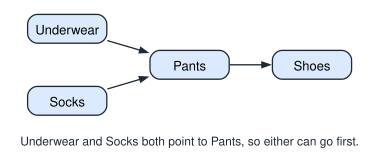
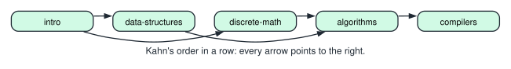
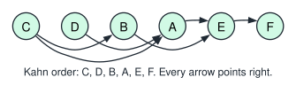

# Module: Topological Sort (Dependency Ordering & Cycle Detection)

Welcome to the **Topological Sort** module. Topological sorting takes a **Directed Acyclic Graph (DAG)** and produces a flat, linear sequence of all vertices such that for every directed edge $u \to v$, node $u$ appears before node $v$ in the ordering.

It answers the universal question: *"Given a collection of tasks with prerequisites, in what valid sequence should I execute them so that every prerequisite is satisfied first?"*

---

## Before you start
<!-- bite: 0755259b-c0cc-4bec-a481-b0d82bdde2a4 -->

- You know what a DAG is and how to detect one — [[09-graphs/02-paths-cycles-and-connectivity|paths and connectivity]].
- You know DFS post-order — [[01-depth-first-search|depth-first search]].
- You know how a queue behaves — [[05-stacks-and-queues|stacks and queues]].

**After this lesson you will be able to:**

1. Implement topological sort **both ways** — Kahn's in-degree algorithm and the DFS post-order method.
2. Detect a cycle as a by-product, and report which vertices are involved.
3. Explain why the order is **not unique**, and enumerate all valid orders for a small DAG.
4. Recognise the problem shape in build systems, schedulers and dependency resolvers.

**Study route:** read 1–5, attempt the prediction in section 4, then run the lab.

---

## 1. Real-World Motivation & Physical Metaphors
<!-- bite: 8ffbb267-cbf3-456a-9f28-941b9daafaa5 -->

Imagine **Getting Dressed in the Morning**:



- You cannot put on your **Shoes** before putting on your **Socks** and **Pants**.
- You cannot put on your **Pants** before putting on your **Underwear**.

Valid Topological Orderings:
1. `[Underwear, Socks, Pants, Shoes]`
2. `[Socks, Underwear, Pants, Shoes]`

Notice that a graph can have **multiple valid topological orderings**!

### Production Applications:
1. **Build Systems (Make, Bazel, Webpack)**: Compiling C++ files or JavaScript bundles in dependency order.
2. **Package Managers (npm, pip, cargo)**: Installing libraries after their required dependencies.
3. **University Course Registration**: Planning degree courses around prerequisite requirements (e.g. CS101 before CS201).
4. **Spreadsheet Engines (Excel)**: Recalculating cell formulas when a parent cell changes.

---

## 2. Plain-English Terminology & Concept Table
<!-- bite: 70cb1631-5d98-491b-84c2-0fd92b24189e -->

| Term | Plain-English Definition | Example / Analogy |
| :--- | :--- | :--- |
| **DAG** | Directed Acyclic Graph (directed edges with NO circular loops). | Prerequisites flowchart. |
| **In-Degree** | The number of incoming directed edges pointing into a node. | The number of uncompleted prerequisites a course has. |
| **Topological Order** | A linear list where every prerequisite node comes before its dependent nodes. | Valid daily task sequence. |
| **Cycle** | A circular path ($A \to B \to C \to A$) that makes topological ordering IMPOSSIBLE! | Circular reasoning deadlocks. |

---

## 3. Technical Deep Dive: Kahn's Algorithm (BFS In-Degree Method)
<!-- bite: 16e550cb-8587-48fe-bbc7-cdb155d0390f -->

Kahn's Algorithm is the industry standard for Topological Sorting:

### Step-by-Step Mechanics
1. Calculate the **In-Degree** (number of incoming edges) for every vertex.
2. Push all vertices with `in_degree == 0` (nodes with zero prerequisites) into a **FIFO Queue**.
3. Pop a vertex `u` from the queue, append it to the `topological_order` list.
4. For every neighbor `v` of `u`, decrement its in-degree by 1 (`in_degree[v] -= 1`).
5. If `v`'s in-degree drops to 0, push `v` into the queue!
6. Repeat until the queue is empty.

> [!KEY-INSIGHT]
> **Cycle Detection Guarantee**: If `len(topological_order) < Total Nodes`, a **Cycle exists in the graph**! Circular dependencies prevent in-degrees from ever reaching 0.

---

### Python Code Implementation (Kahn's Algorithm)

```python
from collections import deque

def topological_sort(num_nodes: int, edges: list) -> list:
    """Performs topological sort using Kahn's Algorithm (BFS).
    
    edges format: list of tuples [(u, v)] meaning u MUST happen before v (u -> v).
    Returns a valid linear ordering list, or [] if a cycle exists!
    """
    # 1. Build adjacency list and calculate in-degrees
    graph = [[] for _ in range(num_nodes)]
    in_degree = [0] * num_nodes
    
    for u, v in edges:
        graph[u].append(v)
        in_degree[v] += 1
        
    # 2. Queue all nodes with 0 prerequisites (in_degree == 0)
    queue = deque([node for node in range(num_nodes) if in_degree[node] == 0])
    topological_order = []
    
    # 3. Process queue
    while queue:
        u = queue.popleft()
        topological_order.append(u)
        
        for v in graph[u]:
            in_degree[v] -= 1
            if in_degree[v] == 0:  # All prerequisites now satisfied!
                queue.append(v)
                
    # 4. Cycle check
    if len(topological_order) == num_nodes:
        return topological_order
    else:
        return []  # Return empty list: A cycle was detected!
```

---

## Seeing Kahn's algorithm step by step

These frames run Kahn's algorithm on the course graph from the lab (Block 4). Each vertex shows its remaining in-degree. Yellow vertices are in the queue, the orange outline is the vertex just taken, green ones are placed, and their used edges turn grey. Look at algorithms: it needs both data-structures and discrete-math placed before its in-degree reaches 0.


## Seeing the order as a line

Put the vertices in a row in the order Kahn produced, and every prerequisite arrow points to the right. That is exactly what a topological order means.



## 4. Time & Space Complexity Summary
<!-- bite: 0361fb35-59b1-44b3-b620-e05caf1c4022 -->

| Metric | Complexity | Explanation |
| :--- | :--- | :--- |
| **Time Complexity** | **$O(V + E)$** | Every vertex ($V$) is enqueued once, and every directed edge ($E$) is decremented once. |
| **Space Complexity** | **$O(V + E)$** | Graph adjacency list $O(V + E)$ plus in-degree array and queue $O(V)$. |

---

## Implementation — complete runnable example
<!-- bite: 0bc94829-2a97-479f-9191-b77f28f6aa23 -->

**Runnable example:** save as `toposort.py` in any empty directory and run `python3 toposort.py`. Standard library only; writes no files.

```python
"""Topological sort: Kahn's algorithm, the DFS method, and cycle reporting."""
from collections import defaultdict, deque
from itertools import permutations


def build(edges, vertices=None):
    adj = defaultdict(list)
    for v in (vertices or []):
        adj.setdefault(v, [])
    for u, v in edges:
        adj[u].append(v)
        adj.setdefault(v, [])
    return {k: sorted(vs) for k, vs in adj.items()}


def kahn(adj):
    """Repeatedly take a vertex with no remaining prerequisites."""
    indeg = {v: 0 for v in adj}
    for u in adj:
        for v in adj[u]:
            indeg[v] += 1
    q = deque(sorted(v for v in adj if indeg[v] == 0))
    order = []
    while q:
        v = q.popleft()
        order.append(v)
        for w in adj[v]:
            indeg[w] -= 1
            if indeg[w] == 0:
                q.append(w)
    if len(order) != len(adj):
        return None, [v for v in adj if indeg[v] > 0]   # the cycle's vertices
    return order, []


def dfs_topo(adj):
    """Post-order, reversed. A vertex is finished only after all its successors."""
    colour = {v: 0 for v in adj}
    order, cycle = [], []

    def visit(v, path):
        colour[v] = 1
        for w in adj[v]:
            if colour[w] == 1:
                cycle.extend(path[path.index(w):] + [w])
                return False
            if colour[w] == 0 and not visit(w, path + [w]):
                return False
        colour[v] = 2
        order.append(v)                  # recorded on the way OUT
        return True

    for v in sorted(adj):
        if colour[v] == 0 and not visit(v, [v]):
            return None, cycle
    return order[::-1], []


def is_valid_order(adj, order):
    pos = {v: i for i, v in enumerate(order)}
    return len(order) == len(adj) and all(pos[u] < pos[v] for u in adj for v in adj[u])


def all_valid_orders(adj):
    return [p for p in permutations(sorted(adj)) if is_valid_order(adj, list(p))]


if __name__ == "__main__":
    courses = build([("intro", "data-structures"), ("intro", "discrete-math"),
                     ("data-structures", "algorithms"), ("discrete-math", "algorithms"),
                     ("algorithms", "compilers")])

    print("Block 1 - both algorithms produce a valid order")
    k_order, _ = kahn(courses)
    d_order, _ = dfs_topo(courses)
    print(f"  Kahn:  {k_order}")
    print(f"  DFS:   {d_order}")
    assert is_valid_order(courses, k_order)
    assert is_valid_order(courses, d_order)
    print("  both valid; they differ because the order is not unique")

    print()
    print("Block 2 - the order is NOT unique")
    small = build([("a", "c"), ("b", "c"), ("c", "d")])
    orders = all_valid_orders(small)
    print(f"  graph: a->c, b->c, c->d")
    print(f"  all valid orders: {[''.join(o) for o in orders]}")
    assert len(orders) == 2
    print("  a and b are independent, so either may come first. Any algorithm")
    print("  returns ONE of these; asserting a specific one is a broken test.")

    print()
    print("Block 3 - a cycle makes it impossible, and both methods say so")
    cyclic = build([("a", "b"), ("b", "c"), ("c", "a"), ("c", "d")])
    k_res, k_cycle = kahn(cyclic)
    d_res, d_cycle = dfs_topo(cyclic)
    print(f"  Kahn returns {k_res}, vertices stuck in a cycle: {sorted(k_cycle)}")
    print(f"  DFS returns  {d_res}, cycle found: {d_cycle}")
    assert k_res is None and d_res is None
    assert set(k_cycle) >= {"a", "b", "c"}
    print("  Kahn detects it by finishing with fewer vertices than it started with:")
    print("  anything still holding a positive in-degree is waiting on a cycle.")
    print("  DFS detects it by meeting a vertex still on the current path.")

    print()
    print("Block 4 - Kahn's invariant, step by step")
    indeg = {v: 0 for v in courses}
    for u in courses:
        for v in courses[u]:
            indeg[v] += 1
    print(f"  initial in-degrees: {dict(sorted(indeg.items()))}")
    q = deque(sorted(v for v in courses if indeg[v] == 0))
    step = 0
    while q:
        step += 1
        v = q.popleft()
        ready = []
        for w in courses[v]:
            indeg[w] -= 1
            if indeg[w] == 0:
                q.append(w)
                ready.append(w)
        print(f"    step {step}: take {v:16} -> unlocked {ready if ready else '-'}")
    print("  the invariant: the queue holds exactly the vertices whose prerequisites")
    print("  are all already placed. That is what makes the output valid by construction.")

    print()
    print("Block 5 - the shape in the wild")
    build_graph = build([("config.h", "main.o"), ("config.h", "util.o"),
                         ("util.h", "util.o"), ("main.o", "app"), ("util.o", "app")])
    order, _ = kahn(build_graph)
    print(f"  a tiny build dependency graph: {order}")
    assert order.index("main.o") < order.index("app")
    assert order.index("config.h") < order.index("main.o")
    print("  every .o comes after its headers, and the binary comes last.")
    print("  This is make, cargo, npm, a CI pipeline, a spreadsheet recalculation,")
    print("  and course prerequisites - the same algorithm each time.")

    print()
    print("toposort: passed")
```

Expected output:

```text
Block 1 - both algorithms produce a valid order
  Kahn:  ['intro', 'data-structures', 'discrete-math', 'algorithms', 'compilers']
  DFS:   ['intro', 'discrete-math', 'data-structures', 'algorithms', 'compilers']
  both valid; they differ because the order is not unique

Block 2 - the order is NOT unique
  graph: a->c, b->c, c->d
  all valid orders: ['abcd', 'bacd']
  a and b are independent, so either may come first. Any algorithm
  returns ONE of these; asserting a specific one is a broken test.

Block 3 - a cycle makes it impossible, and both methods say so
  Kahn returns None, vertices stuck in a cycle: ['a', 'b', 'c', 'd']
  DFS returns  None, cycle found: ['a', 'b', 'c', 'a']
  Kahn detects it by finishing with fewer vertices than it started with:
  anything still holding a positive in-degree is waiting on a cycle.
  DFS detects it by meeting a vertex still on the current path.

Block 4 - Kahn's invariant, step by step
  initial in-degrees: {'algorithms': 2, 'compilers': 1, 'data-structures': 1, 'discrete-math': 1, 'intro': 0}
    step 1: take intro            -> unlocked ['data-structures', 'discrete-math']
    step 2: take data-structures  -> unlocked -
    step 3: take discrete-math    -> unlocked ['algorithms']
    step 4: take algorithms       -> unlocked ['compilers']
    step 5: take compilers        -> unlocked -
  the invariant: the queue holds exactly the vertices whose prerequisites
  are all already placed. That is what makes the output valid by construction.

Block 5 - the shape in the wild
  a tiny build dependency graph: ['config.h', 'util.h', 'main.o', 'util.o', 'app']
  every .o comes after its headers, and the binary comes last.
  This is make, cargo, npm, a CI pipeline, a spreadsheet recalculation,
  and course prerequisites - the same algorithm each time.

toposort: passed
```

## 5. Common Pitfalls & Traps
<!-- bite: 312d8d04-8e5a-46b1-a501-d824897f0146 -->

1. **Graph Must Be Directed and Acyclic**: Calling Topological Sort on an **undirected graph** or a graph containing a **cycle** will fail. Always check `len(order) == num_nodes`.
2. **Flipping Edge Directions**: Reversing the direction of edges (`v -> u` instead of `u -> v`) will produce a reverse topological order. Be precise about dependency direction!
3. **Non-Unique Orders**: Never assert that a topological sort produces a single fixed output array. Multiple valid topological orderings often exist for the same graph.

---

## Check your understanding
<!-- bite: 2a9cf37d-abef-42fa-97f9-98bbe86be558 -->

Try each one before you open the answer.

1. <!-- q: mcq id="363925d7" -->
   Kahn's algorithm runs on a directed graph with 8 vertices and returns an order of only 5. What does that mean?

   - [x] The graph has a cycle; the vertices on it never reach in-degree 0
   - [ ] The graph is disconnected
   - [ ] 3 vertices have no edges
   - [ ] The queue was used instead of a stack

   <details><summary>Answer</summary>

   Vertices on a cycle each wait on another vertex of the cycle, so their in-degrees never drop to 0 and they are never output. `len(order) < V` is the cycle check.

   </details>

2. <!-- q: gap id="08260bae" answers="in-degree|indegree|in degree;0|zero" -->
   Fill in the gaps. Kahn's algorithm counts each vertex's ___, the number of edges coming into it, and starts by queueing every vertex whose count is ___.

   <details><summary>Answer</summary>

   In-degree, and 0. A vertex with in-degree 0 has no remaining prerequisites, so it is safe to output now.

   </details>

3. <!-- q: mcq id="0d7c002a" -->
   Can an undirected graph with at least one edge be topologically sorted?

   - [ ] Yes, always
   - [x] No; an undirected edge A–B says A comes before B and B comes before A
   - [ ] Only if it is a tree
   - [ ] Only if it is connected

   <details><summary>Answer</summary>

   An undirected edge works both ways, which is a two-vertex cycle in dependency terms. Topological order needs a DAG.

   </details>

4. <!-- q: mcq id="6916ef2a" -->
   Dependencies: underwear → pants, socks → shoes, pants → shoes. Which of these are valid dressing orders? Choose all that apply.

   - [x] underwear, socks, pants, shoes
   - [x] socks, underwear, pants, shoes
   - [ ] underwear, pants, shoes, socks
   - [ ] pants, underwear, socks, shoes

   <details><summary>Answer</summary>

   The first two put every item before what depends on it. The third puts shoes before socks, and the fourth puts pants before underwear. A DAG usually has several valid orders.

   </details>

5. <!-- q: open id="a344b97c" -->
   The DFS method outputs vertices in decreasing finish time. Why does that give a valid topological order?

   <details><summary>Answer</summary>

   In a DAG, for every edge u → v, v finishes before u: either DFS goes into v from u and returns before u finishes, or v was already finished. There are no back edges, which would be the only way for v to finish later. So listing vertices by decreasing finish time puts u before v for every edge.

   </details>

## Check your understanding: worked problems
<!-- bite: 56bffbc9-f5e9-4f28-ad11-1472798f4b1c -->

Work each one out on paper first, then type your answer.

1. <!-- q: gap id="39b15d64" answers="2;1;2" -->
   Fill in the gaps. A directed graph has vertices A, B, C, D, E, F and the edges A→C, B→C, B→D, C→E, D→E, E→F (u→v means u must come before v). The in-degree of C is ___, of D is ___, and of E is ___.

   <details><summary>Answer</summary>

   C has 2 (from A and B), D has 1 (from B), E has 2 (from C and D). A and B have 0, so Kahn's algorithm starts with them.

   </details>

2. <!-- q: exact id="2bf5ebad" answer="A, B, C, D, E, F" accept="ABCDEF|A B C D E F" -->
   A directed graph has vertices A, B, C, D, E, F and the edges A→C, B→C, B→D, C→E, D→E, E→F (u→v means u must come before v). Kahn's algorithm queues the in-degree-0 vertices in alphabetical order, and each vertex's edges are processed in the order listed. What order does it output? Separate the vertices with commas.

   <details><summary>Answer</summary>

   A, B, C, D, E, F. Start with A and B. Removing A drops C to 1. Removing B drops C to 0 and D to 0, queued in that order. C drops E to 1, D drops E to 0, and E frees F.

   </details>

3. <!-- q: exact id="f8f4394f" answer="5" -->
   A directed graph has vertices A, B, C, D, E, F and the edges A→C, B→C, B→D, C→E, D→E, E→F (u→v means u must come before v). How many different valid topological orders does it have?

   <details><summary>Answer</summary>

   5. E and F are always last. The first four must put A and B before C and B before D: B, A, C, D / B, A, D, C / B, D, A, C / A, B, C, D / A, B, D, C.

   </details>

4. <!-- q: exact id="bf0e51ad" answer="A, E" accept="AE|A E|A,E" -->
   A directed graph has vertices A, B, C, D, E and the edges A→B, B→C, C→D, D→B, A→E. Kahn's algorithm runs on it. Which vertices does it output? Separate them with commas.

   <details><summary>Answer</summary>

   A, E. Removing A drops B from 2 to 1 and E to 0. B, C and D form the cycle B → C → D → B, so none of them ever reaches in-degree 0. The short output (2 of 5) reveals the cycle.

   </details>

5. <!-- q: sketch id="0e082c24" -->
   A DAG has the edges D → A, C → A, C → B, A → E, B → E and E → F. Run Kahn's algorithm: start the queue with the in-degree-0 vertices in alphabetical order, and when a vertex's in-degree drops to 0, add it to the back of the queue. Draw the vertices in a row in the order Kahn takes them, and draw every edge.

   <details><summary>Answer</summary>

   

   What to check:
   - The queue starts as C, D (both have in-degree 0).
   - Taking C unlocks B; taking D then unlocks A, so B is ahead of A in the queue.
   - The order is C, D, B, A, E, F.
   - Every edge in your row points to the right.

   </details>

## Practice — independent task
<!-- bite: cd362d63-ee54-4360-9524-4f30a9524827 -->

Implement `resolve(packages)` — a dependency resolver that reports **useful** errors.

1. Input is a dict mapping each package to its dependencies. Return a valid install order, or a structured error.
2. **On a cycle, report the actual cycle** — the list of packages forming it, in order — not just "a cycle exists". This is what makes an error message useful, and it is the part most implementations skip.
3. On a missing dependency, report which package required it.
4. Add **deterministic tie-breaking**: when several packages are ready, take them alphabetically. Assert the output is identical across runs — an unstable order makes builds unreproducible, which is a real problem, not a cosmetic one.
5. Then implement **parallel scheduling**: instead of a flat list, return *waves* — sets of packages installable simultaneously. Wave $k$ is everything whose dependencies are all in earlier waves. Report the number of waves and the maximum wave width, and explain what those two numbers mean for a build farm.

**Edge cases:** a package depending on itself; two packages depending on each other; an empty input; a package with no dependencies and no dependents.

**Done when:** your cycle report names the actual cycle members in order, repeated runs give byte-identical output, and your wave count matches the longest dependency chain — which it must, and you should be able to say why.

## Before moving on
<!-- bite: f3c545bc-a607-4faa-ad10-a7eb18b21fdc -->

You can implement both algorithms, detect and report cycles, and explain why the order is not unique.

**Recap:** a topological order exists **iff** the graph is a DAG; Kahn's repeatedly removes a zero in-degree vertex and detects a cycle by finishing short; the DFS method takes post-order and reverses it, detecting a cycle via a vertex still on the current path; both are $O(V+E)$; the order is generally **not unique**, so never assert one specific answer; the number of parallel waves equals the longest dependency chain.

**Next:** [[06-minimum-spanning-tree|Minimum Spanning Tree]] — connecting everything at least total cost.

## Related Modules
<!-- bite: 392f54c1-b9a3-4bff-a8b7-83bd4b1f817b -->
- [[09-graphs/index|Graphs]] — Directed graphs and adjacency lists
- [[02-breadth-first-search|Breadth-First Search (BFS)]] — FIFO queue mechanics powering Kahn's algorithm
- [[01-depth-first-search|Depth-First Search (DFS)]] — DFS post-order alternative for topological sort
