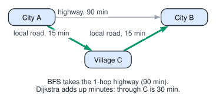
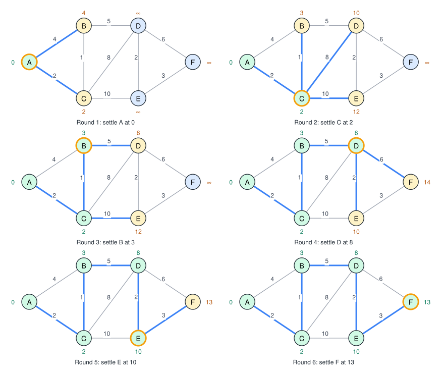
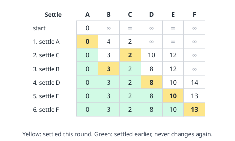
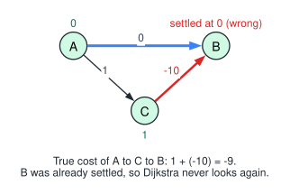
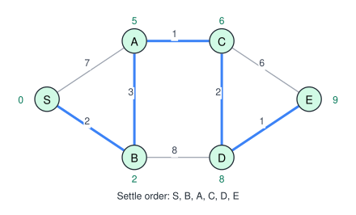

# Module: Dijkstra's Algorithm (Weighted Shortest Path)

Welcome to the **Dijkstra's Algorithm** module.

---

## Before you start
<!-- bite: e1d572cf-e23e-4170-b689-7ab99a7c1775 -->

- You know BFS and why it stops working on weighted graphs — [[02-breadth-first-search|breadth-first search]].
- You know what a min-heap gives you — [[07-heaps|heaps]].
- You know weighted-graph vocabulary — [[09-graphs/01-what-a-graph-is|what a graph is]].

**After this lesson you will be able to:**

1. Implement Dijkstra with a priority queue, and reconstruct the path.
2. Explain the **greedy invariant** that makes it correct — and the exact assumption it needs.
3. **Demonstrate it failing** on a graph with a negative edge, and say why the failure is structural rather than a bug.
4. Choose between Dijkstra, BFS, Bellman–Ford and A* from the graph's properties.

**Study route:** read 1–5, attempt the prediction in section 4, then run the lab. Block 3 breaks it on purpose.

---

## What Dijkstra's algorithm is
<!-- bite: af63ca64-946c-4bbf-bf81-762108a7f292 -->

Dijkstra finds the shortest path from a starting source node to every other node in a **weighted graph with non-negative edge weights**.

While [[02-breadth-first-search|BFS]] finds shortest paths in terms of **number of hops** (unweighted edges), Dijkstra finds shortest paths in terms of **total cumulative cost/distance** (weighted edges).

## 1. Real-World Motivation & Physical Metaphors
<!-- bite: 683c46ee-aede-4b68-bbbe-a3b9f9ab7e03 -->

Imagine planning a **GPS Driving Route**:



- **BFS Strategy**: Picks the 1-hop direct highway route (100 miles, taking 90 minutes).
- **Dijkstra Strategy**: Evaluates total travel time (weight) and picks the 2-hop route through Village C (10 miles total, taking only 30 minutes).

## 1. Real-World Motivation: Production Applications
<!-- bite: a870476d-c6fa-4125-b395-2329f91ee7bf -->

The same cheapest-route idea runs inside many tools you already use.

1. **GPS Navigation (Google Maps / Waze)**: Calculating fastest driving routes considering speed limits and traffic delay weights.
2. **Network IP Routing (OSPF Protocol)**: Routing data packets across servers based on latency.
3. **Flight Booking Search**: Finding the cheapest flight combinations between airports.

---

## 2. Plain-English Terminology & Concept Table
<!-- bite: fda42234-c931-4120-81b2-3d946ee18a4d -->

| Term | Plain-English Definition | Example / Analogy |
| :--- | :--- | :--- |
| **Edge Weight** | The numeric cost (distance, time, fee) required to travel across an edge. | Toll road price or travel time. |
| **Relaxation** | Updating the shortest known distance to a node if a cheaper path is discovered. | Finding a shortcut road. |
| **Min-Heap (Priority Queue)** | Data structure that always pops the unvisited node with the smallest cumulative distance. | Always processing the closest node next. |
| **Stale Entry** | An outdated `(distance, node)` pair left in the heap after a shorter path to that node was found. | Old, expired route suggestion. |

---

## 3. Technical Deep Dive: Dijkstra's Algorithm
<!-- bite: ed14c65e-8634-4411-a559-8045fc78008f -->

### Step-by-Step Mechanics
1. Initialize `distances[source] = 0` and `distances[node] = infinity` for all other nodes.
2. Push `(0, source)` into a **Min-Heap**.
3. Pop the node with the smallest distance `dist`. If `dist > distances[node]`, skip it (**Stale Entry**).
4. For each neighbor, calculate candidate distance: `new_dist = dist + weight`.
5. If `new_dist < distances[neighbor]`, update `distances[neighbor] = new_dist` (**Relaxation**) and push `(new_dist, neighbor)` into the min-heap.

---

## 3. Technical Deep Dive: Python Code Implementation
<!-- bite: 353c013f-3247-435f-b91e-31bc51378c07 -->

Here are the steps above written as Python.

```python
import heapq

def dijkstra(graph: dict, source: str) -> dict:
    """Finds the shortest distance from source to all nodes in a weighted graph.
    
    graph format: { 'A': [('B', 2), ('C', 5)], ... }
    """
    # 1. Initialize distance map with infinity
    distances = {node: float('inf') for node in graph}
    distances[source] = 0
    
    # 2. Min-heap stores tuples of (cumulative_distance, node)
    min_heap = [(0, source)]
    
    while min_heap:
        current_dist, current_node = heapq.heappop(min_heap)
        
        # Lazy Deletion / Stale Entry check:
        # If we already found a shorter path to current_node, skip processing!
        if current_dist > distances[current_node]:
            continue
            
        # 3. Relax edges to neighbors
        for neighbor, weight in graph[current_node]:
            new_dist = current_dist + weight
            
            if new_dist < distances[neighbor]:
                distances[neighbor] = new_dist  # Relaxation step
                heapq.heappush(min_heap, (new_dist, neighbor))
                
    return distances
```

---

## Seeing Dijkstra step by step
<!-- bite: 1424ea2f-bd2f-49eb-90ed-1f9fd3b702bc -->

These frames run Dijkstra from A on the lab's graph. Each round settles the vertex with the smallest distance (orange outline). Green vertices are settled and their numbers never change again; yellow ones have a distance that may still drop. Watch B: it shows 4 after round 1, then drops to 3 when C is settled, because A → C → B costs 2 + 1.



## Seeing the distance table round by round
<!-- bite: d27e9ac8-cba4-4419-bad4-e49e90d35809 -->

The same run as a table: one row per round, one column per vertex. The yellow cell is the vertex settled in that round. Reading down a column shows a distance only ever going down, then freezing once it turns green.



## 4. Why Negative Edge Weights Break Dijkstra
<!-- bite: 7a4f8b3d-79ee-40ae-b519-a553cbcf2072 -->

> [!CAUTION]
> **Dijkstra FAILS on Negative Edge Weights!**
> Dijkstra makes a **Greedy Assumption**: Once a node is popped from the min-heap, its calculated distance is final and will never decrease. 
> 
> If negative edge weights exist, a longer path with 10 hops could suddenly become cheaper later if it contains a `-100` weight edge! For graphs with negative weights, use the **Bellman-Ford Algorithm** ($O(V \cdot E)$).

## 4. Negative weights: seeing it fail
<!-- bite: 373170a3-010c-4a4b-88c2-9c90f656fab5 -->

A tiny graph with one negative edge shows the failure.

The lab's Block 3 shows it on three vertices. Dijkstra settles B at 0 straight away, and only later finds the −10 edge from C.



---

## 5. Time & Space Complexity Summary
<!-- bite: 1ae52a61-5501-45c7-a4f0-e6cbb84ff0aa -->

| Metric | Complexity | Explanation |
| :--- | :--- | :--- |
| **Time Complexity** | **$O((V + E) \log V)$** | Every vertex ($V$) is popped from the heap, and every edge ($E$) can trigger a heap push ($O(\log V)$). |
| **Space Complexity** | **$O(V + E)$** | Graph adjacency list $O(V + E)$ plus heap storage $O(V)$. |

---

## Implementation — complete runnable example
<!-- bite: ca46f833-1dcf-46bd-884f-82f5620f94ad -->

**Runnable example:** save as `dijkstra_lab.py` in any empty directory and run `python3 dijkstra_lab.py`. Standard library only; writes no files.

```python
"""Dijkstra: the algorithm, the path, and the assumption it cannot do without."""
import heapq
from collections import defaultdict


def build(edges, directed=False):
    adj = defaultdict(list)
    for u, v, w in edges:
        adj[u].append((v, w))
        if not directed:
            adj[v].append((u, w))
        else:
            adj.setdefault(v, [])
    return adj


def dijkstra(adj, start):
    """Returns (distances, parents). Lazy deletion: stale heap entries are skipped."""
    dist = {start: 0}
    parent = {start: None}
    done = set()
    pq = [(0, start)]
    pops = 0
    while pq:
        d, v = heapq.heappop(pq)
        pops += 1
        if v in done:
            continue                     # a stale entry from before v was improved
        done.add(v)
        for w, weight in adj.get(v, []):
            if w in done:
                continue                 # FINALISED: Dijkstra never revises it.
            nd = d + weight
            if w not in dist or nd < dist[w]:
                dist[w] = nd
                parent[w] = v
                heapq.heappush(pq, (nd, w))
    return dist, parent, pops


def path_to(parent, goal):
    if goal not in parent:
        return None
    out = [goal]
    while parent[out[-1]] is not None:
        out.append(parent[out[-1]])
    return out[::-1]


def brute_force_shortest(adj, start, goal):
    """Every simple path, exhaustively. Correct, exponential, and a good oracle."""
    best = [None, float("inf")]

    def walk(v, seen, cost, path):
        if cost >= best[1]:
            return
        if v == goal:
            best[0], best[1] = list(path), cost
            return
        for w, weight in adj.get(v, []):
            if w not in seen:
                walk(w, seen | {w}, cost + weight, path + [w])

    walk(start, {start}, 0, [start])
    return best[0], best[1]


def bellman_ford(adj, start, vertices):
    """Handles negative edges, and detects a negative cycle. O(VE)."""
    dist = {v: float("inf") for v in vertices}
    dist[start] = 0
    for _ in range(len(vertices) - 1):
        for u in adj:
            for v, w in adj[u]:
                if dist[u] + w < dist[v]:
                    dist[v] = dist[u] + w
    for u in adj:                        # one more pass: any improvement means a negative cycle
        for v, w in adj[u]:
            if dist[u] + w < dist[v]:
                return None
    return dist


if __name__ == "__main__":
    G = build([("A", "B", 4), ("A", "C", 2), ("B", "C", 1), ("B", "D", 5),
               ("C", "D", 8), ("C", "E", 10), ("D", "E", 2), ("D", "F", 6),
               ("E", "F", 3)])

    print("Block 1 - shortest distances and the paths themselves")
    dist, parent, pops = dijkstra(G, "A")
    for v in sorted(dist):
        print(f"    A -> {v}: distance {dist[v]:2}   path {path_to(parent, v)}")
    assert dist["A"] == 0 and dist["C"] == 2 and dist["B"] == 3
    assert path_to(parent, "B") == ["A", "C", "B"]
    print("  note A->B is 3 via C, not the direct edge of weight 4 -")
    print("  a shortest path need not use the direct edge, or the fewest edges")

    print()
    print("Block 2 - checked against exhaustive search")
    for goal in sorted(dist):
        bpath, bcost = brute_force_shortest(G, "A", goal)
        print(f"    {goal}: dijkstra {dist[goal]:2}   brute force {bcost:2}   agree: {dist[goal] == bcost}")
        assert dist[goal] == bcost
    print("  every distance matches an exhaustive search over all simple paths")

    print()
    print("Block 3 - the assumption: NON-NEGATIVE weights")
    neg = build([("A", "B", 0), ("A", "C", 1), ("C", "B", -10)], directed=True)
    d_dij, _, _ = dijkstra(neg, "A")
    d_bf = bellman_ford(neg, "A", ["A", "B", "C"])
    print("  graph: A->B (0), A->C (1), C->B (-10)")
    print(f"    dijkstra says      A->B = {d_dij['B']}")
    print(f"    bellman-ford says  A->B = {d_bf['B']}")
    print(f"    truth: A->C->B costs 1 + (-10) = {1 + (-10)}")
    assert d_dij["B"] == 0 and d_bf["B"] == -9
    print("  Dijkstra is WRONG here, and not because of a coding error.")
    print("  It pops B first (distance 0) and FINALISES it. Only later does it reach")
    print("  C and find the -10 edge back to B - but B is already settled, and")
    print("  Dijkstra never revises a settled vertex. That refusal is the whole basis")
    print("  of its efficiency, and a negative edge is exactly what invalidates it:")
    print("  going further can now REDUCE the total, so 'closest first' stops working.")

    print()
    print("Block 4 - lazy deletion, and why the heap can exceed V entries")
    dist2, _, pops2 = dijkstra(G, "A")
    print(f"  graph has {len(G)} vertices; the heap was popped {pops2} times")
    print("  extra pops are STALE entries - a vertex whose distance improved after")
    print("  it was pushed. Skipping them with a 'done' set is simpler and faster")
    print("  than the decrease-key operation a textbook heap would need.")
    assert pops2 >= len(G)

    print()
    print("Block 5 - choosing the right tool")
    print("   situation                              use")
    rows = [("unweighted graph", "BFS - O(V+E), no heap needed"),
            ("non-negative weights", "Dijkstra - O((V+E) log V)"),
            ("any weights, need cycle detection", "Bellman-Ford - O(VE)"),
            ("one target, good heuristic available", "A* - Dijkstra with a priority bonus"),
            ("all pairs, dense graph", "Floyd-Warshall - O(V^3)")]
    for a, b in rows:
        print(f"   {a:38} {b}")
    unweighted = build([("A", "B", 1), ("B", "C", 1), ("A", "C", 1)])
    du, _, _ = dijkstra(unweighted, "A")
    print(f"  on an unweighted graph Dijkstra agrees with BFS: {dict(sorted(du.items()))}")
    assert du["C"] == 1
    print("  but BFS gets there without a heap, so use BFS when all weights are equal")

    print()
    print("dijkstra_lab: passed")
```

## Implementation: what it prints
<!-- bite: 43f35d85-497d-4fc6-82e9-3280b52d6d06 -->

When you run the program, it prints this, block by block.

Expected output:

```text
Block 1 - shortest distances and the paths themselves
    A -> A: distance  0   path ['A']
    A -> B: distance  3   path ['A', 'C', 'B']
    A -> C: distance  2   path ['A', 'C']
    A -> D: distance  8   path ['A', 'C', 'B', 'D']
    A -> E: distance 10   path ['A', 'C', 'B', 'D', 'E']
    A -> F: distance 13   path ['A', 'C', 'B', 'D', 'E', 'F']
  note A->B is 3 via C, not the direct edge of weight 4 -
  a shortest path need not use the direct edge, or the fewest edges

Block 2 - checked against exhaustive search
    A: dijkstra  0   brute force  0   agree: True
    B: dijkstra  3   brute force  3   agree: True
    C: dijkstra  2   brute force  2   agree: True
    D: dijkstra  8   brute force  8   agree: True
    E: dijkstra 10   brute force 10   agree: True
    F: dijkstra 13   brute force 13   agree: True
  every distance matches an exhaustive search over all simple paths

Block 3 - the assumption: NON-NEGATIVE weights
  graph: A->B (0), A->C (1), C->B (-10)
    dijkstra says      A->B = 0
    bellman-ford says  A->B = -9
    truth: A->C->B costs 1 + (-10) = -9
  Dijkstra is WRONG here, and not because of a coding error.
  It pops B first (distance 0) and FINALISES it. Only later does it reach
  C and find the -10 edge back to B - but B is already settled, and
  Dijkstra never revises a settled vertex. That refusal is the whole basis
  of its efficiency, and a negative edge is exactly what invalidates it:
  going further can now REDUCE the total, so 'closest first' stops working.

Block 4 - lazy deletion, and why the heap can exceed V entries
  graph has 6 vertices; the heap was popped 10 times
  extra pops are STALE entries - a vertex whose distance improved after
  it was pushed. Skipping them with a 'done' set is simpler and faster
  than the decrease-key operation a textbook heap would need.

Block 5 - choosing the right tool
   situation                              use
   unweighted graph                       BFS - O(V+E), no heap needed
   non-negative weights                   Dijkstra - O((V+E) log V)
   any weights, need cycle detection      Bellman-Ford - O(VE)
   one target, good heuristic available   A* - Dijkstra with a priority bonus
   all pairs, dense graph                 Floyd-Warshall - O(V^3)
  on an unweighted graph Dijkstra agrees with BFS: {'A': 0, 'B': 1, 'C': 1}
  but BFS gets there without a heap, so use BFS when all weights are equal

dijkstra_lab: passed
```

## Implementation: the block that is the lesson
<!-- bite: 5aab1297-4252-480a-a3cd-bf5e86c22d34 -->

One block of the output is the most important result here.

Block 3 is the lesson. Dijkstra returns $0$ where the true answer is $-9$, and no amount of debugging fixes it: the algorithm's correctness *rests* on the assumption that extending a path cannot make it cheaper.

## 6. Common Pitfalls & Traps
<!-- bite: 2b2da3d3-1f3a-4fb1-b493-3d1232ba0930 -->

1. **Forgetting the Stale Entry Check**: Skipping `if current_dist > distances[current_node]: continue` will not cause incorrect answers, but it wastes massive CPU cycles re-exploring outdated graph paths.
2. **Negative Edge Weights**: Never use Dijkstra if edges can have negative values.
3. **Confusing Dijkstra with BFS**: BFS uses a simple Queue ($O(V+E)$ on unweighted graphs). Dijkstra uses a Min-Heap ($O((V+E)\log V)$ on weighted graphs).

---

## Check your understanding
<!-- bite: fda11c40-9c97-483b-b82f-1f8b14046f36 -->

Try each one before you open the answer.

1. <!-- q: mcq id="2a441218" -->
   What does relaxing the edge u → v with weight w mean in Dijkstra's algorithm?

   - [x] If dist[u] + w is less than dist[v], set dist[v] to dist[u] + w and record u as v's parent
   - [ ] Remove the edge if its weight is too large
   - [ ] Halve the weight of the edge
   - [ ] Mark v as visited without changing anything

   <details><summary>Answer</summary>

   Relaxation checks whether going through u is a shortcut to v. If it is, v's best-known distance goes down and v is pushed onto the heap with the new value.

   </details>

2. <!-- q: mcq id="75bc0db3" -->
   Why does Dijkstra use a min-heap instead of a plain FIFO queue?

   - [ ] A heap uses less memory
   - [x] It always takes the unfinished vertex with the smallest total distance so far, not the one found first
   - [ ] A FIFO queue cannot hold weights
   - [ ] So that it runs in O(V + E)

   <details><summary>Answer</summary>

   A FIFO queue orders by hop count, which is BFS. With weights, the vertex to settle next is the one with the smallest total cost, and a min-heap hands that over in O(log V).

   </details>

3. <!-- q: mcq id="9080178f" -->
   Which graphs is Dijkstra's algorithm correct on?

   - [ ] Any weighted graph
   - [x] Weighted graphs with no negative edge weights
   - [ ] Only unweighted graphs
   - [ ] Only DAGs

   <details><summary>Answer</summary>

   Its greedy rule assumes that once a vertex is popped with the smallest distance, no later path can beat it. A negative edge can make a longer path cheaper afterwards, which breaks that. Use Bellman–Ford instead.

   </details>

4. <!-- q: gap id="d5216841" answers="stale" -->
   Fill in the gap. When Dijkstra pops (dist, v) but dist is bigger than the best distance already recorded for v, the entry is ___ and is skipped.

   <details><summary>Answer</summary>

   Stale. It was pushed before a shorter path to v was found. Skipping it saves work; the heap is never searched to delete it.

   </details>

5. <!-- q: mcq id="b78fab05" -->
   What is the time complexity of Dijkstra with a binary heap on V vertices and E edges?

   - [ ] O(V + E)
   - [x] O((V + E) log V)
   - [ ] O(V × E)
   - [ ] O(V³)

   <details><summary>Answer</summary>

   Every vertex is popped and every edge can cause a push, and each heap operation costs O(log V).

   </details>

6. <!-- q: open id="737a5610" -->
   Explain why one negative edge can make Dijkstra give a wrong answer even with no bug in the code.

   <details><summary>Answer</summary>

   Dijkstra finalises a vertex as soon as it is popped, trusting that every other route is already at least as long and can only get longer. A negative edge breaks that: a route that looked more expensive can become cheaper after crossing it, but the vertex is already final and is never improved. The failure is in the greedy assumption itself.

   </details>

## Check your understanding: worked problems
<!-- bite: 41e2b9b1-0c97-4f13-a158-2fa342f4c75c -->

Work each one out on paper first, then type your answer.

1. <!-- q: gap id="bd585e62" answers="3;4;7" -->
   Fill in the gaps.
   A directed graph has these weighted edges:

   | Edge | Weight |
   | :--- | ---: |
   | S → A | 4 |
   | S → B | 1 |
   | B → A | 2 |
   | B → C | 5 |
   | A → C | 1 |
   | A → D | 7 |
   | C → D | 3 |

   Dijkstra runs from S. The shortest distance to A is ___, to C is ___, and to D is ___.

   <details><summary>Answer</summary>

   A is 3 (S → B → A, 1 + 2, beating the direct 4). C is 4 (S → B → A → C). D is 7 (via C, 4 + 3, beating A → D at 3 + 7 = 10).

   </details>

2. <!-- q: exact id="e337b6e2" answer="S, B, A, C, D" accept="SBACD|S B A C D" -->
   A directed graph has these weighted edges:

   | Edge | Weight |
   | :--- | ---: |
   | S → A | 4 |
   | S → B | 1 |
   | B → A | 2 |
   | B → C | 5 |
   | A → C | 1 |
   | A → D | 7 |
   | C → D | 3 |

   Dijkstra runs from S with a min-heap. List the vertices in the order they are finalised (popped with their final distance), separated by commas.

   <details><summary>Answer</summary>

   S, B, A, C, D, in order of distance: 0, 1, 3, 4, 7. The entry (4, A) pushed by S becomes stale once B lowers A to 3, so it is skipped.

   </details>

3. <!-- q: exact id="18c5663d" answer="S, B, A, C, D" accept="SBACD|S B A C D|S-B-A-C-D" -->
   A directed graph has these weighted edges:

   | Edge | Weight |
   | :--- | ---: |
   | S → A | 4 |
   | S → B | 1 |
   | B → A | 2 |
   | B → C | 5 |
   | A → C | 1 |
   | A → D | 7 |
   | C → D | 3 |

   Dijkstra runs from S and records parents. What is the shortest path from S to D? Separate the vertices with commas.

   <details><summary>Answer</summary>

   S, B, A, C, D with total 1 + 2 + 1 + 3 = 7. It has four edges, while S → A → D has two but costs 11.

   </details>

4. <!-- q: gap id="a69e37df" answers="3;2" -->
   Fill in the gaps. A directed graph has the edges S → A (2), S → B (5), B → A (−4), A → T (1). A version of Dijkstra that treats every popped vertex as final reports the distance from S to T as ___. The true shortest distance is ___.

   <details><summary>Answer</summary>

   It reports 3; the truth is 2. A (2) and then T (3) are popped and finalised before B (5). When B's edge to A (−4) offers A a distance of 1, A is already final, so T never improves. The real best route is S → B → A → T = 5 − 4 + 1 = 2.

   </details>

5. <!-- q: sketch id="a4325852" -->
   An undirected weighted graph has the edges S–A 7, S–B 2, B–A 3, A–C 1, B–D 8, C–D 2, C–E 6 and D–E 1. Run Dijkstra from S. Draw the graph on paper, write each vertex's final distance beside it, and mark the shortest-path tree (for each vertex, the edge its best distance came through).

   <details><summary>Answer</summary>

   

   What to check:
   - The settle order is S, B, A, C, D, E.
   - A is 5 through B (2 + 3), not 7 on the direct edge.
   - D is 8 through C (6 + 2), cheaper than 10 straight from B (2 + 8).
   - E is 9 through D (8 + 1), not 12 through C.

   </details>

## Practice — independent task
<!-- bite: 9acef7df-c3ec-4bc5-9026-4c0bbbd3cb6b -->

Implement **A\*** — Dijkstra guided by a heuristic — and measure what the guidance buys.

1. Take a grid with obstacles. Implement Dijkstra on it, then A\* using Manhattan distance as the heuristic $h$. The only change is the priority: $g + h$ instead of $g$.
2. Count **vertices expanded** by each. Report the ratio on several grids of increasing size.
3. **Test admissibility.** A heuristic is admissible if it never overestimates the true remaining cost. Verify Manhattan distance is admissible for 4-directional movement, then deliberately break it — multiply by 1.5 — and show A\* returning a **suboptimal path**. Report by how much.
4. Explain the trade in a comment: an inadmissible heuristic expands fewer nodes but loses the optimality guarantee. Say when that trade is worth making.
5. Then set $h = 0$ and confirm A\* becomes exactly Dijkstra — same expansions, same path. That is the cleanest way to see that A\* is a generalisation, not a different algorithm.

## Practice: edge cases and when you are done
<!-- bite: ec433c4c-4a30-4229-8bf4-0de46dfc7c7f -->

Test your code on these awkward inputs before you call the task finished.

**Edge cases:** no path exists; start equals goal; a grid that is entirely obstacles except the endpoints; a heuristic that is admissible but not *consistent* (look up the difference and say which one A\* actually needs).

**Done when:** A\* and Dijkstra return the same path length on every solvable grid, your inadmissible version demonstrably returns a worse path, and $h=0$ reproduces Dijkstra exactly.

## Before moving on
<!-- bite: d3c7b65d-b981-47ae-9dc1-d9ab3017b813 -->

You can implement Dijkstra with a heap, reconstruct paths, explain its greedy invariant, and demonstrate its failure on negative edges.

**Recap:** Dijkstra repeatedly finalises the closest unfinalised vertex; correct **only** for non-negative weights, because the greedy step assumes extending a path cannot reduce its cost; $O((V+E)\log V)$ with a binary heap; lazy deletion means the heap can hold more than $V$ entries and stale ones are skipped; use BFS when weights are equal, Bellman–Ford for negative weights or cycle detection, A* when you have a heuristic.

**Next:** [[01-topological-sort|Topological Sort]] — ordering a DAG, and the other thing DFS post-order is for.

## Related Modules
<!-- bite: ae00226e-c822-40d0-beba-2431f00eb21b -->
- [[02-breadth-first-search|Breadth-First Search (BFS)]] — Unweighted shortest paths ($O(V+E)$)
- [[07-heaps|Heaps & Priority Queues]] — Min-Heap mechanics powering Dijkstra
- [[09-graphs/index|Graphs]] — Weighted graph adjacency lists
