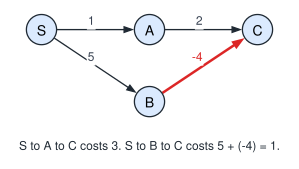
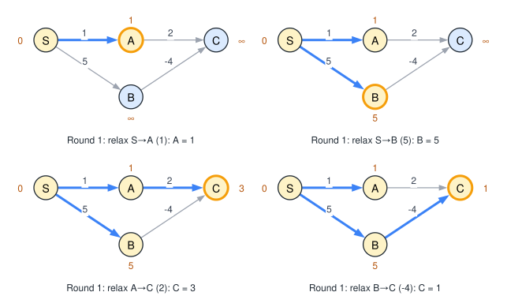
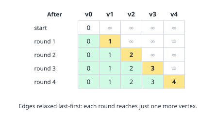
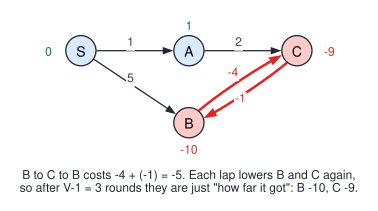
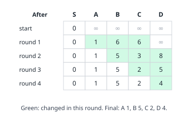

# Module: Bellman–Ford (Shortest Paths When Weights Can Be Negative)

Bellman–Ford is a method for finding the shortest routes from one starting point to every other point in a graph, even when some links have negative costs.

## Before you start
<!-- bite: acad4233-1566-4bb1-8a4f-d3de6ec1dfce -->

- You can implement [[02-dijkstra|Dijkstra]] and explain why it finalises the closest unfinalised vertex.
- You know what a **directed cycle** is, and what makes a graph a **DAG (directed acyclic graph)** — [[02-paths-cycles-and-connectivity|paths, cycles and connectivity]].
- You can read an [[04-representations|edge list]], and you know it is a different representation from an adjacency list.

**After this lesson you will be able to:**

1. Explain **why** Dijkstra breaks on negative weights, in terms of its finalisation step rather than by assertion.
2. Implement Bellman–Ford, and justify the $V-1$ rounds from the maximum length of a shortest path.
3. **Detect a negative cycle** with one extra pass, and say why detection is the only sensible response rather than a correction.
4. Choose between BFS, Dijkstra and Bellman–Ford from a graph's properties.

**Study route:** read 1–3, predict the answer in section 4 before reading it, then run the lab. Section 6 is where negative weights stop being a curiosity.

---

## What Bellman–Ford is
<!-- bite: 954151a0-b869-425e-89b3-376176c4c04f -->

Bellman–Ford finds shortest routes in graphs where some edges cost less than nothing. A negative cost is like a road that pays you to use it, such as a cashback offer on one leg of a trip. It is slower than Dijkstra's method, but it gives the right answer where Dijkstra's can go wrong, and it can spot when a loop of negative costs makes the question meaningless.

## 1. Why this exists: a wrong answer that looks right
<!-- bite: 97f79998-cc43-4f11-965f-0999a516165d -->

Dijkstra's correctness rests on one assumption, and it is worth stating precisely:

> **Once the closest unfinalised vertex is popped, its distance is final — because every other route to it would have to go through a vertex that is already further away, and extending a path can only make it longer.**

**The last clause is the assumption.** "Extending a path can only make it longer" is true exactly when every edge weight is non-negative. Add one negative edge and it collapses.

## 1. Why this exists: the smallest graph that breaks it
<!-- bite: 83fd292a-4f38-47d7-83b9-c26f324588e3 -->

Here is a four-vertex graph where Dijkstra goes wrong.

Here is the smallest graph that breaks it:



## 1. Why this exists: tracing Dijkstra on it
<!-- bite: b86ea9ea-b9ec-4cc4-9157-8c3fc54e0a00 -->

Follow Dijkstra on that graph, one pop at a time.

Trace Dijkstra from `S`:

1. Pop `S` at 0. Relax: `A = 1`, `B = 5`.
2. Pop `A` at 1 — the closest. Relax: `C = 1 + 2 = 3`.
3. Pop `C` at 3 — closer than `B` at 5. **`C` is now finalised at 3.**
4. Pop `B` at 5. Relax `C`: $5 + (-4) = 1$, which is better than 3 — **but `C` is finalised, so the improvement is discarded.**

## 1. Why this exists: what Dijkstra reports
<!-- bite: bf4b5a14-6eae-4ef8-ae1f-bc1098b1f7d8 -->

The trace ends with a wrong answer, and nothing warns you.

Dijkstra reports $C = 3$. The true answer is $1$, via $S \to B \to C$. The lab runs both and prints them side by side:

```text
  Dijkstra     : A=1  B=5  C=3  S=0
  Bellman-Ford : A=1  B=5  C=1  S=0
```

**No exception is raised. No warning is printed.** You get a number that is 200% of the truth, and in a production routing system you would never know. That is the reason this lesson exists: not because negative weights are common, but because the failure mode is silent.

## 1. Why this exists: where negative weights actually come from
<!-- bite: b46a9370-106a-43ba-9b24-1b37b22bbeab -->

Negative weights are not just a textbook trick.

They sound artificial until you have met them:

1. **Currency arbitrage.** Take $-\log(\text{exchange rate})$ as the edge weight, and a profitable trading cycle becomes a negative cycle. Finding one is exactly the negative-cycle detection in section 5.
2. **Any cost that can be a rebate.** Toll roads with credits, energy recovered by a downhill leg, a delivery route that picks up a paying load partway.
3. **Difference constraints.** Systems of inequalities $x_j - x_i \le w$ map directly onto a shortest-path problem with arbitrary-sign weights, which is how schedulers solve timing constraints.
4. **Johnson's algorithm**, which reweights a graph to remove negative edges so Dijkstra can be run many times — and uses Bellman–Ford once to compute the reweighting.

---

## Terms used in Bellman–Ford
<!-- bite: b30e8530-bffc-47e0-990b-fcf594210b9f -->

1. **Relaxation**: This is the single operation the whole algorithm is built from. To relax an edge $u \to v$ with weight $w$ is to ask whether going to $u$ and then taking that edge beats the best route to $v$ found so far — and if it does, to record the better value. In code it is one `if`: `if dist[u] + w < dist[v]: dist[v] = dist[u] + w`.
2. **Round**: This is also called a **pass** or an **iteration**. This is one sweep in which **every edge in the graph** is relaxed once, in some order. Bellman–Ford performs $V-1$ rounds.
3. **Negative cycle**: This is a directed cycle whose edge weights sum to a negative number. Its existence means you can lower a path's cost without limit by going round it again, so **the shortest path is not merely hard to find — it does not exist.**
4. **Reachable negative cycle**: This is a negative cycle you can actually get to from the source. A negative cycle sitting in an unreachable part of the graph does not affect any distance from that source, and a careful implementation reports only reachable ones.

## Terms used in Bellman–Ford: edge lists, stopping early and parents
<!-- bite: 0d1d2408-14ed-4b8a-8e2c-ae19922bb250 -->

These terms cover how the graph is stored, when to stop, and how to rebuild the path.

5. **Edge list**: This is the representation Bellman–Ford wants — a flat list of $(u, v, w)$ triples. It never asks "what are the neighbours of $u$?", so the adjacency list that Dijkstra and [[01-depth-first-search|DFS]] need buys it nothing.
6. **Early termination**: This is stopping once a full round changes nothing. If an entire pass over every edge improves no distance, no later pass can either, because the inputs to every comparison are unchanged.
7. **Predecessor array**: This is also called the **parent array**. This is the record of which vertex each distance came from, which is how you recover an actual path rather than only its cost.

---

## 2. The algorithm
<!-- bite: 34c61e77-d066-4ccc-aa46-04ee5ca8e9d8 -->

**In words: start with every distance at infinity except the source, then relax every edge in the graph, $V-1$ times over.**

That is the whole thing. There is no priority queue, no visited set, no finalisation — and the absence of finalisation is precisely why it survives negative weights. A distance can be improved at any point, right up to the last round.

## 2. The algorithm: the code
<!-- bite: 7c695ad3-05c7-461e-89ef-5ada6ec65f7d -->

Here is the algorithm in Python.

```python
def bellman_ford(graph, source):
    dist = {v: INF for v in graph}
    parent = {v: None for v in graph}
    dist[source] = 0
    edges = [(u, v, w) for u in graph for v, w in graph[u]]

    for _ in range(len(graph) - 1):          # V-1 rounds
        changed = False
        for u, v, w in edges:                # relax EVERY edge
            if dist[u] != INF and dist[u] + w < dist[v]:
                dist[v] = dist[u] + w
                parent[v] = u
                changed = True
        if not changed:
            break                            # early termination

    # One extra pass: any further improvement means a negative cycle.
    for u, v, w in edges:
        if dist[u] != INF and dist[u] + w < dist[v]:
            return dist, parent, True
    return dist, parent, False
```

## 2. The algorithm: why the guard matters
<!-- bite: 959ff931-f69b-4342-8e40-698e0d2a9803 -->

One line in that code looks optional but is not.

**The `dist[u] != INF` guard is not decoration.** Without it, `INF + (-4)` is still `INF` in floating point but would be a real comparison with integers or a sentinel — and relaxing out of an unreached vertex would invent paths that do not exist.

---

## Seeing round 1 on the trap graph
<!-- bite: 187a177c-75d2-4c8d-9992-ae365129e26f -->

Here is the first round of Bellman–Ford on the trap graph, one frame per edge, in the lab's order. The orange outline marks a distance that just went down. Look at the last frame: C drops from 3 to 1, because nothing was ever locked in. Round 2 changes nothing, so the algorithm stops.



## 3. Why exactly $V-1$ rounds
<!-- bite: 80599a5f-7304-4b28-90f1-8a2bde1f514e -->

This is the part to be able to derive rather than recall.

**The claim in words: after $k$ rounds, every vertex reachable by a shortest path of at most $k$ edges has its final distance. Since no shortest path can use more than $V-1$ edges, $V-1$ rounds finish the job.**

**Why a shortest path uses at most $V-1$ edges.** A path with $V$ edges visits $V+1$ vertices, so by the pigeonhole principle it repeats one — it contains a cycle. If the graph has no negative cycle, removing that cycle cannot increase the cost, so a shortest path that is simple always exists. A simple path visits at most $V$ vertices and therefore uses at most $V-1$ edges.

**Why one round extends the guarantee by one edge.** Suppose the shortest path to $v$ is $s \to \dots \to u \to v$ using $k$ edges, and after $k-1$ rounds `dist[u]` is already final. During round $k$, every edge is relaxed — including $u \to v$ — so `dist[v]` becomes at most `dist[u] + w`, which is the shortest-path value. It cannot go lower, because no shorter path exists. Induction does the rest.

## 3. Why V − 1 rounds: edge order and the worst case
<!-- bite: f5b90278-17bc-4ed4-83d5-ed03487e4f38 -->

This part shows how much the order of the edges matters.

**Note what this argument does *not* assume: the order of edges within a round.** That is why the bound is $V-1$ and not smaller — a bad order makes progress one edge at a time. The lab shows exactly this, relaxing a 5-vertex chain in reverse order:

```text
  start : v0=0  v1=inf  v2=inf  v3=inf  v4=inf
  round1: v0=0  v1=1    v2=inf  v3=inf  v4=inf
  round2: v0=0  v1=1    v2=2    v3=inf  v4=inf
  round3: v0=0  v1=1    v2=2    v3=3    v4=inf
  round4: v0=0  v1=1    v2=2    v3=3    v4=4
```

## 3. Why V − 1 rounds: a sensible order, and stopping early
<!-- bite: 41361836-6c6b-4a3c-ad4b-eff2822b6505 -->

The worst case is real, but most runs finish much sooner.

One vertex per round — the worst case, achieved. **And the same graph with the edges in a sensible order converges in a single round**, which the lab also shows. $V-1$ is a guarantee about the worst edge ordering, not a description of every run. This is why early termination is worth having: it often stops after two or three rounds, and the lab reports 2 rounds used on both test graphs where 3 and 4 were allowed. (The last of those rounds is the one that changed nothing and triggered the stop.)

---

## Seeing the worst order, one vertex per round
<!-- bite: 25eb54e8-be8b-460f-a715-5ee42012453e -->

This is the chain trace above drawn as a table. The yellow cell is the one vertex each round adds. With the edges relaxed last-first, the good news can only travel one edge per round, so the chain of 5 vertices needs all 4 rounds.



## 4. Negative cycles: detection, not repair
<!-- bite: 896a4d33-e9e7-4e13-a244-c3bbae55c504 -->

> **Predict before reading on.** Take the trap graph and add one edge, `C -> B` with weight $-1$. Now $B \to C \to B$ costs $-4 + -1 = -5$. What should `bellman_ford` return for `dist[B]`? Commit to an answer before continuing.

**The honest answer is that there is no correct value to return**, and that is the point.

Walk $B \to C \to B$ once and you save 5. Walk it twice and you save 10. There is no lower bound, so $\text{dist}[B] = -\infty$, and every vertex reachable *from* the cycle inherits the same problem. **"Shortest path" is undefined here — not expensive, not hard, undefined.**

The lab reports what the algorithm actually produces:

```text
  negative cycle reachable from S: True
  distances after V-1 rounds     : A=1  B=-10  C=-9  S=0
```

$B = -10$ is not an answer. It is simply how far the algorithm got in three rounds; with more rounds it would keep falling. **The `True` is the answer.**

## 4. Negative cycles: how the detection works
<!-- bite: 92803292-df43-415f-b2d4-3b6e2bb10003 -->

One extra round is enough to catch a negative cycle.

After $V-1$ rounds, every distance is final **if no negative cycle is reachable**. So run one more round: if any edge can still be relaxed, some distance is still falling, which can only happen if it is falling forever. One extra $O(E)$ pass, and the test is exact.

**This is why the check is a separate pass rather than a guard inside the loop.** You cannot detect it during the main rounds, because a distance legitimately improving on round 3 looks identical to one improving because of a cycle. Only the fact that it is *still* improving after $V-1$ rounds distinguishes them.

**To find the cycle itself** rather than just detect it: remember which vertex was relaxed in that extra pass, walk the predecessor array back $V$ times to guarantee you are inside the cycle, then walk until you return to where you started.

---

## Seeing the negative cycle
<!-- bite: 5e31c303-3f3a-467d-85e1-0dfce249e6e1 -->

This is the trap graph with the extra edge C → B (−1). The red loop B → C → B costs −5, so every lap makes B and C cheaper. The numbers are where they stood after 3 rounds; one more pass would lower them again, and that is what the check catches.



## 5. Choosing between the three
<!-- bite: 459d7ced-f798-4b6a-8ba3-dce7b1481f1a -->

| Algorithm | Cost | Correct when | Detects negative cycles |
| :--- | :--- | :--- | :--- |
| [[02-breadth-first-search\|BFS]] | $O(V+E)$ | all weights equal | — |
| [[02-dijkstra\|Dijkstra]] | $O(E\log V)$ | **no negative weights** | no |
| **Bellman–Ford** | $O(V \cdot E)$ | **any weights** | **yes** |

**The factor you are buying with is $V$.** On a graph with 10,000 vertices and 50,000 edges, Dijkstra does roughly $50{,}000 \times 14 \approx 700{,}000$ units of work and Bellman–Ford does $10{,}000 \times 50{,}000 = 5 \times 10^8$. That is a difference between milliseconds and minutes, which is why nobody uses Bellman–Ford when Dijkstra is valid.

## 5. Choosing between the three: two refinements
<!-- bite: 0167ebf3-c922-4225-b2e8-1d42bfccad7b -->

**Two refinements worth knowing by name:**

1. **SPFA** (shortest path faster algorithm) — Bellman–Ford with a queue of vertices whose distance changed, so you only relax edges out of those. Much faster in practice, **the same $O(VE)$ worst case**, and there are adversarial graphs that hit it. Do not quote it as an improvement in asymptotic terms.
2. **On a DAG, neither is needed.** Relax edges in [[01-topological-sort|topological order]] and you get shortest paths in $O(V+E)$ with *any* weights, negative included — because a topological order guarantees you never need to revisit. If your graph is acyclic, this is strictly the right answer.

---

## 6. Worked example — complete runnable lab
<!-- bite: 3283cebd-b16f-4152-9b4a-f00ec63914f6 -->

Save as `bellman_ford.py`. Standard library only.

```python
"""Bellman-Ford: shortest paths that survive negative weights, and detect negative cycles.

Run:  python3 bellman_ford.py
"""

import heapq

INF = float("inf")

# Dijkstra gets this graph WRONG. C is finalised at 3 before the cheaper
# route through B (which costs 5 to reach, then -4) is ever considered.
TRAP = {
    "S": [("A", 1), ("B", 5)],
    "A": [("C", 2)],
    "B": [("C", -4)],
    "C": [],
}

# Same graph plus C -> B, which closes a cycle of total weight -4 + -1 = -5.
NEG_CYCLE = {
    "S": [("A", 1), ("B", 5)],
    "A": [("C", 2)],
    "B": [("C", -4)],
    "C": [("B", -1)],
}

# A chain, used to show why V-1 rounds are both necessary and sufficient.
CHAIN = {
    "v0": [("v1", 1)],
    "v1": [("v2", 1)],
    "v2": [("v3", 1)],
    "v3": [("v4", 1)],
    "v4": [],
}


def dijkstra(graph, source):
    """Textbook Dijkstra WITH finalisation -- the version that breaks."""
    dist = {v: INF for v in graph}
    dist[source] = 0
    done = set()
    pq = [(0, source)]
    while pq:
        d, u = heapq.heappop(pq)
        if u in done:
            continue
        done.add(u)                       # <- once finalised, never revisited
        for v, w in graph[u]:
            if v not in done and d + w < dist[v]:
                dist[v] = d + w
                heapq.heappush(pq, (dist[v], v))
    return dist


def bellman_ford(graph, source):
    """Return (dist, parent, negative_cycle_reachable, rounds_used)."""
    dist = {v: INF for v in graph}
    parent = {v: None for v in graph}
    dist[source] = 0
    edges = [(u, v, w) for u in graph for v, w in graph[u]]

    rounds_used = 0
    for i in range(len(graph) - 1):
        changed = False
        for u, v, w in edges:
            if dist[u] != INF and dist[u] + w < dist[v]:
                dist[v] = dist[u] + w
                parent[v] = u
                changed = True
        rounds_used = i + 1
        if not changed:                   # nothing improved: we are done early
            break

    # One more pass. Any further improvement means a reachable negative cycle.
    negative = False
    for u, v, w in edges:
        if dist[u] != INF and dist[u] + w < dist[v]:
            negative = True
            break
    return dist, parent, negative, rounds_used


def trace_rounds(graph, source):
    """Same algorithm, but report the distance table after every round."""
    dist = {v: INF for v in graph}
    dist[source] = 0
    edges = [(u, v, w) for u in graph for v, w in graph[u]]
    # Deliberately a bad edge order: it relaxes the chain back-to-front, which
    # is the order that actually needs all V-1 rounds.
    edges.reverse()
    snapshots = [dict(dist)]
    for _ in range(len(graph) - 1):
        for u, v, w in edges:
            if dist[u] != INF and dist[u] + w < dist[v]:
                dist[v] = dist[u] + w
        snapshots.append(dict(dist))
    return snapshots


def path_to(parent, target):
    out, seen = [], set()
    while target is not None:
        if target in seen:
            return None                   # walked into a cycle
        seen.add(target)
        out.append(target)
        target = parent[target]
    return list(reversed(out))


def show(dist):
    return "  ".join(f"{v}={'inf' if d == INF else d}" for v, d in sorted(dist.items()))


def main():
    print("=== 1. The graph where Dijkstra is silently wrong ===")
    print("  S->A(1)  S->B(5)  A->C(2)  B->C(-4)")
    d_dij = dijkstra(TRAP, "S")
    d_bf, parent, neg, rounds = bellman_ford(TRAP, "S")
    print(f"  Dijkstra     : {show(d_dij)}")
    print(f"  Bellman-Ford : {show(d_bf)}")
    print(f"  true cost of S->B->C = 5 + (-4) = {5 + (-4)}")
    print(f"  Dijkstra's answer for C: {d_dij['C']}   Bellman-Ford's: {d_bf['C']}")
    print("  -> Dijkstra finalised C at 3 before it had looked at B at all.")
    print("     It returns a number, not an error. That is what makes it dangerous.")
    print(f"  shortest path to C: {' -> '.join(path_to(parent, 'C'))}")

    print("\n=== 2. Why V-1 rounds, and not fewer ===")
    print("  A 5-vertex chain v0->v1->v2->v3->v4, edges relaxed in the WORST order.")
    snaps = trace_rounds(CHAIN, "v0")
    for i, snap in enumerate(snaps):
        label = "start " if i == 0 else f"round{i}"
        print(f"  {label}: {show(snap)}")
    print("  -> each round extends the frontier by exactly one edge in this order.")
    print("     A path can use at most V-1 = 4 edges, so 4 rounds always suffice.")

    print("\n  The same graph with a GOOD edge order finishes in one round:")
    dist = {v: INF for v in CHAIN}
    dist["v0"] = 0
    good_edges = [(u, v, w) for u in sorted(CHAIN) for v, w in CHAIN[u]]
    for u, v, w in good_edges:
        if dist[u] != INF and dist[u] + w < dist[v]:
            dist[v] = dist[u] + w
    print(f"  after 1 round: {show(dist)}")
    print("  -> V-1 is the worst case over edge orders, not the cost of every run.")

    print("\n=== 3. Early termination ===")
    for name, g in (("TRAP", TRAP), ("CHAIN", CHAIN)):
        _, _, _, r = bellman_ford(g, "S" if name == "TRAP" else "v0")
        print(f"  {name:<6}: V-1 = {len(g)-1} rounds allowed, actually used {r}")
    print("  -> if a full pass changes nothing, every later pass would change nothing too")

    print("\n=== 4. Detecting a negative cycle ===")
    print("  Adding C->B(-1) makes B->C->B cost -4 + -1 = -5, repeatable forever.")
    d2, parent2, neg2, _ = bellman_ford(NEG_CYCLE, "S")
    print(f"  negative cycle reachable from S: {neg2}")
    print(f"  distances after V-1 rounds     : {show(d2)}")
    print("  -> these numbers are meaningless: going round the cycle again lowers them.")
    print("     'Shortest path' is UNDEFINED when a negative cycle is reachable,")
    print("     which is why the check is a separate Vth pass rather than a fix.")

    d3, _, neg3, _ = bellman_ford(TRAP, "S")
    print(f"  same check on the cycle-free graph: {neg3}")

    print("\n=== 5. What each algorithm costs, and when it is correct ===")
    rows = [
        ("BFS",            "O(V+E)",      "unweighted only"),
        ("Dijkstra",       "O(E log V)",  "non-negative weights only"),
        ("Bellman-Ford",   "O(V*E)",      "any weights; detects negative cycles"),
    ]
    print("   algorithm      | cost         | correct when")
    for a, c, w in rows:
        print(f"   {a:<14} | {c:<12} | {w}")
    V, E = len(TRAP), sum(len(a) for a in TRAP.values())
    print(f"\n  this graph: V={V}, E={E}")
    print(f"  Bellman-Ford relaxations performed: {(V-1)*E} worst case, "
          f"{rounds*E} actually")


if __name__ == "__main__":
    main()
```

## 6. Worked example: what it prints
<!-- bite: 966bc649-9cdc-4ca9-9885-541633586cf6 -->

When you run the lab, it prints this, block by block.

Generated by running the file above:

```text
=== 1. The graph where Dijkstra is silently wrong ===
  S->A(1)  S->B(5)  A->C(2)  B->C(-4)
  Dijkstra     : A=1  B=5  C=3  S=0
  Bellman-Ford : A=1  B=5  C=1  S=0
  true cost of S->B->C = 5 + (-4) = 1
  Dijkstra's answer for C: 3   Bellman-Ford's: 1
  -> Dijkstra finalised C at 3 before it had looked at B at all.
     It returns a number, not an error. That is what makes it dangerous.
  shortest path to C: S -> B -> C

=== 2. Why V-1 rounds, and not fewer ===
  A 5-vertex chain v0->v1->v2->v3->v4, edges relaxed in the WORST order.
  start : v0=0  v1=inf  v2=inf  v3=inf  v4=inf
  round1: v0=0  v1=1  v2=inf  v3=inf  v4=inf
  round2: v0=0  v1=1  v2=2  v3=inf  v4=inf
  round3: v0=0  v1=1  v2=2  v3=3  v4=inf
  round4: v0=0  v1=1  v2=2  v3=3  v4=4
  -> each round extends the frontier by exactly one edge in this order.
     A path can use at most V-1 = 4 edges, so 4 rounds always suffice.

  The same graph with a GOOD edge order finishes in one round:
  after 1 round: v0=0  v1=1  v2=2  v3=3  v4=4
  -> V-1 is the worst case over edge orders, not the cost of every run.

=== 3. Early termination ===
  TRAP  : V-1 = 3 rounds allowed, actually used 2
  CHAIN : V-1 = 4 rounds allowed, actually used 2
  -> if a full pass changes nothing, every later pass would change nothing too

=== 4. Detecting a negative cycle ===
  Adding C->B(-1) makes B->C->B cost -4 + -1 = -5, repeatable forever.
  negative cycle reachable from S: True
  distances after V-1 rounds     : A=1  B=-10  C=-9  S=0
  -> these numbers are meaningless: going round the cycle again lowers them.
     'Shortest path' is UNDEFINED when a negative cycle is reachable,
     which is why the check is a separate Vth pass rather than a fix.
  same check on the cycle-free graph: False

=== 5. What each algorithm costs, and when it is correct ===
   algorithm      | cost         | correct when
   BFS            | O(V+E)       | unweighted only
   Dijkstra       | O(E log V)   | non-negative weights only
   Bellman-Ford   | O(V*E)       | any weights; detects negative cycles

  this graph: V=4, E=4
  Bellman-Ford relaxations performed: 12 worst case, 8 actually
```

---

## 7. Common pitfalls and traps
<!-- bite: c64721ea-1832-4683-a2d2-98a68775a5a0 -->

1. **Using Dijkstra because the weights "are probably fine".** If a weight *can* be negative, Dijkstra is not a fast approximation — it is an incorrect algorithm that returns a confident number. Check the sign constraint, do not assume it.
2. **Relaxing out of an unreached vertex.** Without the `dist[u] != INF` guard, an unreachable `u` with a negative outgoing edge invents a finite distance for `v`. With floats you may get away with it; with a sentinel integer you will not.
3. **Running only $V-1$ rounds and reporting the distances.** Without the extra pass you cannot know whether those numbers mean anything. **The extra pass is not optional** — it is what distinguishes "these are shortest paths" from "these are how far the algorithm got".
4. **Trying to "fix" a negative cycle by clamping.** There is no correct finite value. Detect it and report it; if the domain allows it (arbitrage), the cycle itself is the answer you wanted.

## 7. Common pitfalls and traps: negative edges versus negative cycles
<!-- bite: 8329815a-0bb8-4090-b344-f01046dbf709 -->

The last four traps are about negative cycles and the shortcuts around them.

5. **Confusing a negative *edge* with a negative *cycle*.** Negative edges are fine and Bellman–Ford handles them exactly. Only negative **cycles** make the problem undefined. A DAG can have every edge negative and still have well-defined shortest paths.
6. **Assuming SPFA changes the complexity.** It is the same $O(VE)$ worst case. Competitive programmers have lost on adversarial tests built specifically to defeat it.
7. **Reporting an unreachable negative cycle.** A cycle the source cannot reach does not affect any distance from that source. Checking only edges whose tail has a finite distance handles this, which the lab's guard does.
8. **Forgetting that undirected negative edges are always a negative cycle.** An undirected edge $\{u,v\}$ of weight $-3$ can be traversed back and forth for $-6$, $-9$, and so on. **Negative weights only make sense on directed graphs**, and an undirected graph with any negative edge is automatically undefined.

## 7. Common pitfalls and traps: the one to have ready
<!-- bite: ca0a9667-67a4-4b1e-9397-1c34ad828c00 -->

One of these traps comes up as an interview question.

**Pitfall 8 is the one worth having ready.** "Can Bellman–Ford handle negative weights in an undirected graph?" sounds like a question about the algorithm and is actually a question about whether the problem exists.

---

## Check your understanding
<!-- bite: 7d57a314-fc6d-4056-92e7-05bd506d0b18 -->

Try each one before you open the answer.

1. <!-- q: mcq id="98ea0ea7" -->
   Why does Bellman–Ford not need a priority queue?

   - [x] It never declares a vertex finished, so it doesn't need to pick the best candidate next; it just relaxes every edge each round
   - [ ] Because it only works on unweighted graphs
   - [ ] Because it uses a stack instead
   - [ ] Because it sorts the edges first

   <details><summary>Answer</summary>

   Dijkstra's heap exists to choose which vertex to finalise. Bellman–Ford finalises nothing until the end, which is also why negative edges don't break it.

   </details>

2. <!-- q: exact id="20429afd" answer="5" -->
   A graph has 6 vertices. What is the largest number of rounds Bellman–Ford needs before every shortest distance is final (with no negative cycle)?

   <details><summary>Answer</summary>

   5, which is V − 1. A shortest path never repeats a vertex, so it has at most V − 1 edges, and each round fixes at least one more edge of it.

   </details>

3. <!-- q: mcq id="a6dcd9ee" -->
   After V − 1 rounds you run one more full round, and some edge can still be relaxed. What does that mean?

   - [ ] You need V more rounds
   - [x] A negative cycle is reachable from the source, so some distances have no lower bound
   - [ ] The graph is disconnected
   - [ ] One edge weight was zero

   <details><summary>Answer</summary>

   Without a reachable negative cycle, every distance is final after V − 1 rounds. A distance still falling means a cycle that can be looped forever for less, so there is no correct finite answer to report.

   </details>

4. <!-- q: mcq id="00fa7c7f" -->
   A graph is a DAG and has some negative edge weights. What is the best way to find shortest paths from one source?

   - [ ] Dijkstra
   - [ ] Bellman–Ford
   - [x] Relax each vertex's outgoing edges in topological order, which is O(V + E)
   - [ ] BFS

   <details><summary>Answer</summary>

   A DAG has no cycles, so no negative cycles. Processing vertices in topological order means every vertex's distance is final before its edges are used, in one pass.

   </details>

5. <!-- q: mcq id="dc05b6e5" -->
   An undirected graph has an edge of weight −3. What happens if you run Bellman–Ford on it?

   - [ ] It works normally
   - [x] It reports a negative cycle, because you can go back and forth along that edge for −6, −9, …
   - [ ] It ignores the edge
   - [ ] It treats the weight as +3

   <details><summary>Answer</summary>

   An undirected edge is two directed edges, u → v and v → u, which together form a cycle of weight −6. Any negative undirected edge is a negative cycle.

   </details>

6. <!-- q: open id="5d89db5d" -->
   Why is the negative-cycle check a separate extra round, rather than a condition checked during the main V − 1 rounds?

   <details><summary>Answer</summary>

   During the main rounds, a distance improving is normal: it is the algorithm working. Only after V − 1 rounds is it guaranteed that every distance should be final if no negative cycle exists, so only then does a further improvement prove a negative cycle.

   </details>

## Check your understanding: worked problems
<!-- bite: 757109e2-781c-4667-acea-312f187da429 -->

Work each one out on paper first, then type your answer.

1. <!-- q: gap id="b41f7710" answers="2;7;4;2" -->
   Fill in the gaps.
   A directed graph has vertices S, A, B, C, D. Bellman–Ford runs from S and relaxes the edges in this order every round:

   | Edge | Weight |
   | :--- | ---: |
   | S → A | 6 |
   | S → B | 7 |
   | A → C | 5 |
   | A → D | −4 |
   | B → C | −3 |
   | B → D | 9 |
   | C → A | −2 |
   | D → C | 7 |

   After round 1, the distances are A = ___, B = ___, C = ___ and D = ___.

   <details><summary>Answer</summary>

   A = 2, B = 7, C = 4, D = 2. In order: A = 6, B = 7, C = 6 + 5 = 11, D = 6 − 4 = 2, C = 7 − 3 = 4, then C → A gives A = 4 − 2 = 2. D → C (2 + 7 = 9) doesn't beat 4. D used A's old value 6, which round 2 fixes.

   </details>

2. <!-- q: gap id="1746f1ce" answers="2;7;4;-2|−2" -->
   Fill in the gaps.
   A directed graph has vertices S, A, B, C, D. Bellman–Ford runs from S and relaxes the edges in this order every round:

   | Edge | Weight |
   | :--- | ---: |
   | S → A | 6 |
   | S → B | 7 |
   | A → C | 5 |
   | A → D | −4 |
   | B → C | −3 |
   | B → D | 9 |
   | C → A | −2 |
   | D → C | 7 |

   The final shortest distances are A = ___, B = ___, C = ___ and D = ___.

   <details><summary>Answer</summary>

   A = 2, B = 7, C = 4, D = −2. Round 2 relaxes A → D with A's improved value: 2 − 4 = −2. Round 3 changes nothing.

   </details>

3. <!-- q: exact id="45b0f865" answer="3" -->
   A directed graph has vertices S, A, B, C, D. Bellman–Ford runs from S and relaxes the edges in this order every round:

   | Edge | Weight |
   | :--- | ---: |
   | S → A | 6 |
   | S → B | 7 |
   | A → C | 5 |
   | A → D | −4 |
   | B → C | −3 |
   | B → D | 9 |
   | C → A | −2 |
   | D → C | 7 |

   The algorithm stops early as soon as a whole round changes nothing. How many rounds does it run?

   <details><summary>Answer</summary>

   3. Round 1 and round 2 both change distances, round 3 changes nothing, so it stops there instead of running all V − 1 = 4.

   </details>

4. <!-- q: exact id="81d0a25e" answer="-2" accept="−2" -->
   A directed graph has the edges S → A (1), A → B (2), B → C (−1), C → A (−3). What is the total weight of the cycle A → B → C → A? (Bellman–Ford's extra round will flag it.)

   <details><summary>Answer</summary>

   −2. 2 + (−1) + (−3) = −2. It is negative and reachable from S, so every lap lowers the distances again and the extra round still finds an edge to relax.

   </details>

5. <!-- q: sketch id="0c46e540" -->
   A directed graph has the vertices S, A, B, C, D. Bellman–Ford from S relaxes the edges in this order every round: C → D (2), B → C (−3), A → B (4), S → A (1), S → B (6), A → C (5). Draw a table on paper with one row per round (start, then rounds 1 to 4) and one column per vertex, and fill in the distances after each round.

   <details><summary>Answer</summary>

   

   What to check:
   - After round 1: A 1, B 6, C 6, and D is still ∞ (C → D was relaxed before C had a distance).
   - After round 2: B 5, C 3, D 8.
   - After round 3: C 2, D 5. After round 4: D 4.
   - Round 4 still changes something, so all V − 1 = 4 rounds are needed.

   </details>

## 9. Practice — independent task
<!-- bite: ba231562-a6ae-477c-a0c7-057de450ce6c -->

Implement `analyse(graph, source)` returning shortest paths **or** an explicit negative cycle.

**Return** a dict with `"dist"`, `"parent"`, `"has_negative_cycle"`, and `"cycle"` — an actual list of vertices forming a negative cycle, or `None`.

**Part 1 — the basics.** Implement Bellman–Ford with early termination and the extra detection pass. Verify it against the lab's trap graph.

## 9. Practice: parts 2 and 3
<!-- bite: e9c975e1-1c70-4578-a019-b2414dfa2bc0 -->

The next two parts recover the cycle and handle cycles the source cannot reach.

**Part 2 — recover the cycle.** When detection fires, note the vertex `v` relaxed in the extra pass, then follow `parent` back $V$ times. **Explain in a comment why $V$ steps guarantees you are on the cycle rather than merely near it.** Then walk forward until you revisit a vertex; that segment is the cycle. Assert its weights sum to a negative number.

**Part 3 — only reachable cycles.** Build a graph with a negative cycle in a component the source cannot reach. Your `has_negative_cycle` must be `False` — the distances from this source are all well-defined. Show a version without the guard reporting `True`, and explain the difference.

## 9. Practice: parts 4 and 5
<!-- bite: 6ba3ea74-69e5-45b0-a4aa-c8cd4e329d44 -->

The last two parts check your answers and apply them to money.

**Part 4 — cross-check.** For graphs with no negative edges, assert your distances match [[02-dijkstra|Dijkstra]] exactly on at least 200 random graphs. For graphs with negative edges and no negative cycle, assert they match a brute-force search over all simple paths on small graphs ($V \le 7$).

**Part 5 — arbitrage.** Given a table of currency exchange rates, build the graph with weight $-\log(\text{rate})$ and use your detector to find a profitable cycle. **Verify the profit independently** by multiplying the actual rates round the cycle and checking the product exceeds 1.

## 9. Practice: edge cases and when you are done
<!-- bite: 41fed647-7fb3-467b-81a7-12929ef5ca17 -->

Test your code on these awkward inputs before you call the task finished.

**Edge cases:** a single vertex; an unreachable vertex (distance stays infinite); a self-loop with negative weight (a cycle of length 1); parallel edges of different weights; a zero-weight cycle, which is **not** a negative cycle and must not be reported.

**Done when:** all cross-checks pass; your recovered cycle really sums negative and really is a cycle; the unreachable-cycle case returns `False`; the zero-weight cycle returns `False`; and your arbitrage profit is confirmed by multiplying raw rates.

---

## Before moving on
<!-- bite: f4454914-0983-4ce6-899a-235f5de876a8 -->

You can explain Dijkstra's failure in terms of finalisation, derive the $V-1$ bound from the maximum length of a simple path, detect a negative cycle with one extra pass, and say why detection rather than repair is the only sensible response.

**Recap:** Bellman–Ford relaxes **every edge, $V-1$ times**, with no finalisation and no priority queue — which is exactly why negative weights do not break it. The bound is $V-1$ because a shortest path in a graph with no negative cycle is simple, and a simple path has at most $V-1$ edges; a bad edge ordering really does need all of them, while a good one can finish in a single round. One **extra pass** detects reachable negative cycles: if anything still relaxes, some distance is falling forever, and the shortest path is undefined rather than merely unknown. Cost is $O(VE)$ against Dijkstra's $O(E\log V)$ — a factor of $V$ bought for correctness. On a **DAG**, do neither: relax in topological order for $O(V+E)$ with any weights. Negative weights only make sense on directed graphs.

**Next:** [[04-floyd-warshall|Floyd–Warshall]] — the same problem for *every* pair of vertices at once, in three lines, and the cleanest dynamic program in the subject.

---

## Related
<!-- bite: 880d4786-4191-4951-ae8d-4bf834c42505 -->

- [[02-dijkstra|Dijkstra's Algorithm]] — faster, and wrong here
- [[04-floyd-warshall|Floyd–Warshall]] — all pairs, and negative-cycle detection on the diagonal
- [[01-topological-sort|Topological Sort]] — the $O(V+E)$ answer when the graph is acyclic
- [[02-breadth-first-search|BFS]] — the answer when the weights are all equal
- [[02-paths-cycles-and-connectivity|Paths, Cycles and Connectivity]] — where directed cycle and DAG are defined
- [[04-representations|Representations]] — why this algorithm wants an edge list
- [[06-algorithms/index|the graph algorithms index]]

## About this lesson
<!-- bite: 6b41b5a4-4339-4132-ac6c-dffb43904a4f -->

**Level:** Advanced. **Covers:** [[02-dijkstra|Dijkstra]] is faster and it is the one everybody names. It is also **wrong** on any graph with a negative edge, and it does not tell you — it returns a plausible number. Bellman–Ford is the algorithm that trades a factor of $V$ for correctness on any weights at all, and it is the only one here that can tell you when "shortest path" has no answer.
