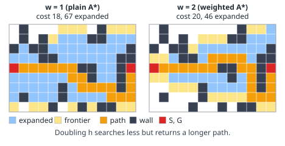

# Module: A\* Search (Dijkstra That Knows Where It Is Going)

A\* is Dijkstra's algorithm with a sense of where the goal is.

---

## Before you start
<!-- bite: a3e3941d-eb44-4d9e-8acc-29b87de34e10 -->

- You can implement [[02-dijkstra|Dijkstra]] with a [[07-heaps|min-heap]] and explain its finalisation step.
- You know that [[02-breadth-first-search|BFS]] gives shortest paths only when every edge costs the same.
- You have met the idea of an [[04-representations|implicit graph]] — a graph with no graph object, where neighbours are computed on demand. Grids are the standard example and the one used here.

**After this lesson you will be able to:**

1. Define $g$, $h$ and $f$ precisely, and say which of them the priority queue is keyed on.
2. State what **admissible** and **consistent** mean, check both, and say which one optimality actually requires.
3. Explain why A\* with $h = 0$ **is** Dijkstra, and why A\* with $f = h$ is fast but wrong.
4. Use **tie-breaking** deliberately, and explain why it changes the work done without changing the answer.

**Study route:** read 1–4; stop at the prediction in section 5 and answer it; then run the lab. Blocks 4 and 5 are the two that repay attention.

---

## What A\* search is
<!-- bite: bc5de531-6c35-437d-8d93-9bd97577ae19 -->

A\* finds the shortest route to one goal, using a guess of the distance left to steer the search. This lesson is also where **tie-breaking** stops being a footnote: on the lab's map, changing nothing but the tie-break rule takes the search from 233 expanded cells to 38.

## 1. Why this exists: Dijkstra explores the wrong direction
<!-- bite: ae0df084-e39b-408a-9da5-de6fe89ef6e5 -->

Dijkstra expands vertices in order of distance from the **source**. It has no concept of a destination, so it grows a circle outward in every direction — including directly away from where you want to go.

For a route from London to Edinburgh, Dijkstra will happily settle every town in Cornwall first, because they are closer to London than Edinburgh is. Those expansions are pure waste: no shortest path to Edinburgh passes through Cornwall, and a human looking at a map knows it instantly.

**What the human has that Dijkstra does not is an estimate.** Straight-line distance to Edinburgh is not the true road distance — roads bend, and there is no direct route — but it is never *more* than the road distance, and that turns out to be exactly the property needed.

## 1. Why this exists: measuring the waste
<!-- bite: 03122b5e-6aa3-4a8b-8d62-36760946623e -->

The lab counts how much of the map each search looks at.

The lab measures the waste on a 20×20 grid with 368 walkable cells:

```text
   heuristic           | path cost | expanded | % of map
   zero (= Dijkstra)   |        37 |      360 |   97.8%
   euclidean           |        37 |      260 |   70.7%
   manhattan           |        37 |      233 |   63.3%
```

**Same optimal answer, 97.8% of the map versus 63.3%.** And with a tie-breaking rule added, the same heuristic drops to 38 cells — about 10% of the map, for an identical path.

---

## Seeing what each search expands
<!-- bite: 2887022b-d4f6-40fa-873b-8d1c70823eca -->

Here is the lab's 20 × 20 map searched three ways. Blue cells were expanded, yellow cells were still waiting in the queue when the goal was reached, and the orange path is the answer. All three paths cost 37; what changes is how much of the map gets searched on the way.


## Terms used in A\*
<!-- bite: 02f7afdf-5a18-4382-ae82-f47b2e7cd182 -->

1. **$g(n)$**: This is the **cost so far** — the cost of the best route found from the start to $n$. It is a known, exact quantity about the past; it is the same number Dijkstra keeps.
2. **$h(n)$**: This is the **heuristic** — an *estimate* of the remaining cost from $n$ to the goal. It is a guess about the future, supplied by you, and it is the only new ingredient in the algorithm.
3. **$f(n) = g(n) + h(n)$**: This is the **estimated total cost** of the best route to the goal that passes through $n$. **A\* is exactly Dijkstra with the priority queue keyed on $f$ instead of $g$** — that single substitution is the whole algorithm.

## Terms used in A\*: good heuristics
<!-- bite: c3274055-fd0c-4c64-a385-a1fdc5e82e51 -->

These two terms describe a heuristic you can trust.

4. **Admissible**: This describes a heuristic that **never overestimates**: $h(n) \le$ the true remaining cost, for every $n$. Admissibility is what guarantees A\* returns an optimal path. An admissible heuristic is optimistic — it may promise a shortcut that does not exist, but it never warns you off a route that is actually good.
5. **Consistent**: This is also called **monotone**. This describes a heuristic satisfying the triangle inequality along every edge: $h(n) \le \text{cost}(n, n') + h(n')$, together with $h(\text{goal}) = 0$. **Consistency is strictly stronger than admissibility** — every consistent heuristic is admissible, but not the reverse.

## Terms used in A\*: the open set, the closed set and expanding
<!-- bite: a308d460-555e-482f-bf32-073c90cb3c59 -->

These terms name what A\* keeps track of while it searches.

6. **Open set**: This is also known as the **frontier** or **fringe**. This is the set of discovered but not yet expanded nodes — in practice, the priority queue. It is the same structure Dijkstra calls its heap.
7. **Closed set**: This is also known as the **expanded set** or **visited set**. This is the set of nodes already taken out of the queue and processed. With a consistent heuristic, a node in the closed set never needs revisiting.
8. **Expanding a node**: This means removing it from the open set and generating its successors. **The number of nodes expanded is the standard measure of a search's cost**, because it is proportional to the real work and does not depend on the machine.

## Terms used in A\*: tie-breaking and the variants
<!-- bite: a64980ff-8432-4645-97bf-ef2bcd214efd -->

These terms name the tie rule and two close relatives of A\*.

9. **Tie-breaking**: This is the rule deciding which node to expand when several share the same $f$. It does not affect correctness and can dramatically affect how many nodes are expanded.
10. **Weighted A\***: This is A\* with $f = g + w \cdot h$ for some $w > 1$. Inflating $h$ makes the search greedier and faster, at the cost of optimality — the result is guaranteed to be within a factor $w$ of the best path.
11. **Greedy best-first search**: This is the algorithm you get by keying the queue on $h$ alone, ignoring $g$. It is fast and **not optimal**, because it never accounts for the cost already paid.

---

## 2. The algorithm
<!-- bite: b8ec4899-b7c4-4eac-9484-e13525e51dbd -->

Take Dijkstra. Change one line — the priority — and you have A\*:

```python
def a_star(start, goal, neighbours, cost, h):
    g = {start: 0}
    parent = {start: None}
    closed = set()
    pq = [(h(start), start)]                     # key is f = g + h, and g = 0 here

    while pq:
        _, cur = heapq.heappop(pq)
        if cur in closed:
            continue
        closed.add(cur)
        if cur == goal:
            return reconstruct(parent, goal)
        for nb in neighbours(cur):
            ng = g[cur] + cost(cur, nb)
            if nb not in g or ng < g[nb]:
                g[nb] = ng
                parent[nb] = cur
                heapq.heappush(pq, (ng + h(nb), nb))   # <-- the only difference
    return None
```

## 2. The algorithm: Dijkstra in disguise, and the goal test
<!-- bite: 2b78fbdc-d7a7-4eab-a181-862933c8b436 -->

Two facts about that code matter more than they look.

**Set $h(n) = 0$ everywhere and this is Dijkstra, character for character.** That is not an analogy — the $f$ key becomes $g + 0 = g$, and every other line is unchanged. A\* is a strict generalisation, which is why "A\* versus Dijkstra" is better understood as "A\* with a good $h$ versus A\* with $h = 0$".

**Why the goal test is on *pop* and not on *push*.** The first time you *discover* the goal you may have found an expensive route to it. The first time you *expand* it, its $f$ is the minimum in the queue, and since $h(\text{goal}) = 0$, $f = g$ — so $g$ is the true shortest distance. Testing at push time is a common bug that returns suboptimal paths and is easy to miss, because the answer is usually right.

---

## 3. Admissible, and why it is what optimality needs
<!-- bite: 6982c5d2-cb06-4209-8c70-d55abbdf15e5 -->

**The claim in words: if the heuristic never overestimates the remaining cost, then the first time A\* expands the goal, it has found the shortest path to it.**

**The argument.** Suppose A\* is about to expand the goal with $f(\text{goal}) = g(\text{goal}) = C$, and suppose some strictly shorter path exists, with cost $C^* < C$. That path must have some node $n$ still sitting in the open set — a path from start to goal cannot be entirely closed without the goal being closed. For that node:

$$f(n) = g(n) + h(n) \le g(n) + (\text{true remaining cost from } n) = C^*  < C$$

The inequality in the middle is *exactly* admissibility. But then $n$ has a smaller $f$ than the goal, so the priority queue would have popped $n$ first, contradicting the assumption that the goal was next. Therefore no shorter path exists.

**Read what that proof depends on: only the one inequality $h(n) \le \text{true remaining}$.** Nothing else about $h$ matters. It can be wildly inaccurate, it can be zero, it can be discontinuous — as long as it never promises the remaining journey is *longer* than it really is.

## 3. Consistency, and what it buys on top
<!-- bite: b50a5882-1fae-4371-8598-171070b937b2 -->

Consistency is a stronger promise than admissibility, and it buys two extra things.

Consistency requires $h(n) \le \text{cost}(n, n') + h(n')$ for every edge — the heuristic's estimate may drop by at most the cost of the step you take.

It gives you two things:

1. **$f$ never decreases along a path.** The lab's block 6 shows $f$ pinned at 37 for every step of the found route, because on that route the heuristic is exact and each step trades one unit of $h$ for one of $g$.
2. **A closed node never needs reopening.** With merely-admissible (but inconsistent) heuristics, you can discover a cheaper route to an already-expanded node and must put it back in the open set, which costs time and complicates the code. Consistency rules this out.

**In practice almost every natural heuristic is consistent**, so the distinction rarely bites — but "what is the difference between admissible and consistent?" is a standard question, and the answer is: *admissible gives you the right answer, consistent gives you the right answer without reopening nodes.*

## 3. Checking a heuristic
<!-- bite: 35d146d8-5b9a-44e2-acaa-326809ede432 -->

You can test a heuristic for both properties by brute force.

The lab checks both properties by brute force against the true distances (computed with a backwards BFS):

```text
   main map: admissible=True (violations=0)   consistent=True (violations=0)
   trap map: admissible=True (violations=0)   consistent=True (violations=0)
```

## 3. Why Manhattan works on one grid and fails on another
<!-- bite: e11d7d77-3a3d-4f2d-a578-15585b95b42d -->

The same heuristic can be safe on one kind of grid and unsafe on another.

**Manhattan distance is admissible on a 4-connected unit-cost grid for a concrete reason:** with no walls it *is* the exact distance, and walls can only ever make the true distance longer. An estimate that equals the truth in the easiest case and the truth only grows from there can never overestimate.

**The same heuristic is inadmissible on an 8-connected grid**, where diagonal moves cost 1 and Manhattan would report 2 for a single diagonal step. The heuristic must match the movement model — this is the most common way people break A\* in practice.

---

## 4. Common heuristics, and matching them to the problem
<!-- bite: 45c5ef80-9513-4e6a-8553-65cdd9a1264b -->

| Movement model | Admissible heuristic | Why |
| :--- | :--- | :--- |
| 4-directional grid, unit cost | **Manhattan** $\lvert \Delta r\rvert + \lvert \Delta c\rvert$ | exactly the distance with no walls |
| 8-directional, diagonals cost 1 | **Chebyshev** $\max(\lvert \Delta r\rvert, \lvert \Delta c\rvert)$ | one move can fix both axes at once |
| 8-directional, diagonals cost $\sqrt2$ | **Octile** | the exact no-wall distance for that cost model |
| Any movement, Euclidean plane | **Straight-line distance** | a straight line is the shortest possible route |
| Road network | straight-line ÷ max speed | no route can beat travelling straight at top speed |
| Sliding tile puzzle | misplaced tiles, or **sum of Manhattan distances** | every misplaced tile needs at least that many moves |
| Anything at all | **0** | always admissible; this is Dijkstra |

## 4. The design rule for heuristics
<!-- bite: 382d46b7-f745-47cd-8368-d6deee7e23b6 -->

There is one simple way to invent a good heuristic for a new problem.

**The design rule: solve a *relaxed* version of your problem — one with some constraints deleted — and use its exact answer as the heuristic.** Manhattan distance is the exact answer to "this grid, with the walls removed". Sum-of-Manhattan for the 15-puzzle is the exact answer to "this puzzle, if tiles could pass through each other". A relaxed problem's optimum can never exceed the real optimum, so it is automatically admissible.

**Stronger heuristics expand fewer nodes**, and the ordering is exactly what the lab measures: zero (360 cells) < Euclidean (260) < Manhattan (233). Euclidean is admissible here but *weaker* than Manhattan on a 4-connected grid, because it underestimates more. A heuristic $h_1$ that is everywhere at least as large as an admissible $h_2$ is said to **dominate** it, and dominating heuristics never expand more nodes.

---

## 5. Weighted A\*: trading optimality for speed, on purpose
<!-- bite: b2ddee35-9fba-4595-9e27-613304f781fb -->

> **Predict before reading on.** Multiply an admissible heuristic by 3 and run A\*. Two things could change: the number of nodes expanded, and the cost of the path returned. Which changes, in which direction, and is the path still optimal?

**Both change. Expansions fall; path cost rises; optimality is lost.** The lab runs it across a range of weights on a cluttered map:

```text
   weight | path cost | expanded | optimal? | admissibility violations
      1.0 |        18 |       67 | yes      | 0
      1.2 |        18 |       55 | yes      | 14
      1.5 |        18 |       49 | yes      | 40
      2.0 |        20 |       46 | NO (+2)  | 67
      3.0 |        20 |       37 | NO (+2)  | 80
      5.0 |        20 |       32 | NO (+2)  | 87
```

## 5. Weighted A\*: reading the table
<!-- bite: d382033d-e8b9-4e80-8e3d-752733ba0c56 -->

The numbers in that table teach a subtler point.

**Read the $w = 1.2$ and $w = 1.5$ rows carefully, because they teach the subtler point.** The heuristic already overestimates at 14 and 40 cells respectively — it is *inadmissible* — and yet the path returned is still optimal. **Admissibility is a sufficient condition for optimality, not a necessary one.** Breaking it means you have lost the *guarantee*, not that you have necessarily lost the answer. That is precisely why inadmissible heuristics are dangerous: they usually work, and then quietly do not.

By $w = 2.0$ the guarantee's absence has become a real 2-unit error, and expansions have more than halved by $w = 5.0$. **The formal promise is that weighted A\* returns a path at most $w$ times the optimal cost** — here $20 \le 1.8 \times 18$, comfortably inside the bound.

This is a legitimate engineering trade. A game pathfinding hundreds of units per frame will happily take a 10%-worse path for a 3× speedup, because nobody can see the difference and everyone can see the frame drop.

---

## Seeing weighted A\* take a longer path
<!-- bite: b093b726-fc60-435d-950e-f1c0d3977155 -->

These are the $w = 1$ and $w = 2$ rows of the table above, on the lab's cluttered map. Doubling the heuristic makes the search dive at the goal, so it expands fewer cells, 46 instead of 67. But it commits to a route that turns out 2 steps longer.



## 6. Tie-breaking: free speed, and a real interview topic
<!-- bite: 44ab7642-877f-4d99-a3fb-26f29be56e88 -->

On a uniform grid, enormous numbers of cells share the same $f$. Every route of the same length through open ground has identical $f$, so A\* faces a **plateau** — a large region it has no reason to prefer any part of. Left to the heap's arbitrary ordering, it explores the plateau broadly.

**Breaking ties deliberately costs nothing and can transform the work done:**

```text
   tie-break rule            | path cost | expanded
   insertion order           |        37 |      233
   prefer smaller h          |        37 |       38
   prefer larger g           |        37 |       38
```

**233 cells to 38 — a 6× reduction — for the same optimal path.** Nothing about the heuristic changed.

## 6. Tie-breaking: why it works, and how to code it
<!-- bite: 45216a26-1676-4cbc-a6ad-171524a75bc4 -->

This part explains the speed-up and shows the one-line change.

The reason is direct: among nodes with equal $f$, a **larger $g$** means further along the journey, and correspondingly a **smaller $h$** means closer to the goal. (On this map the two rules coincide, since $f = g + h$ is constant on the plateau, so maximising $g$ *is* minimising $h$.) Preferring those drives the search down the plateau toward the goal instead of fanning out sideways across it.

**Implementation:** make the priority a tuple. `(f, h)` or `(f, -g)` compares on $f$ first and only consults the second element on a tie:

```python
heapq.heappush(pq, (g_new + h_new, h_new, counter, node))
```

**The `counter` third element is not decoration** — it guarantees a total order so the heap never tries to compare the node objects themselves, which may not be orderable. It also makes runs reproducible.

## 6. Tie-breaking: two further techniques
<!-- bite: 5ac0a2cb-b591-4ca9-bd08-961fcf13cd2d -->

Two further standard techniques:

1. **Scale the heuristic by $1 + \varepsilon$ for tiny $\varepsilon$** (around $1/\text{path length}$). This breaks ties toward larger $h$ almost for free, and the optimality loss is bounded by $\varepsilon$ — often genuinely negligible.
2. **Add a tiny cross-product term** preferring nodes near the straight line from start to goal. Standard in game pathfinding, where the aesthetics of the path matter as much as its length.

---

## 7. The family: it is all one algorithm
<!-- bite: 2ed7cbec-5c61-4a26-aa1e-12eca995fa24 -->

**What you key the priority queue on decides which algorithm you are running.** Nothing else changes.

| Key | Algorithm | Optimal? | Character |
| :--- | :--- | :--- | :--- |
| $g$ | [[02-dijkstra\|Dijkstra]] / uniform-cost | yes | explores in all directions |
| $g$, all costs equal | [[02-breadth-first-search\|BFS]] | yes | the queue is a plain FIFO |
| $h$ | greedy best-first | **no** | fast, dives at the goal, ignores cost paid |
| $g + h$ | **A\*** | yes, if $h$ admissible | the balance |
| $g + w\cdot h$ | weighted A\* | within factor $w$ | tunable speed/quality |
| $g$, $h = 0$ | A\* *is* Dijkstra | yes | the degenerate case |

**Greedy best-first is the instructive failure.** By ignoring $g$ it will happily walk a 500-step route that looks like it is heading the right way, over a 20-step route that starts by moving away from the goal. $g$ is what keeps the search honest about what has already been spent.

---

## 8. Worked example — complete runnable lab
<!-- bite: 70cff807-d6d8-4227-b844-ad4a8e8a52ca -->

Save as `a_star.py`. Standard library only.

```python
"""A*: Dijkstra aimed at a goal, and what the heuristic buys and costs.

Run:  python3 a_star.py
"""

import heapq

# The open map: a diagonal wall, then a long horizontal barrier.
MAIN_MAP = [
    "S.........#.........",
    ".........##.........",
    "........##..........",
    ".......##...........",
    "......##............",
    ".....##.............",
    "....##..............",
    "...##...............",
    "..##................",
    ".##.................",
    ".......#############",
    "....................",
    "....................",
    "....................",
    "....................",
    "....................",
    "....................",
    "....................",
    "....................",
    "..................G.",
]

# A cluttered map where inflating the heuristic really does cost you optimality.
TRAP_MAP = [
    ".#.......#...",
    ".#.#....##...",
    "#.##........#",
    "...##......##",
    "S......##..#G",
    "........#..#.",
    ".....#.....#.",
    ".#...#.......",
    "....#..#.##..",
]


class Map:
    def __init__(self, rows):
        self.rows = rows
        self.R, self.C = len(rows), len(rows[0])
        self.start = self.find("S")
        self.goal = self.find("G")
        self.open_cells = sum(1 for r in range(self.R) for c in range(self.C)
                              if rows[r][c] != "#")

    def find(self, ch):
        for r in range(self.R):
            for c in range(self.C):
                if self.rows[r][c] == ch:
                    return (r, c)
        raise ValueError(ch)

    def neighbours(self, pos):
        r, c = pos
        for dr, dc in ((-1, 0), (1, 0), (0, -1), (0, 1)):
            nr, nc = r + dr, c + dc
            if 0 <= nr < self.R and 0 <= nc < self.C and self.rows[nr][nc] != "#":
                yield (nr, nc)


def manhattan(a, b):
    return abs(a[0] - b[0]) + abs(a[1] - b[1])


def euclidean(a, b):
    return ((a[0] - b[0]) ** 2 + (a[1] - b[1]) ** 2) ** 0.5


def zero(a, b):
    return 0


def search(m, h, tie="none", weight=1.0):
    """A* on map m. Every edge costs 1.

    tie = "none"   -> among equal f, whatever the heap happens to do (insertion order)
          "low-h"  -> among equal f, prefer the smaller h
          "high-g" -> among equal f, prefer the LARGER g (further along)
    weight scales h; weight > 1 can make an admissible h inadmissible.
    """
    start, goal = m.start, m.goal
    g = {start: 0}
    parent = {start: None}
    closed = set()
    expanded = 0
    counter = 0
    pq = [(weight * h(start, goal), 0, counter, start)]

    while pq:
        _, _, _, cur = heapq.heappop(pq)
        if cur in closed:
            continue
        closed.add(cur)
        expanded += 1
        if cur == goal:
            path = []
            n = cur
            while n is not None:
                path.append(n)
                n = parent[n]
            return {"cost": g[cur], "expanded": expanded,
                    "path": list(reversed(path)), "closed": closed}
        for nb in m.neighbours(cur):
            ng = g[cur] + 1
            if nb not in g or ng < g[nb]:
                g[nb] = ng
                parent[nb] = cur
                hv = weight * h(nb, goal)
                counter += 1
                second = -ng if tie == "high-g" else (hv if tie == "low-h" else 0)
                heapq.heappush(pq, (ng + hv, second, counter, nb))
    return {"cost": None, "expanded": expanded, "path": None, "closed": closed}


def true_distances(m):
    """Exact distance from every cell to the goal, by BFS backwards."""
    from collections import deque
    dist = {m.goal: 0}
    q = deque([m.goal])
    while q:
        u = q.popleft()
        for v in m.neighbours(u):
            if v not in dist:
                dist[v] = dist[u] + 1
                q.append(v)
    return dist


def admissibility_violations(m, h, weight=1.0):
    """Cells where the heuristic OVERestimates the true remaining distance."""
    truth = true_distances(m)
    return [(cell, weight * h(cell, m.goal), d)
            for cell, d in truth.items() if weight * h(cell, m.goal) > d + 1e-9]


def consistency_violations(m, h, weight=1.0):
    """Edges where h(n) > cost(n,n') + h(n')."""
    bad = []
    for r in range(m.R):
        for c in range(m.C):
            if m.rows[r][c] == "#":
                continue
            for nb in m.neighbours((r, c)):
                if weight * h((r, c), m.goal) > 1 + weight * h(nb, m.goal) + 1e-9:
                    bad.append(((r, c), nb))
    return bad


def draw(m, closed, path):
    pset = set(path or [])
    out = []
    for r in range(m.R):
        row = ""
        for c in range(m.C):
            p = (r, c)
            if m.rows[r][c] == "#":
                row += "#"
            elif p == m.start:
                row += "S"
            elif p == m.goal:
                row += "G"
            elif p in pset:
                row += "o"
            elif p in closed:
                row += "."
            else:
                row += " "
        out.append(row)
    return out


def main():
    main_map = Map(MAIN_MAP)
    trap = Map(TRAP_MAP)

    print(f"=== The main map ===  {main_map.R}x{main_map.C}, "
          f"{main_map.open_cells} walkable cells")
    for row in MAIN_MAP:
        print("   " + row)
    print(f"   S = {main_map.start}, G = {main_map.goal}")

    print("\n=== 1. Same problem, three heuristics ===")
    print("   heuristic           | path cost | expanded | % of map")
    runs = {}
    for name, h in (("zero (= Dijkstra)", zero), ("euclidean", euclidean),
                    ("manhattan", manhattan)):
        r = search(main_map, h)
        runs[name] = r
        print(f"   {name:<19} | {r['cost']:>9} | {r['expanded']:>8} "
              f"| {100*r['expanded']/main_map.open_cells:>6.1f}%")
    print("   -> all three return the SAME optimal cost; they differ only in work")

    print("\n=== 2. What Dijkstra explores vs what A* explores ===")
    a = draw(main_map, runs["zero (= Dijkstra)"]["closed"], runs["zero (= Dijkstra)"]["path"])
    b = draw(main_map, runs["manhattan"]["closed"], runs["manhattan"]["path"])
    print("   Dijkstra (h = 0)         A* (manhattan)")
    for x, y in zip(a, b):
        print(f"   {x}     {y}")
    print("   '.' expanded   'o' final path   ' ' never touched")

    print("\n=== 3. Is manhattan admissible and consistent here? ===")
    for label, m in (("main map", main_map), ("trap map", trap)):
        va = admissibility_violations(m, manhattan)
        vc = consistency_violations(m, manhattan)
        print(f"   {label}: admissible={not va} (violations={len(va)})   "
              f"consistent={not vc} (violations={len(vc)})")
    print("   -> on a 4-connected unit-cost grid, manhattan IS the distance with no")
    print("      walls, and walls only ever make the true distance longer.")
    print("      So it can never overestimate: admissible, and consistent too.")

    print("\n=== 4. Breaking admissibility: weighted A* ===")
    print("   Multiplying an admissible h by w > 1 can make it overestimate.")
    print("   On the cluttered trap map:")
    for row in TRAP_MAP:
        print("      " + row)
    best = search(trap, manhattan)["cost"]
    print("\n   weight | path cost | expanded | optimal? | admissibility violations")
    for w in (1.0, 1.2, 1.5, 2.0, 3.0, 5.0):
        r = search(trap, manhattan, weight=w)
        v = len(admissibility_violations(trap, manhattan, weight=w))
        verdict = "yes" if r["cost"] == best else f"NO (+{r['cost']-best})"
        print(f"   {w:>6} | {r['cost']:>9} | {r['expanded']:>8} | {verdict:<8} | {v}")
    print("   -> the trade is explicit: w=1.0 expands 67 cells for a cost-18 path;")
    print("      w=5.0 expands 32 and returns cost 20. Fewer cells, worse answer.")
    print("      Guarantee: with weight w the result is within a factor w of optimal.")

    print("\n=== 5. Tie-breaking: same heuristic, same optimality, different work ===")
    print("   Many cells share one f value. Which you pop first is a free choice.")
    print("   tie-break rule            | path cost | expanded")
    for tie, label in (("none", "insertion order"),
                       ("low-h", "prefer smaller h"),
                       ("high-g", "prefer larger g")):
        r = search(main_map, manhattan, tie=tie)
        print(f"   {label:<25} | {r['cost']:>9} | {r['expanded']:>8}")
    print("   -> every rule is optimal. Preferring larger g drives the search along")
    print("      the plateau toward the goal instead of fanning out sideways.")

    print("\n=== 6. g, h and f along the found path ===")
    path = runs["manhattan"]["path"]
    print("   step |     cell |  g |  h |  f")
    for i, cell in enumerate(path):
        if i % 4 == 0 or i == len(path) - 1:
            gv, hv = i, manhattan(cell, main_map.goal)
            print(f"   {i:>4} | {str(cell):>8} | {gv:>2} | {hv:>2} | {gv+hv:>2}")
    print("   -> f is constant 37 here: the heuristic is EXACT along this route,")
    print("      so every step trades one unit of h for one unit of g.")
    print("      Consistency guarantees f never DEcreases; it may increase.")

    print("\n=== 7. The family, in one table ===")
    print("   what you key the priority queue on decides the algorithm:")
    print("     key = g         -> Dijkstra / uniform-cost  optimal, explores widely")
    print("     key = h         -> greedy best-first        fast, NOT optimal")
    print("     key = g + h     -> A*                       optimal if h admissible")
    print("     key = g + w*h   -> weighted A*              within a factor w of optimal")
    print("     h = 0           -> A* IS Dijkstra, exactly")


if __name__ == "__main__":
    main()
```

## 8. Worked example: what it prints
<!-- bite: 23207482-b75c-4be0-a520-e8e3cf320cc0 -->

When you run the lab, it prints this, block by block.

Generated by running the file above:

```text
=== The main map ===  20x20, 368 walkable cells
   S.........#.........
   .........##.........
   ........##..........
   .......##...........
   ......##............
   .....##.............
   ....##..............
   ...##...............
   ..##................
   .##.................
   .......#############
   ....................
   ....................
   ....................
   ....................
   ....................
   ....................
   ....................
   ....................
   ..................G.
   S = (0, 0), G = (19, 18)

=== 1. Same problem, three heuristics ===
   heuristic           | path cost | expanded | % of map
   zero (= Dijkstra)   |        37 |      360 |   97.8%
   euclidean           |        37 |      260 |   70.7%
   manhattan           |        37 |      233 |   63.3%
   -> all three return the SAME optimal cost; they differ only in work

=== 2. What Dijkstra explores vs what A* explores ===
   Dijkstra (h = 0)         A* (manhattan)
   S.........#......        S.........#         
   o........##.......       o........##         
   o.......##.........      o.......##          
   o......##...........     o......##           
   o.....##............     o.....##            
   o....##.............     o....##             
   o...##..............     o...##              
   o..##...............     o..##               
   o.##................     o.##                
   o##.................     o##                 
   o......#############     o......#############
   o...................     o.................. 
   o...................     o.................. 
   o...................     o.................. 
   o...................     o.................. 
   o...................     o.................. 
   o...................     o.................. 
   o...................     o.................. 
   o..................      o.................. 
   ooooooooooooooooooG      ooooooooooooooooooG 
   '.' expanded   'o' final path   ' ' never touched

=== 3. Is manhattan admissible and consistent here? ===
   main map: admissible=True (violations=0)   consistent=True (violations=0)
   trap map: admissible=True (violations=0)   consistent=True (violations=0)
   -> on a 4-connected unit-cost grid, manhattan IS the distance with no
      walls, and walls only ever make the true distance longer.
      So it can never overestimate: admissible, and consistent too.

=== 4. Breaking admissibility: weighted A* ===
   Multiplying an admissible h by w > 1 can make it overestimate.
   On the cluttered trap map:
      .#.......#...
      .#.#....##...
      #.##........#
      ...##......##
      S......##..#G
      ........#..#.
      .....#.....#.
      .#...#.......
      ....#..#.##..

   weight | path cost | expanded | optimal? | admissibility violations
      1.0 |        18 |       67 | yes      | 0
      1.2 |        18 |       55 | yes      | 14
      1.5 |        18 |       49 | yes      | 40
      2.0 |        20 |       46 | NO (+2)  | 67
      3.0 |        20 |       37 | NO (+2)  | 80
      5.0 |        20 |       32 | NO (+2)  | 87
   -> the trade is explicit: w=1.0 expands 67 cells for a cost-18 path;
      w=5.0 expands 32 and returns cost 20. Fewer cells, worse answer.
      Guarantee: with weight w the result is within a factor w of optimal.

=== 5. Tie-breaking: same heuristic, same optimality, different work ===
   Many cells share one f value. Which you pop first is a free choice.
   tie-break rule            | path cost | expanded
   insertion order           |        37 |      233
   prefer smaller h          |        37 |       38
   prefer larger g           |        37 |       38
   -> every rule is optimal. Preferring larger g drives the search along
      the plateau toward the goal instead of fanning out sideways.

=== 6. g, h and f along the found path ===
   step |     cell |  g |  h |  f
      0 |   (0, 0) |  0 | 37 | 37
      4 |   (4, 0) |  4 | 33 | 37
      8 |   (8, 0) |  8 | 29 | 37
     12 |  (12, 0) | 12 | 25 | 37
     16 |  (16, 0) | 16 | 21 | 37
     20 |  (19, 1) | 20 | 17 | 37
     24 |  (19, 5) | 24 | 13 | 37
     28 |  (19, 9) | 28 |  9 | 37
     32 | (19, 13) | 32 |  5 | 37
     36 | (19, 17) | 36 |  1 | 37
     37 | (19, 18) | 37 |  0 | 37
   -> f is constant 37 here: the heuristic is EXACT along this route,
      so every step trades one unit of h for one unit of g.
      Consistency guarantees f never DEcreases; it may increase.

=== 7. The family, in one table ===
   what you key the priority queue on decides the algorithm:
     key = g         -> Dijkstra / uniform-cost  optimal, explores widely
     key = h         -> greedy best-first        fast, NOT optimal
     key = g + h     -> A*                       optimal if h admissible
     key = g + w*h   -> weighted A*              within a factor w of optimal
     h = 0           -> A* IS Dijkstra, exactly
```

---

## 9. Common pitfalls and traps
<!-- bite: 66ab4a4c-eb7d-42ed-a4ce-b66a2195465e -->

1. **A heuristic that does not match the movement model.** Manhattan on an 8-connected grid overestimates a diagonal step by 2×, making it inadmissible and the answer suboptimal. Match $h$ to how the agent actually moves.
2. **Mixing units.** If $g$ is in seconds and $h$ is in metres, $f$ is meaningless. Straight-line distance is admissible for a *time* cost only after dividing by the maximum possible speed.
3. **Testing for the goal on push rather than on pop.** Returns the first route discovered, not the cheapest. Usually right, occasionally wrong, and hard to spot in testing.
4. **Forgetting a tie-break element in the priority tuple.** Without one, Python compares the node objects themselves and raises `TypeError` on anything unorderable — or silently imposes an arbitrary order on tuples, which makes runs irreproducible.

## 9. Common pitfalls and traps: heuristics that break the rules
<!-- bite: d13149fc-b7db-4369-bb5d-047ac1c179d9 -->

The next two traps are about heuristics that are not admissible or not consistent.

5. **Assuming an inadmissible heuristic will obviously misbehave.** The lab shows $w = 1.2$ violating admissibility at 14 cells and still returning the optimal path. **Losing the guarantee is not the same as losing the answer**, which is exactly what makes it dangerous.
6. **Reopening closed nodes with a merely-admissible heuristic.** If $h$ is admissible but not consistent, a cheaper route to a closed node can be found later, and you must reopen it. Code that never reopens is only correct for consistent heuristics.

## 9. Common pitfalls and traps: the wrong job, or a weak heuristic
<!-- bite: ecd1cae5-79f5-4ad2-bb40-09f06b61cd52 -->

The last three traps are about using A\* for the wrong job, or with a heuristic too weak to help.

7. **Using A\* when you need all-pairs or all-targets.** A\* is aimed at one goal. For every pair use [[04-floyd-warshall|Floyd–Warshall]]; for one source to everything, plain [[02-dijkstra|Dijkstra]] is already what you want and the heuristic buys nothing.
8. **Using A\* with negative edge weights.** A\* inherits Dijkstra's finalisation and therefore Dijkstra's failure. Negative weights need [[03-bellman-ford|Bellman–Ford]]; no heuristic repairs this.
9. **Expecting a speedup from a weak heuristic.** If $h$ is near zero everywhere you have paid for the machinery and got Dijkstra. Measure expansions, not intentions — the lab's Euclidean row shows a genuinely admissible heuristic that is simply weaker than the right one.

---

## Check your understanding
<!-- bite: 80e989a6-7c8d-4103-ae24-1aa666701e06 -->

Try each one before you open the answer.

1. <!-- q: gap id="3b5a3b44" answers="g;h;f" -->
   Fill in the gaps with g, h or f. In A*, the exact cost so far from the start to node n is ___(n), the estimate of the remaining cost to the goal is ___(n), and the priority queue is keyed on ___(n), their sum.

   <details><summary>Answer</summary>

   g is the known cost so far, h is the heuristic guess of what remains, and f = g + h is the estimated total, which orders the queue.

   </details>

2. <!-- q: mcq id="7965c622" -->
   What does A* become when h(n) = 0 for every node?

   - [x] Dijkstra's algorithm, exactly
   - [ ] Breadth-first search
   - [ ] Greedy best-first search
   - [ ] It stops working

   <details><summary>Answer</summary>

   The key becomes f = g + 0 = g, which is Dijkstra's key, and every other line is the same. Zero never overestimates, so it is admissible, just useless for speed.

   </details>

3. <!-- q: mcq id="a84d27ca" -->
   Which property of the heuristic guarantees that A* returns a shortest path?

   - [ ] It is always exactly right
   - [x] It never overestimates the true remaining cost (admissible)
   - [ ] It is always greater than the true remaining cost
   - [ ] It is computed in O(1)

   <details><summary>Answer</summary>

   Admissibility is all the optimality proof uses. Consistency (h(n) ≤ cost(n, n′) + h(n′) on every edge) adds that closed nodes never need reopening.

   </details>

4. <!-- q: mcq id="acf0db41" -->
   On a grid where you can also move diagonally, and each diagonal step costs 1, why is Manhattan distance a bad heuristic?

   - [ ] It is too slow to compute
   - [x] It counts a single diagonal step as 2, so it overestimates and is not admissible
   - [ ] It ignores walls
   - [ ] It is always 0

   <details><summary>Answer</summary>

   Manhattan adds horizontal and vertical distance. One diagonal step costs 1 but Manhattan says 2, so it can overestimate, and A* may return a longer path. The heuristic must match the movement rules.

   </details>

5. <!-- q: mcq id="2c00b93f" -->
   You run weighted A* with f = g + 3h, where h is admissible. What happens compared with plain A*?

   - [ ] Same nodes expanded, same path
   - [x] Fewer nodes expanded, but the path may cost more (at most 3 times the optimum)
   - [ ] More nodes expanded, same path
   - [ ] It always fails to find a path

   <details><summary>Answer</summary>

   Inflating h makes the search greedier, so it expands less, but the heuristic may now overestimate, so optimality is lost. The written guarantee is a path no worse than w times the best.

   </details>

6. <!-- q: open id="4009d392" -->
   Why should A* check for the goal when it pops it from the queue, not when it first pushes it?

   <details><summary>Answer</summary>

   The first time the goal is discovered may be through an expensive route; a cheaper route can still be waiting in the queue with a lower f. Only when the goal is popped is its f the smallest in the queue, and with an admissible h that means no cheaper route exists.

   </details>

## Check your understanding: worked problems
<!-- bite: 3e19e2e8-5522-4c26-b678-b843379a7ba2 -->

Work each one out on paper first, then type your answer.

1. <!-- q: gap id="72ebc00e" answers="8;8" -->
   Fill in the gaps.
   A* searches from S to goal G. The directed edges and the heuristic h are:

   | Edge | Cost |
   | :--- | ---: |
   | S → A | 2 |
   | S → B | 4 |
   | A → C | 5 |
   | A → G | 9 |
   | B → C | 1 |
   | C → G | 3 |

   | Vertex | S | A | B | C | G |
   | :--- | ---: | ---: | ---: | ---: | ---: |
   | h | 6 | 6 | 4 | 3 | 0 |

   After S is expanded, A has f = ___ and B has f = ___.

   <details><summary>Answer</summary>

   Both are 8. f(A) = g + h = 2 + 6 = 8 and f(B) = 4 + 4 = 8.

   </details>

2. <!-- q: exact id="b6023044" answer="S, B, C, G" accept="SBCG|S B C G" -->
   A* searches from S to goal G. The directed edges and the heuristic h are:

   | Edge | Cost |
   | :--- | ---: |
   | S → A | 2 |
   | S → B | 4 |
   | A → C | 5 |
   | A → G | 9 |
   | B → C | 1 |
   | C → G | 3 |

   | Vertex | S | A | B | C | G |
   | :--- | ---: | ---: | ---: | ---: | ---: |
   | h | 6 | 6 | 4 | 3 | 0 |

   Ties in f are broken by preferring the smaller h. List the nodes in the order A* expands them, up to and including G. Separate them with commas.

   <details><summary>Answer</summary>

   S, B, C, G. A and B tie at f = 8; B has the smaller h (4 against 6), so it goes first. B finds C with g = 5, f = 8. C finds G with g = 8, f = 8. G is popped before A, so A is never expanded.

   </details>

3. <!-- q: exact id="f584280b" answer="8" -->
   A* searches from S to goal G. The directed edges and the heuristic h are:

   | Edge | Cost |
   | :--- | ---: |
   | S → A | 2 |
   | S → B | 4 |
   | A → C | 5 |
   | A → G | 9 |
   | B → C | 1 |
   | C → G | 3 |

   | Vertex | S | A | B | C | G |
   | :--- | ---: | ---: | ---: | ---: | ---: |
   | h | 6 | 6 | 4 | 3 | 0 |

   What is the cost of the path A* returns from S to G?

   <details><summary>Answer</summary>

   8, along S → B → C → G (4 + 1 + 3). The other routes cost 2 + 9 = 11 and 2 + 5 + 3 = 10.

   </details>

4. <!-- q: mcq id="47a82f8b" -->
   A* searches from S to goal G. The directed edges and the heuristic h are:

   | Edge | Cost |
   | :--- | ---: |
   | S → A | 2 |
   | S → B | 4 |
   | A → C | 5 |
   | A → G | 9 |
   | B → C | 1 |
   | C → G | 3 |

   | Vertex | S | A | B | C | G |
   | :--- | ---: | ---: | ---: | ---: | ---: |
   | h | 6 | 6 | 4 | 3 | 0 |

   Is this heuristic admissible? (The true remaining costs to G are S: 8, A: 8, B: 4, C: 3, G: 0.)

   - [x] Yes, h never exceeds the true remaining cost
   - [ ] No, h(S) is too large
   - [ ] No, h(A) is larger than the true cost
   - [ ] No, h(G) should not be 0

   <details><summary>Answer</summary>

   Yes. Each h is at most the true cost: 6 ≤ 8, 6 ≤ 8, 4 ≤ 4, 3 ≤ 3, 0 ≤ 0. It is also consistent, for example h(B) = 4 ≤ cost(B, C) + h(C) = 1 + 3.

   </details>

## 11. Practice — independent task
<!-- bite: ee65d538-a4f2-4f23-8ff1-1a32591613d9 -->

Build a pathfinder and **measure** the claims in this lesson rather than trusting them.

**Part 1 — the core.** Implement A\* over a grid read from a text map, with pluggable heuristic and tie-break rule. Return path, cost, and the set of expanded nodes.

**Part 2 — verify optimality.** On 300 random maps, assert your A\* cost equals [[02-breadth-first-search|BFS]]'s cost (both are unit-cost shortest paths). **Any disagreement is a bug in your A\*, and BFS is the oracle.**

## 11. Practice: parts 3 and 4
<!-- bite: a0fe24c9-5749-4c5e-ab20-02bf377d4721 -->

The next two parts check the heuristics and the dominance claim.

**Part 3 — check the heuristics yourself.** Write `is_admissible(h)` and `is_consistent(h)` by comparing against true distances from a backwards BFS. Then confirm: Manhattan is admissible on a 4-connected grid and **not** on an 8-connected one. Produce the specific cell where the 8-connected check fails.

**Part 4 — the dominance claim.** Section 4 claims a dominating heuristic never expands more nodes. Test it: on 300 maps, compare expansions for zero, Euclidean and Manhattan. Report any counterexample — and if you find one, work out whether it is a real violation or a tie-breaking artefact. **This distinction is the point of the exercise.**

## 11. Practice: parts 5 and 6
<!-- bite: dccd0e70-1287-4b5e-a3e6-6688cbcdabad -->

The last two parts measure weighted A\* and greedy best-first.

**Part 5 — the weighted trade-off curve.** For $w$ from 1.0 to 5.0, plot (or tabulate) mean expansions and mean path cost over 300 maps. Identify the $w$ giving the best expansions-per-unit-of-suboptimality. Confirm empirically that no run ever exceeds $w \times$ optimal.

**Part 6 — greedy best-first.** Implement it ($f = h$) and find a map where it returns a path more than twice optimal. Explain what its route did.

## 11. Practice: edge cases and when you are done
<!-- bite: 9ecb3627-d789-4832-aac1-be5f4db035fc -->

Test your pathfinder on these awkward inputs before you call the task finished.

**Edge cases:** start equals goal; goal unreachable behind a complete wall; a 1×1 map; start or goal on a blocked cell; a map with no walls at all (where Manhattan is exact and A\* should expand almost nothing with good tie-breaking).

**Done when:** part 2 passes on all 300 maps; part 3 produces the specific failing cell for the 8-connected case; you can state whether part 4 found a counterexample and why; your part 5 table shows the curve, with the $w\times$ bound never violated; and part 6 has a concrete map with a stated ratio.

---

## Before moving on
<!-- bite: e9474e70-366a-4f4d-8174-f4318c08abc5 -->

You can define $g$, $h$ and $f$ and say which the queue is keyed on; state and check admissibility and consistency and say which optimality needs; explain why $h=0$ gives Dijkstra and $f=h$ gives a fast wrong answer; and use tie-breaking deliberately.

**Recap:** A\* is Dijkstra with the priority queue keyed on $f = g + h$ instead of $g$ — one line. $g$ is the exact cost already paid, $h$ is an estimate of what remains. **Admissible** ($h$ never overestimates) is what guarantees an optimal path, and the proof needs nothing else; **consistent** ($h(n) \le \text{cost}(n,n') + h(n')$) additionally guarantees no closed node ever needs reopening. Build a heuristic by **solving a relaxed version of the problem exactly** — Manhattan is the grid with the walls deleted — and match it to the movement model, or it silently overestimates. Test the goal on **pop**, never on push. **Weighted A\*** inflates $h$ for speed and returns within a factor $w$ of optimal; note that breaking admissibility loses the guarantee before it loses the answer, which is what makes it treacherous. **Tie-breaking is free**: preferring larger $g$ among equal $f$ took the lab from 233 expanded cells to 38 for the identical path. A\* inherits Dijkstra's ban on negative weights.

**Next:** state-space search — the general frame these algorithms are instances of, where there is no graph object at all and the "vertices" are configurations generated on demand. It is the last lesson in [[03-searching/index|the searching folder]].

---

## Related
<!-- bite: 40310af2-51a0-433b-aadd-3875452b4e1f -->

- [[02-dijkstra|Dijkstra's Algorithm]] — A\* with $h = 0$; read it first
- [[03-bellman-ford|Bellman–Ford]] — what to use instead when weights can be negative
- [[04-floyd-warshall|Floyd–Warshall]] — the opposite trade: every pair, no goal
- [[03-searching/index|Searching]] — where state-space search, frontiers and tie-breaking are generalised
- [[04-representations|Representations]] — implicit graphs, which is what a grid is
- [[07-heaps|Heaps]] — the priority queue, and why the tuple key matters
- [[13-matrix-traversal|Matrix traversal pattern]] — grid problems at the pattern layer
- [[06-algorithms/index|the graph algorithms index]]

## About this lesson
<!-- bite: 1fdf6b49-0c65-4abe-a641-17842971fa3d -->

**Level:** Advanced. **Covers:** [[02-dijkstra|Dijkstra]] finds the shortest path to *every* vertex, which is wasteful when you only want one. **A\* adds a single piece of information — an estimate of the distance remaining — and uses it to aim the search at the goal.** Done correctly it expands dramatically fewer vertices and still returns the optimal path. Done carelessly it returns a path that is merely quite good, and does not tell you.
