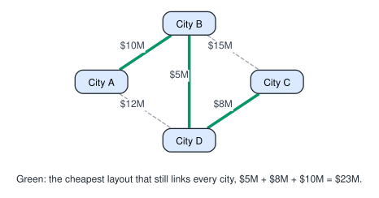
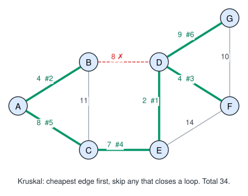
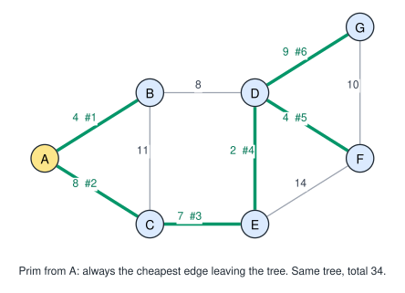
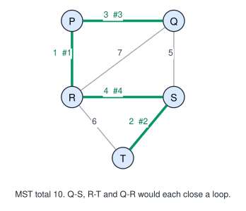

# Module: Minimum Spanning Tree (Prim's & Kruskal's)

Welcome to the **Minimum Spanning Tree (MST)** module.

---

## Before you start
<!-- bite: 433604f3-9ee9-4537-9fd9-57537a323c0b -->

- You know what a spanning tree is and that a connected graph has many — [[09-graphs/03-subgraphs-trees-and-forests|subgraphs, trees and forests]].
- You know union-find — [[10-union-find|union-find]] — and heaps — [[07-heaps|heaps]].
- You have seen a greedy argument — [[01-when-greedy-works|greedy algorithms]].

**After this lesson you will be able to:**

1. Implement **Prim's** and **Kruskal's**, and say which data structure each one needs and why.
2. State the **cut property**, which is the single fact making both correct.
3. Verify an MST is genuinely minimal, by exhaustive search on a small graph.
4. Explain when the MST is **unique**, and what happens when edge weights tie.

**Study route:** read 1–5, attempt the prediction in section 4, then run the lab. Block 2 checks minimality exhaustively.

---

## What a minimum spanning tree is
<!-- bite: f32f3920-fabe-4ecb-8493-d8a3ae2e418a -->

Given a connected, undirected graph with weighted edges, a **Spanning Tree** is a sub-graph that connects all $V$ vertices using **exactly $V - 1$ edges without forming any cycles**.

A **Minimum Spanning Tree (MST)** is the spanning tree that achieves the **minimum possible sum of total edge weights**.

## 1. Real-World Motivation & Physical Metaphors
<!-- bite: d181c962-5d99-45aa-99cf-9dd8fc413a3d -->

Imagine laying **Fiber-Optic Internet Cables** between 4 regional cities:



- Connecting every single pair of cities with direct cable lines would cost tens of millions of dollars in redundant wires.
- An **MST** finds the cheapest total cable layout that ensures every city can communicate with every other city without creating redundant closed loops (cycles).

## 1. Real-World Motivation: Production Applications
<!-- bite: 67f6140a-6958-42d6-9a8c-5b8a2fac56eb -->

The same cheapest-network idea is used in many real fields.

1. **Telecommunications & Utilities**: Designing water pipe networks, electrical grids, and internet cabling.
2. **Cluster Analysis**: Single-linkage hierarchical clustering in Machine Learning.
3. **Road System Construction**: Planning highway connections between towns with minimal asphalt cost.

---

## 2. Plain-English Terminology & Concept Table
<!-- bite: 7375bae4-9575-4f1e-8a55-f234ad7a8492 -->

| Term | Plain-English Definition | Example / Analogy |
| :--- | :--- | :--- |
| **Spanning Tree** | A tree that touches every vertex in a graph using $V - 1$ edges. | A barebones highway map connecting all cities. |
| **MST** | The spanning tree with the absolute smallest total edge weight sum. | The cheapest possible highway map. |
| **Cut Property** | The mathematical rule proving that the cheapest edge crossing any boundary split belongs in the MST. | Greedily choosing the cheapest bridge across a river. |
| **Kruskal's Algorithm** | Global edge sorting + [[10-union-find|Union-Find]] to build the MST edge-by-edge. | Adding cheapest roads one-by-one unless they form a loop. |
| **Prim's Algorithm** | Local tree expansion using a [[07-heaps|Min-Heap]] to grow one MST from a starting node. | Expanding an electrical grid outward from a power station. |

---

## 3. Technical Deep Dive: The Two Classic MST Algorithms
<!-- bite: a20a7bf5-b382-4cae-846e-6b93753a2271 -->

### 1. Kruskal's Algorithm (Sort Edges + Union-Find)

**Strategy**: Sort **all edges** globally by weight. Greedily add the cheapest edge unless both endpoints are already connected (which would create a cycle!).

## 3. Kruskal's Algorithm: the code
<!-- bite: 8134f40a-64f5-4e82-a912-a8534b406c6e -->

Here is Kruskal's strategy written as Python.

```python
from foundations.dsa.02-data-structures.10-union-find import UnionFind

def kruskal_mst(num_nodes: int, edges: list) -> int:
    """Calculates MST total cost using Kruskal's Algorithm.
    
    edges format: [(weight, u, v)]
    """
    # 1. Sort edges globally by weight ascending: O(E log E)
    edges.sort()
    
    uf = UnionFind(num_nodes)
    total_cost = 0
    edges_used = 0
    
    # 2. Iterate through cheapest edges first
    for weight, u, v in edges:
        # Union-Find returns True if u and v were NOT connected (no cycle)
        if uf.union(u, v):
            total_cost += weight
            edges_used += 1
            if edges_used == num_nodes - 1:
                break  # MST is complete!
                
    return total_cost if edges_used == num_nodes - 1 else -1
```

---

## 3. Technical Deep Dive: Prim's Algorithm (Min-Heap Tree Growth)
<!-- bite: 0369efb5-31d2-4380-aeb9-ad700ab594c8 -->

The second classic algorithm grows one tree outward from a single vertex.

**Strategy**: Start from any vertex. Use a **Min-Heap** to repeatedly attach the cheapest edge connecting an unvisited vertex to the growing tree.

## 3. Prim's Algorithm: the code
<!-- bite: 638dd268-667f-4232-9792-1f6b4808e294 -->

Here is Prim's strategy written as Python.

```python
import heapq

def prim_mst(num_nodes: int, adj_list: dict) -> int:
    """Calculates MST total cost using Prim's Algorithm.
    
    adj_list format: { u: [(weight, v), ...] }
    """
    visited = set()
    min_heap = [(0, 0)]  # (weight, start_node)
    total_cost = 0
    
    while min_heap and len(visited) < num_nodes:
        weight, u = heapq.heappop(min_heap)
        
        if u in visited:
            continue  # Skip stale heap entries
            
        visited.add(u)
        total_cost += weight
        
        for edge_weight, neighbor in adj_list[u]:
            if neighbor not in visited:
                heapq.heappush(min_heap, (edge_weight, neighbor))
                
    return total_cost if len(visited) == num_nodes else -1
```

---

## Seeing Kruskal pick its edges
<!-- bite: 6eec5a16-a262-4fc8-a83f-5a99d4d72be2 -->

This is the lab's graph. The green edges are the ones Kruskal keeps, and #1 to #6 is the order it takes them, cheapest first. When it reaches B–D (8), B and D are already joined through A, C and E, so that edge would close a loop and is skipped.



## Seeing Prim grow its tree
<!-- bite: 3d0b0489-790f-417b-b16f-adec53376ac8 -->

The same graph again, now with Prim starting from A (yellow). Each step adds the cheapest edge leaving the tree built so far; when two edges tie, the one that comes first alphabetically wins. The order is different from Kruskal's, but the six edges and the total of 34 are the same.



## 4. Prim's vs. Kruskal's Comparison
<!-- bite: d67907ee-0d56-440f-9944-2ad12a01a65e -->

| Feature | Kruskal's Algorithm | Prim's Algorithm |
| :--- | :--- | :--- |
| **Execution Approach** | Processes edges globally across entire graph. | Grows a single connected tree outward from a root node. |
| **Core Data Structures** | **Union-Find** + Edge Array Sorting. | **Min-Heap** + Visited Set. |
| **Time Complexity** | **$O(E \log E)$** | **$O(E \log V)$** |
| **Best Graph Domain** | **Sparse Graphs** ($E \approx V$). | **Dense Graphs** ($E \approx V^2$). |

---

## 5. Time & Space Complexity Summary
<!-- bite: 8ac27314-87f5-4e53-a50a-4cfbc0b93a49 -->

| Metric | Complexity | Explanation |
| :--- | :--- | :--- |
| **Time Complexity** | **$O(E \log V)$** | Dominant work is edge sorting ($O(E \log E) = O(E \log V)$) or Heap operations. |
| **Space Complexity** | **$O(V + E)$** | Memory for Union-Find parent array, Heap, and adjacency structures. |

---

## Implementation — complete runnable example
<!-- bite: 5e41d1bc-544b-4e80-928a-fabd6a895706 -->

**Runnable example:** save as `mst.py` in any empty directory and run `python3 mst.py`. Standard library only; writes no files.

```python
"""Prim's and Kruskal's, checked against exhaustive search."""
import heapq
from collections import defaultdict
from itertools import combinations


class DSU:
    def __init__(self, items):
        self.parent = {i: i for i in items}
        self.rank = {i: 0 for i in items}

    def find(self, x):
        while self.parent[x] != x:
            self.parent[x] = self.parent[self.parent[x]]      # path compression
            x = self.parent[x]
        return x

    def union(self, a, b):
        ra, rb = self.find(a), self.find(b)
        if ra == rb:
            return False                                       # already connected: a cycle
        if self.rank[ra] < self.rank[rb]:
            ra, rb = rb, ra
        self.parent[rb] = ra
        if self.rank[ra] == self.rank[rb]:
            self.rank[ra] += 1
        return True


def vertices_of(edges):
    return sorted({v for u, w, _ in edges for v in (u, w)})


def kruskal(edges):
    """Sort every edge, take it if it joins two different components."""
    dsu = DSU(vertices_of(edges))
    chosen, total = [], 0
    for u, v, w in sorted(edges, key=lambda e: (e[2], e[0], e[1])):
        if dsu.union(u, v):
            chosen.append((u, v, w))
            total += w
    return chosen, total


def prim(edges, start=None):
    """Grow one tree, always taking the cheapest edge leaving it."""
    adj = defaultdict(list)
    for u, v, w in edges:
        adj[u].append((w, v))
        adj[v].append((w, u))
    start = start or vertices_of(edges)[0]
    seen = {start}
    pq = sorted(adj[start])
    heapq.heapify(pq)
    chosen, total = [], 0
    while pq and len(seen) < len(adj):
        w, v = heapq.heappop(pq)
        if v in seen:
            continue
        seen.add(v)
        total += w
        chosen.append(v)
        for nw, nv in adj[v]:
            if nv not in seen:
                heapq.heappush(pq, (nw, nv))
    return chosen, total


def brute_force_mst(edges):
    """Every spanning tree, exhaustively. The oracle."""
    verts = vertices_of(edges)
    n = len(verts)
    best = float("inf")
    for combo in combinations(edges, n - 1):
        dsu = DSU(verts)
        if all(dsu.union(u, v) for u, v, _ in combo):          # n-1 edges, no cycle
            best = min(best, sum(w for _, _, w in combo))
    return best


if __name__ == "__main__":
    E = [("A", "B", 4), ("A", "C", 8), ("B", "C", 11), ("B", "D", 8),
         ("C", "E", 7), ("D", "E", 2), ("D", "F", 4), ("E", "F", 14),
         ("D", "G", 9), ("F", "G", 10)]

    print("Block 1 - both algorithms, same total weight")
    k_edges, k_total = kruskal(E)
    _, p_total = prim(E)
    print(f"  Kruskal chose {len(k_edges)} edges, total weight {k_total}")
    for u, v, w in k_edges:
        print(f"      {u}-{v} ({w})")
    print(f"  Prim's total weight: {p_total}")
    assert k_total == p_total
    assert len(k_edges) == len(vertices_of(E)) - 1
    print(f"  n-1 = {len(vertices_of(E))-1} edges, as any spanning tree must have")

    print()
    print("Block 2 - is it actually minimal? Checked exhaustively")
    best = brute_force_mst(E)
    print(f"  exhaustive search over all spanning trees: minimum {best}")
    print(f"  Kruskal: {k_total}   Prim: {p_total}   agree: {best == k_total == p_total}")
    assert best == k_total == p_total
    print("  not a proof, but it rules out the obvious way to be wrong")

    print()
    print("  and Prim's answer does not depend on where it starts:")
    for s in vertices_of(E):
        _, t = prim(E, s)
        print(f"    from {s}: total {t}", end="")
    print()
    assert len({prim(E, s)[1] for s in vertices_of(E)}) == 1

    print()
    print("Block 3 - the cut property, which is why greedy works here")
    print("  Split the vertices into any two groups. The CHEAPEST edge crossing")
    print("  that split is in some MST. Both algorithms are applications of this:")
    print("    Kruskal: the cheapest edge joining two different components")
    print("    Prim:    the cheapest edge leaving the tree built so far")
    cut = {"A", "B"}
    crossing = [(u, v, w) for u, v, w in E if (u in cut) != (v in cut)]
    cheapest = min(crossing, key=lambda e: e[2])
    print(f"  cut {sorted(cut)} | rest: crossing edges {[(u,v,w) for u,v,w in crossing]}")
    print(f"    cheapest crossing edge: {cheapest}")
    print(f"    is it in Kruskal's tree? "
          f"{any((u,v)==(cheapest[0],cheapest[1]) for u,v,_ in k_edges)}")
    assert any((u, v) == (cheapest[0], cheapest[1]) for u, v, _ in k_edges)

    print()
    print("Block 4 - uniqueness, and what ties do")
    distinct = [("A", "B", 1), ("B", "C", 2), ("A", "C", 3)]
    tied = [("A", "B", 1), ("B", "C", 1), ("A", "C", 1)]
    for label, es in [("all distinct weights", distinct), ("all weights equal", tied)]:
        verts = vertices_of(es)
        trees = []
        for combo in combinations(es, len(verts) - 1):
            dsu = DSU(verts)
            if all(dsu.union(u, v) for u, v, _ in combo):
                trees.append((sum(w for _, _, w in combo), combo))
        best_w = min(t[0] for t in trees)
        minimal = [t for t in trees if t[0] == best_w]
        print(f"  {label}: {len(trees)} spanning trees, {len(minimal)} of minimum weight {best_w}")
    assert len([1 for c in combinations(distinct, 2)
                if all(DSU(vertices_of(distinct)).union(u, v) for u, v, _ in c)]) >= 1
    print("  with all weights DISTINCT the MST is unique.")
    print("  With ties there can be several, all equally minimal - so an MST")
    print("  algorithm's exact edge set is not something to assert on.")

    print()
    print("Block 5 - which to reach for")
    print("   Kruskal: sort all edges once, union-find     -> O(E log E), wants an EDGE LIST")
    print("   Prim:    grow from one vertex, min-heap      -> O(E log V), wants an ADJACENCY LIST")
    print("   sparse graph (E ~ V)  -> Kruskal is usually simpler and fine")
    print("   dense graph  (E ~ V^2) -> Prim, especially with a better heap")
    sparse = len(E) <= 2 * len(vertices_of(E))
    print(f"  this graph: V={len(vertices_of(E))}, E={len(E)}, sparse={sparse}")

    print()
    print("mst: passed")
```

## Implementation: what it prints
<!-- bite: 988d1907-6f6d-4f59-bb0b-5d7d6005562d -->

When you run the program, it prints this, block by block.

Expected output:

```text
Block 1 - both algorithms, same total weight
  Kruskal chose 6 edges, total weight 34
      D-E (2)
      A-B (4)
      D-F (4)
      C-E (7)
      A-C (8)
      D-G (9)
  Prim's total weight: 34
  n-1 = 6 edges, as any spanning tree must have

Block 2 - is it actually minimal? Checked exhaustively
  exhaustive search over all spanning trees: minimum 34
  Kruskal: 34   Prim: 34   agree: True
  not a proof, but it rules out the obvious way to be wrong

  and Prim's answer does not depend on where it starts:
    from A: total 34    from B: total 34    from C: total 34    from D: total 34    from E: total 34    from F: total 34    from G: total 34

Block 3 - the cut property, which is why greedy works here
  Split the vertices into any two groups. The CHEAPEST edge crossing
  that split is in some MST. Both algorithms are applications of this:
    Kruskal: the cheapest edge joining two different components
    Prim:    the cheapest edge leaving the tree built so far
  cut ['A', 'B'] | rest: crossing edges [('A', 'C', 8), ('B', 'C', 11), ('B', 'D', 8)]
    cheapest crossing edge: ('A', 'C', 8)
    is it in Kruskal's tree? True

Block 4 - uniqueness, and what ties do
  all distinct weights: 3 spanning trees, 1 of minimum weight 3
  all weights equal: 3 spanning trees, 3 of minimum weight 2
  with all weights DISTINCT the MST is unique.
  With ties there can be several, all equally minimal - so an MST
  algorithm's exact edge set is not something to assert on.

Block 5 - which to reach for
   Kruskal: sort all edges once, union-find     -> O(E log E), wants an EDGE LIST
   Prim:    grow from one vertex, min-heap      -> O(E log V), wants an ADJACENCY LIST
   sparse graph (E ~ V)  -> Kruskal is usually simpler and fine
   dense graph  (E ~ V^2) -> Prim, especially with a better heap
  this graph: V=7, E=10, sparse=True

mst: passed
```

## Implementation: the check worth having
<!-- bite: 414d531a-ad5b-4e15-abf1-65726db05375 -->

One block of the output proves both algorithms right on this graph.

Block 2 is the check worth having: exhaustive search over every spanning tree confirms both greedy algorithms found a genuinely minimum one.

## 6. Common Pitfalls & Traps
<!-- bite: 4d8f2c25-5c13-4591-bf3c-ccd3d6cdcbe9 -->

1. **MST is for Undirected Graphs**: Directed graphs use a completely different, more complex structure called a *Minimum Arborescence* (Edmonds' Algorithm).
2. **MST vs. Shortest Path**: An MST minimizes **total global edge weight**, NOT individual path lengths between nodes! A path between two nodes in an MST can be much longer than their shortest path in the original graph (use [[02-dijkstra|Dijkstra]] for shortest paths).
3. **Disconnected Graphs**: If a graph has isolated components, no single spanning tree exists ($V - 1$ edges cannot be placed).

---

## Check your understanding
<!-- bite: 0da47b70-15ef-43f0-b3b2-9cb9b1882e90 -->

Try each one before you open the answer.

1. <!-- q: exact id="bf43fffb" answer="11" -->
   A connected undirected graph has 12 vertices. How many edges does its minimum spanning tree have?

   <details><summary>Answer</summary>

   11. Any spanning tree on V vertices has V − 1 edges: one fewer leaves it disconnected, one more makes a cycle.

   </details>

2. <!-- q: mcq id="a803db86" -->
   Which data structure does each MST algorithm rely on?

   - [x] Kruskal: sorted edge list plus union-find. Prim: min-heap of edges leaving the growing tree
   - [ ] Kruskal: min-heap only. Prim: union-find only
   - [ ] Both: a FIFO queue
   - [ ] Both: an adjacency matrix and nothing else

   <details><summary>Answer</summary>

   Kruskal sorts all edges and uses union-find to reject any edge whose ends are already connected. Prim grows one tree and uses a min-heap to pick the cheapest edge out of it.

   </details>

3. <!-- q: mcq id="06054aa0" -->
   Does a minimum spanning tree give the shortest route between two particular cities?

   - [ ] Yes, always
   - [x] No; it minimises the total weight of the whole network, and the route between two cities inside it can be much longer than their shortest path
   - [ ] Only if all weights are equal
   - [ ] Only for adjacent cities

   <details><summary>Answer</summary>

   An MST answers "cheapest way to connect everyone", not "fastest way from X to Y". For shortest routes use Dijkstra or a similar algorithm.

   </details>

4. <!-- q: mcq id="0adba9a8" -->
   Kruskal looks at the next cheapest edge u–v and finds `find(u) == find(v)`. What does it do?

   - [x] Skip it, because u and v are already connected and the edge would close a cycle
   - [ ] Add it and remove the most expensive edge so far
   - [ ] Stop the algorithm
   - [ ] Add it anyway

   <details><summary>Answer</summary>

   Same representative means a path already joins u and v. Adding the edge would make a cycle, so it can't be in the tree.

   </details>

5. <!-- q: open id="9de498de" -->
   State the cut property and explain why it makes the greedy choices in Prim's and Kruskal's safe.

   <details><summary>Answer</summary>

   Split the vertices into any two groups. The cheapest edge crossing between the groups belongs to some minimum spanning tree (to every one, if that edge is the unique cheapest). Prim's cut is "tree so far versus the rest"; Kruskal's cheapest edge joining two separate components is the cheapest across the cut around one of them. So each greedy pick is always part of an MST.

   </details>

## Check your understanding: worked problems
<!-- bite: dd496629-11ec-43d2-bece-44f4834aa9a7 -->

Work each one out on paper first, then type your answer.

1. <!-- q: exact id="3dccbe1c" answer="17" -->
   An undirected weighted graph has these edges:

   | Edge | Weight |
   | :--- | ---: |
   | A–B | 4 |
   | A–C | 3 |
   | B–C | 2 |
   | B–D | 5 |
   | C–D | 7 |
   | C–E | 8 |
   | D–E | 6 |
   | D–F | 9 |
   | E–F | 1 |

   What is the total weight of its minimum spanning tree?

   <details><summary>Answer</summary>

   17, from E–F (1), B–C (2), A–C (3), B–D (5) and D–E (6). That is 5 edges for 6 vertices.

   </details>

2. <!-- q: gap id="c984818a" answers="A-B|AB|B-A;4" -->
   Fill in the gaps.
   An undirected weighted graph has these edges:

   | Edge | Weight |
   | :--- | ---: |
   | A–B | 4 |
   | A–C | 3 |
   | B–C | 2 |
   | B–D | 5 |
   | C–D | 7 |
   | C–E | 8 |
   | D–E | 6 |
   | D–F | 9 |
   | E–F | 1 |

   Kruskal processes edges from cheapest to dearest. The first edge it rejects is ___ (written like X-Y), with weight ___.

   <details><summary>Answer</summary>

   A-B, weight 4. By then E–F, B–C and A–C are in, so A and B are already connected through C. Adding A–B would close the cycle A–B–C.

   </details>

3. <!-- q: exact id="892ff5c0" answer="A-C, C-B, B-D, D-E, E-F" accept="AC, CB, BD, DE, EF|A-C C-B B-D D-E E-F|AC CB BD DE EF" -->
   An undirected weighted graph has these edges:

   | Edge | Weight |
   | :--- | ---: |
   | A–B | 4 |
   | A–C | 3 |
   | B–C | 2 |
   | B–D | 5 |
   | C–D | 7 |
   | C–E | 8 |
   | D–E | 6 |
   | D–F | 9 |
   | E–F | 1 |

   Prim's algorithm starts at A and always adds the cheapest edge from the tree to a new vertex. List the edges in the order it adds them, each written like X-Y with the tree vertex first, separated by commas.

   <details><summary>Answer</summary>

   A-C (3), C-B (2), B-D (5), D-E (6), E-F (1). The order differs from Kruskal's because Prim must grow one connected tree: E–F is the cheapest edge overall but can only be added once E is in the tree. The total is still 17.

   </details>

4. <!-- q: sketch id="cd7891f4" -->
   An undirected weighted graph has the edges P–Q 3, P–R 1, Q–R 7, Q–S 5, R–S 4, R–T 6 and S–T 2. Run Kruskal's algorithm. Draw the graph on paper, mark the minimum spanning tree edges, and number them in the order Kruskal takes them. What is the total weight?

   <details><summary>Answer</summary>

   

   What to check:
   - The tree has 4 edges for 5 vertices.
   - The order is P–R (1), S–T (2), P–Q (3), R–S (4).
   - Q–S (5) is not taken: Q and S are already joined through P and R.
   - The total weight is 10.

   </details>

## Practice — independent task
<!-- bite: 9cd78f73-6b32-4634-87f2-f82e5e34d6d5 -->

Implement `clustering(points, k)` — single-linkage clustering, which is an MST in disguise.

1. Build the complete graph on the points, weighted by Euclidean distance.
2. Run Kruskal's, but **stop when exactly $k$ components remain** instead of 1. Those components are your clusters.
3. Report the **spacing**: the weight of the next edge Kruskal would have taken. That is the distance between the two closest clusters, and single-linkage clustering maximises it.
4. Verify against a direct definition: for your clustering, compute the minimum distance between any two points in different clusters, and confirm it equals the spacing you reported.
5. Then show the method's known weakness — **chaining**. Construct points in two obvious blobs joined by a thin line of intermediate points, and show single-linkage merging the blobs rather than separating them. Explain why the MST-based criterion causes that.

## Practice: edge cases and when you are done
<!-- bite: e3b9e9f5-bd78-4f7f-8f7c-054cc6456a03 -->

Test your clustering on these awkward inputs before you call the task finished.

**Edge cases:** $k = 1$ (the whole MST); $k = n$ (every point its own cluster, spacing is the smallest edge); duplicate points at distance 0; $k > n$.

**Done when:** your spacing matches the direct inter-cluster minimum for several random point sets, and your chaining example demonstrably produces the clustering you predicted before running it.

## Before moving on
<!-- bite: 8b56f441-00dd-4ab4-986f-6db47bafeb96 -->

You can implement both algorithms, state the cut property, and verify minimality.

**Recap:** an MST is a spanning tree of minimum total weight, with $n-1$ edges; **Kruskal** sorts all edges and adds any that joins two components, using union-find, $O(E\log E)$, wants an edge list; **Prim** grows one tree taking the cheapest leaving edge, using a min-heap, $O(E\log V)$, wants an adjacency list; both are justified by the **cut property** — the cheapest edge across any cut belongs to some MST; the MST is unique when all weights are distinct.

**Next:** [[10-union-find|Union-Find]] - the structure that makes Kruskal's algorithm fast, by answering "are these two already connected?" almost instantly. Or back to [[06-algorithms/index|the graph algorithms index]].

## Related Modules
<!-- bite: 9ca79bb3-6cee-4b8f-b569-f13132cac1af -->
- [[10-union-find|Union-Find]] — Core engine powering Kruskal's algorithm
- [[07-heaps|Heaps & Priority Queues]] — Core engine powering Prim's algorithm
- [[02-dijkstra|Dijkstra's Algorithm]] — Contrast between shortest path vs. minimum spanning tree
