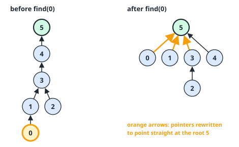
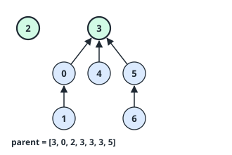

# Module: Union-Find / Disjoint Set Union (Dynamic Connectivity)

Welcome to the **Union-Find** module (also known as **Disjoint Set Union / DSU**). Union-Find is an ultra-fast data structure designed to solve one specific problem in graphs and sets: **tracking connected components as edges are added in real-time**.

It answers two fundamental operations in near-constant time:
1. `find(x)`: Which group/set does element $x$ belong to?
2. `union(x, y)`: Merge the group containing $x$ with the group containing $y$.

---

## Before you start
<!-- bite: 4efacb08-a5ae-4a8d-a95d-94298d75f5b1 -->

- You understand tree structure and height. See [[01-trees|trees]].
- You have seen graph connectivity. See [[09-graphs/index|graphs]].

**What you will be able to do after this lesson:**

1. Explain what connectivity query union-find answers and why other structures answer it slowly.
2. Explain path compression and union by rank, and what each contributes.
3. Explain why the amortised cost is effectively constant.
4. Explain how a failed union detects a cycle.

**Study route:** read the mechanism, run the lab, then attempt the independent task before opening the hint.

## 1. Real-World Motivation & Physical Metaphors
<!-- bite: 122fa6de-0e21-4dae-adef-486d1a7449fc -->

Imagine a **Social Network Friend Tracker**:

Each group is drawn as a little tree. Every arrow points from a person to their parent, and the green person at the top of a group is its representative:


Now, if someone asks: *"Are Alice and Charlie in the same friend network?"*, `find(Alice) == find(Charlie)` returns **True** instantly!

### Why Not Just Use DFS / BFS?
- If all graph edges are static and known upfront, [[01-depth-first-search|DFS]] or [[02-breadth-first-search|BFS]] can find connected components in $O(V + E)$ time.
- But if edges arrive **dynamically one-by-one over time**, re-running DFS/BFS after every new edge takes $O(V + E)$ per query, degrading to a slow $O(E \cdot (V + E))$.
- **Union-Find** updates connectivity dynamically in **$O(\alpha(n)) \approx O(1)$** time per edge!

---

## Terms used with union-find
<!-- bite: dfced4b3-827f-44f4-96dd-bfe196827a8b -->

1. **Union-find**: This is a structure for keeping track of which things are grouped together, when groups can only ever **merge** and never split. It is also called a **disjoint set union**, shortened to **DSU**.

2. **Disjoint sets**: This means a collection of groups where nothing belongs to more than one group. Every element is in exactly one group at any moment.

3. **Representative**: This is one chosen member of a group that stands for the whole group. It is also called the **root** or the **leader**. Two elements are in the same group exactly when they have the same representative — and that is the entire trick, because comparing two representatives is one comparison rather than a search.

4. **Parent pointer**: This is a reference from each element to another element in its group. Following parents repeatedly eventually reaches the representative, which is its own parent.

5. **Find**: This is the operation that returns an element's representative, by following parent pointers to the top.

6. **Union**: This is the operation that merges two groups, by making one group's representative point at the other's.

7. **Path compression**: This is an optimisation applied during `find`. Once you have walked up to the representative, you go back and point every element you passed **directly** at it, so the next `find` on any of them is immediate. It makes the structure flatter every time you use it.

8. **Union by rank**: This is the other optimisation. When merging, always attach the **shorter** tree underneath the taller one, so the result never gets deeper than it needs to be. A close relative, **union by size**, attaches the smaller group under the larger and works just as well.

9. **Inverse Ackermann function**: This is written $\alpha(n)$, and it is the cost of each operation once both optimisations are used. It grows so extraordinarily slowly that it is **less than 5 for any $n$ you could ever store**, so in practice the operations are treated as constant time — though strictly they are not.

## The union-find ADT
<!-- bite: dccc5c2e-1908-47b2-b29d-567ccd54bbb7 -->

Union-find answers one question, very fast, under one restriction: **groups merge and never split.**

1. `make_set(x)` — Creates a new group containing only `x`. $O(1)$.

2. `find(x)` — Returns the representative of `x`'s group. **$O(\alpha(n))$**, effectively constant. You rarely care about the representative's identity; you care that two elements sharing one are in the same group.

3. `union(x, y)` — Merges the groups containing `x` and `y`. **$O(\alpha(n))$**. Usually it returns whether a merge actually happened — if `x` and `y` were already together, that is a useful signal, and it is exactly how [[06-minimum-spanning-tree|Kruskal's algorithm]] detects that an edge would create a cycle.

4. `connected(x, y)` — Returns whether the two are in the same group. This is just `find(x) == find(y)`.

5. `count()` — How many separate groups remain. Start it at the number of elements and decrement on every successful union.

### The restriction is the point

**There is no `split` operation, and there cannot be one.** Path compression works by discarding the history of how groups were built — it rewires pointers straight to the representative — so the information needed to undo a merge is deliberately thrown away. That is precisely what makes it so fast.

So union-find is the right structure when connections are only ever **added**: building a [[06-minimum-spanning-tree|minimum spanning tree]], detecting a cycle as edges arrive, counting connected components in a [[09-graphs/index|graph]] that grows, or grouping accounts as duplicates are discovered.

If connections can be **removed**, union-find cannot help, and you are usually back to recomputing components with [[01-depth-first-search|DFS]] or [[02-breadth-first-search|BFS]] — or reaching for a considerably more complex dynamic-connectivity structure.

## 3. High-Performance Implementation (Python)
<!-- bite: bfcf25c6-0add-4c06-80ed-ac83746b8261 -->

To achieve $O(\alpha(n))$ performance, a Union-Find implementation **must** use both **Path Compression** and **Union by Rank**:

```python
class UnionFind:
    """Disjoint Set Union (DSU) with Path Compression and Union by Rank."""
    def __init__(self, n: int):
        # parent[i] stores the parent of element i.
        # Initially, every element is its own parent (n separate groups).
        self.parent = list(range(n))
        # rank[i] approximates tree height to keep trees balanced during union.
        self.rank = [1] * n
        # Track the total number of connected components remaining.
        self.num_components = n

    def find(self, x: int) -> int:
        """Finds the root representative of element x with Path Compression (Halving)."""
        while x != self.parent[x]:
            # Path Compression: Point x to its grandparent
            self.parent[x] = self.parent[self.parent[x]]
            x = self.parent[x]
        return x

    def union(self, x: int, y: int) -> bool:
        """Merges the sets containing x and y.
        
        Returns:
            True if a merge occurred (they were separate).
            False if they were ALREADY connected (detects a cycle!).
        """
        root_x = self.find(x)
        root_y = self.find(y)

        # If they share the same root, they are already in the same component!
        if root_x == root_y:
            return False  # Redundant edge / Cycle detected!

        # Union by Rank: Attach smaller tree under taller tree
        if self.rank[root_x] < self.rank[root_y]:
            root_x, root_y = root_y, root_x

        self.parent[root_y] = root_x
        self.rank[root_x] += self.rank[root_y]
        self.num_components -= 1
        return True
```

---

## 4. The Two Optimizations Demystified
<!-- bite: 32eee81f-3d07-4b60-939f-8258ef17171e -->

Without optimizations, Union-Find trees can degenerate into linear $O(n)$ linked lists.

Here is the same four unions done both ways, using the lab's `UnionFind` below:


1. **Union by Rank**: When merging two groups, attach the root of the smaller tree to the root of the larger tree. This limits the maximum height of the tree to $O(\log n)$.
2. **Path Compression**: During every `find(x)` call, update the parent pointers of visited nodes to point directly toward the root. This flattens the tree depth to near $O(1)$!

---

## Seeing path compression

Here `find(0)` runs with full path compression, as in the lab below. It walks 0 → 1 → 3 → 4 → 5 to the root. On the way back it points 0, 1 and 3 straight at 5 (orange). Node 2 was not on the path, so it is left alone.



---

## Seeing the forest after each union

This runs the lab's `UnionFind` (union by rank and full path compression) on elements 0 to 5. The orange arrows are the pointers each union changed. Watch the last step: finding 3's root also flattens 3 onto 0.


---

## 5. The Cycle Detection Secret
<!-- bite: b60363f8-ea4f-4a33-87dd-ba2dc131d063 -->

> [!KEY-INSIGHT]
> **Detecting Cycles in Undirected Graphs**: If `union(u, v)` returns `False`, it means nodes `u` and `v` were **already connected** through another path. Adding the edge `(u, v)` creates a **Cycle**!

This single property powers:
- **Kruskal's Minimum Spanning Tree (MST)**: Add cheapest edges while skipping any edge where `union(u, v) == False`.
- **Redundant Edge Detection**: Identify the single edge in a graph that creates an unwanted cycle.

---

## 6. Union-Find vs. DFS / BFS Comparison
<!-- bite: e5d5c948-1012-4c75-82aa-369c275ce641 -->

| Feature | Union-Find (DSU) | DFS / BFS Traversal |
| :--- | :--- | :--- |
| **Dynamic Incremental Edges** | **$O(\alpha(n)) \approx O(1)$ per edge** | $O(V + E)$ per query (Too slow!) |
| **Check Component Membership**| **$O(1)$** | $O(V + E)$ |
| **Retrieve Actual Path Route** | ✗ Cannot find path routes | **✓ Returns exact path** |
| **Edge Deletions** | ✗ Cannot delete edges directly | Must re-traverse |

---

## 7. Complexity Summary
<!-- bite: 8f74a8cc-ec44-4c97-830e-1367ee43774a -->

| Operation | Naive Implementation | Optimized (+ Rank & Path Compression) |
| :--- | :--- | :--- |
| **`find(x)`** | $O(n)$ | **$O(\alpha(n)) \approx O(1)$** |
| **`union(x, y)`** | $O(n)$ | **$O(\alpha(n)) \approx O(1)$** |
| **Space Complexity** | $O(n)$ | $O(n)$ (Parent & Rank arrays) |

---

## 8. Common Pitfalls & Traps
<!-- bite: edea58ad-b3c1-4708-94ac-abe6473bc647 -->

1. **Forgetting Path Compression or Rank**: Skipping either optimization turns Union-Find into an $O(n)$ or $O(\log n)$ structure instead of $O(1)$. Always include both in interviews!
2. **Union-Find Cannot Find Paths**: Union-Find answers *"Are X and Y connected?"*, but it **cannot** tell you the path or shortest distance between X and Y. Use [[02-breadth-first-search|BFS]] or [[02-dijkstra|Dijkstra]] for paths!
3. **No Support for Edge Deletions**: Union-Find only supports adding edges. If a problem deletes edges over time, process queries **in reverse order** (turning deletions into additions)!

---

## Implementation - complete runnable example
<!-- bite: 6f5523cd-f584-4382-96b9-0d146e873318 -->

**Runnable example:** save as `union_find_lab.py` and run `python3 union_find_lab.py`. Standard library only; writes no files. Everything is counted rather than timed, so your output will match this exactly.

```python
"""Union-Find: near-constant-time connectivity, from two small ideas."""

class UnionFind:
    def __init__(self, n, compress=True, by_rank=True):
        self.parent = list(range(n))
        self.rank = [0] * n
        self.compress, self.by_rank = compress, by_rank
        self.steps = 0

    def find(self, x):
        """Walk to the root. With PATH COMPRESSION, flatten on the way back."""
        root = x
        while self.parent[root] != root:
            self.steps += 1
            root = self.parent[root]
        if self.compress:
            while self.parent[x] != root:
                self.parent[x], x = root, self.parent[x]
        return root

    def union(self, a, b):
        ra, rb = self.find(a), self.find(b)
        if ra == rb:
            return False                      # already connected
        if self.by_rank:
            # UNION BY RANK: hang the shorter tree under the taller one,
            # so the height grows as slowly as possible
            if self.rank[ra] < self.rank[rb]:
                ra, rb = rb, ra
            self.parent[rb] = ra
            if self.rank[ra] == self.rank[rb]:
                self.rank[ra] += 1
        else:
            self.parent[rb] = ra
        return True

    def connected(self, a, b):
        return self.find(a) == self.find(b)

    def groups(self):
        out = {}
        for i in range(len(self.parent)):
            out.setdefault(self.find(i), []).append(i)
        return sorted(out.values())

if __name__ == "__main__":
    print("CONNECTIVITY -- 'are these two in the same group?'")
    uf = UnionFind(10)
    for a, b in [(0,1), (1,2), (3,4), (5,6), (6,7), (7,8)]:
        uf.union(a, b)
    print(f"  unions: 0-1, 1-2, 3-4, 5-6, 6-7, 7-8")
    print(f"  groups: {uf.groups()}")
    for a, b in [(0,2), (0,3), (5,8), (9,0)]:
        print(f"  connected({a},{b}) = {uf.connected(a,b)}")
    print()

    print("THE TWO OPTIMISATIONS, MEASURED")
    print("  The worst case depends on the ORDER unions arrive in -- and in")
    print("  real use you do not control that order. Here each union hangs")
    print("  the existing group under a new element, building a long chain:")
    print(f"  {'variant':>28s} {'pointer steps':>15s}")
    N = 2000
    for label, comp, rank in [("neither optimisation", False, False),
                              ("path compression only", True, False),
                              ("union by rank only", False, True),
                              ("both (the real thing)", True, True)]:
        u = UnionFind(N, compress=comp, by_rank=rank)
        for i in range(N - 1):
            u.union(i + 1, i)          # this order degenerates without rank
        u.steps = 0
        for i in range(N):
            u.find(i)
        print(f"  {label:>28s} {u.steps:15,d}")
    print("  -> union by rank keeps trees SHORT; path compression FLATTENS")
    print("     them as a side effect of querying. Together they give")
    print("     effectively O(1) amortised -- formally O(alpha(n)), where")
    print("     alpha is the inverse Ackermann function and is under 5 for")
    print("     any n you will ever use.")
    print()

    print("WHY 'union' RETURNS A BOOLEAN")
    u2 = UnionFind(5)
    print(f"  union(0,1) -> {u2.union(0,1)}  (they were separate)")
    print(f"  union(0,1) -> {u2.union(0,1)}  (already connected)")
    print("  -> that False is a CYCLE DETECTION. Adding an edge between two")
    print("     already-connected nodes closes a loop, which is exactly the")
    print("     test Kruskal's minimum-spanning-tree algorithm needs.")

    both = UnionFind(2000)
    for i in range(1999): both.union(i + 1, i)
    both.steps = 0
    for i in range(2000): both.find(i)
    naive = UnionFind(2000, compress=False, by_rank=False)
    for i in range(1999): naive.union(i + 1, i)
    naive.steps = 0
    for i in range(2000): naive.find(i)
    assert naive.steps > 1_000_000, "the naive version should degenerate"
    assert both.steps < naive.steps / 100, "optimisations must dominate"
    assert uf.connected(0, 2) and not uf.connected(0, 3)
    assert uf.groups() == [[0,1,2],[3,4],[5,6,7,8],[9]]
    print()
    print("union_find_lab: passed")
```

Expected output:

```text
CONNECTIVITY -- 'are these two in the same group?'
  unions: 0-1, 1-2, 3-4, 5-6, 6-7, 7-8
  groups: [[0, 1, 2], [3, 4], [5, 6, 7, 8], [9]]
  connected(0,2) = True
  connected(0,3) = False
  connected(5,8) = True
  connected(9,0) = False

THE TWO OPTIMISATIONS, MEASURED
  The worst case depends on the ORDER unions arrive in -- and in
  real use you do not control that order. Here each union hangs
  the existing group under a new element, building a long chain:
                       variant   pointer steps
          neither optimisation       1,999,000
         path compression only           3,997
            union by rank only           1,999
         both (the real thing)           1,999
  -> union by rank keeps trees SHORT; path compression FLATTENS
     them as a side effect of querying. Together they give
     effectively O(1) amortised -- formally O(alpha(n)), where
     alpha is the inverse Ackermann function and is under 5 for
     any n you will ever use.

WHY 'union' RETURNS A BOOLEAN
  union(0,1) -> True  (they were separate)
  union(0,1) -> False  (already connected)
  -> that False is a CYCLE DETECTION. Adding an edge between two
     already-connected nodes closes a loop, which is exactly the
     test Kruskal's minimum-spanning-tree algorithm needs.

union_find_lab: passed
```

## Check your understanding
<!-- bite: 46153da8-7d7d-4777-94d3-033a86a8d9c7 -->

Try each one before you open the answer.

1. <!-- q: mcq id="dd78a865" -->
   `union(a, b)` returns False. What does that mean in an undirected graph?

   - [x] a and b were already in the same group, so the edge a–b would close a cycle
   - [ ] a or b does not exist
   - [ ] The union failed because the trees were too tall
   - [ ] a and b are now in different groups

   <details><summary>Answer</summary>

   Same representative means a path already joins them. That redundant edge is exactly what Kruskal skips and what cycle detection reports.

   </details>

2. <!-- q: gap id="e58a51ae" answers="path compression;union by rank|union by size" -->
   Fill in the gaps. The optimisation that points every element passed during `find` straight at the root is called ___. The one that always attaches the shorter tree under the taller one is called ___.

   <details><summary>Answer</summary>

   Path compression and union by rank (or by size). Together they make each operation O(α(n)), which is effectively constant.

   </details>

3. <!-- q: mcq id="28a846f2" -->
   Why is O(α(n)), the inverse Ackermann function, treated as constant in practice?

   - [ ] Because it is exactly 1
   - [x] It grows so slowly that it stays at most about 4 for any input that could ever exist
   - [ ] Because union-find runs in O(1) worst case
   - [ ] Because n is always small

   <details><summary>Answer</summary>

   α(n) is at most 4 for n up to far more than the number of atoms in the universe, so each operation costs a small fixed amount in practice.

   </details>

4. <!-- q: mcq id="45d9fba7" -->
   Which jobs can union-find NOT do? Choose all that apply.

   - [x] Return the path between two connected elements
   - [x] Split a group when an edge is deleted
   - [ ] Say whether two elements are in the same group
   - [ ] Count how many groups remain

   <details><summary>Answer</summary>

   It only knows group membership, not routes, and path compression throws away the history needed to split a group. Connectivity checks and a running group count are its job.

   </details>

5. <!-- q: open id="cbd5e2c0" -->
   When should you choose union-find over running BFS or DFS to answer connectivity questions?

   <details><summary>Answer</summary>

   When edges arrive one at a time and you must answer connectivity questions in between. Re-running BFS or DFS costs O(V + E) after every edge, while union-find adds each edge in nearly constant time. If the graph is fixed and you only need the components once, a single traversal is just as good.

   </details>

## Check your understanding: worked problems
<!-- bite: 5b224625-1e56-4ed2-8654-71a3c9a39fb0 -->

Work each one out on paper first, then type your answer.

1. <!-- q: gap id="052361b8" answers="0;0;0;2;4;4" -->
   Fill in the gaps. Elements 0 to 5 start with parent[i] = i. With no optimisations, union(x, y) finds both roots and, if they differ, sets parent[root of y] = root of x. Run union(0, 1), union(2, 3), union(1, 3), union(4, 5), union(0, 2). The parent array is now [___, ___, ___, ___, ___, ___].

   <details><summary>Answer</summary>

   [0, 0, 0, 2, 4, 4]. union(0, 1) sets parent[1] = 0. union(2, 3) sets parent[3] = 2. union(1, 3) joins roots 0 and 2: parent[2] = 0. union(4, 5) sets parent[5] = 4. union(0, 2) finds both roots are 0 and changes nothing.

   </details>

2. <!-- q: gap id="c18e4176" answers="2;false|False|no" -->
   Fill in the gaps. Elements 0 to 5 start alone. Run union(0, 1), union(2, 3), union(1, 3), union(4, 5), union(0, 2). There are now ___ groups, and the last union returned ___ (true or false).

   <details><summary>Answer</summary>

   2 groups, {0, 1, 2, 3} and {4, 5}, and the last union returned false. Four unions succeeded, so 6 − 4 = 2. 0 and 2 were already joined through 1 and 3, so the edge 0–2 would close a cycle.

   </details>

3. <!-- q: gap id="7f9d025d" answers="0;0;0;0;0" -->
   Fill in the gaps. The parent array is [0, 0, 1, 2, 3], so the elements form a chain 4 → 3 → 2 → 1 → 0. You call find(4) with full path compression, which points every element on the path straight at the root. The parent array becomes [___, ___, ___, ___, ___].

   <details><summary>Answer</summary>

   [0, 0, 0, 0, 0]. find(4) walks 4, 3, 2, 1 to the root 0, then sets each of their parents to 0. The next find on any of them takes a single step.

   </details>

4. <!-- q: sketch id="36442ff7" -->
   Elements 0 to 6 start with parent[i] = i. With no optimisations, union(x, y) finds both roots and, if they differ, sets parent[root of y] = root of x. Run union(3, 4), union(5, 6), union(3, 5), union(0, 1), union(6, 1). On paper, draw the forest, with an arrow from each element to its parent, and write out the parent array.

   <details><summary>Answer</summary>

   

   What to check:
   - union(3, 5) joins two roots, so 5 points to 3 and 6 stays under 5.
   - union(6, 1) joins the roots 3 and 0, so 0 (and with it 1) goes under 3.
   - 2 was never in a union, so it stays a group of its own: two groups in total.

   </details>

## Practice - independent task
<!-- bite: a0fc7bc2-055e-4e96-b031-bc5001d20af5 -->

Implement **Kruskal's minimum spanning tree** using your union-find.

- Sort all edges by weight, then add each edge whose endpoints are not already connected.
- `union` returning `False` is precisely your cycle test - use it, do not write a separate one.
- Run it on a weighted graph of at least ten nodes and verify: the result has exactly `n - 1` edges, is connected, and its total weight matches a reference implementation.
- **Then answer:** why is sorting the edges the dominant cost, and what does that make Kruskal's overall complexity?

**Done when:** your MST has n-1 edges, spans every node, and you can state the overall complexity with the reason.

<details><summary>Hint - open only after an attempt</summary>
Sorting E edges costs O(E log E). The union-find operations that follow are effectively O(1) each, so E of them cost about O(E). The sort therefore dominates and Kruskal's is O(E log E).<br>
This is a nice illustration of why near-constant-time union-find matters: it makes the connectivity checks <em>disappear</em> from the complexity, leaving the sort as the only real cost. With a naive connectivity check the algorithm would be far worse.
</details>

## Before moving on
<!-- bite: 2c6ea402-11c6-4c8a-ad04-72fc8f5f050d -->

You are done with this module when you can, closed-book:

- [ ] State the question union-find answers and why a graph traversal is slower at it.
- [ ] Explain path compression and union by rank separately.
- [ ] Explain why the amortised cost is effectively constant for any realistic n.
- [ ] Explain how a failed union detects a cycle, and name an algorithm that uses it.

**Recap:** Union-find tracks which elements belong to the same group, supporting union and find in effectively constant amortised time. Union by rank hangs the shorter tree under the taller so height grows as slowly as possible; path compression flattens the path to the root as a side effect of querying. Together they reduce a chain that would cost O(n) per query to a nearly flat structure. A union that reports the elements were already connected is a cycle detection, which is exactly the test Kruskal's algorithm needs.

**This is the last structure in this folder.** Next is [[01-growth-and-asymptotic-notation|algorithms and complexity]], where these structures stop being the subject and start being the tools.

## Related Modules
<!-- bite: 6bc10598-7252-43ef-b786-3a3dd24d87ea -->
- [[09-graphs/index|Graphs]] — Graph definitions and connectivity
- [[01-depth-first-search|DFS]] & [[02-breadth-first-search|BFS]] — Graph traversal alternatives
- [[06-minimum-spanning-tree|Minimum Spanning Tree]] — Kruskal's algorithm powered by Union-Find
