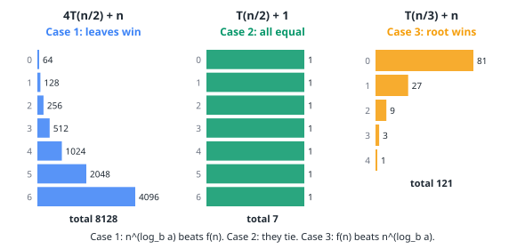

# Module: The Master Theorem (The Shortcut, and Exactly When It Fails)

The Master Theorem is a shortcut that solves most divide-and-conquer recurrences in one step.

## Before you start
<!-- bite: 08c23a83-7aab-4f21-9fb6-b7cbb25cf8de -->

- You can turn recursive code into $T(n) = a\,T(n/b) + f(n)$, and you know what $a$, $b$ and $f$ mean — [[02-recursion-trees-and-recurrences|recursion trees and recurrences]].
- You can compute the work at level $k$ of a recursion tree and say which level dominates.
- You are comfortable with logarithms changing base, and with $a^{\log_b n} = n^{\log_b a}$.

**After this lesson you will be able to:**

1. Apply the theorem's **decision procedure** to an unfamiliar recurrence and produce a $\Theta$ bound.
2. Explain what "**polynomially** larger" means and why Case 3 requires it.
3. Identify the two standard recurrences the theorem **cannot** solve, and say precisely which condition each violates.
4. Verify any verdict empirically with the doubling test.

**Study route:** read 1–3, then attempt the prediction in section 4 before continuing. Section 5 — where it fails — is the part worth rereading.

---

## What the Master Theorem is
<!-- bite: 49c172cf-81bf-4531-a789-9eb8f6c8de6c -->

The Master Theorem gives the cost of a recurrence like $T(n) = a\,T(n/b) + f(n)$ without drawing the tree.

It is genuinely a shortcut — thirty seconds instead of five minutes. It is also the topic most likely to be misapplied, because two of its most famous-looking targets fall outside it. Knowing when it *does not* apply is the harder and more valuable half.

## 1. Why this exists: the same three cases, every time
<!-- bite: 18943827-7c1d-4ee3-a242-89a65a3d84a1 -->

Every divide-and-conquer recurrence you solved in the last lesson followed the same ritual: compute the work at level $k$, see whether it grows, stays flat or shrinks, and pick the corresponding answer. **Doing that from scratch each time is wasted effort, because the answer depends on only two numbers.**

## 1. Why this exists: the two numbers to compare
<!-- bite: 6400a7bb-b3de-4f98-80dc-f8e6ac92bb2a -->

The whole theorem comes down to comparing two numbers.

Those two numbers are:

1. $n^{\log_b a}$ — the total work at the **leaves**, since there are $a^{\log_b n} = n^{\log_b a}$ of them.
2. $f(n)$ — the work at the **root**.

**The whole theorem is: compare those two, and whichever is bigger wins. If they tie, the answer is their common value times the number of levels.**

That is the idea. The precision is in what "bigger" has to mean.

---

## Terms used in the Master Theorem
<!-- bite: 5703b3af-dc3f-4378-a367-19ca52f6c090 -->

1. **Master Theorem**: This is a rule that solves recurrences of the form $T(n) = a\,T(n/b) + f(n)$ by comparing $f(n)$ against $n^{\log_b a}$. It gives a $\Theta$ bound — a tight one, not just an upper bound.
2. **The critical exponent**: This is $\log_b a$, sometimes called the **watershed exponent**. It is the exponent at which leaf work and root work balance. Everything in the theorem is a comparison against $n^{\log_b a}$.
3. **Polynomially larger**: This means larger by a factor of $n^\varepsilon$ for some **fixed $\varepsilon > 0$**. $n^2$ is polynomially larger than $n$ (take $\varepsilon = 1$). $n\log n$ is larger than $n$ but **not polynomially** larger, because $\log n$ grows slower than $n^\varepsilon$ for every positive $\varepsilon$, however small. This distinction is the single most important idea in the lesson.
4. **Polynomially smaller**: The mirror image — smaller by a factor of $n^\varepsilon$ for some fixed $\varepsilon > 0$. Case 1 requires it.

## Terms: regularity and the gap
<!-- bite: 80979e19-2e30-44e7-9b8c-e25579bf8f3a -->

These two terms cover the extra condition in Case 3 and the region the theorem misses.

5. **Regularity condition**: This is the extra requirement in Case 3: $a\,f(n/b) \le c\,f(n)$ for some constant $c < 1$ and all sufficiently large $n$. **In words: the total combine work must actually shrink as you go down the tree, by a constant factor.** It holds for every polynomial $f$ you will meet in practice, and exists to exclude pathological functions that oscillate.
6. **The gap**: This is the region between the cases where the theorem says nothing — when $f(n)$ is larger or smaller than $n^{\log_b a}$ but only by a logarithmic factor rather than a polynomial one. $T(n) = 2T(n/2) + n\log n$ lives here.

---

## 2. The theorem
<!-- bite: 1ef19af8-e7d8-4c94-8bb9-8d66a230efd0 -->

**Stated in words first.** Given a recurrence in which a problem of size $n$ is split into $a$ subproblems of size $n/b$, with $f(n)$ work to divide and combine, compare the work done at the leaves, $n^{\log_b a}$, with the work done at the root, $f(n)$:

1. If the leaves are polynomially *more* work, the leaves dominate and the total is the leaf work.
2. If the two match, every level does about the same work, and the total is that amount times the number of levels — an extra factor of $\log n$.
3. If the root is polynomially *more* work and the combine work shrinks regularly down the tree, the root dominates and the total is just the root's work.

## 2. The theorem in symbols
<!-- bite: d188614e-156a-4981-b8af-d483ae2c30f9 -->

Here are the same three cases written as formulas.

Now the symbols. For $T(n) = a\,T(n/b) + f(n)$ with $a \ge 1$ and $b > 1$:

$$
\textbf{Case 1:}\quad f(n) = O\!\left(n^{\log_b a - \varepsilon}\right) \text{ for some } \varepsilon > 0
\;\Longrightarrow\; T(n) = \Theta\!\left(n^{\log_b a}\right)
$$

$$
\textbf{Case 2:}\quad f(n) = \Theta\!\left(n^{\log_b a} \log^k n\right),\ k \ge 0
\;\Longrightarrow\; T(n) = \Theta\!\left(n^{\log_b a} \log^{k+1} n\right)
$$

$$
\textbf{Case 3:}\quad f(n) = \Omega\!\left(n^{\log_b a + \varepsilon}\right) \text{ for some } \varepsilon > 0,
\text{ and } a f(n/b) \le c f(n) \text{ for some } c<1
\;\Longrightarrow\; T(n) = \Theta\!\left(f(n)\right)
$$

**The $\varepsilon$ in Cases 1 and 3 is doing all the work.** It is what makes "smaller" and "larger" mean *polynomially* so, and it is exactly what $n\log n$ versus $n$ fails to satisfy.

## Seeing the three cases
<!-- bite: afb93986-7ae7-4ac8-a51c-d980cd3307bc -->

Each chart shows one recurrence's work per level, root at the top. In Case 1 the bars grow downward, so the leaves win. In Case 2 every level is the same, so you pay that amount times the number of levels. In Case 3 the bars shrink, so the root wins.



---

## 3. The decision procedure
<!-- bite: 1dacb1c2-8949-427f-a7f1-0bdc96556813 -->

Follow it in order. Do not skip step 1.

1. **Is the recurrence even of this form?** It needs $a\,T(n/b)$ — the input shrinking by a **factor**. If the input shrinks by a constant **amount**, as in $T(n-1)$, the theorem does not apply at all. Go back to the recursion tree.
2. **Compute the critical exponent $\log_b a$.**
3. **Compare $f(n)$ with $n^{\log_b a}$:**
   - $f$ smaller by a polynomial factor → **Case 1**, answer $\Theta(n^{\log_b a})$.
   - $f$ equal, possibly times $\log^k n$ → **Case 2**, answer $\Theta(n^{\log_b a}\log^{k+1} n)$.
   - $f$ larger by a polynomial factor → **Case 3**, answer $\Theta(f(n))$.
4. **For Case 3 only, check regularity.** For any $f(n) = n^d$ it holds automatically: $a(n/b)^d = (a/b^d)n^d$, and Case 3 already requires $d > \log_b a$, which forces $a/b^d < 1$.
5. **If the comparison is "larger/smaller, but only by a logarithmic factor", you are in the gap.** The theorem says nothing. Draw the tree.

## 3. The decision procedure worked: merge sort
<!-- bite: 6f4c0517-c7ab-4b17-9dbe-a6b540d61bce -->

Here is the procedure applied to merge sort.

$T(n) = 2T(n/2) + n$. So $a=2$, $b=2$, $f(n) = n$.

$\log_b a = \log_2 2 = 1$, so $n^{\log_b a} = n^1 = n$. And $f(n) = n$. **They match**, with $k=0$.

Case 2 gives $T(n) = \Theta(n^1 \log^{0+1} n) = \Theta(n\log n)$. ✓

## 3. The decision procedure worked: binary search
<!-- bite: 2930cee3-02f3-4e2c-8f50-3b6403fd0a80 -->

Here is the procedure applied to binary search.

$T(n) = T(n/2) + 1$. So $a=1$, $b=2$, $f(n) = 1$.

$\log_2 1 = 0$, so $n^{\log_b a} = n^0 = 1$. And $f(n) = 1$. **They match**, $k=0$.

Case 2 gives $\Theta(n^0 \log n) = \Theta(\log n)$. ✓

**Notice that binary search is a Case 2, not a Case 1.** People expect the "one branch" recurrence to be special; it is not. With $a = 1$ the critical exponent is 0, and constant work matches $n^0$ exactly.

## 3. The decision procedure worked: Strassen's matrix multiplication
<!-- bite: 66a14a49-6ec2-4f68-815e-c7ca8783814f -->

Here is a Case 1 example, Strassen's matrix multiplication.

$T(n) = 7T(n/2) + n^2$. So $a=7$, $b=2$, $f(n) = n^2$.

$\log_2 7 \approx 2.807$. Is $f(n) = n^2$ polynomially smaller than $n^{2.807}$? Yes — take $\varepsilon = 0.8$.

Case 1 gives $T(n) = \Theta(n^{\log_2 7}) = \Theta(n^{2.807})$.

**This is the entire reason Strassen's algorithm is famous.** Naive matrix multiplication is $\Theta(n^3)$; the same $n^2$ combine work with *seven* subproblems instead of eight drops the exponent to 2.807. The lab measures it: the ratio of measured work to $n^{2.807}$ holds steady at 2.31–2.32 across $n = 128, 256, 512$ — a constant, which is what $\Theta$ claims.

## Seeing the decision procedure
<!-- bite: 2c9c5b86-b878-433b-96ce-d59cb0e55045 -->

The same steps as a flowchart. The two red boxes are where the theorem gives no answer and you go back to drawing the tree.


---

## 4. The comparison that catches people
<!-- bite: e1a0f183-286f-4aa9-a070-a352ff927ebc -->

> **Predict before reading on.** $T(n) = 2T(n/2) + n\log n$. The critical exponent is $\log_2 2 = 1$, and $f(n) = n\log n$ is clearly bigger than $n$. So it is Case 3, giving $\Theta(n \log n)$. **Find the error in that reasoning.**

There are two errors, and they compound.

**Error one: Case 3 requires $f(n)$ to be polynomially larger, and $n\log n$ is not.** Case 3 needs $f(n) = \Omega(n^{1+\varepsilon})$ for some fixed $\varepsilon > 0$. Here $f(n)/n^1 = \log n$. For *any* $\varepsilon > 0$, however tiny, $\log n$ eventually falls behind $n^\varepsilon$ — $\log n$ grows slower than $n^{0.001}$. So no valid $\varepsilon$ exists, and Case 3 does not apply.

## 4. The comparison that catches people: the true answer
<!-- bite: 0f6710bd-d835-4525-a85f-b5d5a81cf964 -->

The second error is in the answer itself, and drawing the tree shows it.

**Error two: the conclusion is wrong too.** Falling in the gap does not mean the answer is whatever Case 3 would have said. Drawing the tree: level $k$ has $2^k$ nodes of size $n/2^k$, so the level work is

$$2^k \cdot \frac{n}{2^k}\log\frac{n}{2^k} = n\left(\log n - k\right)$$

Summing over $k = 0$ to $\log_2 n$ gives $n\sum_{k=0}^{\log n}(\log n - k) = n \cdot \frac{\log n(\log n + 1)}{2} = \Theta(n\log^2 n)$.

## 4. The comparison that catches people: the true answer checked
<!-- bite: e2315708-af3e-4f78-9e3c-17046e2ed682 -->

This part states the true answer and shows the lab agrees with it.

**The true answer is $\Theta(n\log^2 n)$, not $\Theta(n\log n)$** — a whole logarithmic factor larger than the wrong reasoning predicted. The lab confirms it: the measured doubling ratio (2.552, 2.486, 2.435, 2.393) tracks the $n\log^2 n$ prediction (2.612, 2.531, 2.469, 2.420), not the 2.2-and-falling that $n\log n$ would give.

> **This recurrence can in fact be handled by Case 2**, since $f(n) = n\log n = \Theta(n^{\log_b a}\log^1 n)$ with $k=1$, giving $\Theta(n\log^{2} n)$ — the same answer. The trap is not that the recurrence is unsolvable; it is that **reaching for Case 3 because "$f$ looks bigger" gives the wrong answer.** Check which case actually applies before applying one.

---

## 5. Where the theorem genuinely fails
<!-- bite: b8142211-bb3f-4bac-a749-d44eb1055f4c -->

Three situations, in decreasing order of how often they come up.

### 1. The input shrinks by subtraction, not division

$T(n) = 2T(n-1) + 1$ is not of the form $a\,T(n/b) + f(n)$. There is no $b$. The theorem is silent.

The tree is still easy: depth $n$, work doubling per level, so $\Theta(2^n)$. The lab prints the node counts — 2,047 at $n=10$, 2,097,151 at $n=20$.

**This is the case that matters most in interviews**, because $T(n) = T(n-1) + T(n-2) + O(1)$ — naive Fibonacci — looks superficially like a divide-and-conquer recurrence and is nothing of the sort.

### 2. $f(n)$ is in the gap

Covered in section 4. The signature is a ratio $f(n)/n^{\log_b a}$ that is a power of $\log n$, or anything else sub-polynomial. Sometimes Case 2's extended form rescues it; sometimes nothing does, and you draw the tree.

## 5. Where the theorem fails: subproblems of different sizes
<!-- bite: 48abbf56-ff79-447d-94f3-7ef9da73a865 -->

The third failure is a recurrence whose subproblems are not all the same size.

$T(n) = T(n/3) + T(2n/3) + n$ — the recurrence for quicksort with a guaranteed 1:2 split — has two different subproblem sizes. The theorem assumes $a$ identical subproblems of size $n/b$.

The tree still works: every level does $n$ work until branches start bottoming out, and the longest path has length $\log_{3/2} n$, giving $\Theta(n\log n)$. **The useful takeaway is that even a lopsided constant-ratio split gives $n\log n$** — quicksort does not need good pivots, only pivots that are not catastrophically bad.

There is a generalisation, the **Akra–Bazzi method**, that handles unequal splits. It is worth knowing the name and not worth memorising the formula.

---

## 6. Worked example — complete runnable lab
<!-- bite: b749f724-7e89-4048-964b-ec1a061df4b3 -->

Save as `master_theorem.py`. Standard library only. It classifies each recurrence by the theorem, then **checks the verdict against measured work** by doubling $n$ — so the theorem is being tested, not just recited.

```python
"""Apply the Master Theorem, then check its verdict against measured work.

Run:  python3 master_theorem.py
"""

import math
from collections import defaultdict


def measure(a, b, f, n):
    """Total work for T(n) = a*T(n/b) + f(n), summed over the whole tree."""
    by_level = defaultdict(float)

    def rec(size, level):
        by_level[level] += f(size)
        if size <= 1:
            return
        for _ in range(a):
            rec(size / b, level + 1)

    rec(n, 0)
    return sum(by_level.values())


def classify(a, b, f_exp, f_log=0):
    """Classify T(n) = a*T(n/b) + n^f_exp * (log n)^f_log by the Master Theorem.

    Returns (case, description, growth-rate function).
    """
    crit = math.log(a) / math.log(b)          # log_b(a): the 'leaves' exponent

    if f_exp < crit - 1e-12:
        return (1, f"f(n) grows slower than n^{crit:.3f} -> LEAVES win",
                lambda n: n ** crit)
    if abs(f_exp - crit) < 1e-12:
        if f_log < 0:
            return (None, "f/n^crit decreases -> Master Theorem does NOT apply", None)
        return (2, f"f(n) matches n^{crit:.3f} -> ALL LEVELS equal",
                lambda n: (n ** crit) * (math.log2(n) ** (f_log + 1)))
    return (3, f"f(n) grows faster than n^{crit:.3f} -> ROOT wins",
            lambda n: (n ** f_exp) * (math.log2(n) ** f_log))


def report(a, b, f, f_exp, f_log, label, name):
    case, why, growth = classify(a, b, f_exp, f_log)
    crit = math.log(a) / math.log(b)
    print(f"\n  {label}    [{name}]")
    print(f"    a={a}, b={b}, log_b(a) = {crit:.4f},  f(n) = {describe(f_exp, f_log)}")
    print(f"    Case {case}: {why}")
    if growth is None:
        print("    -> fall back to the recursion tree")
        return
    print(f"    verdict: T(n) = Theta({formula(case, crit, f_exp, f_log)})")
    print("        n |     measured work | measured ratio | predicted ratio")
    prev = None
    for n in (128, 256, 512, 1024, 2048):
        w = measure(a, b, f, n)
        mr = f"{w/prev:>14.3f}" if prev else f"{'-':>14}"
        pr = f"{growth(n)/growth(n/2):>15.3f}" if prev else f"{'-':>15}"
        print(f"  {n:>7} | {w:>17,.0f} | {mr} | {pr}")
        prev = w


def describe(e, l):
    base = "1" if e == 0 else ("n" if e == 1 else f"n^{e}")
    if l == 0:
        return base
    return f"{base} * log(n)" if l == 1 else f"{base} * log(n)^{l}"


def formula(case, crit, f_exp, f_log):
    if case == 1:
        return f"n^{crit:.3f}"
    if case == 2:
        return f"n^{crit:.3f} * log(n)^{f_log + 1}"
    return describe(f_exp, f_log)


def main():
    print("=" * 78)
    print("THE MASTER THEOREM:  T(n) = a*T(n/b) + f(n)")
    print("Compare f(n) against n^(log_b a).  Whichever is bigger, wins.")
    print("=" * 78)

    print("\n### CASE 1 -- f(n) is smaller: the leaves dominate")
    report(2, 2, lambda s: 1.0, 0, 0, "T(n) = 2T(n/2) + 1", "tree traversal / heapify")
    report(4, 2, lambda s: s, 1, 0, "T(n) = 4T(n/2) + n", "naive matrix-ish")

    print("\n\n### CASE 2 -- f(n) matches: every level does equal work")
    report(2, 2, lambda s: s, 1, 0, "T(n) = 2T(n/2) + n", "merge sort")
    report(1, 2, lambda s: 1.0, 0, 0, "T(n) = T(n/2) + 1", "binary search")

    print("\n\n### CASE 3 -- f(n) is bigger: the root dominates")
    report(2, 2, lambda s: s * s, 2, 0, "T(n) = 2T(n/2) + n^2", "root-heavy combine")
    report(1, 3, lambda s: s, 1, 0, "T(n) = T(n/3) + n", "shrink-and-scan")

    print("\n\n### THE FAMOUS NEAR-MISSES")

    print("\n  (a) T(n) = 7T(n/2) + n^2   [Strassen matrix multiplication]")
    crit = math.log2(7)
    print(f"      log_2(7) = {crit:.4f}, and f(n) = n^2 with 2 < {crit:.4f}")
    print(f"      Case 1 -> Theta(n^{crit:.4f}), which beats the naive n^3")
    for n in (128, 256, 512):
        w = measure(7, 2, lambda s: s * s, n)
        print(f"      n={n:>5}  measured={w:>18,.0f}   n^2.807={n**crit:>18,.0f}"
              f"   ratio={w/(n**crit):>6.2f}")

    print("\n  (b) T(n) = 2T(n/2) + n*log(n)   [NOT Case 3: Case 2 with k=1]")
    print("      f(n) = n log n is bigger than n^1, but NOT polynomially bigger:")
    print("      the ratio f(n)/n^1 = log n grows slower than any n^epsilon.")
    print("      Case 3 needs f(n) = Omega(n^(crit+eps)) for some eps > 0. It fails.")
    print("      The recursion tree still works: n*log(n) per level shrinking slowly,")
    print("      log n levels  ->  Theta(n * log(n)^2).")
    print("        n |     measured work | measured ratio | n*log2(n)^2 ratio")
    prev = None
    for n in (128, 256, 512, 1024, 2048):
        w = measure(2, 2, lambda s: s * math.log2(s) if s > 1 else 1.0, n)
        pred = lambda m: m * (math.log2(m) ** 2)
        mr = f"{w/prev:>14.3f}" if prev else f"{'-':>14}"
        pr = f"{pred(n)/pred(n/2):>17.3f}" if prev else f"{'-':>17}"
        print(f"  {n:>7} | {w:>17,.0f} | {mr} | {pr}")
        prev = w

    print("\n  (c) T(n) = 2T(n-1) + 1   [not a Master Theorem shape at all]")
    print("      The theorem requires the input to shrink by a FACTOR (n/b),")
    print("      not by a constant AMOUNT (n-c). Use the recursion tree:")
    print("      depth n, work doubling per level -> Theta(2^n).")
    for n in (10, 15, 20):
        total = 2 ** (n + 1) - 1
        print(f"      n={n:>3}  nodes = 2^(n+1)-1 = {total:>12,}")

    print("\n\n### THE DECISION PROCEDURE, IN ORDER")
    print("  1. Is it of the form a*T(n/b) + f(n), with a >= 1 and b > 1?")
    print("     If the input shrinks by subtraction, STOP -- use the recursion tree.")
    print("  2. Compute crit = log_b(a).")
    print("  3. Compare f(n) to n^crit:")
    print("       f smaller by a polynomial factor  -> Case 1: Theta(n^crit)")
    print("       f equal (up to log^k)             -> Case 2: Theta(n^crit * log^(k+1) n)")
    print("       f bigger by a polynomial factor   -> Case 3: Theta(f(n))")
    print("  4. For Case 3, check regularity: a*f(n/b) <= c*f(n) for some c < 1.")
    print("     It holds for every polynomial f you are likely to meet.")
    print("  5. If f is bigger only by log^k n, Case 3 does NOT apply: use Case 2")
    print("     with that k. If f is smaller only by a log factor, go back to the tree.")


if __name__ == "__main__":
    main()
```

## 6. Worked example: what it prints
<!-- bite: e295da06-c9f5-4d6a-81be-87d248ac25e8 -->

Here is what the lab prints when you run it.

Generated by running the file above:

```text
==============================================================================
THE MASTER THEOREM:  T(n) = a*T(n/b) + f(n)
Compare f(n) against n^(log_b a).  Whichever is bigger, wins.
==============================================================================

### CASE 1 -- f(n) is smaller: the leaves dominate

  T(n) = 2T(n/2) + 1    [tree traversal / heapify]
    a=2, b=2, log_b(a) = 1.0000,  f(n) = 1
    Case 1: f(n) grows slower than n^1.000 -> LEAVES win
    verdict: T(n) = Theta(n^1.000)
        n |     measured work | measured ratio | predicted ratio
      128 |               255 |              - |               -
      256 |               511 |          2.004 |           2.000
      512 |             1,023 |          2.002 |           2.000
     1024 |             2,047 |          2.001 |           2.000
     2048 |             4,095 |          2.000 |           2.000

  T(n) = 4T(n/2) + n    [naive matrix-ish]
    a=4, b=2, log_b(a) = 2.0000,  f(n) = n
    Case 1: f(n) grows slower than n^2.000 -> LEAVES win
    verdict: T(n) = Theta(n^2.000)
        n |     measured work | measured ratio | predicted ratio
      128 |            32,640 |              - |               -
      256 |           130,816 |          4.008 |           4.000
      512 |           523,776 |          4.004 |           4.000
     1024 |         2,096,128 |          4.002 |           4.000
     2048 |         8,386,560 |          4.001 |           4.000


### CASE 2 -- f(n) matches: every level does equal work

  T(n) = 2T(n/2) + n    [merge sort]
    a=2, b=2, log_b(a) = 1.0000,  f(n) = n
    Case 2: f(n) matches n^1.000 -> ALL LEVELS equal
    verdict: T(n) = Theta(n^1.000 * log(n)^1)
        n |     measured work | measured ratio | predicted ratio
      128 |             1,024 |              - |               -
      256 |             2,304 |          2.250 |           2.286
      512 |             5,120 |          2.222 |           2.250
     1024 |            11,264 |          2.200 |           2.222
     2048 |            24,576 |          2.182 |           2.200

  T(n) = T(n/2) + 1    [binary search]
    a=1, b=2, log_b(a) = 0.0000,  f(n) = 1
    Case 2: f(n) matches n^0.000 -> ALL LEVELS equal
    verdict: T(n) = Theta(n^0.000 * log(n)^1)
        n |     measured work | measured ratio | predicted ratio
      128 |                 8 |              - |               -
      256 |                 9 |          1.125 |           1.143
      512 |                10 |          1.111 |           1.125
     1024 |                11 |          1.100 |           1.111
     2048 |                12 |          1.091 |           1.100


### CASE 3 -- f(n) is bigger: the root dominates

  T(n) = 2T(n/2) + n^2    [root-heavy combine]
    a=2, b=2, log_b(a) = 1.0000,  f(n) = n^2
    Case 3: f(n) grows faster than n^1.000 -> ROOT wins
    verdict: T(n) = Theta(n^2)
        n |     measured work | measured ratio | predicted ratio
      128 |            32,640 |              - |               -
      256 |           130,816 |          4.008 |           4.000
      512 |           523,776 |          4.004 |           4.000
     1024 |         2,096,128 |          4.002 |           4.000
     2048 |         8,386,560 |          4.001 |           4.000

  T(n) = T(n/3) + n    [shrink-and-scan]
    a=1, b=3, log_b(a) = 0.0000,  f(n) = n
    Case 3: f(n) grows faster than n^0.000 -> ROOT wins
    verdict: T(n) = Theta(n)
        n |     measured work | measured ratio | predicted ratio
      128 |               192 |              - |               -
      256 |               384 |          2.002 |           2.000
      512 |               768 |          2.000 |           2.000
     1024 |             1,536 |          2.001 |           2.000
     2048 |             3,072 |          2.000 |           2.000


### THE FAMOUS NEAR-MISSES

  (a) T(n) = 7T(n/2) + n^2   [Strassen matrix multiplication]
      log_2(7) = 2.8074, and f(n) = n^2 with 2 < 2.8074
      Case 1 -> Theta(n^2.8074), which beats the naive n^3
      n=  128  measured=         1,899,755   n^2.807=           823,543   ratio=  2.31
      n=  256  measured=        13,363,821   n^2.807=         5,764,801   ratio=  2.32
      n=  512  measured=        93,808,891   n^2.807=        40,353,607   ratio=  2.32

  (b) T(n) = 2T(n/2) + n*log(n)   [NOT Case 3: Case 2 with k=1]
      f(n) = n log n is bigger than n^1, but NOT polynomially bigger:
      the ratio f(n)/n^1 = log n grows slower than any n^epsilon.
      Case 3 needs f(n) = Omega(n^(crit+eps)) for some eps > 0. It fails.
      The recursion tree still works: n*log(n) per level shrinking slowly,
      log n levels  ->  Theta(n * log(n)^2).
        n |     measured work | measured ratio | n*log2(n)^2 ratio
      128 |             3,712 |              - |                 -
      256 |             9,472 |          2.552 |             2.612
      512 |            23,552 |          2.486 |             2.531
     1024 |            57,344 |          2.435 |             2.469
     2048 |           137,216 |          2.393 |             2.420

  (c) T(n) = 2T(n-1) + 1   [not a Master Theorem shape at all]
      The theorem requires the input to shrink by a FACTOR (n/b),
      not by a constant AMOUNT (n-c). Use the recursion tree:
      depth n, work doubling per level -> Theta(2^n).
      n= 10  nodes = 2^(n+1)-1 =        2,047
      n= 15  nodes = 2^(n+1)-1 =       65,535
      n= 20  nodes = 2^(n+1)-1 =    2,097,151


### THE DECISION PROCEDURE, IN ORDER
  1. Is it of the form a*T(n/b) + f(n), with a >= 1 and b > 1?
     If the input shrinks by subtraction, STOP -- use the recursion tree.
  2. Compute crit = log_b(a).
  3. Compare f(n) to n^crit:
       f smaller by a polynomial factor  -> Case 1: Theta(n^crit)
       f equal (up to log^k)             -> Case 2: Theta(n^crit * log^(k+1) n)
       f bigger by a polynomial factor   -> Case 3: Theta(f(n))
  4. For Case 3, check regularity: a*f(n/b) <= c*f(n) for some c < 1.
     It holds for every polynomial f you are likely to meet.
  5. If f is bigger only by log^k n, Case 3 does NOT apply: use Case 2
     with that k. If f is smaller only by a log factor, go back to the tree.
```

## 6. Worked example: reading the lab
<!-- bite: 4efc404d-a43e-42b8-8005-dbf780903dec -->

This part explains what to look for in the output.

- **Every `predicted ratio` column comes from the theorem's verdict; every `measured ratio` comes from summing the actual tree.** They agree to three decimal places in Cases 1 and 3, and converge in Case 2 (where the ratio approaches its limit slowly, because of the $\log n$ factor).
- **Binary search prints as Case 2 with critical exponent 0.000.** That is correct and is the subtle one: with $a=1$, $n^{\log_b a} = n^0 = 1$, and constant combine work *matches* it.
- **Near-miss (b) is the important block.** The measured ratios (2.552 → 2.393) sit clearly above what $n\log n$ would produce (which would be 2.2 and falling, as seen in the merge-sort block) and track $n\log^2 n$ instead. **The wrong answer and the right answer are distinguishable from measurements alone**, which is the practical reason to care about the gap.

---

## 7. Common pitfalls and traps
<!-- bite: 408cd506-fd93-42bb-866f-914a64347248 -->

1. **Applying it to a subtractive recurrence.** $T(n) = T(n-1) + n$ is not $a\,T(n/b) + f(n)$. If you "apply" the theorem anyway you will get $O(n)$ instead of the correct $O(n^2)$.
2. **Treating "bigger" as enough for Case 3.** It must be *polynomially* bigger. $n\log n$ against $n$ is the standard counterexample, and it is standard because it is the one everybody gets wrong.
3. **Forgetting the regularity condition exists.** In practice it always holds for polynomial $f$, but you should be able to say what it is and why it is needed — it is a natural follow-up question after you quote Case 3.
4. **Getting $\log_b a$ backwards.** It is $\log_b a$, not $\log_a b$. For $8T(n/2)$ it is $\log_2 8 = 3$, not $\log_8 2 = 1/3$. A quick sanity check: more subproblems should give a *larger* exponent.

## 7. Common pitfalls: what the answer really means
<!-- bite: 0bb4ee79-b548-4717-b2e0-3a31d5940e65 -->

These four pitfalls are about what the theorem's answer really tells you.

5. **Assuming Case 2 always contributes exactly one $\log$.** With $f(n) = n^{\log_b a}\log^k n$ the answer carries $\log^{k+1} n$. For $k=1$ you get $\log^2 n$, as in section 4.
6. **Using it on unequal splits.** $T(n) = T(n/3) + T(2n/3) + n$ has two subproblem sizes and is outside the theorem. The tree gives $\Theta(n\log n)$.
7. **Quoting $\Theta$ when the recurrence only gives $O$.** The Master Theorem yields tight $\Theta$ bounds when its conditions hold. If your $f(n)$ is only an upper bound — because you wrote $O(n)$ for the combine step without knowing it is exactly linear — then your conclusion is an upper bound too.
8. **Forgetting the theorem describes the recurrence, not the algorithm.** If you derived the recurrence wrongly — miscounting subproblems, or including recursive work in $f(n)$ — the theorem will faithfully give you the right answer to the wrong question.

---

## Check your understanding
<!-- bite: 4b1a1cf2-cfc6-44b0-9f7f-d1c8d3daac5f -->

Try each one before you open the answer.

1. <!-- q: mcq id="8201a795" -->
   T(n) = 8T(n/2) + n². Which case of the Master Theorem applies, and what is T(n)?

   - [x] Case 1, Θ(n³)
   - [ ] Case 2, Θ(n² log n)
   - [ ] Case 3, Θ(n²)
   - [ ] The theorem does not apply

   <details><summary>Answer</summary>

   log₂ 8 = 3, and n² is polynomially smaller than n³, so the leaves dominate: Θ(n³). This is naive block matrix multiplication, which Strassen beats by using 7 subproblems instead of 8.

   </details>

2. <!-- q: mcq id="08efb42b" -->
   Binary search has T(n) = T(n/2) + 1. Which case is it?

   - [ ] Case 1
   - [x] Case 2
   - [ ] Case 3
   - [ ] None, because a = 1

   <details><summary>Answer</summary>

   Case 2. With a = 1 the critical exponent is log₂ 1 = 0, and n⁰ = 1 matches f(n) = 1 exactly. So T(n) = Θ(log n).

   </details>

3. <!-- q: mcq id="fde24356" -->
   Which recurrences can the Master Theorem NOT solve directly? Choose all that apply.

   - [x] T(n) = 2T(n−1) + 1
   - [x] T(n) = T(n/3) + T(2n/3) + n
   - [ ] T(n) = 4T(n/2) + n
   - [x] T(n) = 2T(n/2) + n / log n

   <details><summary>Answer</summary>

   The first shrinks by subtraction, so there is no b. The second has two different subproblem sizes. The fourth is smaller than n only by a log factor, so it falls in the gap between Case 1 and Case 2. 4T(n/2) + n is an ordinary Case 1 giving Θ(n²).

   </details>

4. <!-- q: mcq id="e98f6c07" -->
   A colleague applies Case 3 to T(n) = 2T(n/2) + n log n and reports Θ(n log n). What is the correct answer?

   - [ ] Θ(n log n); the colleague is right
   - [x] Θ(n log² n)
   - [ ] Θ(n²)
   - [ ] Θ(n)

   <details><summary>Answer</summary>

   n log n is larger than n only by a log factor, not a polynomial one, so Case 3 does not apply. The extended Case 2 with k = 1 gives Θ(n log² n), and the recursion tree agrees: level k does n(log n − k) work.

   </details>

5. <!-- q: open id="2025903e" -->
   Why does a appear inside a logarithm with b as its base, in the leaf count n^(log_b a)?

   <details><summary>Answer</summary>

   The tree has log_b n levels, because each level divides the size by b, and the number of nodes multiplies by a at each level. So the leaf count is a^(log_b n), which equals n^(log_b a). The shrink factor b sets the depth; the branching factor a sets the growth per level.

   </details>

## Check your understanding: worked problems
<!-- bite: a30c88dd-0a53-475b-9e08-f264cd12c1bf -->

Work each one out on paper first, then type your answer.

1. <!-- q: exact id="49923e90" answer="2" -->
   T(n) = 9T(n/3) + n. What is the critical exponent log_b a?

   <details><summary>Answer</summary>

   2, because log₃ 9 = 2. f(n) = n is polynomially smaller than n², so Case 1 gives T(n) = Θ(n²).

   </details>

2. <!-- q: mcq id="d9d439af" -->
   T(n) = 16T(n/4) + n². What is T(n)?

   - [ ] Θ(n²)
   - [x] Θ(n² log n)
   - [ ] Θ(n⁴)
   - [ ] Θ(n^1.5)

   <details><summary>Answer</summary>

   log₄ 16 = 2, so n^(log_b a) = n², which matches f(n) = n² with k = 0. Case 2 adds one log factor: Θ(n² log n).

   </details>

3. <!-- q: mcq id="f3ff3a10" -->
   T(n) = 2T(n/4) + √n. What is T(n)?

   - [ ] Θ(√n)
   - [x] Θ(√n log n)
   - [ ] Θ(n)
   - [ ] Θ(log n)

   <details><summary>Answer</summary>

   log₄ 2 = 0.5, so n^0.5 = √n, which matches f(n). Case 2: Θ(√n log n).

   </details>

4. <!-- q: mcq id="481ac88a" -->
   T(n) = 3T(n/4) + n log n. log₄ 3 ≈ 0.79. What is T(n)?

   - [ ] Θ(n^0.79)
   - [ ] Θ(n^0.79 log n)
   - [x] Θ(n log n)
   - [ ] Θ(n log² n)

   <details><summary>Answer</summary>

   f(n) = n log n is polynomially larger than n^0.79 (take ε = 0.2), and regularity holds because 3·(n/4)·log(n/4) ≤ (3/4)·n log n. Case 3: Θ(f(n)) = Θ(n log n).

   </details>

## 9. Practice — independent task
<!-- bite: 379020d9-7735-48f3-84e7-c6089574d34a -->

Write `master(a, b, f_exp, f_log)` that applies the theorem and returns a verdict — then **prove it to yourself by measurement**.

**Part 1 — the classifier.** Return a tuple `(case, bound_string)`, where `case` is 1, 2, 3, or `None` for "does not apply". Handle: $a = 1$; $f$ constant; $f$ with a $\log^k$ factor; and the gap on both sides.

**Part 2 — the verifier.** Write `verify(a, b, f, predicted_growth, sizes)` that measures actual total work at doubling sizes and reports whether the measured ratios match the predicted ones to within a tolerance you choose and justify.

## 9. Practice: the table of ten recurrences
<!-- bite: c87f851a-1933-454a-bff1-b693096f5d40 -->

Now run your code over ten recurrences.

**Part 3 — the table.** Run both over these ten recurrences and produce a single table of *predicted case*, *predicted bound*, *measured ratio*, and *agrees?*:

| # | Recurrence | | # | Recurrence |
| :--- | :--- | :--- | :--- | :--- |
| 1 | $T(n) = 2T(n/2) + n$ | | 6 | $T(n) = 7T(n/2) + n^2$ |
| 2 | $T(n) = 2T(n/2) + 1$ | | 7 | $T(n) = 2T(n/2) + n^2$ |
| 3 | $T(n) = T(n/2) + 1$ | | 8 | $T(n) = 4T(n/2) + n^2$ |
| 4 | $T(n) = 3T(n/2) + n$ | | 9 | $T(n) = 2T(n/2) + n\log n$ |
| 5 | $T(n) = 9T(n/3) + n$ | | 10 | $T(n) = T(n-1) + n$ |

**Row 9 must come out as Case 2 with $k = 1$, $\Theta(n\log^2 n)$, not Case 3. Row 10 must be reported as "outside the theorem's form", not as a number.** If your classifier returns Case 3 for row 9, or any case for row 10, it has a bug, and finding it is the point of including them.

## 9. Practice: the gap, edge cases and when you are done
<!-- bite: 8fddd015-27f6-4b40-ace7-503cb92fd7ea -->

The last part handles the gap, then gives the edge cases and the finish line.

**Part 4 — the gap.** For row 9, solve it by recursion tree by hand, then check your $\Theta(n\log^2 n)$ answer against the measurement. Then do the same for $T(n) = 2T(n/2) + n/\log n$ and see whether you can recover $\Theta(n\log\log n)$.

**Edge cases:** $a = 1$; $b$ not an integer (try $b = 1.5$); $f(n) = 0$; $n$ below the base case.

**Done when:** your classifier gets all ten rows right including the two it must refuse; every verdict it does give is confirmed by measurement within your stated tolerance; and you can state in one sentence why row 5 ($9T(n/3) + n$) and row 8 ($4T(n/2) + n^2$) both come out as $\Theta(n^2)$ despite landing in different cases.

---

## Before moving on
<!-- bite: 485439cb-489c-479e-974f-cae9f939863e -->

You can apply the decision procedure to an unfamiliar recurrence, say what "polynomially larger" means and why Case 3 needs it, identify the recurrences the theorem cannot touch, and confirm any verdict by doubling the input.

**Recap:** for $T(n) = aT(n/b) + f(n)$, compare $f(n)$ with $n^{\log_b a}$ — the root's work against the leaves' work. Polynomially smaller gives **Case 1**, $\Theta(n^{\log_b a})$; a match (possibly times $\log^k n$) gives **Case 2**, $\Theta(n^{\log_b a}\log^{k+1} n)$; polynomially larger, plus regularity, gives **Case 3**, $\Theta(f(n))$. **The word "polynomially" is the whole trap**: $n\log n$ is larger than $n$ but not polynomially so, which puts $T(n) = 2T(n/2)+n\log n$ outside Case 3 — its true answer is $\Theta(n\log^2 n)$. The theorem does not apply at all to subtractive recurrences like $T(n-1)$, nor to unequal splits like $T(n/3)+T(2n/3)$; for those, draw the tree. Merge sort is Case 2, binary search is Case 2 with critical exponent 0, and Strassen is Case 1 at $\Theta(n^{2.807})$.

**Next:** [[04-divide-and-conquer|Divide and Conquer]] — the algorithm design technique these recurrences were describing all along, and how to choose $a$, $b$ and $f$ deliberately rather than discovering them after the fact.

---

## Related
<!-- bite: 679ce9c6-e2f2-45c3-a094-06ffa460db3f -->

- [[02-recursion-trees-and-recurrences|Recursion Trees and Recurrences]] — the previous lesson, and the fallback whenever the theorem does not apply
- [[01-recursion-fundamentals|Recursion Fundamentals]] — where the recurrences come from
- [[04-divide-and-conquer|Divide and Conquer]] — the technique these recurrences describe
- [[05-sorting/03-merge-sort|Merge Sort]] — the canonical Case 2
- [[01-linear-and-binary-search|Binary Search]] — Case 2 with critical exponent 0
- [[01-growth-and-asymptotic-notation|Growth and Asymptotic Notation]] — what $\Theta$ is claiming
- [[05-induction-and-recursion|Discrete maths: induction and recursion]] — the proof of the theorem itself
- [[02-recursion/index|the recursion folder]]

## About this lesson
<!-- bite: 07328f53-1441-4966-bb7d-6415749d2acf -->

**Level:** Intermediate → Advanced. **Covers:** [[02-recursion-trees-and-recurrences|The previous lesson]] showed that a divide-and-conquer recurrence has only three possible outcomes: the leaves dominate, the levels are equal, or the root dominates. **The Master Theorem is those three outcomes written as a theorem, with the conditions made precise so you can apply it without drawing anything.**
