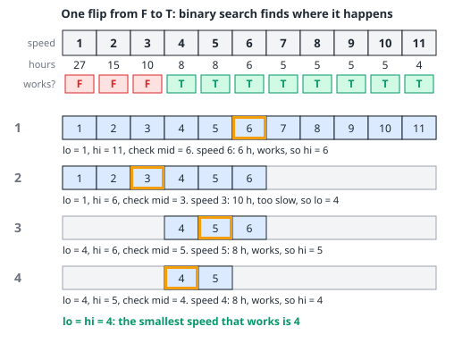

# Module: Binary Search on the Answer (When There Is No Array to Search)

Binary search on the answer is binary search over the range of possible answers, not over an array.

## Before you start
<!-- bite: 861b41ed-52ff-4e56-a612-221d04a7cd1a -->

- You can write a correct binary search over a sorted array and name its three classic bugs — [[01-linear-and-binary-search|linear and binary search]].
- You can read $O(\log n)$ and say what it means for a range being halved.
- You know what a **predicate** is: a function returning true or false.

**After this lesson you will be able to:**

1. Recognise the **monotone predicate** shape hiding in an optimisation problem.
2. Apply the two standard templates — *smallest true* and *largest true* — and say why they need different midpoint rounding.
3. Choose the search bounds correctly, and justify both ends.
4. Say when the technique **does not** apply, and prove monotonicity before relying on it.

**Study route:** read 1–3, answer the prediction in section 4, then run the lab. Section 5's two templates are the part to memorise.

---

## What binary search on the answer is
<!-- bite: 2710ce8a-478d-4186-b476-70fbf3e056dc -->

Binary search on the answer finds the best value by asking a yes-or-no question about each candidate value.

This is one of the highest-leverage recognitions in problem solving, because the problems it solves usually look like optimisation problems and are usually attempted with something much more complicated.

## 1. Why this exists: an optimisation problem in disguise
<!-- bite: e335fbf2-99f6-48f6-b486-ec4a4ef641b4 -->

> Koko has $n$ piles of bananas and $h$ hours before the guards return. She picks an eating speed $s$ bananas per hour. Each hour she eats from a single pile; if the pile has fewer than $s$ left, she finishes it and waits. **What is the smallest $s$ that lets her finish every pile within $h$ hours?**

This reads like an optimisation problem. There is no array to search, nothing is sorted, and the obvious approaches are unpromising — try to derive a formula and the ceilings defeat you; try every speed from 1 upward and you are $O(\max(\text{pile}) \times n)$.

## 1. Why this exists: ask a yes-or-no question instead
<!-- bite: 817d4b91-e3d2-4280-b7e3-cbccd5ddb823 -->

The trick is to swap the hard question for an easy one.

**But ask a different question.** Instead of "what is the best speed?", ask the yes/no question:

> **Does speed $s$ work?**

That is easy — sum $\lceil p_i / s\rceil$ over the piles and compare to $h$. And now tabulate the answer for the piles $[3, 6, 7, 11]$ with $h = 8$, which the lab does:

```text
   speed |  hours | works?
       1 |     27 | F
       2 |     15 | F
       3 |     10 | F
       4 |      8 | T
       5 |      8 | T
       6 |      6 | T
       ...       | T
```

**`F F F T T T T T T T T`.** One flip, and it never flips back — obviously so, since eating faster can never take longer.

## 1. Why this exists: one flip is all binary search needs
<!-- bite: 73d825cc-2243-4312-a930-4309c81e01a4 -->

That single flip is what makes binary search work here.

**That pattern is the only thing binary search has ever required.** A sorted array searched for a target is the same pattern in disguise: the predicate `a[i] >= target` is `F F F T T T`. The sortedness was never the point; it was just a way of guaranteeing the flip.

So: binary search the *speed*, not the piles. The range is $1$ to $\max(p_i)$, and the answer arrives in $O(n \log \max p)$. The lab finds it in **4 predicate evaluations** (speeds 6, 3, 5, 4).

## Seeing the search over speeds
<!-- bite: ed9acec3-5e28-4390-a3c3-24a0bea5ed53 -->

The top strip is the yes/no answer for every speed from 1 to 11. Below it, each row is one pass of `smallest_true`: the blue cells are the speeds still in play and the orange box is the speed being tested. The range shrinks around the flip until only speed 4 is left.



---

## Terms used in this technique
<!-- bite: 303fdace-367f-42ff-bf07-1e4e7a537c8e -->

1. **Binary search on the answer**: This is also known as **parametric search** or **binary search on the result**. This is applying binary search to the range of *possible answers* to a problem, rather than to an input collection.
2. **Predicate**: This is a function from a candidate answer to true or false, expressing "is this candidate good enough?". Writing it is usually the easy part; recognising that you should is the hard part.
3. **Monotone predicate**: This is a predicate whose value, read across the range in order, changes at most once — either `F...FT...T` or `T...TF...F`. **This is the precondition for the whole technique**, and it is what must be proved rather than assumed.
4. **The flip point**: This is also called the **boundary** or **threshold**. This is the single position where the predicate changes value. Finding it *is* the problem.

## Terms: the check and the bounds
<!-- bite: 574540ff-51d8-449b-9c33-4948dfbffbfa -->

These terms cover the check you write and the range you search.

5. **Feasibility check**: This is the concrete computation implementing the predicate — "can this be done with capacity $c$?". Its cost multiplies the $\log$ factor, so an $O(n)$ check over a range of size $R$ gives $O(n \log R)$.
6. **Search bounds**: These are the `lo` and `hi` you start with. **Both must be justified**: `lo` must be an answer that definitely fails (or the minimum conceivable), and `hi` one that definitely succeeds.
7. **Answer space**: This is the set of candidate answers. It may be enormous — $0$ to $10^{18}$ — and that is fine, because $\log_2(10^{18}) \approx 60$.

---

## 2. Recognising it
<!-- bite: c0cb4b02-5cb6-4390-bd84-a4fbb483cba5 -->

The signals, in rough order of reliability:

1. **"Minimum/maximum X such that Y is possible."** Minimum speed, maximum weight, smallest capacity, largest minimum distance. This phrasing is close to a giveaway.
2. **Checking a specific answer is much easier than finding the best one.** "Can we do it with capacity 18?" is a linear scan; "what is the smallest capacity?" is not obvious.
3. **The answer is a number in a known range**, rather than a subset or an arrangement.
4. **"Minimise the maximum"** or **"maximise the minimum"** — these almost always mean this technique.

**The check that saves you:** having found a candidate predicate, tabulate it over a small instance, as the lab does in block 1. If you see `F F F T T T` you are done. If you see anything else, stop — the technique does not apply.

---

## 3. The four worked problems
<!-- bite: 6e90b8f1-05cf-449a-b151-70a5d3563a12 -->

The lab runs all four through **one template**, which is the point:

```text
  Koko                : answer=4  predicate evaluated 4 times  (range 1..11)
  Split-array         : answer=18  checks=4  (range 10..32)
  isqrt(10^12)        : answer=1000000  checks=40  (range 0..1000000000000)
  sqrt(2) to 1e-12    : answer=1.414213562372  checks=41
```

## 3. Worked problem: split array, minimise the largest chunk
<!-- bite: 92ad927b-e171-48dd-bb01-801a224f41aa -->

The second problem splits an array into parts.

Split $[7,2,5,10,8]$ into 2 contiguous parts, minimising the larger part's sum. **Predicate:** "can we split into at most $k$ parts with no part exceeding `cap`?" — greedily fill parts until they would overflow, then count.

**The bounds are where the thinking is.** `lo = max(nums)`: no capacity below the largest single element can work, since that element must fit somewhere. `hi = sum(nums)`: one part containing everything always works. **Both ends need an argument**, and getting `lo` wrong — starting at 0 or 1 — still produces the right answer here but wastes iterations and, in other problems, breaks the monotonicity at the bottom of the range.

## 3. Worked problem: integer square root
<!-- bite: 9283fae3-4a1b-420b-bcd8-547c146c6de2 -->

The third problem finds a square root using whole numbers only.

Largest $x$ with $x^2 \le n$. Predicate `x*x <= n` is `T...TF...F` — the **other** monotone direction, needing the *largest true* template.

**This is the block that shows why searching the answer is worth it.** Linear scan versus binary search, by size of $n$:

```text
                         n |  linear steps |  binary steps
                   1,000,000 |         1,000 |            20
           1,000,000,000,000 |     1,000,000 |            40
   1,000,000,000,000,000,000 | 1,000,000,000 |            60
```

**A billion steps against 60.** The answer space is huge and its logarithm is not.

## 3. Worked problem: real-valued answers
<!-- bite: 75c4c610-44af-49db-8043-8baeae66ccb0 -->

The last problem has an answer that is a real number, not a whole number.

When the answer is a real number there is no "next" value to converge on, so the loop condition becomes a **tolerance**: iterate while `hi - lo > 1e-12`. Each iteration halves the interval, so reaching a tolerance $\varepsilon$ over a range $R$ takes $\log_2(R/\varepsilon)$ iterations — 41 for the lab's $\sqrt2$.

**Never write `while lo < hi` with floats.** Floating-point values can fail to converge to equality, and you get an infinite loop. Use a tolerance, or a fixed iteration count (100 is ample for any double).

---

## 4. The two templates, and why the rounding differs
<!-- bite: 4921bf13-10f6-41f8-ae59-4e015b650f69 -->

> **Predict before reading on.** In the *largest true* template, the update is `lo = mid`. Suppose you compute `mid = lo + (hi - lo) // 2` — the ordinary floor midpoint — and `lo = 4`, `hi = 5`. What is `mid`, and what happens next?

**`mid` is 4, so `lo = mid` leaves `lo = 4` and `hi = 5`: nothing changed, and the loop runs forever.**

This is why the two templates round differently, and it is the single most common bug in the technique.

## 4. Template A: smallest true (`F...FT...T`)
<!-- bite: 2307bf13-23dc-4458-8e11-45b32377cacd -->

Template A finds the first true in a run of falses followed by trues.

```python
def smallest_true(lo, hi, predicate):
    while lo < hi:
        mid = lo + (hi - lo) // 2        # FLOOR
        if predicate(mid):
            hi = mid                     # mid might be the answer: keep it
        else:
            lo = mid + 1                 # mid is definitely not: discard it
    return lo
```

## 4. Template B: largest true (`T...TF...F`)
<!-- bite: 6eff5be1-5dbe-480e-aafc-454c0ea8de1c -->

Template B finds the last true in a run of trues followed by falses.

```python
def largest_true(lo, hi, predicate):
    while lo < hi:
        mid = lo + (hi - lo + 1) // 2    # CEIL
        if predicate(mid):
            lo = mid                     # mid might be the answer: keep it
        else:
            hi = mid - 1                 # mid is definitely not: discard it
    return lo
```

## 4. The two templates: the rule behind the rounding
<!-- bite: 2b107b82-1442-4f18-8138-fe7308fdc6f9 -->

One rule explains both midpoints.

**The rule that generates both:** the branch that *keeps* `mid` must not be the branch that can fail to make progress. Round the midpoint **away** from the variable that gets assigned `mid`. Template A assigns to `hi`, so round toward `lo` (floor). Template B assigns to `lo`, so round toward `hi` (ceil).

The lab demonstrates the failure arithmetic directly:

```text
    lo=4, hi=5 -> floor mid = 4  (lo = mid leaves lo=4, hi=5: no progress)
    lo=4, hi=5 -> ceil  mid = 5  (lo = mid leaves lo=5, hi=5: done)
```

**Also note `lo + (hi - lo) // 2` rather than `(lo + hi) // 2`.** In Python integers are unbounded and both work, but the habit matters: in C++, Java or Rust, `lo + hi` can overflow. That is the bug that sat in the JDK's `binarySearch` for nine years, and [[01-linear-and-binary-search|lesson 01]] demonstrates it failing.

---

## 5. Proving monotonicity, and when it fails
<!-- bite: b80ab441-eb49-4309-8527-c840637eb410 -->

**The technique is only valid if the predicate flips once.** If it does not, halving can discard the half containing the answer, and you get a confidently wrong result.

The lab's counterexample:

```text
   x          | 1  2  3  4  5  6  7  8
   x is prime | F  T  T  F  T  F  T  F
```

No single flip point. "The smallest prime $\ge 4$" cannot be found by halving.

## 5. Proving monotonicity: one sentence each
<!-- bite: 7ec0b856-b4ca-4622-8f0a-fb2545e0485d -->

Here is how to prove the one-flip shape for each problem.

**How to prove monotonicity** — usually one sentence, and usually obvious once stated:

- **Koko:** if speed $s$ finishes in time, so does $s+1$, because $\lceil p/(s{+}1)\rceil \le \lceil p/s\rceil$ for every pile. Eating faster never takes longer.
- **Split array:** if capacity $c$ admits a valid split into $\le k$ parts, so does $c+1$ — the same split is still valid, since every part still fits.
- **isqrt:** if $x^2 \le n$ then $(x-1)^2 \le n$, since squaring is increasing on non-negative integers.

**The general form: increasing the candidate must only ever relax the constraint.** If you cannot state that sentence for your predicate, you do not have monotonicity, and you should not use this technique.

## 5. Proving monotonicity: checking the result too
<!-- bite: 193c9234-aad2-40d7-83d9-bcd319e2921d -->

The lab also tests the answer instead of only trusting the proof.

The lab also checks the result rather than trusting the argument — 300 random Koko instances against a linear scan, 300/300 agreeing. **For a technique whose failure mode is a plausible wrong number, cross-checking against brute force on small inputs is worth the ten lines.**

---

## 6. Worked example — complete runnable lab
<!-- bite: c47c3e81-e9a1-4ffc-af94-4eee26159b34 -->

Save as `binary_search_answer.py`. Standard library only.

```python
"""Binary search where there is no array: search the space of possible ANSWERS.

Run:  python3 binary_search_answer.py
"""

import math


# ---------------------------------------------------------------- the template
def smallest_true(lo, hi, predicate):
    """Smallest x in [lo, hi] with predicate(x) True, assuming F...FT...T.

    Returns hi + 1 if the predicate is False everywhere in range.
    """
    checks = 0
    while lo < hi:
        mid = lo + (hi - lo) // 2          # no overflow, and floors toward lo
        checks += 1
        if predicate(mid):
            hi = mid                       # mid might BE the answer: keep it
        else:
            lo = mid + 1                   # mid is not: discard it
    return lo, checks


def largest_true(lo, hi, predicate):
    """Largest x in [lo, hi] with predicate(x) True, assuming T...TF...F."""
    checks = 0
    while lo < hi:
        mid = lo + (hi - lo + 1) // 2      # ceil, or lo == mid loops forever
        checks += 1
        if predicate(mid):
            lo = mid
        else:
            hi = mid - 1
    return lo, checks


# ------------------------------------------------------------- problem 1: koko
def hours_needed(piles, speed):
    return sum(math.ceil(p / speed) for p in piles)


def koko(piles, limit):
    ok = lambda s: hours_needed(piles, s) <= limit
    return smallest_true(1, max(piles), ok)


# ------------------------------------------------- problem 2: split array sums
def chunks_needed(nums, cap):
    count, cur = 1, 0
    for n in nums:
        if cur + n > cap:
            count += 1
            cur = n
        else:
            cur += n
    return count


def split_array(nums, k):
    ok = lambda cap: chunks_needed(nums, cap) <= k
    return smallest_true(max(nums), sum(nums), ok)


# ----------------------------------------------------- problem 3: square root
def isqrt_bs(n):
    ok = lambda x: x * x <= n
    return largest_true(0, n, ok)


# ------------------------------------------- problem 4: real-valued, tolerance
def sqrt_real(n, tol=1e-12):
    lo, hi, checks = 0.0, max(1.0, n), 0
    while hi - lo > tol:
        mid = (lo + hi) / 2
        checks += 1
        if mid * mid <= n:
            lo = mid
        else:
            hi = mid
    return lo, checks


def main():
    print("=== 1. The shape that makes it work ===")
    print("  Binary search needs a MONOTONE predicate: once true, always true.")
    piles, limit = [3, 6, 7, 11], 8
    print(f"  Koko eats piles {piles} in <= {limit} hours. Speed s works?")
    print("   speed |  hours | works?")
    for s in range(1, 12):
        h = hours_needed(piles, s)
        print(f"   {s:>5} | {h:>6} | {'T' if h <= limit else 'F'}")
    print("  -> F F F T T T T T T T T   <- one flip, never back. That is all")
    print("     binary search ever needed; a sorted array is just one example.")

    print("\n=== 2. Four problems, one template ===")
    ans, checks = koko(piles, limit)
    print(f"  Koko                : answer={ans}  predicate evaluated {checks} times"
          f"  (range 1..{max(piles)})")

    nums, k = [7, 2, 5, 10, 8], 2
    ans2, c2 = split_array(nums, k)
    print(f"  Split-array         : answer={ans2}  checks={c2}"
          f"  (range {max(nums)}..{sum(nums)})")

    n = 10 ** 12
    ans3, c3 = isqrt_bs(n)
    print(f"  isqrt(10^12)        : answer={ans3}  checks={c3}  (range 0..{n})")

    ans4, c4 = sqrt_real(2)
    print(f"  sqrt(2) to 1e-12    : answer={ans4:.12f}  checks={c4}")
    print(f"                        math.sqrt(2) = {math.sqrt(2):.12f}")

    print("\n=== 3. Why searching the ANSWER beats searching the input ===")
    print("  isqrt by linear scan vs binary search, by size of n:")
    print("                         n |  linear steps |  binary steps")
    for e in (6, 9, 12, 15, 18):
        n = 10 ** e
        _, c = isqrt_bs(n)
        print(f"   {n:>25,} | {int(math.isqrt(n)):>13,} | {c:>13}")
    print("  -> the answer space is huge; log2 of it is not")

    print("\n=== 4. The two templates are not interchangeable ===")
    print("  smallest_true uses floor and moves hi = mid.")
    print("  largest_true  uses CEIL and moves lo = mid.")
    print("  Using floor with lo = mid loops forever whenever hi == lo + 1:")
    lo, hi = 4, 5
    mid_floor = lo + (hi - lo) // 2
    mid_ceil = lo + (hi - lo + 1) // 2
    print(f"    lo=4, hi=5 -> floor mid = {mid_floor}  (lo = mid leaves lo=4, hi=5: no progress)")
    print(f"    lo=4, hi=5 -> ceil  mid = {mid_ceil}  (lo = mid leaves lo=5, hi=5: done)")

    print("\n=== 5. Verifying against brute force ===")
    bad = 0
    for trial in range(300):
        import random
        random.seed(trial)
        ps = [random.randint(1, 40) for _ in range(random.randint(1, 8))]
        lim = random.randint(len(ps), 60)
        got, _ = koko(ps, lim)
        truth = next(s for s in range(1, max(ps) + 1) if hours_needed(ps, s) <= lim)
        if got != truth:
            bad += 1
            print(f"    MISMATCH piles={ps} limit={lim} got={got} truth={truth}")
    print(f"    300 random Koko instances checked against linear scan: "
          f"{300 - bad}/300 agree")

    print("\n=== 6. When it does NOT apply ===")
    print("  The predicate must be monotone. This one is not:")
    print("   x       | 1  2  3  4  5  6  7  8")
    print("   x is prime | F  T  T  F  T  F  T  F")
    print("  -> there is no single flip point, so 'the smallest true x' cannot be")
    print("     found by halving: discarding a half may discard the answer.")
    print("  Before reaching for this technique, PROVE the flip happens once.")


if __name__ == "__main__":
    main()
```

## 6. Worked example: what it prints
<!-- bite: 79e57527-d88c-439f-8a29-29597f742cb1 -->

Here is what the lab prints when you run it.

Generated by running the file above:

```text
=== 1. The shape that makes it work ===
  Binary search needs a MONOTONE predicate: once true, always true.
  Koko eats piles [3, 6, 7, 11] in <= 8 hours. Speed s works?
   speed |  hours | works?
       1 |     27 | F
       2 |     15 | F
       3 |     10 | F
       4 |      8 | T
       5 |      8 | T
       6 |      6 | T
       7 |      5 | T
       8 |      5 | T
       9 |      5 | T
      10 |      5 | T
      11 |      4 | T
  -> F F F T T T T T T T T   <- one flip, never back. That is all
     binary search ever needed; a sorted array is just one example.

=== 2. Four problems, one template ===
  Koko                : answer=4  predicate evaluated 4 times  (range 1..11)
  Split-array         : answer=18  checks=4  (range 10..32)
  isqrt(10^12)        : answer=1000000  checks=40  (range 0..1000000000000)
  sqrt(2) to 1e-12    : answer=1.414213562372  checks=41
                        math.sqrt(2) = 1.414213562373

=== 3. Why searching the ANSWER beats searching the input ===
  isqrt by linear scan vs binary search, by size of n:
                         n |  linear steps |  binary steps
                   1,000,000 |         1,000 |            20
               1,000,000,000 |        31,622 |            30
           1,000,000,000,000 |     1,000,000 |            40
       1,000,000,000,000,000 |    31,622,776 |            50
   1,000,000,000,000,000,000 | 1,000,000,000 |            60
  -> the answer space is huge; log2 of it is not

=== 4. The two templates are not interchangeable ===
  smallest_true uses floor and moves hi = mid.
  largest_true  uses CEIL and moves lo = mid.
  Using floor with lo = mid loops forever whenever hi == lo + 1:
    lo=4, hi=5 -> floor mid = 4  (lo = mid leaves lo=4, hi=5: no progress)
    lo=4, hi=5 -> ceil  mid = 5  (lo = mid leaves lo=5, hi=5: done)

=== 5. Verifying against brute force ===
    300 random Koko instances checked against linear scan: 300/300 agree

=== 6. When it does NOT apply ===
  The predicate must be monotone. This one is not:
   x       | 1  2  3  4  5  6  7  8
   x is prime | F  T  T  F  T  F  T  F
  -> there is no single flip point, so 'the smallest true x' cannot be
     found by halving: discarding a half may discard the answer.
  Before reaching for this technique, PROVE the flip happens once.
```

---

## 7. Common pitfalls and traps
<!-- bite: 979af55e-7b25-4b43-aec2-02ba17f53f16 -->

1. **Using the floor midpoint with `lo = mid`.** Infinite loop whenever `hi == lo + 1`. Round away from the variable you assign `mid` to.
2. **Not proving monotonicity.** The technique returns a plausible number on a non-monotone predicate; it does not error. Tabulate the predicate on a small case before trusting it.
3. **Bounds that are too tight.** If the true answer lies outside `[lo, hi]`, you get the nearest endpoint, silently. Prove `lo` fails (or is the minimum conceivable) and `hi` succeeds.
4. **Bounds that are too loose.** Rarely harmful — it costs a few extra iterations — **unless the predicate is undefined outside the valid range**, such as a division by a speed of zero.

## 7. Common pitfalls: floats, cost and the wrong question
<!-- bite: 7a66666e-3ffc-4e9c-ae52-8e1205dd1887 -->

These four pitfalls are about floats, cost and reading the result.

5. **`while lo < hi` on floats.** Use a tolerance or a fixed iteration count; floating-point equality may never be reached.
6. **An expensive feasibility check.** Total cost is $O(\text{check} \times \log R)$. If the check is $O(n^2)$ the technique may not pay. Optimise the check first.
7. **`(lo + hi) // 2` in a fixed-width language.** Overflow. Use `lo + (hi - lo) // 2` everywhere as a habit.
8. **Answering the wrong question.** The template returns the flip point. Make sure the flip point is what the problem asked for — "smallest speed that works" and "largest speed that fails" differ by one, and both are easy to return by accident.

---

## Check your understanding
<!-- bite: 0b932c1f-0108-47b1-870d-d811abec2828 -->

Try each one before you open the answer.

1. <!-- q: mcq id="42ea6c03" -->
   Binary search on the answer needs one property from the predicate (the yes/no check). Which one?

   - [ ] The input array must be sorted
   - [x] It must be monotone: reading across the range, its value changes at most once
   - [ ] It must run in O(1)
   - [ ] The answer must be a whole number

   <details><summary>Answer</summary>

   Monotone: F…FT…T or T…TF…F. A sorted array was only ever one way to make `a[i] >= target` monotone. Any monotone predicate over any range works.

   </details>

2. <!-- q: mcq id="512c3396" -->
   In the "largest true" template the update is `lo = mid`. With lo = 4 and hi = 5, what goes wrong if mid uses floor, `lo + (hi - lo) // 2`?

   - [ ] It skips the answer
   - [x] mid = 4, so `lo = mid` changes nothing and the loop never ends
   - [ ] It returns 5 instead of 4
   - [ ] It divides by zero

   <details><summary>Answer</summary>

   Floor gives mid = 4, and lo = 4 again: no progress. The largest-true template must use the ceiling midpoint, `lo + (hi - lo + 1) // 2`, so mid = 5 and the range shrinks.

   </details>

3. <!-- q: mcq id="fe8dca6b" -->
   To split nums into k contiguous parts while minimising the largest part's sum, you binary-search the capacity. What range should the search cover?

   - [x] From max(nums) to sum(nums)
   - [ ] From 0 to max(nums)
   - [ ] From min(nums) to max(nums)
   - [ ] From 1 to k

   <details><summary>Answer</summary>

   lo = max(nums), because every element must fit inside some part. hi = sum(nums), because one part holding everything always works.

   </details>

4. <!-- q: mcq id="ce805722" -->
   A predicate is monotone, but checking it costs O(n²). n = 10⁵ and the answer range is 10⁹. Is binary search on the answer a good idea?

   - [ ] Yes, log of 10⁹ is only about 30
   - [x] No, about 30 checks × 10¹⁰ steps each is far too slow
   - [ ] Yes, because the predicate is monotone
   - [ ] No, because the range is too large for binary search

   <details><summary>Answer</summary>

   The log R factor is cheap; the check dominates. Find a cheaper feasibility check (often a greedy O(n) one) first. Always cost the check before reaching for the template.

   </details>

5. <!-- q: open id="af511bf5" -->
   You need the smallest real x with f(x) ≥ 0, where f is continuous and increasing. What must change in the binary search, and why?

   <details><summary>Answer</summary>

   There is no "next" real number, so `while lo < hi` may never end with floats. Loop while `hi - lo > eps` with a chosen tolerance, or run a fixed number of iterations (100 is plenty for a double). Each step halves the interval, so it takes about log₂(range / eps) iterations. Return lo or the midpoint and state the accuracy.

   </details>

## Check your understanding: worked problems
<!-- bite: ca51519b-2dd9-4feb-a954-4777f3888f3f -->

Work each one out on paper first, then type your answer.

1. <!-- q: exact id="daf47b60" answer="23" -->
   Koko eats bananas. Each hour she picks one pile and eats up to k bananas from it. The piles are [30, 11, 23, 4, 20] and she has 6 hours. What is the smallest whole speed k that lets her finish?

   <details><summary>Answer</summary>

   23. At k = 23 the hours are 2 + 1 + 1 + 1 + 1 = 6. At k = 22 the 23-pile needs 2 hours, making 7. Hours needed only fall as k rises, so binary search over 1..30 finds the first k that works.

   </details>

2. <!-- q: exact id="b161100a" answer="13" -->
   Split [4, 9, 3, 8, 6, 2] into at most 3 contiguous parts so that the largest part sum is as small as possible. What is that smallest possible largest sum?

   <details><summary>Answer</summary>

   13: [4, 9], [3, 8], [6, 2] with sums 13, 11, 8. A capacity of 12 would need 4 parts with the greedy fill. Binary search runs over capacities 9 (the largest element) to 32 (the total).

   </details>

3. <!-- q: gap id="05bea572" answers="25;12;6;9;7;8;7" -->
   Fill in the gaps. Integer square root of 50 with the largest-true template, `lo = 0, hi = 50`, `mid = lo + (hi - lo + 1) // 2`, predicate `mid * mid <= 50`. The mids are ___, ___, ___, ___, ___, ___ and the answer is ___.

   <details><summary>Answer</summary>

   25 (false, hi = 24), 12 (false, hi = 11), 6 (true, lo = 6), 9 (false, hi = 8), 7 (true, lo = 7), 8 (false, hi = 7). lo = hi = 7, and 7² = 49 ≤ 50 < 64.

   </details>

4. <!-- q: exact id="bfb395b0" answer="37" -->
   A real-valued binary search starts on an interval of length 100 and stops when the interval is no longer than 10⁻⁹. Each iteration halves it. How many iterations does it need?

   <details><summary>Answer</summary>

   37. You need 100 / 2^i ≤ 10⁻⁹, so 2^i ≥ 10¹¹, and log₂ 10¹¹ ≈ 36.5, rounded up to 37.

   </details>

## 9. Practice — independent task
<!-- bite: 9c47e8a6-6ffb-47f0-903b-949d13a5ae8a -->

Write `search_answer(lo, hi, predicate, mode)` supporting both templates, then use it unchanged on four problems.

**Part 1 — the template.** Both modes, integer and real variants. Instrument it to count predicate evaluations. **Assert the count never exceeds $\lceil\log_2(hi-lo+1)\rceil + 1$** — if it does, your interval is not halving.

## 9. Practice: four problems
<!-- bite: 6b750193-9ab6-4c4f-a9d9-ecf2324671e8 -->

Use your template, unchanged, on these four problems.

**Part 2 — four problems.** For each: state the predicate, **prove monotonicity in one sentence**, and justify both bounds.

1. **Ship capacity.** Given package weights and $d$ days, find the least ship capacity that delivers everything in order within $d$ days.
2. **Aggressive cows.** Place $k$ cows in stalls at given positions, **maximising the minimum** distance between any two.
3. **Minimum time.** Given worker speeds, find the least time to complete $n$ tasks.
4. **The $k$-th smallest element of an $n \times n$ multiplication table**, without building the table.

## 9. Practice: check it, break it, cost it
<!-- bite: 2716d66a-96b8-4e53-8ade-254386fa7737 -->

Then test your answers and find where the method fails.

**Part 3 — cross-check.** For each, verify against brute force on inputs small enough to enumerate — at least 300 random instances each, as the lab does for Koko.

**Part 4 — break it.** Construct a predicate that is *nearly* monotone (one flip out of place) and show your implementation returning a confidently wrong answer. **Then write a `check_monotone(lo, hi, predicate)` helper** that samples the range and reports violations, and run it on all four problems above.

**Part 5 — cost the check.** Report, for each problem, the complexity of the feasibility check and the total. Identify which of the four would stop being viable if the check were one factor of $n$ more expensive.

## 9. Practice: edge cases and when you are done
<!-- bite: e67aebdc-d2ee-495c-b37d-f1fbaad476dc -->

Check these cases and this finish line before you call it done.

**Edge cases:** `lo == hi`; the predicate true everywhere; false everywhere; a range of size 2 (**the case that exposes the rounding bug**); negative bounds.

**Done when:** all four match brute force on 300 random instances each; your evaluation counts stay within the log bound; part 4 produces a concrete wrong answer plus a working monotonicity checker; and each problem has its one-sentence monotonicity proof written down.

Then find it in the wild: [[030-koko-eating-bananas|Koko Eating Bananas]], [[034-median-of-two-sorted-arrays|Median of Two Sorted Arrays]] and [[096-swim-in-rising-water|Swim in Rising Water]] are all this technique.

---

## Before moving on
<!-- bite: e03744d5-b30f-41b4-8f88-b4e55aaef6bf -->

You can spot the monotone-predicate shape in an optimisation problem, apply both templates with the right rounding, justify your bounds, and prove monotonicity before relying on it.

**Recap:** binary search does not need an array — it needs a **range** and a **predicate that flips exactly once** across it. Recognise it from "minimum/maximum X such that Y", from "minimise the maximum", and from checking a candidate being far easier than finding the best. Two templates: *smallest true* uses the **floor** midpoint with `hi = mid`; *largest true* uses the **ceil** midpoint with `lo = mid` — **round away from the variable you assign `mid` to**, or the loop hangs at `hi == lo + 1`. Justify both bounds with an argument. Cost is $O(\text{check} \times \log R)$, and the check dominates. For real-valued answers use a tolerance, never `lo < hi`. **Prove the single flip before you trust the result**, because a non-monotone predicate yields a plausible wrong number rather than an error.

**Next:** [[03-state-space-search|State-Space Search]] — the third meaning of "search", where there is no range and no collection, only a starting configuration and a rule for what comes next.

---

## Related
<!-- bite: 9a22f482-72cc-4e4d-9262-12ed5a56e708 -->

- [[01-linear-and-binary-search|Linear and Binary Search]] — the array version, and the three classic bugs
- [[03-state-space-search|State-Space Search]] — searching configurations rather than values
- [[09-modified-binary-search|Modified binary search]] — the pattern-layer treatment with more worked problems
- [[03-searching/index|the searching folder]] — the parent, and the three meanings of "search"
- [[01-growth-and-asymptotic-notation|Growth and Asymptotic Notation]] — why $\log_2(10^{18})$ is only 60

## About this lesson
<!-- bite: df15894e-c614-4100-ba12-499eccf4e2ea -->

**Level:** Intermediate. **Covers:** [[01-linear-and-binary-search|Binary search]] is taught as "find a value in a sorted array", which is a description of one *application* rather than of the technique. The technique is: **you have a range, and a yes/no question whose answer flips exactly once across that range — so you can find the flip point by halving.** The array is incidental. Once you see that, binary search applies to a large family of problems with no array anywhere in sight.
