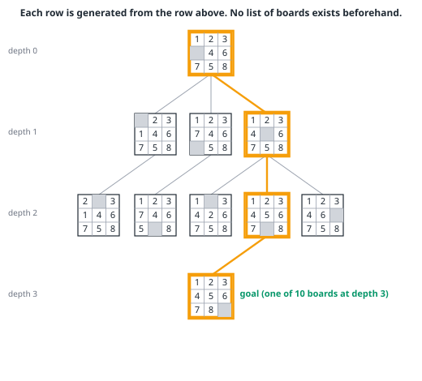
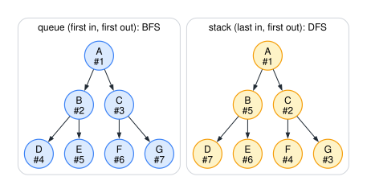

# Module: State-Space Search (Searching a Space That Was Never Built)

State-space search is finding a path through a space of states that the search builds step by step, instead of one stored in advance.

## Before you start
<!-- bite: e7f9a4d2-ff6c-4820-8c0d-9adac91e06fb -->

- You can implement [[02-breadth-first-search|BFS]] and [[01-depth-first-search|DFS]] and say which container each uses.
- You have met [[02-dijkstra|Dijkstra]] and [[05-a-star|A\*]], and know what $g$, $h$ and $f$ mean.
- You know what an [[04-representations|implicit graph]] is — one where neighbours are computed on demand rather than stored.

**After this lesson you will be able to:**

1. Model an unfamiliar problem as a **state space**: states, initial state, successor function, goal test, path cost.
2. Name the five components of any search — frontier, explored set, expansion, goal test, cost — and locate each in code.
3. Explain the difference between **tree search** and **graph search**, and show the cost of getting it wrong.
4. Choose a strategy from the problem's properties, and state what each one guarantees.

**Study route:** read 1–3, predict in section 4 before reading on, then run the lab. The lab is one search function called with different frontiers — that *is* the lesson.

---

## What state-space search is
<!-- bite: 88a5174c-e165-4c38-b8f2-b9cf2dbb2710 -->

State-space search covers many problems that do not look like searching at first.

Chess, route planning, puzzle solving, dependency resolution, regex matching, compiler register allocation and every grid problem you will meet are this. **And so is every graph algorithm in this course** — [[02-breadth-first-search|BFS]], [[01-depth-first-search|DFS]], [[02-dijkstra|Dijkstra]] and [[05-a-star|A\*]] are four answers to one question, which is the point of this lesson.

## 1. Why this exists: the collection that does not exist
<!-- bite: b2d0113e-4153-4b36-9c68-d068f95e9c9f -->

"Search" in lesson 01 meant: here is a sorted array, find 42. The array existed. You could print it.

Now: **find the shortest sequence of moves that sorts this sliding-tile puzzle.**

There is no array of solutions. There is no list of board positions. There is a *starting board*, a *rule* for which boards are one move away, and a *test* for whether a board is finished. The 8-puzzle has 181,440 reachable configurations and the 15-puzzle has about $10^{13}$ — nobody is building that list.

## 1. Why this exists: the search builds what it searches
<!-- bite: 6c51acc5-3613-49b3-8f0b-e7b2ddcac6e3 -->

This part names the key idea: the search makes its own data as it goes.

**So the data structure being searched is generated by the search itself.** You start with one state, ask what is adjacent to it, ask what is adjacent to those, and stop when you find what you want. That is an [[04-representations|implicit graph]]: it has vertices and edges and all the usual properties, but it exists only as a function.

**Once you see it that way, the algorithms you already know turn out to be the complete answer**, and the only thing separating them is what container holds the states waiting to be looked at.

## Seeing the state space grow
<!-- bite: a5d24fc2-a1e0-498e-9ed7-9753843f677a -->

Here is the start of the search from the lab's medium board. The blank is the grey square. Each board's children are the boards you get by sliding one tile into the blank, leaving out boards already seen. The orange path is the three-move solution.



---

## Terms used in state-space search
<!-- bite: da5f3832-3847-4f96-927d-141d4447aa4f -->

1. **State**: This is a complete description of one configuration of the problem, containing everything needed to decide what can happen next. For the 8-puzzle it is the board. For route planning it is your current location. It must be **hashable** if you want duplicate detection, which is why the lab uses tuples rather than lists.
2. **State space**: This is the set of all states reachable from the initial one. It is a graph — states are vertices, moves are edges — and it is usually never materialised.
3. **Initial state**: This is where the search starts.
4. **Successor function**: This is also called the **transition model** or **move generator**. This is the function returning every state reachable from a given state in one step. **It is the edge list of the implicit graph, computed on demand.**
5. **Goal test**: This is a predicate deciding whether a state is a solution. Note it is a *test*, not a known state — "checkmate" describes a huge family of boards, not one board.
6. **Path cost**: This is the accumulated cost of the moves taken to reach a state. Uniform cost of 1 per move reduces the problem to "fewest moves".

## Terms: the frontier and the explored set
<!-- bite: fb61f60b-c5a8-4e94-9b67-1637318e8d4f -->

These terms describe how the search keeps track of states.

7. **Frontier**: This is also known as the **open set** or **fringe**. This is the collection of states discovered but not yet expanded. **Which container you use for it decides which algorithm you are running**, and that is the single most useful fact in this lesson.
8. **Explored set**: This is also known as the **closed set** or **visited set**. This is the states already expanded, kept so you never process one twice.
9. **Expanding a state**: This means removing it from the frontier and generating its successors. **Nodes expanded is the standard cost measure** for a search, because it is machine-independent and proportional to real work.

## Terms: tree search, graph search and guarantees
<!-- bite: 07e0bcfe-bdc8-431e-8b32-31929da6b8d3 -->

These terms describe the two kinds of search, the size of a search and what a strategy promises.

10. **Tree search**: This is search with **no** explored set. Every route to a state is treated as a separate discovery, so the same state is processed many times.
11. **Graph search**: This is search **with** an explored set, so each state is expanded at most once.
12. **Branching factor**: This is written $b$. This is the average number of successors per state. The 8-puzzle's is between 2 and 4; chess's is about 35.
13. **Solution depth**: This is written $d$. This is the number of moves in the shallowest solution. Together with $b$ it gives the size of the search: roughly $b^d$ nodes.
14. **Complete**: This describes a strategy that is guaranteed to find a solution if one exists. DFS on an infinite space is *not* complete.
15. **Optimal**: This describes a strategy guaranteed to find the *cheapest* solution. BFS is optimal for uniform costs; DFS is not optimal for anything.

---

## 2. The five components, and one function
<!-- bite: a7b343ed-5da3-47c1-8fb8-0f516e5f6db0 -->

Every state-space search is the same loop:

```python
def search(start, frontier_kind, h):
    frontier = make_frontier(frontier_kind, start)
    explored = set()
    while frontier:
        state = frontier.pop()          # <- the ONLY thing that varies
        if state in explored:
            continue
        explored.add(state)
        if goal_test(state):
            return reconstruct(state)
        for nxt in successors(state):
            if nxt not in explored:
                frontier.push(nxt)
    return None
```

**Read the loop and notice how little of it is algorithm-specific.** The explored set, the goal test, the successor expansion and the reconstruction are identical for every strategy in this lesson. Only `frontier.pop()` differs — and from that one line, everything follows:

## 2. The frontier decides the algorithm
<!-- bite: 13c59c04-ae05-4ef3-9172-bfa7454368de -->

The table shows which container gives which algorithm.

| Frontier is a... | Pops the... | You get | Optimal? | Complete? | Memory |
| :--- | :--- | :--- | :--- | :--- | :--- |
| **stack** (LIFO) | most recently added | [[01-depth-first-search\|DFS]] | no | only if finite | $O(bd)$ |
| **queue** (FIFO) | earliest added | [[02-breadth-first-search\|BFS]] | yes, uniform costs | yes | $O(b^d)$ |
| **min-heap on $g$** | cheapest so far | uniform-cost / [[02-dijkstra\|Dijkstra]] | yes, any costs | yes | $O(b^d)$ |
| **min-heap on $h$** | most promising-looking | greedy best-first | **no** | no | $O(b^d)$ |
| **min-heap on $g+h$** | best estimated total | [[05-a-star\|A\*]] | yes, if $h$ admissible | yes | $O(b^d)$ |

## 2. One function, five algorithms: the results
<!-- bite: bb0ff443-c74a-4210-a086-0c4ab5631b83 -->

Here is the same puzzle solved five ways by the lab.

The lab implements exactly this — one `search` function, a `frontier` parameter — and solving the same puzzle five ways gives:

```text
   frontier        | algorithm          | cost | expanded | max frontier
   stack           | DFS                | 49285 |   135585 |        42913
   queue           | BFS                |    3 |       17 |           14
   cost            | uniform-cost       |    3 |       17 |           14
   greedy          | greedy best-first  |    3 |        4 |            6
   astar           | A*                 |    3 |        4 |            6
```

**DFS returns a 49,285-move solution to a puzzle that is three moves from solved.** It is not broken — it is doing exactly what it promises, which is to find *a* solution, and it found one by wandering most of the state space. That gap between "a solution" and "the solution" is what the whole table is about.

## Seeing the frontier decide the order
<!-- bite: e647aee9-75c7-4207-a2dc-cf0723ab0f0b -->

The same small tree, searched with the same loop, twice. The only change is the frontier. The number under each letter says when that state was expanded. The queue finishes each level before going deeper; the stack dives down the most recently added branch first.



---

## 3. Uninformed versus informed
<!-- bite: ccbf3772-dc06-4068-8264-a259fcf179a6 -->

The first three rows above are **uninformed** (or *blind*): they use nothing but the structure of the space. The last two are **informed**: they use a heuristic estimate of the distance remaining.

On the hardest possible 8-puzzle, 31 moves from solved:

```text
   frontier        | algorithm          | cost | expanded | max frontier
   stack           | DFS                | 65923 |    98124 |        42960
   queue           | BFS                |   31 |   181439 |        25134
   cost            | uniform-cost       |   31 |   181439 |        25134
   greedy          | greedy best-first  |   47 |      100 |           62
   astar           | A*                 |   31 |    20291 |         9310
```

## 3. Uninformed versus informed: what the table shows
<!-- bite: fd372ed6-0343-47be-9b1a-9239aedab3ae -->

Here is what that table tells you.

Three things to take from that table:

1. **BFS expanded 181,439 states — the entire reachable space.** To prove a 31-move solution is shortest, it had to rule out every shorter one, and there were a lot.
2. **A\* got the same optimal answer from 20,291 expansions — a ninth of the work.** The heuristic is the entire difference.
3. **Greedy best-first finished in 100 expansions and returned a 47-move path.** It is 200× faster and 52% worse. **That is the trade the heuristic makes when you stop counting the cost already paid.**

## 3. The heuristic is where the leverage is
<!-- bite: d75173b1-0df8-4af0-b321-bf5e564a62d3 -->

This part compares three heuristics on the same puzzle.

Same algorithm, same puzzle, three heuristics:

```text
   heuristic             | cost | expanded | generated
   zero (= uniform-cost) |   31 |   181439 |    181440
   misplaced tiles       |   31 |   143840 |    162463
   manhattan sum         |   31 |    20291 |     29757
```

**All three are optimal, because all three are admissible.** They differ only in how much work they do — and Manhattan does 7× less than misplaced-tiles, which in turn does barely better than nothing.

## 3. Why one heuristic beats another: dominance
<!-- bite: 3a1f28b2-b20c-4289-8633-4ed837fb5727 -->

The reason Manhattan does better has a name: dominance.

The reason is **dominance**: for every state, Manhattan's estimate is at least as large as misplaced-tiles' (a tile that is out of place contributes at least 1 to both, and usually more to Manhattan). A larger admissible heuristic is closer to the truth, prunes more, and **never expands more nodes**. So the design goal is: *get $h$ as large as you can without ever exceeding the true remaining cost.*

Both heuristics come from the standard recipe — **solve a relaxed version of the problem exactly**. Misplaced-tiles solves "a tile can teleport anywhere in one move". Manhattan solves "tiles can pass through each other". Both relaxations are easier than the real puzzle, so their answers can never exceed the real one.

---

## 4. Tree search versus graph search
<!-- bite: 0a3d7333-7d23-4bb3-8ea7-d5b402aedcd0 -->

> **Predict before reading on.** Drop the explored set from BFS on the 8-puzzle. The state space is finite — 181,440 states — so the search must still terminate. **Roughly how much extra work does dropping it cost: a few percent, double, or something worse?**

**Something much worse, and it grows with depth.** The lab measures it directly:

```text
   depth | graph search | tree search |  ratio
       2 |            4 |           5 |    1.2x
       4 |           24 |          69 |    2.9x
       6 |           74 |         413 |    5.6x
       8 |          155 |        2205 |   14.2x
      10 |          540 |       32485 |   60.2x
```

**1.2× at depth 2, 60× at depth 10, and still climbing.**

## 4. Tree versus graph search: why tree search explodes
<!-- bite: 87a4e0bb-69fe-42d1-899b-4909261b38e5 -->

This part explains why the numbers grow so fast.

The reason is the distinction the prediction was designed to expose: **the state space is finite, but the search *tree* is not.** Slide a tile left, then slide it back: you are in a state you have already seen, but tree search sees a brand-new node two levels deeper. Every such round trip spawns a whole new subtree, and the number of round trips grows exponentially with depth.

**Graph search is bounded by the number of states, 181,440. Tree search is bounded by nothing.** With a stack instead of a queue it does not terminate at all — DFS tree search walks one branch forever, sliding a tile back and forth.

**The practical rule:** if a state can be reached by more than one route — which is almost always — you need an explored set. The exceptions are genuine trees (each state has exactly one route, as in [[14-backtracking|backtracking]] over decision sequences) and cases where memory forbids it.

## 4. When you cannot afford the explored set
<!-- bite: 775ac723-7633-4192-9725-bc7b0cf38f9b -->

Sometimes there is not enough memory to remember every state, and this part gives the way out.

Storing every state is $O(b^d)$ memory, and memory usually runs out before time does. **Iterative deepening** is the standard escape: run depth-limited DFS with the limit rising from 0.

```text
   easy   : BFS cost=2 expanded=     7 frontier=     8
            IDS cost=2 expanded=     7 frontier=O(depth)
   medium : BFS cost=3 expanded=    17 frontier=    21
            IDS cost=3 expanded=    21 frontier=O(depth)
```

**It re-explores the shallow levels every round, and that sounds wasteful until you count.** With branching factor $b$, the last level contains a $\frac{b-1}{b}$ fraction of all nodes, so everything above it adds only a constant factor — about 11% extra for $b=10$. In exchange, memory drops from $O(b^d)$ to $O(bd)$, and you still get BFS's optimal answer. **IDA\*** is the same trick applied to A\*, bounding on $f$ instead of depth.

---

## 5. Tie-breaking, at the general level
<!-- bite: 874a4db4-5a45-4ef2-8db4-8872b72fc7db -->

[[05-a-star|The A\* lesson]] showed tie-breaking cutting expansions from 233 to 38 on a grid. The reason generalises to any priority-based search.

**Whenever many states share the same priority, the comparison is a coin flip, and the search has no reason to prefer any of them.** On a uniform grid or puzzle this happens constantly — a *plateau* of equally-rated states. How you break the tie decides whether the search drives toward the goal or spreads sideways.

The standard rules, in order of usefulness:

1. **Prefer larger $g$** among equal $f$ — that is, prefer states further along. Equivalently, prefer smaller $h$, since $f = g + h$ is fixed on the plateau.
2. **Prefer the state discovered more recently**, which keeps the search depth-first-ish within a plateau instead of breadth-first-ish.
3. **Add a tiny multiple of $h$** — scale by $1 + \varepsilon$ — which biases toward the goal at a bounded optimality cost.

## 5. Tie-breaking: how to write it
<!-- bite: 576bf093-4221-4757-a193-9d9152946362 -->

Here is how to put tie-breaking into code.

**Implementation is a tuple priority**, and the last element must be a monotonically increasing counter:

```python
heapq.heappush(frontier, (f, h, counter, state))
```

**The counter is not optional.** Without it, Python falls through to comparing the states themselves, which raises `TypeError` for unorderable types, or silently imposes an arbitrary order that makes runs irreproducible.

**Tie-breaking never affects correctness** — the optimality proof for A\* never mentions the order among equal-$f$ nodes. It is free performance, which is why it is worth knowing about.

---

## 6. Modelling: the part that is actually hard
<!-- bite: 30e727ce-4687-4199-9415-3321f1735b25 -->

The algorithms are a table lookup. **Turning a vague problem into states and successors is the real work**, and it is what an interviewer is usually testing.

The questions, in order:

1. **What is a state?** The minimum information determining what can happen next. Include too much and identical situations look different, defeating duplicate detection. Include too little and the successor function cannot do its job.
2. **What are the moves?** One successor function. It must be deterministic and complete.
3. **What is the goal test?** Often a property rather than a specific state.
4. **What does a move cost?** All equal → BFS. Varying → uniform-cost. Estimable remaining cost → A\*.
5. **Is the space finite?** If not, DFS is off the table entirely.

## 6. Modelling: seven problems as state spaces
<!-- bite: 4b38f9f6-3506-4d1f-8b6b-3d195214d60a -->

Here are seven problems written as states, moves and goals.

| Problem | State | Successors | Goal test |
| :--- | :--- | :--- | :--- |
| Sliding puzzle | the board | slide a tile into the blank | board is sorted |
| Word ladder | current word | words one letter away | equals target |
| Route planning | current location | roads out of it | equals destination |
| Water jugs | volumes in each jug | fill / empty / pour | a jug holds $n$ litres |
| Rubik's cube | cube configuration | the 18 face turns | all faces uniform |
| Dependency resolution | set of chosen versions | pick a version for one package | all packages resolved, no conflict |
| Regex matching | (pattern index, text index) | consume a character, or not | both indices at the end |

**The last two are the ones worth noticing**, because neither looks like a search problem until you name the state — and then the whole catalogue above becomes available.

---

## 7. Worked example — complete runnable lab
<!-- bite: 11ae0ffc-d2c8-4c9e-9181-8b09c3260d30 -->

Save as `state_space.py`. Standard library only. **One `search` function; the `frontier` argument selects the algorithm.** It takes a few seconds, mostly in the uninformed searches on the hard board.

```python
"""One search function. Change the frontier, change the algorithm.

The problem is the 8-puzzle: slide tiles into the blank until the board is sorted.
There is no graph object anywhere -- states are generated on demand.

Run:  python3 state_space.py
"""

import heapq
from collections import deque

GOAL = (1, 2, 3, 4, 5, 6, 7, 8, 0)      # 0 is the blank


def successors(state):
    """Every state reachable in one move. This IS the graph."""
    i = state.index(0)
    r, c = divmod(i, 3)
    out = []
    for dr, dc in ((-1, 0), (1, 0), (0, -1), (0, 1)):
        nr, nc = r + dr, c + dc
        if 0 <= nr < 3 and 0 <= nc < 3:
            j = nr * 3 + nc
            lst = list(state)
            lst[i], lst[j] = lst[j], lst[i]
            out.append(tuple(lst))
    return out


def misplaced(state):
    return sum(1 for i, v in enumerate(state) if v != 0 and v != GOAL[i])


def manhattan(state):
    total = 0
    for i, v in enumerate(state):
        if v == 0:
            continue
        goal_i = GOAL.index(v)
        total += abs(i // 3 - goal_i // 3) + abs(i % 3 - goal_i % 3)
    return total


def zero(state):
    return 0


def search(start, frontier, h=zero, dedupe=True, node_limit=400_000):
    """Generic state-space search.

    frontier: "stack" -> DFS, "queue" -> BFS,
              "cost"  -> uniform-cost, "greedy" -> best-first on h,
              "astar" -> A* on g + h
    dedupe:   False turns off the explored set -- TREE search instead of GRAPH search.
    """
    counter = 0
    g = {start: 0}
    parent = {start: None}
    explored = set()
    generated = 1
    expanded = 0
    max_frontier = 1

    if frontier == "stack":
        open_set = [start]
    elif frontier == "queue":
        open_set = deque([start])
    else:
        key = {"cost": 0, "greedy": h(start), "astar": h(start)}[frontier]
        open_set = [(key, counter, start)]

    while open_set:
        max_frontier = max(max_frontier, len(open_set))
        if frontier == "stack":
            cur = open_set.pop()
        elif frontier == "queue":
            cur = open_set.popleft()
        else:
            _, _, cur = heapq.heappop(open_set)

        if dedupe:
            if cur in explored:
                continue
            explored.add(cur)
        expanded += 1
        if expanded > node_limit:
            return {"solved": False, "reason": "node limit", "expanded": expanded,
                    "generated": generated, "max_frontier": max_frontier, "cost": None}

        if cur == GOAL:
            # Walk the parent chain. In TREE search (dedupe=False) the shared
            # parent map can contain a cycle, because one state is reached from
            # several places and the entry is overwritten -- so guard the walk.
            path, seen = [], set()
            n = cur
            while n is not None and n not in seen:
                seen.add(n)
                path.append(n)
                n = parent[n]
            return {"solved": True, "cost": g[cur], "expanded": expanded,
                    "generated": generated, "max_frontier": max_frontier,
                    "depth": len(path) - 1}

        for nxt in successors(cur):
            ng = g[cur] + 1
            if dedupe and nxt in explored:
                continue
            if dedupe and nxt in g and ng >= g[nxt]:
                continue
            g[nxt] = ng
            parent[nxt] = cur
            generated += 1
            counter += 1
            if frontier == "stack":
                open_set.append(nxt)
            elif frontier == "queue":
                open_set.append(nxt)
            elif frontier == "cost":
                heapq.heappush(open_set, (ng, counter, nxt))
            elif frontier == "greedy":
                heapq.heappush(open_set, (h(nxt), counter, nxt))
            else:
                heapq.heappush(open_set, (ng + h(nxt), counter, nxt))
    return {"solved": False, "reason": "exhausted", "expanded": expanded,
            "generated": generated, "max_frontier": max_frontier, "cost": None}


def iterative_deepening(start, limit=30):
    """Depth-limited DFS with a rising limit: BFS's answer at DFS's memory cost."""
    total_expanded = 0
    for depth in range(limit + 1):
        found, expanded = depth_limited(start, depth)
        total_expanded += expanded
        if found is not None:
            return {"solved": True, "cost": depth, "expanded": total_expanded}
    return {"solved": False, "expanded": total_expanded}


def depth_limited(start, limit):
    expanded = 0
    stack = [(start, 0, {start})]
    while stack:
        state, d, path = stack.pop()
        expanded += 1
        if state == GOAL:
            return state, expanded
        if d == limit:
            continue
        for nxt in successors(state):
            if nxt not in path:
                stack.append((nxt, d + 1, path | {nxt}))
    return None, expanded


def show(state):
    return "/".join("".join(str(x) for x in state[i:i+3]) for i in (0, 3, 6))


def main():
    EASY = (1, 2, 3, 4, 5, 6, 0, 7, 8)          # 2 moves
    MEDIUM = (1, 2, 3, 0, 4, 6, 7, 5, 8)        # 3 moves
    HARD = (8, 6, 7, 2, 5, 4, 3, 0, 1)          # 31 moves, the hardest 8-puzzle

    print("=== The problem: the 8-puzzle ===")
    print("  A state is a board. A move slides one tile into the blank.")
    print(f"  goal    : {show(GOAL)}")
    print(f"  easy    : {show(EASY)}    (2 moves away)")
    print(f"  medium  : {show(MEDIUM)}    (3 moves away)")
    print(f"  hard    : {show(HARD)}    (31 moves away)")
    print("  9!/2 = 181,440 reachable states. No graph is ever built.")

    print("\n=== 1. One function, five algorithms -- only the frontier differs ===")
    print("  Solving the MEDIUM board:")
    print("   frontier        | algorithm          | cost | expanded | max frontier")
    configs = [
        ("stack",  zero,      "DFS"),
        ("queue",  zero,      "BFS"),
        ("cost",   zero,      "uniform-cost"),
        ("greedy", manhattan, "greedy best-first"),
        ("astar",  manhattan, "A*"),
    ]
    for f, h, label in configs:
        r = search(MEDIUM, f, h)
        cost = r["cost"] if r["solved"] else "-"
        print(f"   {f:<15} | {label:<18} | {str(cost):>4} | {r['expanded']:>8} "
              f"| {r['max_frontier']:>12}")
    print("  -> BFS, uniform-cost and A* all return 3. DFS returns a far worse path.")

    print("\n=== 2. The same five on a HARD board (31 moves) ===")
    print("   frontier        | algorithm          | cost | expanded | max frontier")
    for f, h, label in configs:
        r = search(HARD, f, h, node_limit=200_000)
        cost = r["cost"] if r["solved"] else f"({r.get('reason','-')})"
        print(f"   {f:<15} | {label:<18} | {str(cost):>4} | {r['expanded']:>8} "
              f"| {r['max_frontier']:>12}")
    print("  -> greedy is fast and WRONG; A* is optimal and expands far less than BFS")

    print("\n=== 3. The heuristic is what does the work ===")
    print("   heuristic            | cost | expanded | generated")
    for name, h in (("zero (= uniform-cost)", zero),
                    ("misplaced tiles", misplaced),
                    ("manhattan sum", manhattan)):
        r = search(HARD, "astar", h, node_limit=200_000)
        print(f"   {name:<21} | {r['cost']:>4} | {r['expanded']:>8} | {r['generated']:>9}")
    print("   -> manhattan dominates misplaced-tiles: it is never smaller, so it")
    print("      never expands more. Both are admissible, so both stay optimal.")

    print("\n=== 4. Why duplicate detection is not optional ===")
    print("   TREE search keeps no explored set, so it re-derives the same board")
    print("   along every route that reaches it. Cost of that, by solution depth:")
    print("   depth | graph search | tree search |  ratio")
    from collections import deque as _dq
    # Find one board at each depth, by walking backwards from the goal.
    depth_of = {GOAL: 0}
    q = _dq([GOAL])
    sample = {0: GOAL}
    while q:
        u = q.popleft()
        for v in successors(u):
            if v not in depth_of:
                depth_of[v] = depth_of[u] + 1
                sample.setdefault(depth_of[v], v)
                q.append(v)
    for d in (2, 4, 6, 8, 10):
        board = sample[d]
        gr = search(board, "queue", zero)
        tr = search(board, "queue", zero, dedupe=False, node_limit=2_000_000)
        if tr["solved"]:
            print(f"   {d:>5} | {gr['expanded']:>12} | {tr['expanded']:>11} "
                  f"| {tr['expanded']/gr['expanded']:>6.1f}x")
        else:
            print(f"   {d:>5} | {gr['expanded']:>12} | {'>2,000,000':>11} |      -")
    print("   -> graph search is bounded by 181,440 states; tree search is bounded")
    print("      by nothing. Each extra move multiplies its work by the branching")
    print("      factor, because sliding a tile away and back is a NEW tree node.")
    print("   -> with a stack instead of a queue, tree search does not terminate at")
    print("      all: it walks one branch forever, revisiting boards it has seen.")

    print("\n=== 5. Iterative deepening: BFS's answer at DFS's memory cost ===")
    for name, board in (("easy", EASY), ("medium", MEDIUM)):
        bfs = search(board, "queue", zero)
        idfs = iterative_deepening(board, limit=12)
        print(f"   {name:<7}: BFS cost={bfs['cost']} expanded={bfs['expanded']:>6} "
              f"frontier={bfs['max_frontier']:>6}")
        print(f"            IDS cost={idfs['cost']} expanded={idfs['expanded']:>6} "
              f"frontier=O(depth)")
    print("   -> IDS re-explores shallow levels, but its memory is the DEPTH, not")
    print("      the width. It pays time to save space, and still returns optimal.")

    print("\n=== 6. The vocabulary, mapped onto the code ===")
    rows = [
        ("state", "a tuple like (1,2,3,0,4,6,7,5,8)"),
        ("initial state", "the argument `start`"),
        ("successor function", "successors(state) -- generates the graph on demand"),
        ("goal test", "cur == GOAL"),
        ("path cost", "g[state], one per move"),
        ("frontier / open set", "the stack, queue or heap"),
        ("explored / closed set", "the `explored` set"),
        ("expanding a node", "popping it and generating its successors"),
        ("branching factor", "len(successors(state)), 2 to 4 here"),
    ]
    for a, b in rows:
        print(f"   {a:<22} {b}")

    print("\n=== 7. Choosing a strategy ===")
    print("   need the fewest moves, small depth       -> BFS")
    print("   need cheapest with varying move costs    -> uniform-cost (Dijkstra)")
    print("   have a good admissible estimate          -> A*")
    print("   memory is the binding constraint         -> iterative deepening (or IDA*)")
    print("   any solution will do, fast               -> greedy best-first / DFS")
    print("   state space is infinite or very deep     -> never plain DFS")


if __name__ == "__main__":
    main()
```

## 7. Worked example: what it prints
<!-- bite: 70af8f2d-367d-4626-b51b-220406f20f15 -->

Here is what the lab prints when you run it.

Generated by running the file above:

```text
=== The problem: the 8-puzzle ===
  A state is a board. A move slides one tile into the blank.
  goal    : 123/456/780
  easy    : 123/456/078    (2 moves away)
  medium  : 123/046/758    (3 moves away)
  hard    : 867/254/301    (31 moves away)
  9!/2 = 181,440 reachable states. No graph is ever built.

=== 1. One function, five algorithms -- only the frontier differs ===
  Solving the MEDIUM board:
   frontier        | algorithm          | cost | expanded | max frontier
   stack           | DFS                | 49285 |   135585 |        42913
   queue           | BFS                |    3 |       17 |           14
   cost            | uniform-cost       |    3 |       17 |           14
   greedy          | greedy best-first  |    3 |        4 |            6
   astar           | A*                 |    3 |        4 |            6
  -> BFS, uniform-cost and A* all return 3. DFS returns a far worse path.

=== 2. The same five on a HARD board (31 moves) ===
   frontier        | algorithm          | cost | expanded | max frontier
   stack           | DFS                | 65923 |    98124 |        42960
   queue           | BFS                |   31 |   181439 |        25134
   cost            | uniform-cost       |   31 |   181439 |        25134
   greedy          | greedy best-first  |   47 |      100 |           62
   astar           | A*                 |   31 |    20291 |         9310
  -> greedy is fast and WRONG; A* is optimal and expands far less than BFS

=== 3. The heuristic is what does the work ===
   heuristic            | cost | expanded | generated
   zero (= uniform-cost) |   31 |   181439 |    181440
   misplaced tiles       |   31 |   143840 |    162463
   manhattan sum         |   31 |    20291 |     29757
   -> manhattan dominates misplaced-tiles: it is never smaller, so it
      never expands more. Both are admissible, so both stay optimal.

=== 4. Why duplicate detection is not optional ===
   TREE search keeps no explored set, so it re-derives the same board
   along every route that reaches it. Cost of that, by solution depth:
   depth | graph search | tree search |  ratio
       2 |            4 |           5 |    1.2x
       4 |           24 |          69 |    2.9x
       6 |           74 |         413 |    5.6x
       8 |          155 |        2205 |   14.2x
      10 |          540 |       32485 |   60.2x
   -> graph search is bounded by 181,440 states; tree search is bounded
      by nothing. Each extra move multiplies its work by the branching
      factor, because sliding a tile away and back is a NEW tree node.
   -> with a stack instead of a queue, tree search does not terminate at
      all: it walks one branch forever, revisiting boards it has seen.

=== 5. Iterative deepening: BFS's answer at DFS's memory cost ===
   easy   : BFS cost=2 expanded=     7 frontier=     8
            IDS cost=2 expanded=     7 frontier=O(depth)
   medium : BFS cost=3 expanded=    17 frontier=    14
            IDS cost=3 expanded=    21 frontier=O(depth)
   -> IDS re-explores shallow levels, but its memory is the DEPTH, not
      the width. It pays time to save space, and still returns optimal.

=== 6. The vocabulary, mapped onto the code ===
   state                  a tuple like (1,2,3,0,4,6,7,5,8)
   initial state          the argument `start`
   successor function     successors(state) -- generates the graph on demand
   goal test              cur == GOAL
   path cost              g[state], one per move
   frontier / open set    the stack, queue or heap
   explored / closed set  the `explored` set
   expanding a node       popping it and generating its successors
   branching factor       len(successors(state)), 2 to 4 here

=== 7. Choosing a strategy ===
   need the fewest moves, small depth       -> BFS
   need cheapest with varying move costs    -> uniform-cost (Dijkstra)
   have a good admissible estimate          -> A*
   memory is the binding constraint         -> iterative deepening (or IDA*)
   any solution will do, fast               -> greedy best-first / DFS
   state space is infinite or very deep     -> never plain DFS
```

---

## 8. Common pitfalls and traps
<!-- bite: 407182a6-4ccd-4a12-8c28-e5ec9c81e501 -->

1. **Using an unhashable state.** A Python list cannot go in a set, so duplicate detection silently becomes impossible. Use tuples, frozensets, or a canonical string.
2. **Putting mutable or irrelevant data in the state.** If the state carries a step counter or a timestamp, two identical boards compare unequal and the explored set stops working. **The state is the minimum that determines the future.**
3. **Omitting the explored set on a graph-shaped space.** The lab measures 60× extra work at depth 10, growing exponentially — and with a stack, non-termination.
4. **Goal-testing on push instead of on pop.** For BFS with uniform costs this is a safe optimisation. For uniform-cost and A\* it is a bug: the first *discovery* of the goal may be via an expensive route, while the first *expansion* is guaranteed cheapest.

## 8. Common pitfalls: strategy, heuristics and solvability
<!-- bite: e310173d-7784-473d-8268-67da36aa4112 -->

These five pitfalls are about choosing and running a strategy.

5. **Using DFS on an infinite or very deep space.** It is not complete there. It will run forever down one branch while the solution sits two moves away on another.
6. **Expecting greedy best-first to be A\* without the bookkeeping.** Dropping $g$ drops optimality entirely — 47 moves against 31 in the lab, and it can be arbitrarily bad.
7. **A heuristic that does not match the move set.** Manhattan distance on a puzzle where tiles may move diagonally overestimates, and the answer stops being optimal. See [[05-a-star|A\*]].
8. **Forgetting the counter in a tuple priority.** `TypeError: '<' not supported between instances of 'tuple' and 'tuple'` at best; irreproducible runs at worst.
9. **Not checking that a solution exists.** Half of all 8-puzzle configurations are unreachable from the goal — the parity of the permutation is invariant under legal moves. A search for one of those explores all 181,440 reachable states and correctly reports failure, after doing the maximum possible work. **Check solvability first when the problem has such an invariant.**

---

## Check your understanding
<!-- bite: c17f3a74-db01-4061-9e6c-a2ecac04dc08 -->

Try each one before you open the answer.

1. <!-- q: mcq id="fd64982e" -->
   One search loop gives every strategy; only the frontier changes. BFS uses a FIFO queue, and Dijkstra uses a min-heap keyed on g, the cost paid so far. What does A* key its min-heap on?

   - [x] g + h: the cost so far plus the estimated cost left
   - [ ] h alone: the estimated cost left
   - [ ] g alone, like Dijkstra
   - [ ] The depth of the state

   <details><summary>Answer</summary>

   g + h. Keying on h alone is greedy best-first search, which can return a worse path. Adding the cost paid so far keeps A* optimal when h never overestimates.

   </details>

2. <!-- q: mcq id="0ab42362" -->
   Greedy best-first search orders the frontier by h alone. What do you get compared with A*?

   - [x] Usually far fewer expansions, but the path may not be the shortest
   - [ ] Always the shortest path, with fewer expansions
   - [ ] The same result as BFS
   - [ ] More expansions and a shorter path

   <details><summary>Answer</summary>

   Ignoring the cost already paid makes it fast but not optimal. On a hard 8-puzzle it took 100 expansions and found a 47-move path where A* found the optimal 31.

   </details>

3. <!-- q: mcq id="69f5bf54" -->
   The 8-puzzle has 181,440 reachable states. Why can BFS without an explored set (tree search) expand far more nodes than that?

   - [ ] Because the puzzle has more states than that
   - [x] Because it counts paths, not states; sliding a tile back and forth makes endless new paths to the same board
   - [ ] Because the queue holds duplicates by mistake
   - [ ] Because BFS is not complete

   <details><summary>Answer</summary>

   The state space is finite, but the search tree is not. The same board reached by two move sequences is two tree nodes, each with its own subtree, so the gap grows with depth.

   </details>

4. <!-- q: mcq id="dd09578c" -->
   You need any valid configuration, not the best one, and the space is finite but huge. Which strategy fits best?

   - [ ] BFS
   - [x] DFS (or greedy best-first)
   - [ ] Uniform-cost search
   - [ ] A* with a zero heuristic

   <details><summary>Answer</summary>

   You do not need optimality, so do not pay for it. DFS uses $O(bd)$ memory where BFS needs $O(b^d)$, and on a huge space memory runs out first. This is the setting for backtracking.

   </details>

5. <!-- q: open id="cc2bdf32" -->
   Iterative deepening re-explores the shallow levels on every round. Why is that not a serious waste?

   <details><summary>Answer</summary>

   With branching factor $b$, the deepest level holds about $(b - 1)/b$ of all nodes, so all the levels above it together cost only a constant factor more (about 11% for $b = 10$). In return, memory drops from $O(b^d)$ to $O(bd)$, and you keep BFS's shortest-path guarantee for equal step costs.

   </details>

6. <!-- q: open id="75fe0a09" -->
   Why is choosing the state usually the hard part of a search problem, rather than choosing the algorithm?

   <details><summary>Answer</summary>

   The algorithms are a short table. If the state holds too much, identical situations look different and duplicate detection fails; if it holds too little, you cannot write the successor function. For regex matching, the insight is that the state is (pattern index, text index); once that is named, the search is routine.

   </details>

## Check your understanding: worked problems
<!-- bite: 00e97b71-bf85-44c7-8f8f-5a4055c5e2a8 -->

Work each one out on paper first, then type your answer.

1. <!-- q: gap id="fe5140e8" answers="A;B;C;D;E" -->
   Fill in the gaps. Graph search with a FIFO queue starts at S and stops when it pops G. Successors are pushed in the order listed:

   | state | successors |
   |---|---|
   | S | A, B |
   | A | C, D |
   | B | D, E |
   | C | none |
   | D | G |
   | E | G |

   The order states are expanded is S, ___, ___, ___, ___, ___, G.

   <details><summary>Answer</summary>

   S, A, B, C, D, E, G. A queue pops states in the order they were added, level by level, and the second copy of D is skipped because it is already explored.

   </details>

2. <!-- q: gap id="5d64617c" answers="B;E" -->
   Fill in the gaps. A search on this graph uses a stack (last in, first out) as its frontier. Successors are pushed in the listed order:

   | state | successors |
   |---|---|
   | S | A, B |
   | A | C, D |
   | B | D, E |
   | C | none |
   | D | G |
   | E | G |

   The states expanded are S, ___, ___, G.

   <details><summary>Answer</summary>

   S, B, E, G. S pushes A then B, so B (pushed last) is popped first. B pushes D then E, so E is popped next, and E pushes G.

   </details>

3. <!-- q: exact id="e0cd7ff3" answer="6" -->
   Water jugs: you have a 3-litre jug and a 5-litre jug, both empty. A move is fill one jug, empty one jug, or pour one into the other until the source is empty or the target is full. What is the fewest number of moves until some jug holds exactly 4 litres?

   <details><summary>Answer</summary>

   6. The state is (litres in 3-jug, litres in 5-jug). BFS from (0, 0) finds: fill 5 → (0,5), pour → (3,2), empty 3 → (0,2), pour → (2,0), fill 5 → (2,5), pour → (3,4).

   </details>

4. <!-- q: gap id="d19677a9" answers="121;179" -->
   Fill in the gaps. A search tree has branching factor 3 and depth 4, so its levels hold 1, 3, 9, 27, 81 nodes. The whole tree has ___ nodes. Iterative deepening runs depth limits 0, 1, 2, 3, 4, each time exploring the whole tree down to that limit, for a total of ___ node expansions.

   <details><summary>Answer</summary>

   1 + 3 + 9 + 27 + 81 = 121. Iterative deepening does 1 + 4 + 13 + 40 + 121 = 179, about 1.5 times as many, for b = 3. The overhead shrinks as b grows.

   </details>

## 10. Practice — independent task
<!-- bite: 8283bf46-46cb-44f6-9a90-91c5a5fac94a -->

Build a **generic search engine**, then use it on three unrelated problems without changing it.

**Part 1 — the engine.** `search(problem, strategy, h=None)` where `problem` supplies `initial`, `successors(state)`, `is_goal(state)` and `cost(a, b)`. Support `"dfs"`, `"bfs"`, `"ucs"`, `"greedy"`, `"astar"` and `"ids"`. Return the solution path, path cost, nodes expanded and maximum frontier size.

**Part 2 — three problems, one engine.** Implement, changing nothing in part 1:

1. **Water jugs.** Jugs of 3 and 5 litres; measure exactly 4. Moves: fill, empty, pour one into the other.
2. **Word ladder.** `cold → cord → card → ward → warm`, given a dictionary. Successors are words one letter different.
3. **The 8-puzzle**, as in the lab.

## 10. Practice: compare, dedupe, and add heuristics
<!-- bite: 36764a4b-cef5-4d5b-8abf-a31fd37471b7 -->

Then measure the strategies and try the harder parts.

**Part 3 — the comparison table.** For each problem, report cost, expansions and peak frontier for all six strategies. **Mark which strategies returned an optimal answer and which did not**, and check the marks against theory.

**Part 4 — tree versus graph.** Add a `dedupe` flag. Plot expansions with and without it against solution depth for the word ladder. **Predict the shape of the curve before plotting.**

**Part 5 — heuristics.** For the 8-puzzle, implement misplaced-tiles, Manhattan, and Manhattan plus linear conflict. Verify each is admissible by comparing against true distances from a backwards BFS over the whole space. Then check the dominance claim: does a larger admissible heuristic ever expand more nodes? **If you find a case where it does, decide whether it is a real violation or a tie-breaking artefact.**

**Part 6 — solvability.** Implement the 8-puzzle parity check and show that an unsolvable board makes graph search expand all 181,440 reachable states before reporting failure.

## 10. Practice: edge cases and when you are done
<!-- bite: 16e5418a-1907-4c59-8135-9e7f6a23722a -->

Check these cases and this finish line before you call it done.

**Edge cases:** the initial state is already the goal; no solution exists; a state with no successors; a problem with a branching factor of 1; duplicate states reachable at different costs.

**Done when:** one engine solves all three problems; your part 3 optimality marks match what the table in section 2 predicts; part 5's admissibility checks pass and you can account for any dominance anomaly; and part 6's expansion count is exactly 181,440.

---

## Before moving on
<!-- bite: d057ae47-aca1-4d53-b04f-f775594fb042 -->

You can model a problem as a state space, name the five components and find them in code, explain and demonstrate the tree-versus-graph distinction, and pick a strategy from the problem's properties.

**Recap:** a state-space search explores an [[04-representations|implicit graph]] defined by an initial state, a successor function and a goal test. **The frontier's container is the algorithm**: stack → DFS, queue → BFS, min-heap on $g$ → Dijkstra, on $h$ → greedy best-first, on $g+h$ → A\*; everything else in the loop is shared. Uninformed strategies use only structure; informed ones use a heuristic, and **the heuristic is where the leverage is** — on the hardest 8-puzzle, BFS expanded 181,439 states and A\* with Manhattan expanded 20,291 for the same optimal answer, while greedy expanded 100 and returned a 52%-worse path. A larger admissible heuristic dominates and never expands more. **Graph search keeps an explored set; tree search does not, and the cost of omitting it grew from 1.2× to 60× between depths 2 and 10** — because the state space is finite while the search tree is not. When memory binds, use iterative deepening: $O(bd)$ space, optimal answer, a constant-factor time penalty. Tie-breaking is free performance and never affects correctness. **The hard part is choosing the state, not the algorithm.**

**Recap of the whole folder:** [[01-linear-and-binary-search|lesson 01]] searched a collection by halving an interval; [[02-binary-search-on-the-answer|lesson 02]] searched a space of possible answers using a monotone predicate; this lesson searched a space of configurations. All three are "search", and only the last has a frontier.

---

## Related
<!-- bite: d1fb1236-a313-491a-845c-a19e54212604 -->

- [[03-searching/index|the searching folder]] — the parent, and the distinction between searching a collection and searching a space
- [[05-a-star|A\*]] — the informed strategy, in full, with tie-breaking measured
- [[02-dijkstra|Dijkstra]] — uniform-cost search on an explicit graph
- [[02-breadth-first-search|BFS]] · [[01-depth-first-search|DFS]] — the two uninformed strategies
- [[04-representations|Representations]] — implicit graphs
- [[14-backtracking|Backtracking]] — DFS over partial solutions, where the space really is a tree
- [[07-heaps|Heaps]] — the priority queue, and why the key is a tuple

## About this lesson
<!-- bite: c83b7569-64f1-4f4c-96f1-0e8050ffd965 -->

**Level:** Intermediate → Advanced. **Covers:** [[01-linear-and-binary-search|Lesson 01]] searched a *collection*: the data existed, and the only question was how few elements you could look at. This lesson searches a **space**: there is no collection, the states are generated as you go, there may be astronomically many of them, and the question is not "how few can I look at" but **"which one should I look at next?"**
