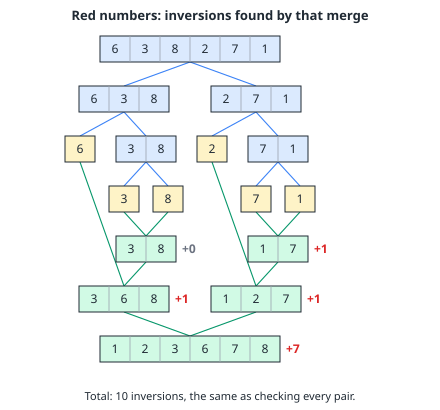
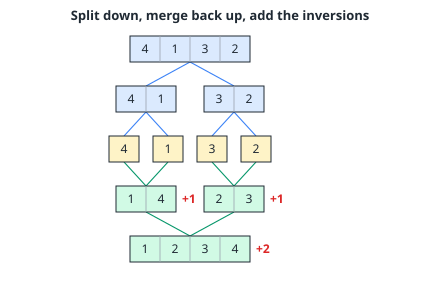

# Module: Divide and Conquer (Split, Solve, Combine — and the Combine Is Everything)

The headline: split the problem, solve the pieces recursively, combine the answers.

## Before you start
<!-- bite: f5b48e00-5223-4ab2-b3e6-53def5a0ef81 -->

- You can write a recursive function and identify its base case — [[01-recursion-fundamentals|recursion fundamentals]].
- You can turn code into $T(n) = a\,T(n/b) + f(n)$ and solve it — [[02-recursion-trees-and-recurrences|recursion trees]], [[03-the-master-theorem|the Master Theorem]].
- You have seen [[05-sorting/03-merge-sort|merge sort]] and [[01-linear-and-binary-search|binary search]].

**After this lesson you will be able to:**

1. Identify the three steps in any divide-and-conquer algorithm and say which one dominates its cost.
2. **Design** a divide-and-conquer solution by choosing the split and the combine, and predict the complexity before writing code.
3. Explain why reducing $a$ — the number of subproblems — changes the *exponent*, while reducing $f(n)$ only changes the log factor.
4. Say when divide and conquer is the wrong tool, including when it is perfectly applicable.

**Study route:** read 1–3, answer the prediction in section 4 before continuing, then run the lab. Block 3 is the one that stops this becoming a hammer.

---

## What divide and conquer is
<!-- bite: 321921a6-880c-4a6d-8e25-607e327a38c4 -->

Divide and conquer is a way to design algorithms by splitting a problem into smaller copies of itself.

The part that actually matters, and the part beginners skip: **the combine step decides the complexity, and a cheaper combine is usually where the algorithm is won.**

## 1. Why this exists: the combine step is the algorithm
<!-- bite: e9c014b8-cff2-4ab3-9b21-a00a02a20142 -->

Everyone can state the pattern: **divide** the problem into smaller instances, **conquer** them recursively, **combine** their answers. Stated that way it sounds like a slogan rather than a technique.

Here is what makes it a technique. Take the recurrence:

$$T(n) = a\,T(n/b) + f(n)$$

You chose all three of those. **The algorithm design question is not "should I use divide and conquer?" — it is "what values of $a$, $b$ and $f$ can I get away with?"** And the Master Theorem tells you exactly what each choice buys:

## 1. Why this exists: the three things you can change
<!-- bite: 9feba4e7-9671-48d0-a9fa-b2e4aac6a8c2 -->

The table shows what each choice does to the cost.

| Change | Effect on the answer | Example |
| :--- | :--- | :--- |
| Reduce **$a$** (fewer subproblems) | changes the **exponent** $n^{\log_b a}$ | Karatsuba: 4 → 3 multiplications, $n^2 \to n^{1.585}$ |
| Increase **$b$** (smaller pieces) | changes the exponent the other way | rarely available |
| Reduce **$f(n)$** (cheaper combine) | changes a **log factor**, or nothing | merge sort's $O(n)$ merge is what the $\log n$ costs |

**Reducing $a$ is worth far more than reducing $f$**, and that is the single most useful design insight here. Strassen and Karatsuba are famous because they cut $a$; nobody is famous for a faster merge.

---

## Terms used in divide and conquer
<!-- bite: a6bbde73-e9d1-483c-9a02-f2df18a8176b -->

1. **Divide and conquer**: This is a design technique in which a problem is split into **independent** subproblems of the same kind, solved recursively, and their results combined into an answer for the whole.
2. **Divide step**: This is how the input is split. Usually trivial — halve an array, split a number's digits — and its cost is part of $f(n)$.
3. **Conquer step**: This is the recursive call or calls. There are $a$ of them, each on an input of size $n/b$.
4. **Combine step**: This is the work that turns the subproblems' answers into the whole answer. **It is where almost all divide-and-conquer algorithms do their real work**, and where the interesting ones do something clever.

## Terms: independence, balance and the threshold
<!-- bite: 42d7982d-cd84-4ae8-84f9-f4e30e3d187b -->

These terms describe what makes a good split.

5. **Independent subproblems**: This means no subproblem's answer is needed to compute another's, and no two subproblems solve the same instance. **Independence is what distinguishes divide and conquer from [[15-dynamic-programming|dynamic programming]]** — when subproblems overlap, you memoise instead.
6. **Balanced split**: This means the subproblems are of roughly equal size. Balanced splits give $\log_b n$ depth; unbalanced ones can degrade to depth $n$, which is exactly [[05-sorting/04-quicksort|quicksort]]'s worst case.
7. **Base case threshold**: This is the size below which you stop recursing and use a simple method instead. Real merge sorts switch to insertion sort at around 10–30 elements, because recursion's constant factors dominate below that.

---

## 2. The catalogue, organised by combine cost
<!-- bite: dfbe5d0f-ef70-4d90-ad37-2c0817d7aa51 -->

The lab prints this table, and it is the lesson in one screen:

```text
   algorithm          | recurrence              | result      | combine
   binary search      | T(n) = 1T(n/2) + O(1)   | O(log n)    | combine: nothing
   tree traversal     | T(n) = 2T(n/2) + O(1)   | O(n)        | combine: one add
   merge sort         | T(n) = 2T(n/2) + O(n)   | O(n log n)  | combine: merge
   count inversions   | T(n) = 2T(n/2) + O(n)   | O(n log n)  | combine: merge + count
   max subarray (D&C) | T(n) = 2T(n/2) + O(n)   | O(n log n)  | combine: scan both ways
   karatsuba          | T(n) = 3T(n/2) + O(n)   | O(n^1.585)  | combine: 3 muls not 4
   fast power         | T(n) = 1T(n/2) + O(1)   | O(log n)    | combine: one square
```

## 2. The catalogue: what the rows teach
<!-- bite: 80defafb-523e-4e62-b8a7-4c9cf7e11c82 -->

Two pairs of rows in that table teach the most.

**Read rows 2 and 3.** Identical $a$ and $b$; the only difference is an $O(1)$ combine versus an $O(n)$ combine — and that is the entire difference between $O(n)$ and $O(n\log n)$. **Merge sort's logarithmic factor is the price of its merge**, paid once per level across $\log n$ levels. This is why merge sort cannot be made linear by writing a faster merge: any correct merge must look at every element.

**Read rows 1 and 7.** Only one recursive call, so no branching at all — the tree is a path, and the result is simply the depth. Any algorithm that discards a constant fraction of its input each step and recurses once is $O(\log n)$.

---

## 3. Counting inversions: getting the combine for free
<!-- bite: 085f708e-eaa2-41ad-8e01-31be0c301d9d -->

An **inversion** is a pair $(i, j)$ with $i < j$ and $a_i > a_j$ — a pair out of order. The count measures how unsorted a list is, and it is used in rank correlation statistics and in collaborative filtering.

Brute force is $O(n^2)$: check every pair. The divide-and-conquer version is merge sort with a counter, and the insight is entirely in the merge.

**When merging two sorted halves, suppose you take an element from the right half because it is smaller than the current element of the left half.** The left half is sorted, so that right element is smaller than **every remaining element of the left half** — all `len(left) - i` of them. That is `len(left) - i` inversions, counted in one operation instead of one at a time.

```python
if left[i] <= right[j]:
    out.append(left[i]); i += 1
else:
    out.append(right[j]); j += 1
    inv += len(left) - i          # <- the entire algorithm is this line
```

## 3. Counting inversions: checked against brute force
<!-- bite: af986236-9318-464d-90d2-17df93ebbe3d -->

The lab checks the count against the slow method and times both.

The lab verifies it against brute force and times both:

```text
        n | brute force |  divide & conquer | agree | brute time | D&C time
      200 |      10,325 |            10,325 |  True |     0.0042 |   0.0014
     1600 |     636,673 |           636,673 |  True |     0.1166 |   0.0048
```

**Identical counts, and the time gap widens with every doubling** — 3× at $n=200$, 24× at $n=1600$, which is the $n^2$ versus $n\log n$ gap appearing on a real machine. (The counts reproduce exactly; the timings are machine-dependent and yours will differ.)

**This is the shape of a good divide-and-conquer design: the combine step you already needed for another reason turns out to compute the thing you wanted.**

## Seeing the inversions counted at each merge
<!-- bite: c43bab5a-1da9-4063-8fc8-4f55976acf8c -->

Here is the whole algorithm on [6, 3, 8, 2, 7, 1]. The blue rows split the list in half until each piece has one element. The green rows merge the pieces back in sorted order. The red number beside each merge is how many out-of-order pairs that merge found across its two halves. They add up to 10, the same answer as checking all 15 pairs.



---

## 4. When divide and conquer is the wrong tool
<!-- bite: b3cc9cca-be60-41a4-9c89-d3a2d31e85f6 -->

> **Predict before reading on.** Maximum subarray sum has a clean divide-and-conquer solution: the best subarray lies entirely in the left half, entirely in the right half, or crosses the middle — and the crossing case is two linear scans. That gives $T(n) = 2T(n/2) + O(n) = O(n\log n)$. **Is this a good algorithm for the problem?**

**No — the problem is solvable in $O(n)$**, and the divide-and-conquer solution is a factor of $\log n$ worse while being considerably longer.

[[10-max-slice-algorithms|Kadane's algorithm]] makes one pass, keeping the best subarray ending at the current position. The lab runs both:

```text
        n | D&C O(n log n) | Kadane O(n) | agree | D&C time | Kadane time
     1000 |          1,653 |       1,653 |  True |   0.0024 |      0.0002
    64000 |          9,715 |       9,715 |  True |   0.2074 |      0.0106
```

**Same answers; roughly 20× the time at $n = 64{,}000$, and the ratio grows.**

## 4. When divide and conquer is the wrong tool: the lesson
<!-- bite: e1652981-7640-4a6d-adde-edb14b599ffd -->

Here is what to take from that comparison.

**The lesson is not that the divide-and-conquer solution is wrong — it is correct and it is a genuinely instructive exercise.** The lesson is that *being applicable is not the same as being right*. Divide and conquer splits the problem because it does not know anything else about it. Kadane's exploits a property divide and conquer throws away: the best subarray ending at position $i$ is computable from the one ending at $i-1$. **A technique that ignores structure loses to one that uses it.**

## 4. When to use divide and conquer: the checklist
<!-- bite: df371f98-74c5-4441-8009-6f5e39b528bd -->

Here is a short checklist for when to use it and when not to.

Reach for divide and conquer when:

1. The problem splits into **independent** subproblems of the same kind.
2. Combining the sub-answers is **cheaper** than solving the whole thing directly.
3. The split is **balanced**, or you can make it so.

Do **not** reach for it when:

1. **Subproblems overlap.** That is [[15-dynamic-programming|dynamic programming]] — memoise rather than recompute. Naive Fibonacci is the canonical case of getting this wrong.
2. **A single linear pass suffices.** Block 3 above.
3. **The combine costs as much as brute force.** If $f(n)$ is $\Theta$ of the whole problem, you have added recursion overhead for nothing.
4. **The subproblems are not independent.** If the left half's answer changes what the right half's question is, the recursion is not well-formed.

---

## 5. Reducing $a$: where the famous algorithms live
<!-- bite: 7f4650ce-1e56-4aae-bc42-c25d3a94dcc9 -->

Splitting an $n$-digit multiplication into halves gives four sub-products the obvious way:

$$(a\cdot 10^m + b)(c \cdot 10^m + d) = ac\cdot10^{2m} + (ad + bc)\cdot10^m + bd$$

Four multiplications: $ac$, $ad$, $bc$, $bd$. So $T(n) = 4T(n/2) + O(n)$, and $\log_2 4 = 2$ gives $\Theta(n^2)$ — **exactly the schoolbook method, with extra steps.** Divide and conquer bought nothing.

**Karatsuba's observation:** you do not need $ad$ and $bc$ separately, only their *sum*. And

$$ad + bc = (a+b)(c+d) - ac - bd$$

You already have $ac$ and $bd$. So one extra multiplication, $(a+b)(c+d)$, yields the middle term — **three multiplications instead of four**:

$$T(n) = 3T(n/2) + O(n) \implies \Theta\!\left(n^{\log_2 3}\right) = \Theta(n^{1.585})$$

## 5. Reducing $a$: what the lab counts
<!-- bite: 1840dc5d-8819-4e75-90ee-aee271fd4e1e -->

The lab counts the multiplications that Karatsuba saves.

The lab counts base multiplications:

```text
     digits | naive digit-muls | karatsuba base-muls | ratio | correct
          8 |               64 |                  41 |  0.64 | True
         64 |            4,096 |               1,103 |  0.27 | True
```

**The ratio falls from 0.64 to 0.27 as the numbers grow** — that is the $n^{1.585}$ versus $n^2$ gap in the operation count. Wall-clock crossover comes much later, because each level pays additions and shifts that schoolbook does not, which is why real bignum libraries switch to Karatsuba only above a few hundred digits.

## 5. Reducing $a$: Strassen, the same move for matrices
<!-- bite: abfde1bb-0429-4527-bda3-f506de00c47e -->

Strassen's algorithm uses the same idea for matrices.

**Strassen's algorithm is the same move for matrices:** the obvious block decomposition needs 8 multiplications, giving $\log_2 8 = 3$ and the usual $\Theta(n^3)$. Strassen found a way with 7, giving $\Theta(n^{\log_2 7}) = \Theta(n^{2.807})$.

**Both are the same insight: an extra addition is cheap; a multiplication is a whole recursive subproblem.** Trading additions for multiplications changes the exponent, and nothing else you can do to the combine step will.

---

## 6. Worked example — complete runnable lab
<!-- bite: 8f5a9527-11b7-430e-9687-fed9cd9b5519 -->

Save as `divide_conquer.py`. Standard library only. **The counts are exact and will reproduce; the timing columns are machine-dependent and yours will differ.**

```python
"""Divide and conquer: split, solve, combine -- and what the combine step costs.

Run:  python3 divide_conquer.py
"""

import random
import time


# ------------------------------------------------------- 1. counting inversions
def count_inversions_brute(a):
    n = len(a)
    return sum(1 for i in range(n) for j in range(i + 1, n) if a[i] > a[j])


def count_inversions(a):
    """Merge sort with a counter. The combine step is where the counting happens."""
    def go(arr):
        if len(arr) <= 1:
            return arr, 0
        mid = len(arr) // 2
        left, il = go(arr[:mid])
        right, ir = go(arr[mid:])
        merged, ic = merge_count(left, right)
        return merged, il + ir + ic

    return go(a)[1]


def merge_count(left, right):
    out, i, j, inv = [], 0, 0, 0
    while i < len(left) and j < len(right):
        if left[i] <= right[j]:
            out.append(left[i]); i += 1
        else:
            # left[i] > right[j], and left is sorted, so every remaining
            # element of left is also greater: that is len(left) - i inversions.
            out.append(right[j]); j += 1
            inv += len(left) - i
    out.extend(left[i:]); out.extend(right[j:])
    return out, inv


# --------------------------------------------------- 2. maximum subarray, D&C
def max_subarray_dc(a):
    def go(lo, hi):
        if lo == hi:
            return a[lo]
        mid = (lo + hi) // 2
        best_left = go(lo, mid)
        best_right = go(mid + 1, hi)
        # the crossing case: the only part that needs real work
        s, left_best = 0, float("-inf")
        for i in range(mid, lo - 1, -1):
            s += a[i]
            left_best = max(left_best, s)
        s, right_best = 0, float("-inf")
        for i in range(mid + 1, hi + 1):
            s += a[i]
            right_best = max(right_best, s)
        return max(best_left, best_right, left_best + right_best)
    return go(0, len(a) - 1)


def max_subarray_kadane(a):
    best = cur = a[0]
    for x in a[1:]:
        cur = max(x, cur + x)
        best = max(best, cur)
    return best


# --------------------------------------------------------- 3. fast exponentiation
def power_naive(base, e):
    r, ops = 1, 0
    for _ in range(e):
        r *= base
        ops += 1
    return r, ops


def power_fast(base, e):
    ops = [0]

    def go(b, n):
        if n == 0:
            return 1
        half = go(b, n // 2)
        ops[0] += 1
        if n % 2:
            return half * half * b
        return half * half

    return go(base, e), ops[0]


# --------------------------------------------------------- 4. karatsuba vs naive
def mul_naive(x, y):
    """Schoolbook multiplication on digit lists; counts digit multiplications."""
    return x * y, len(str(abs(x))) * len(str(abs(y)))


def karatsuba(x, y, counter=None):
    if counter is None:
        counter = [0]
    if x < 10 or y < 10:
        counter[0] += 1
        return x * y, counter[0]
    n = max(len(str(x)), len(str(y)))
    m = n // 2
    high_x, low_x = divmod(x, 10 ** m)
    high_y, low_y = divmod(y, 10 ** m)
    a, _ = karatsuba(high_x, high_y, counter)
    b, _ = karatsuba(low_x, low_y, counter)
    c, _ = karatsuba(high_x + low_x, high_y + low_y, counter)
    middle = c - a - b
    return a * 10 ** (2 * m) + middle * 10 ** m + b, counter[0]


def main():
    print("=== 1. The shape: split, solve, combine ===")
    print("   Every algorithm here has the same three steps. What differs is")
    print("   only how much work the COMBINE step does -- and that alone decides")
    print("   the complexity, via the Master Theorem.")
    rows = [
        ("binary search",      "T(n) = 1T(n/2) + O(1)",  "O(log n)",     "combine: nothing"),
        ("tree traversal",     "T(n) = 2T(n/2) + O(1)",  "O(n)",         "combine: one add"),
        ("merge sort",         "T(n) = 2T(n/2) + O(n)",  "O(n log n)",   "combine: merge"),
        ("count inversions",   "T(n) = 2T(n/2) + O(n)",  "O(n log n)",   "combine: merge + count"),
        ("max subarray (D&C)", "T(n) = 2T(n/2) + O(n)",  "O(n log n)",   "combine: scan both ways"),
        ("karatsuba",          "T(n) = 3T(n/2) + O(n)",  "O(n^1.585)",   "combine: 3 muls not 4"),
        ("fast power",         "T(n) = 1T(n/2) + O(1)",  "O(log n)",     "combine: one square"),
    ]
    print("   algorithm          | recurrence              | result      | combine")
    for a, r, c, w in rows:
        print(f"   {a:<18} | {r:<23} | {c:<11} | {w}")

    print("\n=== 2. Counting inversions: the combine step does the real work ===")
    print("   An inversion is a pair out of order. Brute force is O(n^2);")
    print("   merge sort counts them for free during the merge.")
    print("        n | brute force |  divide & conquer | agree | brute time | D&C time")
    for n in (200, 400, 800, 1600):
        random.seed(n)
        a = [random.randint(0, 10 ** 6) for _ in range(n)]
        t0 = time.perf_counter(); b = count_inversions_brute(a); t1 = time.perf_counter()
        d = count_inversions(a); t2 = time.perf_counter()
        print(f"   {n:>6} | {b:>11,} | {d:>17,} | {str(b == d):>5} "
              f"| {t1-t0:>10.4f} | {t2-t1:>8.4f}")
    print("   -> identical answers; the gap in time widens with every doubling")

    print("\n=== 3. Max subarray: D&C works, and is the WRONG tool ===")
    print("        n | D&C O(n log n) | Kadane O(n) | agree | D&C time | Kadane time")
    for n in (1000, 4000, 16000, 64000):
        random.seed(n)
        a = [random.randint(-50, 50) for _ in range(n)]
        t0 = time.perf_counter(); d = max_subarray_dc(a); t1 = time.perf_counter()
        k = max_subarray_kadane(a); t2 = time.perf_counter()
        print(f"   {n:>6} | {d:>14,} | {k:>11,} | {str(d == k):>5} "
              f"| {t1-t0:>8.4f} | {t2-t1:>11.4f}")
    print("   -> divide and conquer being APPLICABLE does not make it optimal.")
    print("      Kadane's is linear because it exploits structure D&C ignores.")

    print("\n=== 4. Fast exponentiation: n multiplications down to log n ===")
    print("        e | naive muls | fast muls | same answer")
    for e in (10, 100, 1000, 10000):
        rn, on = power_naive(3, e)
        rf, of = power_fast(3, e)
        print(f"   {e:>6} | {on:>10,} | {of:>9} | {rn == rf}")
    print("   -> x^n = (x^(n/2))^2, so each step halves the exponent")

    print("\n=== 5. Karatsuba: 3 multiplications instead of 4 ===")
    print("   Splitting each number in half gives 4 sub-products the obvious way.")
    print("   Karatsuba computes the middle term from the other two, needing only 3.")
    print("   That single saving takes the exponent from log2(4)=2 to log2(3)=1.585.")
    print("     digits | naive digit-muls | karatsuba base-muls | ratio | correct")
    for digits in (8, 16, 32, 64):
        random.seed(digits)
        x = random.randrange(10 ** (digits - 1), 10 ** digits)
        y = random.randrange(10 ** (digits - 1), 10 ** digits)
        _, naive_ops = mul_naive(x, y)
        prod, k_ops = karatsuba(x, y)
        print(f"   {digits:>8} | {naive_ops:>16,} | {k_ops:>19,} | "
              f"{k_ops/naive_ops:>5.2f} | {prod == x*y}")
    print("   -> Karatsuba already does FEWER base multiplications, and the ratio")
    print("      keeps falling: 0.64 -> 0.27 as digits go 8 -> 64. That is the")
    print("      n^1.585 vs n^2 gap showing up in the operation count.")
    print("      Wall-clock crossover comes much later, because each level also")
    print("      pays additions, subtractions and shifts that schoolbook does not.")
    print("      Real bignum libraries switch to Karatsuba only above a threshold")
    print("      of roughly a few hundred digits, for exactly that reason.")

    print("\n=== 6. When divide and conquer is the right reach ===")
    print("   YES  the problem splits into INDEPENDENT subproblems")
    print("   YES  combining the answers is cheaper than solving from scratch")
    print("   YES  subproblems are the same KIND as the original")
    print("   NO   subproblems overlap        -> that is dynamic programming")
    print("   NO   a single linear pass suffices -> see block 3")
    print("   NO   the combine costs as much as brute force -> no saving")


if __name__ == "__main__":
    main()
```

## 6. Worked example: what it prints
<!-- bite: 420d6b04-ffd3-4366-917d-ca17b0d205d3 -->

Here is what the lab prints when you run it.

From one run on the author's machine. The count columns reproduce exactly; the seconds will not:

```text
=== 1. The shape: split, solve, combine ===
   Every algorithm here has the same three steps. What differs is
   only how much work the COMBINE step does -- and that alone decides
   the complexity, via the Master Theorem.
   algorithm          | recurrence              | result      | combine
   binary search      | T(n) = 1T(n/2) + O(1)   | O(log n)    | combine: nothing
   tree traversal     | T(n) = 2T(n/2) + O(1)   | O(n)        | combine: one add
   merge sort         | T(n) = 2T(n/2) + O(n)   | O(n log n)  | combine: merge
   count inversions   | T(n) = 2T(n/2) + O(n)   | O(n log n)  | combine: merge + count
   max subarray (D&C) | T(n) = 2T(n/2) + O(n)   | O(n log n)  | combine: scan both ways
   karatsuba          | T(n) = 3T(n/2) + O(n)   | O(n^1.585)  | combine: 3 muls not 4
   fast power         | T(n) = 1T(n/2) + O(1)   | O(log n)    | combine: one square

=== 2. Counting inversions: the combine step does the real work ===
   An inversion is a pair out of order. Brute force is O(n^2);
   merge sort counts them for free during the merge.
        n | brute force |  divide & conquer | agree | brute time | D&C time
      200 |      10,325 |            10,325 |  True |     0.0042 |   0.0014
      400 |      42,153 |            42,153 |  True |     0.0196 |   0.0030
      800 |     160,414 |           160,414 |  True |     0.0569 |   0.0022
     1600 |     636,673 |           636,673 |  True |     0.1160 |   0.0048
   -> identical answers; the gap in time widens with every doubling

=== 3. Max subarray: D&C works, and is the WRONG tool ===
        n | D&C O(n log n) | Kadane O(n) | agree | D&C time | Kadane time
     1000 |          1,653 |       1,653 |  True |   0.0024 |      0.0002
     4000 |          2,151 |       2,151 |  True |   0.0108 |      0.0007
    16000 |          6,493 |       6,493 |  True |   0.0487 |      0.0028
    64000 |          9,715 |       9,715 |  True |   0.2098 |      0.0111
   -> divide and conquer being APPLICABLE does not make it optimal.
      Kadane's is linear because it exploits structure D&C ignores.

=== 4. Fast exponentiation: n multiplications down to log n ===
        e | naive muls | fast muls | same answer
       10 |         10 |         4 | True
      100 |        100 |         7 | True
     1000 |      1,000 |        10 | True
    10000 |     10,000 |        14 | True
   -> x^n = (x^(n/2))^2, so each step halves the exponent

=== 5. Karatsuba: 3 multiplications instead of 4 ===
   Splitting each number in half gives 4 sub-products the obvious way.
   Karatsuba computes the middle term from the other two, needing only 3.
   That single saving takes the exponent from log2(4)=2 to log2(3)=1.585.
     digits | naive digit-muls | karatsuba base-muls | ratio | correct
          8 |               64 |                  41 |  0.64 | True
         16 |              256 |                 123 |  0.48 | True
         32 |            1,024 |                 325 |  0.32 | True
         64 |            4,096 |               1,103 |  0.27 | True
   -> Karatsuba already does FEWER base multiplications, and the ratio
      keeps falling: 0.64 -> 0.27 as digits go 8 -> 64. That is the
      n^1.585 vs n^2 gap showing up in the operation count.
      Wall-clock crossover comes much later, because each level also
      pays additions, subtractions and shifts that schoolbook does not.
      Real bignum libraries switch to Karatsuba only above a threshold
      of roughly a few hundred digits, for exactly that reason.

=== 6. When divide and conquer is the right reach ===
   YES  the problem splits into INDEPENDENT subproblems
   YES  combining the answers is cheaper than solving from scratch
   YES  subproblems are the same KIND as the original
   NO   subproblems overlap        -> that is dynamic programming
   NO   a single linear pass suffices -> see block 3
   NO   the combine costs as much as brute force -> no saving
```

---

## 7. Common pitfalls and traps
<!-- bite: 65ec2529-d636-4146-b799-e9fa7580c9fa -->

1. **Using it when subproblems overlap.** If two branches solve the same instance, you are recomputing — memoise and you are in [[15-dynamic-programming|dynamic programming]]. Naive Fibonacci is $T(n) = T(n{-}1) + T(n{-}2)$ and is exponential for exactly this reason.
2. **Forgetting the split cost.** `arr[:mid]` copies. A merge sort written with slices does $O(n)$ extra work *and* allocates $O(n\log n)$ total memory. Pass indices instead.
3. **An unbalanced split.** [[05-sorting/04-quicksort|Quicksort]] with a worst-case pivot gives $T(n) = T(n-1) + O(n) = O(n^2)$. Balance is a precondition for the $\log$ depth, not a bonus.
4. **No base-case threshold.** Recursing to single elements pays function-call overhead where a 10-element insertion sort would finish immediately. Production sorts switch over at 10–30 elements.

## 7. Common pitfalls: the wrong tool and the wrong target
<!-- bite: 958ca438-bd8b-4012-958c-3cc8ff09a742 -->

These four pitfalls are about choosing and shaping the recursion.

5. **Assuming applicability implies optimality.** Block 3: the $O(n\log n)$ max-subarray solution is correct, elegant and beaten by a five-line linear scan.
6. **Optimising $f(n)$ when you should be attacking $a$.** A faster merge cannot make merge sort linear. Removing one recursive call is what changes an exponent — that is the whole content of Karatsuba and Strassen.
7. **Recursion depth on large inputs.** Balanced splits give $O(\log n)$ depth, which is safe. An unbalanced one gives $O(n)$, and [[01-recursion-fundamentals|the stack runs out at about 1,000 frames]]. Recursing on the smaller side and looping on the larger bounds the depth at $O(\log n)$ regardless.
8. **Believing the subproblems are independent when they are not.** If solving the left half changes what the right half's problem *is*, the recursion is ill-formed and will produce a confidently wrong answer.

---

## Check your understanding
<!-- bite: bcb90112-e5a8-4b95-892d-6f35075ed2ae -->

Try each one before you open the answer.

1. <!-- q: mcq id="8f722144" -->
   Merge sort and a binary-tree traversal both split into 2 halves. Why is merge sort O(n log n) while the traversal is O(n)?

   - [ ] Merge sort makes more recursive calls
   - [x] The combine step: merging costs O(n), while the traversal combines with O(1) work
   - [ ] The traversal skips half the tree
   - [ ] Merge sort's tree is deeper

   <details><summary>Answer</summary>

   Same a and b, different combine. T(n) = 2T(n/2) + O(1) is leaf-dominated, Θ(n). T(n) = 2T(n/2) + O(n) does n work on each of log n levels, Θ(n log n).

   </details>

2. <!-- q: mcq id="4e9e60ab" -->
   Your algorithm is T(n) = 4T(n/2) + O(n). Which change helps more?

   - [ ] Halving the combine cost
   - [x] Removing one recursive call, making it 3T(n/2) + O(n)
   - [ ] Both help equally
   - [ ] Neither changes the growth rate

   <details><summary>Answer</summary>

   Now it is Θ(n²), and halving f(n) only changes the constant. Three calls give Θ(n^(log₂ 3)) ≈ Θ(n^1.585), a change of exponent. That is the Karatsuba move.

   </details>

3. <!-- q: open id="2fdf5e3b" -->
   There can be Θ(n²) inversions in a list. Why does counting them with merge sort take only O(n log n)?

   <details><summary>Answer</summary>

   It never lists them one by one. When the merge takes an element from the right half, that element is smaller than all len(left) − i elements still waiting in the left half, so it counts that whole group with one addition.

   </details>

4. <!-- q: mcq id="3fac9c88" -->
   Maximum subarray sum has a correct divide-and-conquer solution. Why is it the wrong choice?

   - [ ] It gives wrong answers on negative numbers
   - [x] Kadane's algorithm solves it in O(n), a log n factor faster
   - [ ] Its subproblems overlap
   - [ ] It needs O(n²) memory

   <details><summary>Answer</summary>

   D&C is O(n log n). Kadane's one pass uses the fact that the best subarray ending at i follows from the one ending at i − 1, which splitting in half throws away. Applicable is not the same as best.

   </details>

5. <!-- q: mcq id="8cae199d" -->
   When should you NOT reach for divide and conquer? Choose all that apply.

   - [x] When the subproblems overlap
   - [x] When one linear pass already solves it
   - [x] When the combine step costs as much as solving the whole problem directly
   - [ ] When the problem splits into balanced, independent halves

   <details><summary>Answer</summary>

   Overlapping subproblems call for dynamic programming; a linear pass beats any recursion; an expensive combine adds overhead for nothing. Balanced, independent halves are exactly when D&C works.

   </details>

## Check your understanding: worked problems
<!-- bite: 33f3d32e-0996-49b8-beb9-42d74af3ae98 -->

Work each one out on paper first, then type your answer.

1. <!-- q: exact id="94451721" answer="7" -->
   An inversion is a pair of positions i < j with a[i] > a[j]. How many inversions does [5, 2, 8, 1, 9, 3] have?

   <details><summary>Answer</summary>

   7: (5,2), (5,1), (5,3), (2,1), (8,1), (8,3), (9,3). Merge sort with a counter gets the same 7 in O(n log n).

   </details>

2. <!-- q: exact id="8ce5ef09" answer="5" -->
   Merge sort is merging the sorted halves left = [2, 5, 8] and right = [1, 3, 9]. Each time it takes an element from the right, it adds the number of left elements still waiting. How many inversions does this merge count?

   <details><summary>Answer</summary>

   5. Taking 1 adds 3 (2, 5, 8 are still waiting). Taking 3 adds 2 (5, 8 are waiting). Taking 9 happens after the left is empty, so it adds nothing.

   </details>

3. <!-- q: gap id="4c984459" answers="672;2652;2840" -->
   Fill in the gaps. Karatsuba multiplies 1234 × 5678 by splitting into a = 12, b = 34, c = 56, d = 78. Then ac = ___, bd = ___, and the middle term (a + b)(c + d) − ac − bd = ___.

   <details><summary>Answer</summary>

   ac = 672, bd = 2652, and 46 × 134 − 672 − 2652 = 2840. The product is 672 × 10⁴ + 2840 × 10² + 2652 = 7,006,652, using three multiplications instead of four.

   </details>

4. <!-- q: gap id="cac8c8ca" answers="256;81" -->
   Fill in the gaps. Multiplying two 16-digit numbers by splitting in half down to single digits, the four-multiplication method does ___ single-digit multiplications and Karatsuba does ___.

   <details><summary>Answer</summary>

   16 halves to 1 in 4 levels. Four calls per level gives 4⁴ = 256; three gives 3⁴ = 81. The gap grows as n² against n^1.585.

   </details>

5. <!-- q: sketch id="2418f8f3" -->
   Count the inversions in [4, 1, 3, 2] the divide-and-conquer way. Draw the split rows down to single elements, then the merge rows back up, and write beside each merge how many inversions it adds.

   <details><summary>Answer</summary>

   

   What to check:
   - The first split is [4, 1] and [3, 2], and each of those splits into single elements.
   - Merging [4] and [1] gives [1, 4] and adds 1; merging [3] and [2] gives [2, 3] and adds 1.
   - In the last merge, taking 2 from the right adds 1 (only 4 is still waiting on the left), and taking 3 adds 1 more, so this merge adds 2.
   - The total is 1 + 1 + 2 = 4, the same as the pairs (4,1), (4,3), (4,2) and (3,2).

   </details>

## 9. Practice — independent task
<!-- bite: 1e350489-395a-48d1-9312-84f08ad40e78 -->

Design divide-and-conquer solutions to problems you have not been given the split for.

**Part 1 — closest pair of points.** Given $n$ points in the plane, find the two closest. Brute force is $O(n^2)$; a divide-and-conquer solution is $O(n\log n)$. **Work out the combine step yourself** — the hard part is the strip near the dividing line, and the key fact is that only a constant number of points in that strip can be within distance $d$ of any given point. Verify against brute force on 300 random inputs.

**Part 2 — majority element.** Find an element appearing more than $n/2$ times, by divide and conquer. State the recurrence and solve it. Then compare against [[09-leader-algorithm|Boyer–Moore voting]] and say which you would ship and why.

## 9. Practice: matrices and designs of your own
<!-- bite: 64a6006c-f8b3-40a7-8e4b-be8ea85a82cf -->

The next two parts are about matrices and new problems.

**Part 3 — matrix multiplication.** Implement the naive $8T(n/2) + O(n^2)$ block version and Strassen's $7T(n/2) + O(n^2)$. Count multiplications for $n = 2, 4, 8, \dots, 128$ and confirm the ratio tracks $n^3$ versus $n^{2.807}$. **Find the size at which Strassen's wins on wall-clock time on your machine**, and explain the gap between that and the operation-count crossover.

**Part 4 — design from scratch.** For each, choose the split and the combine, predict the complexity **before coding**, then measure it with the doubling test from [[02-recursion-trees-and-recurrences|recursion trees]]:

1. Count pairs $(i, j)$ with $i < j$ and $a_i > 2a_j$.
2. The skyline problem: given rectangular buildings, produce the visible outline.
3. Given a sorted-rows, sorted-columns matrix, count entries less than $x$.

## 9. Practice: the threshold, edge cases and when you are done
<!-- bite: 8e3b2f92-dc79-4e6d-a088-86ff4b2e7a39 -->

The last part tunes the cutoff, then gives the edge cases and the finish line.

**Part 5 — the threshold.** Add a base-case cutoff to your merge sort. Find the cutoff minimising runtime on random input of $10^6$ elements, and report the speedup over no cutoff.

**Edge cases:** $n = 0$ and $n = 1$; all elements equal; already-sorted input; an input whose split is maximally unbalanced.

**Done when:** part 1 agrees with brute force on all 300 inputs; every part-4 prediction matches its measured doubling ratio, or you can explain why not; part 3 reports both crossovers with numbers; and part 5 reports a measured optimal cutoff.

---

## Before moving on
<!-- bite: d5146b55-95a5-46ea-97a7-28bc029b6810 -->

You can name the three steps and say which dominates; design a split and a combine and predict the complexity before writing code; explain why reducing $a$ beats reducing $f(n)$; and recognise when the technique is applicable but wrong.

**Recap:** divide and conquer splits a problem into **independent** subproblems, solves them recursively, and combines the results — giving $T(n) = a\,T(n/b) + f(n)$, where **you choose all three**. The combine step is where the work and the ideas live: identical $a$ and $b$ with an $O(1)$ versus an $O(n)$ combine is the difference between $O(n)$ and $O(n\log n)$. **Reducing $a$ changes the exponent; reducing $f(n)$ changes at most a log factor** — which is why Karatsuba (4 multiplications → 3, $n^2 \to n^{1.585}$) and Strassen (8 → 7, $n^3 \to n^{2.807}$) are famous and fast merges are not. Counting inversions shows the ideal shape: a combine you already needed computes the answer for free, counting a whole group of inversions in one addition. **Applicability is not optimality** — the $O(n\log n)$ max-subarray solution is correct and loses to Kadane's linear scan by 20× at $n=64{,}000$. If subproblems overlap, you want dynamic programming instead. Keep splits balanced, pass indices rather than slices, and stop recursing at a small threshold.

**Next:** [[05-sorting/index|Sorting]] — merge sort and quicksort are divide and conquer at work. Later, [[07-dynamic-programming/index|dynamic programming]] covers what to do when the subproblems are *not* independent, and the recursion tree is full of repeats.

---

## Related
<!-- bite: 38757554-4ed3-4684-bcb1-09165638fa76 -->

- [[02-recursion/index|Recursion]] — the folder this depends on: fundamentals, recursion trees, the Master Theorem
- [[03-the-master-theorem|The Master Theorem]] — how to price a split and combine before writing it
- [[05-sorting/03-merge-sort|Merge Sort]] · [[05-sorting/04-quicksort|Quicksort]] — the two canonical instances
- [[01-linear-and-binary-search|Binary Search]] — divide and conquer with one recursive call and no combine
- [[10-max-slice-algorithms|Max Slice / Kadane's]] — the linear algorithm that beats the D&C one
- [[15-dynamic-programming|Dynamic Programming]] — the technique for when subproblems overlap
- [[12-math-and-geometry|Math and Geometry]] — fast exponentiation and matrix work
- [[03-algorithms/index|03-algorithms]] — the parent folder

## About this lesson
<!-- bite: cba9ebad-b161-4ecf-a9f7-7bc0df1735a4 -->

**Level:** Intermediate. **Covers:** [[02-recursion-trees-and-recurrences|Recursion trees]] and [[03-the-master-theorem|the Master Theorem]] taught you to *analyse* a recurrence someone handed you. This lesson is the other direction: **choosing $a$, $b$ and $f(n)$ deliberately, because you are designing the algorithm.**
