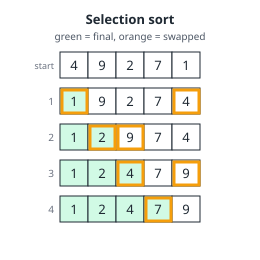

# Module: Elementary Sorts

Elementary sorts are the simplest ways of putting a list in order: selection sort, bubble sort and insertion sort. They are slow on big lists but easy to understand and often fine for small ones. Insertion sort is how most people sort a hand of playing cards, by sliding each new card into its right place.

## Before you start
<!-- bite: 434d27df-a416-424a-8e17-4f94283556f2 -->

- You know stable, in-place and adaptive — [[01-the-lower-bound|the lower bound]].
- You can trace a nested loop and count its iterations — [[01-loops-and-what-they-cost|loops and what they cost]].

**After this lesson you will be able to:**

1. Implement all three, and state each one's invariant.
2. Explain why all three are $O(n^2)$ yet behave very differently in practice.
3. Say which is stable, which is adaptive, and which does the fewest **writes**.
4. Explain why insertion sort survives inside Timsort and introsort.

**Study route:** read 1–4, attempt the prediction in section 3, then run the lab.

---

## 1. Why this exists
<!-- bite: ddf3dc74-f8bd-4cc9-a471-cd2e8e2541e3 -->

Three quadratic algorithms is two too many, if speed on large inputs were the only criterion. It is not.

These are worth knowing for three reasons. They are the sorts you can **prove correct on paper** in a minute, using an invariant — a skill that transfers directly to harder algorithms. They differ on properties that matter more than asymptotics on small inputs. And **insertion sort is genuinely in production**: Python's Timsort and C++'s introsort both fall back to it below about 16 elements, because for small $n$ its constant factor beats every $O(n\log n)$ algorithm.

Asymptotic notation deliberately discards constants. On small inputs the constants are the whole story.

## 2. The three, with their invariants
<!-- bite: dbe24bf1-debb-4c47-b000-3dbd193ef3e4 -->

An **invariant** is a statement true before and after every iteration. It is what makes a loop provably correct rather than plausibly correct.

### Selection sort

> **Invariant:** after $i$ passes, the first $i$ positions hold the $i$ smallest elements, in order.

Scan the unsorted remainder for the minimum, swap it into place, repeat.

- Comparisons: always $\frac{n(n-1)}{2}$ — **it cannot adapt**, because it always scans the whole remainder.
- **Writes: exactly $n-1$ swaps.** This is its one real advantage: when a write is far more expensive than a read — flash memory, or huge records — selection sort moves the least data of any of these.
- Not stable: the long-range swap can jump one equal element past another.

### Bubble sort

> **Invariant:** after $i$ passes, the last $i$ positions hold the $i$ largest elements, in order.

Repeatedly sweep, swapping adjacent out-of-order pairs; the largest "bubbles" to the end each pass.

- With an early exit when a pass makes no swaps, it is $O(n)$ on already-sorted input — **adaptive**.
- Stable, since it only ever swaps *adjacent* unequal-ordered elements.
- Otherwise the worst of the three: $O(n^2)$ comparisons *and* $O(n^2)$ writes.

### Insertion sort

> **Invariant:** after $i$ steps, the first $i+1$ elements are sorted **among themselves** (though not necessarily in final position).

Take the next element, shift larger elements right, drop it into the gap. Exactly how you sort a hand of cards.

- $O(n)$ on nearly-sorted input, and $O(n + d)$ where $d$ is the number of inversions — **the most adaptive of the three**.
- Stable, since it shifts only strictly-greater elements.
- **The one that survives in libraries.**

> [!TIP]
> **Predict before running the lab.** On an array of 1,000 elements that is already sorted, roughly how many comparisons will each of the three do? And on the same array reversed? Decide all six numbers, at least to an order of magnitude, before opening the answers.

## Seeing the three sorts pass by pass
<!-- bite: f3624240-1198-4ead-8b08-a54b615ec3f6 -->

Here are all three on the same array, [5, 2, 4, 6, 1, 3], one row per pass. Green cells are the part each invariant promises. Selection's green part grows from the left and is final. Bubble's grows from the right and is final. Insertion's green part is sorted only among itself, so later elements can still slide into it. Orange outlines mark what moved.


## 3. Why insertion sort wins for small $n$
<!-- bite: 1afeaf03-9b1c-4025-b6d4-50715f596d14 -->

Merge sort at $n = 10$ does about $10\log_2 10 \approx 33$ comparisons, plus allocation, plus recursive call overhead, plus copying into and out of temporary arrays.

Insertion sort at $n = 10$ does at most $45$ comparisons, with no allocation, no recursion, and perfectly sequential memory access. The asymptotics say merge sort wins; the constants say otherwise, and at $n=10$ the constants are all there is.

That crossover — usually somewhere between 10 and 32 elements — is why every serious library is a hybrid. Timsort sorts short runs with **binary** insertion sort, then merges them. Introsort quicksorts until the partitions are small, then finishes the whole array with one insertion-sort pass.

## Worked example — runnable
<!-- bite: b665424a-3243-4688-871e-633fcddbb2a8 -->

**Runnable example:** save as `elementary.py` in any empty directory and run `python3 elementary.py`. Standard library only; writes no files.

```python
"""Bubble, selection and insertion sort - with their invariants checked."""
import random


class Counter:
    def __init__(self):
        self.comparisons = 0
        self.writes = 0


def bubble_sort(xs, c=None):
    c = c or Counter()
    xs = list(xs)
    n = len(xs)
    for i in range(n):
        swapped = False
        for j in range(n - 1 - i):
            c.comparisons += 1
            if xs[j] > xs[j + 1]:
                xs[j], xs[j + 1] = xs[j + 1], xs[j]
                c.writes += 2
                swapped = True
        # invariant: the last i+1 elements are the largest, in order
        assert xs[n - 1 - i:] == sorted(xs[n - 1 - i:])
        if not swapped:
            break                       # already sorted: this is what makes it adaptive
    return xs, c


def selection_sort(xs, c=None):
    c = c or Counter()
    xs = list(xs)
    n = len(xs)
    for i in range(n - 1):
        m = i
        for j in range(i + 1, n):
            c.comparisons += 1
            if xs[j] < xs[m]:
                m = j
        if m != i:
            xs[i], xs[m] = xs[m], xs[i]
            c.writes += 2
        # invariant: the first i+1 elements are the smallest, in order
        assert xs[:i + 1] == sorted(xs)[:i + 1]
    return xs, c


def insertion_sort(xs, c=None):
    c = c or Counter()
    xs = list(xs)
    for i in range(1, len(xs)):
        cur = xs[i]
        j = i - 1
        while j >= 0:
            c.comparisons += 1
            if xs[j] <= cur:
                break
            xs[j + 1] = xs[j]
            c.writes += 1
            j -= 1
        xs[j + 1] = cur
        c.writes += 1
        # invariant: the first i+1 elements are sorted among themselves
        assert xs[:i + 1] == sorted(xs[:i + 1])
    return xs, c


SORTS = [("bubble", bubble_sort), ("selection", selection_sort), ("insertion", insertion_sort)]


class Item:
    """Compares on `key` ONLY, so ties do not silently break on anything else.

    Comparing plain tuples would order equal keys by their second field, which
    makes every sort look stable - the test would prove nothing.
    """

    def __init__(self, key, tag):
        self.key, self.tag = key, tag

    def __lt__(self, other):
        return self.key < other.key

    def __gt__(self, other):
        return self.key > other.key

    def __le__(self, other):
        return self.key <= other.key

    def __repr__(self):
        return f"{self.key}{self.tag}"


def is_stable(fn):
    data = [Item(1, "a"), Item(1, "b"), Item(0, "c"), Item(1, "d"), Item(0, "e")]
    out, _ = fn(data)
    for k in (0, 1):
        tags = [it.tag for it in out if it.key == k]
        if tags != sorted(tags):
            return False
    return True


if __name__ == "__main__":
    print("Block 1 - all three are correct, and their invariants hold throughout")
    rng = random.Random(20260910)
    for name, fn in SORTS:
        for trial in range(200):
            n = rng.randint(0, 30)
            data = [rng.randint(-20, 20) for _ in range(n)]
            out, _ = fn(data)
            assert out == sorted(data), (name, data)
        print(f"  {name:10} correct on 200 random arrays, invariant asserted every pass")

    print()
    print("Block 2 - comparisons and writes on 1,000 elements")
    N = 1000
    inputs = {
        "sorted  ": list(range(N)),
        "reversed": list(range(N, 0, -1)),
        "random  ": [rng.randint(0, N) for _ in range(N)],
        "nearly  ": list(range(N)),
    }
    for i in range(0, N, 100):          # perturb 1% of the sorted array
        j = min(N - 1, i + 1)
        inputs["nearly  "][i], inputs["nearly  "][j] = inputs["nearly  "][j], inputs["nearly  "][i]

    print("   input      algorithm     comparisons        writes")
    for label, data in inputs.items():
        for name, fn in SORTS:
            _, c = fn(data)
            print(f"   {label}   {name:10}  {c.comparisons:12,}  {c.writes:12,}")
        print()
    _, c_sel = selection_sort(inputs["sorted  "])
    _, c_ins = insertion_sort(inputs["sorted  "])
    _, c_bub = bubble_sort(inputs["sorted  "])
    assert c_sel.comparisons == N * (N - 1) // 2, "selection never adapts"
    assert c_ins.comparisons == N - 1, "insertion is O(n) on sorted input"
    assert c_bub.comparisons == N - 1, "bubble with early exit is O(n) on sorted input"
    print("  selection does the SAME 499,500 comparisons whatever the input,")
    print("  while insertion and bubble do only n-1 on already-sorted data")

    print()
    print("Block 3 - selection sort's one advantage: it barely writes")
    data = [rng.randint(0, 1000) for _ in range(500)]
    for name, fn in SORTS:
        _, c = fn(data)
        print(f"  {name:10} writes {c.writes:8,}")
    _, c_sel = selection_sort(data)
    assert c_sel.writes <= 2 * (len(data) - 1)
    print(f"  selection is bounded by 2(n-1) = {2*(len(data)-1):,} writes, always")
    print("  that matters when a write costs far more than a read: flash, or huge records")

    print()
    print("Block 4 - stability")
    demo = [Item(1, "a"), Item(1, "b"), Item(0, "c"), Item(1, "d"), Item(0, "e")]
    print(f"  input: {demo}")
    for name, fn in SORTS:
        out, _ = fn(demo)
        print(f"  {name:10} -> {out}   stable: {is_stable(fn)}")
    assert is_stable(bubble_sort) and is_stable(insertion_sort)
    assert not is_stable(selection_sort)
    print("  selection's long-range swap can jump one equal element past another")

    print()
    print("Block 5 - why insertion sort is inside Timsort: the crossover")
    print("      n    insertion comparisons    n*log2(n) (a merge sort estimate)")
    import math
    for n in (4, 8, 16, 32, 64, 128):
        worst = 0
        for _ in range(100):
            perm = list(range(n))
            rng.shuffle(perm)
            _, c = insertion_sort(perm)
            worst = max(worst, c.comparisons)
        print(f"  {n:5}    {worst:20}    {n*math.log2(n):30.1f}")
    print("  insertion loses asymptotically, but with no recursion, no allocation and")
    print("  sequential access its constant is so much smaller that libraries switch")
    print("  to it below roughly 16-32 elements")

    print()
    print("elementary: passed")
```

Expected output:

```text
Block 1 - all three are correct, and their invariants hold throughout
  bubble     correct on 200 random arrays, invariant asserted every pass
  selection  correct on 200 random arrays, invariant asserted every pass
  insertion  correct on 200 random arrays, invariant asserted every pass

Block 2 - comparisons and writes on 1,000 elements
   input      algorithm     comparisons        writes
   sorted     bubble               999             0
   sorted     selection        499,500             0
   sorted     insertion            999           999

   reversed   bubble           499,500       999,000
   reversed   selection        499,500         1,000
   reversed   insertion        499,500       500,499

   random     bubble           498,759       516,030
   random     selection        499,500         1,980
   random     insertion        259,007       259,014

   nearly     bubble             1,997            20
   nearly     selection        499,500            20
   nearly     insertion          1,008         1,009

  selection does the SAME 499,500 comparisons whatever the input,
  while insertion and bubble do only n-1 on already-sorted data

Block 3 - selection sort's one advantage: it barely writes
  bubble     writes  122,828
  selection  writes      978
  insertion  writes   61,913
  selection is bounded by 2(n-1) = 998 writes, always
  that matters when a write costs far more than a read: flash, or huge records

Block 4 - stability
  input: [1a, 1b, 0c, 1d, 0e]
  bubble     -> [0c, 0e, 1a, 1b, 1d]   stable: True
  selection  -> [0c, 0e, 1a, 1d, 1b]   stable: False
  insertion  -> [0c, 0e, 1a, 1b, 1d]   stable: True
  selection's long-range swap can jump one equal element past another

Block 5 - why insertion sort is inside Timsort: the crossover
      n    insertion comparisons    n*log2(n) (a merge sort estimate)
      4                       6                               8.0
      8                      28                              24.0
     16                     100                              64.0
     32                     325                             160.0
     64                    1313                             384.0
    128                    4661                             896.0
  insertion loses asymptotically, but with no recursion, no allocation and
  sequential access its constant is so much smaller that libraries switch
  to it below roughly 16-32 elements

elementary: passed
```

## Common pitfalls and traps
<!-- bite: 2b0705a9-e9df-4de3-b18c-d79c39bb0985 -->

- **Bubble sort without the early exit.** Without the `swapped` flag it is $O(n^2)$ even on sorted input, losing the one property that makes it tolerable.
- **Assuming $O(n^2)$ means "never use it".** For $n < 32$ these beat everything, which is why they are in the libraries.
- **Writing insertion sort with `<` instead of `<=` in the shift test.** Shifting equal elements destroys stability.
- **Choosing selection sort for speed.** It is the slowest in comparisons and cannot adapt. Choose it only when *writes* are the expensive operation.
- **Confusing swaps with writes.** One swap is two writes. Selection sort's $n-1$ swaps are $2(n-1)$ writes.

## Check your understanding
<!-- bite: 83a1c868-0e5b-4055-9819-d5d6ff76a6b6 -->

Try each one before you open the answer.

1. <!-- q: mcq id="a8495433" -->
   Which statement is the invariant of insertion sort?

   - [ ] After i steps, the first i positions hold the i smallest elements
   - [x] After i steps, the first i + 1 elements are sorted among themselves, though not necessarily in their final places
   - [ ] After i passes, the last i positions hold the i largest elements
   - [ ] After each step, the array has one fewer inversion

   <details><summary>Answer</summary>

   Insertion sort keeps a sorted prefix, but later elements may still belong inside it. "The i smallest in place" is selection sort's invariant; "the i largest at the end" is bubble sort's.

   </details>

2. <!-- q: exact id="48aedb83" answer="4950" accept="4,950" -->
   How many comparisons does selection sort make on an already-sorted array of 100 elements?

   <details><summary>Answer</summary>

   4,950 = 100 × 99 / 2. Selection sort cannot adapt: it always scans the whole unsorted remainder for the minimum.

   </details>

3. <!-- q: mcq id="5ebbd2f8" -->
   Which of the three elementary sorts are stable? Choose all that apply.

   - [x] Bubble sort
   - [x] Insertion sort
   - [ ] Selection sort

   <details><summary>Answer</summary>

   Bubble sort only swaps adjacent elements that are strictly out of order, and insertion sort only shifts strictly greater elements, so equal items never pass each other. Selection sort's long swap can jump one equal item past another.

   </details>

4. <!-- q: mcq id="3f7f2b2c" -->
   When would you deliberately choose selection sort?

   - [ ] When the input is nearly sorted
   - [x] When writes are much more expensive than reads, because it does at most n − 1 swaps
   - [ ] When you need a stable sort
   - [ ] When n is very large

   <details><summary>Answer</summary>

   Flash memory with limited write cycles, or huge records that are costly to move. Selection sort moves the least data of the three.

   </details>

5. <!-- q: open id="c3a00920" -->
   Why do Timsort and introsort both contain insertion sort?

   <details><summary>Answer</summary>

   On small inputs its constant factor beats every O(n log n) algorithm: no recursion, no allocation, sequential memory access. Both hybrids split the problem down to a small size (around 16 to 32 elements) and finish those pieces with insertion sort.

   </details>

## Check your understanding: worked problems
<!-- bite: 5e0ed498-6e55-4e44-a9c9-7c1622ba9590 -->

Work each one out on paper first, then type your answer.

1. <!-- q: gap id="9e35e059" answers="10;13;14;37;29" -->
   Fill in the gaps. Selection sort runs on [29, 10, 14, 37, 13]. Each pass finds the minimum of the unsorted part and swaps it to the front of that part. After 2 passes the array is [___, ___, ___, ___, ___].

   <details><summary>Answer</summary>

   [10, 13, 14, 37, 29]. Pass 1 swaps 10 with 29: [10, 29, 14, 37, 13]. Pass 2 finds 13 and swaps it with 29: [10, 13, 14, 37, 29].

   </details>

2. <!-- q: gap id="5bdfc157" answers="2;6;4;1;9;3" -->
   Fill in the gaps. Bubble sort makes one pass over [6, 2, 9, 4, 1], swapping each adjacent pair that is out of order. After the pass the array is [___, ___, ___, ___, ___], and the pass made ___ swaps.

   <details><summary>Answer</summary>

   [2, 6, 4, 1, 9] with 3 swaps: 6↔2, then 9↔4, then 9↔1. The largest value, 9, has bubbled to the end.

   </details>

3. <!-- q: gap id="e91da941" answers="1;3;5;8;9;2" -->
   Fill in the gaps. Insertion sort runs on [8, 3, 5, 1, 9, 2]. After inserting the elements at indexes 1, 2 and 3 (three steps), the array is [___, ___, ___, ___, ___, ___].

   <details><summary>Answer</summary>

   [1, 3, 5, 8, 9, 2]. The first four are sorted among themselves: 3 goes before 8, then 5 between 3 and 8, then 1 to the front. 9 and 2 are not touched yet.

   </details>

4. <!-- q: gap id="905899e4" answers="8;8" -->
   Fill in the gaps. An inversion is a pair i < j with a[i] > a[j]. The array [3, 7, 4, 9, 5, 2] has ___ inversions, and insertion sort shifts elements right exactly ___ times while sorting it.

   <details><summary>Answer</summary>

   8 and 8. Each shift fixes exactly one inversion, which is why insertion sort costs O(n + d), where d is the number of inversions.

   </details>

5. <!-- q: sketch id="b209ac1d" -->
   Draw selection sort on [4, 9, 2, 7, 1]. Draw the array once at the start, then once after each pass (4 passes). In each row, shade the part that is now final and circle the two cells that were swapped.

   <details><summary>Answer</summary>

   

   What to check:
   - Pass 1 swaps 1 (the minimum) with 4: [1, 9, 2, 7, 4].
   - Pass 2 swaps 2 with 9: [1, 2, 9, 7, 4].
   - Pass 3 swaps 4 with 9: [1, 2, 4, 7, 9].
   - Pass 4 finds 7 already in place, so nothing moves, but it still scans: selection sort never stops early.

   </details>

## Practice — independent task
<!-- bite: 47c7fc95-9e30-4c77-95a2-2784ec56e36a -->

Implement **binary insertion sort** and measure what it does and does not improve.

1. Standard insertion sort finds the insertion point by scanning. Replace that scan with a **binary search** over the already-sorted prefix.
2. Count comparisons and writes separately. Binary search reduces comparisons to $O(\log i)$ per element, so total comparisons become $O(n\log n)$.
3. **Then explain why it is still $O(n^2)$.** The shifting has not changed — you still move every larger element one place right. Measure both counts and show the comparison count dropping while the write count does not.
4. Verify it is still **stable**. Binary search must find the position *after* any equal elements — get the boundary condition wrong and stability breaks. Test with many duplicate keys.
5. Report at which $n$ the reduced comparison count actually pays for itself, given that comparisons on integers are cheap but on long strings are not. Simulate an expensive comparison by adding a counter-plus-delay wrapper, and show the crossover moving.

**Edge cases:** an empty array; all equal elements (binary search must still be stable); an array already sorted (does binary insertion still do $O(n\log n)$ comparisons where plain insertion does $O(n)$? — this is a real regression, explain it).

**Done when:** your comparison count is $O(n\log n)$ while writes stay $O(n^2)$, stability holds with duplicates, and you can explain the sorted-input regression in step 5's edge case.

## Before moving on
<!-- bite: 051f7c08-ee98-498d-85f7-56f42a983609 -->

You can implement all three from their invariants, state which is stable and which adapts, and explain why insertion sort is in production libraries.

**Recap:** selection — invariant "first $i$ are the smallest", always $\frac{n(n-1)}{2}$ comparisons, only $n-1$ swaps, not stable, not adaptive; bubble — invariant "last $i$ are the largest", stable, adaptive with the early-exit flag, most writes; insertion — invariant "first $i+1$ sorted among themselves", stable, most adaptive, and the one libraries keep for small $n$.

**Next:** [[03-merge-sort|Merge Sort]] — the first algorithm here to actually reach $O(n\log n)$, and the one that works when the data does not fit in memory.

## Related
<!-- bite: 07c0c5f7-57b8-45af-b580-5075b0c8af1d -->

- [[01-the-lower-bound|The Lower Bound]] — the properties compared here
- [[03-merge-sort|Merge Sort]] · [[04-quicksort|Quicksort]] — the $O(n\log n)$ pair
- [[01-arrays|Arrays]] — why shifting costs what it does

## About this lesson
<!-- bite: bf0691e8-0ea3-4f5a-a6aa-d7dec5b88dbe -->

**Level:** Beginner. **Covers:** bubble, selection and insertion, and why one of the three is inside every production sorting library.
