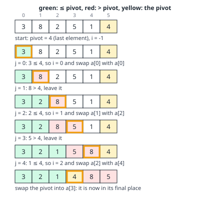
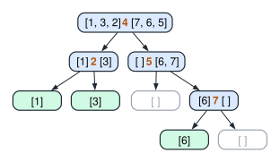

# Module: Quicksort

Quicksort is a way of sorting a list by picking one item, called the pivot, putting smaller items to its left and bigger ones to its right, then doing the same to each side. It is usually one of the fastest sorts in practice. Many programming languages use quicksort, or something built on it, when you ask them to sort numbers.

## Before you start
<!-- bite: 27c8504a-df9e-4336-9c53-ca03a5a27295 -->

- You know merge sort and the recursion-tree argument — [[03-merge-sort|merge sort]].
- You know what in-place and stable mean — [[01-the-lower-bound|the lower bound]].

**After this lesson you will be able to:**

1. Implement **Lomuto** and **Hoare** partitioning, and say why Hoare is the one libraries use.
2. Explain the $O(n^2)$ worst case, **trigger it deliberately**, and prevent it.
3. Explain why quicksort is not stable, and why it is still the default in most libraries.
4. Handle the duplicate-keys trap with **three-way partitioning**.

**Study route:** read 1–4, attempt the prediction in section 3, then run the lab. Block 3 breaks the naive version on purpose.

---

## 1. Why this exists
<!-- bite: e8809f6d-116d-430d-9158-b89a3288e14e -->

Merge sort guarantees $O(n\log n)$ and needs $O(n)$ extra memory. Quicksort has the same average cost, needs only $O(\log n)$ of stack, and in practice runs faster despite doing a similar number of comparisons.

The reason is memory, not operation count. Partitioning sweeps the array **sequentially** and swaps in place, which is friendly to CPU caches and prefetchers. Merge sort copies into and out of a separate buffer, doubling memory traffic. Constants win.

The price is a genuine worst case. Merge sort's split is by position and cannot be unbalanced; quicksort's split is by **value**, so an adversarial or merely unlucky input can make every partition maximally lopsided, giving $O(n^2)$.

## 2. Partitioning
<!-- bite: 1359ed53-5926-4c9e-ad36-b8d88c30e1de -->

Choose a **pivot**. Rearrange so everything smaller is left of it and everything larger is right. The pivot is now in its final position. Recurse on both sides.

### Lomuto (simpler, slower)

Pivot is the last element. Walk with `i` marking the boundary of the "smaller" region.

```python
def lomuto(a, lo, hi):
    pivot = a[hi]
    i = lo - 1
    for j in range(lo, hi):
        if a[j] <= pivot:
            i += 1
            a[i], a[j] = a[j], a[i]
    a[i + 1], a[hi] = a[hi], a[i + 1]
    return i + 1
```

Easy to get right, and it degrades badly on arrays of **equal elements**: every element satisfies `<= pivot`, so every partition is maximally lopsided and the sort goes quadratic on input that is already trivially sorted.

### Hoare (the one that is used)

Two pointers move towards each other, swapping out-of-place pairs.

Hoare does about **three times fewer swaps** on average and handles duplicates far better, because elements equal to the pivot can end up on either side, which keeps partitions balanced. Its index handling is fiddlier, which is the only reason Lomuto is taught first.

## Seeing a Lomuto partition

Here is `lomuto` on [3, 8, 2, 5, 1, 4], one row per step. The pivot is 4 (yellow). As `j` walks right (orange), anything at most 4 is swapped into the green region at the front, and anything bigger is left in the red region. The last step swaps the pivot between the two regions, where it stays for good.



## 3. The worst case, and preventing it
<!-- bite: eef3d380-4f6c-459b-8ad6-220f36ead8f5 -->

The recursion depth is what matters:

- **Balanced** splits give depth $\log_2 n$ and $O(n\log n)$.
- **Maximally lopsided** splits — one side empty every time — give depth $n$ and $O(n^2)$.

With a **last-element pivot**, already-sorted input is the worst case: the pivot is always the maximum, so one side gets everything. That is not a rare adversarial input; it is the most common input shape there is.

**The fixes, in order of what libraries actually do:**

| Fix | What it does |
| :--- | :--- |
| **Median-of-three** | Pivot on the median of first, middle and last — kills the sorted-input case cheaply |
| **Randomised pivot** | No fixed input is worst-case; an adversary cannot predict it |
| **Introsort** | Count recursion depth; past $2\log n$, switch to **heapsort** — a hard $O(n\log n)$ ceiling |
| **Three-way partition** | Split into `< = >`; makes arrays of duplicates linear |
| **Insertion sort below ~16** | Better constants on the small partitions |

`std::sort` in C++ is introsort with all of these. That is why the standard library never exhibits the worst case even though the underlying algorithm has one.

> [!TIP]
> **Predict before running the lab.** With a last-element pivot, which input is worse: a random array, a reverse-sorted array, or an array where every element is identical? Rank all three before opening the answers.

## Seeing balanced and lopsided splits

Each box is one call: the left part, the pivot (orange) and the right part. On a mixed array the pivot lands near the middle, so the tree stays shallow. On sorted input the last element is always the largest, the right part is always empty, and the tree turns into a long chain: depth $n$, and $O(n^2)$ work.


## 4. Why it is not stable
<!-- bite: 2bd739dc-441b-4dec-8078-1a280a16c5c8 -->

Partitioning swaps elements across long distances. Two equal elements can be exchanged with each other or jumped past one another, and their original order is lost.

Making it stable requires extra space, which surrenders quicksort's main advantage. So libraries offer a choice: `sort` (quicksort-family, unstable, fast) and `stable_sort` (merge-family, stable, $O(n)$ memory). Python's `list.sort` is Timsort and always stable, which is a deliberate different trade.

## Worked example — runnable
<!-- bite: 4b35440f-2b9d-40aa-9d53-173a57451129 -->

**Runnable example:** save as `quicksort.py` in any empty directory and run `python3 quicksort.py`. Standard library only; writes no files.

```python
"""Quicksort: two partition schemes, the worst case, and how to prevent it."""
import random
import sys

sys.setrecursionlimit(30000)


class Counter:
    def __init__(self):
        self.comparisons = 0
        self.swaps = 0
        self.depth = 0


def lomuto(a, lo, hi, c):
    pivot = a[hi]
    i = lo - 1
    for j in range(lo, hi):
        c.comparisons += 1
        if a[j] <= pivot:
            i += 1
            a[i], a[j] = a[j], a[i]
            c.swaps += 1
    a[i + 1], a[hi] = a[hi], a[i + 1]
    c.swaps += 1
    return i + 1


def hoare(a, lo, hi, c):
    pivot = a[(lo + hi) // 2]
    i, j = lo - 1, hi + 1
    while True:
        i += 1
        while a[i] < pivot:
            c.comparisons += 1
            i += 1
        c.comparisons += 1
        j -= 1
        while a[j] > pivot:
            c.comparisons += 1
            j -= 1
        c.comparisons += 1
        if i >= j:
            return j
        a[i], a[j] = a[j], a[i]
        c.swaps += 1


def quicksort(a, scheme=lomuto, lo=0, hi=None, c=None, depth=0):
    c = c or Counter()
    hi = len(a) - 1 if hi is None else hi
    c.depth = max(c.depth, depth)
    if lo < hi:
        if scheme is lomuto:
            p = lomuto(a, lo, hi, c)
            quicksort(a, scheme, lo, p - 1, c, depth + 1)
            quicksort(a, scheme, p + 1, hi, c, depth + 1)
        else:
            p = hoare(a, lo, hi, c)
            quicksort(a, scheme, lo, p, c, depth + 1)
            quicksort(a, scheme, p + 1, hi, c, depth + 1)
    return a, c


def median_of_three(a, lo, hi, c):
    mid = (lo + hi) // 2
    trio = sorted([(a[lo], lo), (a[mid], mid), (a[hi], hi)])
    _, m = trio[1]
    a[m], a[hi] = a[hi], a[m]
    c.swaps += 1
    return lomuto(a, lo, hi, c)


def quicksort_m3(a, lo=0, hi=None, c=None, depth=0):
    c = c or Counter()
    hi = len(a) - 1 if hi is None else hi
    c.depth = max(c.depth, depth)
    if lo < hi:
        p = median_of_three(a, lo, hi, c)
        quicksort_m3(a, lo, p - 1, c, depth + 1)
        quicksort_m3(a, p + 1, hi, c, depth + 1)
    return a, c


def quicksort3(a, lo=0, hi=None, c=None, depth=0):
    """Three-way partition: < pivot, == pivot, > pivot."""
    c = c or Counter()
    hi = len(a) - 1 if hi is None else hi
    c.depth = max(c.depth, depth)
    if lo >= hi:
        return a, c
    pivot = a[(lo + hi) // 2]
    lt, i, gt = lo, lo, hi
    while i <= gt:
        c.comparisons += 1
        if a[i] < pivot:
            a[lt], a[i] = a[i], a[lt]
            c.swaps += 1
            lt += 1; i += 1
        elif a[i] > pivot:
            a[gt], a[i] = a[i], a[gt]
            c.swaps += 1
            gt -= 1
        else:
            i += 1
    quicksort3(a, lo, lt - 1, c, depth + 1)
    quicksort3(a, gt + 1, hi, c, depth + 1)
    return a, c


if __name__ == "__main__":
    rng = random.Random(20260910)

    print("Block 1 - both schemes are correct")
    for name, scheme in [("lomuto", lomuto), ("hoare", hoare)]:
        for _ in range(300):
            n = rng.randint(0, 40)
            data = [rng.randint(-20, 20) for _ in range(n)]
            out, _ = quicksort(list(data), scheme)
            assert out == sorted(data), (name, data)
        print(f"  {name:8} correct on 300 random arrays")

    print()
    print("Block 2 - Hoare does far fewer swaps than Lomuto")
    N = 500
    data = [rng.randint(0, N) for _ in range(N)]
    for name, scheme in [("lomuto", lomuto), ("hoare", hoare)]:
        _, c = quicksort(list(data), scheme)
        print(f"  {name:8} comparisons {c.comparisons:7,}   swaps {c.swaps:7,}"
              f"   depth {c.depth}")
    _, cl = quicksort(list(data), lomuto)
    _, ch = quicksort(list(data), hoare)
    assert ch.swaps < cl.swaps
    print(f"  Hoare uses {cl.swaps/ch.swaps:.1f}x fewer swaps on the same input")

    print()
    print("Block 3 - the worst case, triggered on purpose (last-element pivot)")
    print("      input            n    comparisons   recursion depth   n^2/2")
    for label, make in [("random  ", lambda n: [rng.randint(0, n) for _ in range(n)]),
                        ("sorted  ", lambda n: list(range(n))),
                        ("reversed", lambda n: list(range(n, 0, -1))),
                        ("all equal", lambda n: [5] * n)]:
        n = 400
        _, c = quicksort(make(n), lomuto)
        print(f"   {label}   {n:6}   {c.comparisons:11,}   {c.depth:15}   {n*n//2:7,}")
    _, c_sorted = quicksort(list(range(400)), lomuto)
    _, c_random = quicksort([rng.randint(0, 400) for _ in range(400)], lomuto)
    assert c_sorted.depth > 300, "sorted input drives the recursion linear"
    assert c_sorted.comparisons > 10 * c_random.comparisons
    print("  sorted input is the WORST case for a last-element pivot: the pivot is")
    print("  always the maximum, so one side of every partition is empty.")
    print("  All-equal input is just as bad for Lomuto: every element is <= the pivot.")

    print()
    print("Block 4 - median-of-three fixes the sorted case")
    print("      input        naive comparisons   naive depth   m3 comparisons   m3 depth")
    for label, make in [("sorted  ", lambda n: list(range(n))),
                        ("reversed", lambda n: list(range(n, 0, -1)))]:
        n = 400
        _, cn = quicksort(make(n), lomuto)
        _, cm = quicksort_m3(make(n))
        print(f"   {label}    {cn.comparisons:17,}   {cn.depth:11}   "
              f"{cm.comparisons:14,}   {cm.depth:8}")
    _, cm = quicksort_m3(list(range(400)))
    assert cm.depth < 20, "median-of-three keeps the recursion logarithmic"
    print("  depth drops from ~400 to under 20: the recursion is logarithmic again")

    print()
    print("Block 5 - three-way partitioning makes duplicates linear")
    print("      distinct values      2-way comparisons   3-way comparisons")
    n = 2000
    for distinct in (2, 10, 100, 2000):
        data = [rng.randint(0, distinct - 1) for _ in range(n)]
        _, c2 = quicksort(list(data), hoare)
        _, c3 = quicksort3(list(data))
        print(f"   {distinct:15}      {c2.comparisons:17,}   {c3.comparisons:17,}")
    data = [rng.randint(0, 1) for _ in range(n)]
    _, c2 = quicksort(list(data), hoare)
    _, c3 = quicksort3(list(data))
    assert c3.comparisons < c2.comparisons
    assert sorted(quicksort3(list(data))[0]) == sorted(data)
    print("  with few distinct values the 3-way version does far less work, because")
    print("  everything equal to the pivot is finished in a single pass")

    print()
    print("Block 6 - quicksort is not stable")
    class Item:
        def __init__(self, key, tag):
            self.key, self.tag = key, tag
        def __lt__(self, o): return self.key < o.key
        def __le__(self, o): return self.key <= o.key
        def __gt__(self, o): return self.key > o.key
        def __repr__(self): return f"{self.key}{self.tag}"

    demo = [Item(1, "a"), Item(1, "b"), Item(0, "c"), Item(1, "d"), Item(0, "e")]
    out, _ = quicksort(list(demo), lomuto)
    print(f"  input:     {demo}")
    print(f"  quicksort: {out}")
    tags = [it.tag for it in out if it.key == 1]
    print(f"  the 1s came out in order {tags}, not ['a','b','d']")
    assert tags != ["a", "b", "d"]
    print("  partitioning swaps across long distances, so equal elements get reordered")

    print()
    print("quicksort: passed")
```

Expected output:

```text
Block 1 - both schemes are correct
  lomuto   correct on 300 random arrays
  hoare    correct on 300 random arrays

Block 2 - Hoare does far fewer swaps than Lomuto
  lomuto   comparisons   5,444   swaps   2,735   depth 23
  hoare    comparisons   6,484   swaps   1,133   depth 21
  Hoare uses 2.4x fewer swaps on the same input

Block 3 - the worst case, triggered on purpose (last-element pivot)
      input            n    comparisons   recursion depth   n^2/2
   random        400         3,420                16    80,000
   sorted        400        79,800               399    80,000
   reversed      400        79,800               399    80,000
   all equal      400        79,800               399    80,000
  sorted input is the WORST case for a last-element pivot: the pivot is
  always the maximum, so one side of every partition is empty.
  All-equal input is just as bad for Lomuto: every element is <= the pivot.

Block 4 - median-of-three fixes the sorted case
      input        naive comparisons   naive depth   m3 comparisons   m3 depth
   sorted                 79,800           399            2,698          8
   reversed               79,800           399            4,502         17
  depth drops from ~400 to under 20: the recursion is logarithmic again

Block 5 - three-way partitioning makes duplicates linear
      distinct values      2-way comparisons   3-way comparisons
                 2                 26,108               2,999
                10                 26,658               6,042
               100                 31,396              16,114
              2000                 31,996              23,582
  with few distinct values the 3-way version does far less work, because
  everything equal to the pivot is finished in a single pass

Block 6 - quicksort is not stable
  input:     [1a, 1b, 0c, 1d, 0e]
  quicksort: [0c, 0e, 1a, 1d, 1b]
  the 1s came out in order ['a', 'd', 'b'], not ['a','b','d']
  partitioning swaps across long distances, so equal elements get reordered

quicksort: passed
```

Block 3 is the point of the lesson: the naive version is not slow on *weird* input, it is slow on **sorted** input — the single most common shape real data arrives in. Block 4 shows a three-line change fixing it.

## Common pitfalls and traps
<!-- bite: 533b242d-5e27-4f0c-b05c-405989156d50 -->

- **Shipping a last-element pivot.** Sorted or nearly-sorted input is extremely common, and it is precisely the worst case. Use median-of-three or randomise.
- **Lomuto on duplicate-heavy data.** Every element is `<=` the pivot, so partitions are maximally lopsided. Use Hoare, or three-way.
- **Off-by-one in Hoare's return.** Hoare returns `j` and recurses on `[lo, j]` and `[j+1, hi]` — **not** `[lo, j-1]`. Getting this wrong causes infinite recursion.
- **Expecting stability.** It is not stable, and making it so costs the memory advantage.
- **Ignoring stack depth.** Worst-case recursion is $O(n)$ deep and can blow the stack. Recurse into the smaller side and loop on the larger, capping depth at $O(\log n)$.
- **Assuming randomisation makes the worst case impossible.** It makes it *improbable* and input-independent. It is still reachable, just not by an adversary choosing the input.

## Check your understanding
<!-- bite: cb68b8d1-490e-4896-9249-c8fd9d403d31 -->

Try each one before you open the answer.

1. <!-- q: mcq id="69a897d8" -->
   Quicksort and merge sort are both O(n log n) on average. Why is quicksort usually faster in practice?

   - [ ] It does far fewer comparisons
   - [x] It partitions in place with sequential scans, which suits the cache, while merge sort copies through an O(n) buffer
   - [ ] It is stable
   - [ ] Its worst case is better

   <details><summary>Answer</summary>

   The comparison counts are similar; the memory traffic is not. In-place, cache-friendly scans win.

   </details>

2. <!-- q: mcq id="10c29f60" -->
   With the last element as pivot, which input is a worst case?

   - [ ] A random array
   - [x] An already-sorted array
   - [ ] An array of distinct primes
   - [ ] An array with one duplicate

   <details><summary>Answer</summary>

   On sorted input the last element is always the maximum, so each partition puts n − 1 elements on one side and none on the other. The depth becomes n and the cost O(n²).

   </details>

3. <!-- q: mcq id="704121ce" -->
   Why does Lomuto partitioning go quadratic on an array where every element is equal?

   - [x] Every element passes `a[j] <= pivot`, so each partition is as lopsided as possible
   - [ ] It swaps equal elements forever
   - [ ] It picks the first element as pivot
   - [ ] It cannot sort duplicates at all

   <details><summary>Answer</summary>

   All elements land on the "smaller" side every time. Three-way partitioning fixes this by gathering everything equal to the pivot into a middle band that is never recursed into.

   </details>

4. <!-- q: gap id="04fa757a" answers="heapsort|heap sort" -->
   Fill in the gap. Introsort runs quicksort but counts recursion depth, and past about 2 log n it switches to ___, guaranteeing O(n log n) in the worst case.

   <details><summary>Answer</summary>

   Heapsort. It keeps quicksort's speed on normal input and puts a hard ceiling on the bad cases. C++'s std::sort works this way.

   </details>

5. <!-- q: open id="58a44581" -->
   Why is quicksort not stable?

   <details><summary>Answer</summary>

   Partitioning swaps elements across long distances, so one equal element can jump past another. Keeping the original order would need extra space, which removes quicksort's main advantage over merge sort.

   </details>

## Check your understanding: worked problems
<!-- bite: 35f715ea-54f5-470b-a430-c234569e10e8 -->

Work each one out on paper first, then type your answer.

1. <!-- q: gap id="a72edd82" answers="2;4;1;5;9;6;7;3" -->
   Fill in the gaps. Lomuto partition with the last element as pivot runs once on [7, 2, 9, 4, 1, 6, 5]:

   ```python
   pivot = a[hi]; i = lo - 1
   for j in range(lo, hi):
       if a[j] <= pivot:
           i += 1
           a[i], a[j] = a[j], a[i]
   a[i + 1], a[hi] = a[hi], a[i + 1]
   return i + 1
   ```

   Afterwards the array is [___, ___, ___, ___, ___, ___, ___] and the pivot's index is ___.

   <details><summary>Answer</summary>

   [2, 4, 1, 5, 9, 6, 7] and index 3. The values ≤ 5 (2, 4, 1) are swapped to the front in the order met, then the pivot 5 swaps into position 3. Everything left of it is smaller, everything right is larger.

   </details>

2. <!-- q: exact id="6d77b2cb" answer="45" -->
   Quicksort with Lomuto partition (last element as pivot) sorts the already-sorted array [0, 1, 2, …, 9] (10 elements). How many element-to-pivot comparisons does it make in total?

   <details><summary>Answer</summary>

   45. Every pivot is the maximum, so the partitions compare 9 + 8 + … + 1 = 45 times: n(n − 1)/2, the quadratic worst case.

   </details>

3. <!-- q: exact id="f9a79c94" answer="28" -->
   Quicksort with Lomuto partition sorts [4, 4, 4, 4, 4, 4, 4, 4] (eight equal values). How many element-to-pivot comparisons does it make?

   <details><summary>Answer</summary>

   28 = 7 + 6 + … + 1. Every element passes `<= pivot`, so the pivot lands at the end and one side gets everything, just like sorted input.

   </details>

4. <!-- q: exact id="98cc2255" answer="5" -->
   Median-of-three picks the median of the first, middle and last elements as pivot. For an array whose first element is 9, middle element is 2 and last element is 5, which pivot does it pick?

   <details><summary>Answer</summary>

   5, the middle value of 2, 5, 9. On sorted input median-of-three picks the true middle, which removes the sorted-input worst case cheaply.

   </details>

5. <!-- q: sketch id="07be7a3a" -->
   Draw the recursion tree of quicksort on [5, 1, 6, 3, 7, 2, 4], using Lomuto partition with the last element as pivot. In each box write the left part, the pivot and the right part after partitioning, exactly in the order the partition leaves them. Stop at pieces of size 0 or 1.

   <details><summary>Answer</summary>

   

   What to check:
   - The top partition gives [1, 3, 2] 4 [7, 6, 5]: 1, 3 and 2 were swapped to the front in the order j met them.
   - [1, 3, 2] has pivot 2 and splits into [1] and [3].
   - [7, 6, 5] has pivot 5, the smallest, so its left part is empty and its right part is [6, 7].
   - [6, 7] has pivot 7, the largest, so its right part is empty. The tree is 3 levels deep below the top.

   </details>

## Practice — independent task
<!-- bite: 21625fe4-ef34-4aa3-b38b-fd3263aff777 -->

Implement **quickselect** — find the $k$th smallest element without sorting.

1. Partition as in quicksort, but recurse into **only** the side containing position $k$. Average $O(n)$, not $O(n\log n)$: derive why from the sum $n + n/2 + n/4 + \cdots$
2. Implement it iteratively so it uses $O(1)$ stack.
3. Verify against `sorted(xs)[k]` on hundreds of random arrays, including duplicates and $k$ at both extremes.
4. **Count operations** and compare with sorting-then-indexing at $n = 10^4$. Report the ratio.
5. Then break it: construct input that makes naive quickselect $O(n^2)$, show the blow-up, and fix it with a random pivot. Optionally implement **median-of-medians** for a guaranteed $O(n)$, and measure how much its better guarantee costs you in the average case — this is the trade real implementations decline to make.

**Edge cases:** $k$ out of range; an empty array; all elements equal (quickselect must still terminate — check yours does); $k = 0$ and $k = n-1$.

**Done when:** quickselect matches the sorted answer every time, your operation count beats full sorting by the margin you predicted, and you can state why median-of-medians is rarely used despite its better guarantee.

## Before moving on
<!-- bite: 869b392f-447d-470f-b656-711661775045 -->

You can implement both partition schemes, trigger and prevent the worst case, and explain the stability and memory trades.

**Recap:** partition around a pivot, recurse both sides; average $O(n\log n)$, worst $O(n^2)$ when partitions are lopsided; last-element pivot makes **sorted input** the worst case; fix with median-of-three, randomisation, or introsort's heapsort fallback; Hoare beats Lomuto on swaps and duplicates; three-way partitioning makes duplicate-heavy input linear; not stable; $O(\log n)$ stack if you recurse into the smaller side.

**Next:** [[05-non-comparison-sorts|Non-Comparison Sorts]] — counting, radix and bucket sort, and how they get under the $\Omega(n\log n)$ bound.

## Related
<!-- bite: 00a320a9-9f2a-4415-8daa-eced4fab8618 -->

- [[03-merge-sort|Merge Sort]] — the guaranteed alternative
- [[07-heaps|Heaps]] — heapsort, introsort's fallback
- [[01-the-lower-bound|The Lower Bound]] — what quicksort's average case meets

## About this lesson
<!-- bite: 4ab58266-db4f-42c3-84e8-54988ef74bb0 -->

**Level:** Advanced. **Covers:** usually the fastest comparison sort, in-place, and carrying an $O(n^2)$ worst case you must actively prevent.
