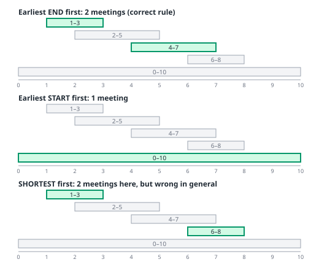
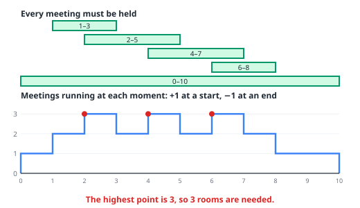
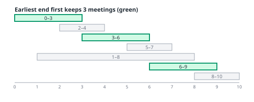

# Module: Greedy Selection and Scheduling (Sort by the Right Key, Then Sweep)

Nearly every algorithm here has the same shape: **sort by one key, then sweep once.**

## Before you start
<!-- bite: b6394871-de7a-4c0b-be1d-9773b14f8e0d -->

- You know what makes a greedy choice safe, and have seen coin change $\{1,3,4\}$ defeat the obvious rule — [[01-when-greedy-works|when greedy works]].
- You can use a [[07-heaps|heap]] as a priority queue, and know `heapq` is a **min**-heap.
- You know what an [[01-what-makes-a-problem-dp|exchange argument]] is, or are willing to meet one here.

**After this lesson you will be able to:**

1. Solve the **hire-K-workers** problem, and explain why the cheapest-looking candidates are often the wrong ones.
2. Apply the **sort-then-sweep** template, and say which sort key each classic problem needs.
3. Distinguish **"select the most"** from **"cover them all"** — two questions about the same data with opposite answers.
4. Prove a greedy correct with an **exchange argument**, rather than testing it and hoping.

**Study route:** work section 1 carefully and answer its prediction before reading on — it is the one that catches people. Sections 2 and 3 are faster once the template is visible.

---

## What greedy selection and scheduling is
<!-- bite: ae40c713-1182-4803-98e8-f00d0797e965 -->

Selection and scheduling problems ask you to pick the best group of items, or to fit in as many as you can.

Finding the key is the problem. Proving it is the other half — and the cost problem below has a key that almost nobody guesses first time.

## 1. Hire K workers: the cost problem
<!-- bite: 9066a6cc-3b01-48a9-a464-c729d99719ac -->

> You are hiring **K** people from a pool. Each candidate has a **quality** (how much work they do) and a **minimum wage** they will accept. Company policy — and in many countries, law — says people doing the same job must be paid **in proportion to their contribution**. So whatever group you hire, everyone is paid at the same *rate per unit of quality*, and nobody may be paid below their own minimum.
>
> **Which K people cost you the least in total?**

## 1. Hire K workers: why the obvious answer is wrong
<!-- bite: 653f11ae-c25a-4aca-979a-e0e9018a0cd8 -->

The obvious move is to hire the people with the lowest wages, and this example shows why that fails.

The instinct is: sort by advertised wage, take the K cheapest. Consider:

| person | quality | min wage | ratio (wage ÷ quality) |
| :--- | ---: | ---: | ---: |
| A | 10 | 70 | 7.00 |
| B | 20 | 140 | 7.00 |
| C | 5 | 60 | 12.00 |

Hiring **K = 2**, the two lowest advertised wages are A (70) and C (60) — apparently 130.

**It is not 130.** C demands 60 for only 5 quality, a rate of 12.00 per unit. If C is in the group, *everyone* is paid at 12.00. So A — who would have accepted 70 — must now be paid $12.00 \times 10 = 120$, and the real bill is $12.00 \times (10 + 5) = 180$.

> **Predict before reading on.** Given that, is A + B better or worse than A + C? A and B both have ratio 7.00, so the rate is only 7.00 — but B's quality is 20. **Work out both totals before continuing.**

## 1. Hire K workers: what each group really costs
<!-- bite: 63899a9f-cd70-4707-abe4-4e45dc1d0040 -->

Here are the three possible groups and what each one costs.

The lab enumerates all three groups:

```text
     ['A', 'B']  rate  7.00 x quality  30  =  210.00
     ['A', 'C']  rate 12.00 x quality  15  =  180.00
     ['B', 'C']  rate 12.00 x quality  25  =  300.00
```

**A + C wins at 180**, despite containing the person with the worst rate. The cheap rate of A + B is more than cancelled by B's high quality, because **you pay for quality you do not need.**

**That is the whole difficulty: the cost of a group is not the sum of its members' costs.** It is a product of two things that pull in opposite directions.

## 1. Hire K workers: the formula
<!-- bite: e2fbd81e-c3be-402e-afef-00588a7631c9 -->

The cost of a group can be written as one formula.

For a group $S$ paid at rate $r$: every member needs $r \times q_i \ge w_i$, so $r \ge w_i / q_i$ for all of them, and the cheapest legal rate is the **largest ratio in the group**:

$$\text{cost}(S) = \left(\max_{i \in S} \frac{w_i}{q_i}\right) \times \sum_{i \in S} q_i$$

**State that in words before trusting it: the bill is the group's worst rate multiplied by the group's total quality.** One person sets the price; everyone contributes to the volume.

## 1. Hire K workers: the greedy
<!-- bite: e948798f-c0df-4924-9871-3147cc1d03ab -->

The formula makes a greedy method possible.

The formula splits the problem in a way that makes a greedy possible:

1. **Sort everyone by ratio, ascending.**
2. Walk the list. The worker you are currently at has the **largest ratio seen so far**, so if they are in the group, they set the rate.
3. Given that rate, you want the $K$ **smallest qualities** among everyone seen so far — because total quality is the other factor and you are minimising it.
4. Maintain those with a **max-heap of size K**: push each quality, and when the heap exceeds $K$, pop the largest.
5. Once the heap holds exactly $K$, the candidate cost is `rate × sum_of_heap`. Keep the minimum over all positions.

## 1. Hire K workers: the greedy in code
<!-- bite: d3c4edd2-39b3-41f8-b441-5de24ac68bc5 -->

Here are those five steps as code.

```python
workers = sorted(range(n), key=lambda i: wage[i] / quality[i])
heap, qsum, best = [], 0, float("inf")
for idx in workers:
    heapq.heappush(heap, -quality[idx])      # max-heap via negation
    qsum += quality[idx]
    if len(heap) > k:
        qsum += heapq.heappop(heap)          # popped value is negative
    if len(heap) == k:
        best = min(best, (wage[idx] / quality[idx]) * qsum)
```

**Cost:** $O(n \log n)$ to sort, $O(n \log k)$ to sweep.

## 1. Hire K workers: why the greedy is correct
<!-- bite: 73cf8b5c-4c54-4be2-9536-97a1b988cf22 -->

This part shows why the greedy is right, and how often the naive rule is wrong.

**Why it is correct:** every group has *some* member with the maximum ratio. Fixing that member fixes the rate, and the only remaining freedom is which $K-1$ others to take — for which you obviously want the smallest qualities available. Iterating over every possible rate-setter therefore considers every group that could be optimal.

The lab checks it against exhaustive search on **400 random instances — 400/400 agree** — and also measures how often the naive rule fails:

```text
   Checking greedy against brute force on 400 random instances...
   agreed on 400/400

   And how often is 'take the k cheapest wages' wrong?
   wrong on 130/400 random instances
```

**Nearly a third.** Not an exotic corner case — the naive rule is simply wrong, often.

---

## 2. Interval scheduling: the sort key *is* the algorithm
<!-- bite: 1b3774c0-01aa-4208-9ca2-ac0034d5cb3a -->

> You have a list of meetings with start and end times. Fit in **as many non-overlapping meetings as possible.**

Three plausible sort keys. Only one is correct, and the lab runs all three:

```text
   meetings (start, end): [(1, 3), (2, 5), (4, 7), (6, 8), (0, 10)]
   brute force optimum: 2 meetings [(1, 3), (4, 7)]

   sort key                      | picked | meetings
   earliest END time   (correct) |      2 | [(1, 3), (4, 7)]
   earliest START time (wrong)   |      1 | [(0, 10)]   <- SUBOPTIMAL
   shortest DURATION   (wrong)   |      2 | [(1, 3), (6, 8)]
```

**Earliest start** takes the meeting running from 0 to 10 and is then blocked for the whole day.

## 2. Interval scheduling: a second test input
<!-- bite: 51b4b430-0db0-431f-b2e6-8f58f7032818 -->

A second input shows why shortest duration is also wrong.

**Shortest duration** ties here, which is exactly how a wrong rule survives casual testing — so the lab runs a second input:

```text
   meetings: [(0, 5), (4, 6), (5, 10)]   brute force optimum: 2 [(0, 5), (5, 10)]
   earliest END time   (correct) |      2 | [(0, 5), (5, 10)]
   earliest START time (wrong)   |      2 | [(0, 5), (5, 10)]
   shortest DURATION   (wrong)   |      1 | [(4, 6)]   <- SUBOPTIMAL
```

The short meeting in the middle blocks **both** long ones. **Each wrong key fails on some input and ties on others; only "earliest end" survives both.**

## 2. Interval scheduling: the exchange argument
<!-- bite: f769e839-cfa5-4992-89aa-c24eff97fc0d -->

An exchange argument proves that earliest end is the right key.

**Claim:** taking the earliest-finishing compatible meeting at each step is optimal.

**Proof sketch.** Let $g_1$ be the meeting the greedy picks first — the one that ends earliest overall. Take any optimal solution $O = \{o_1, o_2, \dots\}$, sorted by end time. By definition $g_1$ ends no later than $o_1$. So replacing $o_1$ with $g_1$ leaves every later meeting in $O$ still compatible — they all start after $o_1$ ends, which is at or after when $g_1$ ends. The modified set is still valid and **the same size**, so it is still optimal. Now recurse on what remains.

**In one sentence: finishing earliest leaves the most room for everything else, and nothing is lost by preferring it.** That is the whole intuition, and the formal version is just that sentence made careful.

Checked against brute force on **300 random inputs — 300/300**.

## Seeing the three sort keys on a timeline
<!-- bite: 36d103e5-f7d7-4151-af89-83110935e01d -->

The same five meetings, drawn three times. Green bars are the meetings each rule keeps. Earliest start grabs the long 0–10 meeting and has no room left. Shortest first happens to keep two here, which is how a wrong rule hides. Earliest end leaves the most room after each pick.



---

## 3. "Select the most" versus "cover them all"
<!-- bite: b2ff9106-e178-4b13-b27a-aee9f7c08c2f -->

> Same meetings. Now: **how many rooms do you need to hold all of them?**

This *sounds* like the same problem and is its opposite. Section 2 discards conflicting meetings; this one pays for them.

**The answer is the peak number of simultaneous meetings.** Sweep the timeline, $+1$ at every start, $-1$ at every end, and track the maximum:

```python
events = [(s, 1) for s, e in intervals] + [(e, -1) for s, e in intervals]
events.sort(key=lambda x: (x[0], x[1]))   # -1 before +1 at the same instant
cur = peak = 0
for _, delta in events:
    cur += delta
    peak = max(peak, cur)
```

## 3. Fewest rooms: why the tie order matters
<!-- bite: cebe0c63-7d63-4bf0-9db8-8c5d46e10efd -->

The order of events at the same moment changes the answer, and this part explains why.

**The `(x[0], x[1])` sort key is doing real work.** At an instant where one meeting ends and another begins, the end must be processed first — otherwise you book a second room for a meeting that could reuse the one just freed. Since $-1 < +1$, sorting by the delta as the tiebreak gets this right automatically.

```text
   fewest rooms (sweep line) : 3
   peak overlap (brute force): 3
```

Checked on **300 random inputs — 300/300**.

**Recognising which question you are being asked is the actual skill here.** "Fit in the most", "use the fewest rooms", "remove the fewest meetings to eliminate conflicts" are three different problems over one input, and only the first two are greedy in the same way. (The third is section 2 in disguise: removing the fewest is keeping the most.)

## Seeing the sweep line
<!-- bite: 954ffc2e-f2c0-4537-b8bb-c22a78e14bf6 -->

Here are the same five meetings with the sweep's running count drawn underneath. The count steps up at every start and down at every end. Its highest point is 3, so three rooms are needed.



---

## 4. The template
<!-- bite: 80ce3264-bdfc-41bf-9b56-457ef967db33 -->

| Problem | Sort / order by | Then |
| :--- | :--- | :--- |
| Hire K workers | wage/quality **ratio** | max-heap of $k$ qualities |
| Most non-overlapping meetings | **end** time | take it if it starts after the last one ended |
| Fewest rooms | time, **ends before starts** | running count, track the peak |
| [[06-minimum-spanning-tree\|Minimum spanning tree]] | edge **weight** | [[10-union-find\|union-find]] (Kruskal's) |
| [[06-minimum-spanning-tree\|MST]], other form | **cheapest edge leaving the tree** | min-heap (Prim's) |
| Coin change $\{1,3,4\}$ | — *no key works* — | [[07-dynamic-programming/index\|dynamic programming]] |

**A greedy algorithm is almost always "sort by the right key, then sweep once".** The code is short and boring. The key is the insight, and the proof is what separates a guess from an algorithm.

**And the last row is the reason [[01-when-greedy-works|lesson 01]] exists.** The template is seductive: it *always* produces an answer, quickly, and the answer is often right. When no valid key exists, you get a confident wrong number rather than a failure.

---

## 5. Worked example — complete runnable lab
<!-- bite: 6a66cd62-2358-443b-a86d-76c93c9f34cf -->

Save as `greedy_selection.py`. Standard library only. **Every greedy is checked against exhaustive search**, not merely demonstrated.

```python
"""Greedy selection and scheduling: when sorting by the right key IS the algorithm.

Run:  python3 greedy_selection.py
"""

import heapq
import itertools
import random


# ==================================================== HIRE K WORKERS
# Each worker has a quality and a minimum wage they will accept.
# Rules for any group you hire:
#   1. everyone is paid in proportion to their quality
#   2. everyone is paid at least their own minimum wage
# So if you pay rate r per unit of quality, you need r >= wage[i]/quality[i]
# for every hired worker -- meaning r is the MAXIMUM ratio in the group, and
#   total cost = (max ratio in group) x (sum of qualities in group)
# One expensive person raises the rate for everybody.

def cost_of_group(quality, wage, group):
    rate = max(wage[i] / quality[i] for i in group)
    return rate * sum(quality[i] for i in group)


def hire_brute(quality, wage, k):
    n = len(quality)
    best, best_group = float("inf"), None
    for group in itertools.combinations(range(n), k):
        c = cost_of_group(quality, wage, group)
        if c < best:
            best, best_group = c, group
    return best, best_group


def hire_greedy(quality, wage, k):
    """Sort by ratio; the current worker sets the rate, so keep the k
    cheapest-quality workers seen so far."""
    workers = sorted(range(len(quality)), key=lambda i: wage[i] / quality[i])
    heap, qsum = [], 0
    best, best_group = float("inf"), None
    for idx in workers:
        heapq.heappush(heap, -quality[idx])     # max-heap via negation
        qsum += quality[idx]
        if len(heap) > k:
            qsum += heapq.heappop(heap)         # popped value is negative
        if len(heap) == k:
            rate = wage[idx] / quality[idx]     # this worker has the largest ratio so far
            if rate * qsum < best:
                best = rate * qsum
                best_group = tuple(sorted(-q for q in heap))
    return best, best_group


def hire_naive_cheapest(quality, wage, k):
    """The obvious wrong answer: take the k lowest advertised wages."""
    order = sorted(range(len(quality)), key=lambda i: wage[i])[:k]
    return cost_of_group(quality, wage, order), tuple(sorted(order))


# ============================================== INTERVAL SCHEDULING
def max_non_overlapping(intervals, key):
    chosen, last_end = [], float("-inf")
    for s, e in sorted(intervals, key=key):
        if s >= last_end:
            chosen.append((s, e))
            last_end = e
    return chosen


def max_non_overlapping_brute(intervals):
    best = []
    for r in range(len(intervals), -1, -1):
        for combo in itertools.combinations(sorted(intervals), r):
            if all(a[1] <= b[0] for a, b in zip(combo, combo[1:])):
                return list(combo)
    return best


def min_rooms(intervals):
    """Sweep the timeline: +1 at every start, -1 at every end."""
    events = []
    for s, e in intervals:
        events.append((s, 1))
        events.append((e, -1))
    events.sort(key=lambda x: (x[0], x[1]))   # an end at time t frees the room before a start at t
    cur = peak = 0
    for _, delta in events:
        cur += delta
        peak = max(peak, cur)
    return peak


def min_rooms_brute(intervals):
    """Peak overlap, checked point by point at every start time."""
    peak = 0
    for s, _ in intervals:
        peak = max(peak, sum(1 for a, b in intervals if a <= s < b))
    return peak


def main():
    print("=" * 76)
    print("1. HIRE K WORKERS -- pay the least, and the obvious answer is wrong")
    print("=" * 76)
    quality = [10, 20, 5]
    wage = [70, 140, 60]
    names = "ABC"
    k = 2
    print("\n   person   quality   min wage   ratio (wage/quality)")
    for i, nm in enumerate(names):
        print(f"     {nm}        {quality[i]:>3}       {wage[i]:>3}       "
              f"{wage[i]/quality[i]:>5.2f}")
    print(f"\n   Hire K = {k}.")
    print("   Rule: everyone in the group is paid the SAME rate per unit of quality,")
    print("         and nobody may be paid below their own minimum. So the rate is")
    print("         the LARGEST ratio in the group, and it applies to everyone.")

    nv, ng = hire_naive_cheapest(quality, wage, k)
    print(f"\n   'Take the two cheapest advertised wages' -> {[names[i] for i in ng]}")
    print(f"     A wants 70 and C wants 60, so it looks like 130.")
    print(f"     But C's ratio is 12.00, which becomes everyone's rate:")
    print(f"     total = 12.00 x (10 + 5) = {nv:.2f}")

    bv, bg = hire_brute(quality, wage, k)
    gv, _ = hire_greedy(quality, wage, k)
    print(f"\n   every group of {k}, by brute force:")
    for group in itertools.combinations(range(3), k):
        rate = max(wage[i] / quality[i] for i in group)
        qs = sum(quality[i] for i in group)
        print(f"     {[names[i] for i in group]}  rate {rate:>5.2f} x quality {qs:>3}"
              f"  = {cost_of_group(quality, wage, group):>7.2f}")
    print(f"\n   optimal: {[names[i] for i in bg]} at {bv:.2f}")
    print(f"   greedy  : {gv:.2f}   agrees: {abs(gv - bv) < 1e-9}")

    print("\n   The greedy: sort by RATIO ascending. Walking the list, the current")
    print("   worker has the largest ratio so far, so they set the rate -- and you")
    print("   want the k SMALLEST qualities among everyone seen so far, which a")
    print("   max-heap of size k maintains in O(log k) per step.")

    print("\n   Checking greedy against brute force on 400 random instances...")
    bad = 0
    for t in range(400):
        random.seed(t)
        n = random.randint(1, 9)
        q = [random.randint(1, 20) for _ in range(n)]
        w = [random.randint(1, 60) for _ in range(n)]
        kk = random.randint(1, n)
        if abs(hire_greedy(q, w, kk)[0] - hire_brute(q, w, kk)[0]) > 1e-9:
            bad += 1
    print(f"   agreed on {400 - bad}/400")

    print("\n   And how often is 'take the k cheapest wages' wrong?")
    wrong = 0
    for t in range(400):
        random.seed(t)
        n = random.randint(2, 9)
        q = [random.randint(1, 20) for _ in range(n)]
        w = [random.randint(1, 60) for _ in range(n)]
        kk = random.randint(1, n)
        if abs(hire_naive_cheapest(q, w, kk)[0] - hire_brute(q, w, kk)[0]) > 1e-9:
            wrong += 1
    print(f"   wrong on {wrong}/400 random instances")

    print("\n" + "=" * 76)
    print("2. INTERVAL SCHEDULING -- the sort key IS the algorithm")
    print("=" * 76)
    meetings = [(1, 3), (2, 5), (4, 7), (6, 8), (0, 10)]
    print(f"\n   meetings (start, end): {meetings}")
    print("   Goal: fit in as many non-overlapping meetings as possible.")

    strategies = [
        ("earliest END time   (correct)", lambda x: x[1]),
        ("earliest START time (wrong)", lambda x: x[0]),
        ("shortest DURATION   (wrong)", lambda x: x[1] - x[0]),
    ]
    truth = max_non_overlapping_brute(meetings)
    print(f"\n   brute force optimum: {len(truth)} meetings {truth}")
    print("\n   sort key                      | picked | meetings")
    for label, key in strategies:
        got = max_non_overlapping(meetings, key)
        mark = "" if len(got) == len(truth) else "   <- SUBOPTIMAL"
        print(f"   {label:<29} | {len(got):>6} | {got}{mark}")
    print("\n   'shortest duration' happens to tie here. It does not on this one:")
    trap = [(0, 5), (4, 6), (5, 10)]
    truth2 = max_non_overlapping_brute(trap)
    print(f"   meetings: {trap}   brute force optimum: {len(truth2)} {truth2}")
    for label, key in strategies:
        got = max_non_overlapping(trap, key)
        mark = "" if len(got) == len(truth2) else "   <- SUBOPTIMAL"
        print(f"   {label:<29} | {len(got):>6} | {got}{mark}")
    print("   -> the short meeting in the middle blocks BOTH long ones. Duration")
    print("      is not the right key; only the END time is.")

    print("\n   -> sorting by end time works because finishing earliest leaves the")
    print("      most room for everything after it. That is the exchange argument:")
    print("      swap any optimal solution's first meeting for the earliest-ending")
    print("      one and it is still valid, and still the same size.")

    print("\n   Checking 'earliest end' against brute force on 300 random inputs...")
    bad = 0
    for t in range(300):
        random.seed(t + 77)
        iv = []
        for _ in range(random.randint(0, 8)):
            s = random.randint(0, 15)
            iv.append((s, s + random.randint(1, 6)))
        if len(max_non_overlapping(iv, lambda x: x[1])) != len(max_non_overlapping_brute(iv)):
            bad += 1
    print(f"   agreed on {300 - bad}/300")

    print("\n" + "=" * 76)
    print("3. A DIFFERENT QUESTION ABOUT THE SAME MEETINGS")
    print("=" * 76)
    print(f"\n   meetings: {meetings}")
    print("   'How many rooms do I need to hold ALL of them?' is not the same")
    print("   question, and it is not solved by the same greedy.")
    print(f"\n   fewest rooms (sweep line) : {min_rooms(meetings)}")
    print(f"   peak overlap (brute force): {min_rooms_brute(meetings)}")
    print("   -> the answer is the PEAK number of simultaneous meetings. Sweep the")
    print("      timeline, +1 at each start and -1 at each end, and track the max.")
    print("   -> 'select the most' and 'cover them all' are opposite problems:")
    print("      one discards conflicts, the other pays for them.")

    print("\n   Checking the sweep against brute force on 300 random inputs...")
    bad = 0
    for t in range(300):
        random.seed(t + 500)
        iv = []
        for _ in range(random.randint(1, 9)):
            s = random.randint(0, 15)
            iv.append((s, s + random.randint(1, 6)))
        if min_rooms(iv) != min_rooms_brute(iv):
            bad += 1
    print(f"   agreed on {300 - bad}/300")

    print("\n" + "=" * 76)
    print("4. THE SHAPE OF EVERY GREEDY IN THIS LESSON")
    print("=" * 76)
    print("""
   problem                  | sort / order by        | then
   -------------------------|------------------------|---------------------------
   hire k workers           | wage/quality RATIO     | max-heap of k qualities
   most non-overlapping     | END time               | take if it starts after
   fewest rooms             | time, ends before starts| running count, track peak
   minimum spanning tree    | edge weight            | union-find (Kruskal)
   coin change {1,3,4}      | -- no order works --   | use dynamic programming

   -> a greedy algorithm is almost always 'sort by the right key, then sweep'.
      Finding the key is the whole problem, and PROVING it is the other half.
   -> the proof is nearly always an EXCHANGE ARGUMENT: take any optimal
      solution, show you can swap in the greedy's first choice without making
      it worse, and induct.""")


if __name__ == "__main__":
    main()
```

## 5. Worked example: what it prints
<!-- bite: 14cf5a62-46ee-4bf5-ac9d-aec3e2567ffa -->

Here is what the lab prints when you run it.

Generated by running the file above:

```text
============================================================================
1. HIRE K WORKERS -- pay the least, and the obvious answer is wrong
============================================================================

   person   quality   min wage   ratio (wage/quality)
     A         10        70        7.00
     B         20       140        7.00
     C          5        60       12.00

   Hire K = 2.
   Rule: everyone in the group is paid the SAME rate per unit of quality,
         and nobody may be paid below their own minimum. So the rate is
         the LARGEST ratio in the group, and it applies to everyone.

   'Take the two cheapest advertised wages' -> ['A', 'C']
     A wants 70 and C wants 60, so it looks like 130.
     But C's ratio is 12.00, which becomes everyone's rate:
     total = 12.00 x (10 + 5) = 180.00

   every group of 2, by brute force:
     ['A', 'B']  rate  7.00 x quality  30  =  210.00
     ['A', 'C']  rate 12.00 x quality  15  =  180.00
     ['B', 'C']  rate 12.00 x quality  25  =  300.00

   optimal: ['A', 'C'] at 180.00
   greedy  : 180.00   agrees: True

   The greedy: sort by RATIO ascending. Walking the list, the current
   worker has the largest ratio so far, so they set the rate -- and you
   want the k SMALLEST qualities among everyone seen so far, which a
   max-heap of size k maintains in O(log k) per step.

   Checking greedy against brute force on 400 random instances...
   agreed on 400/400

   And how often is 'take the k cheapest wages' wrong?
   wrong on 130/400 random instances

============================================================================
2. INTERVAL SCHEDULING -- the sort key IS the algorithm
============================================================================

   meetings (start, end): [(1, 3), (2, 5), (4, 7), (6, 8), (0, 10)]
   Goal: fit in as many non-overlapping meetings as possible.

   brute force optimum: 2 meetings [(1, 3), (4, 7)]

   sort key                      | picked | meetings
   earliest END time   (correct) |      2 | [(1, 3), (4, 7)]
   earliest START time (wrong)   |      1 | [(0, 10)]   <- SUBOPTIMAL
   shortest DURATION   (wrong)   |      2 | [(1, 3), (6, 8)]

   'shortest duration' happens to tie here. It does not on this one:
   meetings: [(0, 5), (4, 6), (5, 10)]   brute force optimum: 2 [(0, 5), (5, 10)]
   earliest END time   (correct) |      2 | [(0, 5), (5, 10)]
   earliest START time (wrong)   |      2 | [(0, 5), (5, 10)]
   shortest DURATION   (wrong)   |      1 | [(4, 6)]   <- SUBOPTIMAL
   -> the short meeting in the middle blocks BOTH long ones. Duration
      is not the right key; only the END time is.

   -> sorting by end time works because finishing earliest leaves the
      most room for everything after it. That is the exchange argument:
      swap any optimal solution's first meeting for the earliest-ending
      one and it is still valid, and still the same size.

   Checking 'earliest end' against brute force on 300 random inputs...
   agreed on 300/300

============================================================================
3. A DIFFERENT QUESTION ABOUT THE SAME MEETINGS
============================================================================

   meetings: [(1, 3), (2, 5), (4, 7), (6, 8), (0, 10)]
   'How many rooms do I need to hold ALL of them?' is not the same
   question, and it is not solved by the same greedy.

   fewest rooms (sweep line) : 3
   peak overlap (brute force): 3
   -> the answer is the PEAK number of simultaneous meetings. Sweep the
      timeline, +1 at each start and -1 at each end, and track the max.
   -> 'select the most' and 'cover them all' are opposite problems:
      one discards conflicts, the other pays for them.

   Checking the sweep against brute force on 300 random inputs...
   agreed on 300/300

============================================================================
4. THE SHAPE OF EVERY GREEDY IN THIS LESSON
============================================================================

   problem                  | sort / order by        | then
   -------------------------|------------------------|---------------------------
   hire k workers           | wage/quality RATIO     | max-heap of k qualities
   most non-overlapping     | END time               | take if it starts after
   fewest rooms             | time, ends before starts| running count, track peak
   minimum spanning tree    | edge weight            | union-find (Kruskal)
   coin change {1,3,4}      | -- no order works --   | use dynamic programming

   -> a greedy algorithm is almost always 'sort by the right key, then sweep'.
      Finding the key is the whole problem, and PROVING it is the other half.
   -> the proof is nearly always an EXCHANGE ARGUMENT: take any optimal
      solution, show you can swap in the greedy's first choice without making
      it worse, and induct.
```

---

## 6. Common pitfalls and traps
<!-- bite: 7a143061-5c2b-4df4-bb54-38248bd2e3fc -->

1. **Assuming a group's cost is the sum of its members' costs.** In the hiring problem it is a *product*: worst rate × total quality. Any problem where one member's constraint applies to the whole group has this shape — and the naive per-member sum is wrong on ~⅓ of random instances.
2. **Sorting by the wrong key and testing on one input.** Shortest-duration ties with the correct answer on the lab's first example and fails on the second. **One passing example is not evidence.**
3. **Using a min-heap where you need a max-heap.** Python's `heapq` is a min-heap; negate to invert. In the hiring sweep you are discarding the *largest* qualities, so the heap must surrender its maximum.
4. **Processing starts before ends at the same instant.** A meeting ending at 10 and another starting at 10 need one room, not two. Sort the events so $-1$ precedes $+1$.

## 6. Common pitfalls: the wrong problem and no proof
<!-- bite: 9b9db688-9c38-4c7e-bdf1-2783caac1819 -->

These four pitfalls are about picking the right problem and proving the greedy.

5. **Confusing "select the most" with "cover them all".** Opposite problems over the same input, with different algorithms and different answers.
6. **Not proving it.** A greedy that passes your tests and has no exchange argument is a guess. If you cannot write the argument, use [[07-dynamic-programming/index|dynamic programming]] — slower and correct beats fast and wrong.
7. **Forgetting floating-point comparison on ratios.** Two candidates with equal ratios can compare unequal after division. Compare $w_i q_j$ against $w_j q_i$ to stay in integers where it matters.
8. **Assuming greedy generalises.** Hire-K is greedy; the *assignment problem* — one person per job, each pair with its own cost — looks similar and greedy is wrong for it. That one needs the Hungarian algorithm or min-cost max-flow.

---

## Check your understanding
<!-- bite: 23a0123d-4772-4eb5-963e-c63a9a9bcbe0 -->

Try each one before you open the answer.

1. <!-- q: mcq id="a8b6fb1b" -->
   You hire K workers. Everyone in a group is paid at the group's highest wage-to-quality ratio. Why is "take the K lowest advertised wages" wrong?

   - [ ] Because wages must be sorted descending
   - [x] Because cost is the group's worst rate × total quality, so a cheap but low-quality worker can raise everyone's pay
   - [ ] Because K is always 1
   - [ ] Because the heap is too small

   <details><summary>Answer</summary>

   The wage someone accepts is not what they are paid. One worker with a bad ratio sets the rate for the whole group, so the bill is not a sum of advertised wages.

   </details>

2. <!-- q: mcq id="b76a16f1" -->
   The hiring greedy sorts by ratio and keeps a max-heap of qualities of size K. What is the heap for?

   - [ ] To find the largest ratio
   - [x] To keep the K smallest qualities seen so far, evicting the largest when it overflows
   - [ ] To sort the wages
   - [ ] To count how many workers there are

   <details><summary>Answer</summary>

   The current worker fixes the rate, so the only freedom left is total quality, which you want small. A max-heap lets you drop the biggest quality in O(log K).

   </details>

3. <!-- q: mcq id="5a1fcbed" -->
   To fit the most non-overlapping meetings, which sort key does the greedy use?

   - [ ] Shortest duration first
   - [ ] Earliest start first
   - [x] Earliest end first
   - [ ] Latest start first

   <details><summary>Answer</summary>

   Earliest end leaves the most room for the rest, and it has an exchange argument. Shortest first fails on [(0,5), (4,6), (5,10)]: it picks (4,6), which blocks both others.

   </details>

4. <!-- q: mcq id="03ed6383" -->
   You must schedule every meeting and want the fewest rooms. What do you compute?

   - [ ] The earliest-end greedy count
   - [x] The peak number of meetings happening at once, with a sweep: +1 at each start, −1 at each end
   - [ ] The total length of all meetings
   - [ ] The number of meetings divided by 2

   <details><summary>Answer</summary>

   This is a different question from selecting a maximum set. At a shared instant, process the end before the start, so a room freed at 10 can be reused by a meeting starting at 10.

   </details>

5. <!-- q: open id="f5a5d048" -->
   When should you stop looking for a greedy and write a dynamic program instead?

   <details><summary>Answer</summary>

   When you cannot state the exchange argument, that is, you cannot finish "taking the greedy choice first never makes the solution worse, because…". The greedy template will still hand you a plausible wrong number, silently. Coin change with {1, 3, 4} is the standing example.

   </details>

## Check your understanding: worked problems
<!-- bite: 2d1815b7-69e8-423b-82c8-d715dee763af -->

Work each one out on paper first, then type your answer.

1. <!-- q: exact id="d09996da" answer="70" -->
   Hire K = 2 workers. Everyone in the group is paid (the group's highest wage ÷ quality) × their own quality. What is the lowest possible total cost?

   | worker | quality | min wage |
   |---|---|---|
   | A | 10 | 50 |
   | B | 4 | 24 |
   | C | 8 | 48 |
   | D | 6 | 42 |

   <details><summary>Answer</summary>

   70, with B and D. Their ratios are 6 and 7, so the rate is 7 and total quality is 10: 7 × 10 = 70. B and C (rate 6, quality 12) cost 72, and A and B cost 84.

   </details>

2. <!-- q: exact id="df3ed5be" answer="4" -->
   Using earliest-end-first, how many non-overlapping meetings can you fit? A meeting may start exactly when the previous one ends.

   (1,4), (3,5), (0,6), (5,7), (3,9), (5,9), (6,10), (8,11), (8,12), (2,14), (12,16)

   <details><summary>Answer</summary>

   4: (1,4), (5,7), (8,11), (12,16). Each time, take the meeting that ends first among those starting at or after the last chosen end.

   </details>

3. <!-- q: exact id="07bc5346" answer="3" -->
   What is the fewest number of rooms needed to hold all these meetings? A meeting ending at time t frees its room for one starting at t.

   (0,30), (5,10), (15,20), (10,25), (20,40)

   <details><summary>Answer</summary>

   3. Sweeping the times, the peak overlap is 3, for example between 15 and 20 when (0,30), (10,25) and (15,20) all run.

   </details>

4. <!-- q: sketch id="d322907a" -->
   Draw these meetings as bars on a timeline from 0 to 10, one bar per row: (0,3), (2,4), (3,6), (5,7), (1,8), (6,9), (8,10). Then run earliest-end-first and shade the meetings it keeps. A meeting may start exactly when the previous one ends.

   <details><summary>Answer</summary>

   

   What to check:
   - Sorted by end time the order is 0–3, 2–4, 3–6, 5–7, 1–8, 6–9, 8–10.
   - 0–3 is kept first; 2–4 overlaps it, so it is skipped.
   - 3–6 starts exactly when 0–3 ends, so it is kept; 5–7 and 1–8 overlap and are skipped.
   - 6–9 is kept, and 8–10 overlaps it. Three meetings in all, and no choice of four avoids an overlap.

   </details>

## 8. Practice — independent task
<!-- bite: 0629262f-b523-4b3b-8fb9-8339a87f14b3 -->

**Part 1 — hire K workers.** Implement the greedy and a brute force. Verify on 500 random instances. Then: **return the actual people hired**, not just the cost, and assert the returned group really does cost what you reported.

**Part 2 — where does the naive rule fail?** Instrument "take the K cheapest wages" and characterise the instances where it loses. Does the failure rate depend on $K$? On the spread of qualities? **Produce a plot or a table, and state the pattern in one sentence.**

## 8. Practice: the scheduling family
<!-- bite: 4a118e17-0613-412b-bdf9-a689e8c3c4d5 -->

Next, build the four scheduling problems.

**Part 3 — the scheduling family.** Implement, each verified against brute force on 300 inputs:
   1. Maximum non-overlapping meetings.
   2. Fewest rooms.
   3. Minimum meetings to *remove* so none overlap. **Predict its relationship to (1) before coding.**
   4. Maximum **weighted** non-overlapping meetings, where each has a value. **This one is not greedy** — work out why the earliest-end argument collapses, then write the DP.

## 8. Practice: proofs, and the problem that is not greedy
<!-- bite: 326584d0-66c3-425a-bc2a-c4f9abaf1230 -->

The last parts ask for written proofs and a case where greedy fails.

**Part 4 — exchange arguments in writing.** For each greedy in part 3 that *is* greedy, write the argument out properly: take an optimal solution, swap in the greedy's first choice, show it is still valid and no smaller.

**Part 5 — the one that is not greedy.** Implement the assignment problem (N people, N jobs, a cost per pair) with (a) a greedy that repeatedly takes the cheapest remaining cell and (b) brute force over all permutations. **Find the smallest instance where greedy loses**, and report by how much.

## 8. Practice: edge cases and when you are done
<!-- bite: 644d5cdc-5337-460c-a823-d290fc417d90 -->

Check these cases and this finish line before you call it done.

**Edge cases:** $K$ equal to the pool size; $K = 1$; candidates with identical ratios; zero-length meetings; meetings that touch exactly at an endpoint; an empty input.

**Done when:** parts 1 and 3 agree with brute force on every instance; part 2 states the pattern; part 4 has four written arguments; and part 5 names a concrete instance with the gap measured.

Then find them worked: [[133-meeting-rooms|Meeting Rooms]], [[134-meeting-rooms-ii|Meeting Rooms II]], [[132-non-overlapping-intervals|Non-overlapping Intervals]], [[068-task-scheduler|Task Scheduler]], [[126-hand-of-straights|Hand of Straights]].

---

## Before moving on
<!-- bite: a0495722-d5de-417c-8e26-5aa819a76179 -->

You can solve hire-K-workers and explain why the cheapest candidates are often wrong; apply sort-then-sweep and name the key each classic needs; tell "select the most" from "cover them all"; and prove a greedy with an exchange argument.

**Recap:** the greedy selection family is nearly always **sort by one key, then sweep once** — the code is short and the key is the insight. **Hire K workers** is the trap: a group's cost is not a sum but a product, $(\max \text{ratio}) \times (\sum \text{quality})$, so one bad rate is charged to everybody. Sort by ratio, let each worker in turn set the rate, and keep the $K$ smallest qualities in a max-heap — $O(n\log n)$, and verified 400/400 against brute force, while "take the K cheapest wages" is wrong on 130/400. **Interval scheduling** needs the **end** time; earliest-start and shortest-duration each fail on some input and tie on others, which is how wrong keys survive testing. The **exchange argument** is the proof: finishing earliest leaves the most room, so swapping it into any optimal solution keeps it valid and the same size. **Fewest rooms is the opposite question** — peak overlap via a sweep, with ends processed before starts at a shared instant. And when no key admits an exchange argument, stop: that is [[07-dynamic-programming/index|dynamic programming]]'s job, and greedy will return a confident wrong number instead of failing.

---

## Related
<!-- bite: 7cbc0b15-6c16-4088-b640-4e5baf942812 -->

- [[01-when-greedy-works|When Greedy Works]] — the previous lesson: the coin-change trap and the conditions
- [[07-dynamic-programming/index|Dynamic Programming]] — what to use when no greedy key exists
- [[07-heaps|Heaps]] — the max-heap-of-size-K trick, and why `heapq` needs negation
- [[06-minimum-spanning-tree|Minimum Spanning Tree]] — the same template on a graph
- [[08-overlapping-intervals|Overlapping intervals pattern]] — the recognition layer for the scheduling half
- [[07-top-k-elements|Top-K pattern]] — the heap-of-size-K idea in general
- [[06-greedy-algorithms/index|the greedy folder]]

## About this lesson
<!-- bite: 3a90c1b5-df4e-491d-9849-dc9bbaac9139 -->

**Level:** Intermediate → Advanced. **Covers:** [[01-when-greedy-works|The previous lesson]] established when a greedy algorithm is *allowed*. This one is the family that shows up most in interviews and in real systems: **choosing a subset — of people, of meetings, of jobs — to minimise a cost or maximise a count.**
