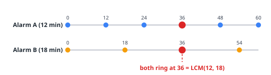
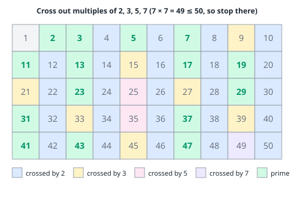
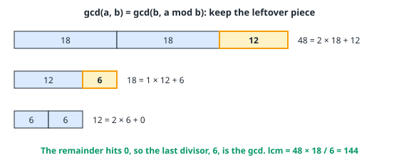

# Module: Number Theory Basics (Primes, Sieves & GCD)

Number theory is the branch of mathematics and computer science that deals with the properties of integers.

## Before you start
<!-- bite: 224feda9-9a56-4ef0-837d-a75cfcb9ddd6 -->

- You know modular arithmetic informally — [[02-discrete-math/08-number-theory-and-modular-arithmetic|discrete maths: number theory]] proves what this note uses.
- You can reason about $O(\sqrt{n})$ versus $O(n)$ — [[01-growth-and-asymptotic-notation|complexity analysis]].

**After this lesson you will be able to:**

1. Test primality in $O(\sqrt{n})$ and generate all primes below $n$ with the **sieve of Eratosthenes**.
2. Compute GCD by the Euclidean algorithm and explain why it terminates so fast.
3. Implement **modular exponentiation** by squaring, and say why the naive version is unusable.
4. Say why these appear in interviews and in cryptography for the same underlying reason.

**Study route:** read 1–5, attempt the prediction in section 4, then run the lab.

---

## What number theory is
<!-- bite: d84b41c0-e3d6-40fa-8c7d-b15957978979 -->

Number theory studies whole numbers: primes, divisors, and the factors numbers share.

Welcome to the **Number Theory Basics** module.

Understanding prime numbers, factorization, and greatest common divisors is essential for modern software engineering—powering everything from **RSA Encryption (HTTPS/SSH)** to hash table distribution and computer graphics algorithms.

## 1. Real-World Motivation & Physical Metaphors
<!-- bite: cb63ae5c-b42f-439b-a166-0b1b3f784aa1 -->

Imagine two **Alarm Clocks**:
- Alarm A rings every **12 minutes**.
- Alarm B rings every **18 minutes**.



When will both alarm clocks ring at the exact same moment for the first time?
- The answer is the **Least Common Multiple ($\text{LCM}(12, 18) = 36$ minutes)**!

## 1. Where number theory is used: cryptography
<!-- bite: 40ffc43f-8f73-4f92-a066-cfdd5420349b -->

The biggest real use of number theory is keeping the internet secure.

Modern internet security relies on the fact that multiplying two 500-digit prime numbers together is instant ($O(1)$), but breaking that 1000-digit result back into its prime factors takes thousands of years of supercomputer brute force!

---

## 2. Plain-English Terminology & Concept Table
<!-- bite: 8800f631-3d7a-424a-b0d1-2f4c926cf50c -->

| Term | Plain-English Definition | Real-World Example |
| :--- | :--- | :--- |
| **Prime Number** | An integer $> 1$ that has no positive divisors other than $1$ and itself. | $2, 3, 5, 7, 11, 13 \dots$ |
| **Composite Number** | An integer $> 1$ that has more than two divisors. | $4, 6, 8, 9, 10, 12 \dots$ |
| **GCD** | Greatest Common Divisor (largest number that divides both $a$ and $b$). | $\text{GCD}(24, 36) = 12$. |
| **LCM** | Least Common Multiple (smallest number that is a multiple of both $a$ and $b$). | $\text{LCM}(12, 18) = 36$. |
| **Sieve of Eratosthenes** | Algorithm to generate all prime numbers up to $N$ by crossing out composite multiples. | Filtering non-prime numbers out of an array. |

---

## 3. Technical Deep Dive: The Core Number Theory Algorithms
<!-- bite: a26d4507-e167-48cd-94a8-9b66a3546a99 -->

### 1. Primality Testing ($O(\sqrt{N})$ Optimization)

> [!KEY-INSIGHT]
> **The $\sqrt{N}$ Symmetric Factor Rule**:
> Every factor pair of $N$ consists of $(a, b)$ such that $a \times b = N$.
> If both $a > \sqrt{N}$ and $b > \sqrt{N}$, then $a \times b > N$ (impossible!). Therefore, **at least one factor in every pair MUST be $\le \sqrt{N}$**.
> 
> To test if $N$ is prime, you only need to test potential divisors up to $\sqrt{N}$!

## 3. Primality testing: the code
<!-- bite: 46184330-2283-48d7-81d9-e2dee7edcc89 -->

Here is the square-root test as code.

```python
def is_prime(n: int) -> bool:
    """Tests if a single integer n is prime in O(sqrt(n)) time."""
    if n <= 1:
        return False
        
    i = 2
    while i * i <= n:  # Equivalent to i <= sqrt(n)
        if n % i == 0:
            return False  # Found a factor: not prime!
        i += 1
        
    return True
```
- *Performance*: For $N = 1,000,000,000$, checking up to $N$ takes 1 billion operations. Checking up to $\sqrt{N}$ takes only **31,622 operations** (a $30,000\times$ speedup!).

---

## 3. Sieve of Eratosthenes: all primes up to $N$ in $O(N \log \log N)$
<!-- bite: aa37d459-1dbd-4a19-ae25-99ba37e7f5fe -->

The sieve finds every prime up to $N$ in one go.

Testing each number individually up to $N$ takes $N \times O(\sqrt{N}) = O(N \sqrt{N})$. The **Sieve of Eratosthenes** finds ALL primes up to $N$ in near-linear time by crossing out multiples of known primes:

```python
def sieve_of_eratosthenes(n: int) -> list:
    """Generates a boolean list where is_prime[x] is True if x is prime."""
    is_prime = [True] * (n + 1)
    is_prime[0] = is_prime[1] = False  # 0 and 1 are not prime
    
    i = 2
    while i * i <= n:
        if is_prime[i]:
            # Start crossing out multiples from i*i (smaller multiples already crossed out!)
            for k in range(i * i, n + 1, i):
                is_prime[k] = False
        i += 1
        
    return is_prime
```

---

## 3. Euclid's algorithm for GCD and LCM, $O(\log(\min(a, b)))$
<!-- bite: 08eb4d1c-4add-4438-9c40-cbd983ecabb7 -->

Euclid's algorithm finds the greatest common divisor of two numbers very quickly.

The **Euclidean Algorithm** computes the Greatest Common Divisor using the modulo identity:
$$\text{GCD}(a, b) = \text{GCD}(b, a \pmod b)$$

```python
def gcd(a: int, b: int) -> int:
    """Computes Greatest Common Divisor in O(log(min(a, b))) time."""
    while b:
        a, b = b, a % b
    return a

def lcm(a: int, b: int) -> int:
    """Computes Least Common Multiple using GCD."""
    if a == 0 or b == 0:
        return 0
    return (a * b) // gcd(a, b)
```

## Seeing the sieve
<!-- bite: 1ad17989-669c-4e11-884f-2d4ef71700bd -->

Here is the sieve run on 1 to 50. Each crossed-out number is coloured by the prime that crossed it out first. It only needs the primes 2, 3, 5 and 7, because 7 × 7 = 49 is the last square that fits. Whatever is left (green) is prime.



## Seeing Euclid's algorithm
<!-- bite: b2b449db-ed7b-41a0-8242-cb06a34dfea5 -->

Each row fits as many copies of the smaller number into the bigger one as it can. The leftover piece (orange) becomes the new smaller number. When nothing is left over, the last piece used is the gcd.



---

## 4. Time & Space Complexity Summary
<!-- bite: 71c7e366-5f0b-40c3-9dbc-53b8766a1008 -->

| Algorithm | Time Complexity | Auxiliary Space | Key Advantage |
| :--- | :--- | :--- | :--- |
| **Primality Check (`is_prime`)** | **$O(\sqrt{N})$** | $O(1)$ | Fast single-number check. |
| **Divisor Counting** | **$O(\sqrt{N})$** | $O(1)$ | Counts factor pairs simultaneously. |
| **Sieve of Eratosthenes** | **$O(N \log \log N)$** | $O(N)$ | Finds all primes up to $N$ at scale. |
| **Euclidean GCD (`gcd`)** | **$O(\log(\min(a, b)))$** | $O(1)$ | Instant GCD calculation. |

---

## Implementation — complete runnable example
<!-- bite: e8cf4d6c-743c-468f-bead-80493d572bfd -->

**Runnable example:** save as `number_theory.py` in any empty directory and run `python3 number_theory.py`. Standard library only; writes no files.

```python
"""Primes, GCD and modular exponentiation - with the costs counted."""
import math


def is_prime(n, c=None):
    """Trial division to sqrt(n). Everything above sqrt(n) has a partner below it."""
    if c is None:
        c = [0]
    if n < 2:
        return False
    if n < 4:
        return True
    if n % 2 == 0:
        return False
    i = 3
    while i * i <= n:
        c[0] += 1
        if n % i == 0:
            return False
        i += 2
    return True


def sieve(n):
    """All primes below n. Mark multiples starting at i*i, since smaller ones are done."""
    if n < 2:
        return [], 0
    flags = [True] * n
    flags[0] = flags[1] = False
    ops = 0
    for i in range(2, int(n ** 0.5) + 1):
        if flags[i]:
            for j in range(i * i, n, i):
                flags[j] = False
                ops += 1
    return [i for i, f in enumerate(flags) if f], ops


def gcd(a, b, steps=None):
    """Euclid: gcd(a,b) = gcd(b, a mod b). Terminates because the remainder shrinks."""
    if steps is not None:
        steps.append((a, b))
    while b:
        a, b = b, a % b
        if steps is not None:
            steps.append((a, b))
    return a


def lcm(a, b):
    return a * b // gcd(a, b)


def extended_gcd(a, b):
    """Returns (g, x, y) with a*x + b*y = g. The basis of modular inverses."""
    if b == 0:
        return a, 1, 0
    g, x1, y1 = extended_gcd(b, a % b)
    return g, y1, x1 - (a // b) * y1


def mod_pow_naive(base, exp, mod, c):
    result = 1
    for _ in range(exp):
        c[0] += 1
        result = (result * base) % mod
    return result


def mod_pow(base, exp, mod, c):
    """Square-and-multiply: O(log exp) multiplications instead of O(exp)."""
    result = 1
    base %= mod
    while exp > 0:
        c[0] += 1
        if exp & 1:
            result = (result * base) % mod
        base = (base * base) % mod
        exp >>= 1
    return result


def prime_factors(n):
    out = []
    d = 2
    while d * d <= n:
        while n % d == 0:
            out.append(d)
            n //= d
        d += 1 if d == 2 else 2
    if n > 1:
        out.append(n)
    return out


if __name__ == "__main__":
    print("Block 1 - primality by trial division, and why sqrt(n) suffices")
    for n in (97, 561, 7919, 104729, 104730):
        c = [0]
        print(f"  {n:7}: prime={str(is_prime(n, c)):5}  divisions tried {c[0]:4}"
              f"  sqrt(n)={math.isqrt(n)}")
    assert is_prime(7919) and not is_prime(561)
    print("  if n = a*b with a <= b, then a <= sqrt(n) - so a divisor above sqrt(n)")
    print("  always has a partner below it, and checking past sqrt(n) is wasted work")

    print()
    print("Block 2 - the sieve beats repeated trial division")
    print("        n   primes below n   sieve marks   trial-division cost")
    for n in (100, 1000, 10000, 100000):
        primes, ops = sieve(n)
        trial = 0
        for k in range(2, min(n, 3000)):
            c = [0]
            is_prime(k, c)
            trial += c[0]
        scale = "" if n <= 3000 else " (first 3,000 only)"
        print(f"  {n:7}   {len(primes):14,}   {ops:11,}   {trial:12,}{scale}")
    primes, _ = sieve(100)
    assert primes[:10] == [2, 3, 5, 7, 11, 13, 17, 19, 23, 29]
    assert len(sieve(100000)[0]) == 9592
    print("  the sieve is O(n log log n) total - each composite is crossed off once")
    print("  per distinct prime factor, which is a very small number on average")

    print()
    print("Block 3 - Euclid's algorithm, traced")
    for a, b in [(48, 18), (1071, 462), (17, 5)]:
        steps = []
        g = gcd(a, b, steps)
        chain = " -> ".join(f"({x},{y})" for x, y in steps)
        print(f"  gcd({a}, {b}) = {g}")
        print(f"    {chain}")
    assert gcd(48, 18) == 6 and gcd(17, 5) == 1
    print(f"  lcm(4, 6) = {lcm(4, 6)}, using lcm(a,b) = a*b // gcd(a,b)")
    assert lcm(4, 6) == 12
    steps = []
    gcd(fib_a := 832040, fib_b := 514229, steps)
    print(f"  worst case is consecutive Fibonacci numbers: gcd({fib_a}, {fib_b})")
    print(f"    took {len(steps)-1} steps for numbers around 10^6")
    print("  each step at least halves the larger argument, so it is O(log min(a,b))")

    print()
    print("Block 4 - modular exponentiation: why squaring is not optional")
    print("      exponent   naive multiplications   square-and-multiply   ratio")
    for e in (10, 1000, 10 ** 6):
        cn, cs = [0], [0]
        if e <= 10 ** 6:
            mod_pow_naive(7, e, 1000000007, cn)
        mod_pow(7, e, 1000000007, cs)
        print(f"   {e:11,}   {cn[0]:21,}   {cs[0]:19}   {cn[0]//max(cs[0],1):6,}x")
    c1, c2 = [0], [0]
    assert mod_pow_naive(7, 1000, 1000000007, c1) == mod_pow(7, 1000, 1000000007, c2)
    assert c2[0] < 15
    big_e = 2 ** 256
    c = [0]
    mod_pow(7, big_e, 1000000007, c)
    print(f"  exponent 2^256 takes {c[0]} multiplications - the naive loop would")
    print("  take 2^256 of them, which is more steps than there are atoms on Earth.")
    print("  This is exactly why RSA and Diffie-Hellman are computable at all.")

    print()
    print("Block 5 - extended Euclid gives modular inverses")
    for a, m in [(3, 11), (10, 17), (7, 26)]:
        g, x, _ = extended_gcd(a, m)
        inv = x % m
        print(f"  inverse of {a} mod {m}: {inv}   check: {a} * {inv} mod {m} = {(a*inv) % m}")
        assert g == 1 and (a * inv) % m == 1
    g, _, _ = extended_gcd(4, 8)
    print(f"  4 has no inverse mod 8, because gcd(4,8) = {g} != 1")
    assert g != 1
    print("  an inverse exists exactly when gcd(a, m) = 1 - which is why RSA needs")
    print("  its exponent coprime to (p-1)(q-1)")

    print()
    print("  and factorisation, the hard direction:")
    for n in (60, 97, 1001, 1000003):
        print(f"    {n:8} = {' x '.join(map(str, prime_factors(n)))}")
    assert prime_factors(60) == [2, 2, 3, 5]
    print("  multiplying primes is fast; recovering them is not. That asymmetry")
    print("  is the entire basis of RSA.")

    print()
    print("number_theory: passed")
```

## Implementation: what it prints
<!-- bite: fb84138d-c99b-4335-8a2b-a51c20c2fbc7 -->

Here is what the lab prints when you run it.

Expected output:

```text
Block 1 - primality by trial division, and why sqrt(n) suffices
       97: prime=True   divisions tried    4  sqrt(n)=9
      561: prime=False  divisions tried    1  sqrt(n)=23
     7919: prime=True   divisions tried   43  sqrt(n)=88
   104729: prime=True   divisions tried  161  sqrt(n)=323
   104730: prime=False  divisions tried    0  sqrt(n)=323
  if n = a*b with a <= b, then a <= sqrt(n) - so a divisor above sqrt(n)
  always has a partner below it, and checking past sqrt(n) is wasted work

Block 2 - the sieve beats repeated trial division
        n   primes below n   sieve marks   trial-division cost
      100               25           102             87
     1000              168         1,409          2,351
    10000            1,229        16,979         10,687 (first 3,000 only)
   100000            9,592       193,076         10,687 (first 3,000 only)
  the sieve is O(n log log n) total - each composite is crossed off once
  per distinct prime factor, which is a very small number on average

Block 3 - Euclid's algorithm, traced
  gcd(48, 18) = 6
    (48,18) -> (18,12) -> (12,6) -> (6,0)
  gcd(1071, 462) = 21
    (1071,462) -> (462,147) -> (147,21) -> (21,0)
  gcd(17, 5) = 1
    (17,5) -> (5,2) -> (2,1) -> (1,0)
  lcm(4, 6) = 12, using lcm(a,b) = a*b // gcd(a,b)
  worst case is consecutive Fibonacci numbers: gcd(832040, 514229)
    took 28 steps for numbers around 10^6
  each step at least halves the larger argument, so it is O(log min(a,b))

Block 4 - modular exponentiation: why squaring is not optional
      exponent   naive multiplications   square-and-multiply   ratio
            10                      10                     4        2x
         1,000                   1,000                    10      100x
     1,000,000               1,000,000                    20   50,000x
  exponent 2^256 takes 257 multiplications - the naive loop would
  take 2^256 of them, which is more steps than there are atoms on Earth.
  This is exactly why RSA and Diffie-Hellman are computable at all.

Block 5 - extended Euclid gives modular inverses
  inverse of 3 mod 11: 4   check: 3 * 4 mod 11 = 1
  inverse of 10 mod 17: 12   check: 10 * 12 mod 17 = 1
  inverse of 7 mod 26: 15   check: 7 * 15 mod 26 = 1
  4 has no inverse mod 8, because gcd(4,8) = 4 != 1
  an inverse exists exactly when gcd(a, m) = 1 - which is why RSA needs
  its exponent coprime to (p-1)(q-1)

  and factorisation, the hard direction:
          60 = 2 x 2 x 3 x 5
          97 = 97
        1001 = 7 x 11 x 13
     1000003 = 1000003
  multiplying primes is fast; recovering them is not. That asymmetry
  is the entire basis of RSA.

number_theory: passed
```

Block 4 is the practical point: modular exponentiation by squaring turns an impossible computation into $O(\log e)$ multiplications, which is why public-key cryptography exists.

## 5. Common Pitfalls & Traps
<!-- bite: 5efa8c60-82a4-45b3-8dd0-3c1a9fea96ef -->

1. **0 and 1 are NOT Prime**: The numbers 0 and 1 are neither prime nor composite. Always handle $N \le 1$ explicitly as `False`.
2. **Integer Overflow in LCM**: In languages like C++ or Java, computing `(a * b) / gcd(a, b)` can overflow 32-bit integers if $a \times b$ is large.
   - *Fix*: Divide first! Write `(a // gcd(a, b)) * b`.
3. **Starting Sieve Multiples at $2i$ instead of $i^2$**: Multiples of $i$ smaller than $i^2$ (like $2i, 3i$) have already been crossed out by smaller primes. Always start crossing out from $i^2$.

---

## Check your understanding
<!-- bite: 498580bb-234a-408d-92f3-e30f21fa4c31 -->

Try each one before you open the answer.

1. <!-- q: mcq id="58fc7e5e" -->
   Why does a primality test only need to try divisors up to √N?

   - [ ] Because primes are always smaller than √N
   - [x] Factors come in pairs a × b = N, and both cannot be above √N, so one of them is at most √N
   - [ ] Because even numbers are skipped
   - [ ] Because √N is always a whole number

   <details><summary>Answer</summary>

   If a and b were both greater than √N, their product would be greater than N. So if N has any factor pair, the smaller one shows up by √N.

   </details>

2. <!-- q: mcq id="1be67fe5" -->
   Which formula gives the least common multiple of a and b?

   - [x] LCM(a, b) = (a × b) ÷ GCD(a, b)
   - [ ] LCM(a, b) = (a + b) ÷ GCD(a, b)
   - [ ] LCM(a, b) = GCD(a, b) ÷ (a × b)
   - [ ] LCM(a, b) = a × b × GCD(a, b)

   <details><summary>Answer</summary>

   (a × b) ÷ GCD(a, b). In code, divide first, `a // gcd(a, b) * b`, to keep the intermediate number small.

   </details>

3. <!-- q: mcq id="1c6239b9" -->
   What is the time complexity of the Euclidean algorithm for GCD(a, b)?

   - [ ] O(min(a, b))
   - [x] O(log(min(a, b)))
   - [ ] O(√a)
   - [ ] O(a × b)

   <details><summary>Answer</summary>

   Each pair of modulo steps at least halves the smaller number, so the number of steps grows with the number of digits, not the value.

   </details>

4. <!-- q: mcq id="ffc709dc" -->
   The Sieve of Eratosthenes starts crossing out multiples of i at i × i, not at 2 × i. Why is that safe?

   - [x] Every smaller multiple k × i with k < i has a smaller prime factor and was already crossed out
   - [ ] Multiples below i × i are all prime
   - [ ] It is not safe; it misses some composites
   - [ ] Because i × i is always even

   <details><summary>Answer</summary>

   A multiple like 3 × 5 = 15 was already removed when the sieve handled 3. Starting at i² skips work without missing anything.

   </details>

5. <!-- q: open id="bbf9fdd9" -->
   You need all primes up to 10⁶. Why use a sieve instead of testing each number with the √N method?

   <details><summary>Answer</summary>

   Testing each number costs about N × √N steps in total. The sieve crosses out multiples once per prime and runs in O(N log log N), which is nearly linear. It trades O(N) memory for that speed.

   </details>

## Check your understanding: worked problems
<!-- bite: 45e650d0-5f33-4a1e-8e59-57bc811c14d0 -->

Work each one out on paper first, then type your answer.

1. <!-- q: gap id="0d4efd30" answers="54;36;18;18" -->
   Fill in the gaps. Euclid's algorithm on GCD(252, 198) using `a, b = b, a % b`: the pairs are (252, 198), (198, ___), (54, ___), (36, ___), and the GCD is ___.

   <details><summary>Answer</summary>

   252 mod 198 = 54, 198 mod 54 = 36, 54 mod 36 = 18, 36 mod 18 = 0. The GCD is 18.

   </details>

2. <!-- q: exact id="500b06a4" answer="42" -->
   What is LCM(21, 6)?

   <details><summary>Answer</summary>

   42. GCD(21, 6) = 3, so LCM = 21 × 6 / 3 = 126 / 3 = 42.

   </details>

3. <!-- q: exact id="eac5a85b" answer="12" -->
   The test `i = 2; while i * i <= n: if n % i == 0: return False; i += 1` runs on n = 221. How many values of i does it try before it returns?

   <details><summary>Answer</summary>

   12. It tries i = 2 up to 13, and 221 = 13 × 17, so it stops at 13. That is 12 trial divisions.

   </details>

4. <!-- q: exact id="9837de10" answer="15" -->
   The sieve finds all primes up to 50. How many are there?

   <details><summary>Answer</summary>

   15: 2, 3, 5, 7, 11, 13, 17, 19, 23, 29, 31, 37, 41, 43, 47. The sieve only needs to cross out multiples of 2, 3, 5 and 7, because 7² = 49 ≤ 50 < 64.

   </details>

## Practice — independent task
<!-- bite: 0180d86f-5348-49c8-83de-168717f4595c -->

Implement `miller_rabin(n, k)` — a probabilistic primality test that works on numbers trial division cannot touch.

1. Write $n - 1 = d \cdot 2^r$ with $d$ odd. For each of $k$ random bases $a$, check whether $a^d \equiv 1$ or $a^{d \cdot 2^i} \equiv -1 \pmod n$ for some $i < r$. If neither, $n$ is composite.
2. Use your `mod_pow` — the naive version is unusable here, which is the point.
3. Verify against your $O(\sqrt{n})$ test for every $n$ below $100{,}000$. They must agree exactly.

## Practice: Carmichael numbers and timing
<!-- bite: 587d949e-f2bc-4320-959f-02cca8aa2937 -->

The last two steps show where the simpler test fails and how fast the new one is.

4. **Find a Carmichael number** — a composite that passes the simpler Fermat test for many bases. $561$ is the smallest. Show Fermat's test accepting it and Miller–Rabin rejecting it, and explain the structural difference.
5. Then measure: time both tests on a 40-digit prime. Report how long trial division would take by extrapolating from a smaller case rather than actually running it — and say what that extrapolation is worth.

**Edge cases:** $n < 4$; even $n$; $n$ a perfect square; a base $a$ that shares a factor with $n$.

**Done when:** the two tests agree below $100{,}000$, your Carmichael demonstration works, and your extrapolation is honest about its assumptions.

## Before moving on
<!-- bite: 0bfaaec7-ac64-469a-bd54-05ca79029fe6 -->

You can test primality, sieve, compute GCDs, and do modular exponentiation efficiently.

**Recap:** trial division to $\sqrt{n}$ suffices because divisors pair up; the sieve of Eratosthenes is $O(n\log\log n)$ and marks from $i^2$; Euclid's $\gcd(a,b) = \gcd(b, a \bmod b)$ is $O(\log\min(a,b))$, worst case on consecutive Fibonacci numbers; $\text{lcm}(a,b) = ab/\gcd(a,b)$; modular exponentiation by squaring is $O(\log e)$; a modular inverse exists exactly when $\gcd(a,m) = 1$, found by extended Euclid.

**Next:** [[09-leader-algorithm|Leader Algorithm]] — finding the value that appears in more than half of an array, in one pass and almost no memory.

## Related Modules
<!-- bite: f61843cd-99b8-485a-85bd-229a751a997b -->
- [[01-growth-and-asymptotic-notation|Algorithms & Complexity Analysis]] — Asymptotic growth bounds
- [[01-linear-and-binary-search|Searching Algorithms]] — Binary Search applications
